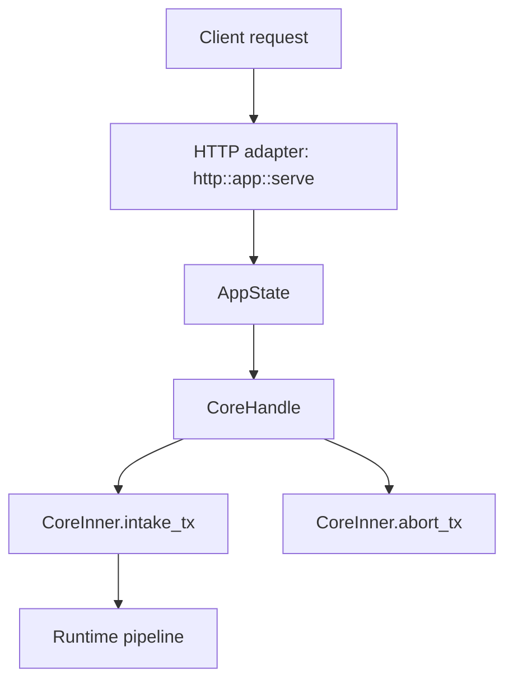
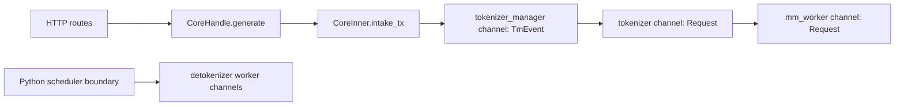
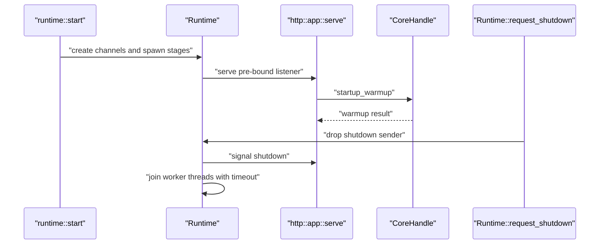

<!-- source: DeepWiki mcp.deepwiki.com · repo sgl-project/sglang · page 21.1 Gateway Architecture and Worker Management · fetched 2026-10-30 -->

# Gateway Architecture and Worker Management

Relevant source files

The following files were used as context for generating this wiki page:

- [proto/sglang/api/v1/sampling.proto](proto/sglang/api/v1/sampling.proto)
- [python/sglang/srt/managers/disagg_service.py](python/sglang/srt/managers/disagg_service.py)
- [python/sglang/srt/rust_server/config.py](python/sglang/srt/rust_server/config.py)
- [python/sglang/srt/rust_server/server.py](python/sglang/srt/rust_server/server.py)
- [rust/sglang-server/src/api_server/core/handle.rs](rust/sglang-server/src/api_server/core/handle.rs)
- [rust/sglang-server/src/api_server/core/prefetch.rs](rust/sglang-server/src/api_server/core/prefetch.rs)
- [rust/sglang-server/src/api_server/http.rs](rust/sglang-server/src/api_server/http.rs)
- [rust/sglang-server/src/api_server/http/app.rs](rust/sglang-server/src/api_server/http/app.rs)
- [rust/sglang-server/src/api_server/http/info.rs](rust/sglang-server/src/api_server/http/info.rs)
- [rust/sglang-server/src/api_server/http/loads.rs](rust/sglang-server/src/api_server/http/loads.rs)
- [rust/sglang-server/src/api_server/http/metrics.rs](rust/sglang-server/src/api_server/http/metrics.rs)
- [rust/sglang-server/src/api_server/http/native_api.rs](rust/sglang-server/src/api_server/http/native_api.rs)
- [rust/sglang-server/src/api_server/http/openai.rs](rust/sglang-server/src/api_server/http/openai.rs)
- [rust/sglang-server/src/api_server/http/openai/chat.rs](rust/sglang-server/src/api_server/http/openai/chat.rs)
- [rust/sglang-server/src/api_server/http/openai/completions.rs](rust/sglang-server/src/api_server/http/openai/completions.rs)
- [rust/sglang-server/src/api_server/http/openai/template.rs](rust/sglang-server/src/api_server/http/openai/template.rs)
- [rust/sglang-server/src/api_server/http/openai/test_utils.rs](rust/sglang-server/src/api_server/http/openai/test_utils.rs)
- [rust/sglang-server/src/api_server/http/openai/tokenize.rs](rust/sglang-server/src/api_server/http/openai/tokenize.rs)
- [rust/sglang-server/src/api_server/http/openai/tools.rs](rust/sglang-server/src/api_server/http/openai/tools.rs)
- [rust/sglang-server/src/lib.rs](rust/sglang-server/src/lib.rs)
- [rust/sglang-server/src/message.rs](rust/sglang-server/src/message.rs)
- [rust/sglang-server/src/message/config.rs](rust/sglang-server/src/message/config.rs)
- [rust/sglang-server/src/message/detok.rs](rust/sglang-server/src/message/detok.rs)
- [rust/sglang-server/src/message/finish_reason.rs](rust/sglang-server/src/message/finish_reason.rs)
- [rust/sglang-server/src/message/multimodal.rs](rust/sglang-server/src/message/multimodal.rs)
- [rust/sglang-server/src/message/types.rs](rust/sglang-server/src/message/types.rs)
- [rust/sglang-server/src/message/wire.rs](rust/sglang-server/src/message/wire.rs)
- [rust/sglang-server/src/multi_modality/payload.rs](rust/sglang-server/src/multi_modality/payload.rs)
- [rust/sglang-server/src/multi_modality/worker.rs](rust/sglang-server/src/multi_modality/worker.rs)
- [rust/sglang-server/src/tokenizer_manager.rs](rust/sglang-server/src/tokenizer_manager.rs)
- [rust/sglang-server/src/tokenizer_manager/detokenizer.rs](rust/sglang-server/src/tokenizer_manager/detokenizer.rs)
- [rust/sglang-server/src/tokenizer_manager/to_scheduler.rs](rust/sglang-server/src/tokenizer_manager/to_scheduler.rs)
- [rust/sglang-server/src/tokenizer_manager/to_scheduler_tests.rs](rust/sglang-server/src/tokenizer_manager/to_scheduler_tests.rs)
- [rust/sglang-server/src/tokenizer_manager/to_scheduler_validation.rs](rust/sglang-server/src/tokenizer_manager/to_scheduler_validation.rs)
- [rust/sglang-server/src/tokenizer_manager/tokenizer.rs](rust/sglang-server/src/tokenizer_manager/tokenizer.rs)
- [rust/sglang-server/src/tokenizer_manager/wiring.rs](rust/sglang-server/src/tokenizer_manager/wiring.rs)
- [rust/sglang-server/src/utils/runtime.rs](rust/sglang-server/src/utils/runtime.rs)
- [test/registered/unit/entrypoints/test_rust_server_dp_ports.py](test/registered/unit/entrypoints/test_rust_server_dp_ports.py)
- [test/registered/unit/multimodal/rust/shared/test_rust_server_extension.py](test/registered/unit/multimodal/rust/shared/test_rust_server_extension.py)

## Purpose and Scope

This page covers the gateway-related architecture that can be verified from the supplied source: the Rust HTTP/gRPC frontend, its shared request-submission handle, runtime stages, bounded channels, and the PD bootstrap route. The provided files do **not** contain the `sgl-model-gateway` implementation or its worker registry, job queue, circuit breakers, or service-discovery code. Those gateway mechanisms therefore cannot be documented here as codebase facts. [rust/sglang-server/src/lib.rs:1-12](), [rust/sglang-server/src/api_server/core/handle.rs:103-144](), [rust/sglang-server/src/api_server/http/app.rs:136-145]()

Sources: [rust/sglang-server/src/lib.rs:1-12](), [rust/sglang-server/src/api_server/core/handle.rs:103-144](), [rust/sglang-server/src/api_server/http/app.rs:136-145]()

## Gateway Control Plane and Request Pipeline

In the supplied implementation, the closest equivalent to a request control plane is the Rust server’s transport-neutral `CoreHandle`. HTTP and gRPC adapters share this entry into the runtime pipeline; handlers translate semantic core events into protocol responses. The HTTP adapter mounts routes through `http::app::serve`, while `AppState` retains a `CoreHandle` and the HTTP-specific configuration and formatter. [rust/sglang-server/src/api_server/http/app.rs:27-36](), [rust/sglang-server/src/api_server/http/app.rs:64-96](), [rust/sglang-server/src/api_server/core/handle.rs:103-144]()

`CoreHandle::new` receives an intake sender and abort sender and stores them in shared `CoreInner` state. `CoreHandle::generate` registers a generation, checks cancellation while preparing it, then submits it through the core pipeline. This is request admission and runtime submission, not evidence of a gateway-level worker-selection registry. [rust/sglang-server/src/api_server/core/handle.rs:124-144](), [rust/sglang-server/src/api_server/core/handle.rs:171-180]()

### Control-Plane Components: Natural Language to Code Entities

The diagram maps request-facing concepts to the code entities visible in the supplied files. It does not imply that `CoreHandle` selects among gateway workers. [rust/sglang-server/src/api_server/http/app.rs:27-36](), [rust/sglang-server/src/api_server/http/app.rs:64-96](), [rust/sglang-server/src/api_server/core/handle.rs:103-144](), [rust/sglang-server/src/api_server/core/handle.rs:171-180]()

Sources: [rust/sglang-server/src/api_server/http/app.rs:27-36](), [rust/sglang-server/src/api_server/http/app.rs:64-96](), [rust/sglang-server/src/api_server/core/handle.rs:103-144](), [rust/sglang-server/src/api_server/core/handle.rs:171-180]()

## Worker Registry and Runtime Stages

The visible runtime is a staged frontend pipeline, not a gateway worker registry. `runtime::start` creates bounded Rust↔Python channels and bounded inter-stage channels for `TmEvent`, requests, and multimodal work. It also creates per-worker detokenizer channels. The channel capacities are configurable through `to_scheduler_cap`, `from_scheduler_cap`, and `stage_channel_cap`. [rust/sglang-server/src/message/config.rs:31-46](), [rust/sglang-server/src/utils/runtime.rs:131-158]()

The runtime documentation describes separate API transport, tokenizer, detokenizer, scheduler-facing, and optional multimodal worker threads. CPU-bound tokenization and detokenization are kept off the async API executor. `Runtime` retains thread handles and a shutdown sender; `request_shutdown` signals shutdown and joins workers with a bounded wait. [rust/sglang-server/src/utils/runtime.rs:1-16](), [rust/sglang-server/src/utils/runtime.rs:42-53](), [rust/sglang-server/src/utils/runtime.rs:109-120]()

| Runtime role | Code entity or mechanism | What the supplied files establish |
|---|---|---|
| API transports | `api_server` | Axum/Tokio frontend with HTTP adapters and shared `AppState`. [rust/sglang-server/src/api_server/http/app.rs:27-36]() |
| Runtime handle | `Runtime` | Holds scheduler-facing channels, multimodal wiring, worker joins, and shutdown state. [rust/sglang-server/src/utils/runtime.rs:42-53]() |
| Tokenizer and detokenizer | Runtime worker pools | CPU-bound work runs on pinned OS threads rather than API executor threads. [rust/sglang-server/src/utils/runtime.rs:1-16]() |
| Multimodal workers | `start_mm_workers`, `spawn_mm_pool` | Optional pool is started late and connected to the runtime’s multimodal channels. [rust/sglang-server/src/utils/runtime.rs:69-107]() |
| Gateway workers | Not present in supplied files | No gateway worker registry or worker lifecycle manager is shown. |

Sources: [rust/sglang-server/src/utils/runtime.rs:1-16](), [rust/sglang-server/src/utils/runtime.rs:42-53](), [rust/sglang-server/src/utils/runtime.rs:69-120](), [rust/sglang-server/src/message/config.rs:31-46]()

### Request and Worker-Stage Flow: Natural Language to Code Entities

The diagram names only entities and channel roles supported by the shown source. The runtime creates the tokenizer, multimodal, and detokenizer channels; the provided excerpts do not show every channel-to-channel transition as a complete execution sequence. [rust/sglang-server/src/api_server/core/handle.rs:171-180](), [rust/sglang-server/src/utils/runtime.rs:42-48](), [rust/sglang-server/src/utils/runtime.rs:131-158]()

Sources: [rust/sglang-server/src/api_server/core/handle.rs:171-180](), [rust/sglang-server/src/utils/runtime.rs:42-48](), [rust/sglang-server/src/utils/runtime.rs:131-158]()

## Job Queue and Backpressure

The supplied runtime uses bounded `flume` channels between stages. For example, `tok_manager_tx`, `tokenizer_tx`, and `mm_worker_tx` are created with `stage_channel_cap`; the source comments explicitly describe bounded multimodal dispatch as applying backpressure instead of accumulating unbounded buffered work. This is evidence of bounded stage queues, not a gateway job queue, priority queue, or scheduling policy. [rust/sglang-server/src/utils/runtime.rs:151-158]()

The `CoreHandle` submits generation work through an intake channel and has a separate abort channel. The supplied excerpt does not specify queue ordering, worker assignment policy, job retry behavior, or queue persistence. [rust/sglang-server/src/api_server/core/handle.rs:107-111](), [rust/sglang-server/src/api_server/core/handle.rs:171-180]()

Sources: [rust/sglang-server/src/utils/runtime.rs:151-158](), [rust/sglang-server/src/api_server/core/handle.rs:107-111](), [rust/sglang-server/src/api_server/core/handle.rs:171-180]()

## Circuit Breakers and Health

No gateway circuit-breaker implementation is present in the supplied files. The shown server has a shared readiness flag in `CoreHandle`: `is_ready` reads it, and `mark_ready` sets it after startup warmup. The HTTP server starts warmup, marks the core ready after success, and logs warmup failures or timeouts. This readiness behavior is distinct from a per-worker circuit breaker; the supplied source does not establish breaker thresholds, cooldowns, or worker health transitions. [rust/sglang-server/src/api_server/core/handle.rs:152-160](), [rust/sglang-server/src/api_server/http/app.rs:39-61]()

Sources: [rust/sglang-server/src/api_server/core/handle.rs:152-160](), [rust/sglang-server/src/api_server/http/app.rs:39-61]()

## Service Discovery and PD Bootstrap

The HTTP app conditionally mounts a PD bootstrap registry when `server_args.enable_pd_bootstrap()` is true. The registry routes and a sweeper are created by `pd_bootstrap::router_and_sweeper`; the sweeper runs as a Tokio task. The source describes this as a prefill-only KV bootstrap registry. It is not evidence of general worker discovery, Kubernetes EndpointSlice watching, or worker-registry reconciliation. [rust/sglang-server/src/api_server/http/app.rs:140-145]()

The app merges HTTP route groups for information, loads, native API, and OpenAI-compatible endpoints; metrics routes are conditional on configuration and listener role. A supplied `HttpLayer` can wrap the app before it is served. [rust/sglang-server/src/api_server/http/app.rs:100-135](), [rust/sglang-server/src/lib.rs:158-161]()

Sources: [rust/sglang-server/src/api_server/http/app.rs:100-145](), [rust/sglang-server/src/lib.rs:158-161]()

## Startup, Serving, and Shutdown

`runtime::start` plans CPU cores, creates channel pairs, and starts the runtime stages. The API app serves a pre-bound listener; on shutdown, it stops accepting requests and aborts in-flight handlers with the API runtime. `Runtime::request_shutdown` drops the shared shutdown sender and joins registered worker threads, subject to a five-second join timeout. [rust/sglang-server/src/utils/runtime.rs:55-57](), [rust/sglang-server/src/utils/runtime.rs:109-120](), [rust/sglang-server/src/utils/runtime.rs:131-158](), [rust/sglang-server/src/api_server/http/app.rs:64-79](), [rust/sglang-server/src/api_server/http/app.rs:150-164]()

The sequence summarizes startup, warmup, and shutdown behavior shown in the runtime and HTTP app. [rust/sglang-server/src/utils/runtime.rs:55-57](), [rust/sglang-server/src/utils/runtime.rs:109-120](), [rust/sglang-server/src/utils/runtime.rs:131-158](), [rust/sglang-server/src/api_server/http/app.rs:64-79](), [rust/sglang-server/src/api_server/http/app.rs:150-164]()

Sources: [rust/sglang-server/src/utils/runtime.rs:55-57](), [rust/sglang-server/src/utils/runtime.rs:109-120](), [rust/sglang-server/src/utils/runtime.rs:131-158](), [rust/sglang-server/src/api_server/http/app.rs:64-79](), [rust/sglang-server/src/api_server/http/app.rs:150-164]()

## Gateway-Specific Coverage Boundary

The page’s original gateway-specific topics—`WorkerRegistry`, gateway job queue, per-worker circuit breakers, and service discovery—cannot be verified from the supplied file contents. The available Rust server files describe an embedded serving frontend and its internal runtime pipeline. They do not provide definitions or call sites for the gateway components named in those topics. [rust/sglang-server/src/lib.rs:1-12](), [rust/sglang-server/src/utils/runtime.rs:1-16](), [rust/sglang-server/src/api_server/core/handle.rs:103-111]()

| Requested gateway topic | Evidence available in supplied files |
|---|---|
| Gateway control plane | The server-side `CoreHandle` and API adapters are shown; a model-gateway control plane is not. [rust/sglang-server/src/api_server/core/handle.rs:103-144]() |
| Worker registry | Not shown. The visible worker pools are internal tokenizer, detokenizer, and multimodal stages. [rust/sglang-server/src/utils/runtime.rs:1-16]() |
| Job queue | Bounded internal stage channels are shown; gateway job scheduling semantics are not. [rust/sglang-server/src/utils/runtime.rs:151-158]() |
| Circuit breakers | Not shown. Core startup readiness is shown, but it is not a per-worker breaker. [rust/sglang-server/src/api_server/core/handle.rs:152-160]() |
| Service discovery | PD bootstrap registry mounting is shown; general backend-worker discovery is not. [rust/sglang-server/src/api_server/http/app.rs:140-145]() |

Sources: [rust/sglang-server/src/lib.rs:1-12](), [rust/sglang-server/src/utils/runtime.rs:1-16](), [rust/sglang-server/src/utils/runtime.rs:151-158](), [rust/sglang-server/src/api_server/core/handle.rs:103-144](), [rust/sglang-server/src/api_server/http/app.rs:140-145]()

---

