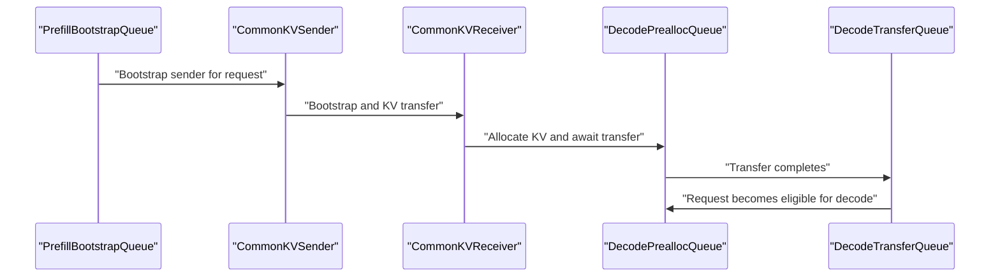

<!-- source: DeepWiki mcp.deepwiki.com · repo sgl-project/sglang · page 21.2 Routing Policies and Load Balancing · fetched 2026-10-30 -->

# Routing Policies and Load Balancing

Relevant source files

The following files were used as context for generating this wiki page:

- [docs/docs/advanced_features/radix_eviction_policy.mdx](docs/docs/advanced_features/radix_eviction_policy.mdx)
- [proto/sglang/api/v1/sampling.proto](proto/sglang/api/v1/sampling.proto)
- [python/sglang/srt/disaggregation/kv_events.py](python/sglang/srt/disaggregation/kv_events.py)
- [python/sglang/srt/managers/disagg_service.py](python/sglang/srt/managers/disagg_service.py)
- [python/sglang/srt/managers/scheduler_components/kv_events_publisher.py](python/sglang/srt/managers/scheduler_components/kv_events_publisher.py)
- [python/sglang/srt/mem_cache/events.py](python/sglang/srt/mem_cache/events.py)
- [python/sglang/srt/mem_cache/evict_policy.py](python/sglang/srt/mem_cache/evict_policy.py)
- [python/sglang/srt/mem_cache/radix_cache.py](python/sglang/srt/mem_cache/radix_cache.py)
- [python/sglang/srt/mem_cache/utils.py](python/sglang/srt/mem_cache/utils.py)
- [python/sglang/srt/rust_server/config.py](python/sglang/srt/rust_server/config.py)
- [python/sglang/srt/rust_server/server.py](python/sglang/srt/rust_server/server.py)
- [rust/sglang-server/src/api_server/core/handle.rs](rust/sglang-server/src/api_server/core/handle.rs)
- [rust/sglang-server/src/api_server/core/prefetch.rs](rust/sglang-server/src/api_server/core/prefetch.rs)
- [rust/sglang-server/src/api_server/http.rs](rust/sglang-server/src/api_server/http.rs)
- [rust/sglang-server/src/api_server/http/app.rs](rust/sglang-server/src/api_server/http/app.rs)
- [rust/sglang-server/src/api_server/http/info.rs](rust/sglang-server/src/api_server/http/info.rs)
- [rust/sglang-server/src/api_server/http/loads.rs](rust/sglang-server/src/api_server/http/loads.rs)
- [rust/sglang-server/src/api_server/http/metrics.rs](rust/sglang-server/src/api_server/http/metrics.rs)
- [rust/sglang-server/src/api_server/http/native_api.rs](rust/sglang-server/src/api_server/http/native_api.rs)
- [rust/sglang-server/src/api_server/http/openai.rs](rust/sglang-server/src/api_server/http/openai.rs)
- [rust/sglang-server/src/api_server/http/openai/chat.rs](rust/sglang-server/src/api_server/http/openai/chat.rs)
- [rust/sglang-server/src/api_server/http/openai/completions.rs](rust/sglang-server/src/api_server/http/openai/completions.rs)
- [rust/sglang-server/src/api_server/http/openai/template.rs](rust/sglang-server/src/api_server/http/openai/template.rs)
- [rust/sglang-server/src/api_server/http/openai/test_utils.rs](rust/sglang-server/src/api_server/http/openai/test_utils.rs)
- [rust/sglang-server/src/api_server/http/openai/tokenize.rs](rust/sglang-server/src/api_server/http/openai/tokenize.rs)
- [rust/sglang-server/src/api_server/http/openai/tools.rs](rust/sglang-server/src/api_server/http/openai/tools.rs)
- [rust/sglang-server/src/lib.rs](rust/sglang-server/src/lib.rs)
- [rust/sglang-server/src/message.rs](rust/sglang-server/src/message.rs)
- [rust/sglang-server/src/message/config.rs](rust/sglang-server/src/message/config.rs)
- [rust/sglang-server/src/message/detok.rs](rust/sglang-server/src/message/detok.rs)
- [rust/sglang-server/src/message/finish_reason.rs](rust/sglang-server/src/message/finish_reason.rs)
- [rust/sglang-server/src/message/multimodal.rs](rust/sglang-server/src/message/multimodal.rs)
- [rust/sglang-server/src/message/types.rs](rust/sglang-server/src/message/types.rs)
- [rust/sglang-server/src/message/wire.rs](rust/sglang-server/src/message/wire.rs)
- [rust/sglang-server/src/multi_modality/payload.rs](rust/sglang-server/src/multi_modality/payload.rs)
- [rust/sglang-server/src/multi_modality/worker.rs](rust/sglang-server/src/multi_modality/worker.rs)
- [rust/sglang-server/src/tokenizer_manager.rs](rust/sglang-server/src/tokenizer_manager.rs)
- [rust/sglang-server/src/tokenizer_manager/detokenizer.rs](rust/sglang-server/src/tokenizer_manager/detokenizer.rs)
- [rust/sglang-server/src/tokenizer_manager/to_scheduler.rs](rust/sglang-server/src/tokenizer_manager/to_scheduler.rs)
- [rust/sglang-server/src/tokenizer_manager/to_scheduler_tests.rs](rust/sglang-server/src/tokenizer_manager/to_scheduler_tests.rs)
- [rust/sglang-server/src/tokenizer_manager/to_scheduler_validation.rs](rust/sglang-server/src/tokenizer_manager/to_scheduler_validation.rs)
- [rust/sglang-server/src/tokenizer_manager/tokenizer.rs](rust/sglang-server/src/tokenizer_manager/tokenizer.rs)
- [rust/sglang-server/src/tokenizer_manager/wiring.rs](rust/sglang-server/src/tokenizer_manager/wiring.rs)
- [rust/sglang-server/src/utils/runtime.rs](rust/sglang-server/src/utils/runtime.rs)
- [test/registered/unit/disaggregation/test_kv_events.py](test/registered/unit/disaggregation/test_kv_events.py)
- [test/registered/unit/entrypoints/test_rust_server_dp_ports.py](test/registered/unit/entrypoints/test_rust_server_dp_ports.py)
- [test/registered/unit/mem_cache/test_mamba_unittest.py](test/registered/unit/mem_cache/test_mamba_unittest.py)
- [test/registered/unit/mem_cache/test_radix_cache_unit.py](test/registered/unit/mem_cache/test_radix_cache_unit.py)
- [test/registered/unit/mem_cache/test_tlru_eviction_policy.py](test/registered/unit/mem_cache/test_tlru_eviction_policy.py)
- [test/registered/unit/multimodal/rust/shared/test_rust_server_extension.py](test/registered/unit/multimodal/rust/shared/test_rust_server_extension.py)

## Purpose and Scope

This page covers the routing-policy topics listed for section 21.2: cache-aware routing, power-of-two selection, prefill/decode (PD) routing, and multi-model IGW mode. The supplied source excerpts do not include `sgl-model-gateway` or `sgl-router` policy implementations, so this page does not assert their selection algorithms, configuration keys, or gateway control-plane behavior. It documents the PD request and KV-transfer lifecycle that is visible in the supplied SGLang runtime sources.

Sources: [python/sglang/srt/disaggregation/prefill.py:1-18](), [python/sglang/srt/disaggregation/decode.py:1-19]()

---

## 1. Routing Architecture: Evidence and Boundaries

The supplied sources describe PD disaggregation as separate prefill and decode request lifecycles. The prefill-side lifecycle bootstraps a sender, runs prefill, and waits for KV transfer completion; the decode-side lifecycle initializes a receiver, allocates KV, waits for transfer completion, and then schedules decoding. These are runtime-side coordination steps, not evidence of how a gateway chooses among model workers. [python/sglang/srt/disaggregation/prefill.py:1-18](), [python/sglang/srt/disaggregation/decode.py:1-19]()

The sources provided for this page do not show the gateway’s cache-aware policy, power-of-two selection, model routing, IGW mode, or their code entities. Consequently, those mechanisms are not specified here.

### Natural Language to Code Entity Space: PD Request Lifecycle

Sources: [python/sglang/srt/disaggregation/prefill.py:1-18](), [python/sglang/srt/disaggregation/decode.py:1-19](), [python/sglang/srt/disaggregation/common/conn.py:30-40]()

---

## 2. Cache-Aware Routing

The supplied sources do not show a gateway cache-aware routing policy or a router-side prefix lookup implementation. They do show that a decode-side transfer can carry `decode_prefix_len`, which represents the prefix length already held by decode; the MORI transfer metadata documents that prefill should send only pages beyond that prefix. This is transfer optimization based on decode cache state, not evidence of a gateway worker-selection policy. [python/sglang/srt/disaggregation/mori/conn.py:128-143]()

`TransferInfo.from_zmq` parses that optional field. Its compatibility behavior treats a missing value as `None`; the accompanying comments state that older receivers or disabled radix-cache support should be treated as having no prefix hit and therefore requiring a full send. The same parser distinguishes a dummy transfer from a zero-delta transfer where auxiliary data is still required. [python/sglang/srt/disaggregation/mori/conn.py:145-194]()

| Concern | Supplied-source behavior | Boundary |
|---|---|---|
| Decode-side prefix metadata | `TransferInfo.decode_prefix_len` records the decode-held prefix length. [python/sglang/srt/disaggregation/mori/conn.py:128-143]() | Does not specify which worker a router selects. |
| Backward compatibility | An absent prefix length remains `None`; comments specify treating this as no prefix hit. [python/sglang/srt/disaggregation/mori/conn.py:139-143](), [python/sglang/srt/disaggregation/mori/conn.py:171-174]() | Does not define a gateway cache index or pending-prefix policy. |
| Transfer delta | The comments specify sending pages beyond the decode-held prefix. [python/sglang/srt/disaggregation/mori/conn.py:139-143]() | The excerpt does not provide the complete sender-side page-selection implementation. |

Sources: [python/sglang/srt/disaggregation/mori/conn.py:128-194]()

---

## 3. Power-of-Two Selection (P2C)

No supplied excerpt defines a power-of-two policy, candidate sampling procedure, worker load score, or selection function. The runtime disaggregation sources therefore do not establish how P2C is implemented in the gateway or router. No algorithm or configuration detail is inferred here.

Sources: [python/sglang/srt/disaggregation/utils.py:149-160](), [python/sglang/srt/disaggregation/base/conn.py:123-129]()

---

## 4. Prefill-Decode (PD) Routing and Coordination

PD disaggregation has distinct prefill and decode roles. `DisaggregationMode` defines `PREFILL` and `DECODE`, and `to_engine_type` maps those modes to engine-type strings; other values map to `"unified"`. [python/sglang/srt/disaggregation/utils.py:149-160]()

At runtime, the prefill lifecycle is described as a bootstrap queue, a waiting queue that runs prefill, and an inflight queue that polls transfer completion. The decode lifecycle is described as preallocation, transfer, waiting, and running-batch stages. These queues coordinate the two runtime roles; the supplied sources do not show a router’s prefill-worker or decode-worker selection policy. [python/sglang/srt/disaggregation/prefill.py:1-18](), [python/sglang/srt/disaggregation/decode.py:1-19]()

### PD Runtime Flow and Code Entities

Sources: [python/sglang/srt/disaggregation/utils.py:149-160](), [python/sglang/srt/disaggregation/prefill.py:1-18](), [python/sglang/srt/disaggregation/decode.py:1-19](), [python/sglang/srt/disaggregation/common/conn.py:30-40]()

### Transfer State and Backend Abstraction

The shared connection module defines `KVPoll` states for failure, bootstrap, waiting for input, transfer, and success. `BaseKVManager` is the abstract manager interface and includes registration with a bootstrap server; `BaseKVSender` and related transfer types are part of the common connection abstraction. [python/sglang/srt/disaggregation/base/conn.py:123-180]()

`PrefillServerInfo` carries topology and transfer-compatibility metadata, including attention TP/CP size, DP/PP size, page size, KV-cache dtype and layout, and whether KV-cache sharding is enabled. It also has fields for decode-side rank mappings. This is metadata used to coordinate compatible PD endpoints; it is not, by itself, a worker-selection policy. [python/sglang/srt/disaggregation/common/conn.py:119-148]()

The supplied implementation excerpts include Mooncake, NIXL, and MORI connection modules. Their presence establishes that those names are transfer-backend implementations in the provided code, but the excerpts do not provide enough of their transfer methods to compare backend routing or performance behavior. [python/sglang/srt/disaggregation/mooncake/conn.py:18-37](), [python/sglang/srt/disaggregation/nixl/conn.py:21-56](), [python/sglang/srt/disaggregation/mori/conn.py:17-59]()

Sources: [python/sglang/srt/disaggregation/base/conn.py:123-180](), [python/sglang/srt/disaggregation/common/conn.py:119-148](), [python/sglang/srt/disaggregation/mooncake/conn.py:18-37](), [python/sglang/srt/disaggregation/nixl/conn.py:21-56](), [python/sglang/srt/disaggregation/mori/conn.py:17-59]()

---

## 5. Multi-Model IGW Mode

The supplied files do not show multi-model IGW mode, model-to-worker mappings, gateway registries, or model-aware routing decisions. Therefore this page cannot substantiate the IGW control plane, its data plane, or how it combines model selection with load balancing.

The visible Rust server source describes a Rust frontend embedded in the Python scheduler process and lists server and request-boundary entities such as `Server` and `IngressRequest`. It does not identify that frontend as the model gateway or provide evidence of IGW routing behavior. [rust/sglang-server/src/lib.rs:1-12](), [rust/sglang-server/src/lib.rs:45-60](), [rust/sglang-server/src/lib.rs:159-179]()

Sources: [rust/sglang-server/src/lib.rs:1-12](), [rust/sglang-server/src/lib.rs:45-60](), [rust/sglang-server/src/lib.rs:159-179]()

---

## 6. Policy Coverage and Source Boundaries

| Topic | What the supplied excerpts establish | What is not established |
|---|---|---|
| Cache-aware routing | MORI transfer metadata can carry decode’s existing prefix length, with comments describing sending only the remaining pages. [python/sglang/srt/disaggregation/mori/conn.py:128-143]() | Gateway cache-aware policy, candidate scoring, cache index, and router configuration. |
| Power-of-two selection | No P2C implementation is shown. | Sampling, load measurement, tie-breaking, or configuration. |
| PD routing | Runtime prefill/decode modes and their queue lifecycles are described. [python/sglang/srt/disaggregation/utils.py:149-160](), [python/sglang/srt/disaggregation/prefill.py:1-18](), [python/sglang/srt/disaggregation/decode.py:1-19]() | Gateway-side endpoint selection and dispatch policy. |
| Multi-model IGW mode | No IGW implementation is shown. | Model registry, worker discovery, control plane, and multi-model routing behavior. |

Sources: [python/sglang/srt/disaggregation/mori/conn.py:128-143](), [python/sglang/srt/disaggregation/utils.py:149-160](), [python/sglang/srt/disaggregation/prefill.py:1-18](), [python/sglang/srt/disaggregation/decode.py:1-19](), [rust/sglang-server/src/lib.rs:1-12]()

---

