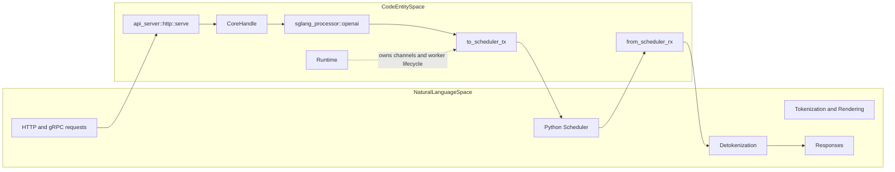
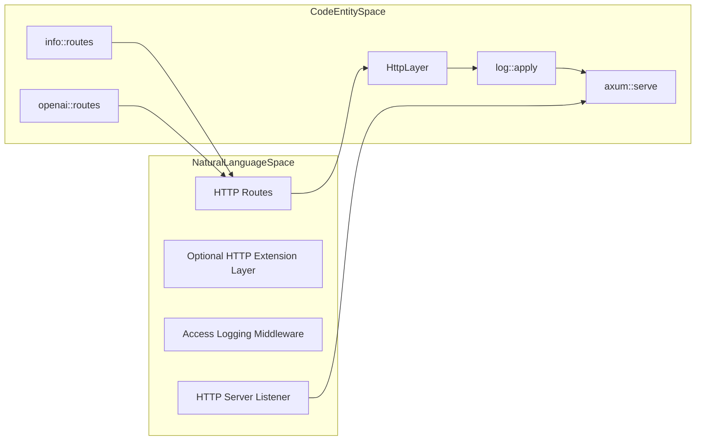
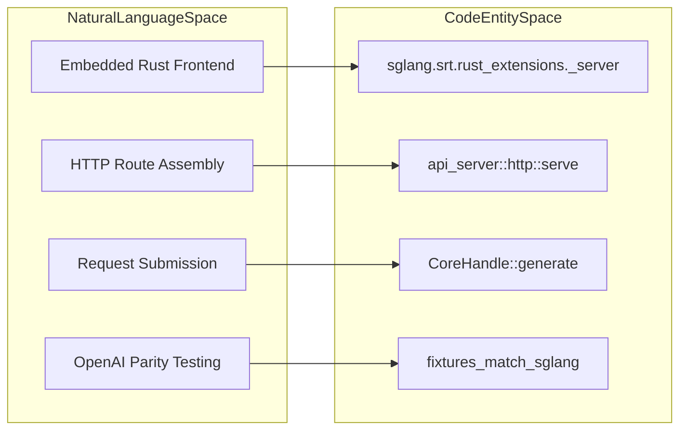

<!-- source: DeepWiki mcp.deepwiki.com · repo sgl-project/sglang · page 21.3 Workflow Engine and WASM Middleware · fetched 2026-10-30 -->

# Workflow Engine and WASM Middleware

Relevant source files

The following files were used as context for generating this wiki page:

- [rust/Cargo.lock](rust/Cargo.lock)
- [rust/sglang-processor/Cargo.toml](rust/sglang-processor/Cargo.toml)
- [rust/sglang-processor/README.md](rust/sglang-processor/README.md)
- [rust/sglang-processor/src/lib.rs](rust/sglang-processor/src/lib.rs)
- [rust/sglang-processor/src/openai/chat.rs](rust/sglang-processor/src/openai/chat.rs)
- [rust/sglang-processor/src/openai/completions.rs](rust/sglang-processor/src/openai/completions.rs)
- [rust/sglang-processor/src/openai/mod.rs](rust/sglang-processor/src/openai/mod.rs)
- [rust/sglang-processor/src/openai/request.rs](rust/sglang-processor/src/openai/request.rs)
- [rust/sglang-processor/src/openai/wire.rs](rust/sglang-processor/src/openai/wire.rs)
- [rust/sglang-processor/src/render/mod.rs](rust/sglang-processor/src/render/mod.rs)
- [rust/sglang-processor/src/render/models/glm53.rs](rust/sglang-processor/src/render/models/glm53.rs)
- [rust/sglang-processor/src/render/models/kimi_k3.rs](rust/sglang-processor/src/render/models/kimi_k3.rs)
- [rust/sglang-processor/src/render/models/qwen38.rs](rust/sglang-processor/src/render/models/qwen38.rs)
- [rust/sglang-processor/src/render/template.rs](rust/sglang-processor/src/render/template.rs)
- [rust/sglang-processor/src/render/thinking.rs](rust/sglang-processor/src/render/thinking.rs)
- [rust/sglang-processor/tests/openai_parity.rs](rust/sglang-processor/tests/openai_parity.rs)
- [rust/sglang-server/Cargo.toml](rust/sglang-server/Cargo.toml)
- [sgl-router/Cargo.lock](sgl-router/Cargo.lock)
- [sgl-router/deny.toml](sgl-router/deny.toml)
- [sgl-router/src/server/routes/chat/openai.rs](sgl-router/src/server/routes/chat/openai.rs)
- [sgl-router/src/server/routes/chat/preparation.rs](sgl-router/src/server/routes/chat/preparation.rs)

## Purpose and scope

This page explains the server runtime architecture, frontend processing pipelines, endpoint handlers, and testing infrastructure implemented across `sglang-server` and `sglang-processor`. While gateway-specific workflow engines or WASM plugins may be integrated at higher layers, the core Rust backend establishes staged runtime channels, PyO3 bindings (`sglang.srt.rust_extensions._server`), chat/completion request lowering, and robust parser/renderer integrations mirroring Python serving behavior. [rust/sglang-server/Cargo.toml:8-18](), [rust/sglang-processor/src/lib.rs:1-7]()

Sources: [rust/sglang-server/Cargo.toml:8-18](), [rust/sglang-processor/src/lib.rs:1-7]()

---

## Workflow Engine Architecture

The Rust server runtime provides staged request processing, separating I/O-bound API routing from CPU-bound tokenization, chat rendering, and multimodal processing. The runtime coordinates workers through bounded `flume` and Tokio channels, ensuring backpressure across stage boundaries. [rust/sglang-server/src/utils/runtime.rs:1-15]()

The Rust frontend embeds within the Python scheduler process via the PyO3 module defined in `rust/sglang-server/Cargo.toml` [rust/sglang-server/Cargo.toml:8-18](). The runtime manages worker threads, core handles, and communication rings [rust/sglang-server/src/utils/runtime.rs:40-53]().

| Verified component | Responsibility |
|---|---|
| `Runtime` | Manages scheduler channels, multimodal wiring, worker handles, and shutdown orchestration. [rust/sglang-server/src/utils/runtime.rs:40-53]() |
| `runtime::start` | Configures core affinities, creates inter-stage ring buffers, and launches frontend tasks. [rust/sglang-server/src/utils/runtime.rs:128-150]() |
| `CoreHandle` | Provides cloneable handles for protocol adapters to submit generation work into the core pipeline. [rust/sglang-server/src/api_server/core/handle.rs:95-117]() |
| `Responder` | Lowered OpenAI endpoint wrapper handling unary and streaming responses over `/generate` output. [rust/sglang-processor/src/openai/mod.rs:26-30]() |

Sources: [rust/sglang-server/src/utils/runtime.rs:40-53](), [rust/sglang-server/src/utils/runtime.rs:128-150](), [rust/sglang-server/src/api_server/core/handle.rs:95-117](), [rust/sglang-processor/src/openai/mod.rs:26-30]()

### Runtime stages and request flow

The request pipeline transitions through API routing, prompt rendering/tokenization via `sglang-processor`, scheduler queueing, model execution, and detokenization [rust/sglang-processor/src/lib.rs:1-7]().

**Diagram: Rust server runtime mapped to code entities**

Sources: [rust/sglang-server/src/api_server/http/app.rs:59-103](), [rust/sglang-server/src/api_server/core/handle.rs:95-117](), [rust/sglang-processor/src/openai/mod.rs:26-30]()

### Request submission and cancellation

`CoreHandle::generate` registers new generations with abort channels, managing cancellation tokens before submitting work downstream [rust/sglang-server/src/api_server/core/handle.rs:161-177]().

Sources: [rust/sglang-server/src/api_server/core/handle.rs:161-177]()

---

## WASM Middleware and Pipeline System

The Axum-based HTTP server supports modular routing and optional extension layers (`HttpLayer`), wrapping routers for metrics, server info, loading statuses, and OpenAI-compatible endpoints [rust/sglang-server/src/api_server/http/app.rs:85-120]().

**Diagram: HTTP extension point mapped to code entities**

Sources: [rust/sglang-server/src/lib.rs:154-157](), [rust/sglang-server/src/api_server/http/app.rs:85-120]()

---

## MCP Integration and Service Discovery

The API server exposes unified HTTP and gRPC adapters over a transport-neutral core [rust/sglang-server/src/api_server.rs:1-10](). Typed control operations supported by `CoreHandle` include model information queries, model listing, cache flushing, weight checking, tokenization, and health checks [rust/sglang-server/src/api_server/core/handle.rs:1-4]().

| Topic | Implementation Details |
|---|---|
| HTTP/gRPC Adapters | Shared core exposed via Axum HTTP routes and tonic gRPC services. [rust/sglang-server/src/api_server.rs:1-10]() |
| Core Control Operations | Typed operations for cache management, model metadata, and health probing. [rust/sglang-server/src/api_server/core/handle.rs:1-4]() |

Sources: [rust/sglang-server/src/api_server.rs:1-10](), [rust/sglang-server/src/api_server/core/handle.rs:1-4]()

---

## Conversation Connectors and History Persistence

Chat formatting and request prompt rendering are handled via `ChatFormatter` and associated Dynamo renderer wrappers [rust/sglang-processor/src/render/mod.rs:43-70](). Model settings and chat formatting configurations parse request bodies and manage template kwargs defaults [rust/sglang-processor/src/openai/chat.rs:31-68]().

Sources: [rust/sglang-processor/src/render/mod.rs:43-70](), [rust/sglang-processor/src/openai/chat.rs:31-68]()

---

## End-to-End (E2E) Test Infrastructure

Test suites include comprehensive parity validation tests such as `openai_parity.rs`, verifying that requests lower identically to Python's OpenAI layer expectations across test fixtures [rust/sglang-processor/tests/openai_parity.rs:1-118](). Development dependencies like `tower` provide `Router::oneshot` utilities for handler-level router testing [rust/sglang-server/Cargo.toml:67-69]().

| Test Infrastructure Detail | Evidence in Codebase |
|---|---|
| OpenAI Parity Tests | `tests/openai_parity.rs` verifies lowered `/generate` payloads against recorded fixture expectations. [rust/sglang-processor/tests/openai_parity.rs:1-118]() |
| Router Testing Utilities | `tower` dependency enables `Router::oneshot` integration tests. [rust/sglang-server/Cargo.toml:67-69]() |

Sources: [rust/sglang-processor/tests/openai_parity.rs:1-118](), [rust/sglang-server/Cargo.toml:67-69]()

---

## Natural Language to Code Entity Space Mapping

**Diagram: Verified server concepts and code entities**

Sources: [rust/sglang-server/Cargo.toml:8-18](), [rust/sglang-server/src/api_server/http/app.rs:59-73](), [rust/sglang-server/src/api_server/core/handle.rs:161-177](), [rust/sglang-processor/tests/openai_parity.rs:96-118]()

---

