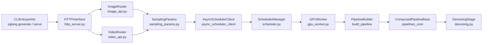
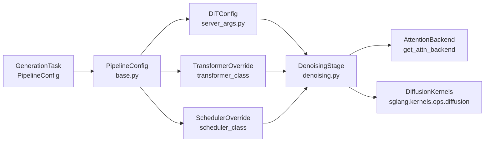

<!-- source: DeepWiki mcp.deepwiki.com · repo sgl-project/sglang · page 22 Diffusion and Multimodal Generation (multimodal_gen) · fetched 2026-10-30 -->

# Diffusion and Multimodal Generation (multimodal_gen)

Relevant source files

The following files were used as context for generating this wiki page:

- [docs/docs/sglang-diffusion/api/cli.mdx](docs/docs/sglang-diffusion/api/cli.mdx)
- [docs/docs/sglang-diffusion/api/openai_api.mdx](docs/docs/sglang-diffusion/api/openai_api.mdx)
- [python/sglang/multimodal_gen/configs/sample/sampling_params.py](python/sglang/multimodal_gen/configs/sample/sampling_params.py)
- [python/sglang/multimodal_gen/runtime/entrypoints/__init__.py](python/sglang/multimodal_gen/runtime/entrypoints/__init__.py)
- [python/sglang/multimodal_gen/runtime/entrypoints/diffusion_generator.py](python/sglang/multimodal_gen/runtime/entrypoints/diffusion_generator.py)
- [python/sglang/multimodal_gen/runtime/entrypoints/http_server.py](python/sglang/multimodal_gen/runtime/entrypoints/http_server.py)
- [python/sglang/multimodal_gen/runtime/entrypoints/openai/image_api.py](python/sglang/multimodal_gen/runtime/entrypoints/openai/image_api.py)
- [python/sglang/multimodal_gen/runtime/entrypoints/openai/mesh_api.py](python/sglang/multimodal_gen/runtime/entrypoints/openai/mesh_api.py)
- [python/sglang/multimodal_gen/runtime/entrypoints/openai/protocol.py](python/sglang/multimodal_gen/runtime/entrypoints/openai/protocol.py)
- [python/sglang/multimodal_gen/runtime/entrypoints/openai/stores.py](python/sglang/multimodal_gen/runtime/entrypoints/openai/stores.py)
- [python/sglang/multimodal_gen/runtime/entrypoints/openai/utils.py](python/sglang/multimodal_gen/runtime/entrypoints/openai/utils.py)
- [python/sglang/multimodal_gen/runtime/entrypoints/openai/video_api.py](python/sglang/multimodal_gen/runtime/entrypoints/openai/video_api.py)
- [python/sglang/multimodal_gen/runtime/entrypoints/utils.py](python/sglang/multimodal_gen/runtime/entrypoints/utils.py)
- [python/sglang/multimodal_gen/runtime/managers/gpu_worker.py](python/sglang/multimodal_gen/runtime/managers/gpu_worker.py)
- [python/sglang/multimodal_gen/runtime/managers/scheduler.py](python/sglang/multimodal_gen/runtime/managers/scheduler.py)
- [python/sglang/multimodal_gen/runtime/pipelines_core/schedule_batch.py](python/sglang/multimodal_gen/runtime/pipelines_core/schedule_batch.py)
- [python/sglang/multimodal_gen/runtime/postprocess/bounded_cache.py](python/sglang/multimodal_gen/runtime/postprocess/bounded_cache.py)
- [python/sglang/multimodal_gen/runtime/postprocess/realesrgan_upscaler.py](python/sglang/multimodal_gen/runtime/postprocess/realesrgan_upscaler.py)
- [python/sglang/multimodal_gen/runtime/postprocess/rife_interpolator.py](python/sglang/multimodal_gen/runtime/postprocess/rife_interpolator.py)
- [python/sglang/multimodal_gen/runtime/server_args/server_args.py](python/sglang/multimodal_gen/runtime/server_args/server_args.py)
- [python/sglang/multimodal_gen/test/server/test_server_utils.py](python/sglang/multimodal_gen/test/server/test_server_utils.py)
- [python/sglang/multimodal_gen/test/unit/realtime/test_output_materialization.py](python/sglang/multimodal_gen/test/unit/realtime/test_output_materialization.py)
- [python/sglang/multimodal_gen/test/unit/test_health_warmup_gate.py](python/sglang/multimodal_gen/test/unit/test_health_warmup_gate.py)
- [python/sglang/multimodal_gen/test/unit/test_image_response_bytes.py](python/sglang/multimodal_gen/test/unit/test_image_response_bytes.py)
- [python/sglang/multimodal_gen/test/unit/test_multiple_task_types.py](python/sglang/multimodal_gen/test/unit/test_multiple_task_types.py)
- [python/sglang/multimodal_gen/test/unit/test_openai_image_api.py](python/sglang/multimodal_gen/test/unit/test_openai_image_api.py)
- [python/sglang/multimodal_gen/test/unit/test_openai_security.py](python/sglang/multimodal_gen/test/unit/test_openai_security.py)
- [python/sglang/multimodal_gen/test/unit/test_openai_utils.py](python/sglang/multimodal_gen/test/unit/test_openai_utils.py)
- [python/sglang/multimodal_gen/test/unit/test_output_saving.py](python/sglang/multimodal_gen/test/unit/test_output_saving.py)
- [python/sglang/multimodal_gen/test/unit/test_prompt_enhancement.py](python/sglang/multimodal_gen/test/unit/test_prompt_enhancement.py)
- [python/sglang/multimodal_gen/test/unit/test_sampling_params.py](python/sglang/multimodal_gen/test/unit/test_sampling_params.py)
- [python/sglang/multimodal_gen/test/unit/test_server_args.py](python/sglang/multimodal_gen/test/unit/test_server_args.py)
- [python/sglang/multimodal_gen/test/unit/test_video_api_profiling.py](python/sglang/multimodal_gen/test/unit/test_video_api_profiling.py)
- [python/sglang/multimodal_gen/test/unit/test_video_job_lifecycle.py](python/sglang/multimodal_gen/test/unit/test_video_job_lifecycle.py)

## Purpose and Scope

SGLang’s `multimodal_gen` package provides a high-performance serving and generation runtime for diffusion pipelines, supporting text-to-image, image-to-image, text-to-video, and image-to-video workloads using Diffusion Transformer (DiT) models. This parent page introduces the request lifecycle, system architecture, and major components of the framework. Detailed implementation details are documented in the respective child pages. The CLI supports one-off generation tasks via `sglang generate` and persistent HTTP serving via `sglang serve`. [docs/docs/sglang-diffusion/api/cli.mdx:6-6]()

Sources: [docs/docs/sglang-diffusion/api/cli.mdx:6-6]()

## System Architecture Overview

Requests enter through the client interfaces (CLI or FastAPI endpoints), are structured using request objects and sampling parameters, and are coordinated by the scheduler (`Scheduler`) and execution workers (`GPUWorker` or `CPUWorker`). [python/sglang/multimodal_gen/runtime/managers/scheduler.py:110-125](), [python/sglang/multimodal_gen/runtime/managers/scheduler.py:165-185](), [python/sglang/multimodal_gen/runtime/managers/gpu_worker.py:78-85]()

The runtime orchestrates pipeline composition via `build_pipeline` and executes iterative denoising through `DenoisingStage`. Memory management, component residency, and hardware platform bindings are handled prior to execution. For deeper details, see the child pages. [python/sglang/multimodal_gen/runtime/managers/gpu_worker.py:60-88](), [python/sglang/multimodal_gen/runtime/pipelines_core/stages/denoising.py:109-125](), [python/sglang/multimodal_gen/runtime/pipelines_core/__init__.py]()

Sources: [python/sglang/multimodal_gen/runtime/managers/scheduler.py:110-125](), [python/sglang/multimodal_gen/runtime/managers/gpu_worker.py:60-88](), [python/sglang/multimodal_gen/runtime/pipelines_core/stages/denoising.py:109-125]()

### Component-to-code map: request and execution path

This diagram maps natural language request concepts to concrete source code entities in the execution path.

Sources: [docs/docs/sglang-diffusion/api/cli.mdx:6-6](), [python/sglang/multimodal_gen/runtime/entrypoints/http_server.py:16-40](), [python/sglang/multimodal_gen/runtime/entrypoints/openai/image_api.py:25-61](), [python/sglang/multimodal_gen/runtime/managers/scheduler.py:110-125](), [python/sglang/multimodal_gen/runtime/managers/gpu_worker.py:78-85](), [python/sglang/multimodal_gen/runtime/pipelines_core/stages/denoising.py:109-125]()

### Component-to-code map: model configuration and denoising

This diagram links model configurations and transformer definitions to execution stages and attention backends.

Sources: [python/sglang/multimodal_gen/configs/pipeline_configs/base.py:141-181](), [python/sglang/multimodal_gen/runtime/pipelines_core/stages/denoising.py:92-143](), [python/sglang/multimodal_gen/test/unit/test_server_args.py:23-67]()

---

## 22.1 Diffusion Runtime Architecture

The SGLang diffusion runtime is structured around `Scheduler`, which manages ZMQ communication and dispatches work to `GPUWorker` or `CPUWorker` instances. Pipelines are composed dynamically using `build_pipeline` and executed through modular stage classes such as `DenoisingStage`. For a comprehensive breakdown of worker lifecycles, execution stages, memory residency managers, layerwise offload policies, and multi-platform support, see [Diffusion Runtime Architecture](#22.1). [python/sglang/multimodal_gen/runtime/managers/scheduler.py:110-185](), [python/sglang/multimodal_gen/runtime/managers/gpu_worker.py:78-85](), [python/sglang/multimodal_gen/runtime/pipelines_core/stages/denoising.py:109-125]()

Sources: [python/sglang/multimodal_gen/runtime/managers/scheduler.py:110-185](), [python/sglang/multimodal_gen/runtime/managers/gpu_worker.py:78-85](), [python/sglang/multimodal_gen/runtime/pipelines_core/stages/denoising.py:109-125]()

## 22.2 Supported Diffusion Models and DiT Architectures

The framework provides specialized pipeline configurations, transformer models, and layer structures for a wide range of architectures including Flux, WanVideo, Qwen-Image, HunyuanVideo, Z-Image, GLM-Image, LTX-2, MoVA, Cosmos3, and MiniMax-H3. These models integrate custom attention backends and tensor parallel execution strategies. For details on specific model families, DiT layers, and attention integration, see [Supported Diffusion Models and DiT Architectures](#22.2). [python/sglang/multimodal_gen/configs/pipeline_configs/base.py:141-181](), [python/sglang/multimodal_gen/test/unit/test_server_args.py:23-67]()

Sources: [python/sglang/multimodal_gen/configs/pipeline_configs/base.py:141-181](), [python/sglang/multimodal_gen/test/unit/test_server_args.py:23-67]()

## 22.3 Diffusion API, Loading, and LoRA Support

SGLang offers OpenAI-compatible REST endpoints under `/v1/images` and `/v1/videos` managed by FastAPI routers in `image_api.py` and `video_api.py`. Server configuration is handled by `ServerArgs`, supporting component-level weight loading, quantization configs, LoRA adapter injection (`--lora-path`), caching mechanisms like `cache-dit`, and multi-stage generation flows. For API specifications, loading pipelines, quantization schemes, and LoRA support, see [Diffusion API, Loading, and LoRA Support](#22.3). [python/sglang/multimodal_gen/runtime/entrypoints/http_server.py:16-40](), [python/sglang/multimodal_gen/runtime/entrypoints/openai/image_api.py:25-61](), [python/sglang/multimodal_gen/runtime/entrypoints/openai/video_api.py:25-63](), [python/sglang/multimodal_gen/runtime/server_args/server_args.py:22-48]()

Sources: [python/sglang/multimodal_gen/runtime/entrypoints/http_server.py:16-40](), [python/sglang/multimodal_gen/runtime/entrypoints/openai/image_api.py:25-61](), [python/sglang/multimodal_gen/runtime/entrypoints/openai/video_api.py:25-63](), [python/sglang/multimodal_gen/runtime/server_args/server_args.py:22-48]()

## 22.4 Diffusion Testing, Baselines, and CI

The test suite for `multimodal_gen` under `python/sglang/multimodal_gen/test/` validates server arguments, platform lifecycle hooks, pipeline configurations across model families, response serialization, and output saving workflows. For information on test suites, consistency and performance baselines, workload partitioning, and CI ground-truth generation, see [Diffusion Testing, Baselines, and CI](#22.4). [python/sglang/multimodal_gen/test/unit/test_server_args.py:23-140]()

Sources: [python/sglang/multimodal_gen/test/unit/test_server_args.py:23-140]()

---

