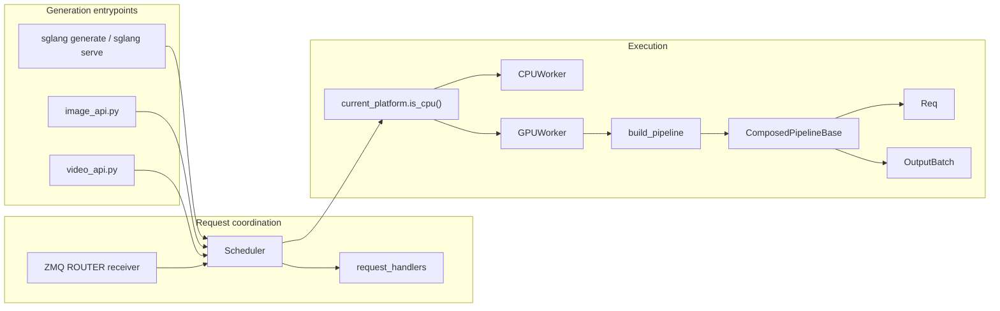
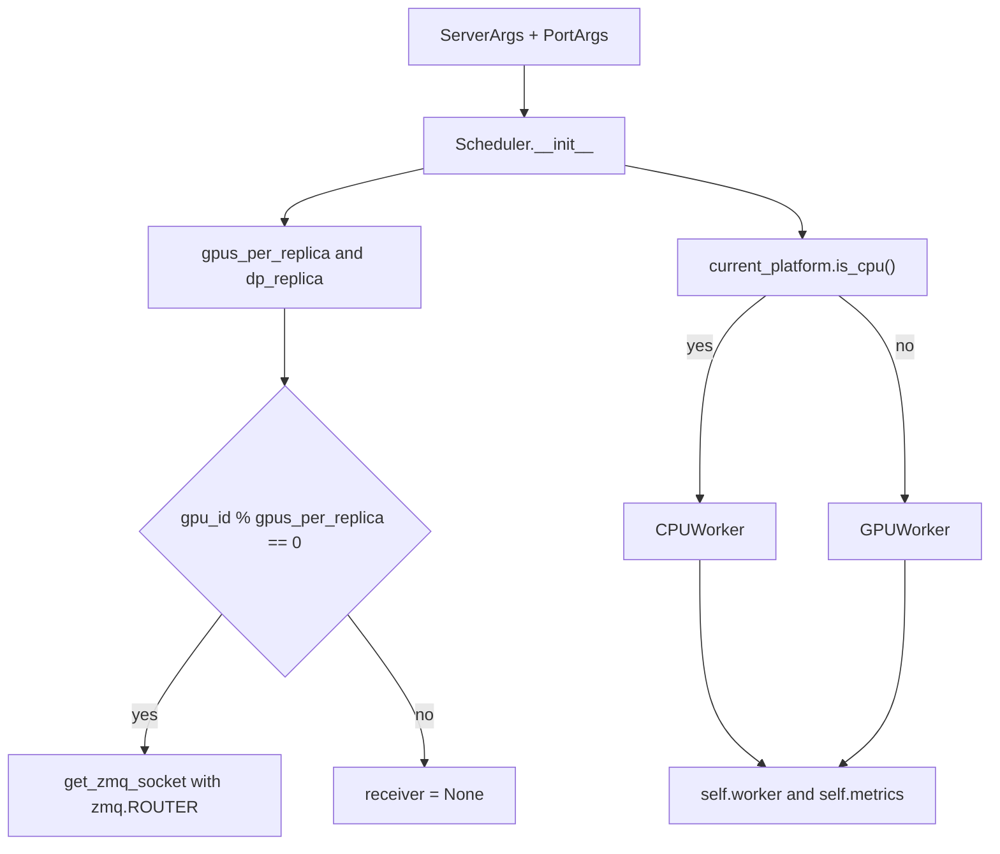
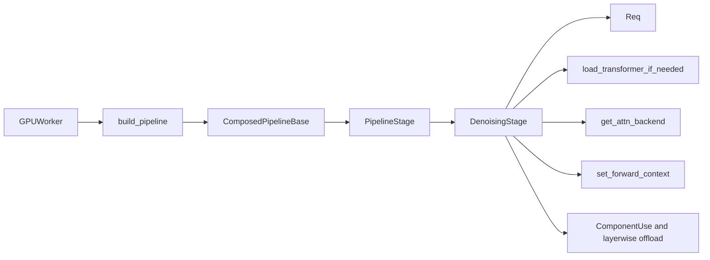
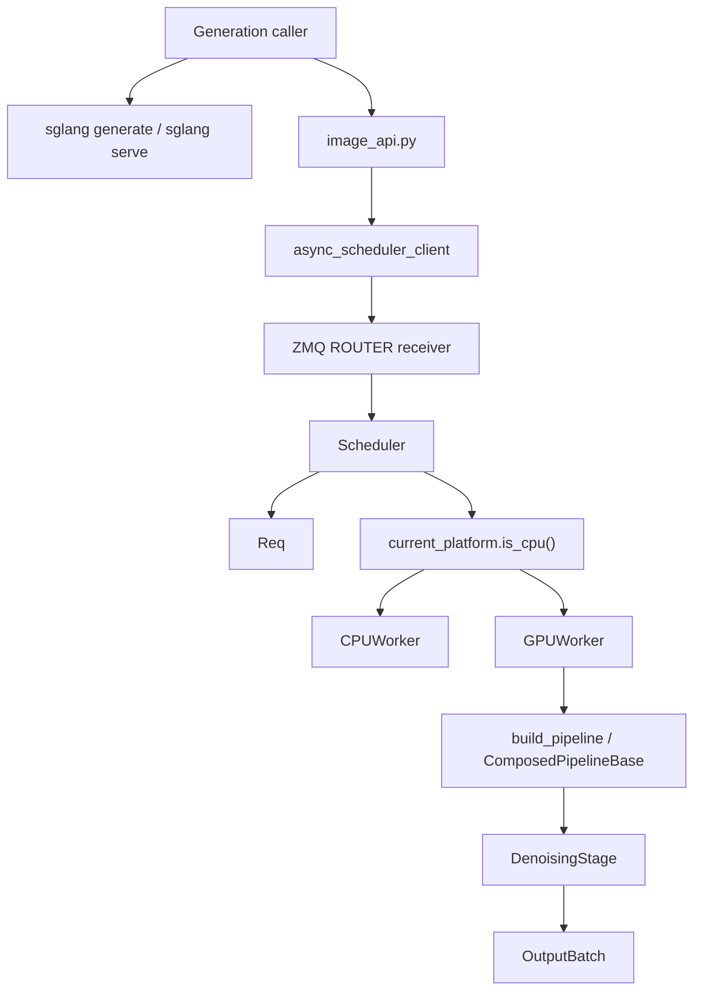

<!-- source: DeepWiki mcp.deepwiki.com · repo sgl-project/sglang · page 22.1 Diffusion Runtime Architecture · fetched 2026-10-30 -->

# Diffusion Runtime Architecture

Relevant source files

The following files were used as context for generating this wiki page:

- [docs/docs/sglang-diffusion/api/cli.mdx](docs/docs/sglang-diffusion/api/cli.mdx)
- [docs/docs/sglang-diffusion/api/openai_api.mdx](docs/docs/sglang-diffusion/api/openai_api.mdx)
- [docs/docs/sglang-diffusion/disaggregation.mdx](docs/docs/sglang-diffusion/disaggregation.mdx)
- [docs/docs/sglang-diffusion/encoder_parallel.mdx](docs/docs/sglang-diffusion/encoder_parallel.mdx)
- [docs/docs/sglang-diffusion/performance-optimization.mdx](docs/docs/sglang-diffusion/performance-optimization.mdx)
- [python/sglang/multimodal_gen/configs/models/encoders/base.py](python/sglang/multimodal_gen/configs/models/encoders/base.py)
- [python/sglang/multimodal_gen/configs/pipeline_configs/glm_image.py](python/sglang/multimodal_gen/configs/pipeline_configs/glm_image.py)
- [python/sglang/multimodal_gen/configs/sample/glmimage.py](python/sglang/multimodal_gen/configs/sample/glmimage.py)
- [python/sglang/multimodal_gen/configs/sample/sampling_params.py](python/sglang/multimodal_gen/configs/sample/sampling_params.py)
- [python/sglang/multimodal_gen/runtime/disaggregation/orchestrator.py](python/sglang/multimodal_gen/runtime/disaggregation/orchestrator.py)
- [python/sglang/multimodal_gen/runtime/disaggregation/request_state.py](python/sglang/multimodal_gen/runtime/disaggregation/request_state.py)
- [python/sglang/multimodal_gen/runtime/disaggregation/scheduler_mixin.py](python/sglang/multimodal_gen/runtime/disaggregation/scheduler_mixin.py)
- [python/sglang/multimodal_gen/runtime/distributed/__init__.py](python/sglang/multimodal_gen/runtime/distributed/__init__.py)
- [python/sglang/multimodal_gen/runtime/distributed/group_coordinator.py](python/sglang/multimodal_gen/runtime/distributed/group_coordinator.py)
- [python/sglang/multimodal_gen/runtime/distributed/parallel_state.py](python/sglang/multimodal_gen/runtime/distributed/parallel_state.py)
- [python/sglang/multimodal_gen/runtime/entrypoints/__init__.py](python/sglang/multimodal_gen/runtime/entrypoints/__init__.py)
- [python/sglang/multimodal_gen/runtime/entrypoints/diffusion_generator.py](python/sglang/multimodal_gen/runtime/entrypoints/diffusion_generator.py)
- [python/sglang/multimodal_gen/runtime/entrypoints/http_server.py](python/sglang/multimodal_gen/runtime/entrypoints/http_server.py)
- [python/sglang/multimodal_gen/runtime/entrypoints/openai/image_api.py](python/sglang/multimodal_gen/runtime/entrypoints/openai/image_api.py)
- [python/sglang/multimodal_gen/runtime/entrypoints/openai/mesh_api.py](python/sglang/multimodal_gen/runtime/entrypoints/openai/mesh_api.py)
- [python/sglang/multimodal_gen/runtime/entrypoints/openai/protocol.py](python/sglang/multimodal_gen/runtime/entrypoints/openai/protocol.py)
- [python/sglang/multimodal_gen/runtime/entrypoints/openai/stores.py](python/sglang/multimodal_gen/runtime/entrypoints/openai/stores.py)
- [python/sglang/multimodal_gen/runtime/entrypoints/openai/utils.py](python/sglang/multimodal_gen/runtime/entrypoints/openai/utils.py)
- [python/sglang/multimodal_gen/runtime/entrypoints/openai/video_api.py](python/sglang/multimodal_gen/runtime/entrypoints/openai/video_api.py)
- [python/sglang/multimodal_gen/runtime/entrypoints/openai/video_progress.py](python/sglang/multimodal_gen/runtime/entrypoints/openai/video_progress.py)
- [python/sglang/multimodal_gen/runtime/entrypoints/utils.py](python/sglang/multimodal_gen/runtime/entrypoints/utils.py)
- [python/sglang/multimodal_gen/runtime/launch_server.py](python/sglang/multimodal_gen/runtime/launch_server.py)
- [python/sglang/multimodal_gen/runtime/managers/gpu_worker.py](python/sglang/multimodal_gen/runtime/managers/gpu_worker.py)
- [python/sglang/multimodal_gen/runtime/managers/memory_managers/component_manager.py](python/sglang/multimodal_gen/runtime/managers/memory_managers/component_manager.py)
- [python/sglang/multimodal_gen/runtime/managers/memory_managers/component_residency_strategies.py](python/sglang/multimodal_gen/runtime/managers/memory_managers/component_residency_strategies.py)
- [python/sglang/multimodal_gen/runtime/managers/memory_managers/host_memory_budget.py](python/sglang/multimodal_gen/runtime/managers/memory_managers/host_memory_budget.py)
- [python/sglang/multimodal_gen/runtime/managers/memory_managers/layerwise_offload.py](python/sglang/multimodal_gen/runtime/managers/memory_managers/layerwise_offload.py)
- [python/sglang/multimodal_gen/runtime/managers/progress_reporter.py](python/sglang/multimodal_gen/runtime/managers/progress_reporter.py)
- [python/sglang/multimodal_gen/runtime/managers/request_gc.py](python/sglang/multimodal_gen/runtime/managers/request_gc.py)
- [python/sglang/multimodal_gen/runtime/managers/scheduler.py](python/sglang/multimodal_gen/runtime/managers/scheduler.py)
- [python/sglang/multimodal_gen/runtime/models/dits/minimax_h3_adaln_cache.py](python/sglang/multimodal_gen/runtime/models/dits/minimax_h3_adaln_cache.py)
- [python/sglang/multimodal_gen/runtime/models/encoders/clip.py](python/sglang/multimodal_gen/runtime/models/encoders/clip.py)
- [python/sglang/multimodal_gen/runtime/models/encoders/t5.py](python/sglang/multimodal_gen/runtime/models/encoders/t5.py)
- [python/sglang/multimodal_gen/runtime/models/vaes/autoencoder_kl_qwenimage21.py](python/sglang/multimodal_gen/runtime/models/vaes/autoencoder_kl_qwenimage21.py)
- [python/sglang/multimodal_gen/runtime/models/vaes/resample.py](python/sglang/multimodal_gen/runtime/models/vaes/resample.py)
- [python/sglang/multimodal_gen/runtime/pipelines/glm_image.py](python/sglang/multimodal_gen/runtime/pipelines/glm_image.py)
- [python/sglang/multimodal_gen/runtime/pipelines_core/executors/parallel_executor.py](python/sglang/multimodal_gen/runtime/pipelines_core/executors/parallel_executor.py)
- [python/sglang/multimodal_gen/runtime/pipelines_core/executors/pipeline_executor.py](python/sglang/multimodal_gen/runtime/pipelines_core/executors/pipeline_executor.py)
- [python/sglang/multimodal_gen/runtime/pipelines_core/executors/sync_executor.py](python/sglang/multimodal_gen/runtime/pipelines_core/executors/sync_executor.py)
- [python/sglang/multimodal_gen/runtime/pipelines_core/request_utils.py](python/sglang/multimodal_gen/runtime/pipelines_core/request_utils.py)
- [python/sglang/multimodal_gen/runtime/pipelines_core/schedule_batch.py](python/sglang/multimodal_gen/runtime/pipelines_core/schedule_batch.py)
- [python/sglang/multimodal_gen/runtime/pipelines_core/stages/base.py](python/sglang/multimodal_gen/runtime/pipelines_core/stages/base.py)
- [python/sglang/multimodal_gen/runtime/pipelines_core/stages/model_specific_stages/glm_image.py](python/sglang/multimodal_gen/runtime/pipelines_core/stages/model_specific_stages/glm_image.py)
- [python/sglang/multimodal_gen/runtime/pipelines_core/stages/model_specific_stages/helios_denoising.py](python/sglang/multimodal_gen/runtime/pipelines_core/stages/model_specific_stages/helios_denoising.py)
- [python/sglang/multimodal_gen/runtime/pipelines_core/stages/model_specific_stages/longlive2.py](python/sglang/multimodal_gen/runtime/pipelines_core/stages/model_specific_stages/longlive2.py)
- [python/sglang/multimodal_gen/runtime/pipelines_core/stages/model_specific_stages/ltx_2/denoising_av.py](python/sglang/multimodal_gen/runtime/pipelines_core/stages/model_specific_stages/ltx_2/denoising_av.py)
- [python/sglang/multimodal_gen/runtime/postprocess/bounded_cache.py](python/sglang/multimodal_gen/runtime/postprocess/bounded_cache.py)
- [python/sglang/multimodal_gen/runtime/postprocess/realesrgan_upscaler.py](python/sglang/multimodal_gen/runtime/postprocess/realesrgan_upscaler.py)
- [python/sglang/multimodal_gen/runtime/postprocess/rife_interpolator.py](python/sglang/multimodal_gen/runtime/postprocess/rife_interpolator.py)
- [python/sglang/multimodal_gen/runtime/server_args/server_args.py](python/sglang/multimodal_gen/runtime/server_args/server_args.py)
- [python/sglang/multimodal_gen/runtime/server_warmup.py](python/sglang/multimodal_gen/runtime/server_warmup.py)
- [python/sglang/multimodal_gen/runtime/utils/perf_logger.py](python/sglang/multimodal_gen/runtime/utils/perf_logger.py)
- [python/sglang/multimodal_gen/runtime/warmup_request_builder.py](python/sglang/multimodal_gen/runtime/warmup_request_builder.py)
- [python/sglang/multimodal_gen/test/server/test_server_utils.py](python/sglang/multimodal_gen/test/server/test_server_utils.py)
- [python/sglang/multimodal_gen/test/unit/realtime/test_output_materialization.py](python/sglang/multimodal_gen/test/unit/realtime/test_output_materialization.py)
- [python/sglang/multimodal_gen/test/unit/test_async_output_save.py](python/sglang/multimodal_gen/test/unit/test_async_output_save.py)
- [python/sglang/multimodal_gen/test/unit/test_cfg_parallel_warmup.py](python/sglang/multimodal_gen/test/unit/test_cfg_parallel_warmup.py)
- [python/sglang/multimodal_gen/test/unit/test_component_residency.py](python/sglang/multimodal_gen/test/unit/test_component_residency.py)
- [python/sglang/multimodal_gen/test/unit/test_diffusion_bcg_tp_graph_capture.py](python/sglang/multimodal_gen/test/unit/test_diffusion_bcg_tp_graph_capture.py)
- [python/sglang/multimodal_gen/test/unit/test_disagg_orchestration.py](python/sglang/multimodal_gen/test/unit/test_disagg_orchestration.py)
- [python/sglang/multimodal_gen/test/unit/test_encoder_world_folding.py](python/sglang/multimodal_gen/test/unit/test_encoder_world_folding.py)
- [python/sglang/multimodal_gen/test/unit/test_glm_image_ar.py](python/sglang/multimodal_gen/test/unit/test_glm_image_ar.py)
- [python/sglang/multimodal_gen/test/unit/test_glm_image_multi_output.py](python/sglang/multimodal_gen/test/unit/test_glm_image_multi_output.py)
- [python/sglang/multimodal_gen/test/unit/test_gpu_worker_cpu_threads.py](python/sglang/multimodal_gen/test/unit/test_gpu_worker_cpu_threads.py)
- [python/sglang/multimodal_gen/test/unit/test_group_coordinator_compiled_all_reduce.py](python/sglang/multimodal_gen/test/unit/test_group_coordinator_compiled_all_reduce.py)
- [python/sglang/multimodal_gen/test/unit/test_health_warmup_gate.py](python/sglang/multimodal_gen/test/unit/test_health_warmup_gate.py)
- [python/sglang/multimodal_gen/test/unit/test_helios_denoising_profiler.py](python/sglang/multimodal_gen/test/unit/test_helios_denoising_profiler.py)
- [python/sglang/multimodal_gen/test/unit/test_host_memory_budget.py](python/sglang/multimodal_gen/test/unit/test_host_memory_budget.py)
- [python/sglang/multimodal_gen/test/unit/test_host_resident_vocab_table.py](python/sglang/multimodal_gen/test/unit/test_host_resident_vocab_table.py)
- [python/sglang/multimodal_gen/test/unit/test_image_response_bytes.py](python/sglang/multimodal_gen/test/unit/test_image_response_bytes.py)
- [python/sglang/multimodal_gen/test/unit/test_launch_server_shutdown.py](python/sglang/multimodal_gen/test/unit/test_launch_server_shutdown.py)
- [python/sglang/multimodal_gen/test/unit/test_layerwise_offload.py](python/sglang/multimodal_gen/test/unit/test_layerwise_offload.py)
- [python/sglang/multimodal_gen/test/unit/test_load_inclusive_e2e.py](python/sglang/multimodal_gen/test/unit/test_load_inclusive_e2e.py)
- [python/sglang/multimodal_gen/test/unit/test_minimax_h3_adaln_cache.py](python/sglang/multimodal_gen/test/unit/test_minimax_h3_adaln_cache.py)
- [python/sglang/multimodal_gen/test/unit/test_multi_output_grouping.py](python/sglang/multimodal_gen/test/unit/test_multi_output_grouping.py)
- [python/sglang/multimodal_gen/test/unit/test_multiple_task_types.py](python/sglang/multimodal_gen/test/unit/test_multiple_task_types.py)
- [python/sglang/multimodal_gen/test/unit/test_openai_image_api.py](python/sglang/multimodal_gen/test/unit/test_openai_image_api.py)
- [python/sglang/multimodal_gen/test/unit/test_openai_security.py](python/sglang/multimodal_gen/test/unit/test_openai_security.py)
- [python/sglang/multimodal_gen/test/unit/test_openai_utils.py](python/sglang/multimodal_gen/test/unit/test_openai_utils.py)
- [python/sglang/multimodal_gen/test/unit/test_output_saving.py](python/sglang/multimodal_gen/test/unit/test_output_saving.py)
- [python/sglang/multimodal_gen/test/unit/test_performance_metrics.py](python/sglang/multimodal_gen/test/unit/test_performance_metrics.py)
- [python/sglang/multimodal_gen/test/unit/test_prompt_enhancement.py](python/sglang/multimodal_gen/test/unit/test_prompt_enhancement.py)
- [python/sglang/multimodal_gen/test/unit/test_sampling_params.py](python/sglang/multimodal_gen/test/unit/test_sampling_params.py)
- [python/sglang/multimodal_gen/test/unit/test_sequence_parallel_over_cfg_ranks.py](python/sglang/multimodal_gen/test/unit/test_sequence_parallel_over_cfg_ranks.py)
- [python/sglang/multimodal_gen/test/unit/test_server_args.py](python/sglang/multimodal_gen/test/unit/test_server_args.py)
- [python/sglang/multimodal_gen/test/unit/test_sp_kv_gather_contiguous.py](python/sglang/multimodal_gen/test/unit/test_sp_kv_gather_contiguous.py)
- [python/sglang/multimodal_gen/test/unit/test_vae_resample.py](python/sglang/multimodal_gen/test/unit/test_vae_resample.py)
- [python/sglang/multimodal_gen/test/unit/test_video_api_profiling.py](python/sglang/multimodal_gen/test/unit/test_video_api_profiling.py)
- [python/sglang/multimodal_gen/test/unit/test_video_job_lifecycle.py](python/sglang/multimodal_gen/test/unit/test_video_job_lifecycle.py)
- [python/sglang/srt/utils/__init__.py](python/sglang/srt/utils/__init__.py)
- [python/sglang/srt/utils/numa_utils.py](python/sglang/srt/utils/numa_utils.py)
- [test/registered/utils/test_numa_utils.py](test/registered/utils/test_numa_utils.py)
- [test/registered/xpu/test_numa_utils_xpu.py](test/registered/xpu/test_numa_utils_xpu.py)

## Purpose and scope

This page describes the `multimodal_gen` runtime’s request coordination, GPU execution, composed pipeline and stage structure, memory-residency mechanisms, and platform abstraction. It focuses on how the named runtime components fit together; it does not document individual model architectures [python/sglang/multimodal_gen/runtime/managers/scheduler.py:110-120](), [python/sglang/multimodal_gen/runtime/managers/gpu_worker.py:78-89](), [python/sglang/multimodal_gen/runtime/pipelines_core/stages/denoising.py:119-150]().

Sources: [python/sglang/multimodal_gen/runtime/managers/scheduler.py:110-120](), [python/sglang/multimodal_gen/runtime/managers/gpu_worker.py:78-89](), [python/sglang/multimodal_gen/runtime/pipelines_core/stages/denoising.py:119-150]()

---

## System overview

The runtime separates request coordination from model execution. `Scheduler` runs the event loop for a rank-0 worker, receives requests through ZMQ, and coordinates worker execution [python/sglang/multimodal_gen/runtime/managers/scheduler.py:110-120](). It constructs a `GPUWorker` on accelerator platforms and a `CPUWorker` on CPU platforms [python/sglang/multimodal_gen/runtime/managers/scheduler.py:165-178](). The worker imports identify `ComposedPipelineBase`, `build_pipeline`, `Req`, and `OutputBatch` as pipeline and request types used by the execution layer [python/sglang/multimodal_gen/runtime/managers/gpu_worker.py:78-85]().

`ServerArgs` is the runtime configuration type passed to the scheduler and worker [python/sglang/multimodal_gen/runtime/server_args/server_args.py:22-48](). It imports pipeline configuration, platform selection, component-residency handling, layerwise-offload configuration, and disaggregation-role definitions, linking those concerns in a common configuration surface [python/sglang/multimodal_gen/runtime/server_args/server_args.py:70-78]().

The command-line interface exposes one-off generation through `sglang generate` and persistent serving through `sglang serve`; the runtime components described here provide the execution path behind diffusion generation [docs/docs/sglang-diffusion/api/cli.mdx:6-6]().

Sources: [python/sglang/multimodal_gen/runtime/managers/scheduler.py:110-120](), [python/sglang/multimodal_gen/runtime/managers/scheduler.py:127-175](), [python/sglang/multimodal_gen/runtime/managers/gpu_worker.py:78-85](), [python/sglang/multimodal_gen/runtime/server_args/server_args.py:22-48](), [python/sglang/multimodal_gen/runtime/server_args/server_args.py:70-78](), [docs/docs/sglang-diffusion/api/cli.mdx:6-6]()

---

## Runtime components: natural-language roles and code entities

This map connects runtime roles to identifiers visible in the implementation. The scheduler chooses `CPUWorker` or `GPUWorker` based on `current_platform.is_cpu()`, and initializes the selected worker with rank, port, and `ServerArgs` [python/sglang/multimodal_gen/runtime/managers/scheduler.py:165-175]().

**Diagram: Runtime roles mapped to implementation entities**

Sources: [python/sglang/multimodal_gen/runtime/managers/scheduler.py:110-120](), [python/sglang/multimodal_gen/runtime/managers/scheduler.py:151-175](), [python/sglang/multimodal_gen/runtime/managers/scheduler.py:180-186](), [python/sglang/multimodal_gen/runtime/managers/gpu_worker.py:78-85](), [docs/docs/sglang-diffusion/api/cli.mdx:6-6](), [python/sglang/multimodal_gen/runtime/entrypoints/openai/image_api.py:55-61]()

---

## Request coordination and scheduler

`Scheduler` is declared with `Pi05SegmentSchedulerMixin`, `SchedulerWarmupMixin`, `SchedulerPostTrainingMixin`, and `SchedulerDisaggMixin` [python/sglang/multimodal_gen/runtime/managers/scheduler.py:110-120](). Its class documentation identifies it as the main event loop for the rank-0 worker: it listens for external requests over ZMQ and coordinates with other workers, but does not manage worker processes [python/sglang/multimodal_gen/runtime/managers/scheduler.py:110-120]().

During initialization, the scheduler stores `ServerArgs` and `PortArgs`, sets global server arguments, and calculates the number of GPUs per data-parallel replica [python/sglang/multimodal_gen/runtime/managers/scheduler.py:127-164](). The first GPU rank in each replica binds a ZMQ `ROUTER` socket at that replica’s scheduler endpoint; other ranks in the replica do not create a receiver [python/sglang/multimodal_gen/runtime/managers/scheduler.py:127-164]().

The scheduler selects `CPUWorker` when `current_platform.is_cpu()` is true and otherwise selects `GPUWorker` [python/sglang/multimodal_gen/runtime/managers/scheduler.py:165-178](). It initializes that worker with `local_rank`, the master port, the global rank, and `ServerArgs`, then retains the worker and its metrics [python/sglang/multimodal_gen/runtime/managers/scheduler.py:165-178]().

**Diagram: Scheduler initialization and worker selection**

Sources: [python/sglang/multimodal_gen/runtime/managers/scheduler.py:110-178]()

---

## DiffGenerator and generation entrypoints

The diffusion CLI documents two user-facing modes: `sglang generate` for one-off generation and `sglang serve` for starting a persistent HTTP server [docs/docs/sglang-diffusion/api/cli.mdx:6-6](), [docs/docs/sglang-diffusion/api/cli.mdx:45-71](). It also documents model and runtime options such as `--model-path`, `--num-gpus`, and parallelism settings [docs/docs/sglang-diffusion/api/cli.mdx:73-92]().

The image API defines an `/v1/images` router [python/sglang/multimodal_gen/runtime/entrypoints/openai/image_api.py:61](). Its imports include request/response protocol types, request preparation utilities, `OutputBatch`, and `async_scheduler_client`, exposing the API-to-scheduler boundary in the visible module surface [python/sglang/multimodal_gen/runtime/entrypoints/openai/image_api.py:34-60]().

Sources: [docs/docs/sglang-diffusion/api/cli.mdx:6-92](), [python/sglang/multimodal_gen/runtime/entrypoints/openai/image_api.py:34-60]()

---

## GPU worker and execution boundary

`GPUWorker` imports distributed initialization and parallel-state helpers, including tensor-parallel and sequence-parallel group accessors [python/sglang/multimodal_gen/runtime/managers/gpu_worker.py:28-52](). It also imports `ComposedPipelineBase`, `LoRAPipeline`, `Req`, `build_pipeline`, and `OutputBatch`, which identify the worker’s principal execution-facing types [python/sglang/multimodal_gen/runtime/managers/gpu_worker.py:78-85]().

The worker module also imports component-residency management, layerwise-offload configuration, and `MemoryOccupationController` [python/sglang/multimodal_gen/runtime/managers/gpu_worker.py:60-73](). These imports show the worker’s integration points for residency and memory control [python/sglang/multimodal_gen/runtime/managers/gpu_worker.py:60-73]().

Sources: [python/sglang/multimodal_gen/runtime/managers/gpu_worker.py:28-85]()

---

## Composed pipeline and stage architecture

The worker imports `build_pipeline` and `ComposedPipelineBase` from `pipelines_core`, alongside request and output types [python/sglang/multimodal_gen/runtime/managers/gpu_worker.py:78-85](). This is the visible boundary between worker execution and the composed-pipeline layer [python/sglang/multimodal_gen/runtime/managers/gpu_worker.py:78-85]().

`DenoisingStage` is a pipeline-stage implementation [python/sglang/multimodal_gen/runtime/pipelines_core/stages/denoising.py:86](). Its module imports `PipelineStage`, `Req`, `ServerArgs`, `ComponentUse`, component-loading helpers, and layerwise-offload interfaces [python/sglang/multimodal_gen/runtime/pipelines_core/stages/denoising.py:67-108]().

**Diagram: Pipeline and denoising-stage code relationships**

Sources: [python/sglang/multimodal_gen/runtime/managers/gpu_worker.py:78-85](), [python/sglang/multimodal_gen/runtime/pipelines_core/stages/denoising.py:67-150]()

---

## Memory management and layerwise offload

The runtime imports component-residency modes including `RESIDENT`, `COMPONENT_OFFLOAD`, `LAYERWISE_OFFLOAD`, and `SNAPSHOT_OFFLOAD` into `ServerArgs` [python/sglang/multimodal_gen/runtime/server_args/server_args.py:40-48]().

`layerwise_offload.py` defines `compute_streamed_layers(num_layers, resident_layers, policy)` [python/sglang/multimodal_gen/runtime/managers/memory_managers/layerwise_offload.py:67-69](). It validates the policy against `RESIDENCY_POLICIES`, clamps the resident-layer count to the valid range, and returns no streamed layers when all layers are resident [python/sglang/multimodal_gen/runtime/managers/memory_managers/layerwise_offload.py:67-103](). For `leading`, it streams the tail after the resident prefix; otherwise it computes a strided set of streamed layer indices [python/sglang/multimodal_gen/runtime/managers/memory_managers/layerwise_offload.py:105-114]().

The same module identifies a host-resident-table path [python/sglang/multimodal_gen/runtime/managers/memory_managers/layerwise_offload.py:139-168](). `_host_resident_tables` scans modules for declared `host_resident_table_names`, resolves candidate submodules, and filters out invalid weights, tensor-parallel-sharded tables, and tables below `HOST_RESIDENT_TABLE_MIN_BYTES` [python/sglang/multimodal_gen/runtime/managers/memory_managers/layerwise_offload.py:139-168]().

| Mechanism | Code identifier | Established role |
|---|---|---|
| Residency configuration | `normalize_component_residency`, `resolve_component_residency_mode` | Normalize and resolve configured component-residency modes [python/sglang/multimodal_gen/runtime/server_args/server_args.py:40-48]() |
| Layer selection | `compute_streamed_layers` | Determine streamed layer indices for a selected policy [python/sglang/multimodal_gen/runtime/managers/memory_managers/layerwise_offload.py:67-115]() |
| Layerwise module setup | `configure_layerwise_offload_modules` | Worker integration point for configuring layerwise-offloaded modules [python/sglang/multimodal_gen/runtime/managers/gpu_worker.py:68-70]() |
| Component residency | `get_global_component_residency_manager` | Worker integration point for global component-residency management [python/sglang/multimodal_gen/runtime/managers/gpu_worker.py:64-67]() |
| Memory occupation | `MemoryOccupationController` | Worker import for memory-occupation control [python/sglang/multimodal_gen/runtime/managers/gpu_worker.py:71-73]() |

Sources: [python/sglang/multimodal_gen/runtime/server_args/server_args.py:40-48](), [python/sglang/multimodal_gen/runtime/managers/memory_managers/layerwise_offload.py:67-168](), [python/sglang/multimodal_gen/runtime/managers/gpu_worker.py:60-73]()

---

## Platform support and attention selection

`ServerArgs` imports `AttentionBackendEnum` and `current_platform` from the diffusion runtime’s platform package [python/sglang/multimodal_gen/runtime/server_args/server_args.py:70-73](). The worker imports `initialize_current_platform`, and the scheduler selects `CPUWorker` versus `GPUWorker` using `current_platform.is_cpu()` [python/sglang/multimodal_gen/runtime/managers/gpu_worker.py:86-89](), [python/sglang/multimodal_gen/runtime/managers/scheduler.py:165-174]().

Sources: [python/sglang/multimodal_gen/runtime/server_args/server_args.py:70-73](), [python/sglang/multimodal_gen/runtime/managers/gpu_worker.py:86-89](), [python/sglang/multimodal_gen/runtime/managers/scheduler.py:165-174]()

---

## End-to-end architecture map

This diagram links user-facing diffusion entrypoints to the runtime identifiers visible in the supplied files [python/sglang/multimodal_gen/runtime/entrypoints/openai/image_api.py:55-61](), [python/sglang/multimodal_gen/runtime/managers/scheduler.py:151-175]().

**Diagram: Natural-language request path to code entities**

Sources: [docs/docs/sglang-diffusion/api/cli.mdx:6-6](), [python/sglang/multimodal_gen/runtime/entrypoints/openai/image_api.py:55-61](), [python/sglang/multimodal_gen/runtime/managers/scheduler.py:151-175](), [python/sglang/multimodal_gen/runtime/managers/gpu_worker.py:78-85](), [python/sglang/multimodal_gen/runtime/pipelines_core/stages/denoising.py:119-150]()

---

## Configuration and operational context

`ServerArgs` imports pipeline configuration types and platform, attention, disaggregation, quantization, and component-residency definitions [python/sglang/multimodal_gen/runtime/server_args/server_args.py:22-38](). Its module also defines `Backend` with `AUTO`, `SGLANG`, and `DIFFUSERS` values; the enum documentation describes automatic selection as preferring the native SGLang implementation and falling back to Diffusers [python/sglang/multimodal_gen/runtime/server_args/server_args.py:160-185]().

The CLI documents runtime choices such as model path, GPU count, NUMA-node selection, and performance mode [docs/docs/sglang-diffusion/api/cli.mdx:73-92](). It states that explicit offload, FSDP, and parallelism flags take precedence over performance-mode defaults [docs/docs/sglang-diffusion/api/cli.mdx:73-92]().

Sources: [python/sglang/multimodal_gen/runtime/server_args/server_args.py:22-38](), [python/sglang/multimodal_gen/runtime/server_args/server_args.py:160-185](), [docs/docs/sglang-diffusion/api/cli.mdx:73-92]()

---

