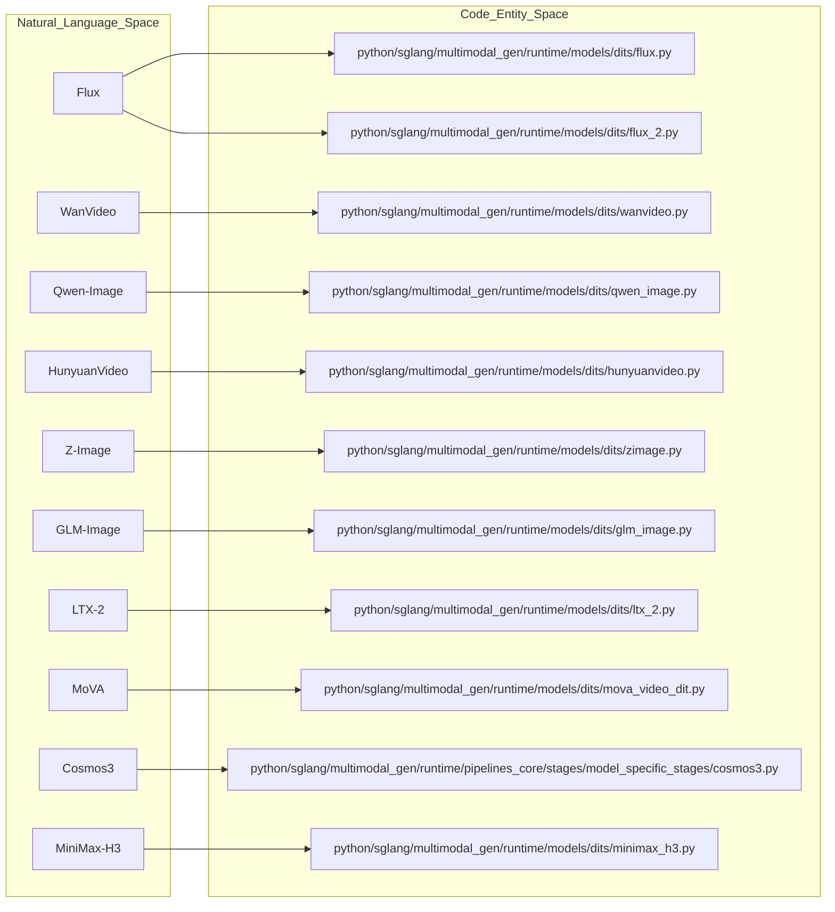
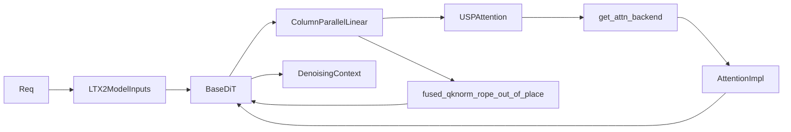
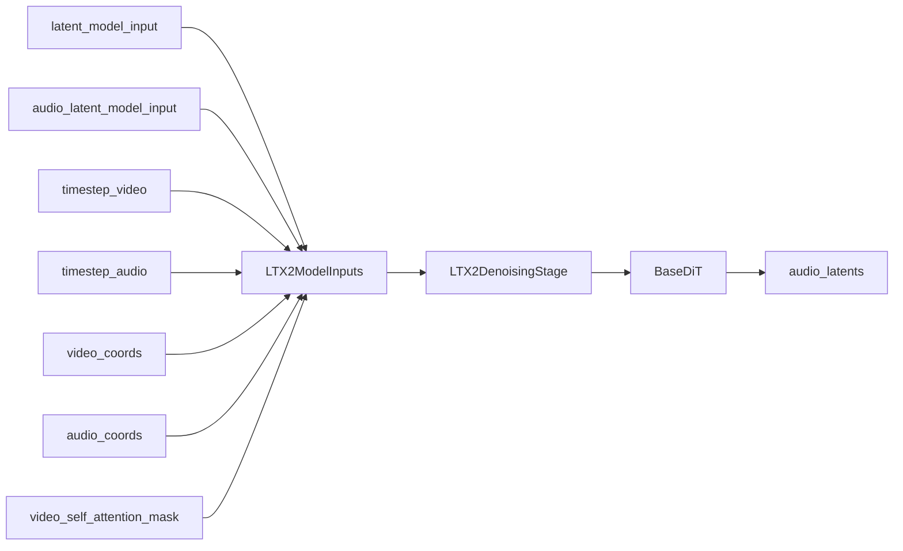
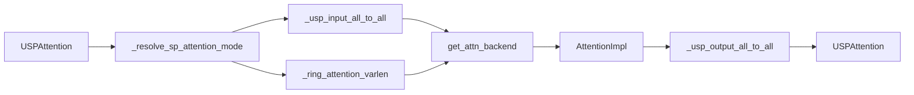

<!-- source: DeepWiki mcp.deepwiki.com · repo sgl-project/sglang · page 22.2 Supported Diffusion Models and DiT Architectures · fetched 2026-10-30 -->

# Supported Diffusion Models and DiT Architectures

Relevant source files

The following files were used as context for generating this wiki page:

- [.agents/skills/cookbook-add-model/templates/diffusion-page.mdx.tmpl](.agents/skills/cookbook-add-model/templates/diffusion-page.mdx.tmpl)
- [docs/cookbook/diffusion/CircleStone/Anima.mdx](docs/cookbook/diffusion/CircleStone/Anima.mdx)
- [docs/cookbook/diffusion/Cosmos/Cosmos3.mdx](docs/cookbook/diffusion/Cosmos/Cosmos3.mdx)
- [docs/cookbook/diffusion/Ernie-Image/Ernie-Image.mdx](docs/cookbook/diffusion/Ernie-Image/Ernie-Image.mdx)
- [docs/cookbook/diffusion/JoyEcho/JoyEcho.mdx](docs/cookbook/diffusion/JoyEcho/JoyEcho.mdx)
- [docs/cookbook/diffusion/LTX/LTX2.5.mdx](docs/cookbook/diffusion/LTX/LTX2.5.mdx)
- [docs/cookbook/diffusion/LingBot-Video/LingBot-Video-MoE.mdx](docs/cookbook/diffusion/LingBot-Video/LingBot-Video-MoE.mdx)
- [docs/cookbook/diffusion/LongCat/LongCat-Image.mdx](docs/cookbook/diffusion/LongCat/LongCat-Image.mdx)
- [docs/cookbook/diffusion/SANA-Video/SANA-Video.mdx](docs/cookbook/diffusion/SANA-Video/SANA-Video.mdx)
- [docs/docs/sglang-diffusion/attention_backends.mdx](docs/docs/sglang-diffusion/attention_backends.mdx)
- [docs/docs/sglang-diffusion/ci_perf.mdx](docs/docs/sglang-diffusion/ci_perf.mdx)
- [docs/docs/sglang-diffusion/contributing.mdx](docs/docs/sglang-diffusion/contributing.mdx)
- [docs/docs/sglang-diffusion/deployment_cookbook.mdx](docs/docs/sglang-diffusion/deployment_cookbook.mdx)
- [docs/docs/sglang-diffusion/support_new_models.mdx](docs/docs/sglang-diffusion/support_new_models.mdx)
- [python/sglang/kernels/jit/csrc/diffusion/gelu_tanh_cat.cuh](python/sglang/kernels/jit/csrc/diffusion/gelu_tanh_cat.cuh)
- [python/sglang/kernels/ops/diffusion/activation/gelu_tanh_cat_jit.py](python/sglang/kernels/ops/diffusion/activation/gelu_tanh_cat_jit.py)
- [python/sglang/kernels/ops/diffusion/common/platform.py](python/sglang/kernels/ops/diffusion/common/platform.py)
- [python/sglang/kernels/ops/diffusion/layout/head_group_copy_triton.py](python/sglang/kernels/ops/diffusion/layout/head_group_copy_triton.py)
- [python/sglang/kernels/ops/diffusion/modulate/ltx2_ada_values_triton.py](python/sglang/kernels/ops/diffusion/modulate/ltx2_ada_values_triton.py)
- [python/sglang/kernels/ops/diffusion/norm/scale_residual_norm_scale_shift_sycl.py](python/sglang/kernels/ops/diffusion/norm/scale_residual_norm_scale_shift_sycl.py)
- [python/sglang/kernels/ops/diffusion/norm/scale_residual_norm_scale_shift_triton.py](python/sglang/kernels/ops/diffusion/norm/scale_residual_norm_scale_shift_triton.py)
- [python/sglang/multimodal_gen/configs/models/dits/cosmos3video.py](python/sglang/multimodal_gen/configs/models/dits/cosmos3video.py)
- [python/sglang/multimodal_gen/configs/models/dits/minimax_h3.py](python/sglang/multimodal_gen/configs/models/dits/minimax_h3.py)
- [python/sglang/multimodal_gen/configs/pipeline_configs/cosmos3.py](python/sglang/multimodal_gen/configs/pipeline_configs/cosmos3.py)
- [python/sglang/multimodal_gen/configs/pipeline_configs/minimax_h3.py](python/sglang/multimodal_gen/configs/pipeline_configs/minimax_h3.py)
- [python/sglang/multimodal_gen/configs/sample/cosmos3.py](python/sglang/multimodal_gen/configs/sample/cosmos3.py)
- [python/sglang/multimodal_gen/configs/sample/longcat_image.py](python/sglang/multimodal_gen/configs/sample/longcat_image.py)
- [python/sglang/multimodal_gen/configs/sample/ltx_2.py](python/sglang/multimodal_gen/configs/sample/ltx_2.py)
- [python/sglang/multimodal_gen/configs/sample/minimax_h3.py](python/sglang/multimodal_gen/configs/sample/minimax_h3.py)
- [python/sglang/multimodal_gen/envs.py](python/sglang/multimodal_gen/envs.py)
- [python/sglang/multimodal_gen/runtime/breakable_cuda_graph/model_padders/longcat_image.py](python/sglang/multimodal_gen/runtime/breakable_cuda_graph/model_padders/longcat_image.py)
- [python/sglang/multimodal_gen/runtime/layers/attention/backends/attention_backend.py](python/sglang/multimodal_gen/runtime/layers/attention/backends/attention_backend.py)
- [python/sglang/multimodal_gen/runtime/layers/attention/backends/flash_attn.py](python/sglang/multimodal_gen/runtime/layers/attention/backends/flash_attn.py)
- [python/sglang/multimodal_gen/runtime/layers/attention/backends/sage_attn.py](python/sglang/multimodal_gen/runtime/layers/attention/backends/sage_attn.py)
- [python/sglang/multimodal_gen/runtime/layers/attention/backends/sdpa.py](python/sglang/multimodal_gen/runtime/layers/attention/backends/sdpa.py)
- [python/sglang/multimodal_gen/runtime/layers/attention/backends/sparse_linear_attn.py](python/sglang/multimodal_gen/runtime/layers/attention/backends/sparse_linear_attn.py)
- [python/sglang/multimodal_gen/runtime/layers/attention/backends/video_sparse_attn.py](python/sglang/multimodal_gen/runtime/layers/attention/backends/video_sparse_attn.py)
- [python/sglang/multimodal_gen/runtime/layers/attention/backends/video_sparse_attn_h3.py](python/sglang/multimodal_gen/runtime/layers/attention/backends/video_sparse_attn_h3.py)
- [python/sglang/multimodal_gen/runtime/layers/attention/layer.py](python/sglang/multimodal_gen/runtime/layers/attention/layer.py)
- [python/sglang/multimodal_gen/runtime/layers/attention/selector.py](python/sglang/multimodal_gen/runtime/layers/attention/selector.py)
- [python/sglang/multimodal_gen/runtime/layers/elementwise.py](python/sglang/multimodal_gen/runtime/layers/elementwise.py)
- [python/sglang/multimodal_gen/runtime/layers/layernorm.py](python/sglang/multimodal_gen/runtime/layers/layernorm.py)
- [python/sglang/multimodal_gen/runtime/layers/linear.py](python/sglang/multimodal_gen/runtime/layers/linear.py)
- [python/sglang/multimodal_gen/runtime/layers/parallel_conv.py](python/sglang/multimodal_gen/runtime/layers/parallel_conv.py)
- [python/sglang/multimodal_gen/runtime/layers/rotary_embedding/__init__.py](python/sglang/multimodal_gen/runtime/layers/rotary_embedding/__init__.py)
- [python/sglang/multimodal_gen/runtime/layers/rotary_embedding/base.py](python/sglang/multimodal_gen/runtime/layers/rotary_embedding/base.py)
- [python/sglang/multimodal_gen/runtime/layers/rotary_embedding/mrope.py](python/sglang/multimodal_gen/runtime/layers/rotary_embedding/mrope.py)
- [python/sglang/multimodal_gen/runtime/layers/rotary_embedding/utils.py](python/sglang/multimodal_gen/runtime/layers/rotary_embedding/utils.py)
- [python/sglang/multimodal_gen/runtime/loader/fsdp_load.py](python/sglang/multimodal_gen/runtime/loader/fsdp_load.py)
- [python/sglang/multimodal_gen/runtime/loader/rank_local_checkpoint.py](python/sglang/multimodal_gen/runtime/loader/rank_local_checkpoint.py)
- [python/sglang/multimodal_gen/runtime/loader/utils.py](python/sglang/multimodal_gen/runtime/loader/utils.py)
- [python/sglang/multimodal_gen/runtime/loader/weight_utils.py](python/sglang/multimodal_gen/runtime/loader/weight_utils.py)
- [python/sglang/multimodal_gen/runtime/managers/memory_managers/auto_residency.py](python/sglang/multimodal_gen/runtime/managers/memory_managers/auto_residency.py)
- [python/sglang/multimodal_gen/runtime/managers/worker_bootstrap.py](python/sglang/multimodal_gen/runtime/managers/worker_bootstrap.py)
- [python/sglang/multimodal_gen/runtime/models/dits/cosmos3video.py](python/sglang/multimodal_gen/runtime/models/dits/cosmos3video.py)
- [python/sglang/multimodal_gen/runtime/models/dits/flux.py](python/sglang/multimodal_gen/runtime/models/dits/flux.py)
- [python/sglang/multimodal_gen/runtime/models/dits/flux_2.py](python/sglang/multimodal_gen/runtime/models/dits/flux_2.py)
- [python/sglang/multimodal_gen/runtime/models/dits/hunyuan3d.py](python/sglang/multimodal_gen/runtime/models/dits/hunyuan3d.py)
- [python/sglang/multimodal_gen/runtime/models/dits/hunyuanvideo.py](python/sglang/multimodal_gen/runtime/models/dits/hunyuanvideo.py)
- [python/sglang/multimodal_gen/runtime/models/dits/longcat_image.py](python/sglang/multimodal_gen/runtime/models/dits/longcat_image.py)
- [python/sglang/multimodal_gen/runtime/models/dits/ltx_2.py](python/sglang/multimodal_gen/runtime/models/dits/ltx_2.py)
- [python/sglang/multimodal_gen/runtime/models/dits/minimax_h3.py](python/sglang/multimodal_gen/runtime/models/dits/minimax_h3.py)
- [python/sglang/multimodal_gen/runtime/models/dits/mova_audio_dit.py](python/sglang/multimodal_gen/runtime/models/dits/mova_audio_dit.py)
- [python/sglang/multimodal_gen/runtime/models/dits/mova_video_dit.py](python/sglang/multimodal_gen/runtime/models/dits/mova_video_dit.py)
- [python/sglang/multimodal_gen/runtime/models/dits/zimage.py](python/sglang/multimodal_gen/runtime/models/dits/zimage.py)
- [python/sglang/multimodal_gen/runtime/models/encoders/gemma_4_unified.py](python/sglang/multimodal_gen/runtime/models/encoders/gemma_4_unified.py)
- [python/sglang/multimodal_gen/runtime/models/schedulers/kandinsky6_piflow.py](python/sglang/multimodal_gen/runtime/models/schedulers/kandinsky6_piflow.py)
- [python/sglang/multimodal_gen/runtime/models/schedulers/scheduling_helios.py](python/sglang/multimodal_gen/runtime/models/schedulers/scheduling_helios.py)
- [python/sglang/multimodal_gen/runtime/models/vaes/flux2_vae_cuda_opt.py](python/sglang/multimodal_gen/runtime/models/vaes/flux2_vae_cuda_opt.py)
- [python/sglang/multimodal_gen/runtime/models/vaes/ltx_2_vae.py](python/sglang/multimodal_gen/runtime/models/vaes/ltx_2_vae.py)
- [python/sglang/multimodal_gen/runtime/pipelines/cosmos3_pipeline.py](python/sglang/multimodal_gen/runtime/pipelines/cosmos3_pipeline.py)
- [python/sglang/multimodal_gen/runtime/pipelines/ltx_2_pipeline.py](python/sglang/multimodal_gen/runtime/pipelines/ltx_2_pipeline.py)
- [python/sglang/multimodal_gen/runtime/pipelines/minimax_h3_pipeline.py](python/sglang/multimodal_gen/runtime/pipelines/minimax_h3_pipeline.py)
- [python/sglang/multimodal_gen/runtime/pipelines_core/stages/denoising_dmd.py](python/sglang/multimodal_gen/runtime/pipelines_core/stages/denoising_dmd.py)
- [python/sglang/multimodal_gen/runtime/pipelines_core/stages/encode_while_decoding.py](python/sglang/multimodal_gen/runtime/pipelines_core/stages/encode_while_decoding.py)
- [python/sglang/multimodal_gen/runtime/pipelines_core/stages/model_specific_stages/cosmos3.py](python/sglang/multimodal_gen/runtime/pipelines_core/stages/model_specific_stages/cosmos3.py)
- [python/sglang/multimodal_gen/runtime/pipelines_core/stages/model_specific_stages/cosmos3_guardrails.py](python/sglang/multimodal_gen/runtime/pipelines_core/stages/model_specific_stages/cosmos3_guardrails.py)
- [python/sglang/multimodal_gen/runtime/pipelines_core/stages/model_specific_stages/joy_echo/setup.py](python/sglang/multimodal_gen/runtime/pipelines_core/stages/model_specific_stages/joy_echo/setup.py)
- [python/sglang/multimodal_gen/runtime/pipelines_core/stages/model_specific_stages/ltx_2/decoding_av.py](python/sglang/multimodal_gen/runtime/pipelines_core/stages/model_specific_stages/ltx_2/decoding_av.py)
- [python/sglang/multimodal_gen/runtime/pipelines_core/stages/model_specific_stages/ltx_2/denoising.py](python/sglang/multimodal_gen/runtime/pipelines_core/stages/model_specific_stages/ltx_2/denoising.py)
- [python/sglang/multimodal_gen/runtime/pipelines_core/stages/model_specific_stages/minimax_h3/denoise_loop.py](python/sglang/multimodal_gen/runtime/pipelines_core/stages/model_specific_stages/minimax_h3/denoise_loop.py)
- [python/sglang/multimodal_gen/runtime/pipelines_core/stages/model_specific_stages/minimax_h3/minimax_h3_rollout.py](python/sglang/multimodal_gen/runtime/pipelines_core/stages/model_specific_stages/minimax_h3/minimax_h3_rollout.py)
- [python/sglang/multimodal_gen/runtime/pipelines_core/stages/model_specific_stages/minimax_h3/release_metadata.py](python/sglang/multimodal_gen/runtime/pipelines_core/stages/model_specific_stages/minimax_h3/release_metadata.py)
- [python/sglang/multimodal_gen/runtime/pipelines_core/stages/model_specific_stages/minimax_h3/stages/denoising.py](python/sglang/multimodal_gen/runtime/pipelines_core/stages/model_specific_stages/minimax_h3/stages/denoising.py)
- [python/sglang/multimodal_gen/runtime/pipelines_core/stages/model_specific_stages/minimax_h3/stages/timestep_preparation.py](python/sglang/multimodal_gen/runtime/pipelines_core/stages/model_specific_stages/minimax_h3/stages/timestep_preparation.py)
- [python/sglang/multimodal_gen/runtime/pipelines_core/stages/model_specific_stages/mova.py](python/sglang/multimodal_gen/runtime/pipelines_core/stages/model_specific_stages/mova.py)
- [python/sglang/multimodal_gen/runtime/platforms/__init__.py](python/sglang/multimodal_gen/runtime/platforms/__init__.py)
- [python/sglang/multimodal_gen/runtime/platforms/cpu.py](python/sglang/multimodal_gen/runtime/platforms/cpu.py)
- [python/sglang/multimodal_gen/runtime/platforms/cuda.py](python/sglang/multimodal_gen/runtime/platforms/cuda.py)
- [python/sglang/multimodal_gen/runtime/platforms/interface.py](python/sglang/multimodal_gen/runtime/platforms/interface.py)
- [python/sglang/multimodal_gen/runtime/platforms/mps.py](python/sglang/multimodal_gen/runtime/platforms/mps.py)
- [python/sglang/multimodal_gen/runtime/platforms/musa.py](python/sglang/multimodal_gen/runtime/platforms/musa.py)
- [python/sglang/multimodal_gen/runtime/platforms/npu.py](python/sglang/multimodal_gen/runtime/platforms/npu.py)
- [python/sglang/multimodal_gen/runtime/platforms/rocm.py](python/sglang/multimodal_gen/runtime/platforms/rocm.py)
- [python/sglang/multimodal_gen/runtime/platforms/xpu.py](python/sglang/multimodal_gen/runtime/platforms/xpu.py)
- [python/sglang/multimodal_gen/runtime/server_args/auto_tune.py](python/sglang/multimodal_gen/runtime/server_args/auto_tune.py)
- [python/sglang/multimodal_gen/test/server/conftest.py](python/sglang/multimodal_gen/test/server/conftest.py)
- [python/sglang/multimodal_gen/test/single_test_file/test_usp_replicated_parity_2_gpu.py](python/sglang/multimodal_gen/test/single_test_file/test_usp_replicated_parity_2_gpu.py)
- [python/sglang/multimodal_gen/test/single_test_file/test_wan_vae_parallel_groups_4_gpu.py](python/sglang/multimodal_gen/test/single_test_file/test_wan_vae_parallel_groups_4_gpu.py)
- [python/sglang/multimodal_gen/test/unit/host_sync_guard.py](python/sglang/multimodal_gen/test/unit/host_sync_guard.py)
- [python/sglang/multimodal_gen/test/unit/test_attention_backend_selector.py](python/sglang/multimodal_gen/test/unit/test_attention_backend_selector.py)
- [python/sglang/multimodal_gen/test/unit/test_auto_residency.py](python/sglang/multimodal_gen/test/unit/test_auto_residency.py)
- [python/sglang/multimodal_gen/test/unit/test_ci_gpu_idle.py](python/sglang/multimodal_gen/test/unit/test_ci_gpu_idle.py)
- [python/sglang/multimodal_gen/test/unit/test_cosmos3.py](python/sglang/multimodal_gen/test/unit/test_cosmos3.py)
- [python/sglang/multimodal_gen/test/unit/test_cuda_attention_backend.py](python/sglang/multimodal_gen/test/unit/test_cuda_attention_backend.py)
- [python/sglang/multimodal_gen/test/unit/test_diffusion_nightly_comparison.py](python/sglang/multimodal_gen/test/unit/test_diffusion_nightly_comparison.py)
- [python/sglang/multimodal_gen/test/unit/test_dynamic_cudnn_sdpa_routing.py](python/sglang/multimodal_gen/test/unit/test_dynamic_cudnn_sdpa_routing.py)
- [python/sglang/multimodal_gen/test/unit/test_dynamic_cudnn_sdpa_selection.py](python/sglang/multimodal_gen/test/unit/test_dynamic_cudnn_sdpa_selection.py)
- [python/sglang/multimodal_gen/test/unit/test_fsdp_load.py](python/sglang/multimodal_gen/test/unit/test_fsdp_load.py)
- [python/sglang/multimodal_gen/test/unit/test_gemma4_unified_layerwise_offload.py](python/sglang/multimodal_gen/test/unit/test_gemma4_unified_layerwise_offload.py)
- [python/sglang/multimodal_gen/test/unit/test_longcat_image_edit_config.py](python/sglang/multimodal_gen/test/unit/test_longcat_image_edit_config.py)
- [python/sglang/multimodal_gen/test/unit/test_ltx23_per_sample_adaln.py](python/sglang/multimodal_gen/test/unit/test_ltx23_per_sample_adaln.py)
- [python/sglang/multimodal_gen/test/unit/test_ltx2_bcg_coords.py](python/sglang/multimodal_gen/test/unit/test_ltx2_bcg_coords.py)
- [python/sglang/multimodal_gen/test/unit/test_ltx2_cfg_parallel_guidance.py](python/sglang/multimodal_gen/test/unit/test_ltx2_cfg_parallel_guidance.py)
- [python/sglang/multimodal_gen/test/unit/test_ltx2_prompt_kv_cache.py](python/sglang/multimodal_gen/test/unit/test_ltx2_prompt_kv_cache.py)
- [python/sglang/multimodal_gen/test/unit/test_ltx2_prompt_mask.py](python/sglang/multimodal_gen/test/unit/test_ltx2_prompt_mask.py)
- [python/sglang/multimodal_gen/test/unit/test_ltx2_vae_channels_last.py](python/sglang/multimodal_gen/test/unit/test_ltx2_vae_channels_last.py)
- [python/sglang/multimodal_gen/test/unit/test_ltx_vae_on_frames.py](python/sglang/multimodal_gen/test/unit/test_ltx_vae_on_frames.py)
- [python/sglang/multimodal_gen/test/unit/test_ltx_vae_parallel_decode.py](python/sglang/multimodal_gen/test/unit/test_ltx_vae_parallel_decode.py)
- [python/sglang/multimodal_gen/test/unit/test_minimax_h3_admission.py](python/sglang/multimodal_gen/test/unit/test_minimax_h3_admission.py)
- [python/sglang/multimodal_gen/test/unit/test_minimax_h3_denoise_loop.py](python/sglang/multimodal_gen/test/unit/test_minimax_h3_denoise_loop.py)
- [python/sglang/multimodal_gen/test/unit/test_minimax_h3_dit_contract.py](python/sglang/multimodal_gen/test/unit/test_minimax_h3_dit_contract.py)
- [python/sglang/multimodal_gen/test/unit/test_minimax_h3_streamed_encode.py](python/sglang/multimodal_gen/test/unit/test_minimax_h3_streamed_encode.py)
- [python/sglang/multimodal_gen/test/unit/test_mova_denoising_loop.py](python/sglang/multimodal_gen/test/unit/test_mova_denoising_loop.py)
- [python/sglang/multimodal_gen/test/unit/test_parallel_linear_weight_loading.py](python/sglang/multimodal_gen/test/unit/test_parallel_linear_weight_loading.py)
- [python/sglang/multimodal_gen/test/unit/test_rocm_conv3d_patch.py](python/sglang/multimodal_gen/test/unit/test_rocm_conv3d_patch.py)
- [python/sglang/multimodal_gen/test/unit/test_sequential_server_requests.py](python/sglang/multimodal_gen/test/unit/test_sequential_server_requests.py)
- [python/sglang/multimodal_gen/test/unit/test_transformer_loader_fallback.py](python/sglang/multimodal_gen/test/unit/test_transformer_loader_fallback.py)
- [python/sglang/multimodal_gen/test/unit/test_usp_attention_replicated_prefix.py](python/sglang/multimodal_gen/test/unit/test_usp_attention_replicated_prefix.py)
- [python/sglang/multimodal_gen/test/unit/test_vae_spatial_parallel_decode.py](python/sglang/multimodal_gen/test/unit/test_vae_spatial_parallel_decode.py)
- [python/sglang/multimodal_gen/test/unit/test_video_sparse_attention.py](python/sglang/multimodal_gen/test/unit/test_video_sparse_attention.py)
- [python/sglang/multimodal_gen/test/unit/test_wan_streamed_encode.py](python/sglang/multimodal_gen/test/unit/test_wan_streamed_encode.py)
- [python/sglang/multimodal_gen/test/unit/test_weight_utils.py](python/sglang/multimodal_gen/test/unit/test_weight_utils.py)
- [python/sglang/multimodal_gen/test/unit/test_zimage_rope_cache.py](python/sglang/multimodal_gen/test/unit/test_zimage_rope_cache.py)
- [scripts/ci/utils/diffusion/comparison_configs.json](scripts/ci/utils/diffusion/comparison_configs.json)
- [scripts/ci/utils/diffusion/generate_diffusion_dashboard.py](scripts/ci/utils/diffusion/generate_diffusion_dashboard.py)
- [scripts/ci/utils/diffusion/publish_comparison_results.py](scripts/ci/utils/diffusion/publish_comparison_results.py)
- [scripts/ci/utils/diffusion/run_comparison.py](scripts/ci/utils/diffusion/run_comparison.py)
- [test/registered/kernels/ops/diffusion/test_gelu_tanh_cat.py](test/registered/kernels/ops/diffusion/test_gelu_tanh_cat.py)
- [test/registered/kernels/ops/diffusion/test_layout.py](test/registered/kernels/ops/diffusion/test_layout.py)

## Purpose and scope

This page maps the requested diffusion model families to the DiT implementation files and runtime layer abstractions visible in the supplied code references. It focuses on implementation boundaries, data flow, attention selection, and model-specific fused operations. The available references show detailed implementation excerpts for Flux, WanVideo, Qwen-Image, HunyuanVideo, Z-Image, GLM-Image, LTX-2, MoVA, Cosmos3, MiniMax-H3, the attention layer, and diffusion kernels [python/sglang/multimodal_gen/runtime/models/dits/flux.py:17-44](), [python/sglang/multimodal_gen/runtime/models/dits/qwen_image.py:18-33](), [python/sglang/multimodal_gen/runtime/models/dits/ltx_2.py:14-60](), [python/sglang/multimodal_gen/runtime/models/dits/minimax_h3.py:2-6]().

Sources: [python/sglang/multimodal_gen/runtime/models/dits/flux.py:17-44](), [python/sglang/multimodal_gen/runtime/models/dits/qwen_image.py:18-33](), [python/sglang/multimodal_gen/runtime/models/dits/ltx_2.py:14-60](), [python/sglang/multimodal_gen/runtime/models/dits/minimax_h3.py:2-6]()

## Architectural overview

The diffusion model implementations sit within `multimodal_gen`: model-specific DiT modules use common runtime layers, attention abstractions, and diffusion-kernel operations. The kernel package is the supported import facade for diffusion operators; its registry records operator names, backend choices, and capability requirements, while resolving implementations lazily to avoid importing heavy backend dependencies unnecessarily [python/sglang/kernels/ops/diffusion/README.md:13-33](), [python/sglang/kernels/ops/diffusion/__init__.py:21-45]().

The visible model implementations illustrate three common integration patterns:

- A DiT can inherit from `CachableDiT` or `BaseDiT`; Flux, Qwen-Image, and LTX-2 import `CachableDiT`, while MiniMax H3 imports `BaseDiT` [python/sglang/multimodal_gen/runtime/models/dits/flux.py:84-89](), [python/sglang/multimodal_gen/runtime/models/dits/qwen_image.py:102-106](), [python/sglang/multimodal_gen/runtime/models/dits/ltx_2.py:57-60](), [python/sglang/multimodal_gen/runtime/models/dits/minimax_h3.py:96-97]().
- Attention is exposed through shared layers such as `USPAttention` and `LocalAttention`, and the attention layer selects implementations using backend and component-selection helpers [python/sglang/multimodal_gen/runtime/models/dits/flux.py:59-60](), [python/sglang/multimodal_gen/runtime/models/dits/ltx_2.py:42-47](), [python/sglang/multimodal_gen/runtime/layers/attention/layer.py:43-56]().
- Model-specific wrappers decide whether a fused operator is valid for the current tensor layout, platform, and numerical contract; otherwise they use an eager reference path [python/sglang/multimodal_gen/runtime/models/dits/flux.py:105-181](), [python/sglang/multimodal_gen/runtime/models/dits/qwen_image.py:122-181](), [python/sglang/multimodal_gen/runtime/models/dits/ltx_2.py:76-135]().

Sources: [python/sglang/kernels/ops/diffusion/README.md:13-33](), [python/sglang/kernels/ops/diffusion/__init__.py:21-45](), [python/sglang/multimodal_gen/runtime/models/dits/flux.py:59-89](), [python/sglang/multimodal_gen/runtime/models/dits/qwen_image.py:102-106](), [python/sglang/multimodal_gen/runtime/models/dits/ltx_2.py:42-60](), [python/sglang/multimodal_gen/runtime/models/dits/minimax_h3.py:96-97](), [python/sglang/multimodal_gen/runtime/layers/attention/layer.py:43-56]()

### Model names mapped to implementation entities

The diagram connects model names to implementation paths and visible code entities.

**Model-name-to-code map**

Sources: [python/sglang/multimodal_gen/runtime/models/dits/flux.py:45-45](), [python/sglang/multimodal_gen/runtime/models/dits/flux_2.py:49-49](), [python/sglang/multimodal_gen/runtime/models/dits/qwen_image.py:35-36](), [python/sglang/multimodal_gen/runtime/models/dits/ltx_2.py:31-34](), [python/sglang/multimodal_gen/runtime/models/dits/minimax_h3.py:69-76](), [python/sglang/multimodal_gen/runtime/pipelines_core/stages/model_specific_stages/cosmos3.py:2-9](), [python/sglang/multimodal_gen/runtime/models/dits/mova_video_dit.py:1-1](), [python/sglang/multimodal_gen/runtime/models/dits/wanvideo.py:1-1](), [python/sglang/multimodal_gen/runtime/models/dits/hunyuanvideo.py:1-1](), [python/sglang/multimodal_gen/runtime/models/dits/zimage.py:1-1](), [python/sglang/multimodal_gen/runtime/models/dits/glm_image.py:1-1](), [test/registered/kernels/ops/diffusion/test_model_fast_paths.py:33-42]()

### High-level DiT call path

A denoising stage supplies model inputs; a model implementation applies its conditioning, projections, attention, and feed-forward operations; attention dispatch invokes the selected backend and may exchange sequence-sharded data; diffusion operators provide eligible fusions [python/sglang/multimodal_gen/runtime/pipelines_core/stages/model_specific_stages/ltx_2/denoising.py:84-99](), [python/sglang/multimodal_gen/runtime/models/dits/ltx_2.py:42-60](), [python/sglang/multimodal_gen/runtime/layers/attention/layer.py:26-56](), [python/sglang/kernels/ops/diffusion/README.md:27-48]().

**Denoising inputs through model and attention layers**

Sources: [python/sglang/multimodal_gen/runtime/pipelines_core/stages/model_specific_stages/ltx_2/denoising.py:84-99](), [python/sglang/multimodal_gen/runtime/models/dits/ltx_2.py:42-60](), [python/sglang/multimodal_gen/runtime/layers/attention/layer.py:26-56](), [python/sglang/kernels/ops/diffusion/README.md:27-48]()

## Supported models and implementations

### Flux and Flux.2

`flux.py` and `flux_2.py` provide separate model implementations. The Flux implementation imports `USPAttention`, tensor-parallel linear layers, `FluxPosEmbed`, and `CachableDiT`; Flux.2 imports `USPAttention`, `Flux2PosEmbed`, model-parallel linear layers, and `CachableDiT` [python/sglang/multimodal_gen/runtime/models/dits/flux.py:59-89](), [python/sglang/multimodal_gen/runtime/models/dits/flux_2.py:63-90]().

The Flux normalization wrapper `_flux_norm_modulate` applies the model’s normalization-and-modulation operation. It first tries `_flux_fused_ln_modulate`; if that path is unavailable, it may use the request-mounted fused affine path, otherwise it evaluates the eager normalization and modulation chain [python/sglang/multimodal_gen/runtime/models/dits/flux.py:105-181]().

Flux.2’s `_flux2_single_qk_rope` has a specialized strided Q/K norm-plus-RoPE path [python/sglang/multimodal_gen/runtime/models/dits/flux_2.py:123-165]().

Sources: [python/sglang/multimodal_gen/runtime/models/dits/flux.py:59-89](), [python/sglang/multimodal_gen/runtime/models/dits/flux.py:105-181](), [python/sglang/multimodal_gen/runtime/models/dits/flux_2.py:63-90](), [python/sglang/multimodal_gen/runtime/models/dits/flux_2.py:123-165]()

### WanVideo

The supplied references identify a `wanvideo.py` implementation and Wan-specific diffusion-kernel operators, including `wan_rmsnorm_silu` and `wan_norm_silu_post` [python/sglang/kernels/ops/diffusion/__init__.py:115-125](), [test/registered/kernels/ops/diffusion/test_model_fast_paths.py:50-54]().

Sources: [python/sglang/kernels/ops/diffusion/__init__.py:115-125](), [test/registered/kernels/ops/diffusion/test_model_fast_paths.py:50-54](), [test/registered/kernels/ops/diffusion/test_model_fast_paths.py:137-143]()

### Qwen-Image

`qwen_image.py` defines the Qwen-Image DiT implementation and imports configuration classes, `USPAttention`, parallel linear layers, normalization layers, and quantization methods [python/sglang/multimodal_gen/runtime/models/dits/qwen_image.py:18-36]().

Sources: [python/sglang/multimodal_gen/runtime/models/dits/qwen_image.py:18-36](), [python/sglang/multimodal_gen/runtime/models/dits/qwen_image.py:55-80](), [python/sglang/multimodal_gen/runtime/models/dits/qwen_image.py:122-181]()

### HunyuanVideo

The supplied test imports `hunyuanvideo.py` and exercises `_hunyuan_pack_qkv` and `_hunyuan_qknorm` [test/registered/kernels/ops/diffusion/test_model_fast_paths.py:33-33](), [test/registered/kernels/ops/diffusion/test_model_fast_paths.py:97-100]().

Sources: [test/registered/kernels/ops/diffusion/test_model_fast_paths.py:33-33](), [test/registered/kernels/ops/diffusion/test_model_fast_paths.py:97-100]()

### Z-Image

The supplied test imports `zimage.py` as part of the model fast-path test suite [test/registered/kernels/ops/diffusion/test_model_fast_paths.py:42-42]().

Sources: [test/registered/kernels/ops/diffusion/test_model_fast_paths.py:42-42]()

### GLM-Image

The supplied test imports `glm_image.py` and directly imports `_glm_ln_modulate` and `_glm_qk_layernorm` [test/registered/kernels/ops/diffusion/test_model_fast_paths.py:3-8]().

Sources: [test/registered/kernels/ops/diffusion/test_model_fast_paths.py:3-8](), [test/registered/kernels/ops/diffusion/test_model_fast_paths.py:37-37](), [test/registered/kernels/ops/diffusion/test_model_fast_paths.py:90-96]()

### LTX-2

`ltx_2.py` imports `LocalAttention` and `USPAttention`, RMSNorm variants, model-parallel linear layers, and LTX-2 configuration classes [python/sglang/multimodal_gen/runtime/models/dits/ltx_2.py:31-60]().

**LTX-2 joint video/audio denoising state**

Sources: [python/sglang/multimodal_gen/runtime/pipelines_core/stages/model_specific_stages/ltx_2/denoising.py:84-99](), [python/sglang/multimodal_gen/runtime/pipelines_core/stages/model_specific_stages/ltx_2/denoising.py:157-160]()

### MoVA

The supplied file list identifies `mova_video_dit.py` and the model-specific `mova.py` stage file [python/sglang/multimodal_gen/runtime/models/dits/mova_video_dit.py:1-1]().

Sources: [python/sglang/multimodal_gen/runtime/models/dits/mova_video_dit.py:1-1](), [python/sglang/multimodal_gen/runtime/pipelines_core/stages/model_specific_stages/mova.py:1-1]()

### Cosmos3

`Cosmos3Pipeline` supports text-to-video, image-to-video, video-to-video, and text-to-image modes [python/sglang/multimodal_gen/runtime/pipelines_core/stages/model_specific_stages/cosmos3.py:2-9]().

Sources: [python/sglang/multimodal_gen/runtime/pipelines_core/stages/model_specific_stages/cosmos3.py:2-9](), [python/sglang/multimodal_gen/runtime/pipelines_core/stages/model_specific_stages/cosmos3.py:111-135](), [python/sglang/multimodal_gen/runtime/models/dits/cosmos3video.py:1-1]()

### MiniMax-H3

`MiniMaxH3DiT` is a native SGLang implementation of the MiniMax H3 audio-video DiT [python/sglang/multimodal_gen/runtime/models/dits/minimax_h3.py:2-6]().

Sources: [python/sglang/multimodal_gen/runtime/models/dits/minimax_h3.py:2-6](), [python/sglang/multimodal_gen/runtime/models/dits/minimax_h3.py:21-42](), [python/sglang/multimodal_gen/runtime/models/dits/minimax_h3.py:62-97](), [python/sglang/multimodal_gen/runtime/models/dits/minimax_h3.py:140-180]()

## Attention layer and backend selection

The shared attention layer imports FlashAttention’s variable-length function, the FlashAttention backend, `AttentionImpl`, backend-selection helpers, and distributed sequence-parallel operations [python/sglang/multimodal_gen/runtime/layers/attention/layer.py:14-20]().

**Attention dispatch and sequence-parallel exchange**

Sources: [python/sglang/multimodal_gen/runtime/layers/attention/layer.py:108-156](), [python/sglang/multimodal_gen/runtime/layers/attention/layer.py:53-56](), [python/sglang/multimodal_gen/runtime/layers/attention/layer.py:61-71]()

## DiT layer components

| Component | Code entities | Role evidenced in supplied sources |
|---|---|---|
| Attention | `USPAttention`, `LocalAttention`, `get_attn_backend` | Shared attention-layer abstractions and backend-selection entry points [python/sglang/multimodal_gen/runtime/models/dits/flux.py:59-60](). |
| Normalization | `RMSNorm`, `RMSNormNoWeight`, `LayerNormScaleShift` | Normalization modules used by model code and the common layernorm module [python/sglang/multimodal_gen/runtime/models/dits/ltx_2.py:46-48](). |
| Linear projections | `ColumnParallelLinear`, `RowParallelLinear`, `MergedColumnParallelLinear` | Model-parallel projection layers imported by model implementations [python/sglang/multimodal_gen/runtime/models/dits/flux.py:64-68](). |
| Position encoding | `FluxPosEmbed`, `Flux2PosEmbed`, `RotaryEmbedding` | Model-specific or shared rotary embedding entities [python/sglang/multimodal_gen/runtime/models/dits/flux.py:77-79](). |
| Diffusion operators | `fused_rmsnorm_scale_shift_bitexact`, `fused_qknorm_rope_out_of_place`, `wan_rmsnorm_silu` | Operators exported through the diffusion facade [python/sglang/kernels/ops/diffusion/__init__.py:1-18](). |

Sources: [python/sglang/multimodal_gen/runtime/models/dits/flux.py:59-89](), [python/sglang/multimodal_gen/runtime/models/dits/flux_2.py:84-85](), [python/sglang/multimodal_gen/runtime/models/dits/qwen_image.py:66-79](), [python/sglang/multimodal_gen/runtime/models/dits/ltx_2.py:42-48](), [python/sglang/multimodal_gen/runtime/layers/attention/layer.py:43-56](), [python/sglang/multimodal_gen/runtime/layers/layernorm.py:39-42](), [python/sglang/kernels/ops/diffusion/__init__.py:1-18](), [python/sglang/kernels/ops/diffusion/__init__.py:115-130]()

## Diffusion kernel integration and numerical behavior

The diffusion kernel package groups operations by domain, including `norm`, `modulate`, `rope`, `activation`, `attention`, `gemm`, `routing`, and `layout` [python/sglang/kernels/ops/diffusion/__init__.py:1-25]().

Sources: [python/sglang/kernels/ops/diffusion/__init__.py:1-25](), [python/sglang/kernels/ops/diffusion/__init__.py:115-155](), [python/sglang/kernels/ops/diffusion/README.md:13-76](), [python/sglang/multimodal_gen/runtime/models/dits/flux.py:105-181](), [python/sglang/multimodal_gen/runtime/models/dits/qwen_image.py:122-181](), [python/sglang/multimodal_gen/runtime/models/dits/ltx_2.py:76-135]()

## Platform and execution considerations

The attention layer exposes FlashAttention and PyTorch SDPA backend components, and includes distributed sequence-parallel communication helpers [python/sglang/multimodal_gen/runtime/layers/attention/layer.py:12-20]().

Sources: [python/sglang/multimodal_gen/runtime/layers/attention/layer.py:12-20](), [python/sglang/multimodal_gen/runtime/layers/attention/layer.py:26-56](), [python/sglang/multimodal_gen/runtime/layers/attention/layer.py:99-105](), [python/sglang/multimodal_gen/runtime/layers/layernorm.py:51-100]()

## Implementation lookup

| Model or subsystem | Starting file |
|---|---|
| Flux | `python/sglang/multimodal_gen/runtime/models/dits/flux.py` [python/sglang/multimodal_gen/runtime/models/dits/flux.py:45-45]() |
| Flux.2 | `python/sglang/multimodal_gen/runtime/models/dits/flux_2.py` [python/sglang/multimodal_gen/runtime/models/dits/flux_2.py:49-49]() |
| WanVideo | `python/sglang/multimodal_gen/runtime/models/dits/wanvideo.py` [test/registered/kernels/ops/diffusion/test_model_fast_paths.py:50-54]() |
| Qwen-Image | `python/sglang/multimodal_gen/runtime/models/dits/qwen_image.py` [python/sglang/multimodal_gen/runtime/models/dits/qwen_image.py:35-36]() |
| HunyuanVideo | `python/sglang/multimodal_gen/runtime/models/dits/hunyuanvideo.py` [test/registered/kernels/ops/diffusion/test_model_fast_paths.py:97-100]() |
| Z-Image | `python/sglang/multimodal_gen/runtime/models/dits/zimage.py` [test/registered/kernels/ops/diffusion/test_model_fast_paths.py:42-42]() |
| GLM-Image | `python/sglang/multimodal_gen/runtime/models/dits/glm_image.py` [test/registered/kernels/ops/diffusion/test_model_fast_paths.py:90-96]() |
| LTX-2 | `python/sglang/multimodal_gen/runtime/models/dits/ltx_2.py` [python/sglang/multimodal_gen/runtime/models/dits/ltx_2.py:31-60]() |
| MoVA | `python/sglang/multimodal_gen/runtime/models/dits/mova_video_dit.py` [python/sglang/multimodal_gen/runtime/models/dits/mova_video_dit.py:1-1]() |
| Cosmos3 | `python/sglang/multimodal_gen/runtime/models/dits/cosmos3video.py` [python/sglang/multimodal_gen/runtime/pipelines_core/stages/model_specific_stages/cosmos3.py:2-9]() |
| MiniMax-H3 | `python/sglang/multimodal_gen/runtime/models/dits/minimax_h3.py` [python/sglang/multimodal_gen/runtime/models/dits/minimax_h3.py:2-6]() |
| Attention dispatch | `python/sglang/multimodal_gen/runtime/layers/attention/layer.py` [python/sglang/multimodal_gen/runtime/layers/attention/layer.py:43-56]() |
| Diffusion kernel facade | `python/sglang/kernels/ops/diffusion/__init__.py` [python/sglang/kernels/ops/diffusion/__init__.py:1-25]() |

Sources: [test/registered/kernels/ops/diffusion/test_model_fast_paths.py:33-42](), [python/sglang/multimodal_gen/runtime/models/dits/flux.py:45-45](), [python/sglang/multimodal_gen/runtime/models/dits/flux_2.py:49-49](), [python/sglang/multimodal_gen/runtime/models/dits/qwen_image.py:35-36](), [python/sglang/multimodal_gen/runtime/models/dits/ltx_2.py:31-60](), [python/sglang/multimodal_gen/runtime/models/dits/minimax_h3.py:2-6](), [python/sglang/multimodal_gen/runtime/layers/attention/layer.py:43-56](), [python/sglang/kernels/ops/diffusion/__init__.py:1-25]()

## Summary

The supplied code shows a shared diffusion runtime built around model-specific DiT implementations, reusable attention and normalization layers, and a diffusion-operator facade with backend-aware dispatch [python/sglang/multimodal_gen/runtime/models/dits/flux.py:59-89](), [python/sglang/multimodal_gen/runtime/models/dits/qwen_image.py:55-80](), [python/sglang/multimodal_gen/runtime/models/dits/ltx_2.py:42-60](), [python/sglang/multimodal_gen/runtime/models/dits/minimax_h3.py:2-6](), [python/sglang/multimodal_gen/runtime/pipelines_core/stages/model_specific_stages/cosmos3.py:2-9](), [test/registered/kernels/ops/diffusion/test_model_fast_paths.py:33-42]().

Sources: [python/sglang/multimodal_gen/runtime/models/dits/flux.py:59-89](), [python/sglang/multimodal_gen/runtime/models/dits/qwen_image.py:55-80](), [python/sglang/multimodal_gen/runtime/models/dits/ltx_2.py:42-60](), [python/sglang/multimodal_gen/runtime/models/dits/minimax_h3.py:2-6](), [python/sglang/multimodal_gen/runtime/pipelines_core/stages/model_specific_stages/cosmos3.py:2-9](), [test/registered/kernels/ops/diffusion/test_model_fast_paths.py:33-42]()

---

