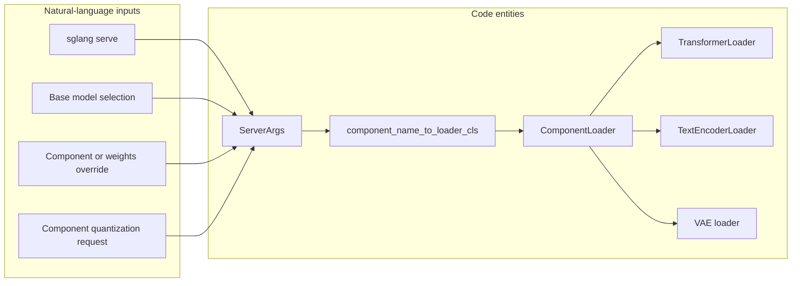
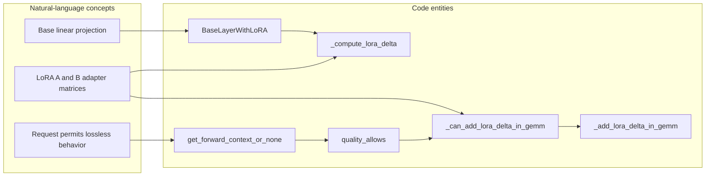
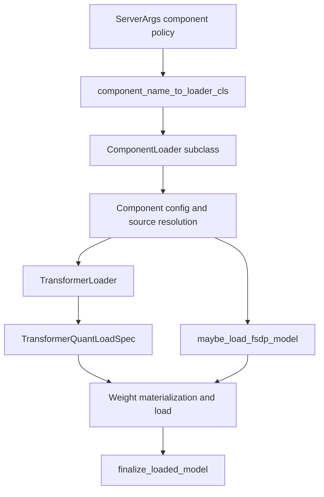

<!-- source: DeepWiki mcp.deepwiki.com · repo sgl-project/sglang · page 22.3 Diffusion API, Loading, and LoRA Support · fetched 2026-10-30 -->

# Diffusion API, Loading, and LoRA Support

Relevant source files

The following files were used as context for generating this wiki page:

- [docs/cookbook/diffusion/MiniMax/MiniMax-H3.mdx](docs/cookbook/diffusion/MiniMax/MiniMax-H3.mdx)
- [docs/docs/sglang-diffusion/cache_dit.mdx](docs/docs/sglang-diffusion/cache_dit.mdx)
- [docs/docs/sglang-diffusion/fused_kernels.mdx](docs/docs/sglang-diffusion/fused_kernels.mdx)
- [docs/docs/sglang-diffusion/quantization.mdx](docs/docs/sglang-diffusion/quantization.mdx)
- [python/sglang/kernels/jit/csrc/diffusion/interleaved_rope_fp64.cuh](python/sglang/kernels/jit/csrc/diffusion/interleaved_rope_fp64.cuh)
- [python/sglang/kernels/ops/diffusion/README.md](python/sglang/kernels/ops/diffusion/README.md)
- [python/sglang/kernels/ops/diffusion/__init__.py](python/sglang/kernels/ops/diffusion/__init__.py)
- [python/sglang/kernels/ops/diffusion/gemm/flux3_fp8_prims_ts.py](python/sglang/kernels/ops/diffusion/gemm/flux3_fp8_prims_ts.py)
- [python/sglang/kernels/ops/diffusion/gemm/flux3_nvfp4_prims_ts.py](python/sglang/kernels/ops/diffusion/gemm/flux3_nvfp4_prims_ts.py)
- [python/sglang/kernels/ops/diffusion/gemm/flux3_prims_ts_config.py](python/sglang/kernels/ops/diffusion/gemm/flux3_prims_ts_config.py)
- [python/sglang/kernels/ops/diffusion/modulate/conv_bias_epilogue_triton.py](python/sglang/kernels/ops/diffusion/modulate/conv_bias_epilogue_triton.py)
- [python/sglang/kernels/ops/diffusion/norm/cutedsl_common/norm_fusion.py](python/sglang/kernels/ops/diffusion/norm/cutedsl_common/norm_fusion.py)
- [python/sglang/kernels/ops/diffusion/norm/cutedsl_common/reduce.py](python/sglang/kernels/ops/diffusion/norm/cutedsl_common/reduce.py)
- [python/sglang/kernels/ops/diffusion/norm/scale_residual_norm_cutedsl.py](python/sglang/kernels/ops/diffusion/norm/scale_residual_norm_cutedsl.py)
- [python/sglang/kernels/ops/diffusion/norm/wan_rmsnorm_silu_triton.py](python/sglang/kernels/ops/diffusion/norm/wan_rmsnorm_silu_triton.py)
- [python/sglang/kernels/ops/diffusion/rope/interleaved_rope_fp64_jit.py](python/sglang/kernels/ops/diffusion/rope/interleaved_rope_fp64_jit.py)
- [python/sglang/kernels/ops/diffusion/rope/rmsnorm_interleaved_rope_cutedsl.py](python/sglang/kernels/ops/diffusion/rope/rmsnorm_interleaved_rope_cutedsl.py)
- [python/sglang/kernels/ops/mm/process/lanczos.py](python/sglang/kernels/ops/mm/process/lanczos.py)
- [python/sglang/multimodal_gen/configs/models/dits/ideogram.py](python/sglang/multimodal_gen/configs/models/dits/ideogram.py)
- [python/sglang/multimodal_gen/configs/models/dits/sana.py](python/sglang/multimodal_gen/configs/models/dits/sana.py)
- [python/sglang/multimodal_gen/configs/pipeline_configs/base.py](python/sglang/multimodal_gen/configs/pipeline_configs/base.py)
- [python/sglang/multimodal_gen/configs/pipeline_configs/flux.py](python/sglang/multimodal_gen/configs/pipeline_configs/flux.py)
- [python/sglang/multimodal_gen/configs/pipeline_configs/ideogram.py](python/sglang/multimodal_gen/configs/pipeline_configs/ideogram.py)
- [python/sglang/multimodal_gen/configs/pipeline_configs/qwen_image.py](python/sglang/multimodal_gen/configs/pipeline_configs/qwen_image.py)
- [python/sglang/multimodal_gen/configs/pipeline_configs/zimage.py](python/sglang/multimodal_gen/configs/pipeline_configs/zimage.py)
- [python/sglang/multimodal_gen/configs/sample/ideogram.py](python/sglang/multimodal_gen/configs/sample/ideogram.py)
- [python/sglang/multimodal_gen/configs/sample/zimage.py](python/sglang/multimodal_gen/configs/sample/zimage.py)
- [python/sglang/multimodal_gen/runtime/cache/cache_dit_integration.py](python/sglang/multimodal_gen/runtime/cache/cache_dit_integration.py)
- [python/sglang/multimodal_gen/runtime/entrypoints/cli/generate.py](python/sglang/multimodal_gen/runtime/entrypoints/cli/generate.py)
- [python/sglang/multimodal_gen/runtime/layers/flux3_fused_ops.py](python/sglang/multimodal_gen/runtime/layers/flux3_fused_ops.py)
- [python/sglang/multimodal_gen/runtime/layers/lora/linear.py](python/sglang/multimodal_gen/runtime/layers/lora/linear.py)
- [python/sglang/multimodal_gen/runtime/layers/quantization/__init__.py](python/sglang/multimodal_gen/runtime/layers/quantization/__init__.py)
- [python/sglang/multimodal_gen/runtime/layers/quantization/comfy_fp8.py](python/sglang/multimodal_gen/runtime/layers/quantization/comfy_fp8.py)
- [python/sglang/multimodal_gen/runtime/layers/quantization/configs/base_config.py](python/sglang/multimodal_gen/runtime/layers/quantization/configs/base_config.py)
- [python/sglang/multimodal_gen/runtime/layers/quantization/flux3_prims_ts.py](python/sglang/multimodal_gen/runtime/layers/quantization/flux3_prims_ts.py)
- [python/sglang/multimodal_gen/runtime/layers/quantization/gguf.py](python/sglang/multimodal_gen/runtime/layers/quantization/gguf.py)
- [python/sglang/multimodal_gen/runtime/layers/quantization/modelopt_quant.py](python/sglang/multimodal_gen/runtime/layers/quantization/modelopt_quant.py)
- [python/sglang/multimodal_gen/runtime/layers/quantization/weight_only_fp8.py](python/sglang/multimodal_gen/runtime/layers/quantization/weight_only_fp8.py)
- [python/sglang/multimodal_gen/runtime/loader/component_loaders/component_loader.py](python/sglang/multimodal_gen/runtime/loader/component_loaders/component_loader.py)
- [python/sglang/multimodal_gen/runtime/loader/component_loaders/image_encoder_loader.py](python/sglang/multimodal_gen/runtime/loader/component_loaders/image_encoder_loader.py)
- [python/sglang/multimodal_gen/runtime/loader/component_loaders/text_encoder_loader.py](python/sglang/multimodal_gen/runtime/loader/component_loaders/text_encoder_loader.py)
- [python/sglang/multimodal_gen/runtime/loader/component_loaders/transformer_loader.py](python/sglang/multimodal_gen/runtime/loader/component_loaders/transformer_loader.py)
- [python/sglang/multimodal_gen/runtime/loader/component_loaders/vae_loader.py](python/sglang/multimodal_gen/runtime/loader/component_loaders/vae_loader.py)
- [python/sglang/multimodal_gen/runtime/loader/gguf_weights.py](python/sglang/multimodal_gen/runtime/loader/gguf_weights.py)
- [python/sglang/multimodal_gen/runtime/loader/minimax_h3_weights.py](python/sglang/multimodal_gen/runtime/loader/minimax_h3_weights.py)
- [python/sglang/multimodal_gen/runtime/loader/transformer_load_utils.py](python/sglang/multimodal_gen/runtime/loader/transformer_load_utils.py)
- [python/sglang/multimodal_gen/runtime/managers/forward_context.py](python/sglang/multimodal_gen/runtime/managers/forward_context.py)
- [python/sglang/multimodal_gen/runtime/models/dits/glm_image.py](python/sglang/multimodal_gen/runtime/models/dits/glm_image.py)
- [python/sglang/multimodal_gen/runtime/models/dits/ideogram.py](python/sglang/multimodal_gen/runtime/models/dits/ideogram.py)
- [python/sglang/multimodal_gen/runtime/models/dits/joy_image.py](python/sglang/multimodal_gen/runtime/models/dits/joy_image.py)
- [python/sglang/multimodal_gen/runtime/models/dits/qwen_image.py](python/sglang/multimodal_gen/runtime/models/dits/qwen_image.py)
- [python/sglang/multimodal_gen/runtime/models/dits/sana.py](python/sglang/multimodal_gen/runtime/models/dits/sana.py)
- [python/sglang/multimodal_gen/runtime/models/dits/sana_video.py](python/sglang/multimodal_gen/runtime/models/dits/sana_video.py)
- [python/sglang/multimodal_gen/runtime/models/dits/wanvideo.py](python/sglang/multimodal_gen/runtime/models/dits/wanvideo.py)
- [python/sglang/multimodal_gen/runtime/models/encoders/base.py](python/sglang/multimodal_gen/runtime/models/encoders/base.py)
- [python/sglang/multimodal_gen/runtime/models/encoders/ideogram.py](python/sglang/multimodal_gen/runtime/models/encoders/ideogram.py)
- [python/sglang/multimodal_gen/runtime/models/encoders/minimax_h3_qwen3vl.py](python/sglang/multimodal_gen/runtime/models/encoders/minimax_h3_qwen3vl.py)
- [python/sglang/multimodal_gen/runtime/models/vaes/wan_vae_cuda_opt.py](python/sglang/multimodal_gen/runtime/models/vaes/wan_vae_cuda_opt.py)
- [python/sglang/multimodal_gen/runtime/models/vaes/wanvae.py](python/sglang/multimodal_gen/runtime/models/vaes/wanvae.py)
- [python/sglang/multimodal_gen/runtime/models/vocoder/ltx_2_vocoder.py](python/sglang/multimodal_gen/runtime/models/vocoder/ltx_2_vocoder.py)
- [python/sglang/multimodal_gen/runtime/pipelines/flux3_image.py](python/sglang/multimodal_gen/runtime/pipelines/flux3_image.py)
- [python/sglang/multimodal_gen/runtime/pipelines/ideogram.py](python/sglang/multimodal_gen/runtime/pipelines/ideogram.py)
- [python/sglang/multimodal_gen/runtime/pipelines_core/lora/pipeline.py](python/sglang/multimodal_gen/runtime/pipelines_core/lora/pipeline.py)
- [python/sglang/multimodal_gen/runtime/pipelines_core/stages/decoding.py](python/sglang/multimodal_gen/runtime/pipelines_core/stages/decoding.py)
- [python/sglang/multimodal_gen/runtime/pipelines_core/stages/denoising.py](python/sglang/multimodal_gen/runtime/pipelines_core/stages/denoising.py)
- [python/sglang/multimodal_gen/runtime/pipelines_core/stages/image_encoding.py](python/sglang/multimodal_gen/runtime/pipelines_core/stages/image_encoding.py)
- [python/sglang/multimodal_gen/runtime/pipelines_core/stages/input_validation.py](python/sglang/multimodal_gen/runtime/pipelines_core/stages/input_validation.py)
- [python/sglang/multimodal_gen/runtime/pipelines_core/stages/model_specific_stages/cosmos3_simulation/transfer.py](python/sglang/multimodal_gen/runtime/pipelines_core/stages/model_specific_stages/cosmos3_simulation/transfer.py)
- [python/sglang/multimodal_gen/runtime/pipelines_core/stages/model_specific_stages/ideogram.py](python/sglang/multimodal_gen/runtime/pipelines_core/stages/model_specific_stages/ideogram.py)
- [python/sglang/multimodal_gen/runtime/pipelines_core/stages/progressive_resolution/denoising.py](python/sglang/multimodal_gen/runtime/pipelines_core/stages/progressive_resolution/denoising.py)
- [python/sglang/multimodal_gen/runtime/pipelines_core/stages/progressive_resolution/flux.py](python/sglang/multimodal_gen/runtime/pipelines_core/stages/progressive_resolution/flux.py)
- [python/sglang/multimodal_gen/runtime/pipelines_core/stages/progressive_resolution/ideogram.py](python/sglang/multimodal_gen/runtime/pipelines_core/stages/progressive_resolution/ideogram.py)
- [python/sglang/multimodal_gen/runtime/pipelines_core/stages/progressive_resolution/qwen_image.py](python/sglang/multimodal_gen/runtime/pipelines_core/stages/progressive_resolution/qwen_image.py)
- [python/sglang/multimodal_gen/runtime/pipelines_core/stages/progressive_resolution/wan.py](python/sglang/multimodal_gen/runtime/pipelines_core/stages/progressive_resolution/wan.py)
- [python/sglang/multimodal_gen/runtime/pipelines_core/stages/text_encoding.py](python/sglang/multimodal_gen/runtime/pipelines_core/stages/text_encoding.py)
- [python/sglang/multimodal_gen/runtime/utils/common.py](python/sglang/multimodal_gen/runtime/utils/common.py)
- [python/sglang/multimodal_gen/runtime/utils/hf_diffusers_utils.py](python/sglang/multimodal_gen/runtime/utils/hf_diffusers_utils.py)
- [python/sglang/multimodal_gen/runtime/utils/image_io.py](python/sglang/multimodal_gen/runtime/utils/image_io.py)
- [python/sglang/multimodal_gen/runtime/utils/logging_utils.py](python/sglang/multimodal_gen/runtime/utils/logging_utils.py)
- [python/sglang/multimodal_gen/runtime/utils/model_overlay.py](python/sglang/multimodal_gen/runtime/utils/model_overlay.py)
- [python/sglang/multimodal_gen/runtime/utils/nvtx_pytorch_hooks.py](python/sglang/multimodal_gen/runtime/utils/nvtx_pytorch_hooks.py)
- [python/sglang/multimodal_gen/runtime/utils/precision.py](python/sglang/multimodal_gen/runtime/utils/precision.py)
- [python/sglang/multimodal_gen/runtime/utils/quantization_utils.py](python/sglang/multimodal_gen/runtime/utils/quantization_utils.py)
- [python/sglang/multimodal_gen/runtime/utils/vision.py](python/sglang/multimodal_gen/runtime/utils/vision.py)
- [python/sglang/multimodal_gen/test/scripts/gen_perf_baselines.py](python/sglang/multimodal_gen/test/scripts/gen_perf_baselines.py)
- [python/sglang/multimodal_gen/test/server/ascend/perf_baselines_npu.json](python/sglang/multimodal_gen/test/server/ascend/perf_baselines_npu.json)
- [python/sglang/multimodal_gen/test/server/ascend/testcase_configs_npu.py](python/sglang/multimodal_gen/test/server/ascend/testcase_configs_npu.py)
- [python/sglang/multimodal_gen/test/unit/manual/bench_lora_merge_addmm.py](python/sglang/multimodal_gen/test/unit/manual/bench_lora_merge_addmm.py)
- [python/sglang/multimodal_gen/test/unit/progressive_resolution/test_progressive.py](python/sglang/multimodal_gen/test/unit/progressive_resolution/test_progressive.py)
- [python/sglang/multimodal_gen/test/unit/sana_wm/test_streaming_realtime_path.py](python/sglang/multimodal_gen/test/unit/sana_wm/test_streaming_realtime_path.py)
- [python/sglang/multimodal_gen/test/unit/test_cache_dit_integration.py](python/sglang/multimodal_gen/test/unit/test_cache_dit_integration.py)
- [python/sglang/multimodal_gen/test/unit/test_cache_dit_per_request.py](python/sglang/multimodal_gen/test/unit/test_cache_dit_per_request.py)
- [python/sglang/multimodal_gen/test/unit/test_decoding_stage_parallelism.py](python/sglang/multimodal_gen/test/unit/test_decoding_stage_parallelism.py)
- [python/sglang/multimodal_gen/test/unit/test_flux3_image_served.py](python/sglang/multimodal_gen/test/unit/test_flux3_image_served.py)
- [python/sglang/multimodal_gen/test/unit/test_gguf_diffusion.py](python/sglang/multimodal_gen/test/unit/test_gguf_diffusion.py)
- [python/sglang/multimodal_gen/test/unit/test_hf_diffusers_utils.py](python/sglang/multimodal_gen/test/unit/test_hf_diffusers_utils.py)
- [python/sglang/multimodal_gen/test/unit/test_ideogram4.py](python/sglang/multimodal_gen/test/unit/test_ideogram4.py)
- [python/sglang/multimodal_gen/test/unit/test_ideogram_rope_swiglu_fusion.py](python/sglang/multimodal_gen/test/unit/test_ideogram_rope_swiglu_fusion.py)
- [python/sglang/multimodal_gen/test/unit/test_image_encoder_loader.py](python/sglang/multimodal_gen/test/unit/test_image_encoder_loader.py)
- [python/sglang/multimodal_gen/test/unit/test_input_validation.py](python/sglang/multimodal_gen/test/unit/test_input_validation.py)
- [python/sglang/multimodal_gen/test/unit/test_logging_utils.py](python/sglang/multimodal_gen/test/unit/test_logging_utils.py)
- [python/sglang/multimodal_gen/test/unit/test_lora_auto_merge_rounding.py](python/sglang/multimodal_gen/test/unit/test_lora_auto_merge_rounding.py)
- [python/sglang/multimodal_gen/test/unit/test_lora_commit_as_base.py](python/sglang/multimodal_gen/test/unit/test_lora_commit_as_base.py)
- [python/sglang/multimodal_gen/test/unit/test_lora_dynamic_delta_in_gemm.py](python/sglang/multimodal_gen/test/unit/test_lora_dynamic_delta_in_gemm.py)
- [python/sglang/multimodal_gen/test/unit/test_lora_inference_mode.py](python/sglang/multimodal_gen/test/unit/test_lora_inference_mode.py)
- [python/sglang/multimodal_gen/test/unit/test_lora_pipeline.py](python/sglang/multimodal_gen/test/unit/test_lora_pipeline.py)
- [python/sglang/multimodal_gen/test/unit/test_model_overlay.py](python/sglang/multimodal_gen/test/unit/test_model_overlay.py)
- [python/sglang/multimodal_gen/test/unit/test_modelopt_checkpoint_tools.py](python/sglang/multimodal_gen/test/unit/test_modelopt_checkpoint_tools.py)
- [python/sglang/multimodal_gen/test/unit/test_nvtx_pytorch_hooks.py](python/sglang/multimodal_gen/test/unit/test_nvtx_pytorch_hooks.py)
- [python/sglang/multimodal_gen/test/unit/test_precision_consistency.py](python/sglang/multimodal_gen/test/unit/test_precision_consistency.py)
- [python/sglang/multimodal_gen/test/unit/test_sana_video.py](python/sglang/multimodal_gen/test/unit/test_sana_video.py)
- [python/sglang/multimodal_gen/test/unit/test_text_encoder_loader.py](python/sglang/multimodal_gen/test/unit/test_text_encoder_loader.py)
- [python/sglang/multimodal_gen/test/unit/test_text_encoding_cache.py](python/sglang/multimodal_gen/test/unit/test_text_encoding_cache.py)
- [python/sglang/multimodal_gen/test/unit/test_transformer_quant.py](python/sglang/multimodal_gen/test/unit/test_transformer_quant.py)
- [python/sglang/multimodal_gen/test/unit/test_vae_decoder_store.py](python/sglang/multimodal_gen/test/unit/test_vae_decoder_store.py)
- [python/sglang/multimodal_gen/test/unit/test_vae_loader.py](python/sglang/multimodal_gen/test/unit/test_vae_loader.py)
- [python/sglang/multimodal_gen/test/unit/test_wan_temb_table_slices.py](python/sglang/multimodal_gen/test/unit/test_wan_temb_table_slices.py)
- [python/sglang/multimodal_gen/test/unit/test_wan_vae_attention_rows.py](python/sglang/multimodal_gen/test/unit/test_wan_vae_attention_rows.py)
- [python/sglang/multimodal_gen/test/unit/test_wan_vae_dupup.py](python/sglang/multimodal_gen/test/unit/test_wan_vae_dupup.py)
- [python/sglang/multimodal_gen/test/unit/test_weight_only_fp8_dequant_cache.py](python/sglang/multimodal_gen/test/unit/test_weight_only_fp8_dequant_cache.py)
- [python/sglang/multimodal_gen/test/unit/test_zimage_pipeline_config.py](python/sglang/multimodal_gen/test/unit/test_zimage_pipeline_config.py)
- [python/sglang/multimodal_gen/test/unit/test_zmq_bind_port.py](python/sglang/multimodal_gen/test/unit/test_zmq_bind_port.py)
- [python/sglang/multimodal_gen/tools/build_modelopt_fp8_transformer.py](python/sglang/multimodal_gen/tools/build_modelopt_fp8_transformer.py)
- [python/sglang/multimodal_gen/tools/build_modelopt_nvfp4_transformer.py](python/sglang/multimodal_gen/tools/build_modelopt_nvfp4_transformer.py)
- [python/sglang/multimodal_gen/tools/modelopt_checkpoint.py](python/sglang/multimodal_gen/tools/modelopt_checkpoint.py)
- [test/registered/kernels/benchmark/diffusion/bench_interleaved_rope_fp64.py](test/registered/kernels/benchmark/diffusion/bench_interleaved_rope_fp64.py)
- [test/registered/kernels/ops/diffusion/test_conv_bias_epilogue.py](test/registered/kernels/ops/diffusion/test_conv_bias_epilogue.py)
- [test/registered/kernels/ops/diffusion/test_interleaved_rope_fp64.py](test/registered/kernels/ops/diffusion/test_interleaved_rope_fp64.py)
- [test/registered/kernels/ops/diffusion/test_model_fast_paths.py](test/registered/kernels/ops/diffusion/test_model_fast_paths.py)
- [test/registered/kernels/ops/diffusion/test_norm.py](test/registered/kernels/ops/diffusion/test_norm.py)
- [test/registered/kernels/ops/diffusion/test_rmsnorm_interleaved_rope.py](test/registered/kernels/ops/diffusion/test_rmsnorm_interleaved_rope.py)
- [test/registered/kernels/ops/diffusion/test_wan_norm_silu_post.py](test/registered/kernels/ops/diffusion/test_wan_norm_silu_post.py)

## Purpose and Scope

This page describes the SGLang Diffusion serving interface and the component-loading path for image and video generation. It covers request and server configuration concepts, component-specific loading and FSDP, checkpoint quantization, LoRA linear layers, cache-DiT integration, and the encoding and denoising stages. The available implementation excerpts provide detailed loader and quantization behavior; API-route and cache-integration details are limited to the cited references. [docs/cookbook/diffusion/MiniMax/MiniMax-H3.mdx:14-40](), [docs/docs/sglang-diffusion/quantization.mdx:8-29](), [python/sglang/multimodal_gen/runtime/loader/component_loaders/component_loader.py:147-178](), [python/sglang/multimodal_gen/runtime/layers/lora/linear.py:47-77]()

Sources: [docs/cookbook/diffusion/MiniMax/MiniMax-H3.mdx:14-40](), [docs/docs/sglang-diffusion/quantization.mdx:8-29](), [python/sglang/multimodal_gen/runtime/loader/component_loaders/component_loader.py:147-178](), [python/sglang/multimodal_gen/runtime/layers/lora/linear.py:47-77]()

---

## 1. OpenAI-Compatible API and Server Arguments (`ServerArgs`)

SGLang Diffusion documentation describes a serving path based on `sglang serve`, alongside `sglang generate` for generation. Server and request choices are separate: server options configure deployment and model setup, while request options control sampling without reloading the model. The available source excerpts do not include the OpenAI route implementations or the `ServerArgs` definition, so endpoint schemas and the full argument list are not specified here. [docs/cookbook/diffusion/MiniMax/MiniMax-H3.mdx:14-27]()

### Generation Interface and Entrypoints

The documented MiniMax-H3 recipe uses the normal `sglang serve` path. It selects a model variant at server startup; for H3, `fl2va` covers text-to-video-and-audio and first/last-frame conditioning, while `ref2va` serves reference-conditioned requests. A video-to-video use case is described as `ref2va` with a video reference condition, not as a separate task value. These are H3-specific documented behaviors, not a general API contract for every diffusion model. [docs/cookbook/diffusion/MiniMax/MiniMax-H3.mdx:35-37](), [docs/cookbook/diffusion/MiniMax/MiniMax-H3.mdx:48-65]()

The MiniMax-H3 cookbook says that the server command builder supplies a recommended encoder policy. It also distinguishes that startup configuration from request options, which do not reload the model. Conditioned requests may require a host media directory mounted into the deployment. [docs/cookbook/diffusion/MiniMax/MiniMax-H3.mdx:18-33]()

### Server Arguments and Configuration

The quantization documentation establishes a component-oriented configuration contract:

| Input or operation | Configuration | Effect |
| --- | --- | --- |
| Base model | `--model-path` | Selects the base model. |
| Component repository or directory | `--component-paths.<component>` | Replaces that component’s configuration and weights. |
| Component weights only | `--component-weights-paths.<component>` | Keeps the base component configuration and substitutes its weights. |
| Online component quantization | `--component-quantizations.<component>` | Requests an online quantization implementation for that component. |
| Online quantization exclusions | `--component-quantization-ignored-layers.<component>` | Excludes matching layers from component quantization. |
| Primary-transformer aliases | `--transformer-path`, `--transformer-weights-path`, `--quantization` | Convenience spellings for pipelines with one primary DiT. |
| Causal KV-cache quantization | `--kv-cache-quant` | Quantizes completed runtime cache chunks; it does not quantize checkpoint weights. |

The component key must correspond to a real entry in the model’s `model_index.json` or native pipeline registry. Names such as `transformer`, `transformer_2`, `text_encoder`, `video_vae`, and `audio_vae` are examples rather than universal component names. [docs/docs/sglang-diffusion/quantization.mdx:18-29]()

The MiniMax-H3 server recipe additionally exposes `--model-variant` for choosing the checkpoint partition. The cookbook advises selecting a Hub root model ID and allowing SGLang to map the variant to its checkpoint directory, rather than pointing `--model-path` at a manually downloaded subdirectory. [docs/cookbook/diffusion/MiniMax/MiniMax-H3.mdx:60-65]()

### API and Runtime Dataflow

At the model-configuration boundary, the request or server selection determines the model and component inputs. The component loader registry maps component names to loader classes; `ComponentLoader` records the component architecture and type and provides structural-name normalization. Specialized loaders then resolve and materialize the component weights. [python/sglang/multimodal_gen/runtime/loader/component_loaders/component_loader.py:147-178](), [docs/docs/sglang-diffusion/quantization.mdx:18-29]()

Title: "Serving Configuration to Component Loader Entities"

Sources: [python/sglang/multimodal_gen/runtime/loader/component_loaders/component_loader.py:147-178](), [python/sglang/multimodal_gen/runtime/loader/component_loaders/transformer_loader.py:159-168](), [python/sglang/multimodal_gen/runtime/loader/component_loaders/text_encoder_loader.py:76-87](), [python/sglang/multimodal_gen/runtime/loader/component_loaders/vae_loader.py:18-38](), [docs/docs/sglang-diffusion/quantization.mdx:18-29]()

Sources: [docs/cookbook/diffusion/MiniMax/MiniMax-H3.mdx:14-37](), [docs/cookbook/diffusion/MiniMax/MiniMax-H3.mdx:48-65](), [docs/docs/sglang-diffusion/quantization.mdx:18-29](), [python/sglang/multimodal_gen/runtime/loader/component_loaders/component_loader.py:147-178]()

---

## 2. LoRA Adapter Support and State Normalization

Diffusion LoRA support includes linear-layer wrappers that keep base-layer weights and adapter weights distinct. The shown implementation supports regular two-dimensional LoRA matrices and grouped three-dimensional matrices, and defines a request-quality check used by a lossless fused-add path. [python/sglang/multimodal_gen/runtime/layers/lora/linear.py:47-77](), [python/sglang/multimodal_gen/runtime/layers/lora/linear.py:80-142](), [python/sglang/multimodal_gen/runtime/layers/lora/linear.py:145-183]()

### LoRA Linear-Layer Behavior

`BaseLayerWithLoRA` wraps a base module and maintains adapter-related state, including `lora_weights_list`, `lora_path`, `strength`, and a disabled-by-default flag. Its optional CPU base-weight snapshot can be cloned, or represented as a view under the implementation’s restricted copy-merge conditions. [python/sglang/multimodal_gen/runtime/layers/lora/linear.py:145-183]()

`_compute_lora_delta` computes the ordinary projection as `x @ lora_A.T @ lora_B.T`. For stacked projections it uses grouped `einsum` operations and flattens the group and output dimensions; it rejects incompatible ranks or mismatched group counts. [python/sglang/multimodal_gen/runtime/layers/lora/linear.py:59-77]()

The optional `_add_lora_delta_in_gemm` path accumulates the scaled delta into the output through the second GEMM rather than materializing the full delta. `_can_add_lora_delta_in_gemm` limits this path to matching 2D or 3D adapter tensors, compatible stacked group counts, contiguous output, and a request quality that allows lossless behavior. [python/sglang/multimodal_gen/runtime/layers/lora/linear.py:80-142]()

### LoRA Application Path

Title: "LoRA Linear Update and Code Entities"

Sources: [python/sglang/multimodal_gen/runtime/layers/lora/linear.py:16-23](), [python/sglang/multimodal_gen/runtime/layers/lora/linear.py:59-77](), [python/sglang/multimodal_gen/runtime/layers/lora/linear.py:80-142](), [python/sglang/multimodal_gen/runtime/layers/lora/linear.py:145-183]()

Sources: [python/sglang/multimodal_gen/runtime/layers/lora/linear.py:16-23](), [python/sglang/multimodal_gen/runtime/layers/lora/linear.py:47-77](), [python/sglang/multimodal_gen/runtime/layers/lora/linear.py:80-183]()

---

## 3. FSDP Model Loading and Component Architecture

Component loading separates the model’s component configuration from its weight source. A component path selects both config and weights, while a component-weights path retains the base config and replaces only weights. [docs/docs/sglang-diffusion/quantization.mdx:18-29](), [docs/docs/sglang-diffusion/quantization.mdx:61-88]()

### FSDP Loading Mechanics

`fsdp_load.py` imports PyTorch FSDP primitives including `fully_shard`, `DeviceMesh`, `MixedPrecisionPolicy`, and `CPUOffloadPolicy`. It also contains shard-condition selection: explicit conditions take precedence, then model-declared repeated/no-split block classes, then common numbered block names. [python/sglang/multimodal_gen/runtime/loader/fsdp_load.py:14-25](), [python/sglang/multimodal_gen/runtime/loader/fsdp_load.py:144-180]()

The component-loader base imports `maybe_load_fsdp_model` and exposes `should`-style component policy through `ServerArgs` usage in specialized loaders. Quantized checkpoint handling is not automatically interchangeable with FSDP placement: the chosen loader must understand the serialized quantization format, and some quantized states require dedicated handling. [python/sglang/multimodal_gen/runtime/loader/component_loaders/component_loader.py:33-46](), [docs/docs/sglang-diffusion/quantization.mdx:61-88]()

### Model Component Loaders

| Loader or component family | Responsibilities evidenced by the implementation |
| --- | --- |
| `TransformerLoader` | Shared loader for DiT transformer components, including `transformer`, `unconditional_transformer`, `audio_dit`, and `video_dit`. It resolves component-specific server-argument overrides and provides component attention-backend context. |
| Text encoder loader | Resolves encoder quantization configuration, supports an SRT FP8 checkpoint adapter for eligible tensor-parallel encoders, and can delegate serialized quantization to Transformers when that library owns the format. |
| VAE loader | Checks quantized-checkpoint metadata before selecting a loader path; supports precision and memory-layout logic, including optional `channels_last_3d` conversion for selected VAE components and pipeline/platform combinations. |
| `ComponentLoader` | Base class for component-specific loaders; subclasses register component names in `component_name_to_loader_cls` when imported. |

[python/sglang/multimodal_gen/runtime/loader/component_loaders/transformer_loader.py:101-183](), [python/sglang/multimodal_gen/runtime/loader/component_loaders/text_encoder_loader.py:127-183](), [python/sglang/multimodal_gen/runtime/loader/component_loaders/vae_loader.py:62-100](), [python/sglang/multimodal_gen/runtime/loader/component_loaders/vae_loader.py:116-166](), [python/sglang/multimodal_gen/runtime/loader/component_loaders/component_loader.py:147-164]()

### Component Model Loading Flow

`TransformerLoader` resolves transformer checkpoint files and a `TransformerQuantLoadSpec` through helpers in `transformer_load_utils.py`. That spec records the selected safetensors files or a GGUF file, quantization configuration, parameter dtype, and any post-load processing hooks. [python/sglang/multimodal_gen/runtime/loader/component_loaders/transformer_loader.py:30-36](), [python/sglang/multimodal_gen/runtime/loader/transformer_load_utils.py:151-168](), [python/sglang/multimodal_gen/runtime/loader/component_loaders/component_loader.py:33-46]()

Title: "Component Loading and FSDP/Quantization Planning"

Sources: [python/sglang/multimodal_gen/runtime/loader/component_loaders/component_loader.py:33-46](), [python/sglang/multimodal_gen/runtime/loader/component_loaders/component_loader.py:147-178](), [python/sglang/multimodal_gen/runtime/loader/component_loaders/transformer_loader.py:30-36](), [python/sglang/multimodal_gen/runtime/loader/transformer_load_utils.py:151-168](), [python/sglang/multimodal_gen/runtime/loader/fsdp_load.py:14-25]()

Sources: [python/sglang/multimodal_gen/runtime/loader/component_loaders/component_loader.py:33-46](), [python/sglang/multimodal_gen/runtime/loader/component_loaders/component_loader.py:147-178](), [python/sglang/multimodal_gen/runtime/loader/component_loaders/transformer_loader.py:101-183](), [python/sglang/multimodal_gen/runtime/loader/transformer_load_utils.py:151-168](), [python/sglang/multimodal_gen/runtime/loader/fsdp_load.py:14-25](), [python/sglang/multimodal_gen/runtime/loader/fsdp_load.py:144-180]()

---

## 4. Quantization Systems and Optimization

Diffusion quantization is component-scoped. Selecting a component source and materializing its quantized checkpoint are distinct operations. [docs/docs/sglang-diffusion/quantization.mdx:8-12](), [docs/docs/sglang-diffusion/quantization.mdx:61-88]()

### Quantization Configuration Resolution

`TransformerQuantLoadSpec` represents the resolved transformer loading plan. It contains a safetensors file list, a quantization config, optional Nunchaku config, parameter dtype, a device-weight postprocess flag, post-load hooks, and an optional GGUF file. Its `runtime_quant_config` property selects the standard quantization config when present and otherwise returns the Nunchaku config. [python/sglang/multimodal_gen/runtime/loader/transformer_load_utils.py:151-168]()

The transformer loader resolves a quantized attention backend only for ModelOpt FP4 on Blackwell, and only when no global, component, or server-level attention backend has been forced. In that case, its default is `AttentionBackendEnum.FA`. [python/sglang/multimodal_gen/runtime/loader/component_loaders/transformer_loader.py:72-85]()

For ModelOpt NVFP4, safetensors-derived layout information can supersede a stale `config.json` exclusion list while preserving other explicit settings such as packed-module mapping, nibble swapping, scale layout, and group size. [python/sglang/multimodal_gen/runtime/loader/transformer_load_utils.py:82-148]()

### Quantization Families and Loader Constraints

| Family or path | Relevant behavior |
| --- | --- |
| ModelOpt FP4 / NVFP4 | Runtime helpers normalize serialized NVFP4 weight bytes and transform scale layouts. The transformer load utilities can infer checkpoint layout from safetensors metadata. |
| FP8 | The FSDP loader includes `_maybe_dequantize_fp8` for cases where a checkpoint stores FP8 weights but a model parameter expects higher precision. The text encoder loader has a specific SRT adapter for serialized FP8 configurations. |
| BitsAndBytes 4-bit | FSDP loading includes helpers to build, split, and attach 4-bit quantization state. |
| Nunchaku | The transformer quant-load plan can carry a `NunchakuConfig`; format-specific validation and scale patching are delegated to helper code. |
| Online quantization | Component-level CLI flags request a supported implementation for unquantized weights. The quantization documentation lists `fp8`, `convrot_int8`, and `mxfp4` as online encoder quantization names in the shown loader excerpt. |
| GGUF | Transformer load utilities can represent a GGUF checkpoint in the load plan; the text encoder loader imports GGUF metadata and iteration helpers. |

[python/sglang/multimodal_gen/runtime/layers/quantization/modelopt_quant.py:67-96](), [python/sglang/multimodal_gen/runtime/loader/transformer_load_utils.py:82-148](), [python/sglang/multimodal_gen/runtime/loader/transformer_load_utils.py:151-168](), [python/sglang/multimodal_gen/runtime/loader/fsdp_load.py:35-38](), [python/sglang/multimodal_gen/runtime/loader/fsdp_load.py:183-195](), [python/sglang/multimodal_gen/runtime/loader/component_loaders/text_encoder_loader.py:112-112](), [python/sglang/multimodal_gen/runtime/loader/component_loaders/text_encoder_loader.py:147-183](), [docs/docs/sglang-diffusion/quantization.mdx:18-24]()

### Checkpoint Selection and Failure Behavior

Use a component path when replacing both the component configuration and weights; use a component-weights path when retaining the base component config. Unsupported or ambiguous formats are rejected or routed to an upstream library loader rather than silently treated as an unquantized state dict. [docs/docs/sglang-diffusion/quantization.mdx:18-24](), [docs/docs/sglang-diffusion/quantization.mdx:54-88]()

The VAE loader parses checkpoint quantization metadata and raises `ComponentCheckpointUnsupportedError` for unsupported native-only, direct-GPU, or metadata cases. When the checkpoint declares a supported top-level `quantization_config` that the native VAE loader cannot restore, it raises `NativeComponentLoaderRequired` to route loading through Diffusers. [python/sglang/multimodal_gen/runtime/loader/component_loaders/vae_loader.py:62-100]()

Sources: [docs/docs/sglang-diffusion/quantization.mdx:8-12](), [docs/docs/sglang-diffusion/quantization.mdx:18-29](), [docs/docs/sglang-diffusion/quantization.mdx:54-88](), [python/sglang/multimodal_gen/runtime/loader/transformer_load_utils.py:82-168](), [python/sglang/multimodal_gen/runtime/loader/component_loaders/transformer_loader.py:72-85](), [python/sglang/multimodal_gen/runtime/layers/quantization/modelopt_quant.py:67-96](), [python/sglang/multimodal_gen/runtime/loader/fsdp_load.py:183-195](), [python/sglang/multimodal_gen/runtime/loader/component_loaders/vae_loader.py:62-100]()

---

## 5. Caching Integration (Cache-DiT)

Cache-DiT is an explicit diffusion runtime integration (`python/sglang/multimodal_gen/runtime/cache/cache_dit_integration.py`), and its behavior should be verified in that module rather than inferred from general checkpoint loading or LoRA code. [python/sglang/multimodal_gen/runtime/cache/cache_dit_integration.py](), [python/sglang/multimodal_gen/test/unit/test_cache_dit_integration.py]()

Sources: [python/sglang/multimodal_gen/runtime/cache/cache_dit_integration.py](), [python/sglang/multimodal_gen/test/unit/test_cache_dit_integration.py](), [docs/cookbook/diffusion/MiniMax/MiniMax-H3.mdx:18-27]()

---

## 6. Encoding and Denoising Pipeline Stages

Diffusion pipelines are composed from model components and stage implementations. [python/sglang/multimodal_gen/runtime/pipelines_core/composed_pipeline_base.py](), [python/sglang/multimodal_gen/runtime/pipelines_core/stages/decoding.py](), [python/sglang/multimodal_gen/runtime/pipelines_core/stages/input_validation.py]()

### Conditioning and Encoding

The component-loading system supports text encoder, image encoder, transformer, and VAE component families. Text-encoder loading imports configuration, model registry, tensor-parallel helpers, checkpoint iterators, and quantization utilities; the VAE loader handles VAE-specific checkpoint and precision concerns. [python/sglang/multimodal_gen/runtime/loader/component_loaders/text_encoder_loader.py:11-24](), [python/sglang/multimodal_gen/runtime/loader/component_loaders/text_encoder_loader.py:66-100](), [python/sglang/multimodal_gen/runtime/loader/component_loaders/vae_loader.py:10-38]()

For MiniMax-H3, documented request conditioning includes text-only generation, ordered first/last keyframes, and image, video, or audio references depending on task and variant. [docs/cookbook/diffusion/MiniMax/MiniMax-H3.mdx:42-65]()

### Denoising and Output Decoding

The provided excerpts establish that `TransformerLoader` is shared by video/audio DiT transformers and that `VAE` components have dedicated loading behavior. [python/sglang/multimodal_gen/runtime/loader/component_loaders/transformer_loader.py:159-168](), [python/sglang/multimodal_gen/runtime/loader/component_loaders/vae_loader.py:18-38](), [python/sglang/multimodal_gen/runtime/pipelines_core/stages/decoding.py]()

### Loader-to-Pipeline Boundary

Title: "Component Roles at the Diffusion Pipeline Boundary"

Sources: [python/sglang/multimodal_gen/runtime/loader/component_loaders/text_encoder_loader.py:11-24](), [python/sglang/multimodal_gen/runtime/loader/component_loaders/transformer_loader.py:159-168](), [python/sglang/multimodal_gen/runtime/loader/component_loaders/vae_loader.py:18-38](), [docs/cookbook/diffusion/MiniMax/MiniMax-H3.mdx:48-58]()

Sources: [python/sglang/multimodal_gen/runtime/loader/component_loaders/text_encoder_loader.py:11-24](), [python/sglang/multimodal_gen/runtime/loader/component_loaders/transformer_loader.py:159-168](), [python/sglang/multimodal_gen/runtime/loader/component_loaders/vae_loader.py:18-38](), [docs/cookbook/diffusion/MiniMax/MiniMax-H3.mdx:48-65](), [python/sglang/multimodal_gen/runtime/pipelines_core/composed_pipeline_base.py](), [python/sglang/multimodal_gen/runtime/pipelines/ltx_2_pipeline.py]()

---

## Summary

SGLang Diffusion exposes server and generation workflows, with component-level configuration that separates the base model, component repositories, component weight overrides, and online quantization. Specialized loaders resolve transformer, encoder, and VAE checkpoints; FSDP support provides a sharding path, while quantization handling is loader- and format-dependent. [docs/cookbook/diffusion/MiniMax/MiniMax-H3.mdx:14-27](), [docs/docs/sglang-diffusion/quantization.mdx:18-29](), [python/sglang/multimodal_gen/runtime/loader/component_loaders/component_loader.py:147-178](), [python/sglang/multimodal_gen/runtime/loader/transformer_load_utils.py:151-168](), [python/sglang/multimodal_gen/runtime/loader/fsdp_load.py:144-180](), [python/sglang/multimodal_gen/runtime/layers/lora/linear.py:59-77]()

Sources: [docs/cookbook/diffusion/MiniMax/MiniMax-H3.mdx:14-27](), [docs/docs/sglang-diffusion/quantization.mdx:18-29](), [python/sglang/multimodal_gen/runtime/loader/component_loaders/component_loader.py:147-178](), [python/sglang/multimodal_gen/runtime/loader/transformer_load_utils.py:151-168](), [python/sglang/multimodal_gen/runtime/loader/fsdp_load.py:144-180](), [python/sglang/multimodal_gen/runtime/layers/lora/linear.py:59-77]()

---

