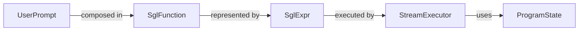
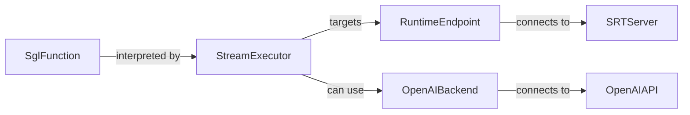

<!-- source: DeepWiki mcp.deepwiki.com · repo sgl-project/sglang · page 23 SGLang Frontend Language · fetched 2026-10-30 -->

# SGLang Frontend Language

Relevant source files

The following files were used as context for generating this wiki page:

- [.github/workflows/release-pypi-nightly.yml](.github/workflows/release-pypi-nightly.yml)
- [.github/workflows/release-pypi-pr.yml](.github/workflows/release-pypi-pr.yml)
- [3rdparty/amd/wheel/sglang/pyproject.toml](3rdparty/amd/wheel/sglang/pyproject.toml)
- [docker/Dockerfile](docker/Dockerfile)
- [python/pyproject.toml](python/pyproject.toml)
- [python/pyproject_cpu.toml](python/pyproject_cpu.toml)
- [python/pyproject_npu.toml](python/pyproject_npu.toml)
- [python/pyproject_other.toml](python/pyproject_other.toml)
- [python/pyproject_xpu.toml](python/pyproject_xpu.toml)
- [python/sglang/srt/entrypoints/engine.py](python/sglang/srt/entrypoints/engine.py)
- [python/sglang/srt/function_call/deepseekv32_detector.py](python/sglang/srt/function_call/deepseekv32_detector.py)
- [python/sglang/srt/function_call/kimik2_detector.py](python/sglang/srt/function_call/kimik2_detector.py)
- [python/sglang/srt/utils/common.py](python/sglang/srt/utils/common.py)
- [python/sglang/srt/utils/json_response.py](python/sglang/srt/utils/json_response.py)
- [scripts/update_nightly_whl_index.py](scripts/update_nightly_whl_index.py)
- [test/registered/function_call/test_kimik2_detector.py](test/registered/function_call/test_kimik2_detector.py)
- [test/registered/moe/test_cutedsl_moe.py](test/registered/moe/test_cutedsl_moe.py)
- [test/registered/unit/function_call/test_deepseekv4_detector.py](test/registered/unit/function_call/test_deepseekv4_detector.py)
- [test/registered/unit/function_call/test_json_schema_constraint.py](test/registered/unit/function_call/test_json_schema_constraint.py)
- [test/registered/unit/function_call/test_structural_tag_excludes.py](test/registered/unit/function_call/test_structural_tag_excludes.py)
- [test/registered/unit/function_call/test_unknown_tool_name.py](test/registered/unit/function_call/test_unknown_tool_name.py)
- [test/registered/unit/utils/test_common.py](test/registered/unit/utils/test_common.py)
- [test/registered/unit/utils/test_json_response.py](test/registered/unit/utils/test_json_response.py)

### Purpose and Scope

This page introduces SGLang’s frontend language as a way to compose LLM interactions in Python and describes where it fits alongside SGLang’s serving interfaces. The frontend-language implementation and examples are covered in the child pages; this overview stays focused on how the pieces relate. SGLang also exposes an OpenAI-compatible server API for applications that interact through HTTP requests. [README.md:21-21](), [docs/docs/get-started/examples.mdx:136-158]()

- [Language IR and Interpreter](#23.1) — Covers the language’s IR primitives, interpreter execution model, program composition, and `examples/frontend_language`.
- [Backend Integrations for Frontend Language](#23.2) — Covers runtime endpoint and OpenAI backends, their connection to server calls, and related examples in `examples/runtime` and monitoring examples.

Sources: [README.md:21-21](), [docs/docs/get-started/examples.mdx:136-158]()

### Frontend Language in the SGLang Workflow

The DSL provides a programmatic layer for composing model interactions; backend integrations connect those programs to inference services. This separates the structure of a frontend program from the particular serving interface it uses. For details on the language primitives and interpreter, see [Language IR and Interpreter](#23.1); for backend mappings, see [Backend Integrations for Frontend Language](#23.2). [python/sglang/lang/ir.py:141-152](), [python/sglang/lang/backend/runtime_endpoint.py:159-196]()

**Diagram: From a prompt to frontend program entities**

Sources: [python/sglang/lang/ir.py:141-152](), [python/sglang/lang/interpreter.py:71-80]()

### Language and Backend Boundaries

At a high level, the frontend expresses a program, while a backend connects execution to a serving system. The runtime endpoint and OpenAI backend are separate integration paths; their detailed behavior and example locations are documented in [Backend Integrations for Frontend Language](#23.2). [python/sglang/lang/backend/runtime_endpoint.py:26-55](), [python/sglang/lang/ir.py:64-119]()

**Diagram: Frontend program entities and backend targets**

Sources: [python/sglang/lang/ir.py:141-152](), [python/sglang/lang/interpreter.py:71-80](), [python/sglang/lang/backend/runtime_endpoint.py:26-55](), [python/sglang/lang/backend/runtime_endpoint.py:159-196]()

### Examples and Further Reading

The repository’s `examples/` directory includes examples for different ways to use SGLang. The user-facing examples guide, for instance, covers local inference, streaming replies, concurrent prompts, and tool-using assistants. The frontend-language child page points to `examples/frontend_language`; the backend child page covers `examples/runtime` and monitoring examples. [docs/docs/get-started/examples.mdx:6-14]()

| Area | Where to continue |
|---|---|
| DSL primitives, interpretation, and program composition | [Language IR and Interpreter](#23.1) |
| Frontend-language programs | `examples/frontend_language` |
| Runtime endpoint and OpenAI backend | [Backend Integrations for Frontend Language](#23.2) |
| Runtime and monitoring examples | `examples/runtime` and monitoring examples |
| Application-facing serving examples | `docs/docs/get-started/examples.mdx` |

Sources: [docs/docs/get-started/examples.mdx:6-14](), [python/sglang/lang/ir.py:1-41](), [python/sglang/lang/backend/runtime_endpoint.py:26-55]()

---

