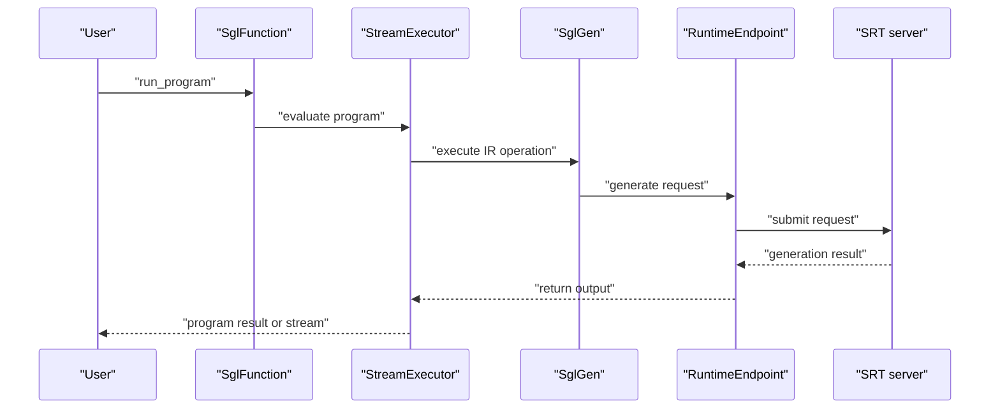
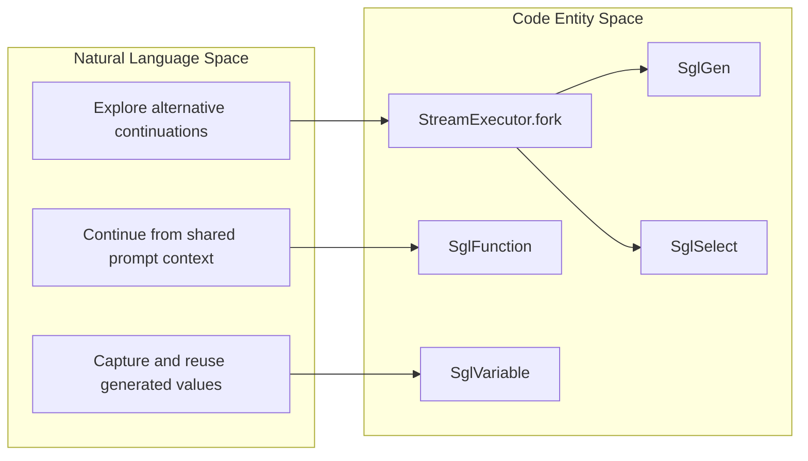
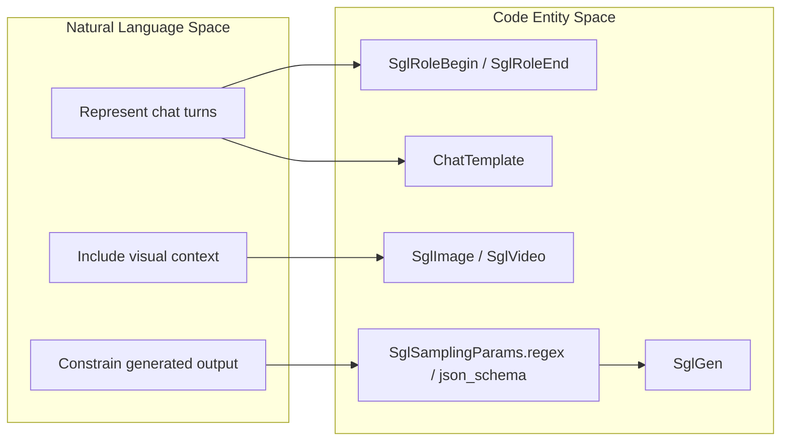

<!-- source: DeepWiki mcp.deepwiki.com · repo sgl-project/sglang · page 23.1 Language IR and Interpreter · fetched 2026-10-30 -->

# Language IR and Interpreter

Relevant source files

The following files were used as context for generating this wiki page:

- [.github/workflows/release-pypi-nightly.yml](.github/workflows/release-pypi-nightly.yml)
- [.github/workflows/release-pypi-pr.yml](.github/workflows/release-pypi-pr.yml)
- [3rdparty/amd/wheel/sglang/pyproject.toml](3rdparty/amd/wheel/sglang/pyproject.toml)
- [docker/Dockerfile](docker/Dockerfile)
- [docs/cards/logos/iquestlab.png](docs/cards/logos/iquestlab.png)
- [docs/cards/logos/perplexity.png](docs/cards/logos/perplexity.png)
- [docs/cookbook/autoregressive/DeepReinforce/Ornith-1.0.mdx](docs/cookbook/autoregressive/DeepReinforce/Ornith-1.0.mdx)
- [docs/cookbook/autoregressive/DeepReinforce/Ornith-1.5.mdx](docs/cookbook/autoregressive/DeepReinforce/Ornith-1.5.mdx)
- [docs/cookbook/autoregressive/Perplexity/PPLX-Decider-v1-27B.mdx](docs/cookbook/autoregressive/Perplexity/PPLX-Decider-v1-27B.mdx)
- [docs/cookbook/autoregressive/Perplexity/PPLX-Decider-v1.1-27B.mdx](docs/cookbook/autoregressive/Perplexity/PPLX-Decider-v1.1-27B.mdx)
- [docs/cookbook/autoregressive/intro.mdx](docs/cookbook/autoregressive/intro.mdx)
- [docs/docs.json](docs/docs.json)
- [docs/docs/supported-models/decision_models.mdx](docs/docs/supported-models/decision_models.mdx)
- [docs/src/snippets/configs/ornith-ai/ornith-1.5.jsx](docs/src/snippets/configs/ornith-ai/ornith-1.5.jsx)
- [docs/src/snippets/configs/perplexity-ai/pplx-decider-v1-27b-benchmarks.jsx](docs/src/snippets/configs/perplexity-ai/pplx-decider-v1-27b-benchmarks.jsx)
- [docs/src/snippets/configs/perplexity-ai/pplx-decider-v1-27b.jsx](docs/src/snippets/configs/perplexity-ai/pplx-decider-v1-27b.jsx)
- [docs/src/snippets/configs/perplexity-ai/pplx-decider-v1.1-27b-benchmarks.jsx](docs/src/snippets/configs/perplexity-ai/pplx-decider-v1.1-27b-benchmarks.jsx)
- [docs/src/snippets/configs/perplexity-ai/pplx-decider-v1.1-27b.jsx](docs/src/snippets/configs/perplexity-ai/pplx-decider-v1.1-27b.jsx)
- [docs/src/snippets/configs/popular-models.jsx](docs/src/snippets/configs/popular-models.jsx)
- [python/pyproject.toml](python/pyproject.toml)
- [python/pyproject_cpu.toml](python/pyproject_cpu.toml)
- [python/pyproject_npu.toml](python/pyproject_npu.toml)
- [python/pyproject_other.toml](python/pyproject_other.toml)
- [python/pyproject_xpu.toml](python/pyproject_xpu.toml)
- [python/sglang/srt/entrypoints/engine.py](python/sglang/srt/entrypoints/engine.py)
- [python/sglang/srt/entrypoints/openai/serving_base.py](python/sglang/srt/entrypoints/openai/serving_base.py)
- [python/sglang/srt/entrypoints/openai/serving_decisions.py](python/sglang/srt/entrypoints/openai/serving_decisions.py)
- [python/sglang/srt/entrypoints/systemone/protocol.py](python/sglang/srt/entrypoints/systemone/protocol.py)
- [python/sglang/srt/entrypoints/systemone/serving.py](python/sglang/srt/entrypoints/systemone/serving.py)
- [python/sglang/srt/function_call/deepseekv32_detector.py](python/sglang/srt/function_call/deepseekv32_detector.py)
- [python/sglang/srt/function_call/kimik2_detector.py](python/sglang/srt/function_call/kimik2_detector.py)
- [python/sglang/srt/utils/common.py](python/sglang/srt/utils/common.py)
- [python/sglang/srt/utils/json_response.py](python/sglang/srt/utils/json_response.py)
- [scripts/update_nightly_whl_index.py](scripts/update_nightly_whl_index.py)
- [test/registered/function_call/test_kimik2_detector.py](test/registered/function_call/test_kimik2_detector.py)
- [test/registered/lora/test_lora_openai_api.py](test/registered/lora/test_lora_openai_api.py)
- [test/registered/moe/test_cutedsl_moe.py](test/registered/moe/test_cutedsl_moe.py)
- [test/registered/unit/entrypoints/openai/test_serving_decisions.py](test/registered/unit/entrypoints/openai/test_serving_decisions.py)
- [test/registered/unit/function_call/test_deepseekv4_detector.py](test/registered/unit/function_call/test_deepseekv4_detector.py)
- [test/registered/unit/function_call/test_json_schema_constraint.py](test/registered/unit/function_call/test_json_schema_constraint.py)
- [test/registered/unit/function_call/test_structural_tag_excludes.py](test/registered/unit/function_call/test_structural_tag_excludes.py)
- [test/registered/unit/function_call/test_unknown_tool_name.py](test/registered/unit/function_call/test_unknown_tool_name.py)
- [test/registered/unit/utils/test_common.py](test/registered/unit/utils/test_common.py)
- [test/registered/unit/utils/test_json_response.py](test/registered/unit/utils/test_json_response.py)

## Purpose and scope

This page explains the SGLang frontend language’s intermediate representation (IR), interpreter execution model, and composition primitives. It focuses on how an LLM program is represented, how execution flows through the interpreter, and how programs compose operations using primitives like `gen`, `select`, and `fork`, with pointers to `examples/frontend_language`. [python/sglang/lang/ir.py:515-642]() [python/sglang/lang/interpreter.py:57-108]()

Sources: `[python/sglang/lang/ir.py:515-642]`, `[python/sglang/lang/interpreter.py:57-108]`

---

## Intermediate Representation (IR) primitives

The frontend IR represents operations in an LLM program, including generation, selection, variable access, multimodal inputs, and chat-role boundaries. The primitive implementations reside in `python/sglang/lang/ir.py`. [python/sglang/lang/ir.py:515-642]()

| IR entity | Role |
|---|---|
| `SglVariable` | Represents a variable that refers to a value generated or assigned during program execution. [python/sglang/lang/ir.py:515-519]() |
| `SglGen` | Represents a generation operation, with a prompt context and generation parameters. [python/sglang/lang/ir.py:534-558]() |
| `SglSelect` | Represents selection among candidate strings. [python/sglang/lang/ir.py:612-623]() |
| `SglImage` | Represents an image input in the program stream. [python/sglang/lang/ir.py:642-642]() |
| `SglVideo` | Represents a video input in the program stream. [python/sglang/lang/ir.py:642-642]() |
| `SglRoleBegin` / `SglRoleEnd` | Represent boundaries for chat roles such as system, user, and assistant. [python/sglang/lang/ir.py:642-642]() |

`SglGen` carries generation settings such as sampling options and output constraints; `SglSelect` expresses a choice operation over candidate strings. These IR nodes let a program describe language-model interactions as composable operations rather than as a single monolithic prompt. [python/sglang/lang/ir.py:534-558]() [python/sglang/lang/ir.py:612-623]()

Sources: `[python/sglang/lang/ir.py:515-642]`

---

## Interpreter execution model

`StreamExecutor`, defined in `python/sglang/lang/interpreter.py`, evaluates the frontend program. It maintains execution context—including accumulated text, multimodal inputs, and values associated with variables—and processes IR operations as it runs the program. [python/sglang/lang/interpreter.py:57-90]()

The program-running entry points include `run_program` and `run_program_batch`. The former executes a program to completion and supports streaming, while the latter runs multiple programs as a batch. [python/sglang/lang/interpreter.py:93-108]()

### Execution data flow

At a high level, execution proceeds from the program into the interpreter, then through the relevant IR operation. For a generation operation, the interpreter delegates the request to a backend such as `RuntimeEndpoint`; the backend communicates with the SGLang serving runtime and returns generated output to the interpreter. The interpreter updates its state and exposes the result to the caller. [python/sglang/lang/interpreter.py:57-108]() [python/sglang/lang/backend/runtime_endpoint.py:186-192]()

**Diagram: Frontend program execution mapped to code entities**

Sources: `[python/sglang/lang/interpreter.py:57-108]`, `[python/sglang/lang/backend/runtime_endpoint.py:186-192]`

### Batch execution

`run_program_batch` supports running multiple programs concurrently. The interpreter includes mechanisms for parallel execution and prefix tracing across batch entries. [python/sglang/lang/interpreter.py:93-108]()

Sources: `[python/sglang/lang/interpreter.py:93-108]`

---

## Program composition and `fork`

SGLang programs compose IR operations with higher-level Python control flow. The `fork` operation creates branches from the current execution context so multiple child paths can proceed independently. Branches inherit the prompt context available at the fork point while keeping subsequent execution state separate. [python/sglang/lang/interpreter.py:1098]()

This makes `fork` useful when a program needs to explore multiple continuations from shared context. `SglVariable` provides access to values associated with the current execution state, while generation and selection operations form the actions within each path. [python/sglang/lang/interpreter.py:1098]() [python/sglang/lang/ir.py:515-623]()

**Diagram: Composition concepts mapped to code entities**

Sources: `[python/sglang/lang/interpreter.py:1098]`, `[python/sglang/lang/ir.py:515-623]`

---

## Multimodal inputs, roles, and constraints

### Multimodal inputs and chat-role boundaries

The IR includes nodes for image and video inputs, and nodes for beginning and ending a chat role. During interpretation, multimodal payloads are collected into the execution state for backend requests. [python/sglang/lang/ir.py:642-642]() [python/sglang/lang/interpreter.py:57-90]()

The role-boundary nodes represent conversational structure in the program. The language layer’s chat-template support is represented by `ChatTemplate`; backend request construction connects frontend context and input payloads to the runtime. [python/sglang/lang/ir.py:642-642]() [python/sglang/lang/chat_template.py:57-62]() [python/sglang/lang/backend/runtime_endpoint.py:107-118]()

### Structured generation

Generation parameters can carry output constraints, including regular-expression and JSON-schema constraints. These settings are associated with the generation operation and are passed through the frontend execution path to the backend. [python/sglang/lang/ir.py:18-41]() [python/sglang/lang/backend/runtime_endpoint.py:107-118]()

**Diagram: Input and formatting concepts mapped to code entities**

Sources: `[python/sglang/lang/ir.py:18-41]`, `[python/sglang/lang/ir.py:642-642]`, `[python/sglang/lang/chat_template.py:57-62]`, `[python/sglang/lang/backend/runtime_endpoint.py:107-118]`

---

## Execution backends

The frontend interpreter delegates model interaction through a backend abstraction. `RuntimeEndpoint` is the runtime-connected backend: it connects the frontend program to a running SGLang serving engine and submits generation requests to the runtime. [python/sglang/lang/backend/runtime_endpoint.py:27-55]() [python/sglang/lang/backend/runtime_endpoint.py:159-232]()

The separation between interpreter and backend keeps program evaluation distinct from the details of communicating with a serving runtime. The interpreter evaluates operations; the backend carries out the corresponding request and returns the output. [python/sglang/lang/interpreter.py:57-108]() [python/sglang/lang/backend/runtime_endpoint.py:159-232]()

Sources: `[python/sglang/lang/backend/runtime_endpoint.py:27-55]`, `[python/sglang/lang/backend/runtime_endpoint.py:159-232]`, `[python/sglang/lang/interpreter.py:57-108]`

---

## Examples and further reading

For concrete frontend-language usage and composition patterns, see `examples/frontend_language`. The interpreter’s program execution and streaming entry points are located in `python/sglang/lang/interpreter.py`. [python/sglang/lang/interpreter.py:57-108]()

Sources: `[python/sglang/lang/interpreter.py:57-108]`, `[examples/frontend_language]()`

---

# End of 23.1 Language IR and Interpreter

---

