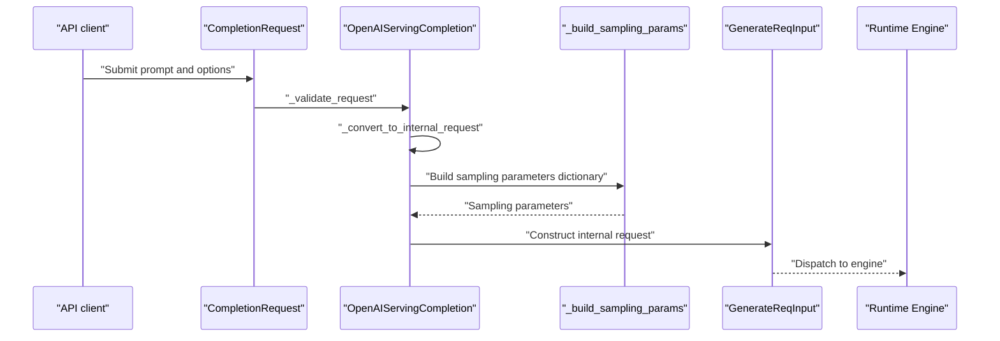

<!-- source: DeepWiki mcp.deepwiki.com · repo sgl-project/sglang · page 23.2 Backend Integrations for Frontend Language · fetched 2026-10-30 -->

# Backend Integrations for Frontend Language

<details>
<summary>Relevant source files</summary>

The following files were used as context for generating this wiki page:

- [benchmark/hicache/bench_host_memory_migration.py](benchmark/hicache/bench_host_memory_migration.py)
- [docs/docs/advanced_features/hicache_best_practices.mdx](docs/docs/advanced_features/hicache_best_practices.mdx)
- [python/sglang/srt/entrypoints/context.py](python/sglang/srt/entrypoints/context.py)
- [python/sglang/srt/entrypoints/harmony_utils.py](python/sglang/srt/entrypoints/harmony_utils.py)
- [python/sglang/srt/entrypoints/openai/chat_encoding.py](python/sglang/srt/entrypoints/openai/chat_encoding.py)
- [python/sglang/srt/entrypoints/openai/chat_encoding_adapters.py](python/sglang/srt/entrypoints/openai/chat_encoding_adapters.py)
- [python/sglang/srt/entrypoints/openai/protocol.py](python/sglang/srt/entrypoints/openai/protocol.py)
- [python/sglang/srt/entrypoints/openai/responses_adapters.py](python/sglang/srt/entrypoints/openai/responses_adapters.py)
- [python/sglang/srt/entrypoints/openai/serving_chat.py](python/sglang/srt/entrypoints/openai/serving_chat.py)
- [python/sglang/srt/entrypoints/openai/serving_completions.py](python/sglang/srt/entrypoints/openai/serving_completions.py)
- [python/sglang/srt/entrypoints/openai/serving_deepseek_recipe.py](python/sglang/srt/entrypoints/openai/serving_deepseek_recipe.py)
- [python/sglang/srt/entrypoints/openai/serving_embedding.py](python/sglang/srt/entrypoints/openai/serving_embedding.py)
- [python/sglang/srt/entrypoints/openai/serving_inkling.py](python/sglang/srt/entrypoints/openai/serving_inkling.py)
- [python/sglang/srt/entrypoints/openai/serving_responses.py](python/sglang/srt/entrypoints/openai/serving_responses.py)
- [python/sglang/srt/entrypoints/openai/utils.py](python/sglang/srt/entrypoints/openai/utils.py)
- [python/sglang/srt/function_call/deepseekv41_detector.py](python/sglang/srt/function_call/deepseekv41_detector.py)
- [python/sglang/srt/managers/scheduler_components/metrics_reporter.py](python/sglang/srt/managers/scheduler_components/metrics_reporter.py)
- [python/sglang/srt/mem_cache/pool_host/base.py](python/sglang/srt/mem_cache/pool_host/base.py)
- [python/sglang/srt/mem_cache/pool_host/common.py](python/sglang/srt/mem_cache/pool_host/common.py)
- [python/sglang/srt/mem_cache/pool_host/dsa.py](python/sglang/srt/mem_cache/pool_host/dsa.py)
- [python/sglang/srt/mem_cache/pool_host/mamba.py](python/sglang/srt/mem_cache/pool_host/mamba.py)
- [python/sglang/srt/mem_cache/pool_host/mha.py](python/sglang/srt/mem_cache/pool_host/mha.py)
- [python/sglang/srt/mem_cache/pool_host/mla.py](python/sglang/srt/mem_cache/pool_host/mla.py)
- [python/sglang/srt/observability/metrics_collector.py](python/sglang/srt/observability/metrics_collector.py)
- [python/sglang/srt/observability/scheduler_stage_metrics.py](python/sglang/srt/observability/scheduler_stage_metrics.py)
- [python/sglang/srt/parser/deepseek_recipe_output.py](python/sglang/srt/parser/deepseek_recipe_output.py)
- [python/sglang/srt/parser/deepseek_recipe_renderer.py](python/sglang/srt/parser/deepseek_recipe_renderer.py)
- [python/sglang/srt/parser/jinja_template_utils.py](python/sglang/srt/parser/jinja_template_utils.py)
- [python/sglang/srt/parser/template_manager.py](python/sglang/srt/parser/template_manager.py)
- [test/registered/observability/test_metrics.py](test/registered/observability/test_metrics.py)
- [test/registered/openai_server/basic/test_openai_server.py](test/registered/openai_server/basic/test_openai_server.py)
- [test/registered/unit/entrypoints/openai/test_protocol.py](test/registered/unit/entrypoints/openai/test_protocol.py)
- [test/registered/unit/entrypoints/openai/test_responses_custom_tools.py](test/registered/unit/entrypoints/openai/test_responses_custom_tools.py)
- [test/registered/unit/entrypoints/openai/test_responses_namespace_tools.py](test/registered/unit/entrypoints/openai/test_responses_namespace_tools.py)
- [test/registered/unit/entrypoints/openai/test_responses_protocol.py](test/registered/unit/entrypoints/openai/test_responses_protocol.py)
- [test/registered/unit/entrypoints/openai/test_serving_chat.py](test/registered/unit/entrypoints/openai/test_serving_chat.py)
- [test/registered/unit/entrypoints/openai/test_serving_completions.py](test/registered/unit/entrypoints/openai/test_serving_completions.py)
- [test/registered/unit/entrypoints/openai/test_serving_deepseek_recipe.py](test/registered/unit/entrypoints/openai/test_serving_deepseek_recipe.py)
- [test/registered/unit/entrypoints/openai/test_serving_embedding.py](test/registered/unit/entrypoints/openai/test_serving_embedding.py)
- [test/registered/unit/entrypoints/openai/test_serving_responses.py](test/registered/unit/entrypoints/openai/test_serving_responses.py)
- [test/registered/unit/entrypoints/openai/test_serving_responses_stream.py](test/registered/unit/entrypoints/openai/test_serving_responses_stream.py)
- [test/registered/unit/entrypoints/openai/utils.py](test/registered/unit/entrypoints/openai/utils.py)
- [test/registered/unit/function_call/test_deepseekv41_detector.py](test/registered/unit/function_call/test_deepseekv41_detector.py)
- [test/registered/unit/managers/test_scheduler_on_idle_load.py](test/registered/unit/managers/test_scheduler_on_idle_load.py)
- [test/registered/unit/mem_cache/test_asymmetric_mha_pool_host_unit.py](test/registered/unit/mem_cache/test_asymmetric_mha_pool_host_unit.py)
- [test/registered/unit/mem_cache/test_hicache_dcp_host_pool.py](test/registered/unit/mem_cache/test_hicache_dcp_host_pool.py)
- [test/registered/unit/mem_cache/test_hicache_host_register.py](test/registered/unit/mem_cache/test_hicache_host_register.py)
- [test/registered/unit/mem_cache/test_hicache_storage_registration_hook.py](test/registered/unit/mem_cache/test_hicache_storage_registration_hook.py)
- [test/registered/unit/mem_cache/test_mem_pool_host.py](test/registered/unit/mem_cache/test_mem_pool_host.py)
- [test/registered/unit/mem_cache/test_mla_host_dedup_primitives.py](test/registered/unit/mem_cache/test_mla_host_dedup_primitives.py)
- [test/registered/unit/observability/test_forward_pass_metrics.py](test/registered/unit/observability/test_forward_pass_metrics.py)
- [test/registered/unit/observability/test_scheduler_stage_metrics.py](test/registered/unit/observability/test_scheduler_stage_metrics.py)
- [test/registered/unit/observability/test_stat_loggers_di.py](test/registered/unit/observability/test_stat_loggers_di.py)
- [test/registered/unit/parser/test_deepseek_recipe_renderer.py](test/registered/unit/parser/test_deepseek_recipe_renderer.py)
- [test/registered/unit/parser/test_jinja_template_utils.py](test/registered/unit/parser/test_jinja_template_utils.py)

</details>


## Purpose and scope

This page describes the backend interfaces relevant to SGLang frontend-language programs: the internal runtime generation request, OpenAI-compatible serving handlers (`OpenAIServingCompletion`, `OpenAIServingChat`, `OpenAIServingResponses`), and the conversion points between API requests and runtime requests (`GenerateReqInput`). It also covers runtime backend mapping, observation, and monitoring collectors.

Sources: [python/sglang/srt/entrypoints/openai/serving_completions.py:49-76](), [python/sglang/srt/entrypoints/openai/serving_chat.py:42-103](), [python/sglang/srt/entrypoints/openai/protocol.py:14-80]()

---

## Backend architecture and frontend-to-server mapping

The backend-facing path has two distinct interfaces: internal generation requests represented by `GenerateReqInput`, and OpenAI-compatible request models handled by serving classes (`OpenAIServingChat`, `OpenAIServingCompletion`, `OpenAIServingResponses`). 

### Natural-language concepts mapped to code entities

**Diagram: Frontend concepts and verified backend entities**

```mermaid
graph TD
    subgraph "Natural_Language_Space"
        "Frontend_program"["Frontend program"]
        "Generation"["Generate text"]
        "Chat"["Chat with messages"]
        "Completion"["Complete a prompt"]
        "Monitoring"["Metrics collection"]
    end

    subgraph "Code_Entity_Space"
        "Frontend_program" --> "Unverified_frontend_callsite"["Frontend call site not shown"]
        "Generation" --> "GenerateReqInput"["GenerateReqInput"]
        "Chat" --> "ChatCompletionRequest"["ChatCompletionRequest"]
        "Completion" --> "CompletionRequest"["CompletionRequest"]
        "ChatCompletionRequest" --> "OpenAIServingChat"["OpenAIServingChat"]
        "CompletionRequest" --> "OpenAIServingCompletion"["OpenAIServingCompletion"]
        "OpenAIServingChat" --> "GenerateReqInput"
        "OpenAIServingCompletion" --> "GenerateReqInput"
        "Monitoring" --> "SchedulerStats"["SchedulerStats"]
        "SchedulerStats" --> "MetricsCollector"["SchedulerMetricsCollector"]
    end
```

`OpenAIServingCompletion._convert_to_internal_request` constructs a `GenerateReqInput` from a completion request, while the chat-serving module imports `GenerateReqInput` and defines the chat handler [python/sglang/srt/entrypoints/openai/serving_completions.py:49-76](), [python/sglang/srt/entrypoints/openai/serving_completions.py:116-146](), [python/sglang/srt/entrypoints/openai/serving_chat.py:42-103](). `SchedulerStats` and `SchedulerMetricsCollector` handle runtime telemetry and metrics reporting [python/sglang/srt/observability/metrics_collector.py:80-175]().

Sources: [python/sglang/srt/entrypoints/openai/serving_completions.py:49-76](), [python/sglang/srt/entrypoints/openai/serving_completions.py:116-146](), [python/sglang/srt/entrypoints/openai/serving_chat.py:42-103](), [python/sglang/srt/observability/metrics_collector.py:80-175]()

### Integration boundaries

| Boundary | Code entity | What the source establishes |
|---|---|---|
| Completion API input | `CompletionRequest` | The completion handler validates the prompt and converts the request into an internal request. [python/sglang/srt/entrypoints/openai/serving_completions.py:49-76]() |
| Chat API input | `ChatCompletionRequest` | The chat-serving module imports the request model and `GenerateReqInput`. [python/sglang/srt/entrypoints/openai/serving_chat.py:42-103]() |
| Internal generation input | `GenerateReqInput` | The completion conversion constructs this object with prompt data, sampling parameters, streaming and metadata options. [python/sglang/srt/entrypoints/openai/serving_completions.py:116-146]() |
| Metrics reporting | `SchedulerStats` | Tracks running requests, queue sizes, cache hit rates, token usage ratios, and disaggregation metrics. [python/sglang/srt/observability/metrics_collector.py:80-175]() |

Sources: [python/sglang/srt/entrypoints/openai/serving_completions.py:71-76](), [python/sglang/srt/entrypoints/openai/serving_completions.py:116-146](), [python/sglang/srt/observability/metrics_collector.py:80-175]()

---

## Runtime endpoint backend

The runtime-facing representation visible in the provided sources is `GenerateReqInput`, used by the OpenAI completion handler as its internal request format [python/sglang/srt/entrypoints/openai/serving_completions.py:71-146](). 

### Completion request conversion

`OpenAIServingCompletion._convert_to_internal_request` obtains the prompt, optionally applies a completion template, determines the prompt representation (`text` or `input_ids`), builds sampling parameters, extracts request metadata, resolves the LoRA path, and constructs `GenerateReqInput`. The resulting request carries options including streaming, logprobs, disaggregation bootstrap information, routed DP rank, session and cache identifiers, custom labels, and multimodal processor settings [python/sglang/srt/entrypoints/openai/serving_completions.py:71-146]().

`_build_sampling_params` maps completion request settings such as temperature, token limits, stop conditions, sampling controls, penalties, and structured-output constraints into a dictionary [python/sglang/srt/entrypoints/openai/serving_completions.py:148-172]().

**Diagram: OpenAI completion conversion into the runtime request object**

```mermaid
flowchart LR
    "CompletionRequest"["CompletionRequest"] --> "Validate"["OpenAIServingCompletion._validate_request"]
    "Validate" --> "Convert"["OpenAIServingCompletion._convert_to_internal_request"]
    "Convert" --> "Prompt"["text or input_ids"]
    "Convert" --> "Sampling"["_build_sampling_params"]
    "Convert" --> "Metadata"["headers and request metadata"]
    "Prompt" --> "GenerateReqInput"["GenerateReqInput"]
    "Sampling" --> "GenerateReqInput"
    "Metadata" --> "GenerateReqInput"
    "GenerateReqInput" --> "Runtime_dispatch"["Runtime dispatch"]
```

Sources: [python/sglang/srt/entrypoints/openai/serving_completions.py:63-76](), [python/sglang/srt/entrypoints/openai/serving_completions.py:94-146]()

### Chat encoding and chat-serving boundary

`resolve_chat_encoding_spec` centralizes selection of a model-specific chat encoder based on the configured tool-call parser or model architecture [python/sglang/srt/entrypoints/openai/chat_encoding.py:1-5](). The chat-serving module imports `ChatCompletionRequest` and `GenerateReqInput` to process conversation inputs [python/sglang/srt/entrypoints/openai/serving_chat.py:42-103]().

Sources: [python/sglang/srt/entrypoints/openai/chat_encoding.py:1-5](), [python/sglang/srt/entrypoints/openai/serving_chat.py:42-103]()

---

## OpenAI backend integration

The OpenAI integration defines protocol models and serving handlers for completion, chat, and responses [python/sglang/srt/entrypoints/openai/protocol.py:14-80](), [python/sglang/srt/entrypoints/openai/serving_chat.py:42-103](), [python/sglang/srt/entrypoints/openai/serving_responses.py:180-196]().

### Protocol models and response types

`protocol.py` defines Pydantic models used for API requests and responses, such as `ModelCard`, `ModelList`, `ErrorResponse`, `UsageInfo`, `PromptTokensDetails`, and `CompletionTokensDetails` [python/sglang/srt/entrypoints/openai/protocol.py:87-227]().

### Responses handler relationship to chat serving

`OpenAIServingResponses` subclasses `OpenAIServingChat` and initializes with the tokenizer manager and template manager, adding responses-specific state and tool-server integration [python/sglang/srt/entrypoints/openai/serving_responses.py:180-196]().

Sources: [python/sglang/srt/entrypoints/openai/protocol.py:87-227](), [python/sglang/srt/entrypoints/openai/serving_responses.py:180-196]()

---

## Request dataflow: API request to generation input

The conversion path begins with an OpenAI API request and terminates at the constructed internal `GenerateReqInput` structure [python/sglang/srt/entrypoints/openai/serving_completions.py:63-146]().

**Diagram: Verified completion-serving sequence**



Sources: [python/sglang/srt/entrypoints/openai/serving_completions.py:63-76](), [python/sglang/srt/entrypoints/openai/serving_completions.py:94-146]()

---

## Monitoring and observability

SGLang tracks engine and scheduler performance via `SchedulerStats` and metrics collectors [python/sglang/srt/observability/metrics_collector.py:80-175]().

### SchedulerStats telemetry

`SchedulerStats` aggregates queue counts, throughput metrics (`gen_throughput`), cache hit rates (`cache_hit_rate`), pool usages (`token_usage`, `full_token_usage`, `swa_token_usage`, `mamba_usage`), absolute token counts, and disaggregation performance metrics [python/sglang/srt/observability/metrics_collector.py:80-155]().

**Diagram: Metrics collection and reporting architecture**

```mermaid
flowchart LR
    "Scheduler"["Scheduler"] --> "MetricsReporter"["SchedulerMetricsReporter"]
    "MetricsReporter" --> "SchedulerStats"["SchedulerStats"]
    "SchedulerStats" --> "PrometheusCollector"["MetricsCollector"]
    "PrometheusCollector" --> "PrometheusEndpoint"["/metrics endpoint"]
```

Sources: [python/sglang/srt/observability/metrics_collector.py:80-175](), [python/sglang/srt/managers/scheduler_components/metrics_reporter.py:1-40]()

---

## Summary

The provided codebase sources demonstrate a structured OpenAI completion and chat request translation pipeline converting protocol models into `GenerateReqInput` objects [python/sglang/srt/entrypoints/openai/serving_completions.py:63-146](). Metrics and telemetry are monitored via `SchedulerStats` for Prometheus export [python/sglang/srt/observability/metrics_collector.py:80-175]().

Sources: [python/sglang/srt/entrypoints/openai/serving_completions.py:63-146](), [python/sglang/srt/observability/metrics_collector.py:80-175]()

---

