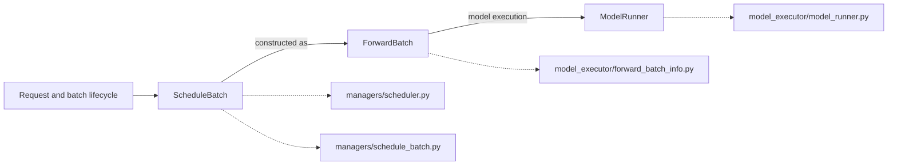
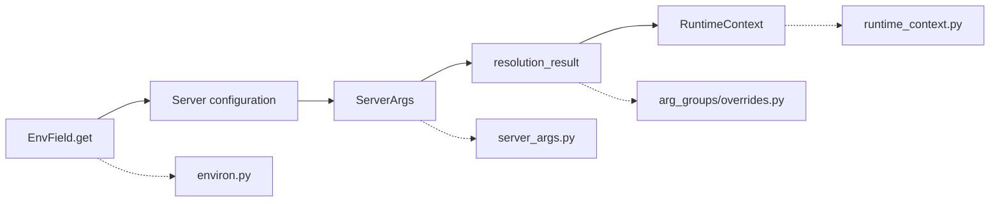

<!-- source: DeepWiki mcp.deepwiki.com · repo sgl-project/sglang · page 24 Glossary · fetched 2026-10-30 -->

# Glossary

Relevant source files

The following files were used as context for generating this wiki page:

- [docs/docs/references/environment_variables.mdx](docs/docs/references/environment_variables.mdx)
- [python/sglang/benchmark/one_batch.py](python/sglang/benchmark/one_batch.py)
- [python/sglang/srt/arg_groups/attention_hook.py](python/sglang/srt/arg_groups/attention_hook.py)
- [python/sglang/srt/arg_groups/overrides.py](python/sglang/srt/arg_groups/overrides.py)
- [python/sglang/srt/arg_groups/pd_disaggregation_hook.py](python/sglang/srt/arg_groups/pd_disaggregation_hook.py)
- [python/sglang/srt/disaggregation/role_switch.py](python/sglang/srt/disaggregation/role_switch.py)
- [python/sglang/srt/distributed/bootstrap.py](python/sglang/srt/distributed/bootstrap.py)
- [python/sglang/srt/distributed/parallel_state.py](python/sglang/srt/distributed/parallel_state.py)
- [python/sglang/srt/environ.py](python/sglang/srt/environ.py)
- [python/sglang/srt/layers/dp_attention.py](python/sglang/srt/layers/dp_attention.py)
- [python/sglang/srt/managers/schedule_batch.py](python/sglang/srt/managers/schedule_batch.py)
- [python/sglang/srt/managers/scheduler.py](python/sglang/srt/managers/scheduler.py)
- [python/sglang/srt/mem_cache/common.py](python/sglang/srt/mem_cache/common.py)
- [python/sglang/srt/model_executor/model_runner.py](python/sglang/srt/model_executor/model_runner.py)
- [python/sglang/srt/runtime_context.py](python/sglang/srt/runtime_context.py)
- [python/sglang/srt/server_args.py](python/sglang/srt/server_args.py)
- [test/manual/test_forward_split_prefill.py](test/manual/test_forward_split_prefill.py)
- [test/manual/test_vlm_accuracy.py](test/manual/test_vlm_accuracy.py)
- [test/registered/unit/disaggregation/test_pd_role_switch.py](test/registered/unit/disaggregation/test_pd_role_switch.py)
- [test/registered/unit/server_args/test_server_args.py](test/registered/unit/server_args/test_server_args.py)
- [test/registered/unit/test_model_overrides.py](test/registered/unit/test_model_overrides.py)
- [test/registered/unit/test_runtime_context.py](test/registered/unit/test_runtime_context.py)

This page is a high-level index to SGLang-specific terminology and code entities. It maps common runtime concepts to their implementation areas; detailed definitions and pointers are grouped in the child pages below. The runtime glossary covers requests, scheduling, memory, and CUDA graphs, while the distributed-and-advanced glossary covers parallelism, quantization, multimodal processing, routing, and simulator vocabulary. [python/sglang/srt/managers/schedule_batch.py:42-54]()

Sources: [python/sglang/srt/managers/schedule_batch.py:42-54]()

## Runtime and request flow

SRT uses `ScheduleBatch` for scheduler-facing batch data and `ForwardBatch` for the lower-level data passed to model execution. `ForwardBatch` is constructed from a `ScheduleBatch`; `ModelRunner` is the component responsible for model forward passes. [python/sglang/srt/managers/schedule_batch.py:42-54] [python/sglang/srt/model_executor/model_runner.py:14-14]()

`ServerArgs` is the server-configuration type. Configuration resolution and model overrides are handled through declarations and resolution helpers; published runtime configuration and state are exposed through `RuntimeContext`. For detailed runtime terminology, see [Glossary: Runtime, Scheduling, and Memory Terms](#24.1). [python/sglang/srt/server_args.py:14-14] [python/sglang/srt/arg_groups/overrides.py:14-20] [python/sglang/srt/runtime_context.py:14-23]()

### Natural-language concepts mapped to runtime code

Sources: [python/sglang/srt/managers/schedule_batch.py:42-54] [python/sglang/srt/model_executor/forward_batch_info.py:14-26] [python/sglang/srt/model_executor/model_runner.py:14-14] [python/sglang/srt/managers/scheduler.py:14-14]()

## Configuration and runtime context

`ServerArgs` provides server argument construction and resolution. `resolution_result` reads the latest declared resolution for a field, while `RuntimeContext` distinguishes raw server arguments from published configuration and mutable runtime state. Environment settings are represented by `EnvField` and typed subclasses such as `EnvBool`, `EnvInt`, and `EnvStr`; callers read them with `.get()`. [python/sglang/srt/server_args.py:14-14] [python/sglang/srt/arg_groups/overrides.py:178-187] [python/sglang/srt/runtime_context.py:14-23] [python/sglang/srt/environ.py:45-80] [python/sglang/srt/environ.py:123-158]()

For definitions of `ServerArgs`, core scheduling and memory terms, see [Glossary: Runtime, Scheduling, and Memory Terms](#24.1). [python/sglang/srt/server_args.py:14-14]()

### Natural-language configuration mapped to code entities

Sources: [python/sglang/srt/server_args.py:14-14] [python/sglang/srt/arg_groups/overrides.py:178-187] [python/sglang/srt/runtime_context.py:14-23] [python/sglang/srt/environ.py:45-80]()

## Memory and caching vocabulary

KV-cache allocation, prefix-cache matching, and cache eviction are represented across the memory-cache and batch-management code. For example, `schedule_batch.py` imports allocation and prefix-cache helpers, while `mem_cache/common.py` contains KV-to-page index helpers and functions for freeing cache slots. See [Glossary: Runtime, Scheduling, and Memory Terms](#24.1) for definitions of KV cache, RadixCache, HiCache, and HiSparse. [python/sglang/srt/managers/schedule_batch.py:106-123] [python/sglang/srt/mem_cache/common.py:46-72] [python/sglang/srt/mem_cache/common.py:74-87]()

Sources: [python/sglang/srt/managers/schedule_batch.py:106-123] [python/sglang/srt/mem_cache/common.py:46-87]()

## Distributed and advanced terminology

The runtime context derives parallel widths and ranks, including tensor-, attention-, and MoE-related dimensions. The scheduler also imports components for disaggregation, expert load balancing, and DLLM scheduling; those imports identify integration areas rather than a complete description of their behavior. For definitions of TP, PP, DP, EP, CP, disaggregation, quantization, multimodal processors, routing, and simulator terms, see [Glossary: Distributed, Quantization, Multimodal, and Gateway Terms](#24.2). [python/sglang/srt/runtime_context.py:73-92] [python/sglang/srt/runtime_context.py:137-170] [python/sglang/srt/managers/scheduler.py:79-110]()

Sources: [python/sglang/srt/runtime_context.py:73-92] [python/sglang/srt/runtime_context.py:137-170] [python/sglang/srt/managers/scheduler.py:79-110]()

## Child pages

- [Glossary: Runtime, Scheduling, and Memory Terms](#24.1) — Defines core SRT runtime terms, including `Req`, `ScheduleBatch`, `ForwardBatch`, `ServerArgs`, KV cache, RadixCache/HiCache/HiSparse, and CUDA graphs.
- [Glossary: Distributed, Quantization, Multimodal, and Gateway Terms](#24.2) — Defines distributed and advanced terms, including TP/PP/DP/EP/CP, disaggregation and transfer backends, quantization, VLM processors, routing/gateway vocabulary, and simulator concepts.

Sources: [python/sglang/srt/managers/schedule_batch.py:42-54] [python/sglang/srt/runtime_context.py:137-170] [python/sglang/srt/managers/scheduler.py:79-110]()

---

