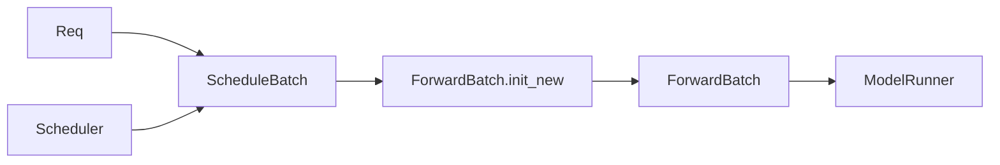
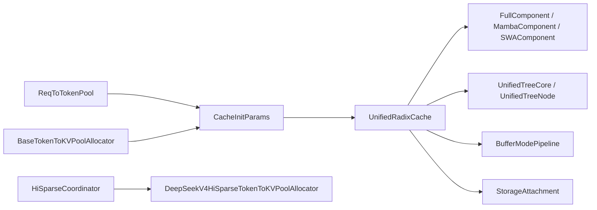
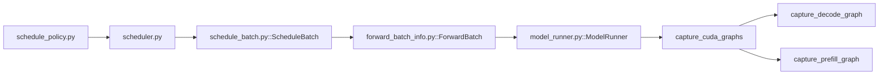

<!-- source: DeepWiki mcp.deepwiki.com · repo sgl-project/sglang · page 24.1 Glossary: Runtime, Scheduling, and Memory Terms · fetched 2026-10-30 -->

# Glossary: Runtime, Scheduling, and Memory Terms

Relevant source files

The following files were used as context for generating this wiki page:

- [docs/docs/references/environment_variables.mdx](docs/docs/references/environment_variables.mdx)
- [python/sglang/benchmark/one_batch.py](python/sglang/benchmark/one_batch.py)
- [python/sglang/kernels/ops/kvcache/kv_read_table.py](python/sglang/kernels/ops/kvcache/kv_read_table.py)
- [python/sglang/kernels/ops/memory/virtual_slot.py](python/sglang/kernels/ops/memory/virtual_slot.py)
- [python/sglang/srt/arg_groups/attention_hook.py](python/sglang/srt/arg_groups/attention_hook.py)
- [python/sglang/srt/arg_groups/overrides.py](python/sglang/srt/arg_groups/overrides.py)
- [python/sglang/srt/arg_groups/pd_disaggregation_hook.py](python/sglang/srt/arg_groups/pd_disaggregation_hook.py)
- [python/sglang/srt/disaggregation/role_switch.py](python/sglang/srt/disaggregation/role_switch.py)
- [python/sglang/srt/distributed/bootstrap.py](python/sglang/srt/distributed/bootstrap.py)
- [python/sglang/srt/distributed/parallel_state.py](python/sglang/srt/distributed/parallel_state.py)
- [python/sglang/srt/environ.py](python/sglang/srt/environ.py)
- [python/sglang/srt/layers/attention/attention_registry.py](python/sglang/srt/layers/attention/attention_registry.py)
- [python/sglang/srt/layers/dp_attention.py](python/sglang/srt/layers/dp_attention.py)
- [python/sglang/srt/managers/cache_controller.py](python/sglang/srt/managers/cache_controller.py)
- [python/sglang/srt/managers/schedule_batch.py](python/sglang/srt/managers/schedule_batch.py)
- [python/sglang/srt/managers/schedule_policy.py](python/sglang/srt/managers/schedule_policy.py)
- [python/sglang/srt/managers/scheduler.py](python/sglang/srt/managers/scheduler.py)
- [python/sglang/srt/mem_cache/allocator/unified_hybrid_swa.py](python/sglang/srt/mem_cache/allocator/unified_hybrid_swa.py)
- [python/sglang/srt/mem_cache/allocator/unified_mamba.py](python/sglang/srt/mem_cache/allocator/unified_mamba.py)
- [python/sglang/srt/mem_cache/allocator/unified_sub_pool.py](python/sglang/srt/mem_cache/allocator/unified_sub_pool.py)
- [python/sglang/srt/mem_cache/base_prefix_cache.py](python/sglang/srt/mem_cache/base_prefix_cache.py)
- [python/sglang/srt/mem_cache/buffer_mode/pipeline.py](python/sglang/srt/mem_cache/buffer_mode/pipeline.py)
- [python/sglang/srt/mem_cache/cache_init_params.py](python/sglang/srt/mem_cache/cache_init_params.py)
- [python/sglang/srt/mem_cache/common.py](python/sglang/srt/mem_cache/common.py)
- [python/sglang/srt/mem_cache/hicache_storage.py](python/sglang/srt/mem_cache/hicache_storage.py)
- [python/sglang/srt/mem_cache/hybrid_cache/hybrid_cache_controller.py](python/sglang/srt/mem_cache/hybrid_cache/hybrid_cache_controller.py)
- [python/sglang/srt/mem_cache/hybrid_cache/hybrid_pool_assembler.py](python/sglang/srt/mem_cache/hybrid_cache/hybrid_pool_assembler.py)
- [python/sglang/srt/mem_cache/hybrid_cache/linker_pool_assembler.py](python/sglang/srt/mem_cache/hybrid_cache/linker_pool_assembler.py)
- [python/sglang/srt/mem_cache/kv_cache_builder.py](python/sglang/srt/mem_cache/kv_cache_builder.py)
- [python/sglang/srt/mem_cache/kv_cache_configurator.py](python/sglang/srt/mem_cache/kv_cache_configurator.py)
- [python/sglang/srt/mem_cache/kv_index_translator.py](python/sglang/srt/mem_cache/kv_index_translator.py)
- [python/sglang/srt/mem_cache/memory_pool.py](python/sglang/srt/mem_cache/memory_pool.py)
- [python/sglang/srt/mem_cache/memory_pool_host.py](python/sglang/srt/mem_cache/memory_pool_host.py)
- [python/sglang/srt/mem_cache/storage/file/__init__.py](python/sglang/srt/mem_cache/storage/file/__init__.py)
- [python/sglang/srt/mem_cache/storage/file/lru_file_evictor.py](python/sglang/srt/mem_cache/storage/file/lru_file_evictor.py)
- [python/sglang/srt/mem_cache/storage/mooncake_store/README.md](python/sglang/srt/mem_cache/storage/mooncake_store/README.md)
- [python/sglang/srt/mem_cache/storage/mooncake_store/mooncake_store.py](python/sglang/srt/mem_cache/storage/mooncake_store/mooncake_store.py)
- [python/sglang/srt/mem_cache/unified_cache/cache_action.py](python/sglang/srt/mem_cache/unified_cache/cache_action.py)
- [python/sglang/srt/mem_cache/unified_memory_pool.py](python/sglang/srt/mem_cache/unified_memory_pool.py)
- [python/sglang/srt/mem_cache/unified_radix_cache.py](python/sglang/srt/mem_cache/unified_radix_cache.py)
- [python/sglang/srt/model_executor/model_runner.py](python/sglang/srt/model_executor/model_runner.py)
- [python/sglang/srt/model_executor/model_runner_components/kv_pool_runtime.py](python/sglang/srt/model_executor/model_runner_components/kv_pool_runtime.py)
- [python/sglang/srt/model_executor/pool_configurator.py](python/sglang/srt/model_executor/pool_configurator.py)
- [python/sglang/srt/runtime_context.py](python/sglang/srt/runtime_context.py)
- [python/sglang/srt/server_args.py](python/sglang/srt/server_args.py)
- [python/sglang/srt/session/streaming_session.py](python/sglang/srt/session/streaming_session.py)
- [python/sglang/srt/speculative/draft_utils.py](python/sglang/srt/speculative/draft_utils.py)
- [test/manual/test_forward_split_prefill.py](test/manual/test_forward_split_prefill.py)
- [test/manual/test_vlm_accuracy.py](test/manual/test_vlm_accuracy.py)
- [test/registered/kernels/ops/mamba/test_mtp_hicache.py](test/registered/kernels/ops/mamba/test_mtp_hicache.py)
- [test/registered/radix_cache/unified_radix_tree/linker/test_unified_cache_linker_kimi_linear.py](test/registered/radix_cache/unified_radix_tree/linker/test_unified_cache_linker_kimi_linear.py)
- [test/registered/unit/disaggregation/test_pd_role_switch.py](test/registered/unit/disaggregation/test_pd_role_switch.py)
- [test/registered/unit/disaggregation/test_unified_memory_move_gate.py](test/registered/unit/disaggregation/test_unified_memory_move_gate.py)
- [test/registered/unit/managers/test_prefill_adder.py](test/registered/unit/managers/test_prefill_adder.py)
- [test/registered/unit/mem_cache/test_buffer_mode_sidecar.py](test/registered/unit/mem_cache/test_buffer_mode_sidecar.py)
- [test/registered/unit/mem_cache/test_full_loc_fast_path.py](test/registered/unit/mem_cache/test_full_loc_fast_path.py)
- [test/registered/unit/mem_cache/test_hicache_file_lru_unit.py](test/registered/unit/mem_cache/test_hicache_file_lru_unit.py)
- [test/registered/unit/mem_cache/test_hicache_staged_write_back_dispatch.py](test/registered/unit/mem_cache/test_hicache_staged_write_back_dispatch.py)
- [test/registered/unit/mem_cache/test_hybrid_pool_assembler.py](test/registered/unit/mem_cache/test_hybrid_pool_assembler.py)
- [test/registered/unit/mem_cache/test_kv_index_translator.py](test/registered/unit/mem_cache/test_kv_index_translator.py)
- [test/registered/unit/mem_cache/test_linker_pool_assembler.py](test/registered/unit/mem_cache/test_linker_pool_assembler.py)
- [test/registered/unit/mem_cache/test_mooncake_group_semantics.py](test/registered/unit/mem_cache/test_mooncake_group_semantics.py)
- [test/registered/unit/mem_cache/test_mooncake_tenant_config.py](test/registered/unit/mem_cache/test_mooncake_tenant_config.py)
- [test/registered/unit/mem_cache/test_multi_ended_allocator.py](test/registered/unit/mem_cache/test_multi_ended_allocator.py)
- [test/registered/unit/mem_cache/test_storage_prefetch_lifecycle.py](test/registered/unit/mem_cache/test_storage_prefetch_lifecycle.py)
- [test/registered/unit/mem_cache/test_streaming_session_unit.py](test/registered/unit/mem_cache/test_streaming_session_unit.py)
- [test/registered/unit/mem_cache/test_swa_locked_full_recover_unified.py](test/registered/unit/mem_cache/test_swa_locked_full_recover_unified.py)
- [test/registered/unit/mem_cache/test_unified_free_no_host_sync.py](test/registered/unit/mem_cache/test_unified_free_no_host_sync.py)
- [test/registered/unit/mem_cache/test_unified_hicache_regressions.py](test/registered/unit/mem_cache/test_unified_hicache_regressions.py)
- [test/registered/unit/mem_cache/test_unified_hicache_transfer_lifecycle.py](test/registered/unit/mem_cache/test_unified_hicache_transfer_lifecycle.py)
- [test/registered/unit/mem_cache/test_unified_mha_views.py](test/registered/unit/mem_cache/test_unified_mha_views.py)
- [test/registered/unit/mem_cache/test_unified_mla_block_table.py](test/registered/unit/mem_cache/test_unified_mla_block_table.py)
- [test/registered/unit/mem_cache/test_unified_mla_views.py](test/registered/unit/mem_cache/test_unified_mla_views.py)
- [test/registered/unit/mem_cache/test_unified_tri_pool.py](test/registered/unit/mem_cache/test_unified_tri_pool.py)
- [test/registered/unit/model_executor/test_kv_canary_headroom.py](test/registered/unit/model_executor/test_kv_canary_headroom.py)
- [test/registered/unit/model_executor/test_pool_configurator.py](test/registered/unit/model_executor/test_pool_configurator.py)
- [test/registered/unit/model_executor/test_unified_out_cache_loc_rebind.py](test/registered/unit/model_executor/test_unified_out_cache_loc_rebind.py)
- [test/registered/unit/server_args/test_server_args.py](test/registered/unit/server_args/test_server_args.py)
- [test/registered/unit/test_model_overrides.py](test/registered/unit/test_model_overrides.py)
- [test/registered/unit/test_runtime_context.py](test/registered/unit/test_runtime_context.py)

## Purpose and scope

This page defines core SGLang Runtime (SRT) terms used in request scheduling, model execution, configuration, and KV-cache management. It focuses on the relationship between the principal runtime entities and points to their primary implementation files. [python/sglang/srt/managers/schedule_batch.py:42-54]() [python/sglang/srt/model_executor/forward_batch_info.py:14-26]() [python/sglang/srt/runtime_context.py:14-23]()

Sources: [python/sglang/srt/managers/schedule_batch.py:42-54]() [python/sglang/srt/model_executor/forward_batch_info.py:14-26]() [python/sglang/srt/runtime_context.py:14-23]()

---

## 1. Request and batch data structures

A request passes through two related batch representations: `ScheduleBatch` holds high-level scheduling information, while `ForwardBatch` holds the lower-level data needed for a model forward pass. The code documents this relationship as `ScheduleBatch → ForwardBatch`; most scheduling data is CPU-side, and most forward-batch data consists of GPU tensors. [python/sglang/srt/managers/schedule_batch.py:42-54]() [python/sglang/srt/model_executor/forward_batch_info.py:14-26]()

Sources: [python/sglang/srt/managers/schedule_batch.py:42-54]() [python/sglang/srt/model_executor/forward_batch_info.py:14-26]()

### `Req` (request)

`Req` is the per-request entity used by scheduling and batch formation. `schedule_policy.py` imports `Req` from `schedule_batch.py` and uses it alongside `ScheduleBatch` in cache-aware scheduling. [python/sglang/srt/managers/schedule_policy.py:45-49]()

Sources: [python/sglang/srt/managers/schedule_policy.py:45-49]()

### `ScheduleBatch`

`ScheduleBatch` is the scheduler-managed, high-level batch representation. It groups request scheduling information and is the source object from which `ForwardBatch` is constructed. The code describes most of its data as CPU-resident and identifies `scheduler.py::Scheduler` as its manager. [python/sglang/srt/managers/schedule_batch.py:42-54]() [python/sglang/srt/model_executor/forward_batch_info.py:17-26]()

`ScheduleBatch` also participates in cache-aware policy decisions: `schedule_policy.py` imports it together with `Req`, prefix-cache helpers, and cache implementations. [python/sglang/srt/managers/schedule_policy.py:45-76]()

Sources: [python/sglang/srt/managers/schedule_batch.py:42-54]() [python/sglang/srt/model_executor/forward_batch_info.py:17-26]() [python/sglang/srt/managers/schedule_policy.py:45-76]()

### `ForwardBatch`

`ForwardBatch` is the model-runner-facing representation of a batch. It contains lower-level forward data, mostly GPU tensors, and is constructed from a `ScheduleBatch` through `ForwardBatch.init_new`. Its definition is in `forward_batch_info.py`; `model_runner.py` imports it for model execution. [python/sglang/srt/model_executor/forward_batch_info.py:17-26]() [python/sglang/srt/model_executor/model_runner.py:109-117]()

`ForwardBatch` also carries forward-mode information: `schedule_batch.py` imports both `ForwardBatch` and `ForwardMode` from `forward_batch_info.py`. [python/sglang/srt/managers/schedule_batch.py:124-128]()

Sources: [python/sglang/srt/model_executor/forward_batch_info.py:17-26]() [python/sglang/srt/model_executor/model_runner.py:109-117]() [python/sglang/srt/managers/schedule_batch.py:124-128]()

### Request-to-forward dataflow

**Diagram: From scheduler entities to model-runner batch**

Sources: [python/sglang/srt/managers/schedule_batch.py:42-54]() [python/sglang/srt/model_executor/forward_batch_info.py:17-26]() [python/sglang/srt/model_executor/model_runner.py:109-117]()

---

## 2. Server configuration

### `ServerArgs`

`ServerArgs` is the public server-configuration record used to collect command-line and runtime inputs. `server_args.py` describes its responsibilities as argument construction, resolution, CLI registration, and network-port handling. It imports argument groups for device, memory, scheduling, execution, parallelism, serving, model, and other configuration domains. [python/sglang/srt/server_args.py:14-14]() [python/sglang/srt/server_args.py:137-182]()

The distinction between raw inputs and resolved configuration matters: `runtime_context.py` says `get_server_args()` retains raw input, while namespace accessors such as `get_exec()` return resolved configuration published from declarations. The override machinery preserves declarations separately from raw inputs, applies them in order, and documents “last writer wins.” [python/sglang/srt/runtime_context.py:14-23]() [python/sglang/srt/arg_groups/overrides.py:14-20]() [python/sglang/srt/arg_groups/overrides.py:110-135]()

**Configuration vocabulary**

| Term | Meaning in this configuration path |
|---|---|
| Raw server arguments | User-provided configuration retained for diagnostics. [python/sglang/srt/runtime_context.py:14-23]() |
| Resolution declaration | A field decision recorded without mutating the raw input. [python/sglang/srt/arg_groups/overrides.py:110-135]() |
| Resolved configuration | Published configuration accessed through runtime-context namespace accessors. [python/sglang/srt/runtime_context.py:14-23]() |
| Runtime override | A post-publication change made through `RuntimeContext.override`, rather than by adding another declaration to published arguments. [python/sglang/srt/arg_groups/overrides.py:110-130]() |

Sources: [python/sglang/srt/server_args.py:14-14]() [python/sglang/srt/server_args.py:137-182]() [python/sglang/srt/runtime_context.py:14-23]() [python/sglang/srt/arg_groups/overrides.py:14-20]() [python/sglang/srt/arg_groups/overrides.py:110-135]()

### `RuntimeContext`

`RuntimeContext` is the process-wide home for configuration, parallel state, flags, resources, and forward state. Its module documentation distinguishes resolved configuration from mutable runtime state and process-owned handles. [python/sglang/srt/runtime_context.py:14-23]()

The `ServerArgs` resolution path and runtime context are related but not interchangeable: raw inputs remain available for diagnostics, while published namespace accessors expose resolved configuration. [python/sglang/srt/runtime_context.py:14-23]() [python/sglang/srt/arg_groups/overrides.py:110-130]()

Sources: [python/sglang/srt/runtime_context.py:14-23]() [python/sglang/srt/arg_groups/overrides.py:110-130]()

### Configuration declarations and resolution

`declare_resolution` appends field decisions to a stash on the argument record without changing raw inputs. It rejects unknown fields for record-backed configuration and rejects declarations against the already-published record. `resolution_result` reads the last declaration first, then falls back to raw input and the provided fallback. [python/sglang/srt/arg_groups/overrides.py:110-135]() [python/sglang/srt/arg_groups/overrides.py:178-187]()

**Diagram: Natural-language configuration terms mapped to code entities**

Sources: [python/sglang/srt/arg_groups/overrides.py:110-135]() [python/sglang/srt/arg_groups/overrides.py:178-187]() [python/sglang/srt/runtime_context.py:14-23]() [python/sglang/srt/managers/scheduler.py:31-49]()

---

## 3. Memory management and KV cache

### KV cache and token pools

The KV cache stores key/value state used by model attention. In the runtime code shown here, `model_runner.py` imports `ReqToTokenPool`, `HybridReqToTokenPool`, `BaseTokenToKVPoolAllocator`, `KVCacheConfigurator`, and `KVIndexTranslator`; `unified_radix_cache.py` receives a request-to-token pool and token-to-KV pool allocator through its initialization parameters. [python/sglang/srt/model_executor/model_runner.py:94-102]() [python/sglang/srt/mem_cache/unified_radix_cache.py:199-206]()

These names distinguish bookkeeping and allocation roles: request-to-token pools are separate from the token-to-KV allocator, and `KVIndexTranslator` is a distinct model-runner dependency. [python/sglang/srt/model_executor/model_runner.py:94-102]() [python/sglang/srt/mem_cache/unified_radix_cache.py:199-206]()

Sources: [python/sglang/srt/model_executor/model_runner.py:94-102]() [python/sglang/srt/mem_cache/unified_radix_cache.py:199-206]()

### `RadixCache` and `UnifiedRadixCache`

`RadixCache` is the radix-cache implementation imported by the scheduling-policy module. That module also imports `RadixKey` and `TreeNode`, along with the `BasePrefixCache` interface and prefix-match helpers. [python/sglang/srt/managers/schedule_policy.py:63-76]()

`UnifiedRadixCache` is a `BasePrefixCache` implementation. Its constructor takes `CacheInitParams` and retains the request-to-token pool, token-to-KV allocator, and cache-disable flag. It accepts configured tree components and has a component registry that includes `FULL`, `MAMBA`, and `SWA` component types. [python/sglang/srt/mem_cache/unified_radix_cache.py:156-160]() [python/sglang/srt/mem_cache/unified_radix_cache.py:199-219]()

The unified cache module also imports tree-core selection and creation functions, `UnifiedTreeCore`, `UnifiedTreeNode`, and `UnifiedLRUList`. These are the code entities to inspect when tracing the unified cache’s tree representation and backend selection. [python/sglang/srt/mem_cache/unified_radix_cache.py:96-109]()

Sources: [python/sglang/srt/managers/schedule_policy.py:63-76]() [python/sglang/srt/mem_cache/unified_radix_cache.py:96-109]() [python/sglang/srt/mem_cache/unified_radix_cache.py:156-160]() [python/sglang/srt/mem_cache/unified_radix_cache.py:199-219]()

### HiCache and `HiRadixCache`

HiCache names the multi-tier cache functionality associated with the unified radix-cache implementation. `unified_radix_cache.py` imports storage-transfer types, buffer-mode pipeline components, storage-existence tracking, storage prefetch support, and storage attachment handling. It also tracks in-flight write-through, load-back, and storage-prefetch operations. [python/sglang/srt/mem_cache/unified_radix_cache.py:45-68]() [python/sglang/srt/mem_cache/unified_radix_cache.py:92-100]() [python/sglang/srt/mem_cache/unified_radix_cache.py:166-196]()

The scheduler imports HiCache-related request types for attaching or detaching storage and clearing the cache, which shows that cache storage operations are exposed through scheduler request handling. [python/sglang/srt/managers/scheduler.py:122-140]()

Sources: [python/sglang/srt/mem_cache/unified_radix_cache.py:45-68]() [python/sglang/srt/mem_cache/unified_radix_cache.py:92-100]() [python/sglang/srt/mem_cache/unified_radix_cache.py:166-196]() [python/sglang/srt/managers/scheduler.py:122-140]()

### `HiSparse`

`HiSparse` is represented in the scheduler by `HiSparseCoordinator`, which is imported alongside cache-related scheduler functionality. `schedule_policy.py` imports `DeepSeekV4HiSparseTokenToKVPoolAllocator`, establishing a separate allocator entity for that HiSparse path. [python/sglang/srt/managers/scheduler.py:120-122]() [python/sglang/srt/managers/schedule_policy.py:45-53]()

Sources: [python/sglang/srt/managers/scheduler.py:120-122]() [python/sglang/srt/managers/schedule_policy.py:45-53]()

### Cache and storage relationships

**Diagram: Natural-language cache terms mapped to code entities**

Sources: [python/sglang/srt/mem_cache/unified_radix_cache.py:45-68]() [python/sglang/srt/mem_cache/unified_radix_cache.py:92-109]() [python/sglang/srt/mem_cache/unified_radix_cache.py:156-160]() [python/sglang/srt/mem_cache/unified_radix_cache.py:199-219]() [python/sglang/srt/managers/scheduler.py:120-122]() [python/sglang/srt/managers/schedule_policy.py:45-53]()

---

## 4. Execution, scheduling, and CUDA graphs

### Scheduler and model execution

The scheduler module describes itself as a scheduler that manages a tensor-parallel GPU worker. It imports runtime configuration accessors and scheduler components, including disaggregation mixins and `SchedulerDllmMixin`. [python/sglang/srt/managers/scheduler.py:14-49]() [python/sglang/srt/managers/scheduler.py:79-110]()

`ModelRunner` runs model forward passes. Its module imports `ForwardBatch`, CUDA-graph capture functions, graph configuration types, and KV-cache-related dependencies. [python/sglang/srt/model_executor/model_runner.py:14-14]() [python/sglang/srt/model_executor/model_runner.py:94-117]() [python/sglang/srt/model_executor/model_runner.py:131-145]()

**Diagram: Runtime names and implementation entry points**

Sources: [python/sglang/srt/managers/scheduler.py:14-49]() [python/sglang/srt/managers/schedule_policy.py:45-76]() [python/sglang/srt/managers/schedule_batch.py:42-54]() [python/sglang/srt/model_executor/forward_batch_info.py:17-26]() [python/sglang/srt/model_executor/model_runner.py:131-145]()

### CUDA graphs

CUDA graphs are represented in the model-runner configuration and capture path by `CudaGraphConfig`, graph backend/phase types, and capture helpers including `capture_cuda_graphs`, `capture_decode_graph`, and `capture_prefill_graph`. These names identify graph configuration and capture entry points. [python/sglang/srt/model_executor/model_runner.py:103-107]() [python/sglang/srt/model_executor/model_runner.py:131-141]()

`cuda_graph_fully_disabled` and `check_cuda_graph_backend` are also imported by `model_runner.py`, indicating that graph enablement and backend checks are part of the runner’s graph-related dependencies. [python/sglang/srt/model_executor/model_runner.py:103-107]()

Sources: [python/sglang/srt/model_executor/model_runner.py:103-107]() [python/sglang/srt/model_executor/model_runner.py:131-141]()

### Breakable and piecewise graphs

A **breakable CUDA graph** is a graph-backend term whose primary implementation file is `python/sglang/srt/model_executor/runner_backend/breakable_cuda_graph_backend.py`; related utilities are in `python/sglang/srt/model_executor/runner_backend_utils/breakable_cuda_graph/breakable_cuda_graph.py`. A **piecewise CUDA graph** is referenced by the distributed runtime through `is_in_tc_piecewise_cuda_graph` in `tc_piecewise_cuda_graph.py`. [python/sglang/srt/distributed/parallel_state.py:55-56]()

Sources: [python/sglang/srt/distributed/parallel_state.py:55-56]()

---

## 5. Summary of core runtime terms

| Term | Definition | Primary implementation pointer |
|---|---|---|
| `Req` | Per-request entity imported by cache-aware scheduling. [python/sglang/srt/managers/schedule_policy.py:45-49]() | [`schedule_batch.py`]() [python/sglang/srt/managers/schedule_policy.py:45-49]() |
| `ScheduleBatch` | Scheduler-managed, high-level batch representation that is converted into a `ForwardBatch`. [python/sglang/srt/managers/schedule_batch.py:42-54]() | [`schedule_batch.py`]() [python/sglang/srt/managers/schedule_batch.py:42-54]() |
| `ForwardBatch` | Model-runner-facing batch of lower-level data, mostly GPU tensors, constructed from `ScheduleBatch`. [python/sglang/srt/model_executor/forward_batch_info.py:17-26]() | [`forward_batch_info.py`]() [python/sglang/srt/model_executor/forward_batch_info.py:17-26]() |
| `ServerArgs` | Server argument record and CLI/configuration entry point. [python/sglang/srt/server_args.py:14-14]() | [`server_args.py`]() [python/sglang/srt/server_args.py:14-14]() |
| `RuntimeContext` | Process-wide configuration, parallel state, flags, resources, and forward-state context. [python/sglang/srt/runtime_context.py:14-23]() | [`runtime_context.py`]() [python/sglang/srt/runtime_context.py:14-23]() |
| KV cache pools | Request-to-token pools, token-to-KV allocators, and index translation are separate model-runner dependencies. [python/sglang/srt/model_executor/model_runner.py:94-102]() | [`model_runner.py`]() [python/sglang/srt/model_executor/model_runner.py:94-102]() |
| `RadixCache` | Radix-cache type imported by the scheduler policy with `RadixKey` and `TreeNode`. [python/sglang/srt/managers/schedule_policy.py:70-76]() | [`schedule_policy.py`]() [python/sglang/srt/managers/schedule_policy.py:70-76]() |
| `UnifiedRadixCache` | `BasePrefixCache` implementation initialized with pools, allocators, and tree components. [python/sglang/srt/mem_cache/unified_radix_cache.py:199-219]() | [`unified_radix_cache.py`]() [python/sglang/srt/mem_cache/unified_radix_cache.py:199-219]() |
| HiCache storage path | Unified-cache dependencies include storage transfers, prefetch, and attachment components. [python/sglang/srt/mem_cache/unified_radix_cache.py:45-68]() [python/sglang/srt/mem_cache/unified_radix_cache.py:92-100]() | [`unified_radix_cache.py`]() [python/sglang/srt/mem_cache/unified_radix_cache.py:45-68]() |
| `HiSparseCoordinator` | Scheduler dependency for HiSparse coordination. [python/sglang/srt/managers/scheduler.py:120-122]() | [`scheduler.py`]() [python/sglang/srt/managers/scheduler.py:120-122]() |
| CUDA graph capture | Model-runner graph configuration and capture helpers for prefill and decode. [python/sglang/srt/model_executor/model_runner.py:103-107]() [python/sglang/srt/model_executor/model_runner.py:131-141]() | [`model_runner.py`]() [python/sglang/srt/model_executor/model_runner.py:103-107]() |
| Piecewise CUDA graph | Piecewise graph utility consulted by distributed runtime code. [python/sglang/srt/distributed/parallel_state.py:55-56]() | [`tc_piecewise_cuda_graph.py`]() [python/sglang/srt/distributed/parallel_state.py:55-56]() |
| Breakable CUDA graph | Graph-backend term associated with the breakable graph backend and utility files. [python/sglang/srt/model_executor/runner_backend/breakable_cuda_graph_backend.py:1-30]() | [`breakable_cuda_graph_backend.py`]() [python/sglang/srt/model_executor/runner_backend/breakable_cuda_graph_backend.py:1-30]() |

Sources: [python/sglang/srt/managers/schedule_batch.py:42-54]() [python/sglang/srt/managers/schedule_policy.py:45-76]() [python/sglang/srt/model_executor/forward_batch_info.py:17-26]() [python/sglang/srt/model_executor/model_runner.py:94-117]() [python/sglang/srt/model_executor/model_runner.py:131-145]() [python/sglang/srt/server_args.py:14-14]() [python/sglang/srt/runtime_context.py:14-23]() [python/sglang/srt/mem_cache/unified_radix_cache.py:45-109]() [python/sglang/srt/mem_cache/unified_radix_cache.py:156-219]() [python/sglang/srt/managers/scheduler.py:120-122]() [python/sglang/srt/distributed/parallel_state.py:55-56]()

---

This glossary is an entry point to the runtime’s main scheduling, configuration, execution-batch, and cache entities. For implementation details beyond the interfaces and dependencies shown here, follow the linked classes and helper modules into their definitions. [python/sglang/srt/managers/schedule_batch.py:42-54]() [python/sglang/srt/model_executor/model_runner.py:94-145]() [python/sglang/srt/mem_cache/unified_radix_cache.py:199-219]()

Sources: [python/sglang/srt/managers/schedule_batch.py:42-54]() [python/sglang/srt/model_executor/model_runner.py:94-145]() [python/sglang/srt/mem_cache/unified_radix_cache.py:199-219]()

---

