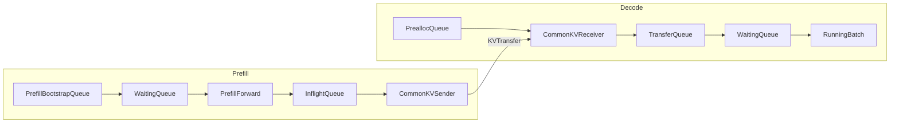
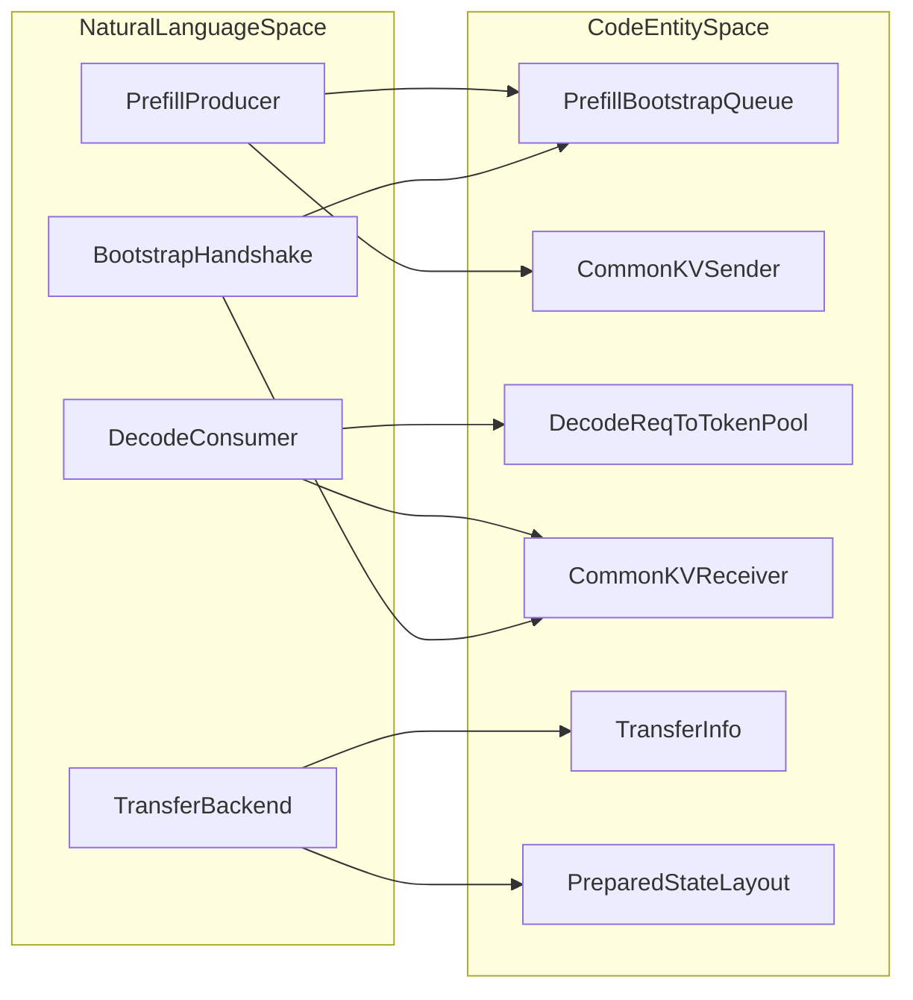
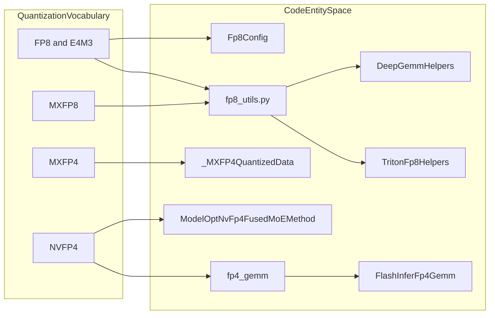
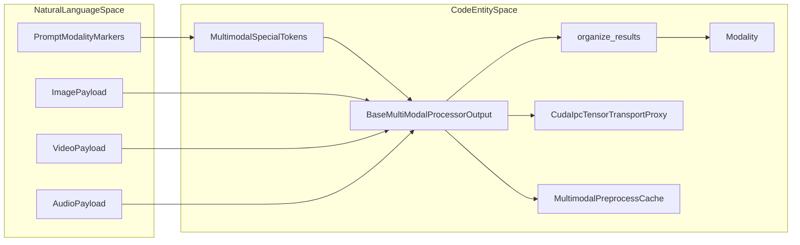

<!-- source: DeepWiki mcp.deepwiki.com · repo sgl-project/sglang · page 24.2 Glossary: Distributed, Quantization, Multimodal, and Gateway Terms · fetched 2026-10-30 -->

# Glossary: Distributed, Quantization, Multimodal, and Gateway Terms

Relevant source files

The following files were used as context for generating this wiki page:

- [proto/sglang/api/v1/sampling.proto](proto/sglang/api/v1/sampling.proto)
- [python/sglang/kernels/ops/kvcache/pd_dcp_gather.py](python/sglang/kernels/ops/kvcache/pd_dcp_gather.py)
- [python/sglang/kernels/ops/moe/ep_moe_kernels.py](python/sglang/kernels/ops/moe/ep_moe_kernels.py)
- [python/sglang/srt/disaggregation/base/conn.py](python/sglang/srt/disaggregation/base/conn.py)
- [python/sglang/srt/disaggregation/common/conn.py](python/sglang/srt/disaggregation/common/conn.py)
- [python/sglang/srt/disaggregation/common/dcp_pack.py](python/sglang/srt/disaggregation/common/dcp_pack.py)
- [python/sglang/srt/disaggregation/common/staging_buffer.py](python/sglang/srt/disaggregation/common/staging_buffer.py)
- [python/sglang/srt/disaggregation/common/staging_handler.py](python/sglang/srt/disaggregation/common/staging_handler.py)
- [python/sglang/srt/disaggregation/common/utils.py](python/sglang/srt/disaggregation/common/utils.py)
- [python/sglang/srt/disaggregation/decode.py](python/sglang/srt/disaggregation/decode.py)
- [python/sglang/srt/disaggregation/fake/conn.py](python/sglang/srt/disaggregation/fake/conn.py)
- [python/sglang/srt/disaggregation/mooncake/conn.py](python/sglang/srt/disaggregation/mooncake/conn.py)
- [python/sglang/srt/disaggregation/mori/conn.py](python/sglang/srt/disaggregation/mori/conn.py)
- [python/sglang/srt/disaggregation/nixl/conn.py](python/sglang/srt/disaggregation/nixl/conn.py)
- [python/sglang/srt/disaggregation/prefill.py](python/sglang/srt/disaggregation/prefill.py)
- [python/sglang/srt/disaggregation/utils.py](python/sglang/srt/disaggregation/utils.py)
- [python/sglang/srt/layers/modelopt_utils.py](python/sglang/srt/layers/modelopt_utils.py)
- [python/sglang/srt/layers/moe/__init__.py](python/sglang/srt/layers/moe/__init__.py)
- [python/sglang/srt/layers/moe/ep_moe/layer.py](python/sglang/srt/layers/moe/ep_moe/layer.py)
- [python/sglang/srt/layers/moe/flashinfer_trtllm_moe.py](python/sglang/srt/layers/moe/flashinfer_trtllm_moe.py)
- [python/sglang/srt/layers/moe/fused_moe_triton/layer.py](python/sglang/srt/layers/moe/fused_moe_triton/layer.py)
- [python/sglang/srt/layers/moe/moe_runner/deep_gemm.py](python/sglang/srt/layers/moe/moe_runner/deep_gemm.py)
- [python/sglang/srt/layers/moe/moe_runner/flashinfer_trtllm.py](python/sglang/srt/layers/moe/moe_runner/flashinfer_trtllm.py)
- [python/sglang/srt/layers/moe/moe_runner/runner.py](python/sglang/srt/layers/moe/moe_runner/runner.py)
- [python/sglang/srt/layers/moe/token_dispatcher/__init__.py](python/sglang/srt/layers/moe/token_dispatcher/__init__.py)
- [python/sglang/srt/layers/moe/token_dispatcher/base.py](python/sglang/srt/layers/moe/token_dispatcher/base.py)
- [python/sglang/srt/layers/moe/token_dispatcher/deepep_v2.py](python/sglang/srt/layers/moe/token_dispatcher/deepep_v2.py)
- [python/sglang/srt/layers/moe/utils.py](python/sglang/srt/layers/moe/utils.py)
- [python/sglang/srt/layers/quantization/compressed_tensors/schemes/compressed_tensors_w4a4_nvfp4_moe.py](python/sglang/srt/layers/quantization/compressed_tensors/schemes/compressed_tensors_w4a4_nvfp4_moe.py)
- [python/sglang/srt/layers/quantization/fp8.py](python/sglang/srt/layers/quantization/fp8.py)
- [python/sglang/srt/layers/quantization/fp8_utils.py](python/sglang/srt/layers/quantization/fp8_utils.py)
- [python/sglang/srt/layers/quantization/modelopt_quant.py](python/sglang/srt/layers/quantization/modelopt_quant.py)
- [python/sglang/srt/layers/quantization/unquant.py](python/sglang/srt/layers/quantization/unquant.py)
- [python/sglang/srt/managers/disagg_service.py](python/sglang/srt/managers/disagg_service.py)
- [python/sglang/srt/model_loader/checkpoint_quantization.py](python/sglang/srt/model_loader/checkpoint_quantization.py)
- [python/sglang/srt/model_loader/utils.py](python/sglang/srt/model_loader/utils.py)
- [python/sglang/srt/models/gigachat35.py](python/sglang/srt/models/gigachat35.py)
- [python/sglang/srt/models/interns2_mobius.py](python/sglang/srt/models/interns2_mobius.py)
- [python/sglang/srt/models/kimi_k25.py](python/sglang/srt/models/kimi_k25.py)
- [python/sglang/srt/models/qwen3_vl.py](python/sglang/srt/models/qwen3_vl.py)
- [python/sglang/srt/models/qwen3_vl_moe.py](python/sglang/srt/models/qwen3_vl_moe.py)
- [python/sglang/srt/models/step3_vl.py](python/sglang/srt/models/step3_vl.py)
- [python/sglang/srt/models/xllm.py](python/sglang/srt/models/xllm.py)
- [python/sglang/srt/multimodal/processors/base_processor.py](python/sglang/srt/multimodal/processors/base_processor.py)
- [python/sglang/srt/multimodal/processors/kimi_k25.py](python/sglang/srt/multimodal/processors/kimi_k25.py)
- [python/sglang/srt/multimodal/processors/kimi_k3.py](python/sglang/srt/multimodal/processors/kimi_k3.py)
- [python/sglang/srt/multimodal/processors/qwen_vl.py](python/sglang/srt/multimodal/processors/qwen_vl.py)
- [python/sglang/srt/multimodal/transport/cuda_ipc.py](python/sglang/srt/multimodal/transport/cuda_ipc.py)
- [python/sglang/srt/multimodal/transport/memory_pool.py](python/sglang/srt/multimodal/transport/memory_pool.py)
- [python/sglang/srt/rust_server/config.py](python/sglang/srt/rust_server/config.py)
- [python/sglang/srt/rust_server/server.py](python/sglang/srt/rust_server/server.py)
- [python/sglang/srt/utils/cuda_ipc_transport_utils.py](python/sglang/srt/utils/cuda_ipc_transport_utils.py)
- [python/sglang/srt/utils/cuda_vmm_transport_utils.py](python/sglang/srt/utils/cuda_vmm_transport_utils.py)
- [rust/sglang-server/src/api_server/core/handle.rs](rust/sglang-server/src/api_server/core/handle.rs)
- [rust/sglang-server/src/api_server/core/prefetch.rs](rust/sglang-server/src/api_server/core/prefetch.rs)
- [rust/sglang-server/src/api_server/http.rs](rust/sglang-server/src/api_server/http.rs)
- [rust/sglang-server/src/api_server/http/app.rs](rust/sglang-server/src/api_server/http/app.rs)
- [rust/sglang-server/src/api_server/http/info.rs](rust/sglang-server/src/api_server/http/info.rs)
- [rust/sglang-server/src/api_server/http/loads.rs](rust/sglang-server/src/api_server/http/loads.rs)
- [rust/sglang-server/src/api_server/http/metrics.rs](rust/sglang-server/src/api_server/http/metrics.rs)
- [rust/sglang-server/src/api_server/http/native_api.rs](rust/sglang-server/src/api_server/http/native_api.rs)
- [rust/sglang-server/src/api_server/http/openai.rs](rust/sglang-server/src/api_server/http/openai.rs)
- [rust/sglang-server/src/api_server/http/openai/chat.rs](rust/sglang-server/src/api_server/http/openai/chat.rs)
- [rust/sglang-server/src/api_server/http/openai/completions.rs](rust/sglang-server/src/api_server/http/openai/completions.rs)
- [rust/sglang-server/src/api_server/http/openai/template.rs](rust/sglang-server/src/api_server/http/openai/template.rs)
- [rust/sglang-server/src/api_server/http/openai/test_utils.rs](rust/sglang-server/src/api_server/http/openai/test_utils.rs)
- [rust/sglang-server/src/api_server/http/openai/tokenize.rs](rust/sglang-server/src/api_server/http/openai/tokenize.rs)
- [rust/sglang-server/src/api_server/http/openai/tools.rs](rust/sglang-server/src/api_server/http/openai/tools.rs)
- [rust/sglang-server/src/lib.rs](rust/sglang-server/src/lib.rs)
- [rust/sglang-server/src/message.rs](rust/sglang-server/src/message.rs)
- [rust/sglang-server/src/message/config.rs](rust/sglang-server/src/message/config.rs)
- [rust/sglang-server/src/message/detok.rs](rust/sglang-server/src/message/detok.rs)
- [rust/sglang-server/src/message/finish_reason.rs](rust/sglang-server/src/message/finish_reason.rs)
- [rust/sglang-server/src/message/multimodal.rs](rust/sglang-server/src/message/multimodal.rs)
- [rust/sglang-server/src/message/types.rs](rust/sglang-server/src/message/types.rs)
- [rust/sglang-server/src/message/wire.rs](rust/sglang-server/src/message/wire.rs)
- [rust/sglang-server/src/multi_modality/payload.rs](rust/sglang-server/src/multi_modality/payload.rs)
- [rust/sglang-server/src/multi_modality/worker.rs](rust/sglang-server/src/multi_modality/worker.rs)
- [rust/sglang-server/src/tokenizer_manager.rs](rust/sglang-server/src/tokenizer_manager.rs)
- [rust/sglang-server/src/tokenizer_manager/detokenizer.rs](rust/sglang-server/src/tokenizer_manager/detokenizer.rs)
- [rust/sglang-server/src/tokenizer_manager/to_scheduler.rs](rust/sglang-server/src/tokenizer_manager/to_scheduler.rs)
- [rust/sglang-server/src/tokenizer_manager/to_scheduler_tests.rs](rust/sglang-server/src/tokenizer_manager/to_scheduler_tests.rs)
- [rust/sglang-server/src/tokenizer_manager/to_scheduler_validation.rs](rust/sglang-server/src/tokenizer_manager/to_scheduler_validation.rs)
- [rust/sglang-server/src/tokenizer_manager/tokenizer.rs](rust/sglang-server/src/tokenizer_manager/tokenizer.rs)
- [rust/sglang-server/src/tokenizer_manager/wiring.rs](rust/sglang-server/src/tokenizer_manager/wiring.rs)
- [rust/sglang-server/src/utils/runtime.rs](rust/sglang-server/src/utils/runtime.rs)
- [test/manual/layers/moe/test_simulate_balanced_routing.py](test/manual/layers/moe/test_simulate_balanced_routing.py)
- [test/manual/quant/test_compressed_tensors_fp8_block_ue8m0.py](test/manual/quant/test_compressed_tensors_fp8_block_ue8m0.py)
- [test/registered/backends/test_flashinfer_nvfp4_online_moe_backend.py](test/registered/backends/test_flashinfer_nvfp4_online_moe_backend.py)
- [test/registered/backends/test_flashinfer_trtllm_gen_moe_backend.py](test/registered/backends/test_flashinfer_trtllm_gen_moe_backend.py)
- [test/registered/kernels/ops/kvcache/test_pd_dcp_gather.py](test/registered/kernels/ops/kvcache/test_pd_dcp_gather.py)
- [test/registered/kernels/ops/moe/test_minimax_quant_scatter.py](test/registered/kernels/ops/moe/test_minimax_quant_scatter.py)
- [test/registered/kernels/ops/moe/test_round_robin_ep_balance.py](test/registered/kernels/ops/moe/test_round_robin_ep_balance.py)
- [test/registered/rl/test_update_weights_from_disk_blackwell.py](test/registered/rl/test_update_weights_from_disk_blackwell.py)
- [test/registered/unit/disaggregation/test_dcp_pack.py](test/registered/unit/disaggregation/test_dcp_pack.py)
- [test/registered/unit/disaggregation/test_decode_queue_cleanup.py](test/registered/unit/disaggregation/test_decode_queue_cleanup.py)
- [test/registered/unit/disaggregation/test_deferred_decode_kv_release.py](test/registered/unit/disaggregation/test_deferred_decode_kv_release.py)
- [test/registered/unit/disaggregation/test_disaggregation_wire.py](test/registered/unit/disaggregation/test_disaggregation_wire.py)
- [test/registered/unit/disaggregation/test_fake_kv_sender.py](test/registered/unit/disaggregation/test_fake_kv_sender.py)
- [test/registered/unit/disaggregation/test_mooncake_deferred_kv_release.py](test/registered/unit/disaggregation/test_mooncake_deferred_kv_release.py)
- [test/registered/unit/disaggregation/test_mooncake_transfer_batching.py](test/registered/unit/disaggregation/test_mooncake_transfer_batching.py)
- [test/registered/unit/disaggregation/test_mori_deferred_kv_release.py](test/registered/unit/disaggregation/test_mori_deferred_kv_release.py)
- [test/registered/unit/disaggregation/test_nixl_backend_basic.py](test/registered/unit/disaggregation/test_nixl_backend_basic.py)
- [test/registered/unit/disaggregation/test_nixl_deferred_kv_release.py](test/registered/unit/disaggregation/test_nixl_deferred_kv_release.py)
- [test/registered/unit/entrypoints/test_rust_server_dp_ports.py](test/registered/unit/entrypoints/test_rust_server_dp_ports.py)
- [test/registered/unit/layers/moe/test_deepep_v2_masked_slab.py](test/registered/unit/layers/moe/test_deepep_v2_masked_slab.py)
- [test/registered/unit/layers/quantization/test_deepgemm_ue8m0_requant.py](test/registered/unit/layers/quantization/test_deepgemm_ue8m0_requant.py)
- [test/registered/unit/layers/quantization/test_modelopt_nvfp4_moe_scales.py](test/registered/unit/layers/quantization/test_modelopt_nvfp4_moe_scales.py)
- [test/registered/unit/layers/test_fp8_bpreshuffle_dense_linear_mi35x.py](test/registered/unit/layers/test_fp8_bpreshuffle_dense_linear_mi35x.py)
- [test/registered/unit/layers/test_fp8_bpreshuffle_producer_mi35x.py](test/registered/unit/layers/test_fp8_bpreshuffle_producer_mi35x.py)
- [test/registered/unit/layers/test_fp8_bpreshuffle_scale.py](test/registered/unit/layers/test_fp8_bpreshuffle_scale.py)
- [test/registered/unit/managers/test_mm_process_config.py](test/registered/unit/managers/test_mm_process_config.py)
- [test/registered/unit/managers/test_priority_scheduling_disaggregation.py](test/registered/unit/managers/test_priority_scheduling_disaggregation.py)
- [test/registered/unit/mem_cache/test_decode_radix_lock_ref.py](test/registered/unit/mem_cache/test_decode_radix_lock_ref.py)
- [test/registered/unit/model_loader/test_modelopt_loader.py](test/registered/unit/model_loader/test_modelopt_loader.py)
- [test/registered/unit/models/test_kimi_k25.py](test/registered/unit/models/test_kimi_k25.py)
- [test/registered/unit/models/test_kimi_k3_bfa_overlap.py](test/registered/unit/models/test_kimi_k3_bfa_overlap.py)
- [test/registered/unit/models/test_qwen3_vl_feature_materialization.py](test/registered/unit/models/test_qwen3_vl_feature_materialization.py)
- [test/registered/unit/multimodal/rust/shared/test_rust_server_extension.py](test/registered/unit/multimodal/rust/shared/test_rust_server_extension.py)
- [test/registered/unit/multimodal/test_cuda_ipc_pool_budget.py](test/registered/unit/multimodal/test_cuda_ipc_pool_budget.py)
- [test/registered/unit/multimodal/test_cuda_ipc_transport.py](test/registered/unit/multimodal/test_cuda_ipc_transport.py)
- [test/registered/unit/multimodal/test_cuda_vmm_transport.py](test/registered/unit/multimodal/test_cuda_vmm_transport.py)
- [test/registered/unit/multimodal/test_gpu_feature_transport.py](test/registered/unit/multimodal/test_gpu_feature_transport.py)
- [test/registered/unit/test_checkpoint_quantization.py](test/registered/unit/test_checkpoint_quantization.py)

## Purpose and scope

This leaf page defines distributed-execution, quantization, multimodal, routing, gateway, and simulator vocabulary used in SGLang. It maps terms to code entities where the supplied code excerpts identify those entities. The available excerpts cover disaggregation, quantization, and multimodal processing; gateway and simulator terms are defined at the vocabulary level where their implementation files are separate.

Sources: [python/sglang/srt/disaggregation/utils.py:150-160](), [python/sglang/srt/layers/quantization/fp8.py:15-80](), [python/sglang/srt/multimodal/processors/base_processor.py:73-105]()

---

## Distributed execution and parallelism

### Parallelism terms

| Term | Meaning | Code connection |
|---|---|---|
| **TP — Tensor Parallelism** | Divides tensor operations across ranks. In the codebase, `get_parallel()` exposes topology used by transfer and MoE code; `dst_tp_rank` and `dst_attn_tp_size` are transfer-registration fields. | [python/sglang/srt/disaggregation/mooncake/conn.py:151-172](), [python/sglang/srt/disaggregation/common/conn.py:55-64]() |
| **PP — Pipeline Parallelism** | Splits model execution across sequential stages. For disaggregation polling, `pp_sync_polls` propagates poll state from PP rank 0 to later ranks; `poll_and_all_reduce_prefill_pp` performs TP/CP reductions before this propagation. | [python/sglang/srt/disaggregation/utils.py:56-90](), [python/sglang/srt/disaggregation/utils.py:111-127]() |
| **DP — Data Parallelism** | Uses multiple data-parallel ranks. The prefill-server metadata records `dp_size`, alongside attention TP/CP and PP sizes, so topology is available during transfer coordination. | [python/sglang/srt/disaggregation/common/conn.py:119-148]() |
| **EP — Expert Parallelism** | Distributes MoE experts and routes tokens between ranks. `create_moe_dispatcher` chooses a dispatcher based on the configured all-to-all backend; `_get_deepep_comm_group` selects a communication group, including a special group choice for MORI. | [python/sglang/srt/layers/moe/fused_moe_triton/layer.py:159-186]() |
| **CP — Context Parallelism** | Partitions attention context across ranks. The disaggregation utilities filter KV indices for CP ranks, and prefill transfer polling reduces readiness across the attention CP group. | [python/sglang/srt/disaggregation/utils.py:111-127](), [python/sglang/srt/disaggregation/common/conn.py:46-50]() |
| **DCP — Distributed Context Parallelism** | A context-parallel arrangement that affects destination KV indexing and transfer layout. The connection metadata includes DCP rank/size and whether relayout is required. | [python/sglang/srt/disaggregation/mooncake/conn.py:151-175]() |

These terms describe distinct partitioning dimensions, not mutually exclusive serving modes. Transfer metadata carries topology fields so a prefill-side KV layout can be mapped to decode-side ranks and indices.

Sources: [python/sglang/srt/disaggregation/common/conn.py:46-64](), [python/sglang/srt/disaggregation/common/conn.py:119-148](), [python/sglang/srt/disaggregation/mooncake/conn.py:151-175](), [python/sglang/srt/disaggregation/utils.py:56-127](), [python/sglang/srt/layers/moe/fused_moe_triton/layer.py:159-186]()

### Disaggregation, bootstrap, and KV transfer

**Prefill-decode disaggregation (PD)** separates prompt processing from token generation. The prefill side bootstraps a sender, runs a forward pass, and tracks transfers in an inflight queue [python/sglang/srt/disaggregation/prefill.py:1-18](). The decode side bootstraps a receiver, allocates destination KV capacity, waits for transfer completion, and admits the request into decoding without repeating the prefill forward pass [python/sglang/srt/disaggregation/decode.py:1-19]().

**Bootstrap** is the setup and handshake phase that establishes transfer participants and destination metadata. `PrefillBootstrapQueue` holds prefill requests whose bootstrap has not completed [python/sglang/srt/disaggregation/prefill.py:174-189](); the shared connection layer includes `CommonKVBootstrapServer`, `CommonKVManager`, `CommonKVSender`, and `CommonKVReceiver` [python/sglang/srt/disaggregation/common/conn.py:30-40]().

**KV transfer** moves KV-cache entries and associated state between the prefill and decode sides. Its metadata can include destination KV indices, auxiliary indices, state indices, layer IDs, TP/CP topology, and staging information [python/sglang/srt/disaggregation/mooncake/conn.py:101-175]().

| Term | Definition in this context | Code pointers |
|---|---|---|
| **Mooncake** | A transfer backend with connection and transfer metadata implemented in `disaggregation/mooncake/conn.py`. Its `TransferInfo` describes a destination endpoint, session, destination KV indices, and state indices; `KVArgsRegisterInfo` carries destination pointers and topology/layout details. | [python/sglang/srt/disaggregation/mooncake/conn.py:100-175]() |
| **NIXL** | A transfer backend with connection logic in `disaggregation/nixl/conn.py`. It prepares state-transfer layouts and selectors, and defines checks for state-layout mismatches and failed posts. | [python/sglang/srt/disaggregation/nixl/conn.py:75-176]() |
| **MORI** | A backend name recognized by the MoE communication-group selection: when `a2a_backend.is_mori()` is true, `_get_deepep_comm_group` selects the TP group. | [python/sglang/srt/layers/moe/fused_moe_triton/layer.py:159-168]() |
| **Staging** | A transfer path with staging metadata and handlers. Mooncake imports `StagingManagerMixin`, staging contexts, and staging message handlers; its transfer descriptors can carry optional staging information. | [python/sglang/srt/disaggregation/mooncake/conn.py:28-115]() |
| **`DisaggregationMode`** | An enum with `NULL`, `PREFILL`, and `DECODE`; `to_engine_type` maps those modes to `unified`, `prefill`, or `decode`. | [python/sglang/srt/disaggregation/utils.py:150-162]() |

Sources: [python/sglang/srt/disaggregation/prefill.py:1-18](), [python/sglang/srt/disaggregation/prefill.py:174-189](), [python/sglang/srt/disaggregation/decode.py:1-19](), [python/sglang/srt/disaggregation/common/conn.py:30-40](), [python/sglang/srt/disaggregation/mooncake/conn.py:28-175](), [python/sglang/srt/disaggregation/nixl/conn.py:75-176](), [python/sglang/srt/layers/moe/fused_moe_triton/layer.py:159-168](), [python/sglang/srt/disaggregation/utils.py:150-162]()

### PD transfer lifecycle

The prefill queue sequence is bootstrap, waiting for prefill scheduling, forward execution, and inflight transfer polling [python/sglang/srt/disaggregation/prefill.py:1-18](). Decode moves requests through preallocation, transfer, waiting, and running-batch merge [python/sglang/srt/disaggregation/decode.py:1-19]().

Diagram: PD lifecycle mapped to queue and connection entities

Sources: [python/sglang/srt/disaggregation/prefill.py:1-18](), [python/sglang/srt/disaggregation/decode.py:1-19](), [python/sglang/srt/disaggregation/common/conn.py:30-40]()

### Natural-language concepts mapped to code entities

Diagram: PD vocabulary to code entities

Sources: [python/sglang/srt/disaggregation/prefill.py:1-18](), [python/sglang/srt/disaggregation/prefill.py:174-189](), [python/sglang/srt/disaggregation/decode.py:1-19](), [python/sglang/srt/disaggregation/common/conn.py:30-40](), [python/sglang/srt/disaggregation/mooncake/conn.py:100-147](), [python/sglang/srt/disaggregation/nixl/conn.py:75-95]()

---

## Quantization system

### Quantization vocabulary

| Term | Definition | Code pointers |
|---|---|---|
| **FP8** | Eight-bit floating-point representation used for weights and/or activations. SGLang’s FP8 implementation imports quantization operations and linear-kernel dispatch helpers. | [python/sglang/srt/layers/quantization/fp8.py:15-20](), [python/sglang/srt/layers/quantization/fp8.py:55-80]() |
| **E4M3** | An FP8 encoding family referenced through the FP8 dtype and normalization utilities (`fp8_dtype`, `fp8_max`, `fp8_min`, `normalize_e4m3fn_to_e4m3fnuz`). | [python/sglang/srt/layers/quantization/fp8_utils.py:16-28](), [python/sglang/srt/layers/quantization/fp8.py:70-75]() |
| **W8A8** | A weight-8-bit, activation-8-bit path. The FP8 utility imports and dispatches block-FP8 GEMM helpers. | [python/sglang/srt/layers/quantization/fp8_utils.py:10-15](), [python/sglang/srt/layers/quantization/fp8_utils.py:71-96]() |
| **Block quantization** | Quantization with scales associated with blocks rather than one scale for a whole tensor. | [python/sglang/srt/layers/quantization/fp8.py:55-80]() |
| **MXFP8** | Microscaled FP8 path represented by conversion, quantization, and backend-dispatch helpers. | [python/sglang/srt/layers/quantization/fp8.py:139-147](), [python/sglang/srt/layers/quantization/fp8.py:67-78]() |
| **MXFP4** | Four-bit microscaled format represented by `MXFP4QuantizeUtil` and `_MXFP4QuantizedData`. | [python/sglang/srt/layers/quantization/fp8_utils.py:32-32](), [python/sglang/srt/layers/quantization/fp8_utils.py:99-108]() |
| **NVFP4** | FP4 scheme with scale and GEMM support (`fp4_gemm` custom op in `modelopt_quant.py`). | [python/sglang/srt/layers/quantization/modelopt_quant.py:121-184](), [python/sglang/srt/layers/moe/fused_moe_triton/layer.py:63-69]() |

Sources: [python/sglang/srt/layers/quantization/fp8.py:15-80](), [python/sglang/srt/layers/quantization/fp8_utils.py:10-28](), [python/sglang/srt/layers/quantization/fp8_utils.py:32-32](), [python/sglang/srt/layers/quantization/fp8_utils.py:71-108](), [python/sglang/srt/layers/quantization/modelopt_quant.py:121-184]()

### Backend and dispatch vocabulary

Quantization format alone does not specify the kernel used at runtime. `fp8_utils.py` imports Triton and DeepGEMM paths and contains AITER-related selection logic [python/sglang/srt/layers/quantization/fp8_utils.py:10-15](); `modelopt_quant.py` routes FP4 GEMM through available backends like FlashInfer `mm_fp4` [python/sglang/srt/layers/quantization/modelopt_quant.py:106-184]().

Sources: [python/sglang/srt/layers/quantization/fp8_utils.py:10-15](), [python/sglang/srt/layers/quantization/fp8_utils.py:71-96](), [python/sglang/srt/layers/quantization/modelopt_quant.py:106-184]()

### Quantization flow mapped to code entities

Diagram: Quantization terms to code entities

Sources: [python/sglang/srt/layers/quantization/fp8.py:49-80](), [python/sglang/srt/layers/quantization/fp8_utils.py:10-28](), [python/sglang/srt/layers/quantization/fp8_utils.py:99-108](), [python/sglang/srt/layers/quantization/modelopt_quant.py:38-48](), [python/sglang/srt/layers/quantization/modelopt_quant.py:136-184]()

---

## Multimodal and vision-language terms

### Processor vocabulary

| Term | Definition | Code connection |
|---|---|---|
| **VLM — Vision-Language Model** | A model that accepts text together with one or more non-text modalities (image, video, audio). | [python/sglang/srt/multimodal/processors/base_processor.py:73-105]() |
| **Processor output** | A structured result containing expanded input text, optional pre-tokenized IDs, images, videos, and audio (`BaseMultiModalProcessorOutput.organize_results()`). | [python/sglang/srt/multimodal/processors/base_processor.py:73-105]() |
| **Multimodal special token** | A modality marker handled by `MultimodalSpecialTokens`, converting IDs to strings, resolving modalities, and building regex patterns. | [python/sglang/srt/multimodal/processors/base_processor.py:109-202]() |
| **`Modality`** | The enum labeling image, video, and audio items. | [python/sglang/srt/multimodal/processors/base_processor.py:28-33]() |
| **Feature transport** | Imports CUDA IPC transport proxies (`CudaIpcTensorTransportProxy`) and memory pools (`MmItemMemoryPool`). | [python/sglang/srt/multimodal/processors/base_processor.py:34-48]() |

Sources: [python/sglang/srt/multimodal/processors/base_processor.py:28-48](), [python/sglang/srt/multimodal/processors/base_processor.py:73-105](), [python/sglang/srt/multimodal/processors/base_processor.py:109-202]()

### Processor dataflow and code map

Diagram: Multimodal input vocabulary to processor entities

Sources: [python/sglang/srt/multimodal/processors/base_processor.py:34-48](), [python/sglang/srt/multimodal/processors/base_processor.py:73-105](), [python/sglang/srt/multimodal/processors/base_processor.py:109-202]()

---

## Gateway, routing, and simulator vocabulary

The terms in this section identify roles described in the scope: routing requests among serving workers, gateway coordination, and simulating serving workloads.

| Term | Definition |
|---|---|
| **Router** | A request-routing component that selects a serving worker for an incoming request. |
| **Gateway** | A higher-level routing service coordinating worker availability and request handling across backends. |
| **Worker registry** | The set of known serving workers and their current state. |
| **Load-balancing policy** | A worker-selection strategy based on load or cache signals. |
| **Cache-aware routing** | Routing considering whether a worker has reusable prompt-prefix/KV-cache state. |
| **PD routing** | Routing accounting for prefill-decode disaggregation roles. |
| **Simulator** | A serving-behavior evaluation tool that replays traces while estimating model-forward latency. |

Sources: [python/sglang/srt/disaggregation/utils.py:150-160]()