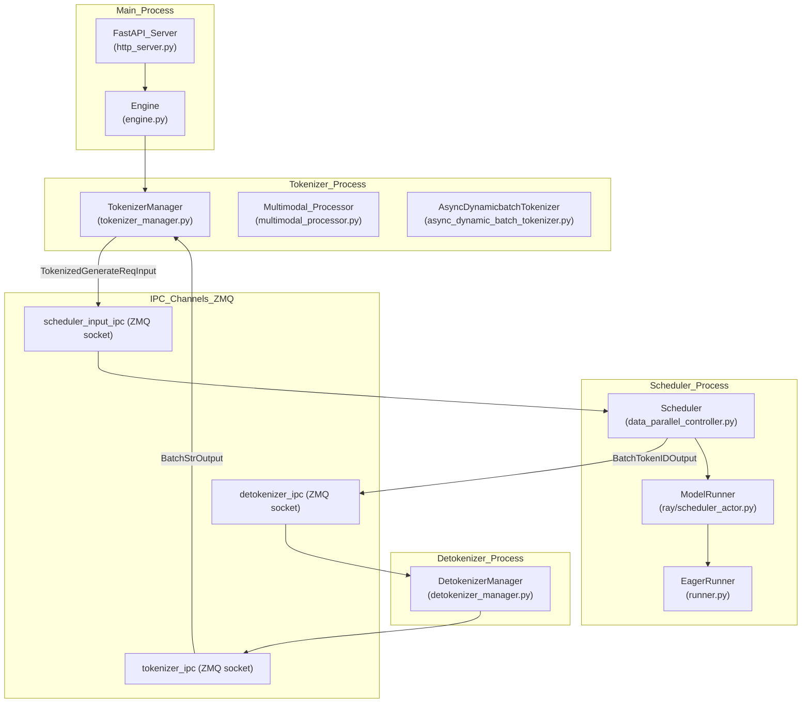
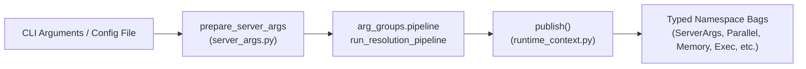

<!-- source: DeepWiki mcp.deepwiki.com · repo sgl-project/sglang · page 3 Core Server Architecture · fetched 2026-10-30 -->

# Core Server Architecture

Relevant source files

The following files were used as context for generating this wiki page:

- [docs/docs/advanced_features/hicache_design.mdx](docs/docs/advanced_features/hicache_design.mdx)
- [docs/docs/references/production_metrics.mdx](docs/docs/references/production_metrics.mdx)
- [python/sglang/srt/entrypoints/http_server.py](python/sglang/srt/entrypoints/http_server.py)
- [python/sglang/srt/managers/data_parallel_controller.py](python/sglang/srt/managers/data_parallel_controller.py)
- [python/sglang/srt/managers/detokenizer_manager.py](python/sglang/srt/managers/detokenizer_manager.py)
- [python/sglang/srt/managers/io_struct.py](python/sglang/srt/managers/io_struct.py)
- [python/sglang/srt/managers/multi_tokenizer_mixin.py](python/sglang/srt/managers/multi_tokenizer_mixin.py)
- [python/sglang/srt/managers/tokenizer_control_mixin.py](python/sglang/srt/managers/tokenizer_control_mixin.py)
- [python/sglang/srt/managers/tokenizer_manager.py](python/sglang/srt/managers/tokenizer_manager.py)
- [python/sglang/srt/ray/data_parallel_controller.py](python/sglang/srt/ray/data_parallel_controller.py)
- [python/sglang/srt/ray/engine.py](python/sglang/srt/ray/engine.py)
- [test/registered/unit/entrypoints/test_server_info.py](test/registered/unit/entrypoints/test_server_info.py)
- [test/registered/unit/managers/test_data_parallel_controller.py](test/registered/unit/managers/test_data_parallel_controller.py)
- [test/registered/unit/managers/test_multi_tokenizer_mixin.py](test/registered/unit/managers/test_multi_tokenizer_mixin.py)
- [test/registered/unit/managers/test_tokenizer_manager_rid_cleanup.py](test/registered/unit/managers/test_tokenizer_manager_rid_cleanup.py)

This page describes SGLang's multi-process server architecture, covering key processes, inter-process communication (IPC) mechanisms, and core configuration systems. It provides a high-level view to orient developers on how components interact and collaborate to serve inference requests efficiently.

## Purpose and Scope

SGLang employs a **multi-process architecture** separating tokenization, scheduling, model execution, and detokenization into dedicated processes. This design supports:

-   **Avoiding Python GIL contention:** Each major task runs in its own process, allowing independent CPU and GPU utilization [python/sglang/srt/managers/tokenizer_manager.py:14-58]().
-   **Asynchronous pipelining:** Tokenization, scheduling, and detokenization proceed concurrently, enabling high throughput [python/sglang/srt/managers/tokenizer_manager.py:14-58]().
-   **Distributed execution:** Supports parallelism strategies including Tensor, Pipeline, Data, and Expert Parallelism [python/sglang/srt/ray/engine.py:115-119]().
-   **Fault isolation:** Subprocess watchdogs monitor critical processes to increase resilience [python/sglang/srt/entrypoints/http_server.py:197-198]() [python/sglang/srt/managers/tokenizer_manager.py:202-202]().

The core architecture centers around four primary process types:

1.  **HTTP Server + Engine (Main Process):** Handles API requests and manages child process lifecycles [python/sglang/srt/entrypoints/http_server.py:15-79]() [python/sglang/srt/ray/engine.py:29-32]().
2.  **TokenizerManager (Subprocess):** Responsible for tokenizing requests and multimodal input encoding [python/sglang/srt/managers/tokenizer_manager.py:14-58]().
3.  **Scheduler (Subprocess):** Manages batching, KV cache memory, and forwards execution to the model runner [python/sglang/srt/managers/data_parallel_controller.py:55-55]().
4.  **DetokenizerManager (Subprocess):** Handles incremental detokenization of model outputs and returns text to the tokenizer [python/sglang/srt/managers/detokenizer_manager.py:14-184]().

For detailed architectural explanation of processes and IPC, server configuration, and tokenizer internals, see these child pages:
- [Multi-Process Architecture and IPC](#3.1) — Document the process model, ZMQ IPC channels, and inter-process communication patterns.
- [Server Configuration (ServerArgs)](#3.2) — Document ServerArgs parameters, the arg_groups resolution pipeline, runtime context, and their effects.
- [TokenizerManager and DetokenizerManager](#3.3) — Explain tokenization/detokenization processes, multi-tokenizer support, and template handling.

Sources:
- [python/sglang/srt/managers/tokenizer_manager.py:14-58]()
- [python/sglang/srt/entrypoints/http_server.py:197-198]()
- [python/sglang/srt/ray/engine.py:115-119]()
- [python/sglang/srt/ray/engine.py:29-32]()
- [python/sglang/srt/managers/data_parallel_controller.py:55-55]()
- [python/sglang/srt/managers/detokenizer_manager.py:14-184]()
- [python/sglang/srt/entrypoints/http_server.py:15-79]()
- [python/sglang/srt/managers/tokenizer_manager.py:202-202]()

---

## Multi-Process Design Overview

SGLang uses a multiprocess design with asynchronous ZeroMQ (ZMQ) communication channels connecting its core components. This architecture balances CPU and GPU workloads and allows each process to specialize while cooperating to serve requests efficiently.

The main request flow is:

-   Client sends requests to the **HTTP Server / Engine** [python/sglang/srt/entrypoints/http_server.py:15-79]().
-   The **Engine** forwards these requests to the **TokenizerManager**, which performs tokenization, multimodal encoding, and pre-processing [python/sglang/srt/managers/tokenizer_manager.py:14-58]().
-   The **TokenizerManager** sends tokenized batches over ZMQ sockets to the **Scheduler** process, managing batch formation, KV cache memory, and model forward execution through `ModelRunner` [python/sglang/srt/managers/data_parallel_controller.py:55-55]() [python/sglang/srt/ray/engine.py:35-35]().
-   The **Scheduler** forwards generated tokens via ZMQ to the **DetokenizerManager**, which decodes tokens into user-readable strings and streams results back [python/sglang/srt/managers/detokenizer_manager.py:14-184]().
-   The **TokenizerManager** relays the final string outputs back to the HTTP Server for client delivery.

### System Components & IPC — Mapping to Code

This diagram associates natural system components with their defining code files:

-   HTTP Server (`http_server.py`) provides FastAPI-based external APIs [python/sglang/srt/entrypoints/http_server.py:15-79]().
-   The Engine (`engine.py`) manages subprocess lifecycles and request forwarding [python/sglang/srt/ray/engine.py:29-32]().
-   The TokenizerManager (`tokenizer_manager.py`) handles tokenization and multimodal processing [python/sglang/srt/managers/tokenizer_manager.py:14-58]().
-   Scheduler (`data_parallel_controller.py`) forms batches, manages KV cache, and coordinates model forward passes [python/sglang/srt/managers/data_parallel_controller.py:55-55]().
-   ModelRunner (`ray/scheduler_actor.py`) executes model inference [python/sglang/srt/ray/engine.py:35-35]().
-   DetokenizerManager (`detokenizer_manager.py`) performs incremental detokenization and streams text output [python/sglang/srt/managers/detokenizer_manager.py:14-184]().

For complete coverage of process lifecycles, ZMQ patterns, and IPC details, see [Multi-Process Architecture and IPC](#3.1).

Sources:
- [python/sglang/srt/entrypoints/http_server.py:15-79]()
- [python/sglang/srt/ray/engine.py:29-32]()
- [python/sglang/srt/managers/tokenizer_manager.py:14-58]()
- [python/sglang/srt/managers/data_parallel_controller.py:55-55]()
- [python/sglang/srt/ray/engine.py:35-35]()
- [python/sglang/srt/managers/detokenizer_manager.py:14-184]()

---

## Server Configuration (`ServerArgs`)

SGLang’s runtime configuration is centralized in the `ServerArgs` dataclass, which defines parameters controlling scheduling, parallelism, hardware assignment, model settings, and IPC port assignments [python/sglang/srt/server_args.py:175-179]().

This configuration flows through a multi-stage resolution pipeline:

-   Initial values come from command-line arguments, environment variables, and config files.
-   A layered resolution pipeline computes derived values based on hardware detection, platform specifics, and model capabilities.
-   The final configuration bundles are published as immutable typed contexts accessible at runtime [python/sglang/srt/runtime_context.py:151-168]().

### ServerArgs Resolution Flow

This approach ensures all server components share a consistent, validated, and immutable runtime configuration context, enabling safe concurrent operations and modular design. `ServerArgs` affects key areas such as batch size limits, parallelism topology (TP/PP/DP/EP), LoRA adapter loading, scheduler policies, and IPC endpoint ports.

For detailed parameter descriptions, resolution logic, and usage in runtime, see [Server Configuration (ServerArgs)](#3.2).

Sources:
- [python/sglang/srt/server_args.py:175-179]()
- [python/sglang/srt/runtime_context.py:151-168]()

---

## `TokenizerManager` and `DetokenizerManager`

Tokenization and detokenization are offloaded to specialized manager processes to reduce CPU contention on the main scheduler and model execution pipeline.

-   **TokenizerManager** manages input preprocessing including text tokenization, multimodal data encoding, chat template handling, and asynchronous batch tokenization. It also handles request lifecycle and state tracking [python/sglang/srt/managers/tokenizer_manager.py:14-58](). The `rid_to_state` dictionary within `TokenizerManager` tracks the state of each request, ensuring proper cleanup after completion or abortion [test/registered/unit/managers/test_tokenizer_manager_rid_cleanup.py:14-15]().

-   **DetokenizerManager** performs incremental detokenization of token ID batches generated by the model. It handles stop conditions and outputs decoded strings asynchronously back to the tokenizer manager [python/sglang/srt/managers/detokenizer_manager.py:14-184](). The `decode_status` dictionary, a `LimitedCapacityDict`, stores the incremental decoding status for each request, with a configurable maximum capacity to prevent memory exhaustion [python/sglang/srt/managers/detokenizer_manager.py:72-72]().

Using independent event loops and subprocess isolation improves throughput and latency by allowing tokenization and detokenization to proceed in parallel with scheduling and model running. These managers communicate with schedulers and the engine over well-defined ZMQ IPC channels to maintain modularity.

For in-depth coverage of tokenization/detokenization mechanics, multi-tokenizer routing, and template management, please refer to [TokenizerManager and DetokenizerManager](#3.3).

Sources:
- [python/sglang/srt/managers/tokenizer_manager.py:14-58]()
- [python/sglang/srt/managers/detokenizer_manager.py:14-184]()
- [python/sglang/srt/managers/multi_tokenizer_mixin.py:1-191]()
- [test/registered/unit/managers/test_tokenizer_manager_rid_cleanup.py:14-15]()
- [python/sglang/srt/managers/detokenizer_manager.py:72-72]()

---

# References and Further Reading

- [Multi-Process Architecture and IPC](#3.1)
- [Server Configuration (ServerArgs)](#3.2)
- [TokenizerManager and DetokenizerManager](#3.3)

---

