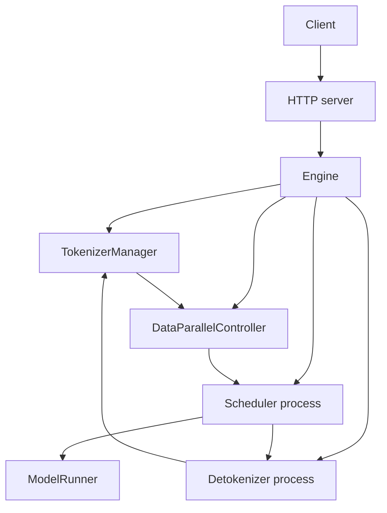

<!-- source: DeepWiki mcp.deepwiki.com · repo sgl-project/sglang · page 3.1 Multi-Process Architecture and IPC · fetched 2026-10-30 -->

# Multi-Process Architecture and IPC

<details>
<summary>Relevant source files</summary>

The following files were used as context for generating this wiki page:

- [.github/workflows/release-pypi-nightly.yml](.github/workflows/release-pypi-nightly.yml)
- [.github/workflows/release-pypi-pr.yml](.github/workflows/release-pypi-pr.yml)
- [3rdparty/amd/wheel/sglang/pyproject.toml](3rdparty/amd/wheel/sglang/pyproject.toml)
- [docker/Dockerfile](docker/Dockerfile)
- [docs/docs/advanced_features/hicache_design.mdx](docs/docs/advanced_features/hicache_design.mdx)
- [docs/docs/references/production_metrics.mdx](docs/docs/references/production_metrics.mdx)
- [python/pyproject.toml](python/pyproject.toml)
- [python/pyproject_cpu.toml](python/pyproject_cpu.toml)
- [python/pyproject_npu.toml](python/pyproject_npu.toml)
- [python/pyproject_other.toml](python/pyproject_other.toml)
- [python/pyproject_xpu.toml](python/pyproject_xpu.toml)
- [python/sglang/srt/entrypoints/engine.py](python/sglang/srt/entrypoints/engine.py)
- [python/sglang/srt/entrypoints/http_server.py](python/sglang/srt/entrypoints/http_server.py)
- [python/sglang/srt/function_call/deepseekv32_detector.py](python/sglang/srt/function_call/deepseekv32_detector.py)
- [python/sglang/srt/function_call/kimik2_detector.py](python/sglang/srt/function_call/kimik2_detector.py)
- [python/sglang/srt/managers/data_parallel_controller.py](python/sglang/srt/managers/data_parallel_controller.py)
- [python/sglang/srt/managers/detokenizer_manager.py](python/sglang/srt/managers/detokenizer_manager.py)
- [python/sglang/srt/managers/io_struct.py](python/sglang/srt/managers/io_struct.py)
- [python/sglang/srt/managers/multi_tokenizer_mixin.py](python/sglang/srt/managers/multi_tokenizer_mixin.py)
- [python/sglang/srt/managers/tokenizer_control_mixin.py](python/sglang/srt/managers/tokenizer_control_mixin.py)
- [python/sglang/srt/managers/tokenizer_manager.py](python/sglang/srt/managers/tokenizer_manager.py)
- [python/sglang/srt/ray/data_parallel_controller.py](python/sglang/srt/ray/data_parallel_controller.py)
- [python/sglang/srt/ray/engine.py](python/sglang/srt/ray/engine.py)
- [python/sglang/srt/utils/common.py](python/sglang/srt/utils/common.py)
- [python/sglang/srt/utils/json_response.py](python/sglang/srt/utils/json_response.py)
- [scripts/update_nightly_whl_index.py](scripts/update_nightly_whl_index.py)
- [test/registered/function_call/test_kimik2_detector.py](test/registered/function_call/test_kimik2_detector.py)
- [test/registered/moe/test_cutedsl_moe.py](test/registered/moe/test_cutedsl_moe.py)
- [test/registered/unit/entrypoints/test_server_info.py](test/registered/unit/entrypoints/test_server_info.py)
- [test/registered/unit/function_call/test_deepseekv4_detector.py](test/registered/unit/function_call/test_deepseekv4_detector.py)
- [test/registered/unit/function_call/test_json_schema_constraint.py](test/registered/unit/function_call/test_json_schema_constraint.py)
- [test/registered/unit/function_call/test_structural_tag_excludes.py](test/registered/unit/function_call/test_structural_tag_excludes.py)
- [test/registered/unit/function_call/test_unknown_tool_name.py](test/registered/unit/function_call/test_unknown_tool_name.py)
- [test/registered/unit/managers/test_data_parallel_controller.py](test/registered/unit/managers/test_data_parallel_controller.py)
- [test/registered/unit/managers/test_multi_tokenizer_mixin.py](test/registered/unit/managers/test_multi_tokenizer_mixin.py)
- [test/registered/unit/managers/test_tokenizer_manager_rid_cleanup.py](test/registered/unit/managers/test_tokenizer_manager_rid_cleanup.py)
- [test/registered/unit/utils/test_common.py](test/registered/unit/utils/test_common.py)
- [test/registered/unit/utils/test_json_response.py](test/registered/unit/utils/test_json_response.py)

</details>


## Purpose and Scope

This page describes the SGLang Runtime (SRT) process roles and the inter-process communication (IPC) patterns visible in the provided implementation. It focuses on `Engine`, `TokenizerManager`, scheduler processes, the data-parallel controller, ZeroMQ sockets, and the typed IPC payloads defined in `io_struct.py`. [python/sglang/srt/entrypoints/engine.py:14-18](), [python/sglang/srt/managers/tokenizer_manager.py:14-14](), [python/sglang/srt/managers/io_struct.py:14-20]()

Sources: `[python/sglang/srt/entrypoints/engine.py:14-18]()`, `[python/sglang/srt/managers/tokenizer_manager.py:14-14]()`, `[python/sglang/srt/managers/io_struct.py:14-20]()`

---

## Process Architecture Overview

SRT separates request handling and model execution into cooperating runtime roles. `Engine` is an inference-server entry point and imports the manager and process-launch functions for the tokenizer, detokenizer, scheduler, and data-parallel controller. `init_tokenizer_manager` constructs a `TokenizerManager` and initializes a `TemplateManager`. [python/sglang/srt/entrypoints/engine.py:14-18](), [python/sglang/srt/entrypoints/engine.py:66-110](), [python/sglang/srt/entrypoints/engine.py:195-208]()

The `TokenizerManager` is documented as a process that tokenizes text. Its module imports both synchronous and asynchronous ZeroMQ APIs, along with request and output structures from `io_struct.py`. [python/sglang/srt/managers/tokenizer_manager.py:14-14](), [python/sglang/srt/managers/tokenizer_manager.py:50-56](), [python/sglang/srt/managers/tokenizer_manager.py:80-115]()

In data-parallel configurations, `DataParallelController` is responsible for dispatching requests to multiple data-parallel workers. Its constructor creates a ZMQ context and, on node rank zero, a `PULL` socket connected to the scheduler input IPC name. [python/sglang/srt/managers/data_parallel_controller.py:14-14](), [python/sglang/srt/managers/data_parallel_controller.py:158-184]()

### Process Architecture Diagram



The diagram maps the runtime roles to entities imported or initialized by the engine and controller. It is a role-level overview; the shown source excerpts do not establish every connection in this diagram as a specific call path. [python/sglang/srt/entrypoints/engine.py:66-110](), [python/sglang/srt/entrypoints/engine.py:195-208](), [python/sglang/srt/managers/data_parallel_controller.py:158-184]()

Sources: `[python/sglang/srt/entrypoints/engine.py:66-110]()`, `[python/sglang/srt/entrypoints/engine.py:195-208]()`, `[python/sglang/srt/managers/data_parallel_controller.py:158-184]()`

---

## Process Components

### Main Process: Engine, HTTP Server, and TokenizerManager

`Engine` is described as the inference-server entry point and implements Python APIs for the inference engine. Its imports show the process and manager roles it coordinates, including `run_detokenizer_process`, `run_scheduler_process`, `run_data_parallel_controller_process`, and `TokenizerManager`. [python/sglang/srt/entrypoints/engine.py:14-18](), [python/sglang/srt/entrypoints/engine.py:66-110]()

`init_tokenizer_manager` selects a supplied `TokenizerManagerClass` or defaults to `TokenizerManager`, constructs it using `server_args` and `port_args`, then initializes `TemplateManager` with that manager and the configured model path. [python/sglang/srt/entrypoints/engine.py:195-208]()

The HTTP entry point is implemented with FastAPI and imports `Engine`, `init_tokenizer_manager`, `run_detokenizer_process`, and `run_scheduler_process`. The excerpt establishes these dependencies, but not the full HTTP request dispatch behavior. [python/sglang/srt/entrypoints/http_server.py:15-18](), [python/sglang/srt/entrypoints/http_server.py:82-87]()

| Component | Code entity | Role established by the shown source |
|---|---|---|
| Engine | `Engine` in `entrypoints/engine.py` | Inference engine entry point; imports process-launch functions and manager classes. [python/sglang/srt/entrypoints/engine.py:14-18](), [python/sglang/srt/entrypoints/engine.py:66-110]() |
| HTTP server | `entrypoints/http_server.py` | FastAPI-based HTTP entry point; imports engine and runtime process entry points. [python/sglang/srt/entrypoints/http_server.py:15-18](), [python/sglang/srt/entrypoints/http_server.py:82-87]() |
| TokenizerManager | `managers/tokenizer_manager.py` | Process documented as tokenizing text; imports IPC request structures and ZMQ APIs. [python/sglang/srt/managers/tokenizer_manager.py:14-14](), [python/sglang/srt/managers/tokenizer_manager.py:50-56](), [python/sglang/srt/managers/tokenizer_manager.py:80-115]() |
| TemplateManager | `parser/template_manager.py` | Initialized by `init_tokenizer_manager` alongside the tokenizer manager. [python/sglang/srt/entrypoints/engine.py:195-208]() |

Sources: `[python/sglang/srt/entrypoints/engine.py:14-18]()`, `[python/sglang/srt/entrypoints/engine.py:66-110]()`, `[python/sglang/srt/entrypoints/engine.py:195-208]()`, `[python/sglang/srt/entrypoints/http_server.py:15-18]()`, `[python/sglang/srt/entrypoints/http_server.py:82-87]()`, `[python/sglang/srt/managers/tokenizer_manager.py:14-14]()`, `[python/sglang/srt/managers/tokenizer_manager.py:50-56]()`

---

### Scheduler Process

`Engine` imports `run_scheduler_process` and `run_scheduler_process_with_init_pipe` from the data-parallel controller module, as well as `run_scheduler_process` from the scheduler module. This indicates that scheduler startup is part of the engine’s runtime composition; the available excerpts do not show the scheduler loop or its complete startup sequence. [python/sglang/srt/entrypoints/engine.py:66-71](), [python/sglang/srt/entrypoints/engine.py:109-110]()

`DataParallelController` accepts a scheduler-process callback in its constructor. It creates a ZMQ context sized using the number of DP ranks and, on node rank zero, receives from `port_args.scheduler_input_ipc_name` through a `PULL` socket. [python/sglang/srt/managers/data_parallel_controller.py:158-184]()

| Component | Code entity | Responsibility established by the shown source |
|---|---|---|
| Scheduler process entry point | `run_scheduler_process` | Imported by `Engine` and the data-parallel controller. [python/sglang/srt/entrypoints/engine.py:66-71](), [python/sglang/srt/entrypoints/engine.py:109-110](), [python/sglang/srt/managers/data_parallel_controller.py:53-56]() |
| Data-parallel controller | `DataParallelController` | Dispatches requests to multiple DP workers and initializes IPC reception from the tokenizer-side scheduler input name. [python/sglang/srt/managers/data_parallel_controller.py:14-14](), [python/sglang/srt/managers/data_parallel_controller.py:158-184]() |

Sources: `[python/sglang/srt/entrypoints/engine.py:66-71]()`, `[python/sglang/srt/entrypoints/engine.py:109-110]()`, `[python/sglang/srt/managers/data_parallel_controller.py:14-14]()`, `[python/sglang/srt/managers/data_parallel_controller.py:53-56]()`, `[python/sglang/srt/managers/data_parallel_controller.py:158-184]()`

---

### DetokenizerManager Process

`Engine` imports `run_detokenizer_process` from `detokenizer_manager.py`. `io_struct.py` identifies `TokenizerManager`, `DetokenizerManager`, and `Scheduler` as the processes whose transferred objects its structures define. The excerpts provided do not show the detokenizer process implementation or the exact socket endpoints it uses. [python/sglang/srt/entrypoints/engine.py:71-72](), [python/sglang/srt/managers/io_struct.py:14-20]()

`io_struct.py` defines `BatchTokenIDOutput` and `BatchStrOutput` among its imported types in the multi-tokenizer utilities; their names indicate batch-level token-ID and string output structures, but the supplied excerpts do not show their definitions or the detokenizer’s conversion behavior. [python/sglang/srt/managers/multi_tokenizer_mixin.py:44-61]()

Sources: `[python/sglang/srt/entrypoints/engine.py:71-72]()`, `[python/sglang/srt/managers/io_struct.py:14-20]()`, `[python/sglang/srt/managers/multi_tokenizer_mixin.py:44-61]()`

---

## IPC Channels and Communication Patterns

The runtime uses ZeroMQ through `pyzmq`. `io_struct.py` imports `zmq` and `zmq.asyncio`, while the `TokenizerManager` imports the same APIs and the synchronous/asynchronous socket helpers from `io_struct.py`. [python/sglang/srt/managers/io_struct.py:46-50](), [python/sglang/srt/managers/tokenizer_manager.py:50-56](), [python/sglang/srt/managers/tokenizer_manager.py:109-115]()

The provided code establishes one concrete socket setup: `DataParallelController` creates a `PULL` socket at `port_args.scheduler_input_ipc_name` when running on node rank zero. `SocketMapping` in `multi_tokenizer_mixin.py` lazily creates `PUSH` sockets for registered IPC names and sends outputs with `sock_send`. [python/sglang/srt/managers/data_parallel_controller.py:179-184](), [python/sglang/srt/managers/multi_tokenizer_mixin.py:88-115]()

The implementation excerpts do not establish the complete set of channel names, all socket peers, or a `DEALER`/`ROUTER` RPC channel. Those details are intentionally not inferred here.

### IPC Mechanisms

| Mechanism | Evidence-backed behavior |
|---|---|
| `PUSH` socket in `SocketMapping` | `_register_ipc_mapping` obtains a `PUSH` socket through `get_zmq_socket`; `send_output` registers a missing mapping and invokes `sock_send`. [python/sglang/srt/managers/multi_tokenizer_mixin.py:88-115]() |
| `PULL` socket in `DataParallelController` | On node rank zero, the controller obtains a `PULL` socket using `scheduler_input_ipc_name`. [python/sglang/srt/managers/data_parallel_controller.py:179-184]() |
| Synchronous and asynchronous helpers | `io_struct.py` imports `sock_recv`, `sock_send`, `async_sock_recv`, and `async_sock_send`; the imports alone do not specify all call-site patterns. [python/sglang/srt/managers/io_struct.py:46-50](), [python/sglang/srt/managers/io_struct.py:109-115]() |

### Message Structures and Routing Metadata

`io_struct.py` is explicitly scoped to objects transferred between `TokenizerManager`, `DetokenizerManager`, and `Scheduler`. `BaseReq` is a tagged `msgspec.Struct` for single-request IPC payloads and includes optional `rid` and `http_worker_ipc` fields. `BaseBatchReq` is the corresponding base for batched payloads and includes optional `rids` and `http_worker_ipcs`. [python/sglang/srt/managers/io_struct.py:14-20](), [python/sglang/srt/managers/io_struct.py:86-108]()

`PickleWrapper` stores arbitrary Python objects as bytes in msgpack IPC when a payload is not represented by a typed msgspec field. Its documentation distinguishes this mode from pickle IPC, where wrapping and unwrapping are no-ops and the wrapper is not used on the wire. [python/sglang/srt/managers/io_struct.py:121-132]()

| Structure | Purpose |
|---|---|
| `BaseReq` | Base for single-request IPC payloads; carries optional request ID and HTTP-worker IPC metadata. [python/sglang/srt/managers/io_struct.py:86-95]() |
| `BaseBatchReq` | Base for batched IPC payloads; carries optional request-ID and HTTP-worker IPC lists. [python/sglang/srt/managers/io_struct.py:97-108]() |
| `PickleWrapper` | Holds opaque serialized bytes for fields that cannot be represented as typed msgspec values in msgpack mode. [python/sglang/srt/managers/io_struct.py:121-132]() |
| `SessionParams` | Carries session and request-branch parameters, including session ID, request ID, insertion offset, and replacement options. [python/sglang/srt/managers/io_struct.py:134-156]() |

Sources: `[python/sglang/srt/managers/data_parallel_controller.py:179-184]()`, `[python/sglang/srt/managers/io_struct.py:14-20]()`, `[python/sglang/srt/managers/io_struct.py:46-50]()`, `[python/sglang/srt/managers/io_struct.py:86-108]()`, `[python/sglang/srt/managers/io_struct.py:109-115]()`, `[python/sglang/srt/managers/io_struct.py:121-132]()`, `[python/sglang/srt/managers/multi_tokenizer_mixin.py:88-115]()`

### ZMQ IPC Channel Diagram


The diagram shows the specific socket construction and scheduler callback visible in the excerpts. It does not assert that `SocketMapping` is the unique sender to this particular channel. [python/sglang/srt/managers/multi_tokenizer_mixin.py:88-115](), [python/sglang/srt/managers/data_parallel_controller.py:158-184]()

Sources: `[python/sglang/srt/managers/multi_tokenizer_mixin.py:88-115]()`, `[python/sglang/srt/managers/data_parallel_controller.py:158-184]()`

---

## Data Flow and Request Lifecycle

The code excerpts support the following broad request path: IPC structures are defined for traffic among the tokenizer manager, detokenizer manager, and scheduler; the engine imports those manager/process entry points; and the data-parallel controller has a `PULL` socket associated with `scheduler_input_ipc_name`. [python/sglang/srt/managers/io_struct.py:14-20](), [python/sglang/srt/entrypoints/engine.py:66-110](), [python/sglang/srt/managers/data_parallel_controller.py:179-184]()

The shown code does not include the complete request-handler call sequence, scheduler-to-model execution code, or detokenizer response path. The sequence below therefore distinguishes the documented runtime roles from the concrete IPC operations shown.

### Request Path at the Process-Role Level

1. The HTTP server is a FastAPI entry point and imports the engine and runtime process entry points. [python/sglang/srt/entrypoints/http_server.py:15-18](), [python/sglang/srt/entrypoints/http_server.py:82-87]()
2. `Engine` imports `TokenizerManager`, scheduler and detokenizer process entry points, and data-parallel-controller startup functions. [python/sglang/srt/entrypoints/engine.py:66-110]()
3. `init_tokenizer_manager` constructs the tokenizer manager and initializes a `TemplateManager`. [python/sglang/srt/entrypoints/engine.py:195-208]()
4. `io_struct.py` defines IPC payload bases for single requests and batches, including request IDs and HTTP-worker routing metadata. [python/sglang/srt/managers/io_struct.py:86-108]()
5. In a data-parallel configuration, the controller receives from the scheduler input IPC name over a `PULL` socket on node rank zero. [python/sglang/srt/managers/data_parallel_controller.py:179-184]()

### Request Lifecycle Sequence Diagram

```mermaid
sequenceDiagram
    participant HTTP as "http_server.py"
    participant Engine as "Engine"
    participant TM as "TokenizerManager"
    participant SocketMapping as "SocketMapping"
    participant DPC as "DataParallelController"
    participant Scheduler as "Scheduler process"
    participant Detokenizer as "Detokenizer process"

    HTTP->>Engine: "Use runtime entry point"
    Engine->>TM: "Construct in init_tokenizer_manager"
    TM->>SocketMapping: "Output associated with IPC name"
    SocketMapping->>DPC: "PUSH socket; channel relationship not fully shown"
    DPC->>Scheduler: "PULL on scheduler_input_ipc_name; scheduler callback"
    Engine->>Detokenizer: "Imports run_detokenizer_process"
```

The diagram uses only call/import relationships and socket setup visible in the excerpts. It does not describe an unshown response sequence or claim that every deployment uses the data-parallel controller. [python/sglang/srt/entrypoints/http_server.py:82-87](), [python/sglang/srt/entrypoints/engine.py:66-110](), [python/sglang/srt/entrypoints/engine.py:195-208](), [python/sglang/srt/managers/multi_tokenizer_mixin.py:88-115](), [python/sglang/srt/managers/data_parallel_controller.py:158-184]()

Sources: `[python/sglang/srt/entrypoints/http_server.py:82-87]()`, `[python/sglang/srt/entrypoints/engine.py:66-110]()`, `[python/sglang/srt/entrypoints/engine.py:195-208]()`, `[python/sglang/srt/managers/multi_tokenizer_mixin.py:88-115]()`, `[python/sglang/srt/managers/data_parallel_controller.py:158-184]()`

---

## Implementation Details and Techniques

### Socket Ownership and Sending

`SocketMapping` owns a ZMQ context and a mapping from IPC names to sockets. It closes mapped sockets in `clear_all_sockets`. When an output is sent to an unregistered IPC name, `send_output` lazily registers a `PUSH` socket and then calls `sock_send`. If the IPC name is `None`, the method logs a warning and skips sending. [python/sglang/srt/managers/multi_tokenizer_mixin.py:88-115]()

### Data-Parallel Input Reception

`DataParallelController` creates a ZMQ context sized as `1 + num_dp_ranks`. On node rank zero, it creates `recv_from_tokenizer` as a `PULL` socket connected using `port_args.scheduler_input_ipc_name`. The controller also accepts a scheduler-process callback as a constructor argument. [python/sglang/srt/managers/data_parallel_controller.py:158-184]()

### Serialization and Correlation

`BaseReq` and `BaseBatchReq` provide request and batch IPC structure bases. Their `rid`/`rids` fields identify requests, while `http_worker_ipc`/`http_worker_ipcs` provide IPC routing metadata for HTTP workers. `PickleWrapper` supplies a bytes field for opaque values carried through msgpack serialization. [python/sglang/srt/managers/io_struct.py:86-108](), [python/sglang/srt/managers/io_struct.py:121-132]()

### Multi-HTTP-Worker Support

`multi_tokenizer_mixin.py` describes its role as supporting multi-HTTP-worker mode through multiple processes for handling requests and tokenization. Its imports include shared-memory utilities, ZMQ APIs, typed request/output structures, and socket send/receive helpers. [python/sglang/srt/managers/multi_tokenizer_mixin.py:17-20](), [python/sglang/srt/managers/multi_tokenizer_mixin.py:22-39](), [python/sglang/srt/managers/multi_tokenizer_mixin.py:44-61]()

Sources: `[python/sglang/srt/managers/multi_tokenizer_mixin.py:17-20]()`, `[python/sglang/srt/managers/multi_tokenizer_mixin.py:22-39]()`, `[python/sglang/srt/managers/multi_tokenizer_mixin.py:88-115]()`, `[python/sglang/srt/managers/data_parallel_controller.py:158-184]()`, `[python/sglang/srt/managers/io_struct.py:86-108]()`, `[python/sglang/srt/managers/io_struct.py:121-132]()`

---

## Summary Diagrams: Entity Mapping

### Natural Language System Entities ↔ Code Entities

```mermaid
flowchart LR
    Client["Inference client"]
    HTTP["HTTP API entry point"]
    HTTPModule["entrypoints/http_server.py"]
    Engine["Engine"]
    EngineModule["entrypoints/engine.py"]
    TokenizerManager["TokenizerManager"]
    TokenizerModule["managers/tokenizer_manager.py"]
    PayloadTypes["BaseReq and BaseBatchReq"]
    IOStruct["managers/io_struct.py"]

    Client --> HTTP
    HTTP --> HTTPModule
    HTTPModule --> Engine
    Engine --> EngineModule
    EngineModule --> TokenizerManager
    TokenizerManager --> TokenizerModule
    TokenizerModule --> PayloadTypes
    PayloadTypes --> IOStruct
```



This diagram bridges serving concepts to file and symbol names present in the implementation. The HTTP module imports the engine entry points; the engine initializes `TokenizerManager`; and `io_struct.py` defines IPC structure bases. [python/sglang/srt/entrypoints/http_server.py:82-87](), [python/sglang/srt/entrypoints/engine.py:195-208](), [python/sglang/srt/managers/io_struct.py:86-108]()

Sources: `[python/sglang/srt/entrypoints/http_server.py:82-87]()`, `[python/sglang/srt/entrypoints/engine.py:195-208]()`, `[python/sglang/srt/managers/io_struct.py:86-108]()`

---

### Process Boundaries and IPC Channels in Code Entity Space

```mermaid
flowchart LR
    SocketMapping["SocketMapping"]
    PushSocket["get_zmq_socket with zmq.PUSH"]
    SchedulerInput["port_args.scheduler_input_ipc_name"]
    PullSocket["get_zmq_socket with zmq.PULL"]
    DataParallelController["DataParallelController"]
    SchedulerCallback["run_scheduler_process_func"]
    SchedulerProcess["run_scheduler_process"]

    SocketMapping -->|"registers IPC name"| PushSocket
    PushSocket -->|"send_output uses sock_send"| SchedulerInput
    SchedulerInput -->|"connected by node rank zero"| PullSocket
    PullSocket --> DataParallelController
    DataParallelController -->|"constructor callback"| SchedulerCallback
    SchedulerCallback --> SchedulerProcess
```



This diagram maps the named scheduler-input channel and the socket operations to their code entities. It does not assert a direct connection between `SocketMapping` and that channel beyond the shared IPC-name-based pattern shown in the sources. [python/sglang/srt/managers/multi_tokenizer_mixin.py:88-115](), [python/sglang/srt/managers/data_parallel_controller.py:158-184](), [python/sglang/srt/managers/data_parallel_controller.py:53-56]()

Sources: `[python/sglang/srt/managers/multi_tokenizer_mixin.py:88-115]()`, `[python/sglang/srt/managers/data_parallel_controller.py:53-56]()`, `[python/sglang/srt/managers/data_parallel_controller.py:158-184]()`

---

## References

- Engine entry point, manager imports, and tokenizer-manager initialization: [python/sglang/srt/entrypoints/engine.py:14-18](), [python/sglang/srt/entrypoints/engine.py:66-110](), [python/sglang/srt/entrypoints/engine.py:195-208]()
- FastAPI HTTP entry point imports: [python/sglang/srt/entrypoints/http_server.py:15-18](), [python/sglang/srt/entrypoints/http_server.py:82-87]()
- IPC structure bases and opaque payload wrapper: [python/sglang/srt/managers/io_struct.py:14-20](), [python/sglang/srt/managers/io_struct.py:86-108](), [python/sglang/srt/managers/io_struct.py:121-132]()
- ZMQ `PUSH` socket mapping and output sending: [python/sglang/srt/managers/multi_tokenizer_mixin.py:88-115]()
- Data-parallel controller and scheduler input socket: [python/sglang/srt/managers/data_parallel_controller.py:158-184]()
- Runtime ZMQ imports: [python/sglang/srt/managers/tokenizer_manager.py:50-56](), [python/sglang/srt/managers/io_struct.py:46-50]()

---

