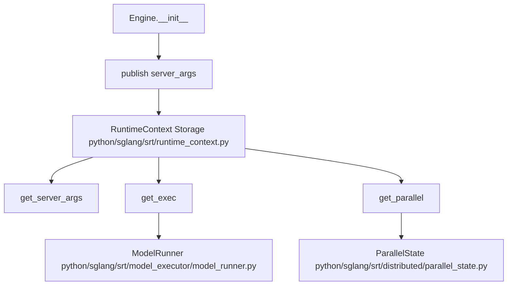

<!-- source: DeepWiki mcp.deepwiki.com · repo sgl-project/sglang · page 3.2 Server Configuration (ServerArgs) · fetched 2026-10-30 -->

# Server Configuration (ServerArgs)

Relevant source files

The following files were used as context for generating this wiki page:

- [docs/docs/advanced_features/server_arguments.mdx](docs/docs/advanced_features/server_arguments.mdx)
- [docs/docs/advanced_features/server_arguments_undocumented.txt](docs/docs/advanced_features/server_arguments_undocumented.txt)
- [docs/docs/references/environment_variables.mdx](docs/docs/references/environment_variables.mdx)
- [python/sglang/benchmark/one_batch.py](python/sglang/benchmark/one_batch.py)
- [python/sglang/srt/arg_groups/arg_utils.py](python/sglang/srt/arg_groups/arg_utils.py)
- [python/sglang/srt/arg_groups/attention_hook.py](python/sglang/srt/arg_groups/attention_hook.py)
- [python/sglang/srt/arg_groups/cuda_graph_hook.py](python/sglang/srt/arg_groups/cuda_graph_hook.py)
- [python/sglang/srt/arg_groups/field_order.py](python/sglang/srt/arg_groups/field_order.py)
- [python/sglang/srt/arg_groups/fields/exec_.py](python/sglang/srt/arg_groups/fields/exec_.py)
- [python/sglang/srt/arg_groups/fields/schedule.py](python/sglang/srt/arg_groups/fields/schedule.py)
- [python/sglang/srt/arg_groups/fields/serving.py](python/sglang/srt/arg_groups/fields/serving.py)
- [python/sglang/srt/arg_groups/memory_hook.py](python/sglang/srt/arg_groups/memory_hook.py)
- [python/sglang/srt/arg_groups/model_hook.py](python/sglang/srt/arg_groups/model_hook.py)
- [python/sglang/srt/arg_groups/overrides.py](python/sglang/srt/arg_groups/overrides.py)
- [python/sglang/srt/arg_groups/pd_disaggregation_hook.py](python/sglang/srt/arg_groups/pd_disaggregation_hook.py)
- [python/sglang/srt/arg_groups/pipeline.py](python/sglang/srt/arg_groups/pipeline.py)
- [python/sglang/srt/arg_groups/platform_hook.py](python/sglang/srt/arg_groups/platform_hook.py)
- [python/sglang/srt/arg_groups/resolution_hooks.py](python/sglang/srt/arg_groups/resolution_hooks.py)
- [python/sglang/srt/arg_groups/serving_hook.py](python/sglang/srt/arg_groups/serving_hook.py)
- [python/sglang/srt/arg_groups/validation_hook.py](python/sglang/srt/arg_groups/validation_hook.py)
- [python/sglang/srt/disaggregation/role_switch.py](python/sglang/srt/disaggregation/role_switch.py)
- [python/sglang/srt/distributed/bootstrap.py](python/sglang/srt/distributed/bootstrap.py)
- [python/sglang/srt/distributed/parallel_state.py](python/sglang/srt/distributed/parallel_state.py)
- [python/sglang/srt/environ.py](python/sglang/srt/environ.py)
- [python/sglang/srt/layers/dp_attention.py](python/sglang/srt/layers/dp_attention.py)
- [python/sglang/srt/managers/schedule_batch.py](python/sglang/srt/managers/schedule_batch.py)
- [python/sglang/srt/managers/scheduler.py](python/sglang/srt/managers/scheduler.py)
- [python/sglang/srt/mem_cache/common.py](python/sglang/srt/mem_cache/common.py)
- [python/sglang/srt/mem_cache/unified_cache/linker_config.py](python/sglang/srt/mem_cache/unified_cache/linker_config.py)
- [python/sglang/srt/model_executor/model_runner.py](python/sglang/srt/model_executor/model_runner.py)
- [python/sglang/srt/model_executor/model_runner_components/layer_setup.py](python/sglang/srt/model_executor/model_runner_components/layer_setup.py)
- [python/sglang/srt/runtime_context.py](python/sglang/srt/runtime_context.py)
- [python/sglang/srt/server_args.py](python/sglang/srt/server_args.py)
- [test/manual/test_forward_split_prefill.py](test/manual/test_forward_split_prefill.py)
- [test/manual/test_vlm_accuracy.py](test/manual/test_vlm_accuracy.py)
- [test/registered/disaggregation/test_disaggregation_optimistic_prefill.py](test/registered/disaggregation/test_disaggregation_optimistic_prefill.py)
- [test/registered/unit/disaggregation/test_pd_role_switch.py](test/registered/unit/disaggregation/test_pd_role_switch.py)
- [test/registered/unit/managers/test_schedule_policy.py](test/registered/unit/managers/test_schedule_policy.py)
- [test/registered/unit/managers/test_scheduler_hicache_events.py](test/registered/unit/managers/test_scheduler_hicache_events.py)
- [test/registered/unit/managers/test_scheduler_prefill_decode_interval.py](test/registered/unit/managers/test_scheduler_prefill_decode_interval.py)
- [test/registered/unit/mem_cache/test_hicache_file_storage_path_unit.py](test/registered/unit/mem_cache/test_hicache_file_storage_path_unit.py)
- [test/registered/unit/model_executor/model_runner_components/test_layer_setup.py](test/registered/unit/model_executor/model_runner_components/test_layer_setup.py)
- [test/registered/unit/server_args/test_resolution_declarations.py](test/registered/unit/server_args/test_resolution_declarations.py)
- [test/registered/unit/server_args/test_resolution_hook_registry.py](test/registered/unit/server_args/test_resolution_hook_registry.py)
- [test/registered/unit/server_args/test_resolution_is_reproducible.py](test/registered/unit/server_args/test_resolution_is_reproducible.py)
- [test/registered/unit/server_args/test_server_args.py](test/registered/unit/server_args/test_server_args.py)
- [test/registered/unit/test_global_config_read_ratchet.py](test/registered/unit/test_global_config_read_ratchet.py)
- [test/registered/unit/test_model_overrides.py](test/registered/unit/test_model_overrides.py)
- [test/registered/unit/test_rocm_pageable_h2d_staging.py](test/registered/unit/test_rocm_pageable_h2d_staging.py)
- [test/registered/unit/test_runtime_context.py](test/registered/unit/test_runtime_context.py)
- [test/registered/unit/test_server_args_cli_metadata.py](test/registered/unit/test_server_args_cli_metadata.py)
- [test/registered/unit/test_server_args_migration.py](test/registered/unit/test_server_args_migration.py)
- [test/registered/unit/test_server_args_namespaces.py](test/registered/unit/test_server_args_namespaces.py)

This page documents the `ServerArgs` dataclass, the argument groups resolution pipeline, companion `PortArgs` configuration, and runtime context integration within the SGLang runtime (`SRT`). It explains how server parameters are declared, validated, resolved, overridden, and accessed consistently across different server components and runtime subsystems.

Sources: [`python/sglang/srt/server_args.py:1-186`](), [`python/sglang/srt/runtime_context.py:1-46`]()

---

## 1. `ServerArgs` Dataclass and Field Group Architecture

`ServerArgs` represents the central server configuration object containing all runtime parameters for serving LLMs and VLMs. Instead of a monolithic class, it is designed as a composition of **field groups**, each encapsulating logically related settings. This modular design facilitates organized declaration, parsing, and resolution.

The `ServerArgs` dataclass is defined in [`python/sglang/srt/server_args.py`](python/sglang/srt/server_args.py) and aggregates groups imported from their respective modules under `sglang.srt.arg_groups.fields.*`. These groups decorate their fields with argument metadata for CLI, environment, and config file integration.

### Major Field Groups in `ServerArgs`

| Field Group | Purpose | Selected Key Fields |
|-------------|---------|---------------------|
| **Model** `[python/sglang/srt/arg_groups/fields/model.py]()` | Model loading and architecture parameters | `model_path`, `revision`, `trust_remote_code`, `context_length`, `load_format` |
| **Parallel** `[python/sglang/srt/arg_groups/fields/parallel.py]()` | Distributed parallelism sizes and ranks | `tp_size` (tensor parallel), `pp_size` (pipeline parallel), `dp_size` (data parallel), `ep_size` (expert parallel), `attn_cp_size` (context parallel) |
| **Memory** `[python/sglang/srt/arg_groups/fields/memory.py]()` | Memory budgets and cache types | `mem_fraction_static`, `max_total_tokens`, `kv_cache_dtype` |
| **Schedule** `[python/sglang/srt/arg_groups/fields/schedule.py]()` | Scheduling policies and concurrency limits | `schedule_policy` (e.g. `fcfs`, `lpm`), `max_running_requests`, `chunked_prefill_size` |
| **Exec_*** `[python/sglang/srt/arg_groups/fields/exec_.py]()` | Execution kernels and CUDA graph settings | `attention_backend`, `cuda_graph`, `moe_runner_backend` |
| **Serving** `[python/sglang/srt/arg_groups/fields/serving.py]()` | Network binding and gRPC-related configs | `host`, `port`, `root_path`, `grpc_mode` |
| **Device** `[python/sglang/srt/arg_groups/fields/device.py]()` | Device-specific configurations | `device`, `dtype` |
| **Disagg** `[python/sglang/srt/arg_groups/fields/disagg.py]()` | Disaggregation settings | `disaggregation_mode`, `disaggregation_transfer_backend` |
| **Lora** `[python/sglang/srt/arg_groups/fields/lora.py]()` | LoRA adapter configurations | `lora_path`, `max_lora_adapters` |
| **Mm** `[python/sglang/srt/arg_groups/fields/mm.py]()` | Multimodal settings | `enable_mm_server`, `mm_image_cache_size` |
| **Observability** `[python/sglang/srt/arg_groups/fields/observability.py]()` | Monitoring and logging settings | `enable_opentelemetry`, `metrics_port` |
| **Spec** `[python/sglang/srt/arg_groups/fields/spec.py]()` | Speculative decoding settings | `enable_speculative_decoding`, `speculative_draft_model` |

This modular field-group hierarchy allows for independent evolution and plug-in extensions of the server configuration interface.

### Diagram: ServerArgs Composition (Natural Language to Code Entity Space)

```mermaid
graph TD
    SA["ServerArgs python/sglang/srt/server_args.py"] --> Model["Model Group python/sglang/srt/arg_groups/fields/model.py"]
    SA --> Parallel["Parallel Group python/sglang/srt/arg_groups/fields/parallel.py"]
    SA --> Memory["Memory Group python/sglang/srt/arg_groups/fields/memory.py"]
    SA --> Schedule["Schedule Group python/sglang/srt/arg_groups/fields/schedule.py"]
    SA --> Exec["Exec Groups python/sglang/srt/arg_groups/fields/exec_.py"]
    SA --> Serving["Serving Group python/sglang/srt/arg_groups/fields/serving.py"]
    SA --> Device["Device Group python/sglang/srt/arg_groups/fields/device.py"]
    SA --> Disagg["Disagg Group python/sglang/srt/arg_groups/fields/disagg.py"]
    SA --> Lora["Lora Group python/sglang/srt/arg_groups/fields/lora.py"]
    SA --> Mm["Mm Group python/sglang/srt/arg_groups/fields/mm.py"]
    SA --> Observability["Observability Group python/sglang/srt/arg_groups/fields/observability.py"]
    SA --> Spec["Spec Group python/sglang/srt/arg_groups/fields/spec.py"]

    Model --> ModelPath["model_path"]
    Parallel --> TPSize["tp_size"]
    Memory --> MemFrac["mem_fraction_static"]
    Schedule --> SchedPolicy["schedule_policy"]
    Exec --> AttentionBackend["attention_backend"]
    Serving --> Port["port"]
    Device --> DType["dtype"]
    Disagg --> DisaggMode["disaggregation_mode"]
    Lora --> LoraPath["lora_path"]
    Mm --> EnableMmServer["enable_mm_server"]
    Observability --> MetricsPort["metrics_port"]
    Spec --> EnableSpeculativeDecoding["enable_speculative_decoding"]
```

Sources: [`python/sglang/srt/server_args.py:116-182`](), [`python/sglang/srt/arg_groups/fields/model.py:1-50`](), [`python/sglang/srt/arg_groups/fields/parallel.py:1-50`](), [`python/sglang/srt/arg_groups/fields/memory.py:1-50`](), [`python/sglang/srt/arg_groups/fields/schedule.py:1-50`](), [`python/sglang/srt/arg_groups/fields/exec_.py:1-50`](), [`python/sglang/srt/arg_groups/fields/serving.py:1-50`](), [`python/sglang/srt/arg_groups/fields/device.py:1-50`](), [`python/sglang/srt/arg_groups/fields/disagg.py:1-50`](), [`python/sglang/srt/arg_groups/fields/lora.py:1-50`](), [`python/sglang/srt/arg_groups/fields/mm.py:1-50`](), [`python/sglang/srt/arg_groups/fields/observability.py:1-50`](), [`python/sglang/srt/arg_groups/fields/spec.py:1-50`]()

---

## 2. Argument Resolution Pipeline and Overrides

The configuration resolution pipeline transforms raw inputs (CLI, config files, environment variables) into a consistent resolved parameter set using a **declarative override mechanism**.

- The initial instantiation of `ServerArgs` applies raw parsing.
- Subsequent **validation and override hooks** (`*_hook.py`) run to:
  - Validate domain-specific constraints.
  - Inject model-specific parameter overrides.
  - Apply platform and runtime compatibility adjustments.

This design defers aggressive mutation during construction in favor of an authoritative **resolution stash** that records override declarations as mappings from field to resolved values (`python/sglang/srt/arg_groups/overrides.py`).

Access to effective configuration values happens via `resolution_result(server_args, field)` or through **resolution views**, ensuring late-bind consistent policy and enabling plugin extensibility.

### Diagram: Resolution Pipeline Dataflow (Natural Language to Code Entity Space)

```mermaid
graph LR
    Input["Raw Input CLI Env Config"] --> Init["ServerArgs.__post_init__"]
    Init --> Pipeline["run_resolution_pipeline python/sglang/srt/arg_groups/pipeline.py"]
    Pipeline --> Hooks["Hook Execution serving_hook parallel_hook model_hook"]
    Hooks --> Overrides["declare_resolution python/sglang/srt/arg_groups/overrides.py"]
    Overrides --> Stash["_resolved_overrides list ServerArgs attribute"]
    Stash --> Publish["publish python/sglang/srt/runtime_context.py"]
    Publish --> Bags["Config Namespace Bags get_exec get_parallel etc."]
```

Sources: [`python/sglang/srt/server_args.py:1-186`](), [`python/sglang/srt/arg_groups/overrides.py:1-187`](), [`test/registered/unit/server_args/test_server_args.py:98-135`](), [`python/sglang/srt/arg_groups/pipeline.py:20-27`](), [`python/sglang/srt/arg_groups/model_hook.py:1-50`]()

---

## 3. Companion IPC and Networking Configuration (`PortArgs`)

The `PortArgs` structure within [`python/sglang/srt/server_args.py`]() declares the endpoint strings and port numbers used for the inter-process communication (IPC) between server components. Managing these ensures seamless coordination between server subprocesses and distributed runtimes.

The typical IPC targets include:

| Field Name | Purpose | Target Component / Subprocess |
|---|---|---|
| `tokenizer_ipc_name` | ZMQ IPC socket name for tokenizer requests | `TokenizerManager` (manages tokenization subprocess) |
| `detokenizer_ipc_name` | ZMQ IPC socket name for detokenizer requests | `DetokenizerManager` |
| `scheduler_input_ipc_name` | IPC address for sending input batches to the scheduler | `Scheduler` (responsible for request scheduling) |
| `rpc_ipc_name` | Dealer/router IPC endpoint for RPC calls | `Scheduler` and worker backend communication |
| `metrics_ipc_name` | Socket endpoint for metrics collection | Observability/monitoring components |
| `nccl_port` | TCP port for PyTorch distributed NCCL bootstrap | Initialization of distributed groups across nodes |

These are set to default free ports if not specified explicitly, allowing dynamic environment adaption but also permitting fixed bindings for cluster deployment.

Sources: [`python/sglang/srt/server_args.py:67-68`](), [`python/sglang/srt/server_args.py:870-878`]()

---

## 4. Runtime Context Integration and Access

After full configuration resolution, the `ServerArgs` instance and its projected derived namespace bags are **published** into the process-global **RuntimeContext** (`sglang.srt.runtime_context`) for convenient access.

This approach avoids passing configuration objects through deep call stacks in critical runtime components, e.g., inside `ModelRunner` forward passes or IPC handlers.

The RuntimeContext separates concerns:

- `get_server_args()` returns the original raw argument snapshot.
- `get_exec()`, `get_parallel()`, `get_schedule()`, `get_model()`, and `get_serving()` provide read-only views filtered and resolved for their respective domains (execution parameters, parallelism, scheduling, model, and serving).
- `get_flags()` and `get_resources()` expose mutable runtime flags and OS-level handles.

### Runtime Context Publication and Consumption Diagram

Sources: [`python/sglang/srt/runtime_context.py:1-46`](), [`python/sglang/srt/distributed/parallel_state.py:1-65`](), [`test/registered/unit/test_runtime_context.py:40-62`]()

---

# Summary

- `ServerArgs` modularly aggregates server configuration parameters in field groups, enabling organized declaration and CLI integration.
- Arguments are processed through a **resolution pipeline** with external override hooks to ensure correct, model-specific, and runtime-consistent settings.
- `PortArgs` provides critical IPC and network configuration enabling inter-process and distributed communication.
- Full resolved configuration is **published into RuntimeContext** for global, efficient, and safe access by runtime components without deep parameter passing.

This architecture balances flexibility, modularity, and runtime performance for SGLang's high-throughput serving platform.

---

# Appendix: Key Code Entities and Functions

| Entity / Function | Role / Description | File and Lines |
|---|---|---|
| `ServerArgs` | Main server configuration dataclass | [`python/sglang/srt/server_args.py:116-182`]() |
| `PortArgs` | IPC and networking argument group | [`python/sglang/srt/server_args.py:870-878`]() |
| `prepare_server_args(argv)` | Parses CLI argv to `ServerArgs` instance with overrides | [`python/sglang/srt/server_args.py:790-868`]() |
| `resolution_result(server_args, field)` | Reads resolved override or raw field value | [`python/sglang/srt/arg_groups/overrides.py:177-187`]() |
| `publish(server_args)` | Publishes resolved config to RuntimeContext singleton | [`python/sglang/srt/runtime_context.py:198-209`]() |
| `get_server_args()`, `get_exec()`, `get_parallel()` | RuntimeContext accessors for published config namespaces | [`python/sglang/srt/runtime_context.py:211-240`]() |
| `run_resolution_pipeline(server_args)` | Orchestrates the execution of all resolution hooks | [`python/sglang/srt/arg_groups/pipeline.py:20-27`]() |

Sources: [`python/sglang/srt/server_args.py:1-908`](), [`python/sglang/srt/runtime_context.py:1-2201`](), [`test/registered/unit/server_args/test_server_args.py:1-190`](), [`python/sglang/srt/arg_groups/overrides.py:1-187`](), [`python/sglang/srt/arg_groups/pipeline.py:1-50`]()

---

