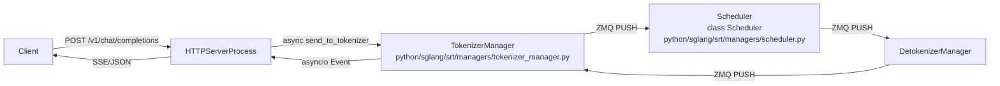
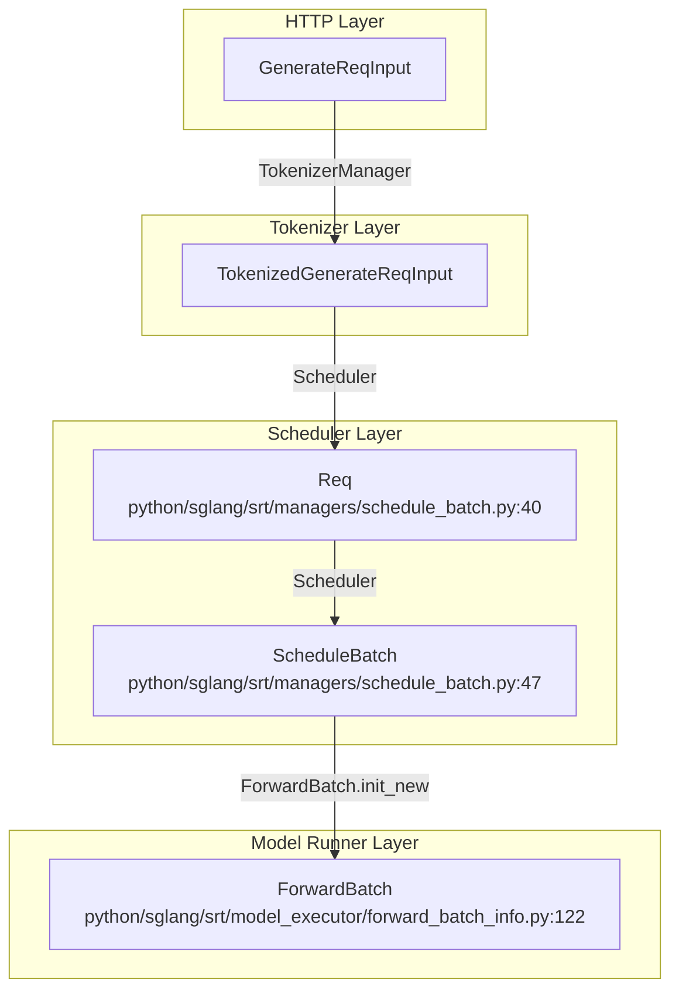
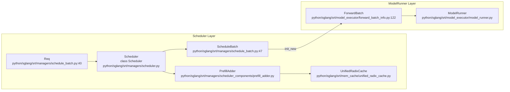

<!-- source: DeepWiki mcp.deepwiki.com · repo sgl-project/sglang · page 4 Request Processing Pipeline · fetched 2026-10-30 -->

# Request Processing Pipeline

Relevant source files

The following files were used as context for generating this wiki page:

- [docs/docs/references/environment_variables.mdx](docs/docs/references/environment_variables.mdx)
- [python/sglang/benchmark/one_batch.py](python/sglang/benchmark/one_batch.py)
- [python/sglang/srt/arg_groups/attention_hook.py](python/sglang/srt/arg_groups/attention_hook.py)
- [python/sglang/srt/arg_groups/overrides.py](python/sglang/srt/arg_groups/overrides.py)
- [python/sglang/srt/arg_groups/pd_disaggregation_hook.py](python/sglang/srt/arg_groups/pd_disaggregation_hook.py)
- [python/sglang/srt/disaggregation/role_switch.py](python/sglang/srt/disaggregation/role_switch.py)
- [python/sglang/srt/distributed/bootstrap.py](python/sglang/srt/distributed/bootstrap.py)
- [python/sglang/srt/distributed/parallel_state.py](python/sglang/srt/distributed/parallel_state.py)
- [python/sglang/srt/environ.py](python/sglang/srt/environ.py)
- [python/sglang/srt/layers/dp_attention.py](python/sglang/srt/layers/dp_attention.py)
- [python/sglang/srt/managers/schedule_batch.py](python/sglang/srt/managers/schedule_batch.py)
- [python/sglang/srt/managers/scheduler.py](python/sglang/srt/managers/scheduler.py)
- [python/sglang/srt/mem_cache/common.py](python/sglang/srt/mem_cache/common.py)
- [python/sglang/srt/model_executor/model_runner.py](python/sglang/srt/model_executor/model_runner.py)
- [python/sglang/srt/runtime_context.py](python/sglang/srt/runtime_context.py)
- [python/sglang/srt/server_args.py](python/sglang/srt/server_args.py)
- [test/manual/test_forward_split_prefill.py](test/manual/test_forward_split_prefill.py)
- [test/manual/test_vlm_accuracy.py](test/manual/test_vlm_accuracy.py)
- [test/registered/unit/disaggregation/test_pd_role_switch.py](test/registered/unit/disaggregation/test_pd_role_switch.py)
- [test/registered/unit/server_args/test_server_args.py](test/registered/unit/server_args/test_server_args.py)
- [test/registered/unit/test_model_overrides.py](test/registered/unit/test_model_overrides.py)
- [test/registered/unit/test_runtime_context.py](test/registered/unit/test_runtime_context.py)

## Purpose and Scope

This document describes the end-to-end lifecycle of a request in SGLang, tracing its flow from arrival at the HTTP server, through tokenization, scheduling, model execution, and finally detokenization back to text output. The discussion focuses on core data structure transformations, process responsibilities, and interaction protocols across the multi-process architecture.

As a parent page, this section provides a high-level overview. Technical details such as request state management, scheduling algorithms, forward pass modes, and CUDA graph optimizations are covered in child pages for depth and clarity:

- [Request Lifecycle and Data Structures](#4.1) — Document request data structures (`Req`, `ScheduleBatch`, `ForwardBatch`), state transitions, and lifecycle management. [python/sglang/srt/managers/schedule_batch.py:40-52]()
- [Scheduler and Batch Formation](#4.2) — Explain scheduling policies (LPM, FCFS, HRRN), batch formation, memory budgeting, prefill delayer, and the DLLM scheduler mixin. [python/sglang/srt/managers/scheduler.py:14-15]()
- [Model Execution and Forward Pass](#4.3) — Document `ModelRunner`, forward pass modes (prefill/decode/extend/mixed), runner backends, and output processing. [python/sglang/srt/model_executor/forward_batch_info.py:122-124]()
- [CUDA Graphs and Performance Optimizations](#4.4) — Explain CUDA Graph capture/replay, piecewise and breakable CUDA graphs, batch size selection, and decode optimizations. [python/sglang/srt/model_executor/cuda_graph_config.py:103-108]()

Sources: [python/sglang/srt/managers/scheduler.py:14-17](), [python/sglang/srt/managers/schedule_batch.py:40-52](), [python/sglang/srt/model_executor/forward_batch_info.py:122-124](), [python/sglang/srt/model_executor/cuda_graph_config.py:103-108]()

---

## Overview

SGLang implements a multi-process request pipeline to maximize throughput and resource utilization by separating concerns across specialized subprocesses communicating predominantly via ZMQ IPC. Each request advances through multiple data representation layers optimized for each functional stage of the pipeline.

### Code Entity Space Bridge: Core Processes

Sources: [python/sglang/srt/managers/scheduler.py:14-15](), [python/sglang/srt/server_args.py:178-179]()

- **HTTP Server**: Receives client-facing API requests and initiates processing [python/sglang/srt/server_args.py:178-179]().
- **TokenizerManager**: Applies chat templates, performs tokenization and multimodal feature extraction, producing tokenized requests for scheduling.
- **Scheduler**: Manages request queuing, scheduling policies, batching, allocating memory, and dispatching GPU execution batches [python/sglang/srt/managers/scheduler.py:14-15]().
- **DetokenizerManager**: Processes token output batches asynchronously for text detokenization and streaming.

---

## Request Data Structure Transformations

A request undergoes multiple transformations, represented by distinct data structures tailored to each pipeline stage:

Sources: [python/sglang/srt/managers/schedule_batch.py:40-52](), [python/sglang/srt/model_executor/forward_batch_info.py:122]()

| Data Structure | Location | Role |
|---|---|---|
| `GenerateReqInput` | `python/sglang/srt/managers/io_struct.py` | Raw client API request input including text, multimodal content, sampling parameters. |
| `TokenizedGenerateReqInput` | `python/sglang/srt/managers/io_struct.py` | Tokenized input with input IDs, embeddings, multimodal features. |
| `Req` | `python/sglang/srt/managers/schedule_batch.py:40` | Scheduler-internal request tracking scheduling state, batching, memory handles, and runtime metadata. |
| `ScheduleBatch` | `python/sglang/srt/managers/schedule_batch.py:47` | Group of `Req` forming a single execution batch for a model forward pass with aligned memory layouts. |
| `ForwardBatch` | `python/sglang/srt/model_executor/forward_batch_info.py:122` | GPU-optimized batch input to `ModelRunner`, including input tensors and space for output buffers. |

---

## Process-Level Pipeline Details

### 1. HTTP Server Process

- Exposes OpenAI-compatible endpoints using FastAPI.
- Parses incoming HTTP requests into API-specific request objects.
- Dispatches requests asynchronously to `TokenizerManager`.
- Coordinates streaming outputs back to clients.

For details, see the [API Interfaces](#13) section.

Sources: [python/sglang/srt/server_args.py:178-179]()

---

### 2. TokenizerManager Process

- Applies chat templates and prompt formatting.
- Tokenizes text inputs and encodes multimodal features into embeddings.
- Generates `TokenizedGenerateReqInput` objects.
- Sends tokenized requests asynchronously via ZMQ to the `Scheduler` process.

For tokenizer internals and chat templates, see [TokenizerManager and DetokenizerManager](#3.3).

Sources: [python/sglang/srt/managers/scheduler.py:14-15]()

---

### 3. Scheduler Process

- Core component managing request queues and batch formation.
- Implements scheduling policies like LPM (Longest Prefix Match), FCFS (First-Come, First-Served), and HRRN (Highest Response Ratio Next) [python/sglang/srt/managers/scheduler.py:200-201]().
- Forms `ScheduleBatch` groups from `Req` objects based on policy and scheduling heuristics.
- Manages memory budgeting within `ReqToTokenPool` and related cache structures, including `UnifiedRadixCache` [python/sglang/srt/mem_cache/common.py:23]().
- Interfaces with the `ModelRunner` by creating `ForwardBatch` objects from `ScheduleBatch` instances.
- Supports both unified and disaggregated execution, including prefill and decode disaggregation flows [python/sglang/srt/disaggregation/decode.py:83-85](), [python/sglang/srt/disaggregation/prefill.py:91-95]().
- Supports speculative decoding integration and DLLM discrete diffusion models via mixins [python/sglang/srt/dllm/mixin/scheduler.py:1-10]().

For scheduling policies, batch formation, and memory management, see [Scheduler and Batch Formation](#4.2).

Sources: [python/sglang/srt/managers/scheduler.py:14-15](), [python/sglang/srt/managers/schedule_batch.py:47-52](), [python/sglang/srt/disaggregation/decode.py:83-85](), [python/sglang/srt/disaggregation/prefill.py:91-95](), [python/sglang/srt/dllm/mixin/scheduler.py:1-10](), [python/sglang/srt/mem_cache/common.py:23]()

---

### 4. DetokenizerManager Process

- Converts output token ID sequences back into strings asynchronously.
- Supports incremental UTF-8 decoding to enable streaming output chunks.
- Manages output buffering, stop token checks, length limit enforcement, and output retraction for speculative decoding.
- Sends streaming events and signals completion to upper layers (e.g. HTTP server).

For batch result processing and output handling, see [Request Lifecycle and Data Structures](#4.1).

Sources: [python/sglang/srt/managers/scheduler.py:14-17]()

---

## Execution Phases Overview

Requests undergo several well-defined phases within the inference pipeline:

| Phase | Description |
|---|---|
| **Tokenization** | Raw input text and multimodal data is tokenized with chat template application. |
| **Prefill Phase** | Handles input context extension, populating KV caches, potentially overlapping with disaggregation and memory management. [python/sglang/srt/disaggregation/prefill.py:91-95]() |
| **Decode Phase** | Incremental token generation in the decoder, emitting tokens one or few at a time, with support for batching and CUDA graph acceleration. [python/sglang/srt/disaggregation/decode.py:83-85]() |
| **Detokenization** | Converts token IDs asynchronously back to text strings for streaming or complete buffered responses. |

Sources: [python/sglang/srt/disaggregation/prefill.py:91-95](), [python/sglang/srt/disaggregation/decode.py:83-85]()

---

## Streaming vs Non-Streaming Modes

- **Streaming Mode**: Output tokens are delivered incrementally via an async push-based generator interfacing with the DetokenizerManager, enabling real-time partial responses.
- **Non-Streaming Mode**: Outputs are buffered in memory and returned upon completion or meeting stopping conditions, such as max length or stop sequences.

Request states retain partial tokens and detokenized text for coordination of streaming responses. Streaming sessions are managed by `StreamingSession` which handles KV record and tree lock ownership [python/sglang/srt/managers/schedule_batch.py:155-157]().

For streaming session management and request lifecycle states, see [Request Lifecycle and Data Structures](#4.1).

Sources: [python/sglang/srt/managers/schedule_batch.py:40-52]()

---

## Natural Language Space to Code Entity Bridge: Scheduling and Forward Execution

Sources: [python/sglang/srt/managers/schedule_batch.py:40-52](), [python/sglang/srt/managers/scheduler.py:14-15](), [python/sglang/srt/model_executor/forward_batch_info.py:122-124](), [python/sglang/srt/managers/scheduler_components/prefill_adder.py:1-10](), [python/sglang/srt/mem_cache/unified_radix_cache.py:1-208]()

---

## Summary

The SGLang request processing pipeline orchestrates requests across multiple isolated processes with well-defined data structure transformations:

- Requests arrive and are tokenized with template application in the TokenizerManager.
- Scheduled by the Scheduler which forms execution batches and handles memory management.
- GPU execution is performed by ModelRunner with support for multiple forward pass modes and backends.
- Generated tokens are asynchronously detokenized and streamed back via the DetokenizerManager.

For in-depth explanation of request and batch data structures, scheduling policies and memory budgeting, execution modes, and CUDA graph optimizations, please consult the child pages:

- [Request Lifecycle and Data Structures](#4.1)
- [Scheduler and Batch Formation](#4.2)
- [Model Execution and Forward Pass](#4.3)
- [CUDA Graphs and Performance Optimizations](#4.4)

Sources: [python/sglang/srt/managers/scheduler.py:14-17](), [python/sglang/srt/managers/schedule_batch.py:40-52](), [python/sglang/srt/model_executor/forward_batch_info.py:122-124]()

---

