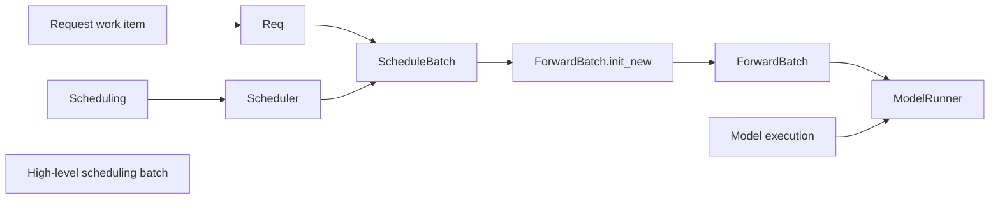
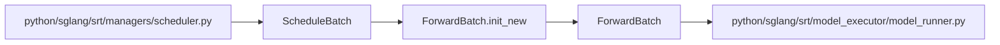

<!-- source: DeepWiki mcp.deepwiki.com · repo sgl-project/sglang · page 4.1 Request Lifecycle and Data Structures · fetched 2026-10-30 -->

# Request Lifecycle and Data Structures

Relevant source files

The following files were used as context for generating this wiki page:

- [docs/docs/references/environment_variables.mdx](docs/docs/references/environment_variables.mdx)
- [python/sglang/benchmark/one_batch.py](python/sglang/benchmark/one_batch.py)
- [python/sglang/srt/arg_groups/attention_hook.py](python/sglang/srt/arg_groups/attention_hook.py)
- [python/sglang/srt/arg_groups/overrides.py](python/sglang/srt/arg_groups/overrides.py)
- [python/sglang/srt/arg_groups/pd_disaggregation_hook.py](python/sglang/srt/arg_groups/pd_disaggregation_hook.py)
- [python/sglang/srt/disaggregation/role_switch.py](python/sglang/srt/disaggregation/role_switch.py)
- [python/sglang/srt/distributed/bootstrap.py](python/sglang/srt/distributed/bootstrap.py)
- [python/sglang/srt/distributed/parallel_state.py](python/sglang/srt/distributed/parallel_state.py)
- [python/sglang/srt/dllm/mixin/scheduler.py](python/sglang/srt/dllm/mixin/scheduler.py)
- [python/sglang/srt/environ.py](python/sglang/srt/environ.py)
- [python/sglang/srt/layers/dp_attention.py](python/sglang/srt/layers/dp_attention.py)
- [python/sglang/srt/managers/schedule_batch.py](python/sglang/srt/managers/schedule_batch.py)
- [python/sglang/srt/managers/scheduler.py](python/sglang/srt/managers/scheduler.py)
- [python/sglang/srt/managers/scheduler_components/batch_result_processor.py](python/sglang/srt/managers/scheduler_components/batch_result_processor.py)
- [python/sglang/srt/managers/scheduler_components/output_streamer.py](python/sglang/srt/managers/scheduler_components/output_streamer.py)
- [python/sglang/srt/managers/utils.py](python/sglang/srt/managers/utils.py)
- [python/sglang/srt/mem_cache/allocation.py](python/sglang/srt/mem_cache/allocation.py)
- [python/sglang/srt/mem_cache/common.py](python/sglang/srt/mem_cache/common.py)
- [python/sglang/srt/model_executor/model_runner.py](python/sglang/srt/model_executor/model_runner.py)
- [python/sglang/srt/runtime_context.py](python/sglang/srt/runtime_context.py)
- [python/sglang/srt/server_args.py](python/sglang/srt/server_args.py)
- [test/manual/test_forward_split_prefill.py](test/manual/test_forward_split_prefill.py)
- [test/manual/test_vlm_accuracy.py](test/manual/test_vlm_accuracy.py)
- [test/registered/scheduler/test_retract_decode_logprob.py](test/registered/scheduler/test_retract_decode_logprob.py)
- [test/registered/unit/disaggregation/test_pd_role_switch.py](test/registered/unit/disaggregation/test_pd_role_switch.py)
- [test/registered/unit/managers/test_batch_result_processor_hidden_states.py](test/registered/unit/managers/test_batch_result_processor_hidden_states.py)
- [test/registered/unit/managers/test_batch_result_processor_mamba_boundary.py](test/registered/unit/managers/test_batch_result_processor_mamba_boundary.py)
- [test/registered/unit/managers/test_batch_result_processor_spec_grammar.py](test/registered/unit/managers/test_batch_result_processor_spec_grammar.py)
- [test/registered/unit/managers/test_mm_token_counts.py](test/registered/unit/managers/test_mm_token_counts.py)
- [test/registered/unit/managers/test_output_streamer_customized_info.py](test/registered/unit/managers/test_output_streamer_customized_info.py)
- [test/registered/unit/managers/test_output_streamer_logprobs.py](test/registered/unit/managers/test_output_streamer_logprobs.py)
- [test/registered/unit/managers/test_scheduler_chunked_req_gate.py](test/registered/unit/managers/test_scheduler_chunked_req_gate.py)
- [test/registered/unit/mem_cache/test_dllm_fdfo_kv_reuse.py](test/registered/unit/mem_cache/test_dllm_fdfo_kv_reuse.py)
- [test/registered/unit/server_args/test_server_args.py](test/registered/unit/server_args/test_server_args.py)
- [test/registered/unit/spec/test_decode_bookkeeping_ownership.py](test/registered/unit/spec/test_decode_bookkeeping_ownership.py)
- [test/registered/unit/test_model_overrides.py](test/registered/unit/test_model_overrides.py)
- [test/registered/unit/test_runtime_context.py](test/registered/unit/test_runtime_context.py)

## Purpose and scope

This page documents how request and batch data are represented across the SGLang Runtime (SRT) execution path. It focuses on the relationship between `Req`, `ScheduleBatch`, and `ForwardBatch`, state transitions during execution, and batch result processing via `SchedulerBatchResultProcessor`. [python/sglang/srt/managers/schedule_batch.py:42-54]() [python/sglang/srt/model_executor/forward_batch_info.py:14-26]() [python/sglang/srt/managers/scheduler_components/batch_result_processor.py:96-117]()

Sources: [python/sglang/srt/managers/schedule_batch.py:42-54](), [python/sglang/srt/model_executor/forward_batch_info.py:14-26](), [python/sglang/srt/managers/scheduler_components/batch_result_processor.py:96-117]()

---

## Overview

The central batch transformation documented in the code is:

`ScheduleBatch` → `ForwardBatch`

`ScheduleBatch` is managed by `Scheduler` and carries high-level scheduling information, most of it residing on the CPU. `ForwardBatch` is managed by `ModelRunner`, contains lower-level data consisting primarily of GPU tensors, and is constructed directly from a `ScheduleBatch`. [python/sglang/srt/managers/schedule_batch.py:42-54]() [python/sglang/srt/model_executor/forward_batch_info.py:14-26]()

### Lifecycle mapped to code entities

The diagram connects the runtime concepts to the named classes and methods present in the codebase.

**Diagram: "Request and batch concepts mapped to code entities"**

Sources: [python/sglang/srt/managers/schedule_batch.py:42-54](), [python/sglang/srt/model_executor/forward_batch_info.py:14-26]()

---

## Core data structures

### `Req`

`Req` represents an individual request inside the scheduler and memory management layers. It tracks request state, input token IDs, output IDs, generation parameters (`SamplingParams`), time statistics (`ReqTimeStats`), and key-value cache allocation metadata (`ReqKVInfo`). [python/sglang/srt/managers/schedule_batch.py:42-54]() [python/sglang/srt/mem_cache/common.py:30-33]()

Sources: [python/sglang/srt/managers/schedule_batch.py:42-54](), [python/sglang/srt/mem_cache/common.py:30-33]()

### `ScheduleBatch`

`ScheduleBatch` is the high-level batch representation managed by `Scheduler` (`python/sglang/srt/managers/scheduler.py`). It contains collections of `Req` objects, batch-level token counts, sampling batch information, and disaggregation metadata, keeping most data on the CPU. [python/sglang/srt/managers/schedule_batch.py:42-54]() [python/sglang/srt/managers/scheduler.py:14-14]()

Sources: [python/sglang/srt/managers/schedule_batch.py:42-54](), [python/sglang/srt/managers/scheduler.py:14-14]()

### `ForwardBatch`

`ForwardBatch` is the lower-level execution representation managed by `ModelRunner` (`python/sglang/srt/model_executor/model_runner.py`). It contains low-level data and GPU tensors required to execute forward passes (such as input ids, positions, cumulative sequence lengths, and KV pool indices). It is constructed from a `ScheduleBatch`. [python/sglang/srt/model_executor/forward_batch_info.py:14-26]() [python/sglang/srt/model_executor/model_runner.py:14-14]()

Sources: [python/sglang/srt/model_executor/forward_batch_info.py:14-26](), [python/sglang/srt/model_executor/model_runner.py:14-14]()

---

## Batch data flow and conversion

The scheduler works with high-level `ScheduleBatch` objects, which are transformed into `ForwardBatch` structures before being dispatched to the model runner for execution.

**Diagram: "Scheduler-to-runner batch conversion flow"**

Sources: [python/sglang/srt/managers/schedule_batch.py:42-54](), [python/sglang/srt/model_executor/forward_batch_info.py:14-26]()

---

## State transitions and lifecycle boundaries

Requests transition through several states during their lifecycle, from waiting in the queue, undergoing prefill (or chunked prefill), generating decode tokens, to reaching completion (via stop strings, max tokens, or abort requests). When a request finishes or is aborted, its allocated KV cache slots are released back to the allocator or tree cache. [python/sglang/srt/managers/scheduler_components/batch_result_processor.py:96-135]() [python/sglang/srt/mem_cache/common.py:74-137]()

Sources: [python/sglang/srt/managers/scheduler_components/batch_result_processor.py:96-135](), [python/sglang/srt/mem_cache/common.py:74-137]()

---

## Batch result processing

Batch results returned from the model runner are processed by `SchedulerBatchResultProcessor` (`python/sglang/srt/managers/scheduler_components/batch_result_processor.py`). This component handles updating request states, collecting logprobs, streaming outputs via `SchedulerOutputStreamer`, managing beam search coordination, and releasing KV cache memory for completed requests. [python/sglang/srt/managers/scheduler_components/batch_result_processor.py:96-135]()

Sources: [python/sglang/srt/managers/scheduler_components/batch_result_processor.py:96-135]()

---

## Dataflow summary

| Concept | Established role | Implementation evidence |
|---|---|---|
| `Req` | Individual request tracking parameters, states, tokens, and KV info. | [python/sglang/srt/managers/schedule_batch.py:42-54]() [python/sglang/srt/mem_cache/common.py:30-33]() |
| `ScheduleBatch` | High-level batch managed by `Scheduler`, mostly CPU-side. | [python/sglang/srt/managers/schedule_batch.py:42-54]() |
| `ForwardBatch` | Lower-level execution batch managed by `ModelRunner` with GPU tensors. | [python/sglang/srt/model_executor/forward_batch_info.py:14-26]() |
| `SchedulerBatchResultProcessor` | Processes batch outputs, updates request states, and releases cache. | [python/sglang/srt/managers/scheduler_components/batch_result_processor.py:96-135]() |

Sources: [python/sglang/srt/managers/schedule_batch.py:42-54](), [python/sglang/srt/model_executor/forward_batch_info.py:14-26](), [python/sglang/srt/managers/scheduler_components/batch_result_processor.py:96-135]()

---

