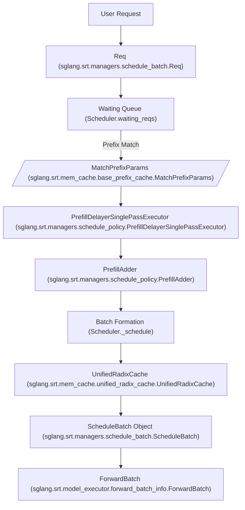
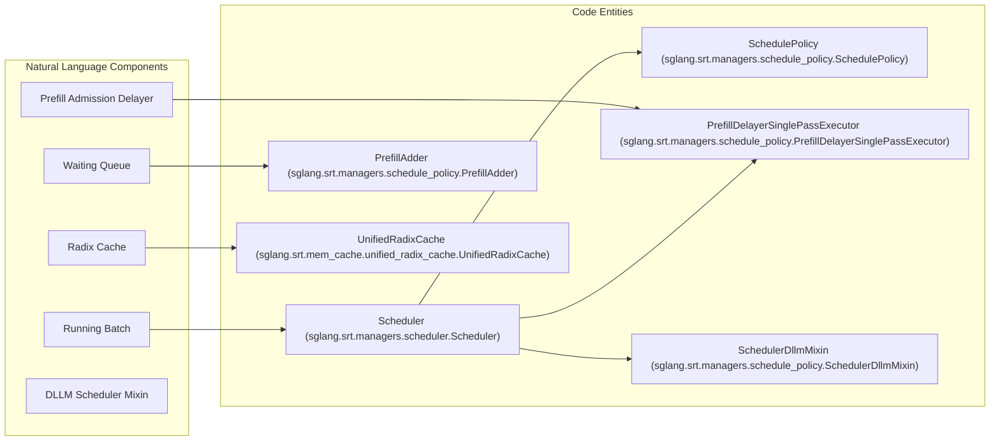

<!-- source: DeepWiki mcp.deepwiki.com · repo sgl-project/sglang · page 4.2 Scheduler and Batch Formation · fetched 2026-10-30 -->

# Scheduler and Batch Formation

<details>
<summary>Relevant source files</summary>

The following files were used as context for generating this wiki page:

- [python/sglang/kernels/jit/csrc/speculative/tree.cuh](python/sglang/kernels/jit/csrc/speculative/tree.cuh)
- [python/sglang/srt/hardware_backend/mlx/profiler.py](python/sglang/srt/hardware_backend/mlx/profiler.py)
- [python/sglang/srt/managers/async_d2h_copy_worker.py](python/sglang/srt/managers/async_d2h_copy_worker.py)
- [python/sglang/srt/managers/cache_controller.py](python/sglang/srt/managers/cache_controller.py)
- [python/sglang/srt/managers/schedule_policy.py](python/sglang/srt/managers/schedule_policy.py)
- [python/sglang/srt/managers/scheduler_components/invariant_checker.py](python/sglang/srt/managers/scheduler_components/invariant_checker.py)
- [python/sglang/srt/managers/scheduler_components/pool_stats_observer.py](python/sglang/srt/managers/scheduler_components/pool_stats_observer.py)
- [python/sglang/srt/mem_cache/base_prefix_cache.py](python/sglang/srt/mem_cache/base_prefix_cache.py)
- [python/sglang/srt/mem_cache/buffer_mode/pipeline.py](python/sglang/srt/mem_cache/buffer_mode/pipeline.py)
- [python/sglang/srt/mem_cache/cache_init_params.py](python/sglang/srt/mem_cache/cache_init_params.py)
- [python/sglang/srt/mem_cache/hicache_storage.py](python/sglang/srt/mem_cache/hicache_storage.py)
- [python/sglang/srt/mem_cache/hybrid_cache/hybrid_cache_controller.py](python/sglang/srt/mem_cache/hybrid_cache/hybrid_cache_controller.py)
- [python/sglang/srt/mem_cache/hybrid_cache/hybrid_pool_assembler.py](python/sglang/srt/mem_cache/hybrid_cache/hybrid_pool_assembler.py)
- [python/sglang/srt/mem_cache/hybrid_cache/linker_pool_assembler.py](python/sglang/srt/mem_cache/hybrid_cache/linker_pool_assembler.py)
- [python/sglang/srt/mem_cache/kv_cache_builder.py](python/sglang/srt/mem_cache/kv_cache_builder.py)
- [python/sglang/srt/mem_cache/memory_pool_host.py](python/sglang/srt/mem_cache/memory_pool_host.py)
- [python/sglang/srt/mem_cache/storage/file/__init__.py](python/sglang/srt/mem_cache/storage/file/__init__.py)
- [python/sglang/srt/mem_cache/storage/file/lru_file_evictor.py](python/sglang/srt/mem_cache/storage/file/lru_file_evictor.py)
- [python/sglang/srt/mem_cache/storage/mooncake_store/README.md](python/sglang/srt/mem_cache/storage/mooncake_store/README.md)
- [python/sglang/srt/mem_cache/storage/mooncake_store/mooncake_store.py](python/sglang/srt/mem_cache/storage/mooncake_store/mooncake_store.py)
- [python/sglang/srt/mem_cache/unified_radix_cache.py](python/sglang/srt/mem_cache/unified_radix_cache.py)
- [python/sglang/srt/session/streaming_session.py](python/sglang/srt/session/streaming_session.py)
- [python/sglang/test/kits/anthropic_messages_kit.py](python/sglang/test/kits/anthropic_messages_kit.py)
- [python/sglang/test/kits/json_mode_kit.py](python/sglang/test/kits/json_mode_kit.py)
- [test/registered/constrained_decoding/test_constrained_decoding.py](test/registered/constrained_decoding/test_constrained_decoding.py)
- [test/registered/kernels/ops/mamba/test_mtp_hicache.py](test/registered/kernels/ops/mamba/test_mtp_hicache.py)
- [test/registered/radix_cache/unified_radix_tree/linker/test_unified_cache_linker_kimi_linear.py](test/registered/radix_cache/unified_radix_tree/linker/test_unified_cache_linker_kimi_linear.py)
- [test/registered/scheduler/test_async_d2h_copy_worker_server.py](test/registered/scheduler/test_async_d2h_copy_worker_server.py)
- [test/registered/scheduler/test_retract_decode.py](test/registered/scheduler/test_retract_decode.py)
- [test/registered/tokenizer/test_skip_tokenizer_init.py](test/registered/tokenizer/test_skip_tokenizer_init.py)
- [test/registered/unit/disaggregation/test_prefill_result_polling.py](test/registered/unit/disaggregation/test_prefill_result_polling.py)
- [test/registered/unit/dllm/test_gemma4_uniform_lifecycle.py](test/registered/unit/dllm/test_gemma4_uniform_lifecycle.py)
- [test/registered/unit/hardware_backend/mlx/test_metal_profiler.py](test/registered/unit/hardware_backend/mlx/test_metal_profiler.py)
- [test/registered/unit/layers/test_minicpm_sparse_cache.py](test/registered/unit/layers/test_minicpm_sparse_cache.py)
- [test/registered/unit/managers/scheduler_components/test_invariant_checker.py](test/registered/unit/managers/scheduler_components/test_invariant_checker.py)
- [test/registered/unit/managers/test_async_d2h_copy_worker.py](test/registered/unit/managers/test_async_d2h_copy_worker.py)
- [test/registered/unit/managers/test_auxiliary_output.py](test/registered/unit/managers/test_auxiliary_output.py)
- [test/registered/unit/managers/test_disagg_idle_step_counters.py](test/registered/unit/managers/test_disagg_idle_step_counters.py)
- [test/registered/unit/managers/test_kv_page_invariants.py](test/registered/unit/managers/test_kv_page_invariants.py)
- [test/registered/unit/managers/test_multimodal_abort_cleanup.py](test/registered/unit/managers/test_multimodal_abort_cleanup.py)
- [test/registered/unit/managers/test_prefill_adder.py](test/registered/unit/managers/test_prefill_adder.py)
- [test/registered/unit/managers/test_scheduler_chunked_abort_race.py](test/registered/unit/managers/test_scheduler_chunked_abort_race.py)
- [test/registered/unit/managers/test_scheduler_pause_generation.py](test/registered/unit/managers/test_scheduler_pause_generation.py)
- [test/registered/unit/managers/test_scheduler_timeouts.py](test/registered/unit/managers/test_scheduler_timeouts.py)
- [test/registered/unit/mem_cache/test_buffer_mode_sidecar.py](test/registered/unit/mem_cache/test_buffer_mode_sidecar.py)
- [test/registered/unit/mem_cache/test_hicache_file_lru_unit.py](test/registered/unit/mem_cache/test_hicache_file_lru_unit.py)
- [test/registered/unit/mem_cache/test_hicache_staged_write_back_dispatch.py](test/registered/unit/mem_cache/test_hicache_staged_write_back_dispatch.py)
- [test/registered/unit/mem_cache/test_hybrid_pool_assembler.py](test/registered/unit/mem_cache/test_hybrid_pool_assembler.py)
- [test/registered/unit/mem_cache/test_linker_pool_assembler.py](test/registered/unit/mem_cache/test_linker_pool_assembler.py)
- [test/registered/unit/mem_cache/test_mooncake_group_semantics.py](test/registered/unit/mem_cache/test_mooncake_group_semantics.py)
- [test/registered/unit/mem_cache/test_mooncake_tenant_config.py](test/registered/unit/mem_cache/test_mooncake_tenant_config.py)
- [test/registered/unit/mem_cache/test_storage_prefetch_lifecycle.py](test/registered/unit/mem_cache/test_storage_prefetch_lifecycle.py)
- [test/registered/unit/mem_cache/test_streaming_session_unit.py](test/registered/unit/mem_cache/test_streaming_session_unit.py)
- [test/registered/unit/mem_cache/test_unified_hicache_regressions.py](test/registered/unit/mem_cache/test_unified_hicache_regressions.py)
- [test/registered/unit/utils/test_weight_versions.py](test/registered/unit/utils/test_weight_versions.py)

</details>


## Purpose and Scope

This page details the implementation of SGLang’s scheduler and batch formation subsystem, central to its efficient serving of large language and vision-language models. It covers:

- The scheduling policies implemented (LPM, FCFS, HRRN, DFS, ROUTING_KEY).
- The mechanics of batch formation and memory budgeting.
- The *prefill delayer* component that manages admission control to prevent spikes.
- The discrete diffusion LLM (DLLM) scheduler mixin and its special scheduling logic.

We describe the key classes, functions, dataflow through these components, and how they interlock with memory allocators and radix cache backends to optimize throughput and latency [python/sglang/srt/managers/schedule_policy.py:1-177](), [python/sglang/srt/mem_cache/unified_radix_cache.py:200-206]().

---

## Scheduler Architecture and Scheduling Policies

The scheduler manages request queuing, prioritization, batch formation, and dispatch for model execution. It uses different scheduling policies to decide the order in which requests are processed, aiming to maximize cache reuse, fairness, and throughput.

### Supported Scheduling Policies

SGLang implements several scheduling policies selectable at runtime, influencing how pending requests in the waiting queue are ordered before forming batches:

| Scheduling Policy | Enum Identifier | Description |
| :---------------- | :-------------- | :---------- |
| **FCFS (First-Come-First-Served)** | `CacheAgnosticPolicy.FCFS` | Processes requests strictly in arrival order. |
| **LPM (Longest Prefix Match)** | `CacheAwarePolicy.LPM` | Prioritizes requests with the longest prefix matched in the radix cache, promoting reuse. |
| **DFS (Depth-First Search Weighting)** | `CacheAwarePolicy.DFS_WEIGHT` | Uses weighted DFS heuristic to order requests maximizing prefix reuse depth. |
| **HRRN (Highest Response Ratio Next)** | `CacheAwarePolicy.HRRN` | Balances waiting time and expected service time to prevent starvation of requests. |
| **SHORTEST_PREFILL_FIRST** | `CacheAwarePolicy.SHORTEST_PREFILL_FIRST` | Prioritizes requests with shorter prefill lengths. |

These policies are implemented within the `SchedulePolicy` class and related helpers like `PrefillAdder`. They involve priority calculations, prefix length evaluation from radix cache matches, and token aging for fairness [python/sglang/srt/managers/schedule_policy.py:1-177]().

Sources:
- [python/sglang/srt/managers/schedule_policy.py:1-177]()

### Priority Scheduling and Preemption

When priority scheduling is enabled, the scheduler supports preemption: it can retract lower priority requests from running batches back into the waiting queue. This reclaims KV cache memory and GPU resources, preventing starvation and ensuring higher-priority requests complete timely under memory constraints.

Preemption decisions interact with admission controls and token budgets inside `PrefillAdder`, which governs whether to admit or defer requests based on memory availability [test/registered/unit/managers/test_prefill_adder.py:167-173]().

Sources:
- [test/registered/unit/managers/test_prefill_adder.py:167-173]()

### Prefix Matching for Cache Reuse

To maximize efficiency, the scheduler performs prefix matching of incoming requests' token streams against radix tree caches (e.g., `UnifiedRadixCache`). This process finds the longest prefix of tokens already cached in KV memory, enabling incremental computation reuse.

The prefix matching is executed via the cache's `match_prefix` method with parameters like `RadixKey` constructed from the request's tokens, optional extra keys, and cache salts. The match returns a `MatchResult` indicating matched length and cache nodes [python/sglang/srt/mem_cache/base_prefix_cache.py:65-74]().

Matching results update the request's internal fields: `prefix_indices`, `last_node`, and `best_match_node`. This matching step enables cache-aware scheduling policies to prioritize requests with significant reuse potential.

Additionally, prefix lengths are clipped based on sliding window attention sizes to avoid stale cache reuse beyond active model contexts [python/sglang/srt/session/streaming_session.py:128-145]().

**Example of prefix matching snippet:**

```python
match_result = tree_cache.match_prefix(
    MatchPrefixParams(
        key=RadixKey(token_ids=token_ids, extra_key=req.extra_key, limit=key_limit, cache_salt=req.cache_salt),
        cow_mamba=cow_mamba,
        req=req if include_req else None,
    )
)
req.prefix_indices = match_result.device_indices
req.last_node = match_result.last_device_node
req.best_match_node = match_result.best_match_node
```
Sources:
- [python/sglang/srt/session/streaming_session.py:128-145]()
- [python/sglang/srt/mem_cache/base_prefix_cache.py:65-74]()

---

## Batch Formation and Memory Budgeting

### Overview of Batch Formation

The scheduler dynamically assembles execution batches by selecting requests from the ordered waiting queue. It seeks to fill batches that respect both token count limits and memory constraints, maximizing GPU utilization.

Batch formation is governed by `PrefillAdder`, which attempts to admit requests based on their token needs while enforcing memory/token budgets. Requests that cannot fit are deferred or chunked.

Sources:
- [test/registered/unit/managers/test_prefill_adder.py:1-2020]()

### Memory Budgeting

Memory is accounted via two principal pools:

- **ReqToTokenPool:** Maps request IDs to token slot allocations [python/sglang/srt/mem_cache/memory_pool.py]().
- **TokenToKVPool:** Manages GPU memory allocations serving as the KV cache for tokens [python/sglang/srt/mem_cache/memory_pool.py]().

The scheduler queries these allocators through interfaces (`BaseTokenToKVPoolAllocator`) and uses radix cache backends (e.g., `UnifiedRadixCache`) to track usage, trigger eviction, and verify available capacity before admitting tokens [python/sglang/srt/mem_cache/base_prefix_cache.py:56-62]().

This dual-layer memory budgeting prevents out-of-memory errors by carefully admitting requests only if the KV cache has enough space to store their tokens.

Sources:
- [python/sglang/srt/mem_cache/base_prefix_cache.py:56-62]()

### Batch Execution Modes

The scheduler distinguishes the forward pass batch mode, affecting execution and memory handling:

| Forward Mode | Description |
| :----------- | :---------- |
| **PREFILL** | Insert new tokens into KV cache (input prefix). |
| **DECODE** | Extend existing tokens (incremental token generation). |
| **MIXED** | Mixed prefill and decode tokens in batch (hybrid mode). |
| **DLLM** | Special schedule for discrete diffusion LLM denoising. |

Batch formation logic adapts depending on the forward mode, including admission budgeting and token accounting [test/registered/unit/managers/test_scheduler_pause_generation.py:132-133]().

Sources:
- [test/registered/unit/managers/test_scheduler_pause_generation.py:132-133]()

### Chunked Prefill Scheduling

To avoid starvation of short decode requests by large prefill inputs, long prefill requests can be chunked. The scheduler breaks large prefill segments into smaller chunks limited by token budgets.

These chunks are admitted stepwise; the remaining tokens are tracked by `rem_chunk_tokens` until the full request is scheduled and completed. This ensures balanced batching between large and small requests [python/sglang/srt/managers/schedule_policy.py:103-109]().

Sources:
- [python/sglang/srt/managers/schedule_policy.py:103-109]()

---

## Prefill Delayer

To regulate peak memory consumption from bursts of prefill requests, the scheduler integrates a *Prefill Delayer* component (`PrefillDelayerSinglePassExecutor`).

This module monitors:

- Prefill token watermarks (maximum safe tokens before memory pressure).
- Waiting queue length and dynamics.
- Historical admission rates and batch sizes.

Based on this state, it dynamically delays admitting new prefill batches by one or more forward passes, smoothing memory usage spikes and reducing out-of-memory risks.

This pacing logic is especially crucial during high load scenarios with many large prefill requests [python/sglang/srt/managers/schedule_policy.py:5]().

Sources:
- [python/sglang/srt/managers/schedule_policy.py:5]()

---

## Specialized DLLM Scheduler Mixin

For discrete diffusion language models (DLLMs) such as LLaDA2 and SDAR, SGLang extends the scheduler with a specialized mixin: `SchedulerDllmMixin`.

This mixin overrides batch formation logic, incorporating:

- Diffusion denoising step scheduling,
- Sampling schedule coordination,
- Masked language model prefix caching adaptations.

This specialized scheduler enables efficient memory use and batching for DLLM inference, adapting the core scheduler mechanisms to the particular workflow of diffusion LLM denoising [python/sglang/srt/managers/schedule_policy.py:45]().

Sources:
- [python/sglang/srt/managers/schedule_policy.py:45]()

---

## Scheduler and Batch Formation Dataflow

### Key Classes and Data

| Name | Role | Location |
| :--- | :--- | :------- |
| `Scheduler` | Main scheduler class managing queues, policies, and batch formation. | `python/sglang/srt/managers/scheduler.py` |
| `ScheduleBatch` | Represents a CPU-side scheduled batch with request list and metadata. | `python/sglang/srt/managers/schedule_batch.py` |
| `ForwardBatch` | GPU-resident data batch constructed from `ScheduleBatch` used by the ModelRunner. | `python/sglang/srt/model_executor/forward_batch_info.py` |
| `SchedulePolicy` | Implements scheduling policies LPM, FCFS, HRRN, DFS, routing key, and admission control. | `python/sglang/srt/managers/schedule_policy.py` |
| `PrefillAdder` | Admission control enforcing token and memory budgeting for prefill tokens. | `python/sglang/srt/managers/schedule_policy.py` |
| `PrefillDelayerSinglePassExecutor` | Controls pacing and admission delay of prefill batches to avoid memory spikes. | `python/sglang/srt/managers/schedule_policy.py:5` |
| `UnifiedRadixCache` | Radix tree prefix cache backend managing prefix KV token trees and cache reuse. | `python/sglang/srt/mem_cache/unified_radix_cache.py` |
| `SchedulerDllmMixin` | DLLM-specific scheduler mixin handling denoising steps and mask prefix caching. | `python/sglang/srt/managers/schedule_policy.py:45` |

Sources:
- [python/sglang/srt/managers/schedule_policy.py]()
- [python/sglang/srt/managers/schedule_policy.py:5]()
- [python/sglang/srt/mem_cache/unified_radix_cache.py]()
- [python/sglang/srt/managers/schedule_policy.py:45]()

---

### Data Flow Diagram: From Request to Batch Formation



This flow walks from receiving user requests, prefix matching against radix caches for reuse, through prefill admission control, to final batch formation for model execution.

Sources:  
- [python/sglang/srt/session/streaming_session.py:128-145]()  
- [python/sglang/srt/managers/schedule_policy.py:5]()  
- [python/sglang/srt/mem_cache/unified_radix_cache.py:200-206]()  
- [python/sglang/srt/mem_cache/base_prefix_cache.py:65-74]()

---

### Mapping of Natural Language Components to Code Entities



This diagram clarifies the relationships between high-level scheduling concepts and actual code classes and modules.

Sources:  
- [python/sglang/srt/managers/schedule_policy.py:1-177]()  
- [python/sglang/srt/managers/schedule_policy.py:5]()  
- [python/sglang/srt/managers/schedule_policy.py:45]()  
- [python/sglang/srt/mem_cache/unified_radix_cache.py:200-206]()

---

## Summary

SGLang's scheduler is a complex system balancing multiple competing objectives: maximizing KV cache reuse via prefix matching, handling multiple scheduling policies, maintaining memory budgeting for large KV caches, allowing preemption for priority, and enabling batch formation that suits heterogeneous execution modes.

This system achieves high throughput and low latency by integrating:

- Cache-aware scheduling policies (LPM, DFS, HRRN),
- Memory-aware admission via `PrefillAdder` and radix caches,
- Prefill pacing through `PrefillDelayerSinglePassExecutor` to avoid memory spikes,
- Specialized DLLM scheduling for diffusion LLMs,
- Close cooperation with GPU memory allocators and radix cache backends.

Understanding this integration is crucial for contributors working on request scheduling, memory management, and performance optimization.

---

# References

- [`python/sglang/srt/managers/schedule_policy.py:1-177`]()
- [`python/sglang/srt/managers/schedule_policy.py:5`]()
- [`python/sglang/srt/mem_cache/unified_radix_cache.py:200-206`]()
- [`python/sglang/srt/managers/schedule_policy.py:45`]()
- [`python/sglang/srt/mem_cache/base_prefix_cache.py:65-74`]()
- [`test/registered/unit/managers/test_prefill_adder.py:167-173`]()
- [`python/sglang/srt/session/streaming_session.py:128-145`]()
- [`test/registered/unit/managers/test_scheduler_pause_generation.py:132-133`]()

---

