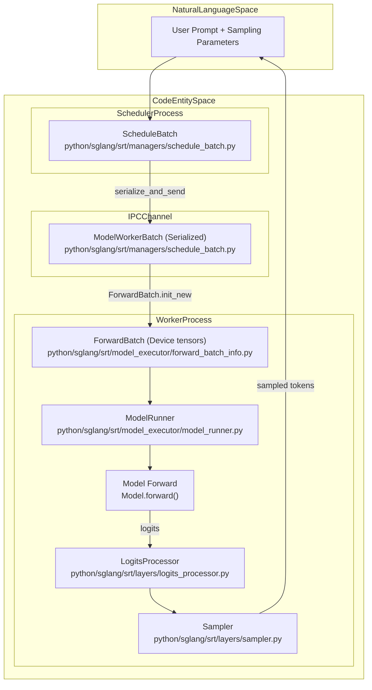
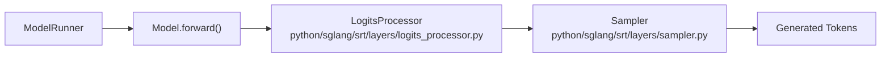

<!-- source: DeepWiki mcp.deepwiki.com · repo sgl-project/sglang · page 4.3 Model Execution and Forward Pass · fetched 2026-10-30 -->

# Model Execution and Forward Pass

Relevant source files

The following files were used as context for generating this wiki page:

- [docs/docs/references/environment_variables.mdx](docs/docs/references/environment_variables.mdx)
- [python/sglang/benchmark/one_batch.py](python/sglang/benchmark/one_batch.py)
- [python/sglang/srt/arg_groups/attention_hook.py](python/sglang/srt/arg_groups/attention_hook.py)
- [python/sglang/srt/arg_groups/cp_tp_group_sharing_hook.py](python/sglang/srt/arg_groups/cp_tp_group_sharing_hook.py)
- [python/sglang/srt/arg_groups/overrides.py](python/sglang/srt/arg_groups/overrides.py)
- [python/sglang/srt/arg_groups/pd_disaggregation_hook.py](python/sglang/srt/arg_groups/pd_disaggregation_hook.py)
- [python/sglang/srt/disaggregation/role_switch.py](python/sglang/srt/disaggregation/role_switch.py)
- [python/sglang/srt/distributed/bootstrap.py](python/sglang/srt/distributed/bootstrap.py)
- [python/sglang/srt/distributed/parallel_state.py](python/sglang/srt/distributed/parallel_state.py)
- [python/sglang/srt/environ.py](python/sglang/srt/environ.py)
- [python/sglang/srt/layers/attention/dsa/dsa_backend_mtp_precompute.py](python/sglang/srt/layers/attention/dsa/dsa_backend_mtp_precompute.py)
- [python/sglang/srt/layers/attention/dsa/dsa_indexer.py](python/sglang/srt/layers/attention/dsa/dsa_indexer.py)
- [python/sglang/srt/layers/attention/dsa/utils.py](python/sglang/srt/layers/attention/dsa/utils.py)
- [python/sglang/srt/layers/attention/dsa_backend.py](python/sglang/srt/layers/attention/dsa_backend.py)
- [python/sglang/srt/layers/cp/base.py](python/sglang/srt/layers/cp/base.py)
- [python/sglang/srt/layers/cp/bcg/interleave_bcg.py](python/sglang/srt/layers/cp/bcg/interleave_bcg.py)
- [python/sglang/srt/layers/cp/interleave.py](python/sglang/srt/layers/cp/interleave.py)
- [python/sglang/srt/layers/cp/padding.py](python/sglang/srt/layers/cp/padding.py)
- [python/sglang/srt/layers/cp/utils.py](python/sglang/srt/layers/cp/utils.py)
- [python/sglang/srt/layers/cp/zigzag.py](python/sglang/srt/layers/cp/zigzag.py)
- [python/sglang/srt/layers/dp_attention.py](python/sglang/srt/layers/dp_attention.py)
- [python/sglang/srt/layers/moe/flashinfer_megamoe_autotune.py](python/sglang/srt/layers/moe/flashinfer_megamoe_autotune.py)
- [python/sglang/srt/layers/utils/cp_utils.py](python/sglang/srt/layers/utils/cp_utils.py)
- [python/sglang/srt/managers/schedule_batch.py](python/sglang/srt/managers/schedule_batch.py)
- [python/sglang/srt/managers/scheduler.py](python/sglang/srt/managers/scheduler.py)
- [python/sglang/srt/mem_cache/common.py](python/sglang/srt/mem_cache/common.py)
- [python/sglang/srt/model_executor/model_runner.py](python/sglang/srt/model_executor/model_runner.py)
- [python/sglang/srt/model_executor/runner/base_runner.py](python/sglang/srt/model_executor/runner/base_runner.py)
- [python/sglang/srt/model_executor/runner/eager_runner.py](python/sglang/srt/model_executor/runner/eager_runner.py)
- [python/sglang/srt/model_executor/runner/flashinfer_autotune.py](python/sglang/srt/model_executor/runner/flashinfer_autotune.py)
- [python/sglang/srt/models/deepseek_common/attention_forward_methods/forward_mla.py](python/sglang/srt/models/deepseek_common/attention_forward_methods/forward_mla.py)
- [python/sglang/srt/runtime_context.py](python/sglang/srt/runtime_context.py)
- [python/sglang/srt/server_args.py](python/sglang/srt/server_args.py)
- [test/manual/test_forward_split_prefill.py](test/manual/test_forward_split_prefill.py)
- [test/manual/test_vlm_accuracy.py](test/manual/test_vlm_accuracy.py)
- [test/registered/cp/test_cp_strategy_unit.py](test/registered/cp/test_cp_strategy_unit.py)
- [test/registered/cp/test_dsa_prefill_cp.py](test/registered/cp/test_dsa_prefill_cp.py)
- [test/registered/unit/disaggregation/test_pd_role_switch.py](test/registered/unit/disaggregation/test_pd_role_switch.py)
- [test/registered/unit/model_executor/runner/test_flashinfer_autotune_sync.py](test/registered/unit/model_executor/runner/test_flashinfer_autotune_sync.py)
- [test/registered/unit/server_args/test_server_args.py](test/registered/unit/server_args/test_server_args.py)
- [test/registered/unit/test_model_overrides.py](test/registered/unit/test_model_overrides.py)
- [test/registered/unit/test_runtime_context.py](test/registered/unit/test_runtime_context.py)

## Purpose and Scope

This page provides a detailed technical overview of the model execution pipeline in SGLang, focusing on how scheduled request batches are transformed into GPU-resident data structures (`ForwardBatch`), the handling of different forward pass modes (`prefill`, `decode`, `extend`, `mixed`), the selection and operation of runner backends (`EagerRunner`, `DecodeCudaGraphRunner`, etc.), and subsequent output processing including logits handling and sampling.

Key architectural components documented here include the `ModelRunner` class orchestrating forward passes, the `ForwardMode` enumeration describing forward pass types, various runner backend implementations optimizing CUDA graph usage, and the memory pool management underlying CUDA graph execution.

Sources: [python/sglang/srt/model_executor/model_runner.py:14-181](), [python/sglang/srt/model_executor/forward_batch_info.py:17-185](), [python/sglang/srt/model_executor/runner/eager_runner.py:83-156]()

---

## System Overview & Data Flow

Model execution transforms input batches from request-level scheduling into device-specific tensors optimized for efficient GPU processing across process boundaries.

#### Explanation:

-   **`ScheduleBatch`**: High-level batch combining multiple requests, containing token IDs, metadata, and scheduling info at CPU host.
-   **`ModelWorkerBatch`**: Serialized form of `ScheduleBatch` transmitted across IPC boundaries.
-   **`ForwardBatch`**: GPU-resident batch created from `ModelWorkerBatch`, including device-pinned tensors and cache state.
-   **`ModelRunner`**: Core logic that executes forward passes on the `ForwardBatch` using selected runner backends.
-   **`Model.forward`**: Actual model network forward call producing logits.
-   **`LogitsProcessor`**: Applies logprob transformations and penalties.
-   **`Sampler`**: Samples tokens from processed logits to produce final output tokens.

Sources: [python/sglang/srt/managers/schedule_batch.py:40-52](), [python/sglang/srt/model_executor/forward_batch_info.py:17-26](), [python/sglang/srt/model_executor/model_runner.py:14-15]()

---

## Batch Data Structure Transformations and Forward Modes

### Data Representations

| Data Structure | Location | Responsibility |
|:---------------|:---------|:---------------|
| `ScheduleBatch` | CPU (host) | High-level scheduling info, request metadata |
| `ModelWorkerBatch` | CPU / serialization | IPC-friendly serialized batch for transmission |
| `ForwardBatch` | GPU device | Low-level tensor inputs and cache state |

The conversion from `ModelWorkerBatch` to `ForwardBatch` pins host memory, transfers to GPU asynchronously when possible, and prepares indices and masks required for forward execution [python/sglang/srt/model_executor/forward_batch_info.py:17-80]().

Sources: [python/sglang/srt/managers/schedule_batch.py:42-54](), [python/sglang/srt/model_executor/forward_batch_info.py:17-80]()

---

### ForwardMode Enumeration

The `ForwardMode` enum directs the model's forward behavior for different token generation phases:

| Mode | Meaning | Usage Context |
|:-----|:--------|:--------------|
| `EXTEND` | Extend prompt tokens, typically prefill mode | Feeding new prompt tokens into KV cache |
| `DECODE` | Autoregressive decoding, generating one token at a time | Standard next-token generation |
| `MIXED` | Combined extend + decode within chunked prefill (hybrid mode) | Chunked prompt forwarding overlapping with decode phase |
| `IDLE` | Placeholder mode, no tokens processed, marks worker idle | Internal synchronization during parallelism |
| `DRAFT_DECODE` | Speculative decoding: draft model generates tokens | Draft model generating initial tokens for verification [python/sglang/srt/speculative/spec_info.py:64-70]() |
| `DRAFT_EXTEND_V2` | Speculative decoding: draft model extends tokens | Draft model extending a sequence of tokens [python/sglang/srt/speculative/spec_info.py:64-70]() |
| `TARGET_VERIFY` | Speculative decoding: target model verifies draft tokens | Target model verifying tokens proposed by a draft model [python/sglang/srt/speculative/spec_info.py:64-70]() |
| `DLLM_EXTEND` | Denoising LLM: extend tokens | Denoising LLM extending a sequence of tokens [python/sglang/srt/dllm/config.py:1-10]() |

Sources: [python/sglang/srt/model_executor/forward_batch_info.py:176-185](), [python/sglang/srt/speculative/spec_info.py:64-70](), [python/sglang/srt/dllm/config.py:1-10]()

---

## Runner Backends and CUDA Graph Architecture

SGLang supports multiple runner backends encapsulating different CUDA graph strategies to optimize kernel launches and forward pass performance.

### Runner Types and Execution Phase Mapping

```mermaid
graph TB
    subgraph ExecutionPhase
        Prefill["Prefill (Prompt Extension)"]
        Decode["Decode (Token Generation)"]
        DraftDecode["Draft Decode (Speculative)"]
        DraftExtend["Draft Extend (Speculative)"]
        TargetVerify["Target Verify (Speculative)"]
        DllmExtend["DLLM Extend"]
    end

    subgraph RunnerBackend
        Eager["EagerRunner<br/>(eager_runner.py)"]
        DecodeGraph["DecodeCudaGraphRunner<br/>(decode_cuda_graph_runner.py)"]
        EagleDraftGraph["EAGLEDraftCudaGraphRunner<br/>(eagle_draft_cuda_graph_runner.py)"]
        EagleDraftExtendGraph["EAGLEDraftExtendCudaGraphRunner<br/>(eagle_draft_extend_cuda_graph_runner.py)"]
        MultiLayerEagleExtendGraph["MultiLayerEagleMultiStepDraftExtendCudaGraphRunner<br/>(multi_layer_eagle_draft_extend_cuda_graph_runner.py)"]
        NPUGraph["NPUGraphRunner<br/>(npu_graph_runner.py)"]
    end

    Prefill --> Eager
    Prefill --> DecodeGraph
    Decode --> DecodeGraph
    Decode --> Eager
    DraftDecode --> EagleDraftGraph
    DraftDecode --> NPUGraph
    DraftExtend --> EagleDraftExtendGraph
    DraftExtend --> MultiLayerEagleExtendGraph
    DraftExtend --> NPUGraph
    TargetVerify --> DecodeGraph
    DllmExtend --> DecodeGraph
```

-   **`EagerRunner`**: Executes forward pass eagerly without CUDA graph capture. Useful for debugging and flexibility [python/sglang/srt/model_executor/runner/eager_runner.py:83-156]().
-   **`DecodeCudaGraphRunner`**: Base class for CUDA graph runners, handling decode, target verify, and DLLM extend modes [python/sglang/srt/model_executor/runner/decode_cuda_graph_runner.py:14-24]().
-   **Speculative Runners**: Specialized CUDA graph runners (`EAGLEDraftCudaGraphRunner`, `EAGLEDraftExtendCudaGraphRunner`, etc.) optimize multi-step draft generation and tree verification.

Sources: [python/sglang/srt/model_executor/runner/eager_runner.py:83-156](), [python/sglang/srt/model_executor/runner/decode_cuda_graph_runner.py:14-24](), [python/sglang/srt/speculative/eagle_draft_cuda_graph_runner.py:1-174]()

---

## Forward Pass Execution Pipeline and Memory Pool Management

`ModelRunner` is the central orchestrator of forward passes. It receives a `ForwardBatch`, inspects the `ForwardMode`, and dispatches to the correct model forward variant (`prefill_forward`, `decode_forward`, `mixed_forward`, etc.) [python/sglang/srt/model_executor/model_runner.py:14-181]().

Key steps:
1.  **Batch conversion**: Converting CPU input (`ScheduleBatch` → `ModelWorkerBatch` → `ForwardBatch`).
2.  **Runner selection**: Based on configuration and hardware platform, picking the suitable runner backend.
3.  **Forward execution**: Running the forward method on the network, accelerated by CUDA graph runners.
4.  **Output capture**: Capturing logits and ancillary outputs for post-processing and sampling.

CUDA graph backends rely on preallocated shared GPU memory pools (`CudaGraphBufferRegistry`) to handle contiguous workspace allocations once per process, reducing overhead during capture and avoiding fragmentation [python/sglang/srt/model_executor/cuda_graph_buffer_registry.py:1-67]().

Sources: [python/sglang/srt/model_executor/model_runner.py:14-181](), [python/sglang/srt/model_executor/cuda_graph_buffer_registry.py:1-67]()

---

## Output Processing and Logits Handling

After model forward calls produce raw logits, these undergo processing before token sampling:

-   **Logprob computation and penalties**: The `LogitsProcessor` applies temperature scaling, frequency and presence penalties, and repetition penalties [python/sglang/srt/layers/logits_processor.py:37-76]().
-   **Sampling**: Processed logits are fed into sampling algorithms (top-k, top-p, greedy, temperature sampling) via the `sampler` module [python/sglang/srt/layers/sampler.py:1-100]().
-   **Output tokens**: Sampled tokens are sent back upstream to the scheduler or HTTP frontend.

Sources: [python/sglang/srt/layers/logits_processor.py:37-76](), [python/sglang/srt/model_executor/model_runner.py:80-87](), [python/sglang/srt/layers/sampler.py:1-100]()

---

# References

-   `ModelRunner` and forward pass logic: [python/sglang/srt/model_executor/model_runner.py:1-181]()
-   `ForwardBatch`, `ForwardMode`: [python/sglang/srt/model_executor/forward_batch_info.py:1-185]()
-   Runner backends implementations: [python/sglang/srt/model_executor/runner/eager_runner.py:83-156](), [python/sglang/srt/model_executor/runner/decode_cuda_graph_runner.py:14-24]()
-   CUDA graph memory pool (`CudaGraphBufferRegistry`): [python/sglang/srt/model_executor/cuda_graph_buffer_registry.py:1-67]()
-   Logprob processing and sampling: [python/sglang/srt/layers/logits_processor.py:37-76](), [python/sglang/srt/layers/sampler.py:1-100]()

---

