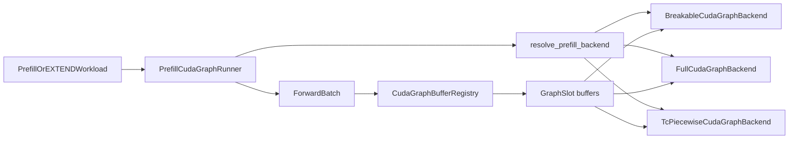
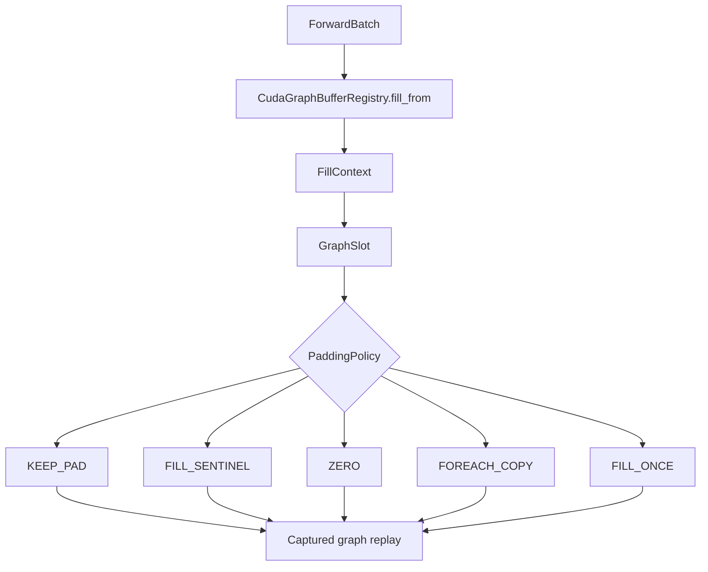
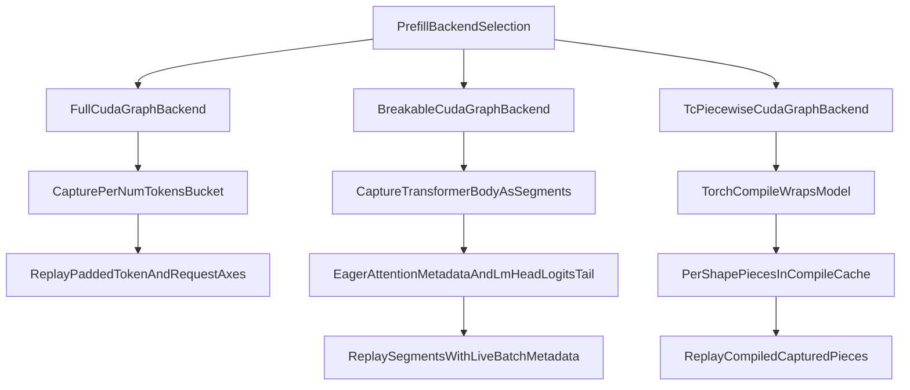
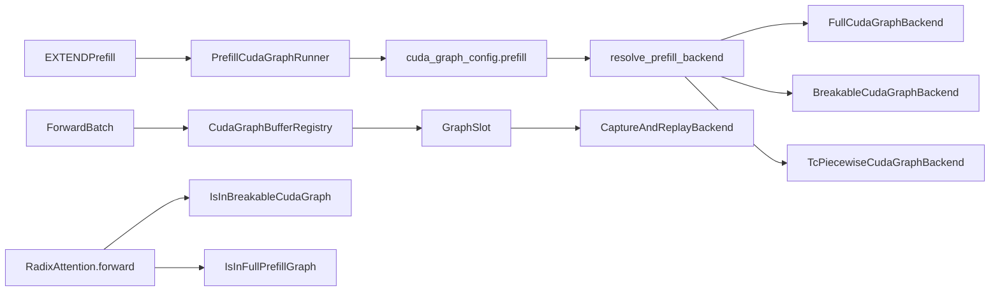

<!-- source: DeepWiki mcp.deepwiki.com · repo sgl-project/sglang · page 4.4 CUDA Graphs and Performance Optimizations · fetched 2026-10-30 -->

# CUDA Graphs and Performance Optimizations

Relevant source files

The following files were used as context for generating this wiki page:

- [python/sglang/srt/distributed/device_communicators/shm_broadcast.py](python/sglang/srt/distributed/device_communicators/shm_broadcast.py)
- [python/sglang/srt/hardware_backend/xpu/graph_runner/xpu_graph_runner.py](python/sglang/srt/hardware_backend/xpu/graph_runner/xpu_graph_runner.py)
- [python/sglang/srt/layers/logprob_processor.py](python/sglang/srt/layers/logprob_processor.py)
- [python/sglang/srt/layers/logsumexp.py](python/sglang/srt/layers/logsumexp.py)
- [python/sglang/srt/managers/scheduler_components/dp_attn.py](python/sglang/srt/managers/scheduler_components/dp_attn.py)
- [python/sglang/srt/model_executor/cuda_graph_buffer_registry.py](python/sglang/srt/model_executor/cuda_graph_buffer_registry.py)
- [python/sglang/srt/model_executor/cuda_graph_config.py](python/sglang/srt/model_executor/cuda_graph_config.py)
- [python/sglang/srt/model_executor/input_buffers.py](python/sglang/srt/model_executor/input_buffers.py)
- [python/sglang/srt/model_executor/model_runner_components/cuda_graph_setup.py](python/sglang/srt/model_executor/model_runner_components/cuda_graph_setup.py)
- [python/sglang/srt/model_executor/model_runner_components/startup_weight_load.py](python/sglang/srt/model_executor/model_runner_components/startup_weight_load.py)
- [python/sglang/srt/model_executor/runner/__init__.py](python/sglang/srt/model_executor/runner/__init__.py)
- [python/sglang/srt/model_executor/runner/base_cuda_graph_runner.py](python/sglang/srt/model_executor/runner/base_cuda_graph_runner.py)
- [python/sglang/srt/model_executor/runner/prefill_cuda_graph_runner.py](python/sglang/srt/model_executor/runner/prefill_cuda_graph_runner.py)
- [python/sglang/srt/model_executor/runner_backend/base_cuda_graph_backend.py](python/sglang/srt/model_executor/runner_backend/base_cuda_graph_backend.py)
- [python/sglang/srt/model_executor/runner_backend/breakable_cuda_graph_backend.py](python/sglang/srt/model_executor/runner_backend/breakable_cuda_graph_backend.py)
- [python/sglang/srt/model_executor/runner_backend/full_cuda_graph_backend.py](python/sglang/srt/model_executor/runner_backend/full_cuda_graph_backend.py)
- [python/sglang/srt/model_executor/runner_backend/tc_piecewise_cuda_graph_backend.py](python/sglang/srt/model_executor/runner_backend/tc_piecewise_cuda_graph_backend.py)
- [python/sglang/srt/model_executor/runner_backend/utils.py](python/sglang/srt/model_executor/runner_backend/utils.py)
- [python/sglang/srt/model_executor/runner_backend_utils/breakable_cuda_graph/breakable_cuda_graph.py](python/sglang/srt/model_executor/runner_backend_utils/breakable_cuda_graph/breakable_cuda_graph.py)
- [python/sglang/srt/model_executor/runner_backend_utils/breakable_cuda_graph/context.py](python/sglang/srt/model_executor/runner_backend_utils/breakable_cuda_graph/context.py)
- [python/sglang/srt/model_executor/runner_backend_utils/breakable_cuda_graph/cuda_utils.py](python/sglang/srt/model_executor/runner_backend_utils/breakable_cuda_graph/cuda_utils.py)
- [python/sglang/srt/model_executor/runner_utils/buffers.py](python/sglang/srt/model_executor/runner_utils/buffers.py)
- [python/sglang/srt/model_executor/runner_utils/pool.py](python/sglang/srt/model_executor/runner_utils/pool.py)
- [python/sglang/srt/utils/stale_shm_cleanup.py](python/sglang/srt/utils/stale_shm_cleanup.py)
- [test/registered/cuda_graph/full_prefill/test_full_cuda_graph_prefill.py](test/registered/cuda_graph/full_prefill/test_full_cuda_graph_prefill.py)
- [test/registered/unit/configs/test_multimodal_piecewise_cuda_graph.py](test/registered/unit/configs/test_multimodal_piecewise_cuda_graph.py)
- [test/registered/unit/layers/test_logprob_chunk_stitching.py](test/registered/unit/layers/test_logprob_chunk_stitching.py)
- [test/registered/unit/layers/test_logprob_fast_input.py](test/registered/unit/layers/test_logprob_fast_input.py)
- [test/registered/unit/managers/scheduler_components/test_dp_attn.py](test/registered/unit/managers/scheduler_components/test_dp_attn.py)
- [test/registered/unit/model_executor/model_runner_components/test_cuda_graph_setup.py](test/registered/unit/model_executor/model_runner_components/test_cuda_graph_setup.py)
- [test/registered/unit/model_executor/model_runner_components/test_startup_weight_load.py](test/registered/unit/model_executor/model_runner_components/test_startup_weight_load.py)
- [test/registered/unit/model_executor/runner/test_decode_cuda_graph_runner.py](test/registered/unit/model_executor/runner/test_decode_cuda_graph_runner.py)
- [test/registered/unit/model_executor/runner/test_hidden_state_graph_recapture.py](test/registered/unit/model_executor/runner/test_hidden_state_graph_recapture.py)
- [test/registered/unit/model_executor/runner/test_prefill_cuda_graph_padding.py](test/registered/unit/model_executor/runner/test_prefill_cuda_graph_padding.py)
- [test/registered/unit/model_executor/runner_backend/test_backend_resolution.py](test/registered/unit/model_executor/runner_backend/test_backend_resolution.py)
- [test/registered/unit/model_executor/runner_backend/test_full_cuda_graph_backend.py](test/registered/unit/model_executor/runner_backend/test_full_cuda_graph_backend.py)
- [test/registered/unit/model_executor/runner_utils/test_graph_pool_borrow.py](test/registered/unit/model_executor/runner_utils/test_graph_pool_borrow.py)
- [test/registered/unit/model_executor/test_cuda_graph_buffer_registry.py](test/registered/unit/model_executor/test_cuda_graph_buffer_registry.py)
- [test/registered/unit/model_executor/test_prefill_cuda_graph_runner.py](test/registered/unit/model_executor/test_prefill_cuda_graph_runner.py)
- [test/registered/utils/test_stale_shm_cleanup.py](test/registered/utils/test_stale_shm_cleanup.py)

## Purpose and Scope

This page describes SGLang’s CUDA graph paths for prefill and decode: capture and replay, full, breakable, and `torch.compile` piecewise prefill backends, shape and batch padding, and the static buffers used to feed captured graphs. The available code excerpts cover prefill backend selection and setup, shared graph buffers, graph backend behavior, attention handling, and selected decode-buffer definitions. [python/sglang/srt/model_executor/runner/prefill_cuda_graph_runner.py:14-35]() [python/sglang/srt/model_executor/model_runner_components/cuda_graph_setup.py:38-43]() [python/sglang/srt/model_executor/runner_utils/buffers.py:14-20]()

Sources: [python/sglang/srt/model_executor/runner/prefill_cuda_graph_runner.py:14-35]() [python/sglang/srt/model_executor/model_runner_components/cuda_graph_setup.py:38-43]() [python/sglang/srt/model_executor/runner_utils/buffers.py:14-20]()

## CUDA Graphs Overview

A CUDA graph captures GPU work into a reusable execution graph. In SGLang’s full backend, a `FullCudaGraphBackend` instance stores graphs and outputs keyed by shape; capture uses warmup forwards before capturing the graph. [python/sglang/srt/model_executor/runner_backend/full_cuda_graph_backend.py:99-123]() [python/sglang/srt/model_executor/runner_backend/full_cuda_graph_backend.py:137-169]()

Graph replay requires stable input storage and compatible shapes. The `CudaGraphBufferRegistry` mirrors `ForwardBatch` attributes into graph-resident buffers, while the static buffer dataclasses provide phase-specific storage. [python/sglang/srt/model_executor/cuda_graph_buffer_registry.py:14-23]() [python/sglang/srt/model_executor/runner_utils/buffers.py:14-20]()

### Prefill Backend Choices

`PrefillCudaGraphRunner` documents four prefill settings: `breakable`, `full`, `tc_piecewise`, and `disabled`. `disabled` is handled at the model-runner level, so no prefill graph runner is constructed. [python/sglang/srt/model_executor/runner/prefill_cuda_graph_runner.py:14-35]()

| Backend | Capture and replay approach | Batch and metadata considerations |
|---|---|---|
| `breakable` | `BreakableCudaGraphBackend` captures segments without `torch.compile`. | Captures the transformer body with one request slot. Multi-request prefill is supported by running attention metadata and the LM-head/logits tail outside the captured body. [python/sglang/srt/model_executor/runner/prefill_cuda_graph_runner.py:16-22]() |
| `full` | `FullCudaGraphBackend` captures one graph per `num_tokens` bucket for the captured transformer body. | Uses a configured number of request slots; replay pads tokens to a bucket and pads unused request slots with zero-length sentinels. Batches larger than the captured slot count fall back to eager execution. Attention metadata is refreshed out of graph against the slot-padded batch. [python/sglang/srt/model_executor/runner/prefill_cuda_graph_runner.py:23-30]() |
| `tc_piecewise` | `TcPiecewiseCudaGraphBackend` uses `torch.compile`; per-shape compiled/captured pieces reside in the compiler’s internal cache. | Supports multi-request prefill. [python/sglang/srt/model_executor/runner/prefill_cuda_graph_runner.py:31-34]() |
| `disabled` | The model-runner layer handles the setting. | The prefill graph runner is not constructed. [python/sglang/srt/model_executor/runner/prefill_cuda_graph_runner.py:35]() |

Sources: [python/sglang/srt/model_executor/runner/prefill_cuda_graph_runner.py:14-35]()

## CUDA Graph Runner and Replay Data Flow

The prefill path is selected through `resolve_prefill_backend` and the backend classes imported by `PrefillCudaGraphRunner`. During replay, the graph needs stable storage for batch inputs; the buffer registry provides a `ForwardBatch`-to-slot mirror, while backend-private buffers remain owned by the attention backend. [python/sglang/srt/model_executor/runner/prefill_cuda_graph_runner.py:77-105]() [python/sglang/srt/model_executor/cuda_graph_buffer_registry.py:14-23]()

### Diagram: Prefill Workload to Graph Backend Entities

Sources: [python/sglang/srt/model_executor/runner/prefill_cuda_graph_runner.py:77-105]() [python/sglang/srt/model_executor/cuda_graph_buffer_registry.py:14-23]() [python/sglang/srt/model_executor/cuda_graph_buffer_registry.py:155-170]()

### Static Inputs, Slots, and Padding

`CudaGraphBufferRegistry` is the graph-buffer mirror for `ForwardBatch`. Each `GraphSlot` mirrors a batch attribute, and its name must match that attribute so `fill_from` can read it from the batch and replay can expose the slot view back on a batch. Slot shape and slicing are defined with respect to batch-size and token axes. [python/sglang/srt/model_executor/cuda_graph_buffer_registry.py:14-23]() [python/sglang/srt/model_executor/cuda_graph_buffer_registry.py:155-170]()

The registry defines padding policies for regions beyond the raw batch or token counts. `KEEP_PAD` leaves the tail unchanged when the caller guarantees it will not be read; `FILL_SENTINEL` resets it to a slot-specific sentinel; `ZERO` clears it; `FOREACH_COPY` copies only raw elements; and `FILL_ONCE` initializes the buffer at allocation rather than every replay. [python/sglang/srt/model_executor/cuda_graph_buffer_registry.py:106-133]()

For eligible CUDA copies, the registry may use `torch._foreach_copy_` or the `try_small_copy` helper; otherwise it groups copies by source and destination dtype and applies foreach copies or individual `copy_` operations. [python/sglang/srt/model_executor/cuda_graph_buffer_registry.py:45-81]()

| Policy | Behavior |
|---|---|
| `KEEP_PAD` | Leave the padded region as-is; the caller must ensure it will not be read. [python/sglang/srt/model_executor/cuda_graph_buffer_registry.py:106-113]() |
| `FILL_SENTINEL` | Reset the padded region to the slot’s `pad_value`. [python/sglang/srt/model_executor/cuda_graph_buffer_registry.py:109-114]() |
| `ZERO` | Reset the padded region to zero; the documented examples include `out_cache_loc` and `req_pool_indices`. [python/sglang/srt/model_executor/cuda_graph_buffer_registry.py:113-117]() |
| `FOREACH_COPY` | Copy raw elements while leaving the padded region unchanged. [python/sglang/srt/model_executor/cuda_graph_buffer_registry.py:118-121]() |
| `FILL_ONCE` | Initialize the whole buffer once at allocation and do not reset it per iteration. [python/sglang/srt/model_executor/cuda_graph_buffer_registry.py:122-125]() |

Sources: [python/sglang/srt/model_executor/cuda_graph_buffer_registry.py:14-23]() [python/sglang/srt/model_executor/cuda_graph_buffer_registry.py:45-81]() [python/sglang/srt/model_executor/cuda_graph_buffer_registry.py:106-170]()

### Diagram: Replay Buffer Population

Sources: [python/sglang/srt/model_executor/cuda_graph_buffer_registry.py:106-170]() [python/sglang/srt/model_executor/cuda_graph_buffer_registry.py:135-152]()

## Full, Breakable, and Piecewise Prefill Graphs

### Full CUDA Graphs

`FullCudaGraphBackend` stores captured graphs and their outputs in dictionaries keyed by shape. It also tracks a graph memory pool, the graph runner, and a capture stream. Its capture session obtains the global graph memory pool and assigns its pool ID before capture. [python/sglang/srt/model_executor/runner_backend/full_cuda_graph_backend.py:99-135]()

For each shape, `capture_one` runs the forward function twice as warmup before graph capture. The warmups synchronize the device and barrier the tensor-parallel group; the implementation also supports a post-warmup hook and optional output-buffer reuse. [python/sglang/srt/model_executor/runner_backend/full_cuda_graph_backend.py:137-169]()

For prefill, the documented `full` behavior uses token buckets and a configured request-slot capacity. It pads tokens to the nearest bucket and unused request slots with zero-length sentinels; if the live batch exceeds the captured slot count, it uses eager execution. Attention metadata is refreshed out of graph against the padded batch. [python/sglang/srt/model_executor/runner/prefill_cuda_graph_runner.py:23-30]()

### Breakable CUDA Graphs

`BreakableCudaGraphBackend` captures graph segments separated by eager break markers; it does not use `torch.compile`. The backend documentation describes attention and Mamba boundaries as break points, with attention metadata recomputed at replay outside captured segments. [python/sglang/srt/model_executor/runner_backend/breakable_cuda_graph_backend.py:14-17]() [python/sglang/srt/model_executor/runner_backend/breakable_cuda_graph_backend.py:60-63]()

A capture session sets up the graph pool and enables breakable capture. For each shape, `capture_one` performs two warmup forwards, creates a `BreakableCUDAGraph`, and captures the forward under `BreakableCUDAGraphCapture`. Capture inputs are retained because CUDA graphs retain tensor addresses, not Python tensor lifetimes. [python/sglang/srt/model_executor/runner_backend/breakable_cuda_graph_backend.py:96-111]() [python/sglang/srt/model_executor/runner_backend/breakable_cuda_graph_backend.py:113-159]()

For prefill, the breakable backend captures the transformer body with one request slot. Its multi-request support keeps attention metadata and the LM-head/logits tail outside the captured body. [python/sglang/srt/model_executor/runner/prefill_cuda_graph_runner.py:16-22]()

### `torch.compile` Piecewise Graphs

The `tc_piecewise` backend wraps the model with `torch.compile`. Its per-shape compiled/captured pieces are kept in the compiler’s internal cache, and the prefill runner documentation states that it supports multi-request prefill. [python/sglang/srt/model_executor/runner/prefill_cuda_graph_runner.py:31-34]()

### Diagram: Capture and Replay by Backend

Sources: [python/sglang/srt/model_executor/runner/prefill_cuda_graph_runner.py:16-34]() [python/sglang/srt/model_executor/runner_backend/breakable_cuda_graph_backend.py:60-63]() [python/sglang/srt/model_executor/runner_backend/full_cuda_graph_backend.py:99-123]()

## Attention Behavior Around Prefill Graphs

`RadixAttention.forward` identifies when execution is inside a breakable graph or full prefill graph. When the prefill attention wrapper is enabled and the batch is an extend operation inside prefill graph scope, attention uses `_eager_attention` for breakable and full prefill graphs. Otherwise it uses real-row handling when applicable or delegates to the active attention backend. [python/sglang/srt/layers/radix_attention.py:114-176]()

This division allows graph-captured transformer work to coexist with attention execution that handles live prefill metadata. The prefill runner documentation specifically describes out-of-graph attention metadata refresh for full graphs, and out-of-graph attention metadata and logits-tail execution for breakable graphs. [python/sglang/srt/layers/radix_attention.py:133-176]() [python/sglang/srt/model_executor/runner/prefill_cuda_graph_runner.py:16-30]()

Sources: [python/sglang/srt/layers/radix_attention.py:114-176]() [python/sglang/srt/model_executor/runner/prefill_cuda_graph_runner.py:16-30]()

## Batch Size and Token Bucket Selection

Prefill graph capture uses a set of token sizes, and full prefill uses one graph per `num_tokens` bucket. During replay, full prefill rounds the token count up to a bucket and pads request slots to the configured capture capacity; batches larger than that capacity fall back to eager execution. [python/sglang/srt/model_executor/runner/prefill_cuda_graph_runner.py:23-30]()

The prefill runner defines a maximum token-padding factor of 2 to avoid excessive extra model work when a sparse bucket list forces replay at a larger captured size. It also defines geometric chunked-prefix variants `(1, 2, 4, 8, 16)` because prefix attention adds a loop body per chunk. [python/sglang/srt/model_executor/runner/prefill_cuda_graph_runner.py:155-161]()

The supplied excerpts identify `get_batch_sizes_to_capture` as part of the runner API imported during CUDA graph setup, but do not include its implementation or enough detail to specify its full selection algorithm. [python/sglang/srt/model_executor/model_runner_components/cuda_graph_setup.py:38-43]()

Sources: [python/sglang/srt/model_executor/runner/prefill_cuda_graph_runner.py:23-30]() [python/sglang/srt/model_executor/runner/prefill_cuda_graph_runner.py:155-161]() [python/sglang/srt/model_executor/model_runner_components/cuda_graph_setup.py:38-43]()

## Decode Buffers and Performance Considerations

`DecodeInputBuffers` is the static-buffer dataclass backing decode-phase capture and replay. It includes stable storage for token inputs, request indices, sequence lengths, cache locations, positions, masks, logits, and other optional decode inputs. The shown `create` method allocates these tensors at configured maximum batch and token dimensions and initializes several of them with zero or sentinel values. [python/sglang/srt/model_executor/runner_utils/buffers.py:14-20]() [python/sglang/srt/model_executor/runner_utils/buffers.py:106-174]()

The shared copy path in `runner_utils/buffers.py` attempts `try_small_copy` for CUDA tensors and otherwise groups copies by dtype pair before using `torch._foreach_copy_` or individual copies. [python/sglang/srt/model_executor/runner_utils/buffers.py:40-64]()

For prefill attention, graph padding must be bounded: the runner’s documented padding-factor limit exists because replay executes every padded token in the bucket. A larger bucket can therefore trade fewer graph shapes and lower launch overhead for more model work per replay. [python/sglang/srt/model_executor/runner/prefill_cuda_graph_runner.py:155-161]()

Sources: [python/sglang/srt/model_executor/runner_utils/buffers.py:14-20]() [python/sglang/srt/model_executor/runner_utils/buffers.py:40-64]() [python/sglang/srt/model_executor/runner_utils/buffers.py:106-174]() [python/sglang/srt/model_executor/runner/prefill_cuda_graph_runner.py:155-161]()

## Distributed Admission and Compatibility

The scheduler’s DP-attention component imports CUDA graph backend and configuration checks, the prefill graph runner, and `ForwardMode`. Its `MLPSyncBatchInfo` carries per-rank eligibility flags for decode, draft, and prefill CUDA graphs, alongside token counts and forward-mode information. [python/sglang/srt/managers/scheduler_components/dp_attn.py:29-37]() [python/sglang/srt/managers/scheduler_components/dp_attn.py:145-174]()

The same file’s `_spec_input_cuda_graph_compatible` helper treats absent, idle, and prebuilt batches as permissive; otherwise it checks speculative input compatibility through `spec_info.cuda_graph_compatible`. [python/sglang/srt/managers/scheduler_components/dp_attn.py:83-100]()

Sources: [python/sglang/srt/managers/scheduler_components/dp_attn.py:29-37]() [python/sglang/srt/managers/scheduler_components/dp_attn.py:83-100]() [python/sglang/srt/managers/scheduler_components/dp_attn.py:145-174]()

## Diagram: Runtime Names to Graph Code Entities

Sources: [python/sglang/srt/model_executor/runner/prefill_cuda_graph_runner.py:14-35]() [python/sglang/srt/model_executor/runner/prefill_cuda_graph_runner.py:77-105]() [python/sglang/srt/model_executor/cuda_graph_buffer_registry.py:14-23]() [python/sglang/srt/model_executor/cuda_graph_buffer_registry.py:155-170]() [python/sglang/srt/layers/radix_attention.py:133-176]()

## Summary of Key Classes and Concepts

| Concept | Code entity | Role |
|---|---|---|
| Prefill graph runner | `PrefillCudaGraphRunner` [python/sglang/srt/model_executor/runner/prefill_cuda_graph_runner.py:14-35]() | Selects and executes the configured prefill graph backend. |
| Full graph backend | `FullCudaGraphBackend` [python/sglang/srt/model_executor/runner_backend/full_cuda_graph_backend.py:99-123]() | Stores graphs and outputs by shape and manages a graph capture session. |
| Breakable graph backend | `BreakableCudaGraphBackend` [python/sglang/srt/model_executor/runner_backend/breakable_cuda_graph_backend.py:60-63]() | Captures graph segments around eager break markers. |
| Prefill piecewise backend | `TcPiecewiseCudaGraphBackend` [python/sglang/srt/model_executor/runner/prefill_cuda_graph_runner.py:31-34]() | Uses `torch.compile` and its per-shape internal cache. |
| Shared graph buffer mirror | `CudaGraphBufferRegistry` [python/sglang/srt/model_executor/cuda_graph_buffer_registry.py:14-23]() | Maps `ForwardBatch` attributes to graph-resident buffer slots. |
| Buffer slot | `GraphSlot` [python/sglang/srt/model_executor/cuda_graph_buffer_registry.py:155-170]() | Defines the mirrored attribute and its buffer shape/slicing behavior. |
| Decode input buffers | `DecodeInputBuffers` [python/sglang/srt/model_executor/runner_utils/buffers.py:106-126]() | Holds static decode inputs and related graph buffers. |
| Attention layer | `RadixAttention.forward` [python/sglang/srt/layers/radix_attention.py:114-176]() | Selects eager attention handling or delegates to the configured backend. |
| DP graph eligibility | `MLPSyncBatchInfo` [python/sglang/srt/managers/scheduler_components/dp_attn.py:145-174]() | Carries per-rank CUDA graph admission and batch information. |

Sources: [python/sglang/srt/model_executor/runner/prefill_cuda_graph_runner.py:14-35]() [python/sglang/srt/model_executor/runner_backend/full_cuda_graph_backend.py:99-123]() [python/sglang/srt/model_executor/runner_backend/breakable_cuda_graph_backend.py:60-63]() [python/sglang/srt/model_executor/cuda_graph_buffer_registry.py:14-23]() [python/sglang/srt/model_executor/cuda_graph_buffer_registry.py:155-170]() [python/sglang/srt/model_executor/runner_utils/buffers.py:106-126]() [python/sglang/srt/layers/radix_attention.py:114-176]() [python/sglang/srt/managers/scheduler_components/dp_attn.py:145-174]()

---

