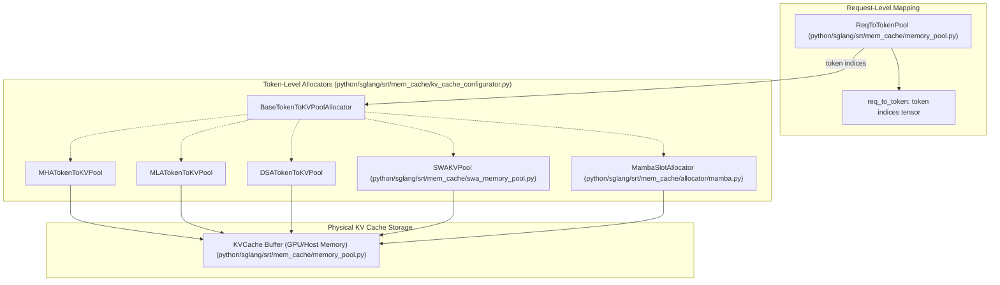
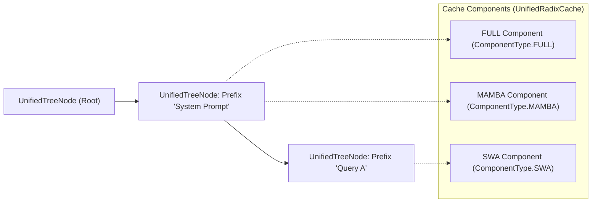
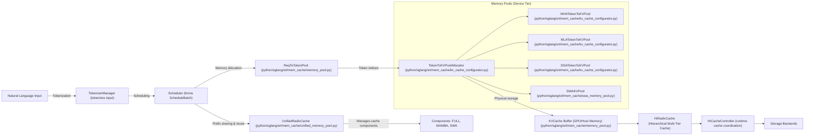

<!-- source: DeepWiki mcp.deepwiki.com · repo sgl-project/sglang · page 5 Memory Management and KV Cache · fetched 2026-10-30 -->

# Memory Management and KV Cache

Relevant source files

The following files were used as context for generating this wiki page:

- [python/sglang/kernels/ops/kvcache/kv_read_table.py](python/sglang/kernels/ops/kvcache/kv_read_table.py)
- [python/sglang/kernels/ops/memory/virtual_slot.py](python/sglang/kernels/ops/memory/virtual_slot.py)
- [python/sglang/srt/layers/attention/attention_registry.py](python/sglang/srt/layers/attention/attention_registry.py)
- [python/sglang/srt/mem_cache/allocator/unified_hybrid_swa.py](python/sglang/srt/mem_cache/allocator/unified_hybrid_swa.py)
- [python/sglang/srt/mem_cache/allocator/unified_mamba.py](python/sglang/srt/mem_cache/allocator/unified_mamba.py)
- [python/sglang/srt/mem_cache/allocator/unified_sub_pool.py](python/sglang/srt/mem_cache/allocator/unified_sub_pool.py)
- [python/sglang/srt/mem_cache/kv_cache_configurator.py](python/sglang/srt/mem_cache/kv_cache_configurator.py)
- [python/sglang/srt/mem_cache/kv_index_translator.py](python/sglang/srt/mem_cache/kv_index_translator.py)
- [python/sglang/srt/mem_cache/memory_pool.py](python/sglang/srt/mem_cache/memory_pool.py)
- [python/sglang/srt/mem_cache/unified_cache/cache_action.py](python/sglang/srt/mem_cache/unified_cache/cache_action.py)
- [python/sglang/srt/mem_cache/unified_memory_pool.py](python/sglang/srt/mem_cache/unified_memory_pool.py)
- [python/sglang/srt/model_executor/model_runner_components/kv_pool_runtime.py](python/sglang/srt/model_executor/model_runner_components/kv_pool_runtime.py)
- [python/sglang/srt/model_executor/pool_configurator.py](python/sglang/srt/model_executor/pool_configurator.py)
- [python/sglang/srt/speculative/draft_utils.py](python/sglang/srt/speculative/draft_utils.py)
- [test/registered/unit/disaggregation/test_unified_memory_move_gate.py](test/registered/unit/disaggregation/test_unified_memory_move_gate.py)
- [test/registered/unit/mem_cache/test_full_loc_fast_path.py](test/registered/unit/mem_cache/test_full_loc_fast_path.py)
- [test/registered/unit/mem_cache/test_kv_index_translator.py](test/registered/unit/mem_cache/test_kv_index_translator.py)
- [test/registered/unit/mem_cache/test_multi_ended_allocator.py](test/registered/unit/mem_cache/test_multi_ended_allocator.py)
- [test/registered/unit/mem_cache/test_swa_locked_full_recover_unified.py](test/registered/unit/mem_cache/test_swa_locked_full_recover_unified.py)
- [test/registered/unit/mem_cache/test_unified_free_no_host_sync.py](test/registered/unit/mem_cache/test_unified_free_no_host_sync.py)
- [test/registered/unit/mem_cache/test_unified_hicache_transfer_lifecycle.py](test/registered/unit/mem_cache/test_unified_hicache_transfer_lifecycle.py)
- [test/registered/unit/mem_cache/test_unified_mha_views.py](test/registered/unit/mem_cache/test_unified_mha_views.py)
- [test/registered/unit/mem_cache/test_unified_mla_block_table.py](test/registered/unit/mem_cache/test_unified_mla_block_table.py)
- [test/registered/unit/mem_cache/test_unified_mla_views.py](test/registered/unit/mem_cache/test_unified_mla_views.py)
- [test/registered/unit/mem_cache/test_unified_tri_pool.py](test/registered/unit/mem_cache/test_unified_tri_pool.py)
- [test/registered/unit/model_executor/test_kv_canary_headroom.py](test/registered/unit/model_executor/test_kv_canary_headroom.py)
- [test/registered/unit/model_executor/test_pool_configurator.py](test/registered/unit/model_executor/test_pool_configurator.py)
- [test/registered/unit/model_executor/test_unified_out_cache_loc_rebind.py](test/registered/unit/model_executor/test_unified_out_cache_loc_rebind.py)

This page documents SGLang's memory management system and KV (Key-Value) cache architecture. It covers the hierarchical caching subsystem, memory pools, prefix sharing mechanisms, and their integration with the scheduler and model execution pipeline.

## Overview

SGLang implements a sophisticated **three-tier hierarchical caching system** designed to maximize GPU memory efficiency while minimizing recomputation. The system is built around two core abstractions:

1.  **Memory Pools**: Manage physical memory allocation at request and token levels. The key components include `ReqToTokenPool` which maps requests to token segments, and `TokenToKVPoolAllocator` variants which organize token indices into the physical KV cache [python/sglang/srt/mem_cache/memory_pool.py:18-19]().

2.  **Prefix Caches**: Enable intelligent sharing of computed KV cache across requests sharing common prefixes using a radix tree structure called the `RadixCache`. This structure supports unified multi-component caches such as full KV cache, Mamba MoE state cache, and SWA (Sliding Window Attention) cache [python/sglang/srt/mem_cache/kv_cache_configurator.py:43-62]().

The memory hierarchy spans:

-   **L1 (Device)**: GPU VRAM containing actively executing requests' KV caches managed by various `TokenToKVPool` implementations [python/sglang/srt/mem_cache/memory_pool.py:18-21]().

-   **L2 (Host)**: CPU RAM pools holding evicted or prefetched KV data to bridge device memory and storage.

-   **L3 (Storage)**: Persistent or distributed storage backends for cold or large KV cache data with asynchronous IO and transfer support.

Together, these layers coordinate caching, eviction, and sharing to optimize latency and throughput for serving large language and vision-language models.

For details on the child components, see the linked child pages below.

**Sources:**
[python/sglang/srt/mem_cache/memory_pool.py:18-21](),
[python/sglang/srt/mem_cache/kv_cache_configurator.py:43-62]()

---

## Memory Pool Architecture

SGLang separates the abstraction of requests and tokens from physical KV storage through a layered pool design, enhancing efficient memory management and reuse.

### Key Components

-   **ReqToTokenPool**: Allocates tokens per request, mapping each request’s token ranges into a global token index space [python/sglang/srt/mem_cache/memory_pool.py:18-19]().

-   **TokenToKVPoolAllocator**: Allocates physical KV cache slots to tokens, coordinating indices with the physical KV cache memory. Several variants support differing model architectures and hardware platforms [python/sglang/srt/mem_cache/kv_cache_configurator.py:43-62]().

-   **KVCache**: The actual buffer holding KV pairs in GPU or host memory [python/sglang/srt/mem_cache/memory_pool.py:20-21]().

The system supports specialized `TokenToKVPool` classes tailored to different model and attention architectures:

-   **MHATokenToKVPool**: For Multi-Head Attention (MHA) workloads [python/sglang/srt/mem_cache/kv_cache_configurator.py:76]().

-   **MLATokenToKVPool**: For Multi-Head Latent Attention architectures (e.g., DeepSeek) [python/sglang/srt/mem_cache/kv_cache_configurator.py:79]().

-   **DSATokenToKVPool**: For Native Structured Attention (NSA/DSA) models [python/sglang/srt/mem_cache/kv_cache_configurator.py:72]().

-   **SWAKVPool**: Supports Sliding Window Attention caching [python/sglang/srt/mem_cache/swa_memory_pool.py:1]().

-   **MambaSlotAllocator**: Specialized slot allocator for Mamba states used in hierarchical caching [python/sglang/srt/mem_cache/allocator/mamba.py:68]().

### Diagram: Memory Pools and Relationships in SGLang

This architecture provides a modular abstraction to manage memory for diverse model types, facilitating cache reuse and efficient memory reclamation. The `ReqToTokenPool` ensures requests receive token allocations within global memory limits, while the `TokenToKVPoolAllocator` variants handle the detailed mapping and physical KV cache buffer management.

For details, see [Memory Pools and Token-to-KV Mapping](#5.1).

**Sources:**
[python/sglang/srt/mem_cache/memory_pool.py:18-21](),
[python/sglang/srt/mem_cache/kv_cache_configurator.py:43-62](),
[python/sglang/srt/mem_cache/kv_cache_configurator.py:70-79](),
[python/sglang/srt/mem_cache/swa_memory_pool.py:1](),
[python/sglang/srt/mem_cache/allocator/mamba.py:68]()

---

## RadixCache and Prefix Sharing

SGLang leverages a **radix tree** data structure to enable **prefix sharing** of KV cache between requests. This allows the reuse of cached KV computations for input sequences sharing common token prefixes.

### Core Concepts:

-   **RadixCache Tree Nodes:** Each node represents a prefix substring of tokens and holds references to KV cache segments corresponding to that prefix [python/sglang/srt/mem_cache/memory_pool.py:18-21]().

-   **UnifiedRadixCache:** A unified management layer over multiple cache components (FULL KV cache, Mamba MoE state cache, SWA cache), handling node state, reference counting, and eviction policies [python/sglang/srt/mem_cache/kv_cache_configurator.py:43-62]().

-   **Reference Counting and Locking:** Nodes maintain reference counts from active requests or execution holders to prevent eviction of in-use cache data.

-   **Unified LRU Eviction:** A global, per-component least recently used (LRU) eviction scheme fairly manages memory pressure across all cache types and tiers.

### Diagram: UnifiedRadixCache Node and Component Structure

### Prefix Request Matching and Eviction

-   The scheduler and batch formation leverage prefix matching for requests to share existing KV cache nodes, reducing redundant computation.

-   Locks and reference counts ensure that cached nodes currently in use by live requests or execution phases cannot be evicted prematurely.

-   Eviction decisions use unified LRU by accounting for combined component sizes and node states to keep caching consistent and balanced.

For comprehensive data structures, runtime locking behaviors, eviction policies, and cross-language radix tree implementations (Rust and C++), see [RadixCache and Prefix Sharing](#5.2).

**Sources:**
[python/sglang/srt/mem_cache/memory_pool.py:18-21](),
[python/sglang/srt/mem_cache/kv_cache_configurator.py:43-62]()

---

## HiCache Multi-Tier Storage

SGLang's **HiCache** is a hierarchical multi-tier cache system that spans device, host, and storage levels for KV cache management.

### Architecture Overview

-   **Device Tier (L1):** Contains the active KV cache in GPU memory managed by `TokenToKVPool` instances and radix caches for fast access.

-   **Host Tier (L2):** Holds evicted or prefetched KV cache blocks in CPU RAM pools, serving as a buffer between fast device memory and persistent storage.

-   **Storage Tier (L3):** Persistent storage backends hold cold KV cache data and provide asynchronous loading, including distributed backends and high-performance solutions.

### HiCache Components

-   **HiRadixCache:** Coordinates device/host tiers and integrates with prefix caches to provide a seamless caching hierarchy.

-   **HiCacheController:** Manages runtime events, cache backend attachment/detachment, and orchestrates transfers and evictions.

-   **KV Cache Events:** Structures monitor cache hits, misses, evictions, and IO operations for observability and optimization.

HiCache enables scaling beyond single device memory limits through intelligent tiering without sacrificing cache consistency or latency.

For a detailed breakdown of architecture, memory pools, events, and backend management, see [HiCache Multi-Tier Storage](#5.3).

**Sources:**
[python/sglang/srt/mem_cache/kv_cache_configurator.py:43-62]()

---

## Storage Backends and Transfer Optimization

SGLang supports multiple sophisticated **storage backends** designed for distributed, disaggregated, and heterogeneous caching needs.

### Backend Implementations

-   **Mooncake & Distributed Backends:** RDMA-enabled distributed backends facilitating KV cache synchronization between prefill and decode workers with high throughput and low latency.

-   **Filesystem and Memory Backends:** Provide filesystem-backed, memory-cached, or segmented VRAM/DRAM solutions with asynchronously managed transfer queues.

### Transfer and Async Operations

-   **Transfer Queues:** Queue abstractions batch contiguous memory blocks for efficient transfers across tiers, reducing overhead.

-   **Asynchronous Pipelines:** Background threads and async operations implement non-blocking prefetch, eviction, and reload phases that preserve throughput during model execution.

This integration ensures smooth data movement between storage mediums while minimizing stalls and resource contention.

See [Storage Backends and Transfer Optimization](#5.4) for the full design and backends descriptions.

**Sources:**
[python/sglang/srt/mem_cache/memory_pool.py:18-21]()

---

## Summary Diagram: From Natural Language Request to Hierarchical KV Cache Storage and Code Entities

This diagram illustrates the interaction flow from natural language input through tokenization, scheduling, memory pool allocation, prefix sharing via radix caches, hierarchical device/host/storage cache tiers, and connection to storage backends—highlighting key classes and entities in code for easy reference.

**Sources:**
[python/sglang/srt/mem_cache/memory_pool.py:18-21](),
[python/sglang/srt/mem_cache/kv_cache_configurator.py:43-62](),
[python/sglang/srt/mem_cache/unified_memory_pool.py:14-24]()

---

For detailed technical information, data structures, and runtime behaviors, see the child pages:

-   [Memory Pools and Token-to-KV Mapping](#5.1)
-   [RadixCache and Prefix Sharing](#5.2)
-   [HiCache Multi-Tier Storage](#5.3)
-   [Storage Backends and Transfer Optimization](#5.4)

---

