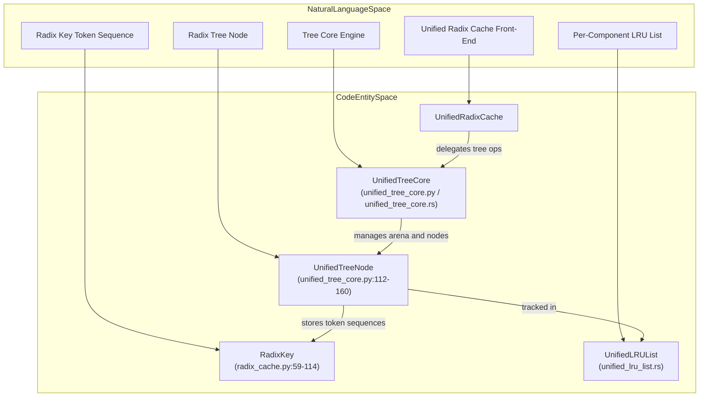
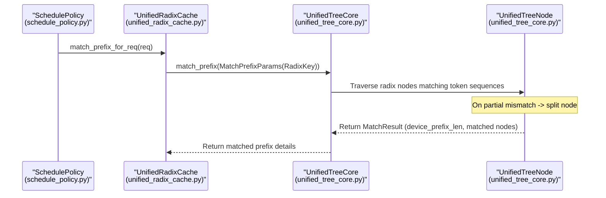
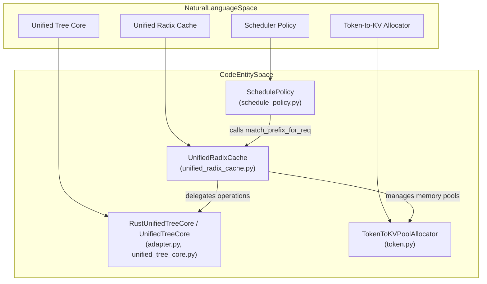

<!-- source: DeepWiki mcp.deepwiki.com · repo sgl-project/sglang · page 5.2 RadixCache and Prefix Sharing · fetched 2026-10-30 -->

# RadixCache and Prefix Sharing

Relevant source files

The following files were used as context for generating this wiki page:

- [docs/docs/advanced_features/radix_eviction_policy.mdx](docs/docs/advanced_features/radix_eviction_policy.mdx)
- [python/sglang/srt/disaggregation/kv_events.py](python/sglang/srt/disaggregation/kv_events.py)
- [python/sglang/srt/managers/scheduler_components/kv_events_publisher.py](python/sglang/srt/managers/scheduler_components/kv_events_publisher.py)
- [python/sglang/srt/mem_cache/events.py](python/sglang/srt/mem_cache/events.py)
- [python/sglang/srt/mem_cache/evict_policy.py](python/sglang/srt/mem_cache/evict_policy.py)
- [python/sglang/srt/mem_cache/radix_cache.py](python/sglang/srt/mem_cache/radix_cache.py)
- [python/sglang/srt/mem_cache/rust_tree_core/adapter.py](python/sglang/srt/mem_cache/rust_tree_core/adapter.py)
- [python/sglang/srt/mem_cache/unified_cache/unified_tree_core.py](python/sglang/srt/mem_cache/unified_cache/unified_tree_core.py)
- [python/sglang/srt/mem_cache/unified_cache/unified_tree_core_interface.py](python/sglang/srt/mem_cache/unified_cache/unified_tree_core_interface.py)
- [python/sglang/srt/mem_cache/utils.py](python/sglang/srt/mem_cache/utils.py)
- [python/sglang/test/kits/basic_api_contract_kit.py](python/sglang/test/kits/basic_api_contract_kit.py)
- [python/sglang/test/kits/basic_scheduler_stress_kit.py](python/sglang/test/kits/basic_scheduler_stress_kit.py)
- [rust/sglang-radix-tree/src/components/full.rs](rust/sglang-radix-tree/src/components/full.rs)
- [rust/sglang-radix-tree/src/components/mamba.rs](rust/sglang-radix-tree/src/components/mamba.rs)
- [rust/sglang-radix-tree/src/components/mod.rs](rust/sglang-radix-tree/src/components/mod.rs)
- [rust/sglang-radix-tree/src/components/swa.rs](rust/sglang-radix-tree/src/components/swa.rs)
- [rust/sglang-radix-tree/src/python_bindings.rs](rust/sglang-radix-tree/src/python_bindings.rs)
- [rust/sglang-radix-tree/src/tests/components/base.rs](rust/sglang-radix-tree/src/tests/components/base.rs)
- [rust/sglang-radix-tree/src/tests/components/full.rs](rust/sglang-radix-tree/src/tests/components/full.rs)
- [rust/sglang-radix-tree/src/tests/components/mamba.rs](rust/sglang-radix-tree/src/tests/components/mamba.rs)
- [rust/sglang-radix-tree/src/tests/components/swa.rs](rust/sglang-radix-tree/src/tests/components/swa.rs)
- [rust/sglang-radix-tree/src/tests/unified_tree_core.rs](rust/sglang-radix-tree/src/tests/unified_tree_core.rs)
- [rust/sglang-radix-tree/src/unified_tree_core.rs](rust/sglang-radix-tree/src/unified_tree_core.rs)
- [test/manual/dsv4/test_dsv4_flash_sanity_dp4.py](test/manual/dsv4/test_dsv4_flash_sanity_dp4.py)
- [test/manual/dsv4/test_dsv4_flash_sanity_tp8.py](test/manual/dsv4/test_dsv4_flash_sanity_tp8.py)
- [test/registered/attention/test_deterministic.py](test/registered/attention/test_deterministic.py)
- [test/registered/attention/test_gemma4_swa_triton_oob_regression.py](test/registered/attention/test_gemma4_swa_triton_oob_regression.py)
- [test/registered/radix_cache/test_radix_attention.py](test/registered/radix_cache/test_radix_attention.py)
- [test/registered/radix_cache/test_radix_cache_hit.py](test/registered/radix_cache/test_radix_cache_hit.py)
- [test/registered/radix_cache/unified_radix_tree/test_unified_radix_cache_hicache_pp_kl.py](test/registered/radix_cache/unified_radix_tree/test_unified_radix_cache_hicache_pp_kl.py)
- [test/registered/radix_cache/unified_radix_tree/test_unified_radix_cache_kl_cp.py](test/registered/radix_cache/unified_radix_tree/test_unified_radix_cache_kl_cp.py)
- [test/registered/radix_cache/unified_radix_tree/test_unified_radix_cache_kl_dcp.py](test/registered/radix_cache/unified_radix_tree/test_unified_radix_cache_kl_dcp.py)
- [test/registered/radix_cache/unified_radix_tree/test_unified_radix_cache_kl_dsv4.py](test/registered/radix_cache/unified_radix_tree/test_unified_radix_cache_kl_dsv4.py)
- [test/registered/radix_cache/unified_radix_tree/test_unified_radix_cache_kl_full.py](test/registered/radix_cache/unified_radix_tree/test_unified_radix_cache_kl_full.py)
- [test/registered/radix_cache/unified_radix_tree/test_unified_radix_cache_kl_glm52.py](test/registered/radix_cache/unified_radix_tree/test_unified_radix_cache_kl_glm52.py)
- [test/registered/radix_cache/unified_radix_tree/test_unified_radix_cache_kl_hybrid_bitexact.py](test/registered/radix_cache/unified_radix_tree/test_unified_radix_cache_kl_hybrid_bitexact.py)
- [test/registered/radix_cache/unified_radix_tree/test_unified_radix_cache_kl_mamba.py](test/registered/radix_cache/unified_radix_tree/test_unified_radix_cache_kl_mamba.py)
- [test/registered/radix_cache/unified_radix_tree/test_unified_radix_cache_kl_mimo.py](test/registered/radix_cache/unified_radix_tree/test_unified_radix_cache_kl_mimo.py)
- [test/registered/radix_cache/unified_radix_tree/test_unified_radix_cache_kl_swa.py](test/registered/radix_cache/unified_radix_tree/test_unified_radix_cache_kl_swa.py)
- [test/registered/rl/test_patch_torch.py](test/registered/rl/test_patch_torch.py)
- [test/registered/scheduler/test_load_snapshot_server.py](test/registered/scheduler/test_load_snapshot_server.py)
- [test/registered/unit/disaggregation/test_kv_events.py](test/registered/unit/disaggregation/test_kv_events.py)
- [test/registered/unit/mem_cache/test_mamba_unittest.py](test/registered/unit/mem_cache/test_mamba_unittest.py)
- [test/registered/unit/mem_cache/test_radix_cache_unit.py](test/registered/unit/mem_cache/test_radix_cache_unit.py)
- [test/registered/unit/mem_cache/test_rust_tree_core_integration.py](test/registered/unit/mem_cache/test_rust_tree_core_integration.py)
- [test/registered/unit/mem_cache/test_tlru_eviction_policy.py](test/registered/unit/mem_cache/test_tlru_eviction_policy.py)

## Purpose and Scope

This document details SGLang's `RadixCache` and unified radix tree systems, implemented to provide compact radix prefix trees that enable efficient prefix sharing of Key-Value (KV) caches across concurrent requests. By sharing cached states for common input token prefixes, SGLang reduces redundant prefill computations and dynamic memory allocations for large language and vision-language model workloads.

We examine core data structures (`RadixKey`, `UnifiedTreeNode`), prefix matching, insertion workflows (`InsertParams`, `InsertResult`), lock reference management, eviction policies, specialized cache variants (`UnifiedRadixCache`), the Rust-backed radix tree implementation (`sglang-radix-tree`), and their integration with the scheduler for memory-aware request handling.

For related memory management internals, see [Memory Pools and Token-to-KV Mapping (5.1)](5.1), and for hierarchical storage extensions, see [HiCache Multi-Tier Storage (5.3)](5.3).

Sources:  
- `python/sglang/srt/mem_cache/radix_cache.py:59-182`  
- `python/sglang/srt/mem_cache/unified_cache/unified_tree_core.py:1-12`  

---

## RadixCache Tree Structure and Unified Components

SGLang organizes cached KV tokens into a radix tree data structure, where each node represents a contiguous segment of tokens from input prefixes, mapped to device and/or host memory pools. This tree structure enables key operations such as shared prefix matching, inserting suffixes, and eviction in a coordinated manner.

The `UnifiedRadixCache` acts as the unified cache front-end, managing multiple cache components and delegating tree operations to a backend tree core (either Python or Rust implemented) [python/sglang/srt/mem_cache/unified_cache/unified_tree_core.py:3-12](). It supports several main component types registered in the system:
- `FULL` — full attention key-value caches [rust/sglang-radix-tree/src/components/full.rs:1-15]()
- `SWA` — sliding window attention caching [rust/sglang-radix-tree/src/components/swa.rs:1-15]()
- `MAMBA` — auxiliary state management for advanced cache layouts [rust/sglang-radix-tree/src/components/mamba.rs:1-15]()

### Key Data Structures

- **RadixKey**: Wraps a sequence of tokens (`token_ids`) with extra metadata including optional namespace keys (`extra_key`), cache salt strings (`cache_salt`) for tenant isolation, and support for a bigram view mode (used by EAGLE speculative decoding) [python/sglang/srt/mem_cache/radix_cache.py:59-114](). It offers efficient slicing and prefix matching aligned to page sizes.

- **UnifiedTreeNode**: Represents a node in the radix tree with children nodes keyed by tokens, references to parent nodes, and an array of per-component state data (`ComponentData`) [python/sglang/srt/mem_cache/unified_cache/unified_tree_core.py:112-160](). Includes timestamps for LRU eviction, hash values for cache events, priority, and linkage pointers for per-component LRU lists.

*Figure: Mapping of RadixCache core natural language concepts to code entities*

Sources:  
- `python/sglang/srt/mem_cache/radix_cache.py:59-114`  
- `python/sglang/srt/mem_cache/unified_cache/unified_tree_core.py:3-160`  
- `rust/sglang-radix-tree/src/components/full.rs:1-15`  
- `rust/sglang-radix-tree/src/components/swa.rs:1-15`  
- `rust/sglang-radix-tree/src/components/mamba.rs:1-15`  

---

## Prefix Matching and Splitting Algorithm

A core operation of the radix cache is prefix matching, which identifies the longest cached token prefix shared between the request’s tokens and existing radix tree nodes. This enables reuse of cached KV states and avoids duplicated prefill effort.

Prefix matching relies on `MatchPrefixParams` and returns a `MatchResult` containing metrics such as `device_prefix_len`, `last_device_node_id`, and cache actions [rust/sglang-radix-tree/src/unified_tree_core.rs:134-170](). `RadixKey` provides primitive matching methods like `match()` and `match_at()` to calculate shared prefixes aligned to page boundaries [python/sglang/srt/mem_cache/radix_cache.py:178-187]().

During a match, the radix tree is traversed recursively while comparing token sequences in nodes. When a partial mismatch occurs inside a node, a node split operation restructures the tree to maintain proper prefix segmentation.

### Prefix Matching Workflow

*Figure: Data flow for prefix matching across scheduler and radix tree modules*

Splitting nodes during prefix matching triggers tree restructuring coordinated via `InsertParams` and step-by-step resumption handles (`begin_insert`, `resume_insert`) [rust/sglang-radix-tree/src/python_bindings.rs:20-25]().

Sources:  
- `python/sglang/srt/mem_cache/radix_cache.py:178-187`  
- `rust/sglang-radix-tree/src/unified_tree_core.rs:134-170`  
- `rust/sglang-radix-tree/src/python_bindings.rs:20-25`  

---

## Insertion, Lock Reference Management, and Streaming Sessions

After prefix matching, unmatched suffix tokens are inserted as new nodes in the radix tree with their associated KV cache tensors. Insertions use `InsertParams` encapsulating keys and device-side values [rust/sglang-radix-tree/src/python_bindings.rs:20-25]().

To prevent eviction of nodes currently in use, reference counts are handled by increment and decrement operations (`inc_lock_ref` / `dec_lock_ref`) which return receipts (`IncLockRefResult` / `DecLockRefParams`) detailing anchors and component lock UUIDs [rust/sglang-radix-tree/src/unified_tree_core.rs:73-127](). These receipts enable precise multi-component and multi-thread lock management enhancing concurrency safety.

Streaming sessions are supported via session slots that maintain virtual sentinel nodes (`_VirtualNode`), representing session-owned KV state with specialized no-op locking semantics.

Sources:  
- `rust/sglang-radix-tree/src/python_bindings.rs:20-25`  
- `rust/sglang-radix-tree/src/unified_tree_core.rs:73-127`  

---

## Eviction Policies and Memory Management

Memory pressure triggers eviction mechanisms in radix caches targeting unlocked leaf nodes holding KV slots. Eviction operations receive parameters encapsulated in `EvictParams` indicating how many tokens to evict by component, and return corresponding base eviction results (`BaseEvictionResult`, `EvictDeviceLeafResult`, `EvictDeviceNextNodeResult`) containing device and host freed tensor lists and eviction tracking metrics [python/sglang/srt/mem_cache/unified_cache/unified_tree_core_interface.py:22-70]().

These coordinated evictions keep the cache size within limits while maintaining correct reuse semantics for shared prefixes and sliding windows.

Sources:  
- `python/sglang/srt/mem_cache/unified_cache/unified_tree_core_interface.py:22-70`  

---

## The Rust/C++ Radix Tree Implementation (`sglang-radix-tree`)

To minimize Python interpreter overhead in critical paths, SGLang offers a Rust-based radix tree core implemented in the `sglang-radix-tree` crate. This Rust core mirrors the Python `UnifiedTreeCoreInterface` and manages node arena allocation, LRU list updates, node splits, eviction queues, and concurrency control efficiently [rust/sglang-radix-tree/src/python_bindings.rs:1-46]().

The Rust crate exposes PyO3 bindings allowing it to plug into the Python runtime seamlessly, serving as a backend via `RustUnifiedTreeCore` when enabled or when higher performance is required [test/registered/unit/mem_cache/test_rust_tree_core_integration.py:57-60]().

Sources:  
- `rust/sglang-radix-tree/src/python_bindings.rs:1-46`  
- `test/registered/unit/mem_cache/test_rust_tree_core_integration.py:57-60`  

---

## Scheduler Integration and Code Architecture Mapping

The SGLang scheduler uses radix cache prefix matching to optimize request dispatch and batch formation, reusing cached KV states and enabling prefix sharing.

*Figure: Code entity mapping showing interactions between scheduler, radix cache, and memory pools*

Sources:  
- `python/sglang/srt/mem_cache/unified_radix_cache.py:1-50`  
- `python/sglang/srt/mem_cache/rust_tree_core/adapter.py:1-60`  

---

# Summary

SGLang's radix caching system is a foundational component enabling efficient memory reuse and prefix sharing across concurrent model requests. This system combines Python-controlled layered components with performant radix tree cores (including a Rust implementation via `sglang-radix-tree`) and supports streaming session state management to reduce prefill overhead and memory usage. The unified radix tree cache supports multiple component types (`FULL`, `SWA`, `MAMBA`), advanced prefix matching, node splitting algorithms, and seamless integration with the scheduler to provide high-throughput serving of large language and vision-language models.

---

