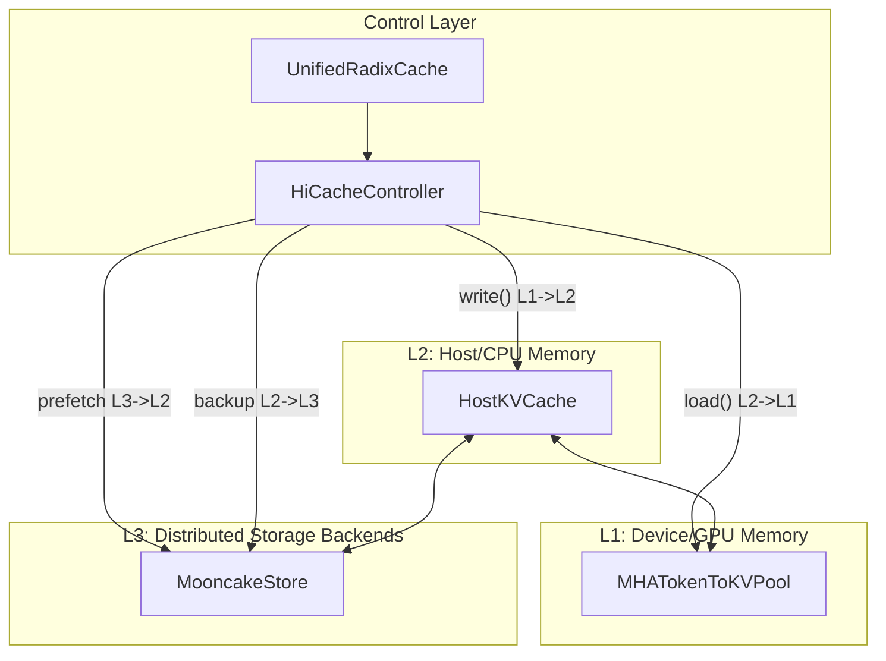
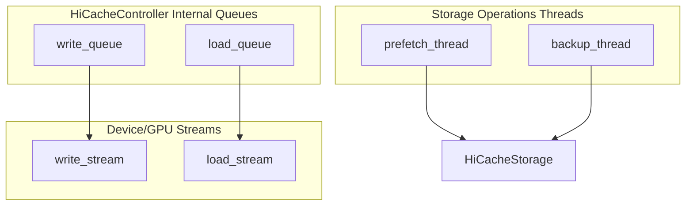
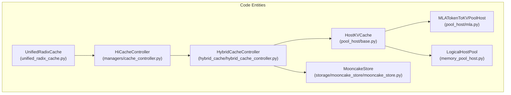
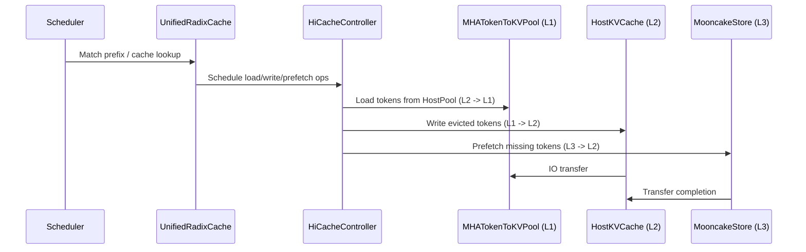

<!-- source: DeepWiki mcp.deepwiki.com · repo sgl-project/sglang · page 5.3 HiCache Multi-Tier Storage · fetched 2026-10-30 -->

# HiCache Multi-Tier Storage

Relevant source files

The following files were used as context for generating this wiki page:

- [benchmark/hicache/bench_host_memory_migration.py](benchmark/hicache/bench_host_memory_migration.py)
- [docs/docs/advanced_features/hicache_best_practices.mdx](docs/docs/advanced_features/hicache_best_practices.mdx)
- [python/sglang/srt/arg_groups/fields/memory.py](python/sglang/srt/arg_groups/fields/memory.py)
- [python/sglang/srt/arg_groups/hicache_hook.py](python/sglang/srt/arg_groups/hicache_hook.py)
- [python/sglang/srt/managers/cache_controller.py](python/sglang/srt/managers/cache_controller.py)
- [python/sglang/srt/managers/schedule_policy.py](python/sglang/srt/managers/schedule_policy.py)
- [python/sglang/srt/managers/scheduler_components/metrics_reporter.py](python/sglang/srt/managers/scheduler_components/metrics_reporter.py)
- [python/sglang/srt/mem_cache/base_prefix_cache.py](python/sglang/srt/mem_cache/base_prefix_cache.py)
- [python/sglang/srt/mem_cache/buffer_mode/pipeline.py](python/sglang/srt/mem_cache/buffer_mode/pipeline.py)
- [python/sglang/srt/mem_cache/cache_init_params.py](python/sglang/srt/mem_cache/cache_init_params.py)
- [python/sglang/srt/mem_cache/hicache_storage.py](python/sglang/srt/mem_cache/hicache_storage.py)
- [python/sglang/srt/mem_cache/hybrid_cache/hybrid_cache_controller.py](python/sglang/srt/mem_cache/hybrid_cache/hybrid_cache_controller.py)
- [python/sglang/srt/mem_cache/hybrid_cache/hybrid_pool_assembler.py](python/sglang/srt/mem_cache/hybrid_cache/hybrid_pool_assembler.py)
- [python/sglang/srt/mem_cache/hybrid_cache/linker_pool_assembler.py](python/sglang/srt/mem_cache/hybrid_cache/linker_pool_assembler.py)
- [python/sglang/srt/mem_cache/kv_cache_builder.py](python/sglang/srt/mem_cache/kv_cache_builder.py)
- [python/sglang/srt/mem_cache/memory_pool_host.py](python/sglang/srt/mem_cache/memory_pool_host.py)
- [python/sglang/srt/mem_cache/pool_host/base.py](python/sglang/srt/mem_cache/pool_host/base.py)
- [python/sglang/srt/mem_cache/pool_host/common.py](python/sglang/srt/mem_cache/pool_host/common.py)
- [python/sglang/srt/mem_cache/pool_host/dsa.py](python/sglang/srt/mem_cache/pool_host/dsa.py)
- [python/sglang/srt/mem_cache/pool_host/mamba.py](python/sglang/srt/mem_cache/pool_host/mamba.py)
- [python/sglang/srt/mem_cache/pool_host/mha.py](python/sglang/srt/mem_cache/pool_host/mha.py)
- [python/sglang/srt/mem_cache/pool_host/mla.py](python/sglang/srt/mem_cache/pool_host/mla.py)
- [python/sglang/srt/mem_cache/registry.py](python/sglang/srt/mem_cache/registry.py)
- [python/sglang/srt/mem_cache/storage/file/__init__.py](python/sglang/srt/mem_cache/storage/file/__init__.py)
- [python/sglang/srt/mem_cache/storage/file/lru_file_evictor.py](python/sglang/srt/mem_cache/storage/file/lru_file_evictor.py)
- [python/sglang/srt/mem_cache/storage/mooncake_store/README.md](python/sglang/srt/mem_cache/storage/mooncake_store/README.md)
- [python/sglang/srt/mem_cache/storage/mooncake_store/mooncake_direct_linker.py](python/sglang/srt/mem_cache/storage/mooncake_store/mooncake_direct_linker.py)
- [python/sglang/srt/mem_cache/storage/mooncake_store/mooncake_store.py](python/sglang/srt/mem_cache/storage/mooncake_store/mooncake_store.py)
- [python/sglang/srt/mem_cache/storage/umbp/umbp_direct_linker.py](python/sglang/srt/mem_cache/storage/umbp/umbp_direct_linker.py)
- [python/sglang/srt/mem_cache/unified_cache/components/base.py](python/sglang/srt/mem_cache/unified_cache/components/base.py)
- [python/sglang/srt/mem_cache/unified_cache/components/full.py](python/sglang/srt/mem_cache/unified_cache/components/full.py)
- [python/sglang/srt/mem_cache/unified_cache/components/mamba.py](python/sglang/srt/mem_cache/unified_cache/components/mamba.py)
- [python/sglang/srt/mem_cache/unified_cache/components/swa.py](python/sglang/srt/mem_cache/unified_cache/components/swa.py)
- [python/sglang/srt/mem_cache/unified_cache/linker_factory.py](python/sglang/srt/mem_cache/unified_cache/linker_factory.py)
- [python/sglang/srt/mem_cache/unified_cache/unified_cache_linker.py](python/sglang/srt/mem_cache/unified_cache/unified_cache_linker.py)
- [python/sglang/srt/mem_cache/unified_radix_cache.py](python/sglang/srt/mem_cache/unified_radix_cache.py)
- [python/sglang/srt/observability/metrics_collector.py](python/sglang/srt/observability/metrics_collector.py)
- [python/sglang/srt/observability/scheduler_stage_metrics.py](python/sglang/srt/observability/scheduler_stage_metrics.py)
- [python/sglang/srt/session/streaming_session.py](python/sglang/srt/session/streaming_session.py)
- [test/registered/kernels/ops/mamba/test_mtp_hicache.py](test/registered/kernels/ops/mamba/test_mtp_hicache.py)
- [test/registered/observability/test_metrics.py](test/registered/observability/test_metrics.py)
- [test/registered/radix_cache/test_mamba_cache_kl.py](test/registered/radix_cache/test_mamba_cache_kl.py)
- [test/registered/radix_cache/unified_radix_tree/linker/test_unified_cache_linker_kimi_linear.py](test/registered/radix_cache/unified_radix_tree/linker/test_unified_cache_linker_kimi_linear.py)
- [test/registered/radix_cache/unified_radix_tree/linker/test_unified_cache_linker_kl_dsv4.py](test/registered/radix_cache/unified_radix_tree/linker/test_unified_cache_linker_kl_dsv4.py)
- [test/registered/radix_cache/unified_radix_tree/linker/test_unified_cache_linker_kl_glm52.py](test/registered/radix_cache/unified_radix_tree/linker/test_unified_cache_linker_kl_glm52.py)
- [test/registered/unit/managers/test_prefill_adder.py](test/registered/unit/managers/test_prefill_adder.py)
- [test/registered/unit/managers/test_scheduler_on_idle_load.py](test/registered/unit/managers/test_scheduler_on_idle_load.py)
- [test/registered/unit/mem_cache/test_asymmetric_mha_pool_host_unit.py](test/registered/unit/mem_cache/test_asymmetric_mha_pool_host_unit.py)
- [test/registered/unit/mem_cache/test_buffer_mode_sidecar.py](test/registered/unit/mem_cache/test_buffer_mode_sidecar.py)
- [test/registered/unit/mem_cache/test_external_linker_factory.py](test/registered/unit/mem_cache/test_external_linker_factory.py)
- [test/registered/unit/mem_cache/test_hicache_dcp_host_pool.py](test/registered/unit/mem_cache/test_hicache_dcp_host_pool.py)
- [test/registered/unit/mem_cache/test_hicache_file_lru_unit.py](test/registered/unit/mem_cache/test_hicache_file_lru_unit.py)
- [test/registered/unit/mem_cache/test_hicache_host_register.py](test/registered/unit/mem_cache/test_hicache_host_register.py)
- [test/registered/unit/mem_cache/test_hicache_staged_write_back_dispatch.py](test/registered/unit/mem_cache/test_hicache_staged_write_back_dispatch.py)
- [test/registered/unit/mem_cache/test_hicache_storage_registration_hook.py](test/registered/unit/mem_cache/test_hicache_storage_registration_hook.py)
- [test/registered/unit/mem_cache/test_hybrid_pool_assembler.py](test/registered/unit/mem_cache/test_hybrid_pool_assembler.py)
- [test/registered/unit/mem_cache/test_linker_pool_assembler.py](test/registered/unit/mem_cache/test_linker_pool_assembler.py)
- [test/registered/unit/mem_cache/test_mamba_donated_alloc_ratio.py](test/registered/unit/mem_cache/test_mamba_donated_alloc_ratio.py)
- [test/registered/unit/mem_cache/test_mem_pool_host.py](test/registered/unit/mem_cache/test_mem_pool_host.py)
- [test/registered/unit/mem_cache/test_mla_host_dedup_primitives.py](test/registered/unit/mem_cache/test_mla_host_dedup_primitives.py)
- [test/registered/unit/mem_cache/test_mooncake_group_semantics.py](test/registered/unit/mem_cache/test_mooncake_group_semantics.py)
- [test/registered/unit/mem_cache/test_mooncake_tenant_config.py](test/registered/unit/mem_cache/test_mooncake_tenant_config.py)
- [test/registered/unit/mem_cache/test_registry.py](test/registered/unit/mem_cache/test_registry.py)
- [test/registered/unit/mem_cache/test_storage_prefetch_lifecycle.py](test/registered/unit/mem_cache/test_storage_prefetch_lifecycle.py)
- [test/registered/unit/mem_cache/test_streaming_session_unit.py](test/registered/unit/mem_cache/test_streaming_session_unit.py)
- [test/registered/unit/mem_cache/test_umbp_direct_linker_rank_keys.py](test/registered/unit/mem_cache/test_umbp_direct_linker_rank_keys.py)
- [test/registered/unit/mem_cache/test_unified_cache_linker.py](test/registered/unit/mem_cache/test_unified_cache_linker.py)
- [test/registered/unit/mem_cache/test_unified_hicache_regressions.py](test/registered/unit/mem_cache/test_unified_hicache_regressions.py)
- [test/registered/unit/observability/test_forward_pass_metrics.py](test/registered/unit/observability/test_forward_pass_metrics.py)
- [test/registered/unit/observability/test_scheduler_stage_metrics.py](test/registered/unit/observability/test_scheduler_stage_metrics.py)
- [test/registered/unit/observability/test_stat_loggers_di.py](test/registered/unit/observability/test_stat_loggers_di.py)

## Purpose and Scope

This document details the hierarchical multi-tier storage system implemented by HiCache in the SGLang codebase. HiCache extends the `UnifiedRadixCache` and `HiRadixCache` architecture to a multi-tier key-value (KV) cache designed to scale KV capacity beyond device memory (GPU) limits by orchestrating caching across three tiers:

- **L1 (Device/GPU memory):** Fastest access, low latency, smallest capacity.
- **L2 (Host/CPU memory):** Larger capacity with medium latency, acts as a staging area.
- **L3 (Distributed Storage Backends):** Large or virtually unlimited capacity with high latency.

The page explains the HiCache design and implementation, including memory pool management, cache event signaling, key classes like `HiCacheController`, `HiSparse` memory pools (`HiSparseHostPoolMixin`), interaction with storage backends (`HiCacheStorage`, `MooncakeStore`), and runtime backend attach/detach mechanisms.

Sources: [`python/sglang/srt/mem_cache/unified_radix_cache.py:1-199](), [`python/sglang/srt/mem_cache/hybrid_cache/hybrid_pool_assembler.py:1-194](), [`python/sglang/srt/managers/cache_controller.py:1-196](), [`python/sglang/srt/mem_cache/hicache_storage.py:1-191]()

---

## Three-Tier Storage Architecture

HiCache models the KV cache as a hierarchical memory system with distinct physical and logical tiers that split capacity and responsibilities.

- **Device Pool (L1):** Manages fast GPU-resident KV tensors backed by allocators like `MHATokenToKVPool` and others to hold active KV caches [`python/sglang/srt/mem_cache/unified_radix_cache.py:204-207`]().
- **Host Pool (L2):** Memory-resident pools implemented as subclasses of `HostKVCache` hold a larger latent copy for overflow and stage transfers [`python/sglang/srt/mem_cache/pool_host/base.py:71-76`]().
- **Storage Tier (L3):** Pluggable backend storages expose persistent or distributed memory, including RDMA-backed `MooncakeStore` [`python/sglang/srt/mem_cache/storage/mooncake_store/mooncake_store.py:38-48`]().

Sources: [`python/sglang/srt/mem_cache/unified_radix_cache.py:199-219](), [`python/sglang/srt/managers/cache_controller.py:1-196](), [`python/sglang/srt/mem_cache/hicache_storage.py:1-191]()

---

## HiCacheController: Orchestrating Tier Operations

The `HiCacheController` is the central component responsible for managing asynchronous data movement, synchronization, and consistency across the three cache tiers. It operates multiple concurrent queues, streams, and threads to efficiently transfer cache tokens between device, host, and storage layers.

| Responsibility | Description | Reference |
|---|---|---|
| Write to L2 | Transfers evicted tokens from GPU device pool to host pool | [`python/sglang/srt/managers/cache_controller.py:112-128`]() |
| Load to L1 | Loads tokens from host pool to GPU device pool on demand | [`python/sglang/srt/managers/cache_controller.py:112-128`]() |
| Prefetch from L3 | Asynchronously fetches missing tokens from storage to host | [`python/sglang/srt/mem_cache/hybrid_cache/hybrid_cache_controller.py:143-187`]() |
| Backup to L3 | Persists host pool tokens to storage backend asynchronously | [`python/sglang/srt/mem_cache/hybrid_cache/hybrid_cache_controller.py:128-142`]() |

### Internal Queues and Threads

- **Operation:** `write_queue` buffers tokens evicted from the device cache that must be saved in host memory. `load_queue` schedules tokens to be loaded back into device memory for decoding.
- **Streams:** CUDA/HIP streams asynchronously execute device-host transfers, leveraging JIT kernels or copy kernels.
- **Storage Threads:** Background threads manage prefetch and backup operations to/from storage backends asynchronously.

Sources: [`python/sglang/srt/managers/cache_controller.py:53-196](), [`python/sglang/srt/mem_cache/hybrid_cache/hybrid_cache_controller.py:128-188]()

---

## L2 Host Memory and HiSparse Memory Pools

### HostKVCache and Its Subclasses

The L2 host pools implement the abstract base class `HostKVCache` which provides:
- Host-side buffers backed by pinned memory or specialized allocators to hold KV cache data offloaded from GPU memory.
- Page-aligned token slot allocation with free lists (`free_slots`, `release_slots`) and thread synchronization (`RLock`).

Typical host pool implementations include:
- **`MHATokenToKVPoolHost`**: wraps MHA device pools; manages k/v tensors with concurrency and staging.
- **`MLATokenToKVPoolHost`**: supports MLA pools with specialized staging and batching [`python/sglang/srt/mem_cache/pool_host/mla.py:35-36`]().
- **`LogicalHostPool`**: a pure-logical anchor pool that does not own any backing buffer but manages page-aligned tokens [`python/sglang/srt/mem_cache/memory_pool_host.py:87-93`]().

### HiSparse Memory Pool Support

To support sparse and compressed KV cache layouts (e.g., DeepSeek-V4), host pools mix in `HiSparseHostPoolMixin` which adds:
- Granular page buffer tracking of sparse tokens/indexers [`python/sglang/srt/mem_cache/pool_host/hisparse.py:1-50`]().
- Management of separate compressed KV buffers and indexer buffers.

Sources: [`python/sglang/srt/mem_cache/memory_pool_host.py:71-135](), [`python/sglang/srt/mem_cache/pool_host/base.py:71-76]()

---

## L3 Storage Backend System

The L3 storage tier abstracts persistent or distributed storage for KV cache pages through the abstract base class `HiCacheStorage` [`python/sglang/srt/mem_cache/hicache_storage.py:1-25`]().

### HiCacheStorage Interface
- `batch_exists_v2`: Queries from a batch of cache keys which pages exist in storage, respecting per-pool hit policies (`PoolHitPolicy`) [`python/sglang/srt/mem_cache/hicache_storage.py:124-138`]().
- `batch_get_v2` / `batch_set_v2`: Batched retrieval and saving operations for cache pages using `PoolTransfer` descriptors [`python/sglang/srt/mem_cache/hicache_storage.py:141-160`]().

### MooncakeStore Backend
- `MooncakeStore` is an RDMA-backed distributed storage backend offering multi-node shared KV cache [`python/sglang/srt/mem_cache/storage/mooncake_store/mooncake_store.py:38-48`]().
- Integrates `MooncakeHostTensorAllocator` using `MooncakeHostMemAllocator` to allocate pinned tensor memory [`python/sglang/srt/mem_cache/storage/mooncake_store/mooncake_store.py:38-78`]().

Sources: [`python/sglang/srt/mem_cache/hicache_storage.py:1-191](), [`python/sglang/srt/mem_cache/storage/mooncake_store/mooncake_store.py:38-118]()

---

## KV Cache Event System

HiCache uses an event-driven system to track cache operation lifecycles and synchronization:
- `LayerLoadingEvent`: Tracks per-layer loading progress using device events (`device_module.Event`) for precise overlap and synchronization [`python/sglang/srt/managers/cache_controller.py:65-81`]().
- `LayerDoneCounter`: Manages multi-buffer producer-consumer synchronization states across forward passes and layer transfers [`python/sglang/srt/managers/cache_controller.py:83-111`]().

Sources: [`python/sglang/srt/managers/cache_controller.py:65-111]()

---

## Runtime Attach/Detach of Backends and Pools

HiCache supports dynamic runtime reconfiguration of cache backend attachments and multi-pool layouts:
- **Attach Storage Backend:** Enables dynamic attachment of a new storage backend at runtime via controller methods.
- **Register Sidecar Pools:** Allows registering new sidecar `SidecarPoolSpec` or `PoolEntry` instances representing additional host pools dynamically [`python/sglang/srt/mem_cache/hicache_storage.py:162-169]() [`python/sglang/srt/mem_cache/kv_cache_builder.py:153-160`]().

Sources: [`python/sglang/srt/mem_cache/hicache_storage.py:162-169](), [`python/sglang/srt/mem_cache/kv_cache_builder.py:123-160]()

---

## System Overview Diagram (Code Entity Space)

Sources: [`python/sglang/srt/mem_cache/unified_radix_cache.py:199-219](), [`python/sglang/srt/managers/cache_controller.py:1-196](), [`python/sglang/srt/mem_cache/hybrid_cache/hybrid_cache_controller.py:1-50](), [`python/sglang/srt/mem_cache/pool_host/mla.py:35-36](), [`python/sglang/srt/mem_cache/storage/mooncake_store/mooncake_store.py:38-48](), [`python/sglang/srt/mem_cache/memory_pool_host.py:87-120]()

---

## Detailed Data Flow Diagram

Sources: [`python/sglang/srt/mem_cache/unified_radix_cache.py:199-219](), [`python/sglang/srt/managers/cache_controller.py:1-196](), [`python/sglang/srt/mem_cache/storage/mooncake_store/mooncake_store.py:38-48]()

---

# Summary

The HiCache multi-tier storage system significantly extends effective KV cache capacity for LLM serving in SGLang by integrating GPU device pools (L1), host memory pools (L2), and distributed storage backends (L3). Managed by `HiCacheController` and `UnifiedRadixCache`, asynchronous transfers and event-driven synchronization ensure high performance and correctness across tiers.

Sources: [`python/sglang/srt/mem_cache/unified_radix_cache.py:1-199](), [`python/sglang/srt/managers/cache_controller.py:1-196](), [`python/sglang/srt/mem_cache/hicache_storage.py:1-191]()

---

