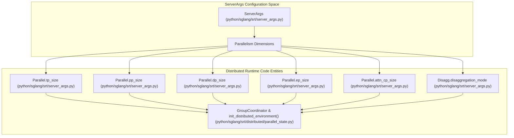
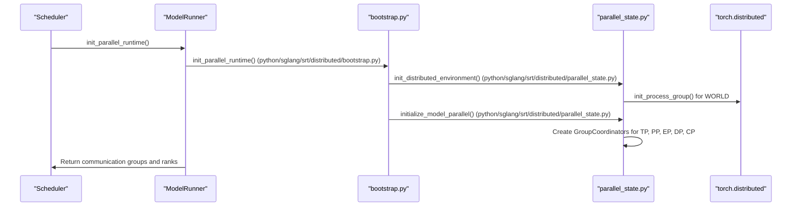
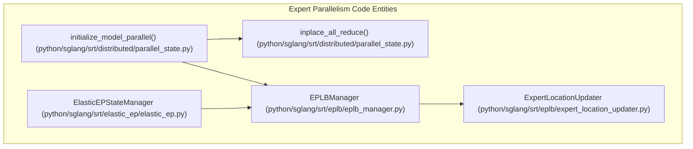

<!-- source: DeepWiki mcp.deepwiki.com · repo sgl-project/sglang · page 6 Distributed Execution Strategies · fetched 2026-10-30 -->

# Distributed Execution Strategies

Relevant source files

The following files were used as context for generating this wiki page:

- [docs/docs/references/environment_variables.mdx](docs/docs/references/environment_variables.mdx)
- [python/sglang/benchmark/one_batch.py](python/sglang/benchmark/one_batch.py)
- [python/sglang/srt/arg_groups/attention_hook.py](python/sglang/srt/arg_groups/attention_hook.py)
- [python/sglang/srt/arg_groups/overrides.py](python/sglang/srt/arg_groups/overrides.py)
- [python/sglang/srt/arg_groups/pd_disaggregation_hook.py](python/sglang/srt/arg_groups/pd_disaggregation_hook.py)
- [python/sglang/srt/disaggregation/role_switch.py](python/sglang/srt/disaggregation/role_switch.py)
- [python/sglang/srt/distributed/bootstrap.py](python/sglang/srt/distributed/bootstrap.py)
- [python/sglang/srt/distributed/parallel_state.py](python/sglang/srt/distributed/parallel_state.py)
- [python/sglang/srt/environ.py](python/sglang/srt/environ.py)
- [python/sglang/srt/layers/dp_attention.py](python/sglang/srt/layers/dp_attention.py)
- [python/sglang/srt/managers/schedule_batch.py](python/sglang/srt/managers/schedule_batch.py)
- [python/sglang/srt/managers/scheduler.py](python/sglang/srt/managers/scheduler.py)
- [python/sglang/srt/mem_cache/common.py](python/sglang/srt/mem_cache/common.py)
- [python/sglang/srt/model_executor/model_runner.py](python/sglang/srt/model_executor/model_runner.py)
- [python/sglang/srt/runtime_context.py](python/sglang/srt/runtime_context.py)
- [python/sglang/srt/server_args.py](python/sglang/srt/server_args.py)
- [test/manual/test_forward_split_prefill.py](test/manual/test_forward_split_prefill.py)
- [test/manual/test_vlm_accuracy.py](test/manual/test_vlm_accuracy.py)
- [test/registered/unit/disaggregation/test_pd_role_switch.py](test/registered/unit/disaggregation/test_pd_role_switch.py)
- [test/registered/unit/server_args/test_server_args.py](test/registered/unit/server_args/test_server_args.py)
- [test/registered/unit/test_model_overrides.py](test/registered/unit/test_model_overrides.py)
- [test/registered/unit/test_runtime_context.py](test/registered/unit/test_runtime_context.py)

This page provides a high-level overview of the distributed execution strategies supported in SGLang for serving large language models (LLMs) and vision-language models (VLMs). The framework supports a variety of parallelism methods designed to scale model inference efficiently across devices and nodes. Distributed execution enables high throughput, optimized memory usage, and flexible deployment topologies for demanding workloads.

Key parallelism strategies covered include:

- **Tensor Parallelism (TP)**
- **Pipeline Parallelism (PP)**
- **Expert Parallelism (EP)**
- **Data Parallelism (DP) and DP Attention**
- **Context Parallelism (CP/DCP)**
- **Prefill-Decode Disaggregation and PD-Multiplexing**
- **Elastic Expert Parallelism**

Detailed technical treatments and implementation details are provided on dedicated child pages linked below.

---

## 6.1. Overview of Parallelism Dimensions

SGLang supports multiple orthogonal parallelism dimensions that can be composed to exploit hardware and model characteristics. These parallelism dimensions are configured via fields in `ServerArgs` [python/sglang/srt/server_args.py:171-173]() and resolved through `parallel_widths_of` [python/sglang/srt/runtime_context.py:160-170]().

The primary dimensions are:
- **Tensor Parallelism (TP):** Shards model weights and activations across GPUs by tensor dimensions.
- **Pipeline Parallelism (PP):** Splits model layers sequentially across stages.
- **Expert Parallelism (EP):** Distributes MoE expert computation across devices [python/sglang/srt/runtime_context.py:153-154]().
- **Data Parallelism (DP):** Runs full model replicas or sharded subsets across multiple devices.
- **Context Parallelism (CP/DCP):** Splits attention computations for long-context support [python/sglang/srt/runtime_context.py:155-156]().

### Diagram: Parallelism Dimensions to Code Entities

Sources: [python/sglang/srt/distributed/parallel_state.py:10-24](), [python/sglang/srt/runtime_context.py:137-170](), [python/sglang/srt/server_args.py:171-173]()

---

## 6.2. Distributed Execution Initialization and Rank Management

SGLang manages distributed environment initialization centrally through `parallel_state` and `bootstrap`. During model runner startup, it initializes communication groups corresponding to different parallelism dimensions.

- `init_distributed_environment()` sets up global and subgroup process groups [python/sglang/srt/distributed/parallel_state.py:10-24]().
- `GroupCoordinator` handles communication contexts and collective operations [python/sglang/srt/distributed/parallel_state.py:176-190]().
- Ranks and parallel widths are derived systematically via `derive_spawn_ranks` and `parallel_widths_of` [python/sglang/srt/runtime_context.py:106-170]().
- Coordinate calculation: `WORLD_rank = ep_join_rank_offset + tp_size * pp_rank + tp_rank` [python/sglang/srt/runtime_context.py:95-103]().

### Diagram: Distributed Initialization Sequence

Sources: [python/sglang/srt/distributed/parallel_state.py:10-24](), [python/sglang/srt/runtime_context.py:95-170](), [python/sglang/srt/distributed/bootstrap.py]()

---

## 6.3. Tensor and Pipeline Parallelism

- **Tensor Parallelism (TP)** shards large weights and activations along tensor dimensions using NCCL collectives.
- **Pipeline Parallelism (PP)** breaks model layers into stages for pipelined execution.

Custom operations like `inplace_all_reduce` and `outplace_all_reduce` perform communication across ranks [python/sglang/srt/distributed/parallel_state.py:184-198]().

For details, see [Tensor and Pipeline Parallelism](#6.1).

Sources: [python/sglang/srt/distributed/parallel_state.py:184-198]()

---

## 6.4. Expert Parallelism for MoE Models

Expert Parallelism distributes Mixture-of-Experts layers across devices.
- Token dispatch uses backends like DeepEP, Mooncake, NIXL, and MORI.
- Managed by `EPLBManager` and `ExpertLocationUpdater` [python/sglang/srt/model_executor/model_runner.py:62-79]().
- Elastic EP manages rank fault recovery and dynamic rebalancing through `ElasticEPStateManager` [python/sglang/srt/model_executor/model_runner.py:43-55]().

### Diagram: Expert Parallelism Code Mapping

For details, see [Expert Parallelism for MoE Models](#6.2).

Sources: [python/sglang/srt/distributed/parallel_state.py:10-24](), [python/sglang/srt/model_executor/model_runner.py:43-79]()

---

## 6.5. Data Parallelism and DP Attention

- **DP Attention** implements fine-grained token-level sharding for attention computations across attention-DP replicas [python/sglang/srt/layers/dp_attention.py:60-70]().
- Padding modes (`MAX_LEN`, `SUM_LEN`) control token batching for DP communication [python/sglang/srt/layers/dp_attention.py:152-192]().
- Context Parallelism (CP/DCP) layers on top for long-context execution, configured via `Parallel.attn_cp_size` and `Parallel.dcp_size` [python/sglang/srt/runtime_context.py:137-170]().

For details, see [Data Parallelism and DP Attention](#6.3).

Sources: [python/sglang/srt/layers/dp_attention.py:60-192](), [python/sglang/srt/runtime_context.py:137-170]()

---

## 6.6. Prefill-Decode Disaggregation

Separates prefill and decode workloads onto dedicated worker pools or clusters for independent scaling and memory management. This is configured via disaggregation settings in `ServerArgs`.
- Coordinated via bootstrap servers and KV cache transfer backends.
- Supports PD-Multiplexing for dynamic role switching, managed by `role_switch` [python/sglang/srt/disaggregation/role_switch.py]() and integrated in `Scheduler` [python/sglang/srt/managers/scheduler.py:79-104]().

For details, see [Prefill-Decode Disaggregation](#6.4).

Sources: [python/sglang/srt/disaggregation/role_switch.py](), [python/sglang/srt/managers/scheduler.py:79-104]()

---

## Child Pages for Detailed Design and Usage

- [Tensor and Pipeline Parallelism](#6.1)
- [Expert Parallelism for MoE Models](#6.2)
- [Data Parallelism and DP Attention](#6.3)
- [Prefill-Decode Disaggregation](#6.4)

---

