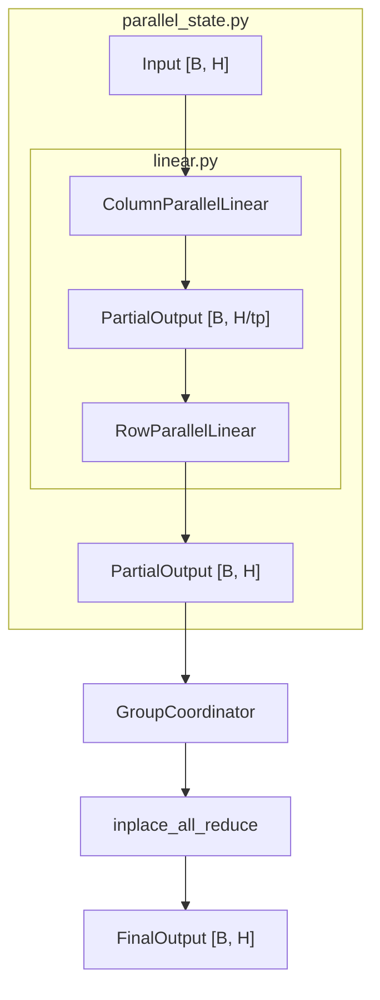
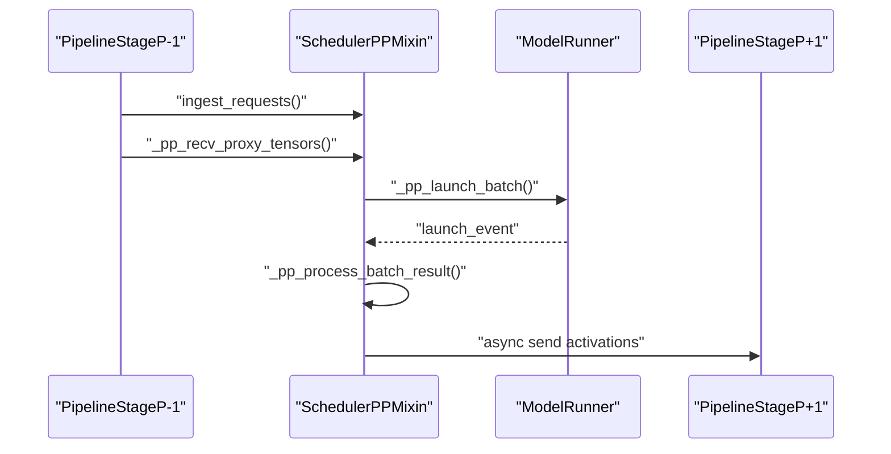
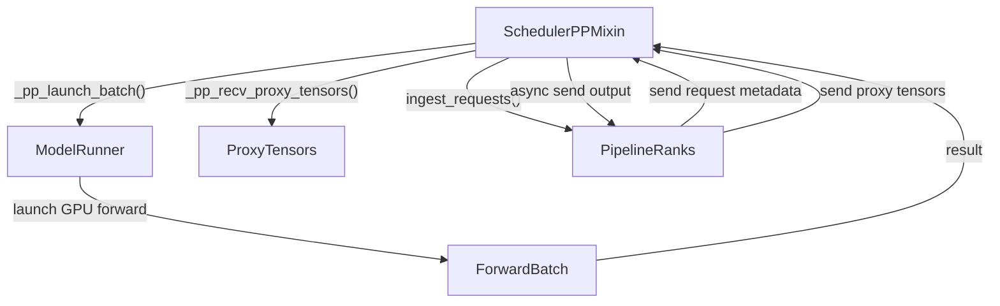

<!-- source: DeepWiki mcp.deepwiki.com · repo sgl-project/sglang · page 6.1 Tensor and Pipeline Parallelism · fetched 2026-10-30 -->

# Tensor and Pipeline Parallelism

Relevant source files

The following files were used as context for generating this wiki page:

- [benchmark/kernels/all_reduce/benchmark_all_reduce.py](benchmark/kernels/all_reduce/benchmark_all_reduce.py)
- [benchmark/kernels/all_reduce/benchmark_fused_ar_rms_amd.py](benchmark/kernels/all_reduce/benchmark_fused_ar_rms_amd.py)
- [benchmark/kernels/all_reduce/benchmark_fused_ar_rms_quant_amd.py](benchmark/kernels/all_reduce/benchmark_fused_ar_rms_quant_amd.py)
- [benchmark/kernels/fused_moe_triton/benchmark_vllm_vs_sglang_fused_moe_triton.py](benchmark/kernels/fused_moe_triton/benchmark_vllm_vs_sglang_fused_moe_triton.py)
- [docs/docs/references/environment_variables.mdx](docs/docs/references/environment_variables.mdx)
- [examples/usage/modelopt_quantize_and_export.py](examples/usage/modelopt_quantize_and_export.py)
- [python/sglang/benchmark/one_batch.py](python/sglang/benchmark/one_batch.py)
- [python/sglang/srt/arg_groups/attention_hook.py](python/sglang/srt/arg_groups/attention_hook.py)
- [python/sglang/srt/arg_groups/overrides.py](python/sglang/srt/arg_groups/overrides.py)
- [python/sglang/srt/arg_groups/pd_disaggregation_hook.py](python/sglang/srt/arg_groups/pd_disaggregation_hook.py)
- [python/sglang/srt/disaggregation/role_switch.py](python/sglang/srt/disaggregation/role_switch.py)
- [python/sglang/srt/distributed/bootstrap.py](python/sglang/srt/distributed/bootstrap.py)
- [python/sglang/srt/distributed/communication_op.py](python/sglang/srt/distributed/communication_op.py)
- [python/sglang/srt/distributed/parallel_state.py](python/sglang/srt/distributed/parallel_state.py)
- [python/sglang/srt/environ.py](python/sglang/srt/environ.py)
- [python/sglang/srt/hardware_backend/mlx/kv_cache/auxiliary_state.py](python/sglang/srt/hardware_backend/mlx/kv_cache/auxiliary_state.py)
- [python/sglang/srt/hardware_backend/mlx/model_runner_stub.py](python/sglang/srt/hardware_backend/mlx/model_runner_stub.py)
- [python/sglang/srt/hardware_backend/mlx/scheduler_mixin.py](python/sglang/srt/hardware_backend/mlx/scheduler_mixin.py)
- [python/sglang/srt/layers/dp_attention.py](python/sglang/srt/layers/dp_attention.py)
- [python/sglang/srt/managers/schedule_batch.py](python/sglang/srt/managers/schedule_batch.py)
- [python/sglang/srt/managers/scheduler.py](python/sglang/srt/managers/scheduler.py)
- [python/sglang/srt/managers/scheduler_components/request_receiver.py](python/sglang/srt/managers/scheduler_components/request_receiver.py)
- [python/sglang/srt/managers/scheduler_pp_mixin.py](python/sglang/srt/managers/scheduler_pp_mixin.py)
- [python/sglang/srt/mem_cache/common.py](python/sglang/srt/mem_cache/common.py)
- [python/sglang/srt/model_executor/model_runner.py](python/sglang/srt/model_executor/model_runner.py)
- [python/sglang/srt/multiplex/multiplexing_mixin.py](python/sglang/srt/multiplex/multiplexing_mixin.py)
- [python/sglang/srt/runtime_context.py](python/sglang/srt/runtime_context.py)
- [python/sglang/srt/server_args.py](python/sglang/srt/server_args.py)
- [test/manual/test_forward_split_prefill.py](test/manual/test_forward_split_prefill.py)
- [test/manual/test_vlm_accuracy.py](test/manual/test_vlm_accuracy.py)
- [test/registered/ops/test_aiter_allreduce_fusion_amd.py](test/registered/ops/test_aiter_allreduce_fusion_amd.py)
- [test/registered/unit/disaggregation/test_pd_role_switch.py](test/registered/unit/disaggregation/test_pd_role_switch.py)
- [test/registered/unit/distributed/test_attn_cp_tp_broadcast.py](test/registered/unit/distributed/test_attn_cp_tp_broadcast.py)
- [test/registered/unit/hardware_backend/mlx/test_attention_patching.py](test/registered/unit/hardware_backend/mlx/test_attention_patching.py)
- [test/registered/unit/hardware_backend/mlx/test_max_running_requests.py](test/registered/unit/hardware_backend/mlx/test_max_running_requests.py)
- [test/registered/unit/hardware_backend/mlx/test_mlx_runner_pool_contract.py](test/registered/unit/hardware_backend/mlx/test_mlx_runner_pool_contract.py)
- [test/registered/unit/hardware_backend/mlx/test_scheduler_mixin.py](test/registered/unit/hardware_backend/mlx/test_scheduler_mixin.py)
- [test/registered/unit/managers/test_mamba_checkpoint_depth.py](test/registered/unit/managers/test_mamba_checkpoint_depth.py)
- [test/registered/unit/managers/test_mm_shm_error_consensus.py](test/registered/unit/managers/test_mm_shm_error_consensus.py)
- [test/registered/unit/managers/test_pp_cp_rank_offsets.py](test/registered/unit/managers/test_pp_cp_rank_offsets.py)
- [test/registered/unit/server_args/test_server_args.py](test/registered/unit/server_args/test_server_args.py)
- [test/registered/unit/test_model_overrides.py](test/registered/unit/test_model_overrides.py)
- [test/registered/unit/test_runtime_context.py](test/registered/unit/test_runtime_context.py)

This document explains SGLang's implementation of **Tensor Parallelism (TP)** and **Pipeline Parallelism (PP)** for distributing model execution across multiple GPUs. These parallelism strategies enable serving large language models that exceed single-GPU memory capacity while improving throughput through parallel computation.

**Scope:** This page covers TP, including weight sharding and collective communication, and PP, including asynchronous pipeline scheduling and communication. For **Expert Parallelism** used in MoE models, see [6.2](). For **Data Parallelism** and batch splitting, see [6.3]().

---

## Tensor Parallelism Overview

**Tensor Parallelism (TP)** partitions model weights across multiple GPUs within the same layer. Each GPU holds a shard of the weight matrices and processes the same input tokens in parallel.

### Weight Sharding Strategy

SGLang implements Megatron-style weight partitioning in linear layers, enabling model scaling beyond single GPU memory. Two main sharding patterns are used:

| Layer Type | Sharding Dimension | Output Behavior | Communication |
| :-------------------- | :------------------------- | :--------------------------------------- | :------------------------- |
| `ColumnParallelLinear` | Output dimension (columns) | Each rank computes a shard of the output activations | Can require AllReduce or Gather to combine outputs |
| `RowParallelLinear` | Input dimension (rows) | Each rank processes input shards; output remains replicated or partly reduced | Optional AllReduce to aggregate partial results |

These approaches allow splitting large matrices and parallelizing matmuls across devices efficiently.

Sources:
- [python/sglang/srt/layers/linear.py:1-100]()

### Communication Mechanisms: NCCL and GroupCoordinator

Communication primitives essential for TP are implemented in `parallel_state.py`. Core concepts include:

- **`GroupCoordinator`**: An abstraction managing distributed process groups and communication operations such as `AllReduce`, `AllGather`, and `ReduceScatter`. It tracks communication backends and supports hardware platforms like CUDA, ROCm, and NPU [python/sglang/srt/distributed/parallel_state.py:176-190]().

- **AllReduce Implementations**:
  - `inplace_all_reduce(tensor, group_name)` performs an in-place all-reduce using the `GroupCoordinator` instance, leveraging NCCL or custom all-reduce methods according to platform and config [python/sglang/srt/distributed/parallel_state.py:183-190]().
  - `outplace_all_reduce(tensor, group_name, outplace_all_reduce_method)` supports out-of-place all-reduce with variable methods [python/sglang/srt/distributed/parallel_state.py:193-197]().

- **AllGather and ReduceScatter** collective operations are wrapped similarly to support tensor communication.

- **NPU (Ascend) Support**: `get_torch_distributed_pg_options` creates HCCL options for process groups, enabling buffer size tuning on Ascend NPUs [python/sglang/srt/distributed/parallel_state.py:103-118]().

- Custom all-reduce handlers support symmetric memory and alternative communication paths beyond NCCL.

Sources:
- [python/sglang/srt/distributed/parallel_state.py:103-118]()
- [python/sglang/srt/distributed/parallel_state.py:176-197]()

### Fused Communication and Kernel Execution

SGLang supports fusion of AllReduce communication with kernel computations to reduce overhead and latency:

- **FlashInfer AllReduce Fusion**: For CUDA platforms supporting FlashInfer, AllReduce can be fused with residual addition and normalization operations during the forward pass, reducing kernel launches and improving performance [python/sglang/srt/layers/communicator.py:191-196]().

- **Aiter AllReduce Fusion**: For AMD ROCm platforms, selective fusion of AllReduce with kernel launches optimizes throughput when specific conditions are met [python/sglang/srt/layers/communicator.py:99-110]().

This dynamic fusion behavior is enabled and configured based on hardware, backend selection, and environment flags.

Sources:
- [python/sglang/srt/layers/communicator.py:99-196]()

### Tensor Parallelism Data Flow and Code Entities

The execution and communication flow of Tensor Parallelism involves processing input tensors on partitioned weight shards, followed by collective communication to combine partial results:

Title: Tensor Parallelism Execution and Communication Data Flow

Here the communication uses the `GroupCoordinator` abstraction which internally manages the NCCL or custom all-reduce operations for synchronization of shard outputs.

Sources:
- [python/sglang/srt/distributed/parallel_state.py:103-118]()
- [python/sglang/srt/distributed/parallel_state.py:176-197]()
- [python/sglang/srt/layers/communicator.py:99-196]()

---

## Pipeline Parallelism Overview

**Pipeline Parallelism (PP)** partitions the model’s layers across multiple GPU stages. Each stage holds a subset of layers, allowing the model to fit across multiple GPUs. Layer executions for requests are pipelined across stages using micro-batches, increasing throughput.

### Pipeline Scheduler (`SchedulerPPMixin`)

The pipeline scheduler is implemented as the `SchedulerPPMixin` class in `scheduler_pp_mixin.py`. It works within the scheduler to manage pipeline stage coordination asynchronously.

**Key Functions and Workflow:**

- **`event_loop_pp`**: The core asynchronous loop that manages the pipeline scheduling by receiving micro-batches, launching forwards, and sending outputs downstream [python/sglang/srt/managers/scheduler_pp_mixin.py:100-161]().

- **`_pp_can_skip_output_comm`**: Determines if output communication (send/recv) can be skipped based on batch type, such as for pure chunked outputs [python/sglang/srt/managers/scheduler_pp_mixin.py:46-55]().

- **`_pp_exchange_outputs_before_forward`**: Decides whether to perform output exchanges before launching the forward pass, supporting synchronization and tensor placement [python/sglang/srt/managers/scheduler_pp_mixin.py:58-71]().

- **`PPBatchMetadata`**: A dataclass holding snapshot information of pipeline micro-batches and auxiliary cache references relevant to pipeline scheduling [python/sglang/srt/managers/scheduler_pp_mixin.py:74-84]().

The scheduler interacts with pipeline ranks over the `pp_group` process group, managing proxy tensors transmit/receive and coordinating forward batch lifecycle.

Sources:
- [python/sglang/srt/managers/scheduler_pp_mixin.py:46-84]()
- [python/sglang/srt/managers/scheduler_pp_mixin.py:100-161]()

### Pipeline Scheduling Sequence

The microbatch lifecycle in pipeline scheduling includes ingestion, receiving input tensors, GPU forward execution, and asynchronous sending of outputs to the next pipeline stage.

Title: Pipeline Scheduling Sequence and Microbatch Lifecycle

Stages interact through metadata and proxy tensors on the communication group `pp_group`.

Sources:
- [python/sglang/srt/managers/scheduler_pp_mixin.py:100-161]()

### MLX-Specific Pipeline Overlap Scheduling

For MLX (Apple Silicon) backends, SGLang employs a specialized overlap scheduling mixin, `SchedulerMlxOverlapMixin`, to pipeline MLX forward passes. This mixin keeps two lazy graphs in flight on the GPU while the scheduler performs CPU-side bookkeeping on the older one [python/sglang/srt/hardware_backend/mlx/scheduler_mixin.py:1-14]().

**Key Aspects:**

- **`event_loop_overlap_mlx`**: The core loop for MLX overlap scheduling, maintaining `pending_curr` and `pending_next` lazy graphs to maximize GPU utilization [python/sglang/srt/hardware_backend/mlx/scheduler_mixin.py:123-154]().
- **`MlxPendingJob`**: A dataclass representing an unfinished MLX job, holding the `MlxLaunch` object, a snapshot of the `ScheduleBatch`, and the associated requests [python/sglang/srt/hardware_backend/mlx/scheduler_mixin.py:38-71]().
- **`MlxLaunch`**: Encapsulates a lazily launched MLX forward pass, including lazy tokens and pending prefill, extend, or decode operations [python/sglang/srt/hardware_backend/mlx/tp_worker.py:51-67]().
- **Chained Decodes**: MLX's dependency tracking allows chained decodes where step N+1's graph reads step N's lazy writes, enabling back-to-back execution without idle gaps [python/sglang/srt/hardware_backend/mlx/scheduler_mixin.py:123-154]().
- **Breaking the Chain**: The chain is broken for non-decode operations (e.g., prefill/extend), new requests in the waiting queue, or when a request finishes, requiring a fresh "schedule + launch" step [python/sglang/srt/hardware_backend/mlx/scheduler_mixin.py:123-154]().
- **`MlxModelRunnerStub`**: A lightweight `ModelRunner` stub for MLX that skips PyTorch weight loading and KV cache allocation, creating only the minimal bookkeeping pools needed by the scheduler [python/sglang/srt/hardware_backend/mlx/model_runner_stub.py:97-103](). The actual inference is routed through `MlxModelRunner` [python/sglang/srt/hardware_backend/mlx/tp_worker.py:77-78]().

Sources:
- [python/sglang/srt/hardware_backend/mlx/scheduler_mixin.py:1-14]()
- [python/sglang/srt/hardware_backend/mlx/scheduler_mixin.py:38-71]()
- [python/sglang/srt/hardware_backend/mlx/scheduler_mixin.py:123-154]()
- [python/sglang/srt/hardware_backend/mlx/model_runner_stub.py:97-103]()
- [python/sglang/srt/hardware_backend/mlx/tp_worker.py:51-67]()
- [python/sglang/srt/hardware_backend/mlx/tp_worker.py:77-78]()

---

## NCCL and Custom Communication Overview

SGLang integrates various communication technologies to optimize distributed execution considering hardware diversity and performance.

### NCCL Communication

- NCCL communicators are wrapped and managed explicitly via `GroupCoordinator`. Each communication group has its own NCCL communicator per device, dynamically resolving streams for synchronization.

- The communication backend transparently supports CUDA NCCL, ROCm equivalents, and Ascend HCCL on NPUs.

### Custom All-Reduce

- To support alternative memory layouts or environments with shared symmetric memory, SGLang provides custom all-reduce implementations such as `CustomAllreduce` and `CustomAllReduceV2`.

- These custom paths are used selectively depending on environment variables, hardware constraints, and workload characteristics [python/sglang/srt/distributed/parallel_state.py:176-197]().

### Fusion and Backend Selection

- Communication fusion for all-reduce (e.g., FlashInfer fusion or Aiter fusion) is dynamically applied based on hardware capability and configured backends.

- The flags to activate fusions (`apply_flashinfer_allreduce_fusion`, `apply_aiter_all_reduce_fusion`) are evaluated within the communication layer [python/sglang/srt/layers/communicator.py:99-196]().

Sources:
- [python/sglang/srt/distributed/parallel_state.py:176-197]()
- [python/sglang/srt/layers/communicator.py:99-196]()

---

## Scheduler PP Mixin Code Entities and Data Flow

The pipeline scheduling subsystem coordinates the lifecycle of micro-batches traversing distributed pipeline stages.

Title: Scheduler PP Mixin Code Entities and Data Flow

This dataflow illustrates how:

- Pipeline ranks exchange control metadata and proxy tensor data with the scheduler mixin.
- The scheduler launches model execution asynchronously via `ModelRunner`, which returns batched results.
- Output tensors are sent asynchronously to the next pipeline stage.

Sources:
- [python/sglang/srt/managers/scheduler_pp_mixin.py:85-161]()
- [python/sglang/srt/distributed/parallel_state.py:176-197]()

---

## Summary

This page described SGLang's implementation and orchestration of Tensor and Pipeline Parallelism:

- **Tensor Parallelism** partitions weight matrices and performs collective communication for shard results using NCCL or custom backends managed by `GroupCoordinator` [python/sglang/srt/distributed/parallel_state.py:176-197]().
- **Pipeline Parallelism** asynchronously schedules micro-batches across pipeline stages using `SchedulerPPMixin`, exchanging hidden states and metadata through proxy tensors [python/sglang/srt/managers/scheduler_pp_mixin.py:46-161]().
- For MLX backends, `SchedulerMlxOverlapMixin` provides specialized overlap scheduling to pipeline lazy MLX forward passes [python/sglang/srt/hardware_backend/mlx/scheduler_mixin.py:1-14]().
- Communication fusion and backend selection dynamically optimize tensor synchronization overhead on different platforms [python/sglang/srt/layers/communicator.py:99-196]().
- Code entity diagrams map key components like layers, communication primitives, and scheduler mixin classes to their respective source modules for navigability.

These parallelization features allow SGLang to efficiently serve large language models scaled across multiple GPUs per node and across nodes.

---

Sources:
- [python/sglang/srt/layers/linear.py:1-100]()
- [python/sglang/srt/distributed/parallel_state.py:103-118]()
- [python/sglang/srt/distributed/parallel_state.py:176-197]()
- [python/sglang/srt/layers/communicator.py:99-196]()
- [python/sglang/srt/managers/scheduler_pp_mixin.py:46-84]()
- [python/sglang/srt/managers/scheduler_pp_mixin.py:100-161]()
- [python/sglang/srt/managers/scheduler_pp_mixin.py:85-161]()
- [python/sglang/srt/hardware_backend/mlx/scheduler_mixin.py:1-14]()
- [python/sglang/srt/hardware_backend/mlx/scheduler_mixin.py:38-71]()
- [python/sglang/srt/hardware_backend/mlx/scheduler_mixin.py:123-154]()
- [python/sglang/srt/hardware_backend/mlx/model_runner_stub.py:97-103]()
- [python/sglang/srt/hardware_backend/mlx/tp_worker.py:51-67]()
- [python/sglang/srt/hardware_backend/mlx/tp_worker.py:77-78]()

---

