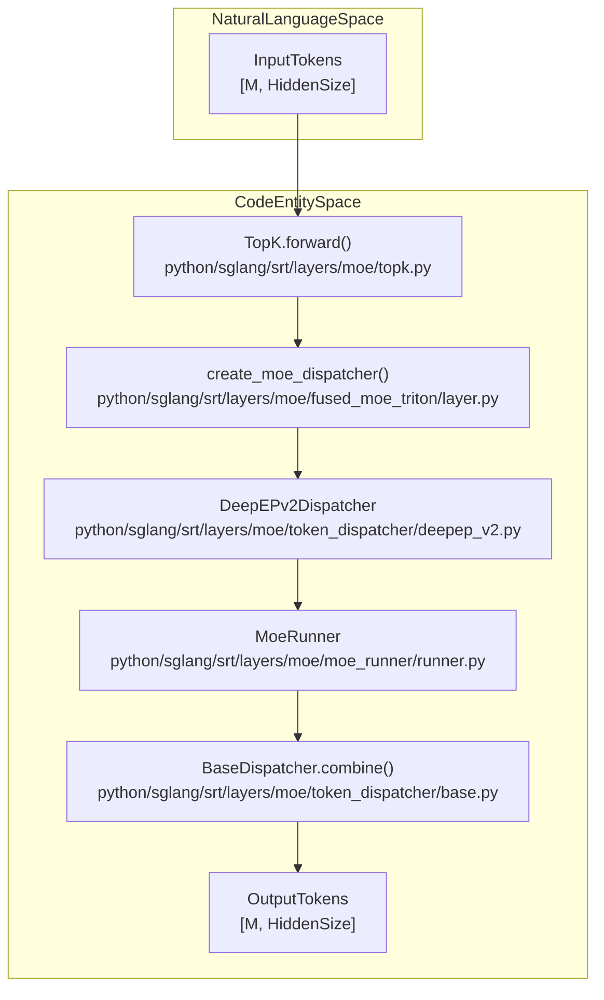
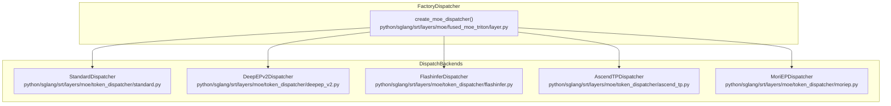

<!-- source: DeepWiki mcp.deepwiki.com · repo sgl-project/sglang · page 6.2 Expert Parallelism for MoE Models · fetched 2026-10-30 -->

# Expert Parallelism for MoE Models

Relevant source files

The following files were used as context for generating this wiki page:

- [python/sglang/kernels/jit/csrc/elementwise/activation.cuh](python/sglang/kernels/jit/csrc/elementwise/activation.cuh)
- [python/sglang/kernels/ops/activation/activation.py](python/sglang/kernels/ops/activation/activation.py)
- [python/sglang/kernels/ops/activation/minimax_m3_swiglu.py](python/sglang/kernels/ops/activation/minimax_m3_swiglu.py)
- [python/sglang/kernels/ops/gemm/smallm_fp8_gfx950/__init__.py](python/sglang/kernels/ops/gemm/smallm_fp8_gfx950/__init__.py)
- [python/sglang/kernels/ops/gemm/smallm_fp8_gfx950/smallm_fp8_gemm.hip](python/sglang/kernels/ops/gemm/smallm_fp8_gfx950/smallm_fp8_gemm.hip)
- [python/sglang/kernels/ops/moe/deepep_waterfill_kernels.py](python/sglang/kernels/ops/moe/deepep_waterfill_kernels.py)
- [python/sglang/kernels/ops/moe/fill_padded_rows.py](python/sglang/kernels/ops/moe/fill_padded_rows.py)
- [python/sglang/kernels/ops/moe/moe_sorting_small.py](python/sglang/kernels/ops/moe/moe_sorting_small.py)
- [python/sglang/kernels/ops/moe/mxfp8_moe_amd_gfx95.py](python/sglang/kernels/ops/moe/mxfp8_moe_amd_gfx95.py)
- [python/sglang/kernels/ops/moe/smallm_moe_gfx950/__init__.py](python/sglang/kernels/ops/moe/smallm_moe_gfx950/__init__.py)
- [python/sglang/kernels/ops/moe/smallm_moe_gfx950/smallm_moe.hip](python/sglang/kernels/ops/moe/smallm_moe_gfx950/smallm_moe.hip)
- [python/sglang/multimodal_gen/test/unit/test_ernie_rope_geglu_fusion.py](python/sglang/multimodal_gen/test/unit/test_ernie_rope_geglu_fusion.py)
- [python/sglang/srt/layers/moe/cutlass_moe.py](python/sglang/srt/layers/moe/cutlass_moe.py)
- [python/sglang/srt/layers/moe/cutlass_w4a8_moe.py](python/sglang/srt/layers/moe/cutlass_w4a8_moe.py)
- [python/sglang/srt/layers/moe/fused_moe_triton/fused_marlin_moe.py](python/sglang/srt/layers/moe/fused_moe_triton/fused_marlin_moe.py)
- [python/sglang/srt/layers/moe/moe_runner/aiter.py](python/sglang/srt/layers/moe/moe_runner/aiter.py)
- [python/sglang/srt/layers/moe/moe_runner/marlin.py](python/sglang/srt/layers/moe/moe_runner/marlin.py)
- [python/sglang/srt/layers/moe/token_dispatcher/deepep.py](python/sglang/srt/layers/moe/token_dispatcher/deepep.py)
- [python/sglang/srt/layers/moe/token_dispatcher/moriep.py](python/sglang/srt/layers/moe/token_dispatcher/moriep.py)
- [python/sglang/srt/layers/quantization/gguf.py](python/sglang/srt/layers/quantization/gguf.py)
- [python/sglang/srt/layers/quantization/marlin_utils.py](python/sglang/srt/layers/quantization/marlin_utils.py)
- [python/sglang/srt/layers/quantization/marlin_utils_fp4.py](python/sglang/srt/layers/quantization/marlin_utils_fp4.py)
- [python/sglang/srt/layers/quantization/mxfp4_marlin_moe.py](python/sglang/srt/layers/quantization/mxfp4_marlin_moe.py)
- [python/sglang/srt/layers/quantization/quark/schemes/quark_w8a8_fp8.py](python/sglang/srt/layers/quantization/quark/schemes/quark_w8a8_fp8.py)
- [python/sglang/srt/layers/quantization/w4afp8.py](python/sglang/srt/layers/quantization/w4afp8.py)
- [test/registered/amd/test_moe_sorting_small.py](test/registered/amd/test_moe_sorting_small.py)
- [test/registered/amd/test_smallm_fp8_proj_gfx950.py](test/registered/amd/test_smallm_fp8_proj_gfx950.py)
- [test/registered/amd/test_smallm_moe_gfx950.py](test/registered/amd/test_smallm_moe_gfx950.py)
- [test/registered/kernels/benchmark/moe/bench_fp8_per_token_to_per_tensor_quant.py](test/registered/kernels/benchmark/moe/bench_fp8_per_token_to_per_tensor_quant.py)
- [test/registered/kernels/ops/activation/test_activation.py](test/registered/kernels/ops/activation/test_activation.py)
- [test/registered/kernels/ops/moe/test_fp8_per_token_to_per_tensor_quant.py](test/registered/kernels/ops/moe/test_fp8_per_token_to_per_tensor_quant.py)
- [test/registered/kernels/ops/moe/test_marlin_moe.py](test/registered/kernels/ops/moe/test_marlin_moe.py)
- [test/registered/kernels/ops/moe/test_moe_tma_down_padding_rows.py](test/registered/kernels/ops/moe/test_moe_tma_down_padding_rows.py)
- [test/registered/unit/layers/moe/test_deepep_import_guard.py](test/registered/unit/layers/moe/test_deepep_import_guard.py)
- [test/registered/unit/layers/moe/test_w4afp8_deepep_dtype.py](test/registered/unit/layers/moe/test_w4afp8_deepep_dtype.py)
- [test/registered/unit/layers/moe/test_w4afp8_deepep_post_reorder.py](test/registered/unit/layers/moe/test_w4afp8_deepep_post_reorder.py)
- [test/registered/unit/layers/quantization/test_quark_w8a8_fp8_ptpc.py](test/registered/unit/layers/quantization/test_quark_w8a8_fp8_ptpc.py)

This page documents the Expert Parallelism (EP) implementation in SGLang for Mixture-of-Experts (MoE) models. It covers token dispatch backends (`DeepEP`, `Mooncake`, `NIXL`, and `MORI`), all-to-all communication mechanisms, expert load balancing (EPLB), and the Elastic EP system for dynamic cluster scaling.

---

## 1. Architecture Overview and Data Flow

Expert Parallelism partitions a model's expert weights across multiple devices. Input tokens are routed dynamically to the ranks owning the corresponding target experts. The dataflow of EP in SGLang proceeds through four core stages:

1.  **TopK Routing**: Computes gating scores and extracts top-$K$ expert indices per token via the routing mechanisms defined in `python/sglang/srt/layers/moe/topk.py` [python/sglang/srt/layers/moe/topk.py]().
2.  **Token Dispatch**: Packs and dispatches tokens across devices using all-to-all communication. Dispatchers are instantiated dynamically through `create_moe_dispatcher()` in `python/sglang/srt/layers/moe/fused_moe_triton/layer.py` [python/sglang/srt/layers/moe/fused_moe_triton/layer.py:163-189]().
3.  **Expert Compute**: Each rank executes its assigned local experts using MoE runner cores optimized for specific hardware and quantization formats. The central dispatcher/runner coordinator is managed via `MoeRunner` in `python/sglang/srt/layers/moe/moe_runner/runner.py` [python/sglang/srt/layers/moe/moe_runner/runner.py:53-110]().
4.  **Combine Outputs**: Combines expert outputs weighted by their routing scores, reordering them back to the original token sequence using kernel routines like `deepep_post_reorder_triton_kernel` in `python/sglang/kernels/ops/moe/ep_moe_kernels.py` [python/sglang/kernels/ops/moe/ep_moe_kernels.py:111-144]().

The following diagram bridges natural language concepts to concrete code entities in the codebase:

Sources:
- [python/sglang/srt/layers/moe/topk.py]()
- [python/sglang/srt/layers/moe/fused_moe_triton/layer.py:163-189]()
- [python/sglang/srt/layers/moe/moe_runner/runner.py:53-110]()
- [python/sglang/kernels/ops/moe/ep_moe_kernels.py:111-144]()

---

## 2. Token Dispatch Backends

SGLang supports multiple token dispatch backends for managing all-to-all communication. The enum class `MoeA2ABackend` in `python/sglang/srt/layers/moe/utils.py` lists available backends including `NONE`, `DEEPEP`, `MOONCAKE`, `NIXL`, `MORI`, `FLASHINFER`, and `DEEPEP_V2` [python/sglang/srt/layers/moe/utils.py:35-48]().

The factory function `create_moe_dispatcher()` (in `python/sglang/srt/layers/moe/fused_moe_triton/layer.py`) checks `get_moe_a2a_backend()` to instantiate the corresponding dispatcher class [python/sglang/srt/layers/moe/fused_moe_triton/layer.py:169-188]().

### Description of Major Dispatchers

-   **StandardDispatcher**: Handles local routing without cross-node all-to-all operations; used for single-node setups or pipeline fallbacks [python/sglang/srt/layers/moe/fused_moe_triton/layer.py:168-183]().
-   **DeepEPv2Dispatcher / MaybeTboDeepEPDispatcher**: Manages DeepEP v1 and v2 token dispatch. It utilizes communication buffers (`DeepEPBuffer`) and overlaps all-to-all communication with execution via Two-Batch Overlap [python/sglang/srt/layers/moe/token_dispatcher/deepep_v2.py:1-10](). The hook class `DeepEPPDispatchHooks` [python/sglang/srt/layers/moe/token_dispatcher/deepep.py:110-114]() supports custom dispatch extensions.
-   **FlashinferDispatcher**: Uses FlashInfer primitives and workspace buffers for asynchronous all-to-all dispatch and fusion [python/sglang/srt/layers/moe/token_dispatcher/flashinfer.py:41-45]().
-   **AscendTPDispatcher**: Specialized dispatcher routing tokens on Huawei Ascend NPU architectures [python/sglang/srt/layers/moe/fused_moe_triton/layer.py:170-171]().
-   **MoriEPDispatcher**: Implements MORI (MoE Optimized Routing Interface) dispatch tailored for low-latency paths and quantization formats such as MXFP8 [python/sglang/srt/layers/moe/token_dispatcher/moriep.py:163-192](). It uses `MoriEPPDispatchHooks` [python/sglang/srt/layers/moe/token_dispatcher/moriep.py:163-167]() for hook customization.

Sources:
- [python/sglang/srt/layers/moe/utils.py:35-48]()
- [python/sglang/srt/layers/moe/fused_moe_triton/layer.py:163-189]()
- [python/sglang/srt/layers/moe/token_dispatcher/deepep_v2.py:1-10]()
- [python/sglang/srt/layers/moe/token_dispatcher/deepep.py:110-114]()
- [python/sglang/srt/layers/moe/token_dispatcher/moriep.py:163-192]()
- [python/sglang/srt/layers/moe/token_dispatcher/moriep.py:163-167]()

---

## 3. All-to-All Communication and Two-Batch Overlap (TBO)

Token dispatch transmits token vectors across ranks based on expert assignments. To hide communication latency, SGLang employs:

-   **Two-Batch Overlap (TBO)**: Overlaps all-to-all communication for batch $N+1$ with the expert computations of batch $N$. Managed via `MaybeTboDeepEPDispatcher` in `python/sglang/srt/batch_overlap/two_batch_overlap.py` [python/sglang/srt/batch_overlap/two_batch_overlap.py]() and queried through `is_tbo_enabled()` in `python/sglang/srt/layers/moe/utils.py:100-102` [python/sglang/srt/layers/moe/utils.py:100-102]().
-   **Buffer Management**: Process-wide buffers are managed by `DeepEPBuffer` to avoid repeated device re-allocations [python/sglang/srt/layers/moe/token_dispatcher/deepep_v2.py:1-10]().
-   **MORI All-to-All**: Relies on `mori.ops.dispatch_combine_v2` for intranode/internode routing with logical receive row bounds and FP8 cast saturation guards [python/sglang/srt/layers/moe/token_dispatcher/moriep.py:62-70](), [python/sglang/srt/layers/moe/token_dispatcher/moriep.py:153-161]().

Sources:
- [python/sglang/srt/batch_overlap/two_batch_overlap.py]()
- [python/sglang/srt/layers/moe/utils.py:100-102]()
- [python/sglang/srt/layers/moe/token_dispatcher/moriep.py:62-70]()
- [python/sglang/srt/layers/moe/token_dispatcher/moriep.py:153-161]()
- [python/sglang/srt/layers/moe/token_dispatcher/deepep_v2.py:1-10]()

---

## 4. Expert Computation and Runner Backends

After token dispatch, each EP rank executes local experts via backend-specific runner cores managed by `MoeRunner` in `python/sglang/srt/layers/moe/moe_runner/runner.py:53-110` [python/sglang/srt/layers/moe/moe_runner/runner.py:53-110](). Supported runner cores include:

-   **DeepGemmRunnerCore**: Executes grouped GEMM kernels for FP8 blockwise, BF16, and unquantized expert computations via `python/sglang/srt/layers/moe/moe_runner/deep_gemm.py:1-40` [python/sglang/srt/layers/moe/moe_runner/deep_gemm.py:1-40](). It handles masked standard layout memory budgeting [python/sglang/srt/layers/moe/moe_runner/deep_gemm.py:116-128]() and activation fallbacks [python/sglang/srt/layers/moe/moe_runner/deep_gemm.py:173-189]().
-   **AiterRunnerCore**: Leverages Aiter's `fused_moe` kernel for AMD HIP platforms, supporting quantization types like `AiterQuantType.PER_TOKEN` and activation clamping (SwiGLU-OAI) [python/sglang/srt/layers/moe/moe_runner/aiter.py:118-131](), [python/sglang/srt/layers/moe/moe_runner/aiter.py:167-210]().
-   **FlashInferTrtllmRunnerCore**: Uses FlashInfer and TensorRT-LLM kernels with deferred output finalization [python/sglang/srt/layers/moe/moe_runner/flashinfer_trtllm.py:73-133]() and MXFP8 shuffle index caching [python/sglang/srt/layers/moe/moe_runner/flashinfer_trtllm.py:157-161]().

Sources:
- [python/sglang/srt/layers/moe/moe_runner/runner.py:53-110]()
- [python/sglang/srt/layers/moe/moe_runner/deep_gemm.py:1-40]()
- [python/sglang/srt/layers/moe/moe_runner/deep_gemm.py:116-128]()
- [python/sglang/srt/layers/moe/moe_runner/deep_gemm.py:173-189]()
- [python/sglang/srt/layers/moe/moe_runner/aiter.py:118-131]()
- [python/sglang/srt/layers/moe/moe_runner/aiter.py:167-210]()
- [python/sglang/srt/layers/moe/moe_runner/flashinfer_trtllm.py:73-133]()
- [python/sglang/srt/layers/moe/moe_runner/flashinfer_trtllm.py:157-161]()

---

## 5. Expert Load Balancing (EPLB)

Imbalance in MoE routing leads to skewed workloads across ranks. SGLang addresses this via the **Expert Parallel Load Balancer (EPLB)**:

-   **Global Expert Distribution Recording**: Tracks token counts per expert across ranks using `ExpertDistributionRecorder` in `python/sglang/srt/eplb/expert_distribution.py:135-151` [python/sglang/srt/eplb/expert_distribution.py:135-151]().
-   **Expert Location Remapping**: Dynamically remaps logical experts to physical ranks without restarting the model, utilizing metadata helpers from `python/sglang/srt/eplb/expert_location.py` [python/sglang/srt/eplb/expert_location.py]() and `python/sglang/srt/eplb/eplb_manager.py` [python/sglang/srt/eplb/eplb_manager.py]().

Sources:
- [python/sglang/srt/eplb/expert_distribution.py:135-151]()
- [python/sglang/srt/eplb/expert_location.py]()
- [python/sglang/srt/eplb/eplb_manager.py]()
- [python/sglang/srt/layers/moe/token_dispatcher/moriep.py:107-117]()

---

## 6. Elastic Expert Parallelism

Elastic EP enables dynamic scaling of the expert parallel group at runtime without dropping active requests:

-   **Scale Cohort**: Defined by `ScaleCohort` in `python/sglang/srt/elastic_ep/elastic_ep.py:30-36` [python/sglang/srt/elastic_ep/elastic_ep.py:30-36](). Registration and discovery are handled via `register_scale_cohort` [python/sglang/srt/elastic_ep/elastic_ep.py:38-53]() and `get_scale_cohort` [python/sglang/srt/elastic_ep/elastic_ep.py:55-63]() using a global TCP store.
-   **Dynamic DP-Attention Updates**: Updates data-parallel attention parameters (`attn_dp_size`, `attn_dp_rank`) upon topology transitions [python/sglang/srt/elastic_ep/elastic_ep.py:77-95]().
-   **Expert Backup and Migration**: Handled via `ExpertBackupManager` and `ExpertBackupClient` for weight replication across nodes [python/sglang/srt/elastic_ep/expert_backup_manager.py](), [python/sglang/srt/elastic_ep/expert_backup_client.py]().
-   **State Management**: Managed by `ElasticEPStateManager` in `python/sglang/srt/elastic_ep/elastic_ep.py:132-197` [python/sglang/srt/elastic_ep/elastic_ep.py:132-197]().

Sources:
- [python/sglang/srt/elastic_ep/expert_backup_manager.py]()
- [python/sglang/srt/elastic_ep/expert_backup_client.py]()
- [python/sglang/srt/elastic_ep/elastic_ep.py:30-36]()
- [python/sglang/srt/elastic_ep/elastic_ep.py:38-53]()
- [python/sglang/srt/elastic_ep/elastic_ep.py:55-63]()
- [python/sglang/srt/elastic_ep/elastic_ep.py:77-95]()
- [python/sglang/srt/elastic_ep/elastic_ep.py:132-197]()

---

