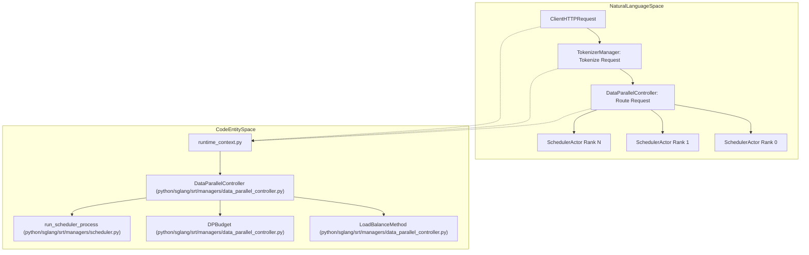
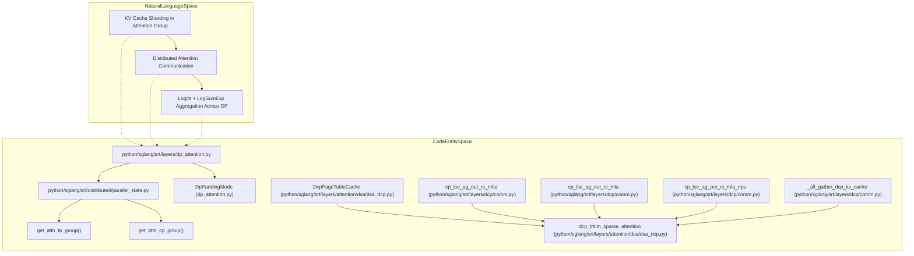

<!-- source: DeepWiki mcp.deepwiki.com · repo sgl-project/sglang · page 6.3 Data Parallelism and DP Attention · fetched 2026-10-30 -->

# Data Parallelism and DP Attention

Relevant source files

The following files were used as context for generating this wiki page:

- [docs/docs/advanced_features/hicache_design.mdx](docs/docs/advanced_features/hicache_design.mdx)
- [docs/docs/references/production_metrics.mdx](docs/docs/references/production_metrics.mdx)
- [python/sglang/srt/arg_groups/cp_tp_group_sharing_hook.py](python/sglang/srt/arg_groups/cp_tp_group_sharing_hook.py)
- [python/sglang/srt/entrypoints/http_server.py](python/sglang/srt/entrypoints/http_server.py)
- [python/sglang/srt/layers/attention/dsa/dsa_backend_mtp_precompute.py](python/sglang/srt/layers/attention/dsa/dsa_backend_mtp_precompute.py)
- [python/sglang/srt/layers/attention/dsa/dsa_indexer.py](python/sglang/srt/layers/attention/dsa/dsa_indexer.py)
- [python/sglang/srt/layers/attention/dsa/utils.py](python/sglang/srt/layers/attention/dsa/utils.py)
- [python/sglang/srt/layers/attention/dsa_backend.py](python/sglang/srt/layers/attention/dsa_backend.py)
- [python/sglang/srt/layers/cp/base.py](python/sglang/srt/layers/cp/base.py)
- [python/sglang/srt/layers/cp/bcg/interleave_bcg.py](python/sglang/srt/layers/cp/bcg/interleave_bcg.py)
- [python/sglang/srt/layers/cp/interleave.py](python/sglang/srt/layers/cp/interleave.py)
- [python/sglang/srt/layers/cp/padding.py](python/sglang/srt/layers/cp/padding.py)
- [python/sglang/srt/layers/cp/utils.py](python/sglang/srt/layers/cp/utils.py)
- [python/sglang/srt/layers/cp/zigzag.py](python/sglang/srt/layers/cp/zigzag.py)
- [python/sglang/srt/layers/moe/flashinfer_megamoe_autotune.py](python/sglang/srt/layers/moe/flashinfer_megamoe_autotune.py)
- [python/sglang/srt/layers/utils/cp_utils.py](python/sglang/srt/layers/utils/cp_utils.py)
- [python/sglang/srt/managers/data_parallel_controller.py](python/sglang/srt/managers/data_parallel_controller.py)
- [python/sglang/srt/managers/detokenizer_manager.py](python/sglang/srt/managers/detokenizer_manager.py)
- [python/sglang/srt/managers/io_struct.py](python/sglang/srt/managers/io_struct.py)
- [python/sglang/srt/managers/multi_tokenizer_mixin.py](python/sglang/srt/managers/multi_tokenizer_mixin.py)
- [python/sglang/srt/managers/tokenizer_control_mixin.py](python/sglang/srt/managers/tokenizer_control_mixin.py)
- [python/sglang/srt/managers/tokenizer_manager.py](python/sglang/srt/managers/tokenizer_manager.py)
- [python/sglang/srt/model_executor/runner/base_runner.py](python/sglang/srt/model_executor/runner/base_runner.py)
- [python/sglang/srt/model_executor/runner/eager_runner.py](python/sglang/srt/model_executor/runner/eager_runner.py)
- [python/sglang/srt/model_executor/runner/flashinfer_autotune.py](python/sglang/srt/model_executor/runner/flashinfer_autotune.py)
- [python/sglang/srt/models/deepseek_common/attention_forward_methods/forward_mla.py](python/sglang/srt/models/deepseek_common/attention_forward_methods/forward_mla.py)
- [python/sglang/srt/ray/data_parallel_controller.py](python/sglang/srt/ray/data_parallel_controller.py)
- [python/sglang/srt/ray/engine.py](python/sglang/srt/ray/engine.py)
- [test/registered/cp/test_cp_strategy_unit.py](test/registered/cp/test_cp_strategy_unit.py)
- [test/registered/cp/test_dsa_prefill_cp.py](test/registered/cp/test_dsa_prefill_cp.py)
- [test/registered/unit/entrypoints/test_server_info.py](test/registered/unit/entrypoints/test_server_info.py)
- [test/registered/unit/managers/test_data_parallel_controller.py](test/registered/unit/managers/test_data_parallel_controller.py)
- [test/registered/unit/managers/test_multi_tokenizer_mixin.py](test/registered/unit/managers/test_multi_tokenizer_mixin.py)
- [test/registered/unit/managers/test_tokenizer_manager_rid_cleanup.py](test/registered/unit/managers/test_tokenizer_manager_rid_cleanup.py)
- [test/registered/unit/model_executor/runner/test_flashinfer_autotune_sync.py](test/registered/unit/model_executor/runner/test_flashinfer_autotune_sync.py)

## Purpose and Scope

This page documents SGLang's **Data Parallelism (DP)**, **DP Attention**, and **Context/Decode Context Parallelism (CP/DCP)** infrastructure. These features provide horizontal scalability by distributing request load across independent scheduler instances and sharding memory-intensive attention computations across specialized process groups.

This documentation covers the implementation of the `DataParallelController`, load balancing strategies (`LoadBalanceMethod` and `DPBudget`), DP attention communication collectives (`dp_gather_width`, `dp_slot_in`), padding modes encapsulated in `DpPaddingMode`, and the integration of context parallelism (CP) and decode context parallelism (DCP) through strategies like `InterleaveCPStrategy` and `ZigzagCPStrategy`.

Sources: [python/sglang/srt/managers/data_parallel_controller.py:89-187](), [python/sglang/srt/layers/cp/base.py:38-201](), [python/sglang/srt/layers/cp/interleave.py:1-174]()

---

## Configuration Parameters and Width Derivation

Data parallelism, DP attention, and context parallelism are primarily configured via server arguments (`ServerArgs`) and resolved through runtime utilities. These define dimensionalities such as `dp_size`, `enable_dp_attention`, `attn_cp_size` (for CP), and `dcp_size` (for decode CP).

Key runtime functions orchestrate the parallelism dimensions and rank assignment:
- **`derive_attention_widths`**: Computes attention DP and TP sizes given the overall TP size and the presence of CP and DP attention [python/sglang/srt/runtime_context.py:73-79]().
- **`derive_attention_ranks`**: Computes process ranks for DP, CP, and TP, with the rank layout ordered as `(dp_rank, cp_rank, tp_rank)` for efficient sharding [python/sglang/srt/runtime_context.py:81-95]().
- **`parallel_widths_of`**: Fetches a tuple of widths for DP, TP, CP, DCP, and MoE parallelism derived from the resolved config view [python/sglang/srt/runtime_context.py:166-183]().

Sources: [python/sglang/srt/runtime_context.py:73-183]()

---

## Architecture Overview and DataParallelController

### Process Topology

When DP is enabled, SGLang instantiates multiple independent scheduler processes or Ray actors for scalability. The `TokenizerManager` distributes tokenized requests to these schedulers through a `DataParallelController` instance that manages routing and load balancing.

Each scheduler corresponds to a DP rank and coordinates model execution with its local TP and CP subgroups. DP partitions the incoming workload at the request level, reducing per-scheduler load and GPU memory footprint.

### Data Flow Diagram: Natural Language to Code Entity Mapping for DP Routing

Sources: [python/sglang/srt/managers/data_parallel_controller.py:89-187](), [python/sglang/srt/runtime_context.py:73-183]()

### Load Balancing Strategies

The `DataParallelController` supports multiple load balancing methods defined in `LoadBalanceMethod`:
- `ROUND_ROBIN`: Cycles through available DP ranks sequentially [python/sglang/srt/managers/data_parallel_controller.py:105-108]().
- `FOLLOW_BOOTSTRAP_ROOM`: Follows auxiliary bootstrap room availability [python/sglang/srt/managers/data_parallel_controller.py:109-110]().
- `TOTAL_REQUESTS`: Dispatches to the DP rank with the minimum total active and waiting requests using `DPBudget` [python/sglang/srt/managers/data_parallel_controller.py:110-140]().
- `TOTAL_TOKENS`: Balances load based on total running token counts with request count as a tie-breaker [python/sglang/srt/managers/data_parallel_controller.py:124-140]().

Sources: [python/sglang/srt/managers/data_parallel_controller.py:89-140]()

---

## DP Attention Optimization

### Conceptual Overview

Traditional DP requires each worker to hold a full KV cache, replicating memory linearly with the number of DP ranks. DP Attention introduces finer-grained sharding across an attention tensor parallel group that shards the KV cache along attention dimensions, reducing per-GPU memory linearly with DP size.

### DP Attention and DCP Topologies Diagram: Natural Language to Code Entity Mapping

Sources: [python/sglang/srt/layers/dp_attention.py:1-111](), [python/sglang/srt/distributed/parallel_state.py:9-24](), [python/sglang/srt/layers/attention/dsa/dsa_dcp.py:1-100](), [python/sglang/srt/layers/dcp/comm.py:45-181]()

---

## Padding Modes and Buffering in DP Attention

### DpPaddingMode

Due to variable sequence lengths across different DP ranks, effective communication requires padding strategy selection for shuffle and gather collectives. The `DpPaddingMode` supports two main modes:

| Mode | Description |
|---|---|
| `MAX_LEN` | Pad all sequences in the DP group to the maximum sequence length discovered among ranks. Required for symmetric memory and MoE all-to-all backends. |
| `SUM_LEN` | Pad sequences only to the sum of lengths across ranks (no wasted zero padding). Optimizes bandwidth when length distribution is uneven. |

Sources: [python/sglang/srt/layers/dp_attention.py:1-191]()

---

## Context Parallelism (CP) and Decode Context Parallelism (DCP)

### Overview

Context parallelism techniques permit splitting large request contexts and decoder computations by distributing KV caches and attention calculations across groups of ranks. Strategies include `InterleaveCPStrategy` ([python/sglang/srt/layers/cp/interleave.py]()) and `ZigzagCPStrategy` ([python/sglang/srt/layers/cp/zigzag.py]()), managed through the `ContextParallelStrategy` base class [python/sglang/srt/layers/cp/base.py:91-201]().

Runtime helpers like `is_cp_active` and `prepare_cp_forward` handle metadata creation and input sharding for active context-parallel forward passes [python/sglang/srt/layers/cp/utils.py:121-184]().

For DeepSeek Sparse Attention (DSA) models, specific CP optimizations are available. `is_dsa_enable_prefill_cp` checks if prefill CP is enabled for DSA, specifically for DeepSeek-V4 on HIP [python/sglang/srt/layers/attention/dsa/utils.py:83-116](). The `prepare_kv_for_attention` function in `dsa_backend.py` handles materializing KV data for attention, potentially deferring it or applying CP strategy-specific materialization [python/sglang/srt/layers/attention/dsa_backend.py:114-136]().

The `DcpPageTableCache` and `dcp_trtllm_sparse_attention` functions in `dsa_dcp.py` are specifically designed for Decode Context Parallelism (DCP) in DSA, localizing page tables and performing sparse attention across DCP ranks [python/sglang/srt/layers/attention/dsa/dsa_dcp.py:64-67]().

Communication primitives for DCP are defined in `python/sglang/srt/layers/dcp/comm.py`. These include:
- `cp_lse_ag_out_rs_mha`: Merges DCP partial attention outputs for MHA, performing an all-gather of LogSumExp (LSE) values and then a reduce-scatter of scaled outputs [python/sglang/srt/layers/dcp/comm.py:56-82]().
- `cp_lse_ag_out_rs_mla`: Merges DCP partial attention outputs for MLA, handling different LSE bases (natural log vs. base-2) and using a reduce-scatter for outputs [python/sglang/srt/layers/dcp/comm.py:85-123]().
- `cp_lse_ag_out_rs_mla_npu`: NPU-specific merge for DCP partial outputs in MLA, utilizing `torch_npu.npu_attention_update` [python/sglang/srt/layers/dcp/comm.py:126-159]().
- `_all_gather_dcp_kv_cache`: All-gathers DCP KV cache data, supporting FP8 dtypes by treating them as `uint8` views for byte copying [python/sglang/srt/layers/dcp/comm.py:161-181]().

Sources: [python/sglang/srt/layers/cp/base.py:91-201](), [python/sglang/srt/layers/cp/interleave.py:1-174](), [python/sglang/srt/layers/cp/utils.py:121-184](), [python/sglang/srt/layers/attention/dsa/utils.py:83-116](), [python/sglang/srt/layers/attention/dsa_backend.py:114-136](), [python/sglang/srt/layers/attention/dsa/dsa_dcp.py:64-67](), [python/sglang/srt/layers/dcp/comm.py:45-181]()

---

## Summary and Appendix

SGLang's data parallelism infrastructure combines the `DataParallelController` for workload routing with finely-tuned parallelism coordination via rank indexing and padding modes in DP attention communication.

| Name | Location | Description |
|---|---|---|
| `DataParallelController` | `python/sglang/srt/managers/data_parallel_controller.py` | Central DP request router managing load balancing. |
| `DPBudget` | `python/sglang/srt/managers/data_parallel_controller.py` | Tracks shm load snapshots and dispatches requests. |
| `ContextParallelStrategy` | `python/sglang/srt/layers/cp/base.py` | Base class for context parallel layouts. |
| `InterleaveCPStrategy` | `python/sglang/srt/layers/cp/interleave.py` | Interleave-based context parallel strategy. |
| `ZigzagCPStrategy` | `python/sglang/srt/layers/cp/zigzag.py` | Zigzag-based context parallel strategy. |
| `DcpPageTableCache` | `python/sglang/srt/layers/attention/dsa/dsa_dcp.py` | Manages page tables for Decode Context Parallelism in DSA. |
| `dcp_trtllm_sparse_attention` | `python/sglang/srt/layers/attention/dsa/dsa_dcp.py` | Performs sparse attention across DCP ranks for DSA. |
| `cp_lse_ag_out_rs_mha` | `python/sglang/srt/layers/dcp/comm.py` | Merges MHA attention outputs and LSEs across DCP ranks. |
| `cp_lse_ag_out_rs_mla` | `python/sglang/srt/layers/dcp/comm.py` | Merges MLA attention outputs and LSEs across DCP ranks. |
| `_all_gather_dcp_kv_cache` | `python/sglang/srt/layers/dcp/comm.py` | All-gathers KV cache data across DCP ranks. |

Sources: All files cited above.

---

