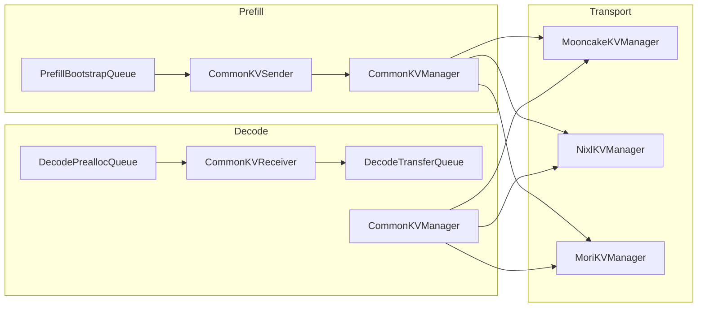
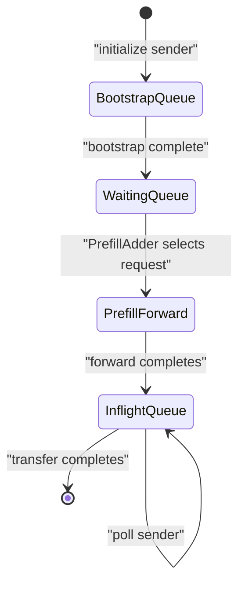
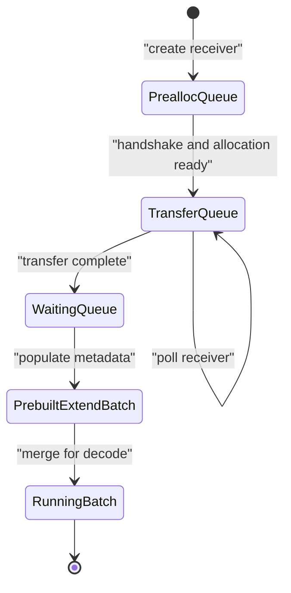
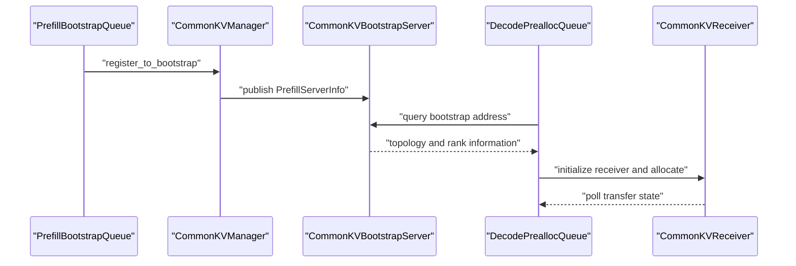
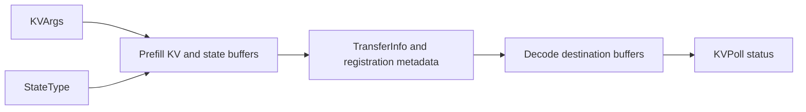
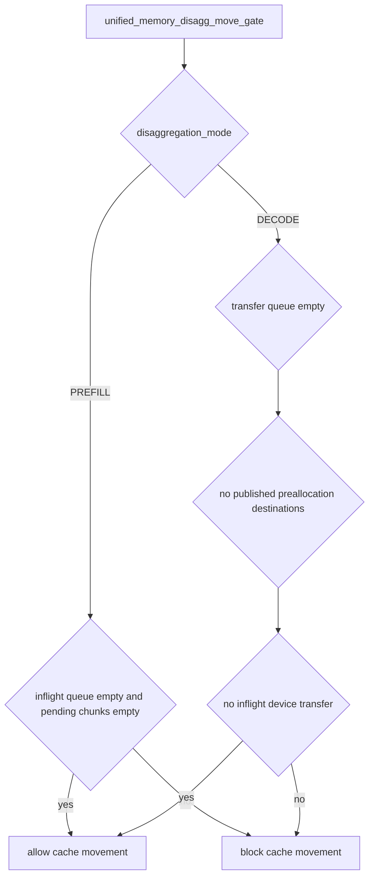
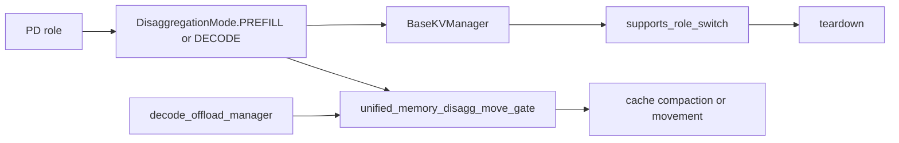

<!-- source: DeepWiki mcp.deepwiki.com · repo sgl-project/sglang · page 6.4 Prefill-Decode Disaggregation · fetched 2026-10-30 -->

# Prefill-Decode Disaggregation

Relevant source files

The following files were used as context for generating this wiki page:

- [python/sglang/kernels/ops/kvcache/pd_dcp_gather.py](python/sglang/kernels/ops/kvcache/pd_dcp_gather.py)
- [python/sglang/srt/disaggregation/base/conn.py](python/sglang/srt/disaggregation/base/conn.py)
- [python/sglang/srt/disaggregation/common/conn.py](python/sglang/srt/disaggregation/common/conn.py)
- [python/sglang/srt/disaggregation/common/dcp_pack.py](python/sglang/srt/disaggregation/common/dcp_pack.py)
- [python/sglang/srt/disaggregation/common/staging_buffer.py](python/sglang/srt/disaggregation/common/staging_buffer.py)
- [python/sglang/srt/disaggregation/common/staging_handler.py](python/sglang/srt/disaggregation/common/staging_handler.py)
- [python/sglang/srt/disaggregation/common/utils.py](python/sglang/srt/disaggregation/common/utils.py)
- [python/sglang/srt/disaggregation/decode.py](python/sglang/srt/disaggregation/decode.py)
- [python/sglang/srt/disaggregation/fake/conn.py](python/sglang/srt/disaggregation/fake/conn.py)
- [python/sglang/srt/disaggregation/mooncake/conn.py](python/sglang/srt/disaggregation/mooncake/conn.py)
- [python/sglang/srt/disaggregation/mori/conn.py](python/sglang/srt/disaggregation/mori/conn.py)
- [python/sglang/srt/disaggregation/nixl/conn.py](python/sglang/srt/disaggregation/nixl/conn.py)
- [python/sglang/srt/disaggregation/prefill.py](python/sglang/srt/disaggregation/prefill.py)
- [python/sglang/srt/disaggregation/utils.py](python/sglang/srt/disaggregation/utils.py)
- [python/sglang/srt/mem_cache/storage/eic/eic_storage.py](python/sglang/srt/mem_cache/storage/eic/eic_storage.py)
- [python/sglang/srt/mem_cache/storage/hf3fs/mini_3fs_metadata_server.py](python/sglang/srt/mem_cache/storage/hf3fs/mini_3fs_metadata_server.py)
- [python/sglang/srt/mem_cache/storage/hf3fs/storage_hf3fs.py](python/sglang/srt/mem_cache/storage/hf3fs/storage_hf3fs.py)
- [python/sglang/test/kits/pd_parity_kit.py](python/sglang/test/kits/pd_parity_kit.py)
- [python/sglang/test/server_fixtures/disaggregation_fixture.py](python/sglang/test/server_fixtures/disaggregation_fixture.py)
- [test/registered/cp/test_deepseek_v4_flash_fp4_b200_cp.py](test/registered/cp/test_deepseek_v4_flash_fp4_b200_cp.py)
- [test/registered/disaggregation/test_disaggregation_aarch64.py](test/registered/disaggregation/test_disaggregation_aarch64.py)
- [test/registered/disaggregation/test_disaggregation_basic.py](test/registered/disaggregation/test_disaggregation_basic.py)
- [test/registered/disaggregation/test_disaggregation_decode_radix_cache.py](test/registered/disaggregation/test_disaggregation_decode_radix_cache.py)
- [test/registered/disaggregation/test_disaggregation_different_tp.py](test/registered/disaggregation/test_disaggregation_different_tp.py)
- [test/registered/disaggregation/test_disaggregation_dp_attention.py](test/registered/disaggregation/test_disaggregation_dp_attention.py)
- [test/registered/disaggregation/test_disaggregation_dsv4.py](test/registered/disaggregation/test_disaggregation_dsv4.py)
- [test/registered/disaggregation/test_disaggregation_hisparse.py](test/registered/disaggregation/test_disaggregation_hisparse.py)
- [test/registered/disaggregation/test_disaggregation_hybrid_attention.py](test/registered/disaggregation/test_disaggregation_hybrid_attention.py)
- [test/registered/disaggregation/test_disaggregation_inkling_mxfp8.py](test/registered/disaggregation/test_disaggregation_inkling_mxfp8.py)
- [test/registered/disaggregation/test_disaggregation_kimi_linear.py](test/registered/disaggregation/test_disaggregation_kimi_linear.py)
- [test/registered/disaggregation/test_disaggregation_nixl.py](test/registered/disaggregation/test_disaggregation_nixl.py)
- [test/registered/disaggregation/test_disaggregation_pp.py](test/registered/disaggregation/test_disaggregation_pp.py)
- [test/registered/hicache/test_hicache_storage_3fs_backend.py](test/registered/hicache/test_hicache_storage_3fs_backend.py)
- [test/registered/kernels/ops/kvcache/test_pd_dcp_gather.py](test/registered/kernels/ops/kvcache/test_pd_dcp_gather.py)
- [test/registered/pp/test_pp_gemma4.py](test/registered/pp/test_pp_gemma4.py)
- [test/registered/pp/test_pp_single_node.py](test/registered/pp/test_pp_single_node.py)
- [test/registered/pp/test_pp_single_node_extra.py](test/registered/pp/test_pp_single_node_extra.py)
- [test/registered/unit/disaggregation/test_dcp_pack.py](test/registered/unit/disaggregation/test_dcp_pack.py)
- [test/registered/unit/disaggregation/test_decode_queue_cleanup.py](test/registered/unit/disaggregation/test_decode_queue_cleanup.py)
- [test/registered/unit/disaggregation/test_deferred_decode_kv_release.py](test/registered/unit/disaggregation/test_deferred_decode_kv_release.py)
- [test/registered/unit/disaggregation/test_disaggregation_wire.py](test/registered/unit/disaggregation/test_disaggregation_wire.py)
- [test/registered/unit/disaggregation/test_fake_kv_sender.py](test/registered/unit/disaggregation/test_fake_kv_sender.py)
- [test/registered/unit/disaggregation/test_mooncake_deferred_kv_release.py](test/registered/unit/disaggregation/test_mooncake_deferred_kv_release.py)
- [test/registered/unit/disaggregation/test_mooncake_transfer_batching.py](test/registered/unit/disaggregation/test_mooncake_transfer_batching.py)
- [test/registered/unit/disaggregation/test_mori_deferred_kv_release.py](test/registered/unit/disaggregation/test_mori_deferred_kv_release.py)
- [test/registered/unit/disaggregation/test_nixl_backend_basic.py](test/registered/unit/disaggregation/test_nixl_backend_basic.py)
- [test/registered/unit/disaggregation/test_nixl_deferred_kv_release.py](test/registered/unit/disaggregation/test_nixl_deferred_kv_release.py)
- [test/registered/unit/managers/test_priority_scheduling_disaggregation.py](test/registered/unit/managers/test_priority_scheduling_disaggregation.py)
- [test/registered/unit/mem_cache/test_decode_radix_lock_ref.py](test/registered/unit/mem_cache/test_decode_radix_lock_ref.py)

## Purpose and Scope

Prefill-Decode (PD) disaggregation separates request processing into prefill and decode roles. The prefill side computes prompt KV state and sends it to the decode side; the decode side receives that state and uses it to continue generation. This page covers the request queues, bootstrap and transfer coordination, transport backends, cache/offload coordination, and role-switching hooks visible in the implementation. [python/sglang/srt/disaggregation/prefill.py:1-18](), [python/sglang/srt/disaggregation/decode.py:1-19]()

Sources: [python/sglang/srt/disaggregation/prefill.py:1-18](), [python/sglang/srt/disaggregation/decode.py:1-19]()

---

## Architecture to Code Entity Mapping

The implementation separates request lifecycle management from transport: `PrefillBootstrapQueue` and decode-side queues coordinate requests, while `CommonKVManager`, `CommonKVSender`, and `CommonKVReceiver` provide the shared transfer abstractions used by backend-specific managers. The prefill and decode modules import these shared abstractions, and the transport modules import the common manager and sender/receiver types. [python/sglang/srt/disaggregation/prefill.py:33-45](), [python/sglang/srt/disaggregation/decode.py:37-50](), [python/sglang/srt/disaggregation/common/conn.py:30-45](), [python/sglang/srt/disaggregation/mooncake/conn.py:18-27](), [python/sglang/srt/disaggregation/nixl/conn.py:21-29](), [python/sglang/srt/disaggregation/mori/conn.py:30-39]()

### Prefill-Decode Code Entity Architecture

Sources: [python/sglang/srt/disaggregation/prefill.py:33-45](), [python/sglang/srt/disaggregation/prefill.py:172-197](), [python/sglang/srt/disaggregation/decode.py:37-50](), [python/sglang/srt/disaggregation/common/conn.py:30-45](), [python/sglang/srt/disaggregation/mooncake/conn.py:18-27](), [python/sglang/srt/disaggregation/nixl/conn.py:21-29](), [python/sglang/srt/disaggregation/mori/conn.py:30-39]()

---

## High-Level Architecture and Dataflow

The prefill server progresses each request through bootstrap, waiting, and inflight-transfer phases. It initializes a sender, waits for bootstrap completion, runs prefill, and polls the sender until transfer completion. The decode server initializes a receiver and preallocates KV capacity, polls transfer progress, constructs a prebuilt extend batch without rerunning prefill, and merges that batch into decoding. [python/sglang/srt/disaggregation/prefill.py:1-18](), [python/sglang/srt/disaggregation/decode.py:1-19]()

The common connection layer exposes `PrefillServerInfo`, which carries topology and cache compatibility fields such as attention TP/CP sizes, DP and PP sizes, page size, KV dtype/layout, and cache-sharding configuration. `KVArgs` describes the local KV and state buffers, including pointers, lengths, layer IDs, cache layout, page size, and parallel rank information. [python/sglang/srt/disaggregation/common/conn.py:119-148](), [python/sglang/srt/disaggregation/base/conn.py:57-120]()

### Request Dataflow: Lifecycle Names to Code Entities

```mermaid
flowchart LR
    Client["Request"]
    PBootstrap["PrefillBootstrapQueue"]
    PWaiting["Prefill waiting queue"]
    PForward["Prefill forward"]
    PInflight["disagg_prefill_inflight_queue"]
    Sender["CommonKVSender"]
    Receiver["CommonKVReceiver"]
    DPrealloc["DecodePreallocQueue"]
    DTransfer["DecodeTransferQueue"]
    DWaiting["Decode waiting queue"]
    Batch["PrebuiltExtendBatch"]
    Running["RunningBatch decode"]

    Client --> PBootstrap
    PBootstrap --> PWaiting
    PWaiting --> PForward
    PForward --> PInflight
    PInflight --> Sender
    Sender --> Receiver
    Receiver --> DPrealloc
    DPrealloc --> DTransfer
    DTransfer --> DWaiting
    DWaiting --> Batch
    Batch --> Running
```

Sources: [python/sglang/srt/disaggregation/prefill.py:1-18](), [python/sglang/srt/disaggregation/decode.py:1-19](), [python/sglang/srt/disaggregation/utils.py:181-204]()

---

## Core Components and Data Structures

### Disaggregation Modes and Poll States

`DisaggregationMode` defines `NULL`, `PREFILL`, and `DECODE`; `to_engine_type` maps these modes to the engine role strings `unified`, `prefill`, or `decode`. `KVPoll` represents transfer progress with `Failed`, `Bootstrapping`, `WaitingForInput`, `Transferring`, and `Success` states. [python/sglang/srt/disaggregation/utils.py:149-160](), [python/sglang/srt/disaggregation/base/conn.py:123-128]()

`TransferBackend` is imported by both lifecycle modules and used as a backend selection type in their setup interfaces. [python/sglang/srt/disaggregation/prefill.py:46-54](), [python/sglang/srt/disaggregation/decode.py:53-60]()

Sources: [python/sglang/srt/disaggregation/utils.py:149-160](), [python/sglang/srt/disaggregation/base/conn.py:123-128](), [python/sglang/srt/disaggregation/prefill.py:46-54](), [python/sglang/srt/disaggregation/decode.py:53-60]()

### Transfer Interfaces and Buffer Metadata

`BaseKVManager` defines the manager contract, including initialization and `register_to_bootstrap()`. Its class-level capability flags include host-destination support, role-switch support, and deferred decode KV release support; `teardown()` is the opt-in lifecycle hook for a manager that supports role switching. `BaseKVSender` and the shared connection module provide the sender/receiver abstractions used by the concrete backend modules. [python/sglang/srt/disaggregation/base/conn.py:131-169](), [python/sglang/srt/disaggregation/base/conn.py:172-184](), [python/sglang/srt/disaggregation/common/conn.py:30-45]()

`KVArgs` describes the source or destination memory layout. It includes KV pointers and lengths, auxiliary buffers, state components, layer IDs, cache dtype/layout, page size, GPU and parallel ranks, and optional host-buffer metadata. `StateType` identifies transferable nonstandard state such as Mamba, SWA, DSA, QSA, block scales, and DeepSeek-V4 request state. [python/sglang/srt/disaggregation/base/conn.py:17-40](), [python/sglang/srt/disaggregation/base/conn.py:57-120]()

Sources: [python/sglang/srt/disaggregation/base/conn.py:17-40](), [python/sglang/srt/disaggregation/base/conn.py:57-120](), [python/sglang/srt/disaggregation/base/conn.py:131-184](), [python/sglang/srt/disaggregation/common/conn.py:30-45]()

---

## Prefill Server Request Lifecycle

The prefill lifecycle has three stages:

1. **Bootstrap queue:** creates a sender for each request and polls until handshake and preallocation complete.
2. **Waiting queue:** uses `PrefillAdder` to select requests, runs the forward pass, then adds requests to the inflight queue.
3. **Inflight queue:** polls sender state without blocking and returns the request when transfer completes. [python/sglang/srt/disaggregation/prefill.py:1-18]()

`PrefillBootstrapQueue` receives the KV pool, metadata-buffer allocator and buffers, GPU and bootstrap port, scheduler, metrics recorder, and selected transfer backend. [python/sglang/srt/disaggregation/prefill.py:172-197]()

The module also contains `max_bootstrap_input_len()`, which computes an admission limit from capacity, page size, and shard size. `maybe_release_metadata_buffer()` frees an allocated metadata index and resets the request’s index to `-1`. [python/sglang/srt/disaggregation/prefill.py:146-169]()

### Prefill Request State Machine

Sources: [python/sglang/srt/disaggregation/prefill.py:1-18](), [python/sglang/srt/disaggregation/prefill.py:146-197]()

---

## Decode Server Request Lifecycle

The decode lifecycle uses four stages: `PreallocQueue`, `TransferQueue`, `WaitingQueue`, and `RunningBatch`. The decode module’s lifecycle description specifies that it initializes a receiver, handshakes and preallocates KV when capacity is available, polls transfer state, constructs a `PrebuiltExtendBatch` while skipping the prefill forward, and merges the resolved batch into running decode. [python/sglang/srt/disaggregation/decode.py:1-19]()

`DecodeReqToTokenPool` expands request-row allocation beyond the configured running-request capacity. Its documented policy limits running requests to `size`, while preallocated and transferring requests can use the additional `pre_alloc_size` capacity. [python/sglang/srt/disaggregation/decode.py:167-200]()

### Decode Request State Machine

Sources: [python/sglang/srt/disaggregation/decode.py:1-19](), [python/sglang/srt/disaggregation/decode.py:167-200]()

---

## Bootstrap Server and Prefill-Decode Coordination

`CommonKVBootstrapServer` is part of the shared connection layer and is imported by the Mooncake, NIXL, and MORI backend modules. `BaseKVManager.register_to_bootstrap()` defines the manager-level registration hook. [python/sglang/srt/disaggregation/common/conn.py:30-45](), [python/sglang/srt/disaggregation/base/conn.py:131-156](), [python/sglang/srt/disaggregation/mooncake/conn.py:18-27](), [python/sglang/srt/disaggregation/nixl/conn.py:21-29](), [python/sglang/srt/disaggregation/mori/conn.py:30-39]()

`PrefillServerInfo` is the topology record used by the shared connection layer. It includes attention TP/CP sizes, DP/PP sizes, page size, KV dtype, KV layout, allocation policy, optional cache-sharding state, and prefill HTTP port. [python/sglang/srt/disaggregation/common/conn.py:119-148]()

The common connection code reuses a thread-local `requests.Session` for bootstrap HTTP queries, keyed by bootstrap address. [python/sglang/srt/disaggregation/common/conn.py:79-100]()

### Coordination Data: Natural-Language Roles to Code Entities

Sources: [python/sglang/srt/disaggregation/prefill.py:172-197](), [python/sglang/srt/disaggregation/base/conn.py:131-156](), [python/sglang/srt/disaggregation/common/conn.py:79-100](), [python/sglang/srt/disaggregation/common/conn.py:119-148](), [python/sglang/srt/disaggregation/decode.py:1-19]()

---

## KV Cache Transfer Backends

The implementation includes Mooncake, NIXL, and MORI connection modules. Each defines transfer metadata that identifies a bootstrap room and destination information, and each reuses abstractions from `common.conn`. [python/sglang/srt/disaggregation/mooncake/conn.py:18-27](), [python/sglang/srt/disaggregation/nixl/conn.py:21-29](), [python/sglang/srt/disaggregation/mori/conn.py:30-39]()

### Mooncake

Mooncake’s `TransferInfo` contains a room, endpoint and destination port, session ID, destination KV indices, auxiliary index, state indices, and a required destination-info count. It can also carry `decode_prefix_len` and device KV indices. [python/sglang/srt/disaggregation/mooncake/conn.py:28-36](), [python/sglang/srt/disaggregation/mooncake/conn.py:100-147]()

### NIXL

NIXL’s module defines prepared-state types and helper structures for laying out state transfers, and its `TransferInfo`/registration structures carry destination metadata. The code recognizes memory kinds `VRAM` and `DRAM` and supports state components including Mamba, SWA, DSA, QSA, block scales, and other request state. [python/sglang/srt/disaggregation/nixl/conn.py:78-107](), [python/sglang/srt/disaggregation/nixl/conn.py:113-175](), [python/sglang/srt/disaggregation/nixl/conn.py:204-212]()

### MORI

MORI imports `IOEngine`, engine and memory descriptors, and RDMA backend configuration types. Its `TransferInfo` includes a room, endpoint, destination port, engine key, destination KV indices, auxiliary index, state indices, expected destination-info count, and optional decode-prefix length. [python/sglang/srt/disaggregation/mori/conn.py:17-28](), [python/sglang/srt/disaggregation/mori/conn.py:128-194]()

### Transfer Metadata and Buffer Layout

Sources: [python/sglang/srt/disaggregation/base/conn.py:17-40](), [python/sglang/srt/disaggregation/base/conn.py:57-120](), [python/sglang/srt/disaggregation/mooncake/conn.py:100-147](), [python/sglang/srt/disaggregation/nixl/conn.py:78-107](), [python/sglang/srt/disaggregation/mori/conn.py:128-194]()

---

## KV Offload and Safe Cache Movement

Decode-side disaggregation imports `DecodeHiCachePreallocMixin`, `DecodeHiCacheTransferMixin`, and restore result/receiver types from `decode_hicache_mixin`. The decode module also imports HiCache storage transfer types, while the shared utilities define a move gate that accounts for transfer queues and the decode offload manager. [python/sglang/srt/disaggregation/decode.py:46-51](), [python/sglang/srt/disaggregation/decode.py:107-109](), [python/sglang/srt/disaggregation/utils.py:163-204]()

`unified_memory_disagg_move_gate(scheduler)` returns a predicate for preventing cache compaction from moving pages while they may be exposed to a peer transfer. On the prefill side, the gate checks the inflight queue and pending chunk request IDs. On the decode side, it checks the transfer queue, published preallocation destinations, and whether `decode_offload_manager` reports an inflight device transfer. [python/sglang/srt/disaggregation/utils.py:163-204]()

### Cache-Movement Gate

Sources: [python/sglang/srt/disaggregation/utils.py:163-204]()

---

## PD-Multiplexing and Role-Switching Hooks

The base manager interface provides opt-in support flags for role switching and deferred decode KV release. A manager that opts in to role switching is expected to implement `teardown()` to release transfer resources; the base implementation raises `NotImplementedError`. [python/sglang/srt/disaggregation/base/conn.py:158-169]()

For a node using a unified memory pool, `unified_memory_disagg_move_gate()` supplies a mode-specific safety predicate so compaction does not relocate pages while transfer or offload work may still access them. The decode predicate includes `decode_offload_manager.has_inflight_device_transfer()` in addition to queue and preallocation state. [python/sglang/srt/disaggregation/utils.py:163-204]()

### Role and Memory Coordination: Natural-Language Concepts to Code Entities

Sources: [python/sglang/srt/disaggregation/base/conn.py:131-169](), [python/sglang/srt/disaggregation/utils.py:149-160](), [python/sglang/srt/disaggregation/utils.py:163-204]()

---

## Implementation Notes and Tests

The disaggregation unit tests import decode queue types, `ScheduleBatchDisaggregationDecodeMixin`, and the Mooncake, NIXL, and MORI manager types. The wire tests also exercise state-index and transfer-layout helpers, including `setup_state_kv_args()` and transfer-entry construction. [test/registered/unit/disaggregation/test_disaggregation_wire.py:12-46]()

Decode queue cleanup tests cover prefill-info lookup behavior and the HiCache restore gate: they verify that a receiver’s terminal poll is combined with restore status, and that a pending restore can keep a successful transfer in the transferring state. [test/registered/unit/disaggregation/test_decode_queue_cleanup.py:40-58](), [test/registered/unit/disaggregation/test_decode_queue_cleanup.py:131-152]()

The NIXL basic tests exercise CPU-side initialization paths with mocked backend agents and environment configuration, including selection of the backend and device initialization in a worker thread. [test/registered/unit/disaggregation/test_nixl_backend_basic.py:83-148](), [test/registered/unit/disaggregation/test_nixl_backend_basic.py:150-183]()

Sources: [test/registered/unit/disaggregation/test_disaggregation_wire.py:12-46](), [test/registered/unit/disaggregation/test_decode_queue_cleanup.py:40-58](), [test/registered/unit/disaggregation/test_decode_queue_cleanup.py:131-152](), [test/registered/unit/disaggregation/test_nixl_backend_basic.py:83-183]()

---

## Summary

PD disaggregation divides request handling into prefill-side bootstrap, forward execution, and KV transfer, followed by decode-side preallocation, transfer polling, metadata-only batch construction, and token generation. The shared connection layer carries topology and buffer metadata; backend modules provide transport-specific transfer records and setup. Decode HiCache hooks and `unified_memory_disagg_move_gate()` connect PD transfer state to safe cache movement, while `BaseKVManager` exposes opt-in teardown support for role switching. [python/sglang/srt/disaggregation/prefill.py:1-18](), [python/sglang/srt/disaggregation/decode.py:1-19](), [python/sglang/srt/disaggregation/common/conn.py:119-148](), [python/sglang/srt/disaggregation/base/conn.py:131-169](), [python/sglang/srt/disaggregation/utils.py:163-204]()

Sources: [python/sglang/srt/disaggregation/prefill.py:1-18](), [python/sglang/srt/disaggregation/decode.py:1-19](), [python/sglang/srt/disaggregation/common/conn.py:119-148](), [python/sglang/srt/disaggregation/base/conn.py:131-169](), [python/sglang/srt/disaggregation/utils.py:163-204]()

---

