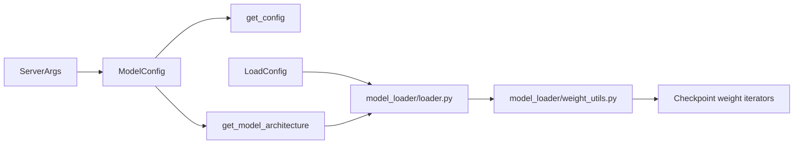
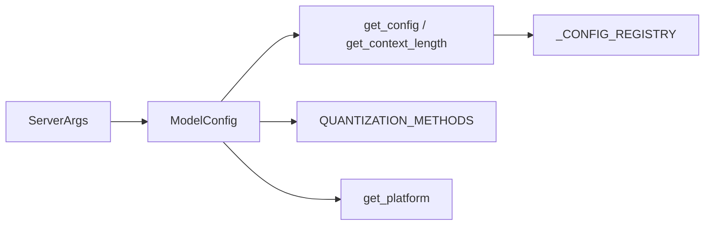
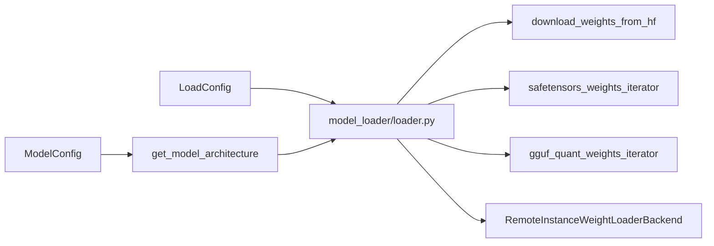
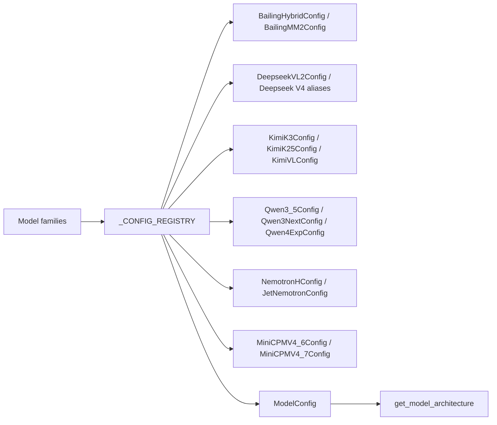
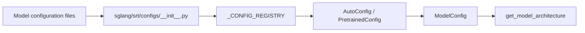

<!-- source: DeepWiki mcp.deepwiki.com · repo sgl-project/sglang · page 7 Model Configuration and Loading · fetched 2026-10-30 -->

# Model Configuration and Loading

Relevant source files

The following files were used as context for generating this wiki page:

- [python/sglang/srt/arg_groups/model_overrides/__init__.py](python/sglang/srt/arg_groups/model_overrides/__init__.py)
- [python/sglang/srt/configs/__init__.py](python/sglang/srt/configs/__init__.py)
- [python/sglang/srt/configs/minimax_vl.py](python/sglang/srt/configs/minimax_vl.py)
- [python/sglang/srt/configs/model_config.py](python/sglang/srt/configs/model_config.py)
- [python/sglang/srt/entrypoints/openai/usage_processor.py](python/sglang/srt/entrypoints/openai/usage_processor.py)
- [python/sglang/srt/function_call/base_format_detector.py](python/sglang/srt/function_call/base_format_detector.py)
- [python/sglang/srt/function_call/function_call_parser.py](python/sglang/srt/function_call/function_call_parser.py)
- [python/sglang/srt/function_call/minimax_m3.py](python/sglang/srt/function_call/minimax_m3.py)
- [python/sglang/srt/layers/quantization/__init__.py](python/sglang/srt/layers/quantization/__init__.py)
- [python/sglang/srt/layers/quantization/base_config.py](python/sglang/srt/layers/quantization/base_config.py)
- [python/sglang/srt/parser/reasoning_parser.py](python/sglang/srt/parser/reasoning_parser.py)
- [python/sglang/srt/parser/template_detection.py](python/sglang/srt/parser/template_detection.py)
- [python/sglang/srt/utils/hf_transformers/common.py](python/sglang/srt/utils/hf_transformers/common.py)
- [test/registered/unit/function_call/test_minimax_m3_detector.py](test/registered/unit/function_call/test_minimax_m3_detector.py)
- [test/registered/unit/parser/test_reasoning_parser.py](test/registered/unit/parser/test_reasoning_parser.py)
- [test/registered/unit/parser/test_template_manager.py](test/registered/unit/parser/test_template_manager.py)

## Purpose and Scope

This page gives a high-level map of how SGLang resolves model configuration, prepares loading options, and connects model metadata to implementation support. It is a parent page; detailed configuration, loading, and architecture coverage is delegated to the child pages below. [python/sglang/srt/configs/model_config.py:29-47]()

- [ModelConfig System](#7.1) — `ModelConfig`, configuration derivation, Hugging Face integration, and validation.
- [Model Loading Pipeline](#7.2) — Model and weight loading, remote sources, weight utilities, and checkpoint integration.
- [Supported Model Architectures](#7.3) — Model families, architecture support, and registry details.

Sources: [python/sglang/srt/configs/model_config.py:29-47]()

## System Overview

Model setup spans configuration resolution and model construction. `ModelConfig` connects server arguments and Hugging Face configuration utilities with runtime metadata; the model loader uses that configuration alongside `LoadConfig` and weight utilities to prepare model weights. [python/sglang/srt/configs/model_config.py:25-47]()

The configuration and loading modules also connect to quantization support, platform-specific behavior, and model architecture lookup. This page outlines those relationships without documenting their internal decision logic. [python/sglang/srt/configs/model_config.py:29-47]()

### Model Loading Architecture Flow

Sources: [python/sglang/srt/configs/model_config.py:25-47]()

## ModelConfig System

`ModelConfig` is the configuration hub for model metadata and runtime-relevant choices. Its module integrates Hugging Face `PretrainedConfig` support with utilities for reading configuration and context length, as well as quantization, platform, and server-argument dependencies. [python/sglang/srt/configs/model_config.py:25-47]()

Hugging Face configuration handling includes a `_CONFIG_REGISTRY` of configuration classes and helpers for model-specific configuration resolution. For details on derivation, validation, and parser behavior, see [ModelConfig System](#7.1). [python/sglang/srt/utils/hf_transformers/common.py:112-188]()

### ModelConfig Initialization and Integration

Sources: [python/sglang/srt/configs/model_config.py:25-47]()[python/sglang/srt/utils/hf_transformers/common.py:112-188]()

For details, see [ModelConfig System](#7.1).

## Model Loading Pipeline

The loader connects `ModelConfig` and `LoadConfig` to model-architecture lookup and weight-loading utilities. The available weight utilities include download helpers and iterators for formats such as safetensors, PyTorch, and GGUF.

The loading modules also reference remote connectors and remote-instance weight-transfer utilities. For the full loading flow, storage options, weight checking, and checkpoint integration, see [Model Loading Pipeline](#7.2).

### Loading Components and Code Entities

Sources: [python/sglang/srt/model_loader/loader.py:45-49]()

For details, see [Model Loading Pipeline](#7.2).

## Supported Model Architectures

Model support is represented across configuration classes and architecture metadata. The Hugging Face configuration registry includes entries associated with families such as Bailing, ChatGLM, DeepSeek, Kimi, Qwen, Nemotron, Mamba, and MiniCPM; the exported configuration package also exposes additional model-specific configuration classes. [python/sglang/srt/utils/hf_transformers/common.py:116-188]()[python/sglang/srt/configs/__init__.py:1-95]()

These configuration entries are one part of support; the model loader separately resolves a model architecture from `ModelConfig`. Consult [Supported Model Architectures](#7.3) for the architecture registry and family-by-family coverage.

### Model Families and Configuration Entities

Sources: [python/sglang/srt/utils/hf_transformers/common.py:116-188]()[python/sglang/srt/utils/hf_transformers/common.py:193-220]()[python/sglang/srt/configs/__init__.py:1-95]()

### Configuration Registry to Model Architecture Lookup

Sources: [python/sglang/srt/configs/__init__.py:1-95]()[python/sglang/srt/utils/hf_transformers/common.py:106-188]()

For details, see [Supported Model Architectures](#7.3).

---

