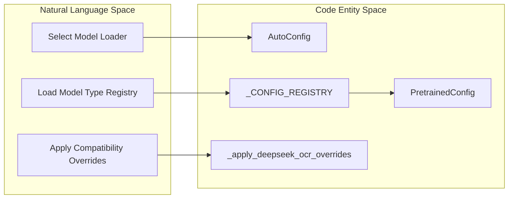
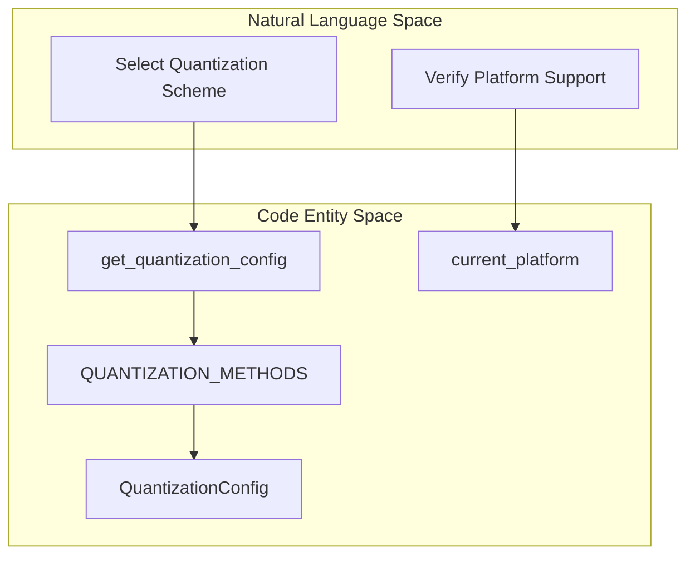

<!-- source: DeepWiki mcp.deepwiki.com · repo sgl-project/sglang · page 7.1 ModelConfig System · fetched 2026-10-30 -->

# ModelConfig System

Relevant source files

The following files were used as context for generating this wiki page:

- [python/sglang/srt/arg_groups/model_overrides/__init__.py](python/sglang/srt/arg_groups/model_overrides/__init__.py)
- [python/sglang/srt/configs/__init__.py](python/sglang/srt/configs/__init__.py)
- [python/sglang/srt/configs/minimax_vl.py](python/sglang/srt/configs/minimax_vl.py)
- [python/sglang/srt/configs/model_config.py](python/sglang/srt/configs/model_config.py)
- [python/sglang/srt/entrypoints/openai/usage_processor.py](python/sglang/srt/entrypoints/openai/usage_processor.py)
- [python/sglang/srt/function_call/base_format_detector.py](python/sglang/srt/function_call/base_format_detector.py)
- [python/sglang/srt/function_call/function_call_parser.py](python/sglang/srt/function_call/function_call_parser.py)
- [python/sglang/srt/function_call/minimax_m3.py](python/sglang/srt/function_call/minimax_m3.py)
- [python/sglang/srt/layers/quantization/__init__.py](python/sglang/srt/layers/quantization/__init__.py)
- [python/sglang/srt/layers/quantization/base_config.py](python/sglang/srt/layers/quantization/base_config.py)
- [python/sglang/srt/parser/reasoning_parser.py](python/sglang/srt/parser/reasoning_parser.py)
- [python/sglang/srt/parser/template_detection.py](python/sglang/srt/parser/template_detection.py)
- [python/sglang/srt/utils/hf_transformers/common.py](python/sglang/srt/utils/hf_transformers/common.py)
- [test/registered/unit/function_call/test_minimax_m3_detector.py](test/registered/unit/function_call/test_minimax_m3_detector.py)
- [test/registered/unit/parser/test_reasoning_parser.py](test/registered/unit/parser/test_reasoning_parser.py)
- [test/registered/unit/parser/test_template_manager.py](test/registered/unit/parser/test_template_manager.py)

## Purpose and Scope

`ModelConfig` is the serving-side configuration layer for model metadata, handling architecture identification, configuration derivation, Hugging Face (HF) transformers integration, and validation logic in SGLang [python/sglang/srt/configs/model_config.py:15-71](). This page documents the configuration factory hook, HF configuration helpers, quantization configuration resolution, and validation mechanics.

Sources: `[python/sglang/srt/configs/model_config.py:15-71]()`

---

## Configuration Factory Registration

`register_model_config_factory` associates a `ServerArgs` subclass with a callable compatible with `ModelConfig.from_server_args` [python/sglang/srt/configs/model_config.py:54-71](). Registration must occur before resolution or model construction in each process. Re-registering the exact same factory is harmless, but registering a different factory for a type that already has one raises `ValueError` [python/sglang/srt/configs/model_config.py:64-71](). A factory registered for a more specific argument-record type takes precedence due to MRO lookup [python/sglang/srt/configs/model_config.py:58-63]().

| Entity | Role |
|---|---|
| `_MODEL_CONFIG_FACTORIES` | Stores factories keyed by `ServerArgs` subclass [python/sglang/srt/configs/model_config.py:51-71](). |
| `register_model_config_factory` | Validates argument types and records the factory [python/sglang/srt/configs/model_config.py:54-71](). |
| `ServerArgs` | Base type required for factory registrations [python/sglang/srt/configs/model_config.py:54-65](). |

The function raises `TypeError` if the supplied type is not a `ServerArgs` subclass, and `ValueError` if a conflict occurs [python/sglang/srt/configs/model_config.py:64-71]().

Sources: `[python/sglang/srt/configs/model_config.py:51-71]()`

---

## Core Types and Architecture Helpers

### Enumerations and Architecture Constants

`AttentionArch` defines `MLA`, `MHA`, and `SSM` categories, where SSM represents state-space models like Mamba and Mamba2 [python/sglang/srt/configs/model_config.py:148-152](). `ModelImpl` defines implementation choices including `AUTO`, `SGLANG`, `TRANSFORMERS`, and `MINDSPORE` [python/sglang/srt/configs/model_config.py:167-172]().

| Symbol | Values or examples | Source-level purpose |
|---|---|---|
| `AttentionArch` | `MLA`, `MHA`, `SSM` | Categorizes attention or state-space architecture [python/sglang/srt/configs/model_config.py:148-152](). |
| `ModelImpl` | `AUTO`, `SGLANG`, `TRANSFORMERS`, `MINDSPORE` | Names implementation backends [python/sglang/srt/configs/model_config.py:167-172](). |
| `PURE_MAMBA1_ARCHITECTURES` | `FalconMambaForCausalLM`, `MambaForCausalLM` | Identifies pure Mamba-1 architectures [python/sglang/srt/configs/model_config.py:156-159](). |
| `PURE_SSM_ARCHITECTURES` | `Mamba2ForCausalLM` plus pure Mamba-1 | Identifies pure state-space causal-LM architectures [python/sglang/srt/configs/model_config.py:164](). |

Sources: `[python/sglang/srt/configs/model_config.py:148-172]()`

### HF Config Accessors

`_hf_arch` reads the first entry in `architectures` from a config dictionary or `PretrainedConfig` object [python/sglang/srt/configs/model_config.py:174-181](). `_hf_attr` retrieves arbitrary attributes or keys safely [python/sglang/srt/configs/model_config.py:184-189](). `requires_mm_token_modalities` checks whether Bailing multimodal wrappers use modality-specific routers [python/sglang/srt/configs/model_config.py:105-113]().

Sources: `[python/sglang/srt/configs/model_config.py:80-86](), [python/sglang/srt/configs/model_config.py:105-113](), [python/sglang/srt/configs/model_config.py:174-189]()`

---

## HF Transformers Configuration Integration

The HF integration connects model metadata to custom `PretrainedConfig` subclasses registered in `_CONFIG_REGISTRY` [python/sglang/srt/utils/hf_transformers/common.py:117-190](). Depending on environment settings (`SGLANG_USE_MODELSCOPE`), `AutoConfig` and `GenerationConfig` are loaded from either ModelScope or transformers [python/sglang/srt/utils/hf_transformers/common.py:106-110]().

### Natural-Language to Code Entity Map: HF Configuration Resolution

This diagram bridges natural language concepts of configuration discovery to code entities in the codebase.

**Diagram: "HFConfigurationResolutionMap"**

Sources: `[python/sglang/srt/utils/hf_transformers/common.py:105-118](), [python/sglang/srt/utils/hf_transformers/config.py:20-49]()`

---

## Quantization Configuration and Registry

The quantization subsystem resolves quantization methods via `get_quantization_config`, inspecting `QUANTIZATION_METHODS` and platform-specific registries [python/sglang/srt/layers/quantization/__init__.py:159-186]().

### Natural-Language to Code Entity Map: Quantization Setup

This diagram maps quantization requirements to runtime registry lookups.

**Diagram: "QuantizationSystemMap"**

Sources: `[python/sglang/srt/layers/quantization/__init__.py:159-186](), [python/sglang/srt/layers/quantization/base_config.py:163-184]()`

---

## Validation Logic and Model-Specific Helpers

`ModelConfig` and associated factories perform rigorous validation checks during initialization:

| Validation Rule | Target Entity / Function | Behavior |
|---|---|---|
| Factory Subclass Check | `register_model_config_factory` | Rejects non-`ServerArgs` types [python/sglang/srt/configs/model_config.py:64-65]() |
| Duplicate Factory Check | `register_model_config_factory` | Rejects conflicting factory registrations [python/sglang/srt/configs/model_config.py:66-71]() |
| Projection Layout Validation | `get_mimo_v2_fused_qkv_expected_tp_size` | Rejects unsupported `attention_projection_layout` values [python/sglang/srt/configs/model_config.py:124-134]() |
| Fused QKV Metadata Check | `get_mimo_v2_fused_qkv_expected_tp_size` | Requires `num_key_value_heads` when layout is `fused_qkv` [python/sglang/srt/configs/model_config.py:135-145]() |

Sources: `[python/sglang/srt/configs/model_config.py:54-71](), [python/sglang/srt/configs/model_config.py:124-145]()`

---

## Summary

The `ModelConfig` system unifies model architecture resolution, factory registration, configuration derivation from Hugging Face transformers, and quantization configuration mapping.

Sources: `[python/sglang/srt/configs/model_config.py:51-189](), [python/sglang/srt/utils/hf_transformers/common.py:105-188]()`

# End of 7.1 ModelConfig System

---

