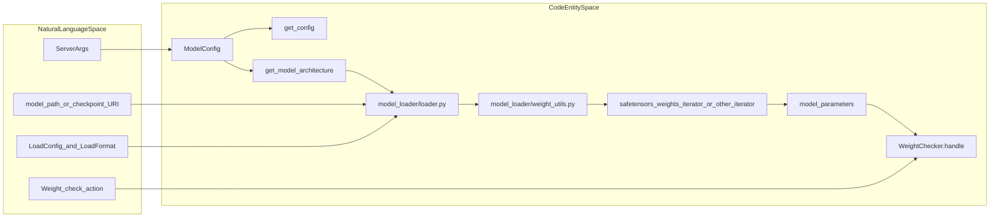
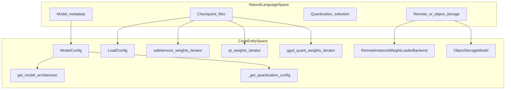
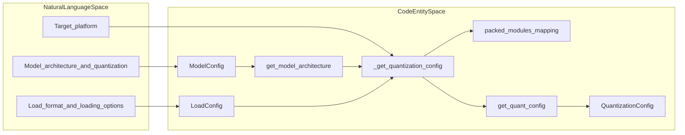
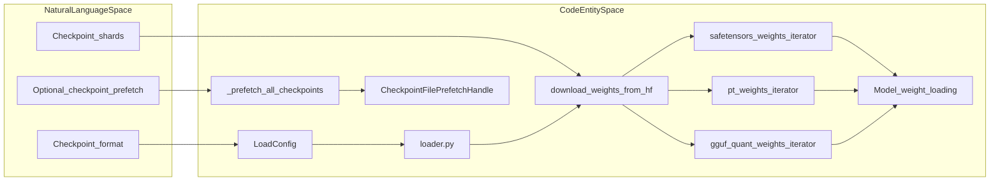
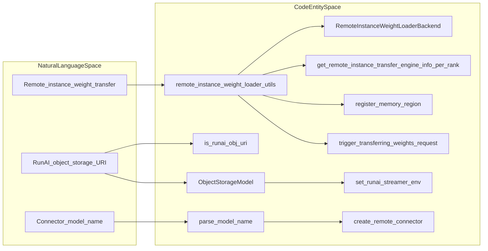
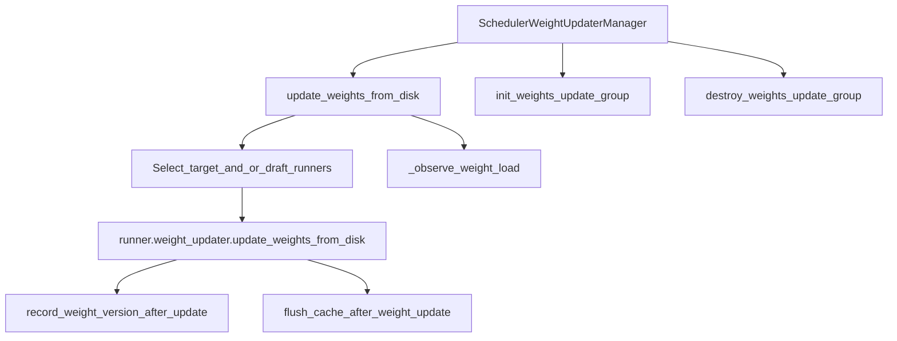
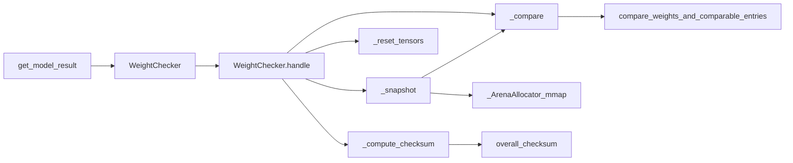

<!-- source: DeepWiki mcp.deepwiki.com · repo sgl-project/sglang · page 7.2 Model Loading Pipeline · fetched 2026-10-30 -->

# Model Loading Pipeline

Relevant source files

The following files were used as context for generating this wiki page:

- [docs/cookbook/autoregressive/Qwen/Qwen3.5.mdx](docs/cookbook/autoregressive/Qwen/Qwen3.5.mdx)
- [docs/src/snippets/autoregressive/qwen35-deployment.jsx](docs/src/snippets/autoregressive/qwen35-deployment.jsx)
- [python/sglang/srt/configs/load_config.py](python/sglang/srt/configs/load_config.py)
- [python/sglang/srt/layers/linear.py](python/sglang/srt/layers/linear.py)
- [python/sglang/srt/layers/quantization/dequantization.py](python/sglang/srt/layers/quantization/dequantization.py)
- [python/sglang/srt/layers/quantization/nvfp4_online.py](python/sglang/srt/layers/quantization/nvfp4_online.py)
- [python/sglang/srt/layers/quantization/quark/quark.py](python/sglang/srt/layers/quantization/quark/quark.py)
- [python/sglang/srt/layers/quantization/quark/schemes/quark_w4a4_mxfp4.py](python/sglang/srt/layers/quantization/quark/schemes/quark_w4a4_mxfp4.py)
- [python/sglang/srt/layers/quantization/quark/schemes/quark_w4a4_mxfp4_moe.py](python/sglang/srt/layers/quantization/quark/schemes/quark_w4a4_mxfp4_moe.py)
- [python/sglang/srt/layers/quantization/quark/utils.py](python/sglang/srt/layers/quantization/quark/utils.py)
- [python/sglang/srt/managers/scheduler_components/weight_updater.py](python/sglang/srt/managers/scheduler_components/weight_updater.py)
- [python/sglang/srt/model_executor/model_runner_components/load_model_utils.py](python/sglang/srt/model_executor/model_runner_components/load_model_utils.py)
- [python/sglang/srt/model_executor/model_runner_components/weight_updater.py](python/sglang/srt/model_executor/model_runner_components/weight_updater.py)
- [python/sglang/srt/model_loader/loader.py](python/sglang/srt/model_loader/loader.py)
- [python/sglang/srt/model_loader/weight_utils.py](python/sglang/srt/model_loader/weight_utils.py)
- [python/sglang/srt/models/glm5_next_nextn.py](python/sglang/srt/models/glm5_next_nextn.py)
- [python/sglang/srt/utils/weight_checker.py](python/sglang/srt/utils/weight_checker.py)
- [python/sglang/srt/utils/weight_checker_comparator.py](python/sglang/srt/utils/weight_checker_comparator.py)
- [python/sglang/srt/weight_sync/tensor_bucket.py](python/sglang/srt/weight_sync/tensor_bucket.py)
- [scripts/ci/amd/check_hf_cache_space.sh](scripts/ci/amd/check_hf_cache_space.sh)
- [test/registered/amd/accuracy/mi35x/test_qwen38_mxfp4_eval_mi35x.py](test/registered/amd/accuracy/mi35x/test_qwen38_mxfp4_eval_mi35x.py)
- [test/registered/rl/test_tensor_bucket.py](test/registered/rl/test_tensor_bucket.py)
- [test/registered/rl/test_weight_checker_e2e.py](test/registered/rl/test_weight_checker_e2e.py)
- [test/registered/unit/layers/quantization/test_nvfp4_online_weight_loader.py](test/registered/unit/layers/quantization/test_nvfp4_online_weight_loader.py)
- [test/registered/unit/layers/quantization/test_quark_config.py](test/registered/unit/layers/quantization/test_quark_config.py)
- [test/registered/unit/layers/quantization/test_quark_shared_expert_online_mxfp4_loader.py](test/registered/unit/layers/quantization/test_quark_shared_expert_online_mxfp4_loader.py)
- [test/registered/unit/layers/quantization/test_quark_utils.py](test/registered/unit/layers/quantization/test_quark_utils.py)
- [test/registered/unit/model_executor/test_weight_update_tensor_rank.py](test/registered/unit/model_executor/test_weight_update_tensor_rank.py)
- [test/registered/unit/model_loader/test_prefetch_checkpoints.py](test/registered/unit/model_loader/test_prefetch_checkpoints.py)
- [test/registered/unit/models/test_glm5_next_modelopt.py](test/registered/unit/models/test_glm5_next_modelopt.py)
- [test/registered/unit/models/test_glm_moe_gate_fp32.py](test/registered/unit/models/test_glm_moe_gate_fp32.py)
- [test/registered/unit/utils/test_weight_checker.py](test/registered/unit/utils/test_weight_checker.py)
- [test/registered/unit/utils/test_weight_checker_comparator.py](test/registered/unit/utils/test_weight_checker_comparator.py)
- [test/registered/unit/utils/test_weight_checker_cpu.py](test/registered/unit/utils/test_weight_checker_cpu.py)

## Purpose and scope

This page describes the model-loading components within SGLang, covering configuration metadata, loader and weight-utility responsibilities, remote and object-storage loading hooks, checkpoint-engine integration via runtime weight updates, and weight checking. The model loader imports checkpoint iterators, architecture resolvers, and post-load staging hooks, while `WeightChecker` provides snapshot, reset, comparison, and checksum actions across target and draft workers.

Sources: [python/sglang/srt/model_loader/loader.py:100-132](), [python/sglang/srt/utils/weight_checker.py:110-149]()

---

## 1. Overview and pipeline architecture

SGLang separates model metadata acquisition and weight discovery from model-specific parameter loading. `loader.py` imports architecture resolution functions (`get_model_architecture`), torch dtype settings (`set_default_torch_dtype`), quantization helpers, and various weight iterators and initialization utilities from `weight_utils.py`. 

The core flow proceeds from `ServerArgs` and `ModelConfig` resolution to architecture dispatch, file downloading, and streaming weight loading into PyTorch module hierarchies.

### Pipeline architecture diagram

Sources: [python/sglang/srt/configs/model_config.py:25-47](), [python/sglang/srt/model_loader/loader.py:100-132](), [python/sglang/srt/model_loader/weight_utils.py:5-6](), [python/sglang/srt/utils/weight_checker.py:110-149]()

### Natural-language concepts and code entities

Model loading maps configuration parameters and remote URIs onto concrete runtime classes and weight iterators.

Sources: [python/sglang/srt/model_loader/loader.py:45-50](), [python/sglang/srt/model_loader/loader.py:76-82](), [python/sglang/srt/model_loader/loader.py:100-132](), [python/sglang/srt/model_loader/loader.py:172-213](), [python/sglang/srt/model_loader/weight_utils.py:43-66]()

---

## 2. Hugging Face configuration and quantization setup

`ModelConfig` integrates Transformers configuration helpers (`PretrainedConfig`, `AutoConfig`) to derive model topology, context lengths, and hidden dimensions. 

The loader's `_get_quantization_config()` function queries `get_model_architecture(model_config)` to inspect model-specific packed module mappings (`packed_modules_mapping`) and prefix remap rules (`remap_prefix`). It accounts for quantization providers like Quark and ModelOpt, adjusting layer mappings for fused projection layers (such as `gate_up_proj` or MQA/GQA projections) before instantiating the final `QuantizationConfig` object.

### Quantization configuration resolution diagram

Sources: [python/sglang/srt/model_loader/loader.py:172-213](), [python/sglang/srt/configs/model_config.py:25-47]()

---

## 3. Weight loading pipeline and weight utilities

### Checkpoint discovery and locking

`weight_utils.py` coordinates weight downloading from Hugging Face Hub, snapshot caching, and concurrency safety. `get_lock()` uses a SHA-256 hash of the model name to construct a shared file lock in the system temporary directory or designated cache directory (`filelock.FileLock`), preventing race conditions when multiple worker processes initialize concurrently.

### Iterators and initialization utilities

SGLang supports multiple checkpoint formats through specialized weight iterators imported by `loader.py`:
- `safetensors_weights_iterator` and `buffered_multi_thread_safetensors_weights_iterator`
- `pt_weights_iterator` and `multi_thread_pt_weights_iterator`
- `gguf_quant_weights_iterator`
- `instanttensor_weights_iterator` and `np_cache_weights_iterator`

Additionally, helper utilities such as `initialize_dummy_weights`, `initialize_capture_safe_weights`, `filter_duplicate_safetensors_files`, and `maybe_add_mtp_safetensors` handle memory initialization and multi-token prediction (MTP) weight shards.

### Checkpoint prefetching

To optimize disk I/O latency, checkpoint prefetching leverages `CheckpointFilePrefetchHandle` and `_prefetch_all_checkpoints` to warm the OS page cache. Block sizes are configured via `SGLANG_PREFETCH_BLOCK_SIZE_MB`.

### Weight loading flow diagram

Sources: [python/sglang/srt/model_loader/loader.py:111-132](), [python/sglang/srt/model_loader/weight_utils.py:143-155]()

---

## 4. Remote instance weight loading and object storage

### Remote instance weight loading

For distributed and disaggregated serving setups, `remote_instance_weight_loader_utils` provides `RemoteInstanceWeightLoaderBackend`, `get_remote_instance_transfer_engine_info_per_rank`, `register_memory_region`, and `trigger_transferring_weights_request`. These facilities enable peer-to-peer or cross-instance weight streaming directly between GPU memory spaces without serializing through host disk storage.

### Object-storage loading

Object storage and custom connector schemas (such as RunAI object URIs) are resolved using `parse_model_name`, `create_remote_connector`, and `set_runai_streamer_env()`. `ModelConfig` checks for object store prefixes via `is_runai_obj_uri` and `ObjectStorageModel`.

### Remote and object-storage integration diagram

Sources: [python/sglang/srt/model_loader/loader.py:45-50](), [python/sglang/srt/model_loader/loader.py:76-82](), [python/sglang/srt/model_loader/loader.py:97-99](), [python/sglang/srt/model_loader/loader.py:111-132](), [python/sglang/srt/configs/model_config.py:39-47](), [python/sglang/srt/utils/hf_transformers/common.py:97-102]()

---

## 5. Checkpoint engine integration and weight updater

Online parameter updates (such as those required in RLHF training loops or dynamic weight refreshing) are managed through `SchedulerWeightUpdaterManager` [python/sglang/srt/managers/scheduler_components/weight_updater.py:87-99]() and `WeightUpdater` [python/sglang/srt/model_executor/model_runner_components/weight_updater.py:87-88]().

`SchedulerWeightUpdaterManager.update_weights_from_disk()` orchestrates in-place weight re-loading across target and draft runners:
1. Iterates through selected runners, calling `runner.weight_updater.update_weights_from_disk()` with the target `model_path`, `load_format`, and CUDA graph recapture flags [python/sglang/srt/managers/scheduler_components/weight_updater.py:138-151]().
2. Records weight version changes via `record_weight_version_after_update()` [python/sglang/srt/managers/scheduler_components/weight_updater.py:135-136]().
3. Flushes KV caches if requested and active via `flush_cache_after_weight_update()` [python/sglang/srt/managers/scheduler_components/weight_updater.py:120-133]().
4. Measures duration using `_observe_weight_load()` with source metrics collection [python/sglang/srt/managers/scheduler_components/weight_updater.py:105-118]().

Custom torch process groups for distributed weight synchronization (e.g., between an actor training engine and inference rollout workers) are initialized via `init_weights_update_group()` [python/sglang/srt/model_executor/model_runner_components/weight_updater.py:100-118]().

### Weight updater manager API diagram

Sources: [python/sglang/srt/managers/scheduler_components/weight_updater.py:87-118](), [python/sglang/srt/managers/scheduler_components/weight_updater.py:120-176](), [python/sglang/srt/model_executor/model_runner_components/weight_updater.py:87-118]()

---

## 6. Weight validation via `WeightChecker`

`WeightChecker` provides automated weight verification, debugging, and testing capabilities across parallel ranks [python/sglang/srt/utils/weight_checker.py:110-149]().

- **Snapshot (`_snapshot`)**: Copies current model parameter tensors into an aligned `_ArenaAllocator` backed by an `mmap` allocation, ensuring low overhead and clean memory isolation [python/sglang/srt/utils/weight_checker.py:151-168]().
- **Reset (`_reset_tensors`)**: Replaces tensor data with random values while respecting non-persistent buffer exclusions (such as rotary embedding caches and expert masks) and `_skip_weight_check` flags [python/sglang/srt/utils/weight_checker.py:60-80](), [python/sglang/srt/utils/weight_checker.py:169-183]().
- **Compare (`_compare`)**: Evaluates structural and numerical closeness against the captured snapshot using quantization-aware comparators (`compare_weights`) [python/sglang/srt/utils/weight_checker.py:14-20](), [python/sglang/srt/utils/weight_checker.py:185-205]().
- **Checksum (`_compute_checksum`)**: Computes SHA-256 digests over tensor states combined with `ParallelismInfo` (tensor-parallel, data-parallel, and pipeline-parallel ranks) to verify consistency across distributed workers [python/sglang/srt/utils/weight_checker.py:29-46](), [python/sglang/srt/utils/weight_checker.py:83-88]().

### WeightChecker data-flow diagram

Sources: [python/sglang/srt/utils/weight_checker.py:29-46](), [python/sglang/srt/utils/weight_checker.py:83-108](), [python/sglang/srt/utils/weight_checker.py:110-205]()

---

## Summary

The model loading pipeline integrates configuration parsing (`ModelConfig`), format-agnostic weight iterators (`weight_utils.py`), remote streaming storage connectors, runtime weight updaters (`SchedulerWeightUpdaterManager`), and weight verification tooling (`WeightChecker`). This architecture enables robust initialization, efficient disk and network transfer, and reliable online parameter updates for high-performance LLM and VLM serving.

Sources: [python/sglang/srt/model_loader/loader.py:45-132](), [python/sglang/srt/managers/scheduler_components/weight_updater.py:138-176](), [python/sglang/srt/utils/weight_checker.py:110-149]()

---

