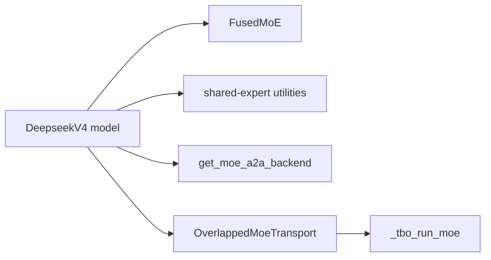
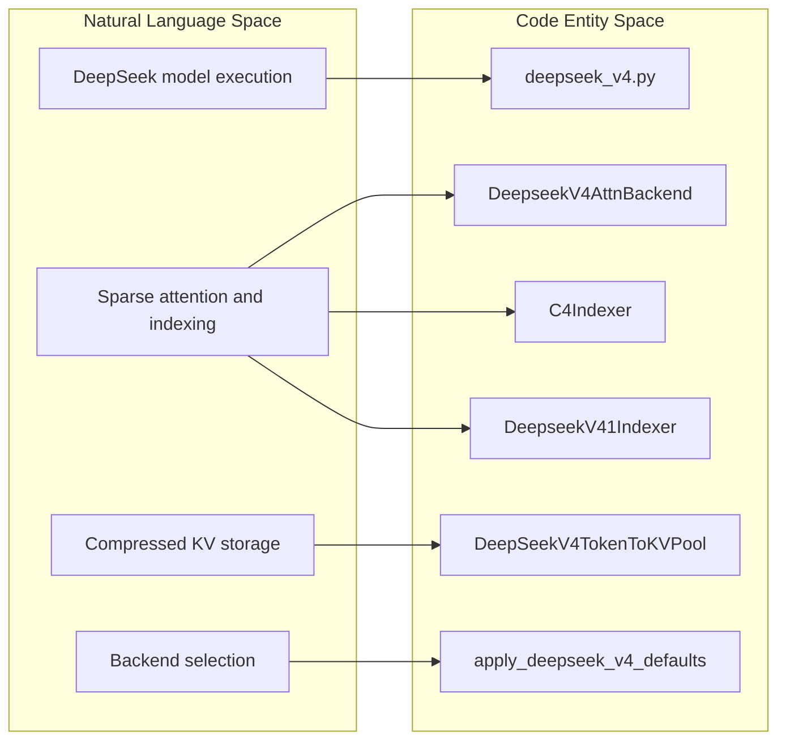
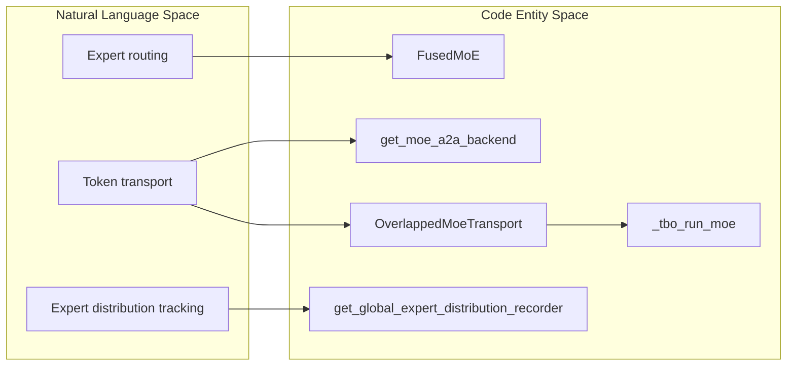

<!-- source: DeepWiki mcp.deepwiki.com · repo sgl-project/sglang · page 8 MoE and DeepSeek Models · fetched 2026-10-30 -->

# MoE and DeepSeek Models

Relevant source files

The following files were used as context for generating this wiki page:

- [python/sglang/kernels/jit/csrc/deepseek_v4/flashmla_sched_meta.cuh](python/sglang/kernels/jit/csrc/deepseek_v4/flashmla_sched_meta.cuh)
- [python/sglang/kernels/ops/attention/dsv4/sparse_prefill_kernels.py](python/sglang/kernels/ops/attention/dsv4/sparse_prefill_kernels.py)
- [python/sglang/kernels/ops/attention/flash_mla_interface.py](python/sglang/kernels/ops/attention/flash_mla_interface.py)
- [python/sglang/kernels/ops/kvcache/__init__.py](python/sglang/kernels/ops/kvcache/__init__.py)
- [python/sglang/kernels/ops/kvcache/dsv41_window_layout.py](python/sglang/kernels/ops/kvcache/dsv41_window_layout.py)
- [python/sglang/kernels/ops/kvcache/dsv4_request_window_copy.py](python/sglang/kernels/ops/kvcache/dsv4_request_window_copy.py)
- [python/sglang/srt/arg_groups/deepseek_v4_hook.py](python/sglang/srt/arg_groups/deepseek_v4_hook.py)
- [python/sglang/srt/layers/attention/deepseek_v4_backend.py](python/sglang/srt/layers/attention/deepseek_v4_backend.py)
- [python/sglang/srt/layers/attention/deepseek_v4_backend_hip_radix.py](python/sglang/srt/layers/attention/deepseek_v4_backend_hip_radix.py)
- [python/sglang/srt/layers/attention/dsv4/compressor.py](python/sglang/srt/layers/attention/dsv4/compressor.py)
- [python/sglang/srt/layers/attention/dsv4/compressor_v2.py](python/sglang/srt/layers/attention/dsv4/compressor_v2.py)
- [python/sglang/srt/layers/attention/dsv4/sparse_prefill_utils.py](python/sglang/srt/layers/attention/dsv4/sparse_prefill_utils.py)
- [python/sglang/srt/mem_cache/deepseek_v4_memory_pool.py](python/sglang/srt/mem_cache/deepseek_v4_memory_pool.py)
- [python/sglang/srt/mem_cache/dsv41_request_window.py](python/sglang/srt/mem_cache/dsv41_request_window.py)
- [python/sglang/srt/models/deepseek_v2.py](python/sglang/srt/models/deepseek_v2.py)
- [python/sglang/srt/models/deepseek_v4.py](python/sglang/srt/models/deepseek_v4.py)
- [python/sglang/srt/models/deepseek_v4_nextn.py](python/sglang/srt/models/deepseek_v4_nextn.py)
- [test/manual/test_dsv41_ragged_prefill.py](test/manual/test_dsv41_ragged_prefill.py)
- [test/registered/attention/unittests/dsv4/test_deepseek_v4.py](test/registered/attention/unittests/dsv4/test_deepseek_v4.py)
- [test/registered/kernels/ops/attention/test_combine_topk_swa_indices.py](test/registered/kernels/ops/attention/test_combine_topk_swa_indices.py)
- [test/registered/kernels/ops/attention/test_flashmla_sched_meta.py](test/registered/kernels/ops/attention/test_flashmla_sched_meta.py)
- [test/registered/kernels/ops/attention/test_q8kv8_sparse_prefill_backend.py](test/registered/kernels/ops/attention/test_q8kv8_sparse_prefill_backend.py)
- [test/registered/unit/layers/test_dsv41_late_layer_tail_readers.py](test/registered/unit/layers/test_dsv41_late_layer_tail_readers.py)
- [test/registered/unit/mem_cache/test_dsv4_compressed_pools.py](test/registered/unit/mem_cache/test_dsv4_compressed_pools.py)

## Purpose and Scope

This parent page maps SGLang’s MoE and DeepSeek model areas at a high level. It connects model execution, attention and KV-cache components, expert routing, and optimization hooks; implementation details belong in the child pages. The DeepSeek-V4 model module imports `FusedMoE`, MoE utilities, attention components, and DeepSeek-specific transport and quantization helpers [python/sglang/srt/models/deepseek_v4.py:66-108](), [python/sglang/srt/models/deepseek_v4.py:149-168]().

For details, see [MoE Layer Architecture](#8.1), [DeepSeek Architecture and MLA](#8.2), [Expert Routing and Token Dispatch](#8.3), and [MoE Quantization and Optimization](#8.4).

Sources: `python/sglang/srt/models/deepseek_v4.py`

---

## MoE Layer Architecture

The DeepSeek-V4 model brings together `FusedMoE` and shared-expert utilities, alongside the model’s other layers [python/sglang/srt/models/deepseek_v4.py:93-102](). This page treats those imports as the high-level connection between model definition and MoE execution; it does not describe the internal expert computation or runner backends.

The surrounding codebase also exposes an MoE all-to-all backend lookup through `get_moe_a2a_backend`, and imports `OverlappedMoeTransport` and `_tbo_run_moe` for DeepSeek model execution [python/sglang/srt/models/deepseek_v4.py:96-102](), [python/sglang/srt/models/deepseek_v4.py:160-162](). For details on `FusedMoE`, expert computation, and MoE runner backends, see [MoE Layer Architecture](#8.1).

### MoE model-to-code overview

Sources: `python/sglang/srt/models/deepseek_v4.py:93-102`, `python/sglang/srt/models/deepseek_v4.py:160-162`

---

## DeepSeek Architecture and MLA

The DeepSeek-V4 model module builds on DeepSeek-V2 code and imports DeepSeek-V4-specific attention components, including `Compressor`, `DeepseekV41Compressor`, `DeepseekV41Indexer`, and `C4Indexer` [python/sglang/srt/models/deepseek_v4.py:27-31](), [python/sglang/srt/models/deepseek_v4.py:66-74](). It also imports `DeepseekV4AttnBackend`-related support through the backend’s own implementation, which connects attention metadata, sparse-indexing components, and the DeepSeek-V4 KV pool [python/sglang/srt/layers/attention/deepseek_v4_backend.py:57-75](), [python/sglang/srt/layers/attention/deepseek_v4_backend.py:113-121]().

At a high level, the model, attention backend, and specialized KV pool form the DeepSeek-specific execution path. The backend includes sparse-prefill and indexer components, while `DeepSeekV4TokenToKVPool` provides a model-specific cache implementation [python/sglang/srt/layers/attention/deepseek_v4_backend.py:57-75](), [python/sglang/srt/layers/attention/deepseek_v4_backend.py:113-121](), [python/sglang/srt/mem_cache/deepseek_v4_memory_pool.py:35-44](). For details on DeepSeek variants, MLA, DSA/DSV4 indexers, and NSA, see [DeepSeek Architecture and MLA](#8.2).

### DeepSeek concepts mapped to code entities

Sources: `python/sglang/srt/models/deepseek_v4.py:27-31`, `python/sglang/srt/models/deepseek_v4.py:66-74`, `python/sglang/srt/layers/attention/deepseek_v4_backend.py:57-75`, `python/sglang/srt/layers/attention/deepseek_v4_backend.py:113-121`, `python/sglang/srt/mem_cache/deepseek_v4_memory_pool.py:35-44`, `python/sglang/srt/arg_groups/deepseek_v4_hook.py:29-45`

---

## Expert Routing and Token Dispatch

The DeepSeek-V4 model imports `FusedMoE`, `get_moe_a2a_backend`, expert-count/shared-expert utilities, and `OverlappedMoeTransport` [python/sglang/srt/models/deepseek_v4.py:93-102](), [python/sglang/srt/models/deepseek_v4.py:160-162](). These imports identify the model’s connection points to MoE execution and transport; the detailed routing and dispatch mechanisms are covered in the child page.

The model also imports `get_global_expert_distribution_recorder`, indicating a connection to expert-distribution tracking [python/sglang/srt/models/deepseek_v4.py:55-57](). For details on TopK routing, token dispatch, hierarchical selection, and EPLB, see [Expert Routing and Token Dispatch](#8.3).

### Routing and dispatch concepts mapped to code entities

Sources: `python/sglang/srt/models/deepseek_v4.py:55-57`, `python/sglang/srt/models/deepseek_v4.py:93-102`, `python/sglang/srt/models/deepseek_v4.py:160-162`

---

## MoE Quantization and Optimization

The DeepSeek-V4 model imports FP8 quantization helpers and a DeepGEMM scale configuration, as well as platform-specific and fused-operation utilities [python/sglang/srt/models/deepseek_v4.py:39-49](), [python/sglang/srt/models/deepseek_v4.py:82-108](). It also imports overlapped MoE transport and `_tbo_run_moe`, linking model execution to an overlap path [python/sglang/srt/models/deepseek_v4.py:160-162](). These are entry points for understanding optimization in this model; this parent page does not prescribe backend or quantization selection.

DeepSeek-V4 backend defaults and validation are handled by `apply_deepseek_v4_defaults`, including attention-backend selection and constraints for particular configurations [python/sglang/srt/arg_groups/deepseek_v4_hook.py:29-45](), [python/sglang/srt/arg_groups/deepseek_v4_hook.py:67-117](). For details on MoE quantization, kernels, mega-MoE, two-batch overlap, and optimization techniques, see [MoE Quantization and Optimization](#8.4).

Sources: `python/sglang/srt/models/deepseek_v4.py:39-49`, `python/sglang/srt/models/deepseek_v4.py:82-108`, `python/sglang/srt/models/deepseek_v4.py:160-162`, `python/sglang/srt/arg_groups/deepseek_v4_hook.py:29-45`, `python/sglang/srt/arg_groups/deepseek_v4_hook.py:67-117`

---

