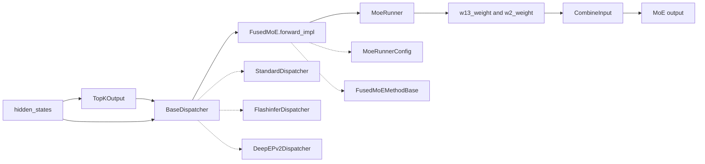
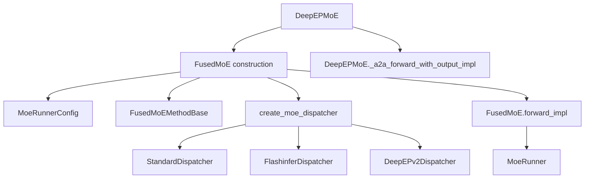
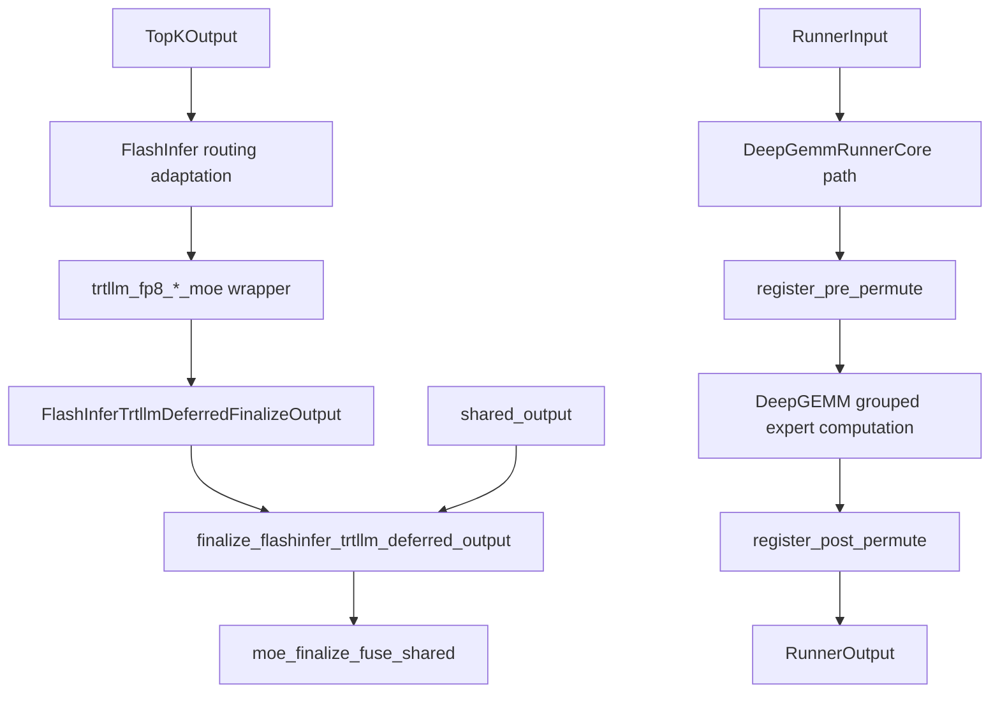
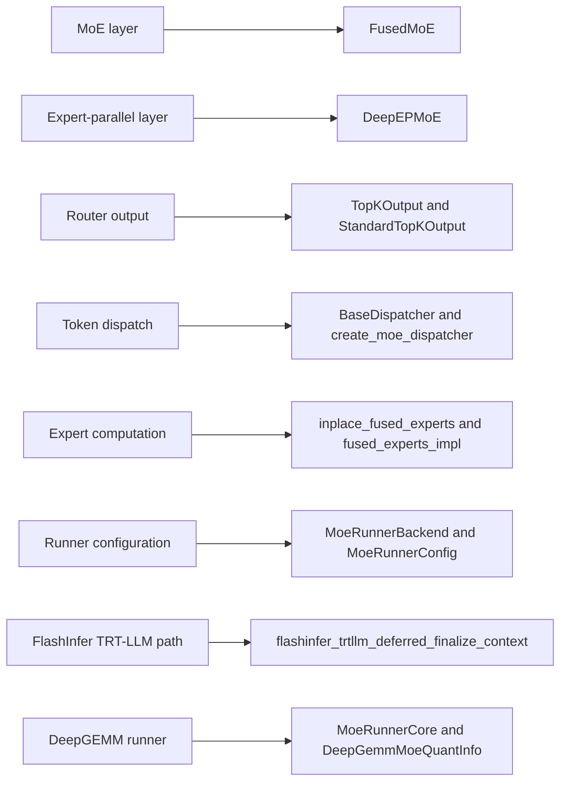
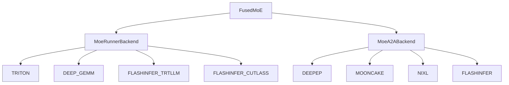

<!-- source: DeepWiki mcp.deepwiki.com · repo sgl-project/sglang · page 8.1 MoE Layer Architecture · fetched 2026-10-30 -->

# MoE Layer Architecture

Relevant source files

The following files were used as context for generating this wiki page:

- [python/sglang/kernels/jit/csrc/gemm/marlin_moe/kernel.h](python/sglang/kernels/jit/csrc/gemm/marlin_moe/kernel.h)
- [python/sglang/kernels/jit/csrc/gemm/marlin_moe/marlin_template.h](python/sglang/kernels/jit/csrc/gemm/marlin_moe/marlin_template.h)
- [python/sglang/kernels/jit/csrc/gemm/marlin_moe/moe_wna16_marlin.cuh](python/sglang/kernels/jit/csrc/gemm/marlin_moe/moe_wna16_marlin.cuh)
- [python/sglang/kernels/jit/csrc/lora/trtllm_lora_temp/moe_lora_merged_align_kernel.cu](python/sglang/kernels/jit/csrc/lora/trtllm_lora_temp/moe_lora_merged_align_kernel.cu)
- [python/sglang/kernels/jit/csrc/moe/align_single_token.cuh](python/sglang/kernels/jit/csrc/moe/align_single_token.cuh)
- [python/sglang/kernels/jit/csrc/moe/moe_align_kernel.cu](python/sglang/kernels/jit/csrc/moe/moe_align_kernel.cu)
- [python/sglang/kernels/ops/lora/common/routing.py](python/sglang/kernels/ops/lora/common/routing.py)
- [python/sglang/kernels/ops/lora/moe/trtllm_lora_temp/moe_lora_merged_align.py](python/sglang/kernels/ops/lora/moe/trtllm_lora_temp/moe_lora_merged_align.py)
- [python/sglang/kernels/ops/lora/moe/trtllm_lora_temp/topk_softmax_pack.py](python/sglang/kernels/ops/lora/moe/trtllm_lora_temp/topk_softmax_pack.py)
- [python/sglang/kernels/ops/lora/moe/trtllm_lora_temp/virtual_experts.py](python/sglang/kernels/ops/lora/moe/trtllm_lora_temp/virtual_experts.py)
- [python/sglang/kernels/ops/lora/moe/virtual_experts.py](python/sglang/kernels/ops/lora/moe/virtual_experts.py)
- [python/sglang/kernels/ops/moe/ep_moe_kernels.py](python/sglang/kernels/ops/moe/ep_moe_kernels.py)
- [python/sglang/kernels/ops/moe/fused_moe_triton_kernels.py](python/sglang/kernels/ops/moe/fused_moe_triton_kernels.py)
- [python/sglang/kernels/ops/moe/moe_align.py](python/sglang/kernels/ops/moe/moe_align.py)
- [python/sglang/kernels/ops/moe/moe_align_single_token.py](python/sglang/kernels/ops/moe/moe_align_single_token.py)
- [python/sglang/kernels/ops/moe/moe_align_small_numel.py](python/sglang/kernels/ops/moe/moe_align_small_numel.py)
- [python/sglang/kernels/ops/moe/moe_wna16_marlin.py](python/sglang/kernels/ops/moe/moe_wna16_marlin.py)
- [python/sglang/srt/layers/modelopt_utils.py](python/sglang/srt/layers/modelopt_utils.py)
- [python/sglang/srt/layers/moe/__init__.py](python/sglang/srt/layers/moe/__init__.py)
- [python/sglang/srt/layers/moe/ep_moe/layer.py](python/sglang/srt/layers/moe/ep_moe/layer.py)
- [python/sglang/srt/layers/moe/flashinfer_trtllm_moe.py](python/sglang/srt/layers/moe/flashinfer_trtllm_moe.py)
- [python/sglang/srt/layers/moe/fused_moe_triton/layer.py](python/sglang/srt/layers/moe/fused_moe_triton/layer.py)
- [python/sglang/srt/layers/moe/moe_runner/deep_gemm.py](python/sglang/srt/layers/moe/moe_runner/deep_gemm.py)
- [python/sglang/srt/layers/moe/moe_runner/flashinfer_trtllm.py](python/sglang/srt/layers/moe/moe_runner/flashinfer_trtllm.py)
- [python/sglang/srt/layers/moe/moe_runner/runner.py](python/sglang/srt/layers/moe/moe_runner/runner.py)
- [python/sglang/srt/layers/moe/moe_runner/triton.py](python/sglang/srt/layers/moe/moe_runner/triton.py)
- [python/sglang/srt/layers/moe/moe_runner/triton_utils/fused_moe.py](python/sglang/srt/layers/moe/moe_runner/triton_utils/fused_moe.py)
- [python/sglang/srt/layers/moe/moe_runner/triton_utils/moe_align_block_size.py](python/sglang/srt/layers/moe/moe_runner/triton_utils/moe_align_block_size.py)
- [python/sglang/srt/layers/moe/token_dispatcher/__init__.py](python/sglang/srt/layers/moe/token_dispatcher/__init__.py)
- [python/sglang/srt/layers/moe/token_dispatcher/base.py](python/sglang/srt/layers/moe/token_dispatcher/base.py)
- [python/sglang/srt/layers/moe/token_dispatcher/deepep_v2.py](python/sglang/srt/layers/moe/token_dispatcher/deepep_v2.py)
- [python/sglang/srt/layers/moe/utils.py](python/sglang/srt/layers/moe/utils.py)
- [python/sglang/srt/layers/quantization/compressed_tensors/schemes/compressed_tensors_w4a4_nvfp4_moe.py](python/sglang/srt/layers/quantization/compressed_tensors/schemes/compressed_tensors_w4a4_nvfp4_moe.py)
- [python/sglang/srt/layers/quantization/fp8.py](python/sglang/srt/layers/quantization/fp8.py)
- [python/sglang/srt/layers/quantization/fp8_utils.py](python/sglang/srt/layers/quantization/fp8_utils.py)
- [python/sglang/srt/layers/quantization/modelopt_quant.py](python/sglang/srt/layers/quantization/modelopt_quant.py)
- [python/sglang/srt/layers/quantization/unquant.py](python/sglang/srt/layers/quantization/unquant.py)
- [python/sglang/srt/lora/lora_moe_runner_marlin.py](python/sglang/srt/lora/lora_moe_runner_marlin.py)
- [python/sglang/srt/lora/marlin_lora_temp/activation.py](python/sglang/srt/lora/marlin_lora_temp/activation.py)
- [python/sglang/srt/lora/marlin_lora_temp/direct_decode.py](python/sglang/srt/lora/marlin_lora_temp/direct_decode.py)
- [python/sglang/srt/lora/marlin_lora_temp/moe_runner.py](python/sglang/srt/lora/marlin_lora_temp/moe_runner.py)
- [python/sglang/srt/lora/trtllm_lora_temp/specialized_expand.py](python/sglang/srt/lora/trtllm_lora_temp/specialized_expand.py)
- [python/sglang/srt/model_loader/checkpoint_quantization.py](python/sglang/srt/model_loader/checkpoint_quantization.py)
- [python/sglang/srt/model_loader/utils.py](python/sglang/srt/model_loader/utils.py)
- [test/manual/layers/moe/test_simulate_balanced_routing.py](test/manual/layers/moe/test_simulate_balanced_routing.py)
- [test/manual/quant/test_compressed_tensors_fp8_block_ue8m0.py](test/manual/quant/test_compressed_tensors_fp8_block_ue8m0.py)
- [test/registered/backends/test_flashinfer_nvfp4_online_moe_backend.py](test/registered/backends/test_flashinfer_nvfp4_online_moe_backend.py)
- [test/registered/backends/test_flashinfer_trtllm_gen_moe_backend.py](test/registered/backends/test_flashinfer_trtllm_gen_moe_backend.py)
- [test/registered/kernels/ops/moe/test_marlin_packed_topk_unpack.py](test/registered/kernels/ops/moe/test_marlin_packed_topk_unpack.py)
- [test/registered/kernels/ops/moe/test_minimax_quant_scatter.py](test/registered/kernels/ops/moe/test_minimax_quant_scatter.py)
- [test/registered/kernels/ops/moe/test_moe_align_block_size.py](test/registered/kernels/ops/moe/test_moe_align_block_size.py)
- [test/registered/kernels/ops/moe/test_moe_wna16_marlin.py](test/registered/kernels/ops/moe/test_moe_wna16_marlin.py)
- [test/registered/kernels/ops/moe/test_round_robin_ep_balance.py](test/registered/kernels/ops/moe/test_round_robin_ep_balance.py)
- [test/registered/lora/test_virtual_experts_kernels.py](test/registered/lora/test_virtual_experts_kernels.py)
- [test/registered/rl/test_update_weights_from_disk_blackwell.py](test/registered/rl/test_update_weights_from_disk_blackwell.py)
- [test/registered/unit/layers/moe/test_deepep_v2_masked_slab.py](test/registered/unit/layers/moe/test_deepep_v2_masked_slab.py)
- [test/registered/unit/layers/quantization/test_deepgemm_ue8m0_requant.py](test/registered/unit/layers/quantization/test_deepgemm_ue8m0_requant.py)
- [test/registered/unit/layers/quantization/test_modelopt_nvfp4_moe_scales.py](test/registered/unit/layers/quantization/test_modelopt_nvfp4_moe_scales.py)
- [test/registered/unit/layers/test_fp8_bpreshuffle_dense_linear_mi35x.py](test/registered/unit/layers/test_fp8_bpreshuffle_dense_linear_mi35x.py)
- [test/registered/unit/layers/test_fp8_bpreshuffle_producer_mi35x.py](test/registered/unit/layers/test_fp8_bpreshuffle_producer_mi35x.py)
- [test/registered/unit/layers/test_fp8_bpreshuffle_scale.py](test/registered/unit/layers/test_fp8_bpreshuffle_scale.py)
- [test/registered/unit/lora/test_experimental_sgl_marlin_runtime_unit.py](test/registered/unit/lora/test_experimental_sgl_marlin_runtime_unit.py)
- [test/registered/unit/lora/test_experimental_sgl_marlin_shared_outer_reduce.py](test/registered/unit/lora/test_experimental_sgl_marlin_shared_outer_reduce.py)
- [test/registered/unit/model_loader/test_modelopt_loader.py](test/registered/unit/model_loader/test_modelopt_loader.py)
- [test/registered/unit/models/test_kimi_k3_bfa_overlap.py](test/registered/unit/models/test_kimi_k3_bfa_overlap.py)
- [test/registered/unit/test_checkpoint_quantization.py](test/registered/unit/test_checkpoint_quantization.py)

## Purpose and scope

This page describes the MoE layer and expert-computation architecture represented in the supplied SGLang source excerpts. It focuses on `FusedMoE`, the runner and dispatcher abstractions, expert GEMM computation, and the FlashInfer/TRT-LLM and DeepGEMM paths. Routing and token dispatch are treated here as interfaces to this layer; their algorithms are outside this page’s scope. [python/sglang/srt/layers/moe/fused_moe_triton/layer.py:25-50](), [python/sglang/srt/layers/moe/moe_runner/deep_gemm.py:25-39](), [python/sglang/srt/layers/moe/moe_runner/flashinfer_trtllm.py:25-37]()

Sources: [python/sglang/srt/layers/moe/fused_moe_triton/layer.py:25-50](), [python/sglang/srt/layers/moe/moe_runner/deep_gemm.py:25-39](), [python/sglang/srt/layers/moe/moe_runner/flashinfer_trtllm.py:25-37]()

---

## 1. MoE Layer Overview and High-Level Data Flow

An MoE layer connects top-k routing output to token dispatch, expert computation, and output combination. In the supplied implementation, `FusedMoE` imports the `TopKOutput` types and dispatcher interfaces, and `create_moe_dispatcher` selects a dispatcher using the configured all-to-all backend and hardware context. [python/sglang/srt/layers/moe/fused_moe_triton/layer.py:35-50](), [python/sglang/srt/layers/moe/fused_moe_triton/layer.py:171-186]()

The expert-computation path is represented by `MoeRunnerConfig` and runner backends. The Triton utility exposes `inplace_fused_experts`, which forwards its arguments to `fused_experts_impl`; the arguments include expert weights, top-k IDs and weights, activation, quantization metadata, and routing-scaling options. [python/sglang/srt/layers/moe/moe_runner/triton_utils/fused_moe.py:163-210]()

The diagram distinguishes layer-level concepts from concrete code entities. It does not imply that every model uses the same dispatcher, runner, activation, or quantization configuration. [python/sglang/srt/layers/moe/fused_moe_triton/layer.py:35-50](), [python/sglang/srt/layers/moe/fused_moe_triton/layer.py:171-186](), [python/sglang/srt/layers/moe/moe_runner/triton_utils/fused_moe.py:163-210]()

**Diagram: MoE layer data flow and code entities**

Sources: [python/sglang/srt/layers/moe/fused_moe_triton/layer.py:25-50](), [python/sglang/srt/layers/moe/fused_moe_triton/layer.py:171-186](), [python/sglang/srt/layers/moe/moe_runner/triton_utils/fused_moe.py:163-210]()

---

## 2. `FusedMoE` and `DeepEPMoE` Layer Implementation

`FusedMoE` is the central layer implementation in `fused_moe_triton/layer.py`; its imports establish the interfaces it composes, including `MoeRunnerConfig`, `BaseDispatcher`, `TopKOutput`, and quantization methods derived from `FusedMoEMethodBase`. The supplied excerpt also defines `create_moe_dispatcher`, which chooses a dispatcher based on the configured all-to-all backend and platform. [python/sglang/srt/layers/moe/fused_moe_triton/layer.py:25-69](), [python/sglang/srt/layers/moe/fused_moe_triton/layer.py:171-186]()

`DeepEPMoE` subclasses `FusedMoE` and initializes its base with expert count, top-k, hidden and intermediate sizes, layer ID, shared-expert count, dtype, quantization configuration, activation, and routed scaling factor. Its constructor then sets a deprecation-path flag according to the selected backend, platform, and quantization conditions; when that flag is set, construction returns early. [python/sglang/srt/layers/moe/ep_moe/layer.py:62-99](), [python/sglang/srt/layers/moe/ep_moe/layer.py:101-152]()

The EP implementation’s documented class description says it is based on DeepEP and that Mooncake EP shares the same class interface. The shown method `_a2a_forward_with_output_impl` temporarily sets the extend-in-batch flag, invokes `forward_impl` with a `StandardTopKOutput`, copies the result into the supplied output, and restores the previous flag in a `finally` block. [python/sglang/srt/layers/moe/ep_moe/layer.py:62-68](), [python/sglang/srt/layers/moe/ep_moe/layer.py:180-198]()

**Diagram: Layer construction and composition**

Sources: [python/sglang/srt/layers/moe/fused_moe_triton/layer.py:25-69](), [python/sglang/srt/layers/moe/fused_moe_triton/layer.py:171-186](), [python/sglang/srt/layers/moe/ep_moe/layer.py:62-99](), [python/sglang/srt/layers/moe/ep_moe/layer.py:180-198]()

### Key attributes and configuration

| Entity | Role established by the supplied code |
|---|---|
| `MoeRunnerConfig` | Runner configuration type imported by `FusedMoE`, the Triton utilities, and the DeepGEMM runner. [python/sglang/srt/layers/moe/fused_moe_triton/layer.py:25-30](), [python/sglang/srt/layers/moe/moe_runner/deep_gemm.py:25-34]() |
| `FusedMoEMethodBase` | Base type for MoE quantization methods used by the layer and dispatcher factory. [python/sglang/srt/layers/moe/fused_moe_triton/layer.py:59-62](), [python/sglang/srt/layers/quantization/fp8.py:49-53]() |
| `BaseDispatcher` | Dispatcher interface returned by `create_moe_dispatcher`. [python/sglang/srt/layers/moe/fused_moe_triton/layer.py:35-43](), [python/sglang/srt/layers/moe/fused_moe_triton/layer.py:171-186]() |
| `TopKOutput` | Routing-output interface used by `FusedMoE`; `DeepEPMoE` wraps top-k weights, IDs, and router logits in `StandardTopKOutput` for its shown forward path. [python/sglang/srt/layers/moe/fused_moe_triton/layer.py:45-50](), [python/sglang/srt/layers/moe/ep_moe/layer.py:192-196]() |
| `MoeRunnerBackend` | Backend enum containing runner choices such as `TRITON`, `DEEP_GEMM`, `FLASHINFER_TRTLLM`, `FLASHINFER_CUTLASS`, `AITER`, and `INTEL_XPU`. [python/sglang/srt/layers/moe/utils.py:112-216]() |

Sources: [python/sglang/srt/layers/moe/fused_moe_triton/layer.py:25-69](), [python/sglang/srt/layers/moe/fused_moe_triton/layer.py:171-186](), [python/sglang/srt/layers/moe/ep_moe/layer.py:180-198](), [python/sglang/srt/layers/moe/utils.py:112-216](), [python/sglang/srt/layers/quantization/fp8.py:49-53]()

---

## 3. Expert Weight Organization and Quantization Layouts

The Triton fused-expert interface accepts `w1` and `w2` tensors alongside top-k IDs and weights. It also accepts optional bias, activation, quantization flags and scale tensors, block shape, routed scaling, and gate/up layout options. This interface supports multiple execution configurations; the excerpt does not establish one universal physical shape or gate/up slicing convention for every quantization method and runner. [python/sglang/srt/layers/moe/moe_runner/triton_utils/fused_moe.py:163-195]()

The `FusedMoE` layer imports quantization implementations including `Fp8MoEMethod`, `ModelOptNvFp4FusedMoEMethod`, `UnquantizedFusedMoEMethod`, and `CompressedTensorsMxInt4MoE`. `fp8.py` also imports runner-specific quant-info types, including `DeepGemmMoeQuantInfo`, `FlashInferTrtllmFp8MoeQuantInfo`, and `TritonMoeQuantInfo`. [python/sglang/srt/layers/moe/fused_moe_triton/layer.py:59-69](), [python/sglang/srt/layers/quantization/fp8.py:31-42]()

The API makes quantization and layout choices explicit: the fused-expert call includes separate weight-scale and zero-point parameters for its two projections, activation scales, block shape, and a `gate_up_interleaved` option. Backend-specific weight preparation can therefore differ; the shown source does not justify a single weight-layout diagram applying to all backends. [python/sglang/srt/layers/moe/moe_runner/triton_utils/fused_moe.py:176-195]()

Sources: [python/sglang/srt/layers/moe/moe_runner/triton_utils/fused_moe.py:163-195](), [python/sglang/srt/layers/moe/fused_moe_triton/layer.py:59-69](), [python/sglang/srt/layers/quantization/fp8.py:31-42]()

---

## 4. MoE Runner Backends

`MoeRunnerBackend` is an enum in `moe/utils.py`. The supplied definition includes `AUTO`, `DEEP_GEMM`, `TRITON`, `TRITON_KERNELS`, `ASCEND`, FlashInfer/TRT-LLM variants, `FLASHINFER_CUTLASS`, `FLASHINFER_CUTEDSL`, `FLASHINFER_MXFP4`, `CUTLASS`, `MARLIN`, `HUMMING`, `AITER`, `HPC_OPS`, and `INTEL_XPU`, among others. [python/sglang/srt/layers/moe/utils.py:194-216]()

The enum’s predicates provide a stable way for other code to test backend families. For example, `is_flashinfer_trtllm()` recognizes both `FLASHINFER_TRTLLM` and `EXPERIMENTAL_SGL_TRTLLM`; `is_marlin()` similarly groups `MARLIN` and `EXPERIMENTAL_SGL_MARLIN`. [python/sglang/srt/layers/moe/utils.py:133-172]()

| Backend family or value | What the supplied source establishes |
|---|---|
| `TRITON` | A runner backend enum value; the fused-expert Triton utility defines `inplace_fused_experts` and `fused_experts_impl` entry points. [python/sglang/srt/layers/moe/utils.py:194-200](), [python/sglang/srt/layers/moe/moe_runner/triton_utils/fused_moe.py:163-210]() |
| `DEEP_GEMM` | A runner backend enum value; `deep_gemm.py` imports `MoeRunnerCore`, `RunnerInput`, and `RunnerOutput` and contains DeepGEMM-specific helpers and quantization/layout logic. [python/sglang/srt/layers/moe/utils.py:194-200](), [python/sglang/srt/layers/moe/moe_runner/deep_gemm.py:25-34]() |
| `FLASHINFER_TRTLLM` | A runner backend enum value; `flashinfer_trtllm.py` adapts FlashInfer routing and defines wrappers and deferred-finalize support. [python/sglang/srt/layers/moe/utils.py:194-205](), [python/sglang/srt/layers/moe/moe_runner/flashinfer_trtllm.py:25-37]() |
| `FLASHINFER_TRTLLM_ROUTED` | A separate runner backend value used for routed FlashInfer/TRT-LLM execution. [python/sglang/srt/layers/moe/utils.py:194-205]() |
| `FLASHINFER_CUTLASS`, `FLASHINFER_CUTEDSL`, `FLASHINFER_MXFP4` | Distinct backend values represented in the enum; selection details are not inferred here. [python/sglang/srt/layers/moe/utils.py:194-216]() |
| `AITER`, `ASCEND`, `INTEL_XPU` | Platform/backend values represented in the enum. [python/sglang/srt/layers/moe/utils.py:194-216]() |

Sources: [python/sglang/srt/layers/moe/utils.py:112-216](), [python/sglang/srt/layers/moe/moe_runner/triton_utils/fused_moe.py:163-210](), [python/sglang/srt/layers/moe/moe_runner/deep_gemm.py:25-34](), [python/sglang/srt/layers/moe/moe_runner/flashinfer_trtllm.py:25-37]()

---

## 5. FlashInfer, TRT-LLM, and DeepGEMM MoE Backends

### FlashInfer/TRT-LLM integration

`moe_runner/flashinfer_trtllm.py` imports the `trtllm_fp8_*` wrapper functions from `flashinfer_trtllm_moe.py`, including block-scale and per-tensor-scale variants, as well as routed variants. The file also defines routing adaptation and deferred-finalize support. [python/sglang/srt/layers/moe/moe_runner/flashinfer_trtllm.py:25-30]()

`_get_routing_for_flashinfer_routed` accepts either packed top-k routing or standard top-k output. For standard routing, it returns contiguous IDs and weights; when requested, it widens FP16 weights to contiguous FP32 for providers that accept BF16/FP32 scores. [python/sglang/srt/layers/moe/moe_runner/flashinfer_trtllm.py:181-199]()

The deferred-finalize mechanism uses a context variable controlled by `flashinfer_trtllm_deferred_finalize_context`. `finalize_flashinfer_trtllm_deferred_output` passes the stored GEMM2 output, expert weights, permuted-index mapping, optional shared output, and top-k value to `moe_finalize_fuse_shared`; it also determines whether to enable PDL through `trtllm_moe_enable_pdl`. [python/sglang/srt/layers/moe/moe_runner/flashinfer_trtllm.py:47-100]()

`_make_deferred_finalize_output` adapts the first three values of the FlashInfer result into `FlashInferTrtllmDeferredFinalizeOutput` and checks the expected dtypes of the expert weights, GEMM2 output, and index mapping. [python/sglang/srt/layers/moe/moe_runner/flashinfer_trtllm.py:87-132]()

### DeepGEMM integration

`deep_gemm.py` imports `MoeRunnerCore`, `RunnerInput`, and `RunnerOutput`, along with registration hooks for pre- and post-permute operations. It also imports DeepGEMM support and utilities for activation, expert-count padding, and per-token-group quantization. [python/sglang/srt/layers/moe/moe_runner/deep_gemm.py:11-39]()

The file contains memory-budget and peak-memory estimation helpers for a masked standard layout. The estimate accounts for padded token rows, activation and scale storage, intermediate gate/up output, and down-projection output; the configured budget fraction is validated to be in `(0, 1]`. [python/sglang/srt/layers/moe/moe_runner/deep_gemm.py:116-170]()

**Diagram: Runner-specific MoE execution and finalization**

Sources: [python/sglang/srt/layers/moe/moe_runner/flashinfer_trtllm.py:25-37](), [python/sglang/srt/layers/moe/moe_runner/flashinfer_trtllm.py:47-132](), [python/sglang/srt/layers/moe/moe_runner/deep_gemm.py:11-39](), [python/sglang/srt/layers/moe/moe_runner/deep_gemm.py:116-170]()

---

## 6. Token Dispatchers and Expert Parallelism

The layer’s dispatcher factory obtains the MoE all-to-all backend and selects among dispatcher implementations. The shown branches include `AscendTPDispatcher` for the no-all-to-all NPU case, and the imported `StandardDispatcher`, `FlashinferDispatcher`, and `DeepEPv2Dispatcher` implementations. Some backend configurations bypass the dispatcher abstraction; the shown comment identifies Ascend FuseEP as an example. [python/sglang/srt/layers/moe/fused_moe_triton/layer.py:35-43](), [python/sglang/srt/layers/moe/fused_moe_triton/layer.py:171-186]()

The dispatcher backend enum is separate from the runner backend enum. `MoeA2ABackend` includes values such as `DEEPEP`, `MOONCAKE`, `NIXL`, `MORI`, `FLASHINFER`, `MEGAMOE`, `DEEPEP_V2`, and `PPLX`; `MoeRunnerBackend` represents expert-computation choices such as `TRITON`, `DEEP_GEMM`, and `FLASHINFER_TRTLLM`. [python/sglang/srt/layers/moe/utils.py:36-49](), [python/sglang/srt/layers/moe/utils.py:194-216]()

`DeepEPMoE` is the EP-facing layer subclass. Its class documentation identifies DeepEP as its basis and says Mooncake EP shares its interface. The exact communication operation and transport details are not established by the supplied excerpt. [python/sglang/srt/layers/moe/ep_moe/layer.py:62-68]()

Sources: [python/sglang/srt/layers/moe/fused_moe_triton/layer.py:35-43](), [python/sglang/srt/layers/moe/fused_moe_triton/layer.py:171-186](), [python/sglang/srt/layers/moe/utils.py:36-49](), [python/sglang/srt/layers/moe/utils.py:194-216](), [python/sglang/srt/layers/moe/ep_moe/layer.py:62-68]()

---

## 7. Natural Language to Code Entity Mapping

This diagram maps layer-level concepts to names that can be searched directly in the repository. The mappings are based on the imports, definitions, and interfaces in the cited source excerpts. [python/sglang/srt/layers/moe/fused_moe_triton/layer.py:25-50](), [python/sglang/srt/layers/moe/fused_moe_triton/layer.py:171-186](), [python/sglang/srt/layers/moe/moe_runner/triton_utils/fused_moe.py:163-210](), [python/sglang/srt/layers/moe/utils.py:36-49](), [python/sglang/srt/layers/moe/utils.py:194-216]()

**Diagram: MoE concepts mapped to code entities**

Sources: [python/sglang/srt/layers/moe/fused_moe_triton/layer.py:25-50](), [python/sglang/srt/layers/moe/fused_moe_triton/layer.py:171-186](), [python/sglang/srt/layers/moe/ep_moe/layer.py:62-68](), [python/sglang/srt/layers/moe/moe_runner/triton_utils/fused_moe.py:163-210](), [python/sglang/srt/layers/moe/moe_runner/flashinfer_trtllm.py:47-100](), [python/sglang/srt/layers/moe/moe_runner/deep_gemm.py:25-34](), [python/sglang/srt/layers/moe/utils.py:36-49](), [python/sglang/srt/layers/moe/utils.py:194-216]()

The runner and communication backend names belong to different configuration dimensions: `MoeRunnerBackend` names the expert-computation implementation, while `MoeA2ABackend` names the all-to-all or dispatch implementation. This distinction is useful when tracing configuration and execution through `FusedMoE`. [python/sglang/srt/layers/moe/utils.py:36-49](), [python/sglang/srt/layers/moe/utils.py:194-216](), [python/sglang/srt/layers/moe/fused_moe_triton/layer.py:171-186]()

**Diagram: Runner backend and communication backend as separate choices**

Sources: [python/sglang/srt/layers/moe/utils.py:36-49](), [python/sglang/srt/layers/moe/utils.py:194-216](), [python/sglang/srt/layers/moe/fused_moe_triton/layer.py:171-186]()

---

