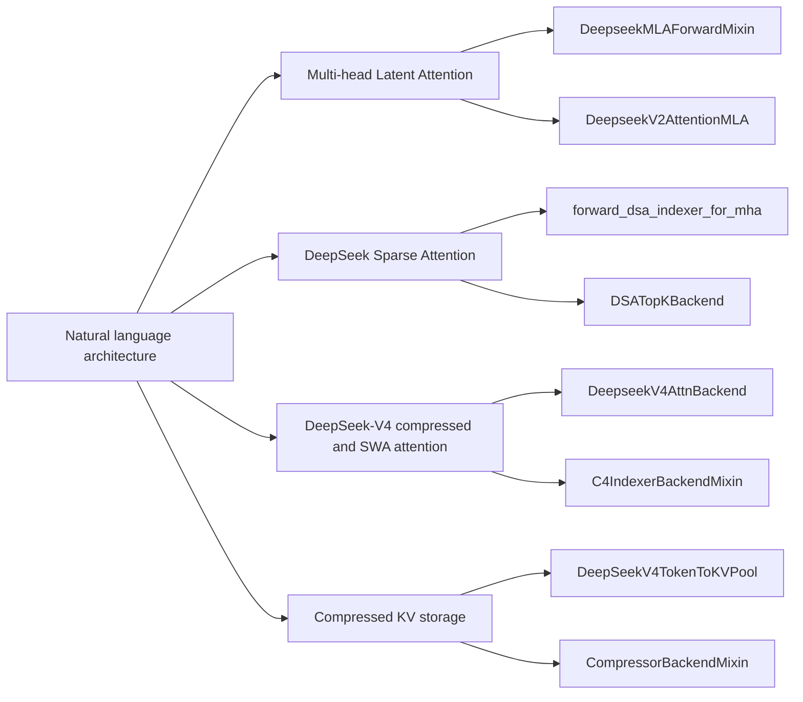
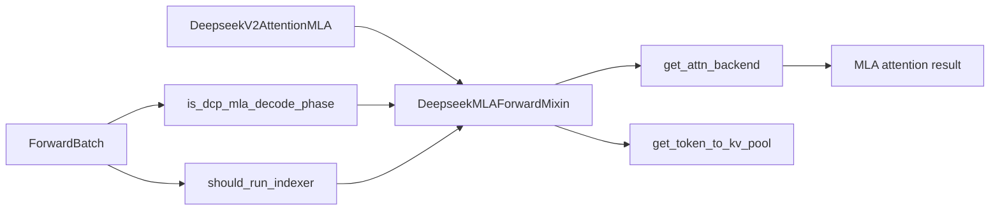
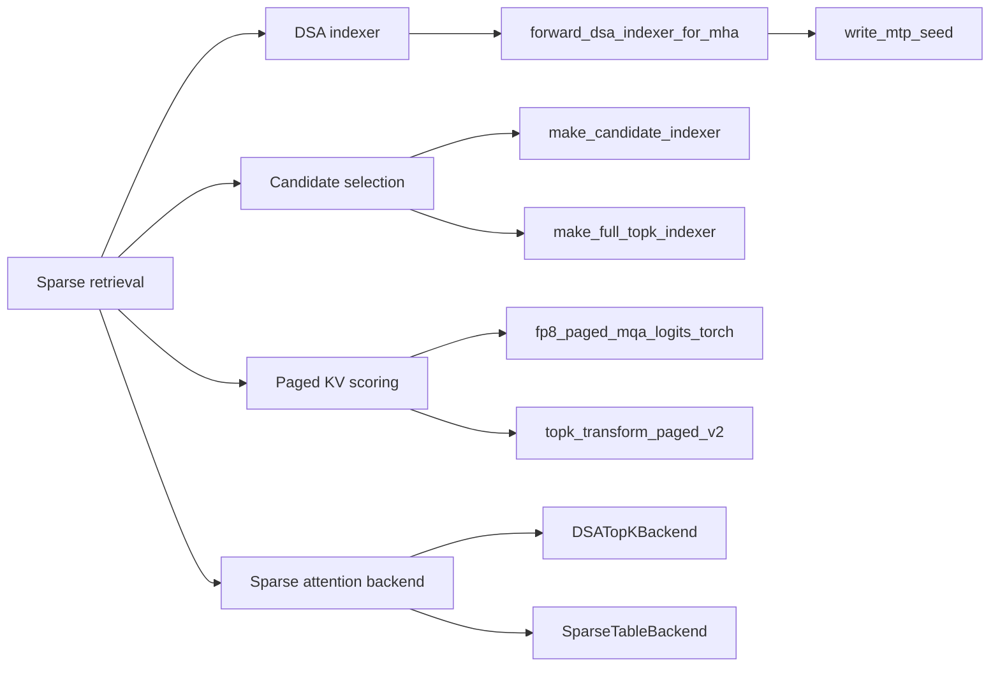
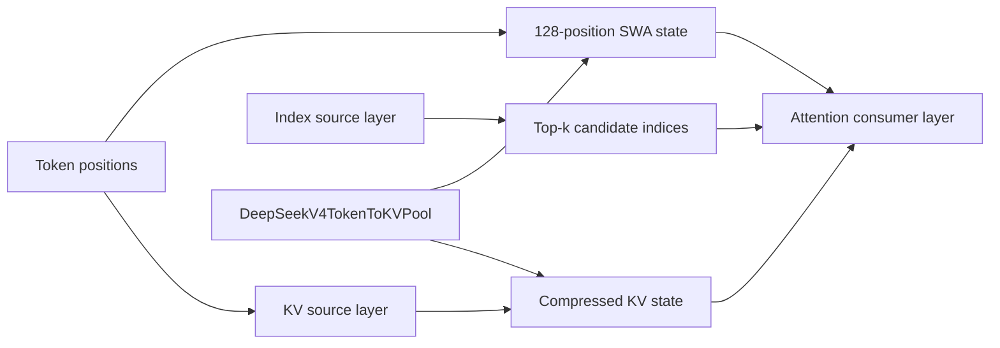

<!-- source: DeepWiki mcp.deepwiki.com · repo sgl-project/sglang · page 8.2 DeepSeek Architecture and MLA · fetched 2026-10-30 -->

# DeepSeek Architecture and MLA

Relevant source files

The following files were used as context for generating this wiki page:

- [python/sglang/kernels/jit/csrc/deepseek_v4/flashmla_sched_meta.cuh](python/sglang/kernels/jit/csrc/deepseek_v4/flashmla_sched_meta.cuh)
- [python/sglang/kernels/jit/csrc/deepseek_v4/fp4_indexer_rope.cuh](python/sglang/kernels/jit/csrc/deepseek_v4/fp4_indexer_rope.cuh)
- [python/sglang/kernels/ops/attention/dsv4/candidate_blocks.py](python/sglang/kernels/ops/attention/dsv4/candidate_blocks.py)
- [python/sglang/kernels/ops/attention/dsv4/fp4_indexer.py](python/sglang/kernels/ops/attention/dsv4/fp4_indexer.py)
- [python/sglang/kernels/ops/attention/dsv4/fp4_indexer_rope.py](python/sglang/kernels/ops/attention/dsv4/fp4_indexer_rope.py)
- [python/sglang/kernels/ops/attention/dsv4/fp4_rope_fake_quant.py](python/sglang/kernels/ops/attention/dsv4/fp4_rope_fake_quant.py)
- [python/sglang/kernels/ops/attention/dsv4/index_logits.py](python/sglang/kernels/ops/attention/dsv4/index_logits.py)
- [python/sglang/kernels/ops/attention/dsv4/sparse_prefill_kernels.py](python/sglang/kernels/ops/attention/dsv4/sparse_prefill_kernels.py)
- [python/sglang/kernels/ops/attention/flash_mla_interface.py](python/sglang/kernels/ops/attention/flash_mla_interface.py)
- [python/sglang/kernels/ops/communication/all_reduce_mhc.py](python/sglang/kernels/ops/communication/all_reduce_mhc.py)
- [python/sglang/kernels/ops/kvcache/__init__.py](python/sglang/kernels/ops/kvcache/__init__.py)
- [python/sglang/kernels/ops/kvcache/dsv41_window_layout.py](python/sglang/kernels/ops/kvcache/dsv41_window_layout.py)
- [python/sglang/kernels/ops/kvcache/dsv4_request_window_copy.py](python/sglang/kernels/ops/kvcache/dsv4_request_window_copy.py)
- [python/sglang/kernels/ops/layernorm/hc_combine_norm.py](python/sglang/kernels/ops/layernorm/hc_combine_norm.py)
- [python/sglang/kernels/ops/layernorm/mhc.py](python/sglang/kernels/ops/layernorm/mhc.py)
- [python/sglang/kernels/ops/layernorm/mhc_mega.py](python/sglang/kernels/ops/layernorm/mhc_mega.py)
- [python/sglang/srt/arg_groups/deepseek_v4_hook.py](python/sglang/srt/arg_groups/deepseek_v4_hook.py)
- [python/sglang/srt/batch_overlap/operations.py](python/sglang/srt/batch_overlap/operations.py)
- [python/sglang/srt/layers/attention/deepseek_v4_backend.py](python/sglang/srt/layers/attention/deepseek_v4_backend.py)
- [python/sglang/srt/layers/attention/deepseek_v4_backend_hip_radix.py](python/sglang/srt/layers/attention/deepseek_v4_backend_hip_radix.py)
- [python/sglang/srt/layers/attention/dsv4/compressor.py](python/sglang/srt/layers/attention/dsv4/compressor.py)
- [python/sglang/srt/layers/attention/dsv4/compressor_v2.py](python/sglang/srt/layers/attention/dsv4/compressor_v2.py)
- [python/sglang/srt/layers/attention/dsv4/indexer.py](python/sglang/srt/layers/attention/dsv4/indexer.py)
- [python/sglang/srt/layers/attention/dsv4/metadata.py](python/sglang/srt/layers/attention/dsv4/metadata.py)
- [python/sglang/srt/layers/attention/dsv4/sparse_prefill_utils.py](python/sglang/srt/layers/attention/dsv4/sparse_prefill_utils.py)
- [python/sglang/srt/layers/attention/dsv4/v41_indexer/__init__.py](python/sglang/srt/layers/attention/dsv4/v41_indexer/__init__.py)
- [python/sglang/srt/layers/attention/dsv4/v41_indexer/dense_blocks.py](python/sglang/srt/layers/attention/dsv4/v41_indexer/dense_blocks.py)
- [python/sglang/srt/layers/attention/dsv4/v41_indexer/full_topk.py](python/sglang/srt/layers/attention/dsv4/v41_indexer/full_topk.py)
- [python/sglang/srt/layers/attention/dsv4/v41_indexer/scoring.py](python/sglang/srt/layers/attention/dsv4/v41_indexer/scoring.py)
- [python/sglang/srt/layers/attention/dsv4/v41_indexer/sparse_table.py](python/sglang/srt/layers/attention/dsv4/v41_indexer/sparse_table.py)
- [python/sglang/srt/layers/attention/dsv4/v41_indexer/types.py](python/sglang/srt/layers/attention/dsv4/v41_indexer/types.py)
- [python/sglang/srt/layers/aux_hidden_states.py](python/sglang/srt/layers/aux_hidden_states.py)
- [python/sglang/srt/layers/radix_attention.py](python/sglang/srt/layers/radix_attention.py)
- [python/sglang/srt/layers/rocm_linear_utils.py](python/sglang/srt/layers/rocm_linear_utils.py)
- [python/sglang/srt/mem_cache/deepseek_v4_memory_pool.py](python/sglang/srt/mem_cache/deepseek_v4_memory_pool.py)
- [python/sglang/srt/mem_cache/dsv41_request_window.py](python/sglang/srt/mem_cache/dsv41_request_window.py)
- [python/sglang/srt/model_executor/forward_batch_deepseek_mha_mixin.py](python/sglang/srt/model_executor/forward_batch_deepseek_mha_mixin.py)
- [python/sglang/srt/models/deepseek_common/amd/deepseek_v2_hip_moe.py](python/sglang/srt/models/deepseek_common/amd/deepseek_v2_hip_moe.py)
- [python/sglang/srt/models/deepseek_common/attention_backend_handler.py](python/sglang/srt/models/deepseek_common/attention_backend_handler.py)
- [python/sglang/srt/models/deepseek_common/attention_forward_methods/__init__.py](python/sglang/srt/models/deepseek_common/attention_forward_methods/__init__.py)
- [python/sglang/srt/models/deepseek_common/attention_forward_methods/forward_methods.py](python/sglang/srt/models/deepseek_common/attention_forward_methods/forward_methods.py)
- [python/sglang/srt/models/deepseek_common/attention_forward_methods/forward_mha.py](python/sglang/srt/models/deepseek_common/attention_forward_methods/forward_mha.py)
- [python/sglang/srt/models/deepseek_common/attention_forward_methods/forward_mha_rocm.py](python/sglang/srt/models/deepseek_common/attention_forward_methods/forward_mha_rocm.py)
- [python/sglang/srt/models/deepseek_common/attention_forward_methods/forward_mla_fused_rope_rocm.py](python/sglang/srt/models/deepseek_common/attention_forward_methods/forward_mla_fused_rope_rocm.py)
- [python/sglang/srt/models/deepseek_common/attention_forward_methods/forward_mla_rocm.py](python/sglang/srt/models/deepseek_common/attention_forward_methods/forward_mla_rocm.py)
- [python/sglang/srt/models/deepseek_common/deepseek_weight_loader.py](python/sglang/srt/models/deepseek_common/deepseek_weight_loader.py)
- [python/sglang/srt/models/deepseek_common/utils.py](python/sglang/srt/models/deepseek_common/utils.py)
- [python/sglang/srt/models/deepseek_v2.py](python/sglang/srt/models/deepseek_v2.py)
- [python/sglang/srt/models/deepseek_v4.py](python/sglang/srt/models/deepseek_v4.py)
- [python/sglang/srt/models/deepseek_v4_boundary.py](python/sglang/srt/models/deepseek_v4_boundary.py)
- [python/sglang/srt/models/deepseek_v4_mhc.py](python/sglang/srt/models/deepseek_v4_mhc.py)
- [python/sglang/srt/models/deepseek_v4_nextn.py](python/sglang/srt/models/deepseek_v4_nextn.py)
- [test/manual/test_dsv41_ragged_prefill.py](test/manual/test_dsv41_ragged_prefill.py)
- [test/registered/attention/unittests/dsv4/test_deepseek_v4.py](test/registered/attention/unittests/dsv4/test_deepseek_v4.py)
- [test/registered/kernels/ops/attention/test_combine_topk_swa_indices.py](test/registered/kernels/ops/attention/test_combine_topk_swa_indices.py)
- [test/registered/kernels/ops/attention/test_dense_prefill_indexer.py](test/registered/kernels/ops/attention/test_dense_prefill_indexer.py)
- [test/registered/kernels/ops/attention/test_dsv41_prefill_sparse_indexer.py](test/registered/kernels/ops/attention/test_dsv41_prefill_sparse_indexer.py)
- [test/registered/kernels/ops/attention/test_flashmla_sched_meta.py](test/registered/kernels/ops/attention/test_flashmla_sched_meta.py)
- [test/registered/kernels/ops/attention/test_fp4_indexer.py](test/registered/kernels/ops/attention/test_fp4_indexer.py)
- [test/registered/kernels/ops/attention/test_q8kv8_sparse_prefill_backend.py](test/registered/kernels/ops/attention/test_q8kv8_sparse_prefill_backend.py)
- [test/registered/kernels/ops/gemm/test_minimax_fused_qkv_index_gemm.py](test/registered/kernels/ops/gemm/test_minimax_fused_qkv_index_gemm.py)
- [test/registered/kernels/ops/layernorm/test_mhc_aiter_hip.py](test/registered/kernels/ops/layernorm/test_mhc_aiter_hip.py)
- [test/registered/kernels/ops/layernorm/test_mhc_stream_mean.py](test/registered/kernels/ops/layernorm/test_mhc_stream_mean.py)
- [test/registered/unit/layers/test_dsv41_late_layer_tail_readers.py](test/registered/unit/layers/test_dsv41_late_layer_tail_readers.py)
- [test/registered/unit/layers/test_dsv4_nonpaged_indexer.py](test/registered/unit/layers/test_dsv4_nonpaged_indexer.py)
- [test/registered/unit/layers/test_radix_attention.py](test/registered/unit/layers/test_radix_attention.py)
- [test/registered/unit/mem_cache/test_dsv4_compressed_pools.py](test/registered/unit/mem_cache/test_dsv4_compressed_pools.py)
- [test/registered/unit/models/test_deepseek_mla_dispatch.py](test/registered/unit/models/test_deepseek_mla_dispatch.py)
- [test/registered/unit/models/test_deepseek_quark_block_fp8_loading.py](test/registered/unit/models/test_deepseek_quark_block_fp8_loading.py)
- [test/registered/unit/models/test_deepseek_v4_boundary.py](test/registered/unit/models/test_deepseek_v4_boundary.py)
- [test/registered/unit/models/test_nope_mha_k_cast.py](test/registered/unit/models/test_nope_mha_k_cast.py)
- [test/registered/unit/models/test_rocm_mla_absorb_fusion_gate.py](test/registered/unit/models/test_rocm_mla_absorb_fusion_gate.py)

## Purpose and Scope

This page explains the DeepSeek-V2/V3 attention path and the DeepSeek-V4/V4.1 architecture exposed by SGLang’s implementation. It focuses on MLA, DSA/V4 indexers, compressed and sliding-window KV storage, backend selection, and the relationship between these concepts and code entities. The available source excerpts do not expose every implementation body, so details are limited to behavior supported by the cited code and documentation. [python/sglang/srt/models/deepseek_common/attention_forward_methods/forward_mha.py:123-140](), [python/sglang/srt/models/deepseek_common/attention_forward_methods/forward_mla.py:116-161](), [docs/cookbook/autoregressive/DeepSeek/DeepSeek-V4_1.mdx:98-104]()

Sources: [python/sglang/srt/models/deepseek_common/attention_forward_methods/forward_mha.py:123-140](), [python/sglang/srt/models/deepseek_common/attention_forward_methods/forward_mla.py:116-161](), [docs/cookbook/autoregressive/DeepSeek/DeepSeek-V4_1.mdx:98-104]()

---

## DeepSeek Model Architecture

DeepSeek-V2/V3 attention in the supplied implementation is represented by `DeepseekV2AttentionMLA`. The MLA forward mixin is shared code that handles forward-mode decisions, indexer reuse, and attention preparation. The V3 attention comments document separate non-RoPE and RoPE query/key dimensions, plus a value dimension; they also describe MHA forward modes used for cases such as chunked KV processing. [python/sglang/srt/models/deepseek_common/attention_forward_methods/forward_mla.py:63-68](), [python/sglang/srt/models/deepseek_common/attention_forward_methods/forward_mla.py:116-161](), [python/sglang/srt/models/deepseek_common/attention_forward_methods/forward_mha.py:123-165]()

The supplied V4.1 deployment documentation describes a sparse-attention MoE model with 40 decoder layers, 384 routed experts selected at top-6, and one shared expert. It describes one 512-wide KV latent per position, reused as key and value across 64 query heads, with no separate value projection. [docs/cookbook/autoregressive/DeepSeek/DeepSeek-V4_1.mdx:98-104]()

| Model or concept | Implementation or architectural detail |
|---|---|
| DeepSeek-V2/V3 MLA | `DeepseekV2AttentionMLA` is the MLA module referenced by the shared forward mixin. [python/sglang/srt/models/deepseek_common/attention_forward_methods/forward_mla.py:63-68]() |
| DeepSeek-V3 attention dimensions | The implementation comments list `qk_nope_head_dim = 128`, `qk_rope_head_dim = 64`, `qk_head_dim = 192`, and `v_head_dim = 128`. [python/sglang/srt/models/deepseek_common/attention_forward_methods/forward_mha.py:123-128]() |
| DeepSeek-V4.1 attention | One 512-wide latent per position supplies key and value information for 64 query heads, according to the deployment architecture description. [docs/cookbook/autoregressive/DeepSeek/DeepSeek-V4_1.mdx:100-104]() |
| DeepSeek-V4.1 sparse retrieval | The documentation distinguishes KV source layers from index source layers and states that retrieving layers select a top-512 candidate set. [docs/cookbook/autoregressive/DeepSeek/DeepSeek-V4_1.mdx:102-104]() |

### Natural-language-to-code map

This diagram connects the architecture terms used in this page to searchable code symbols and paths. [python/sglang/srt/models/deepseek_common/attention_forward_methods/forward_mla.py:63-68](), [python/sglang/srt/models/deepseek_common/attention_forward_methods/forward_mla.py:116-161](), [python/sglang/srt/layers/attention/dsv4/indexer.py:19-42](), [python/sglang/srt/layers/attention/deepseek_v4_backend.py:57-93](), [python/sglang/srt/mem_cache/deepseek_v4_memory_pool.py:53-115]()

**Diagram: Architecture terms mapped to code entities**

Sources: [python/sglang/srt/models/deepseek_common/attention_forward_methods/forward_mla.py:63-68](), [python/sglang/srt/models/deepseek_common/attention_forward_methods/forward_mla.py:116-161](), [python/sglang/srt/layers/attention/dsv4/indexer.py:19-42](), [python/sglang/srt/layers/attention/deepseek_v4_backend.py:57-93](), [python/sglang/srt/mem_cache/deepseek_v4_memory_pool.py:53-115]()

---

## Multi-head Latent Attention (MLA)

### Forward path and dataflow

`DeepseekMLAForwardMixin` provides MLA-specific forward behavior around a `DeepseekV2AttentionMLA` module. It identifies DCP decode-related modes, initializes MLA execution state, decides whether an indexer should run, and gates a BMM-to-attention fusion path. The fusion predicate checks conditions including DCP size, prefill graph scope, DSA use, DeepGEMM use, LoRA activity, and learnable sink parameters. [python/sglang/srt/models/deepseek_common/attention_forward_methods/forward_mla.py:116-184]()

The code shown here does not complete projection and attention internals. The diagram therefore illustrates the supported execution relationship—attention module, forward mixin, backend, and KV pool—without asserting unshown projection internals. The implementation imports `get_attn_backend` and `get_token_to_kv_pool`; the forward-mixin logic uses `ForwardBatch` to make mode-dependent decisions. [python/sglang/srt/models/deepseek_common/attention_forward_methods/forward_mla.py:28-32](), [python/sglang/srt/models/deepseek_common/attention_forward_methods/forward_mla.py:116-161]()

**Diagram: MLA forward coordination**

Sources: [python/sglang/srt/models/deepseek_common/attention_forward_methods/forward_mla.py:28-32](), [python/sglang/srt/models/deepseek_common/attention_forward_methods/forward_mla.py:63-68](), [python/sglang/srt/models/deepseek_common/attention_forward_methods/forward_mla.py:116-184]()

### Indexer reuse and distributed modes

`is_dcp_mla_decode_phase` returns false when DCP size is one; otherwise it recognizes decode, target-verify, and DSA extend modes. `is_dcp_q_replicate_phase` identifies decode and target-verify when query projection replication is enabled. These checks let the forward path distinguish attention phases that need distributed handling. [python/sglang/srt/models/deepseek_common/attention_forward_methods/forward_mla.py:116-135]()

`should_run_indexer` prevents shared `skip_topk` layers from running an indexer whose weights are absent, and permits the NextN fallback when that layer has its own weights. The method’s comments also explain why missing carried top-k indices alone must not trigger recomputation: that could invoke an uninitialized indexer. [python/sglang/srt/models/deepseek_common/attention_forward_methods/forward_mla.py:142-161]()

The MHA-side `forward_dsa_indexer_for_mha` runs an indexer using hidden states, `q_lora`, positions, the forward batch, and layer ID. When speculative metadata requests a DSA seed, it requires returned top-k indices and writes them using `write_mtp_seed`. [python/sglang/srt/models/deepseek_common/attention_forward_methods/forward_mha.py:95-120]()

Sources: [python/sglang/srt/models/deepseek_common/attention_forward_methods/forward_mla.py:116-161](), [python/sglang/srt/models/deepseek_common/attention_forward_methods/forward_mha.py:95-120]()

### MHA and MLA execution modes

The DeepSeek-V3 MHA comments describe three paths: normal attention for an empty KV prefix, one-shot attention for a short prefix, and chunked-KV attention when the prefix exceeds the configured chunk capacity. In the chunked case, successive prefix chunks produce outputs and log-sum-exp values that are accumulated. [python/sglang/srt/models/deepseek_common/attention_forward_methods/forward_mha.py:142-165]()

`resolve_attn_backend` unwraps `TboAttnBackend`, selects the full-attention child of hybrid backends, and selects a prefill/decode child when a backend exposes `_select_backend`. This resolves the actual backend serving the current forward mode. [python/sglang/srt/models/deepseek_common/attention_forward_methods/forward_mha.py:45-66]()

| Path | Condition described in implementation comments | Effect |
|---|---|---|
| `forward_normal` | First chunked-prefill batch with no KV prefix. [python/sglang/srt/models/deepseek_common/attention_forward_methods/forward_mha.py:142-149]() | Performs attention over the current extended tokens. [python/sglang/srt/models/deepseek_common/attention_forward_methods/forward_mha.py:142-149]() |
| `forward_normal_one_shot` | Prefix fits within the configured chunk capacity. [python/sglang/srt/models/deepseek_common/attention_forward_methods/forward_mha.py:150-156]() | Uses combined prefix and extended KV indices. [python/sglang/srt/models/deepseek_common/attention_forward_methods/forward_mha.py:150-156]() |
| `forward_normal_chunked_kv` | Prefix exceeds maximum KV chunk capacity. [python/sglang/srt/models/deepseek_common/attention_forward_methods/forward_mha.py:157-165]() | Processes multiple KV chunks and accumulates partial attention results. [python/sglang/srt/models/deepseek_common/attention_forward_methods/forward_mha.py:157-165]() |

Sources: [python/sglang/srt/models/deepseek_common/attention_forward_methods/forward_mha.py:45-66](), [python/sglang/srt/models/deepseek_common/attention_forward_methods/forward_mha.py:123-165]()

---

## DSA, DSV4 Indexers, and Sparse Retrieval

### DSA indexer path

The shared MHA forward helper invokes an indexer with `hidden_states`, `q_lora`, `positions`, `forward_batch`, and `layer_id`. Its purpose is to populate indexer state and, when requested by speculative metadata, publish top-k indices as an MTP seed. [python/sglang/srt/models/deepseek_common/attention_forward_methods/forward_mha.py:95-120]()

`DSATopKBackend` is imported by the V4 attention backend, while the DSV4 indexer module exposes kernels and helpers including `plan_topk_v2`, `topk_transform_paged`, and `topk_transform_paged_v2`. The shown code establishes these integration points; it does not expose all scoring or selection implementation details. [python/sglang/srt/layers/attention/deepseek_v4_backend.py:53-70](), [python/sglang/srt/layers/attention/dsv4/indexer.py:19-42]()

### DSV4 indexer and candidate selection

The V4 attention backend imports `C4IndexerBackendMixin`, DSV4 indexer metadata types, and V4.1 indexer factories `make_candidate_indexer` and `make_full_topk_indexer`. It also imports `prefill_k_slots` and `SparseTableBackend`, connecting candidate scoring and sparse-table handling to backend execution. [python/sglang/srt/layers/attention/deepseek_v4_backend.py:69-95]()

The general DSV4 indexer module includes FP8 and FP4 quantization-related paths and paged MQA-logit helpers. For example, `fp8_paged_mqa_logits_torch` consumes a query, paged FP8 KV cache, weights, sequence lengths, and a page table; it computes per-token scores and masks positions beyond each sequence length. [python/sglang/srt/layers/attention/dsv4/indexer.py:73-103](), [python/sglang/srt/layers/attention/dsv4/indexer.py:106-145]()

V4.1’s documented retrieval design separates KV source layers and index source layers. The documentation states that extra index layers can rescore keys from a source layer, and that retrieving layers select top-512 candidates. These are model-specific architecture facts; the backend and indexer modules are the corresponding implementation areas. [docs/cookbook/autoregressive/DeepSeek/DeepSeek-V4_1.mdx:102-104](), [python/sglang/srt/layers/attention/deepseek_v4_backend.py:69-95]()

### Natural-language-to-code map: sparse attention

This diagram maps sparse retrieval terminology to the implementation symbols used for indexer execution, top-k handling, and backend metadata. [python/sglang/srt/models/deepseek_common/attention_forward_methods/forward_mha.py:95-120](), [python/sglang/srt/layers/attention/dsv4/indexer.py:19-42](), [python/sglang/srt/layers/attention/dsv4/indexer.py:82-145](), [python/sglang/srt/layers/attention/deepseek_v4_backend.py:57-95]()

**Diagram: Sparse retrieval terms mapped to code entities**

Sources: [python/sglang/srt/models/deepseek_common/attention_forward_methods/forward_mha.py:95-120](), [python/sglang/srt/layers/attention/dsv4/indexer.py:19-42](), [python/sglang/srt/layers/attention/dsv4/indexer.py:82-145](), [python/sglang/srt/layers/attention/deepseek_v4_backend.py:57-95]()

### DSA and NSA terminology

The supplied code identifies DSA explicitly through `DSATopKBackend`, DSA utilities, and DSA indexer calls. The supplied documentation identifies V4.1 as sparse attention and describes its candidate retrieval design. These excerpts do not establish that NSA and DSA are interchangeable names, nor do they provide an NSA-specific implementation path; this page therefore treats DSA and V4 sparse retrieval as the code-supported topics. [python/sglang/srt/layers/attention/deepseek_v4_backend.py:53-59](), [python/sglang/srt/models/deepseek_common/attention_forward_methods/forward_mha.py:95-120](), [docs/cookbook/autoregressive/DeepSeek/DeepSeek-V4_1.mdx:100-104]()

Sources: [python/sglang/srt/layers/attention/deepseek_v4_backend.py:53-59](), [python/sglang/srt/models/deepseek_common/attention_forward_methods/forward_mha.py:95-120](), [docs/cookbook/autoregressive/DeepSeek/DeepSeek-V4_1.mdx:100-104]()

---

## DeepSeek-V4 Compressed KV and Sliding-Window Attention

### V4 KV organization

The V4.1 architecture description distinguishes compressed latents from a 128-position sliding window. It states that compressed latents are produced at source layers and shared forward, while the sliding-window state is computed per layer and remains bounded by the window size. It also describes compression ratios that change across layer ranges. [docs/cookbook/autoregressive/DeepSeek/DeepSeek-V4_1.mdx:100-104]()

The memory-pool helpers support compression ratios 2, 4, and 128 for compression-state rings. `collect_sources_by_ratio` validates configured ratios and groups source layers by ratio; ratios 1 and 2 use `kv_source_layers`, while ratios 4 and 128 use layers directly. [python/sglang/srt/mem_cache/deepseek_v4_memory_pool.py:60-115]()

`DeepSeekV4TokenToKVPool` is imported by the V4 attention backend and is the pool type used there. The memory-pool module also defines `resolve_compress_state_ring_size`, which derives draft-token count from speculative configuration before calculating ring capacity. [python/sglang/srt/layers/attention/deepseek_v4_backend.py:109-115](), [python/sglang/srt/mem_cache/deepseek_v4_memory_pool.py:60-91]()

**Diagram: V4 attention and compressed-state flow**

Sources: [docs/cookbook/autoregressive/DeepSeek/DeepSeek-V4_1.mdx:100-104](), [python/sglang/srt/mem_cache/deepseek_v4_memory_pool.py:60-115](), [python/sglang/srt/layers/attention/deepseek_v4_backend.py:109-115]()

### Compression state and cache layout

The memory-pool code defines ring sizing for speculative and non-speculative use. For ratio 2, speculative sizing grows to a power of two based on draft-token count; for ratios 4 and 128, it selects different ring sizes, and online C128 compression can reduce the ring size to one subject to an MTP guard. [python/sglang/srt/mem_cache/deepseek_v4_memory_pool.py:60-79]()

The V4 attention backend imports compression metadata preparation, paged compressor data creation, KV layout handling, and dequantization helpers. The HIP backend shares the main V4 backend types and adds ROCm-specific sparse-prefill and attention operations. [python/sglang/srt/layers/attention/deepseek_v4_backend.py:23-43](), [python/sglang/srt/layers/attention/deepseek_v4_backend.py:59-75](), [python/sglang/srt/layers/attention/deepseek_v4_backend_hip_radix.py:23-75]()

Sources: [python/sglang/srt/mem_cache/deepseek_v4_memory_pool.py:60-79](), [python/sglang/srt/layers/attention/deepseek_v4_backend.py:23-75](), [python/sglang/srt/layers/attention/deepseek_v4_backend_hip_radix.py:23-75]()

---

## Attention Backend Selection and Platform Constraints

`apply_deepseek_v4_defaults` resolves the default V4 attention backend. Its selection logic chooses `flashmla_mega` only for DeepSeek-V4.1 on CUDA with supported SM100 hardware, FP8 E4M3 KV cache, and an allowed KV layout; otherwise it chooses `flashmla`. It also validates explicit `flashmla_mega` and `trtllm` choices. [python/sglang/srt/arg_groups/deepseek_v4_hook.py:29-42](), [python/sglang/srt/arg_groups/deepseek_v4_hook.py:45-93]()

For the `trtllm` backend, the shown validation requires CUDA and SM100/SM103 support, FP8 E4M3 KV cache, no HiSparse, no context parallelism, no PD disaggregation, and positive chunked-prefill size. The hook also sets a default `max_running_requests` of 256 when none is configured. [python/sglang/srt/arg_groups/deepseek_v4_hook.py:83-128]()

The V4 attention backend defines defaults including `SWA_WINDOW = 128` and `DEFAULT_INDEX_TOPK = 512`. The HIP backend defines the same constants and has a separate backend module with ROCm-specific attention, sparse-prefill, and indexer helpers. [python/sglang/srt/layers/attention/deepseek_v4_backend.py:156-163](), [python/sglang/srt/layers/attention/deepseek_v4_backend_hip_radix.py:130-136]()

| Backend/configuration behavior | Constraint or default |
|---|---|
| Automatic backend | `flashmla_mega` is selected only under the stated V4.1/CUDA/SM100/FP8/layout conditions; otherwise automatic selection returns `flashmla`. [python/sglang/srt/arg_groups/deepseek_v4_hook.py:29-42]() |
| `flashmla_mega` | Requires DeepSeek-V4.1 on CUDA with SM100/SM103 support. [python/sglang/srt/arg_groups/deepseek_v4_hook.py:74-81]() |
| `trtllm` | Requires FP8 E4M3 KV, chunked prefill, and excludes HiSparse, context parallelism, and PD disaggregation in the shown validation. [python/sglang/srt/arg_groups/deepseek_v4_hook.py:83-118]() |
| Prefill context parallelism | V4 accepts `interleave` or `zigzag`; zigzag is restricted to NPU in the shown validation. [python/sglang/srt/arg_groups/deepseek_v4_hook.py:143-158]() |

Sources: [python/sglang/srt/arg_groups/deepseek_v4_hook.py:29-42](), [python/sglang/srt/arg_groups/deepseek_v4_hook.py:74-128](), [python/sglang/srt/arg_groups/deepseek_v4_hook.py:143-158](), [python/sglang/srt/layers/attention/deepseek_v4_backend.py:156-163](), [python/sglang/srt/layers/attention/deepseek_v4_backend_hip_radix.py:130-136]()

---

## Quantization and Indexer Arithmetic

The V4 indexer imports FP4 and FP8 quantization helpers and selects FP8 dtype according to platform support. Its paged FP8 MQA-logit helper checks tensor layouts, gathers pages through a page table, computes scores, masks invalid positions using sequence lengths, and pads or truncates to the requested maximum sequence length. [python/sglang/srt/layers/attention/dsv4/indexer.py:19-42](), [python/sglang/srt/layers/attention/dsv4/indexer.py:73-145]()

The V4 memory-pool utility `get_dsv4_indexer_bytes_per_token` returns a different payload-and-scale byte estimate depending on whether the FP4 indexer is used. This supports memory accounting for compressed indexer tokens; it is separate from the model’s expert-weight quantization. [python/sglang/srt/mem_cache/deepseek_v4_memory_pool.py:53-58]()

Sources: [python/sglang/srt/layers/attention/dsv4/indexer.py:19-42](), [python/sglang/srt/layers/attention/dsv4/indexer.py:73-145](), [python/sglang/srt/mem_cache/deepseek_v4_memory_pool.py:53-58]()

---

## Speculative Decoding Integration

The V4 defaults hook restricts the shown speculative-algorithm choices to `EAGLE` and `DSPARK`; for EAGLE it requires `speculative_eagle_topk == 1`. [python/sglang/srt/arg_groups/deepseek_v4_hook.py:130-140]()

The V4.1 deployment documentation identifies DSpark as a bundled three-stage draft and gives the deployment flag `--speculative-algorithm DSPARK` with a configurable block size. The V4 memory pool includes draft-aware ring sizing and DSpark-specific SWA ring helpers, connecting speculative execution to cache-state allocation. [docs/src/snippets/configs/deepseek-ai/deepseek-v4_1.jsx:91-100](), [python/sglang/srt/mem_cache/deepseek_v4_memory_pool.py:60-79](), [python/sglang/srt/mem_cache/deepseek_v4_memory_pool.py:125-153]()

`DeepseekModelNextN` is an inference-only model class that constructs a `DeepseekV2DecoderLayer` with `is_nextn=True`, and defines token embedding and normalization components used by that model path. [python/sglang/srt/models/deepseek_nextn.py:15-16](), [python/sglang/srt/models/deepseek_nextn.py:58-90](), [python/sglang/srt/models/deepseek_nextn.py:119-140]()

Sources: [python/sglang/srt/arg_groups/deepseek_v4_hook.py:130-140](), [docs/src/snippets/configs/deepseek-ai/deepseek-v4_1.jsx:91-100](), [python/sglang/srt/mem_cache/deepseek_v4_memory_pool.py:60-79](), [python/sglang/srt/mem_cache/deepseek_v4_memory_pool.py:125-153](), [python/sglang/srt/models/deepseek_nextn.py:15-16](), [python/sglang/srt/models/deepseek_nextn.py:58-90]()

---

## Correctness Coverage

The DSV4 attention test module covers SWA-only cases through the `dsv4` backend, CUDA-graph-style decode cases, and compression-ratio cases including C2, C4, and C128. Its test comments state that the compression cases compare the attention integration against an independent PyTorch SWA plus extra-K reference, while compressor-math correctness is deferred in that test suite. [test/registered/attention/unittests/dsv4/test_deepseek_v4.py:1-12](), [test/registered/attention/unittests/dsv4/test_deepseek_v4.py:47-85](), [test/registered/attention/unittests/dsv4/test_deepseek_v4.py:86-150]()

The tests include eager extend/decode and CUDA-graph decode runner cases, and define target-verify cases for SWA and compressed paths. [test/registered/attention/unittests/dsv4/test_deepseek_v4.py:47-85](), [test/registered/attention/unittests/dsv4/test_deepseek_v4.py:152-181]()

Sources: [test/registered/attention/unittests/dsv4/test_deepseek_v4.py:1-12](), [test/registered/attention/unittests/dsv4/test_deepseek_v4.py:47-85](), [test/registered/attention/unittests/dsv4/test_deepseek_v4.py:86-181]()

---

## Key Code Entities

| Code symbol | Role in the supplied implementation excerpts |
|---|---|
| `DeepseekMLAForwardMixin` | MLA forward-mode checks, indexer-run policy, and BMM fusion eligibility. [python/sglang/srt/models/deepseek_common/attention_forward_methods/forward_mla.py:116-184]() |
| `DeepseekV2AttentionMLA` | Type referenced by the MLA forward mixin; V3 attention dimensions are documented in the MHA forward module. [python/sglang/srt/models/deepseek_common/attention_forward_methods/forward_mla.py:63-68](), [python/sglang/srt/models/deepseek_common/attention_forward_methods/forward_mha.py:123-128]() |
| `forward_dsa_indexer_for_mha` | Invokes an indexer and optionally publishes top-k indices as an MTP seed. [python/sglang/srt/models/deepseek_common/attention_forward_methods/forward_mha.py:95-120]() |
| `C4IndexerBackendMixin` | Indexer backend mixin imported by the V4 attention backend. [python/sglang/srt/layers/attention/deepseek_v4_backend.py:64-70]() |
| `make_candidate_indexer`, `make_full_topk_indexer` | V4.1 indexer factories imported by the V4 attention backend. [python/sglang/srt/layers/attention/deepseek_v4_backend.py:83-92]() |
| `SparseTableBackend` | Sparse-table backend imported by the V4 attention backend. [python/sglang/srt/layers/attention/deepseek_v4_backend.py:92-95]() |
| `DeepSeekV4TokenToKVPool` | V4 KV pool type imported by the attention backend. [python/sglang/srt/layers/attention/deepseek_v4_backend.py:109-115]() |
| `DeepseekModelNextN` | Inference-only NextN model containing a decoder layer configured with `is_nextn=True`. [python/sglang/srt/models/deepseek_nextn.py:15-16](), [python/sglang/srt/models/deepseek_nextn.py:58-60](), [python/sglang/srt/models/deepseek_nextn.py:119-137]() |
| `apply_deepseek_v4_defaults` | Resolves V4 attention defaults and validates backend/platform combinations. [python/sglang/srt/arg_groups/deepseek_v4_hook.py:45-128]() |

Sources: [python/sglang/srt/models/deepseek_common/attention_forward_methods/forward_mla.py:116-184](), [python/sglang/srt/models/deepseek_common/attention_forward_methods/forward_mha.py:95-128](), [python/sglang/srt/layers/attention/deepseek_v4_backend.py:64-115](), [python/sglang/srt/models/deepseek_nextn.py:15-16](), [python/sglang/srt/models/deepseek_nextn.py:58-60](), [python/sglang/srt/arg_groups/deepseek_v4_hook.py:45-128]()

---

## Summary

- The DeepSeek-V2/V3 MLA forward mixin makes execution decisions from `ForwardBatch`, including DCP phase checks, indexer reuse, and fusion eligibility. [python/sglang/srt/models/deepseek_common/attention_forward_methods/forward_mla.py:116-184]()
- The V3 MHA implementation documents normal, one-shot, and chunked-KV attention paths, and resolves nested or phase-specific attention backends. [python/sglang/srt/models/deepseek_common/attention_forward_methods/forward_mha.py:45-66](), [python/sglang/srt/models/deepseek_common/attention_forward_methods/forward_mha.py:142-165]()
- DSA indexing invokes an indexer and can provide top-k seeds for speculative execution; V4 backend modules connect indexer factories, top-k helpers, sparse tables, compression metadata, and attention execution. [python/sglang/srt/models/deepseek_common/attention_forward_methods/forward_mha.py:95-120](), [python/sglang/srt/layers/attention/deepseek_v4_backend.py:59-95]()
- V4.1 combines compressed KV state, bounded sliding-window state, and sparse candidate retrieval; the memory-pool utilities account for compression ratios and speculative ring sizing. [docs/cookbook/autoregressive/DeepSeek/DeepSeek-V4_1.mdx:100-104](), [python/sglang/srt/mem_cache/deepseek_v4_memory_pool.py:60-115]()
- V4 backend selection and validation depend on hardware, KV dtype, context-parallel settings, and prefill configuration. [python/sglang/srt/arg_groups/deepseek_v4_hook.py:29-42](), [python/sglang/srt/arg_groups/deepseek_v4_hook.py:74-128]()

Sources: [python/sglang/srt/models/deepseek_common/attention_forward_methods/forward_mla.py:116-184](), [python/sglang/srt/models/deepseek_common/attention_forward_methods/forward_mha.py:45-66](), [python/sglang/srt/models/deepseek_common/attention_forward_methods/forward_mha.py:95-120](), [python/sglang/srt/layers/attention/deepseek_v4_backend.py:59-95](), [docs/cookbook/autoregressive/DeepSeek/DeepSeek-V4_1.mdx:100-104](), [python/sglang/srt/mem_cache/deepseek_v4_memory_pool.py:60-115](), [python/sglang/srt/arg_groups/deepseek_v4_hook.py:29-42](), [python/sglang/srt/arg_groups/deepseek_v4_hook.py:74-128]()

---

