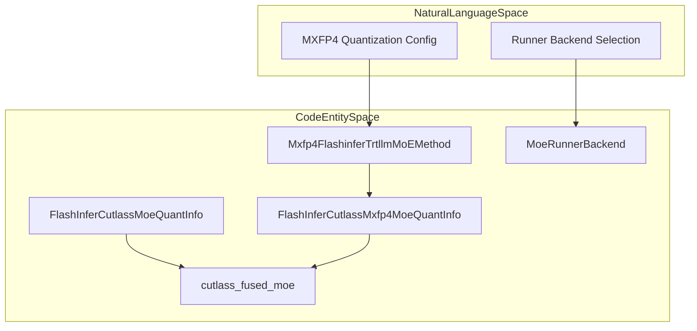
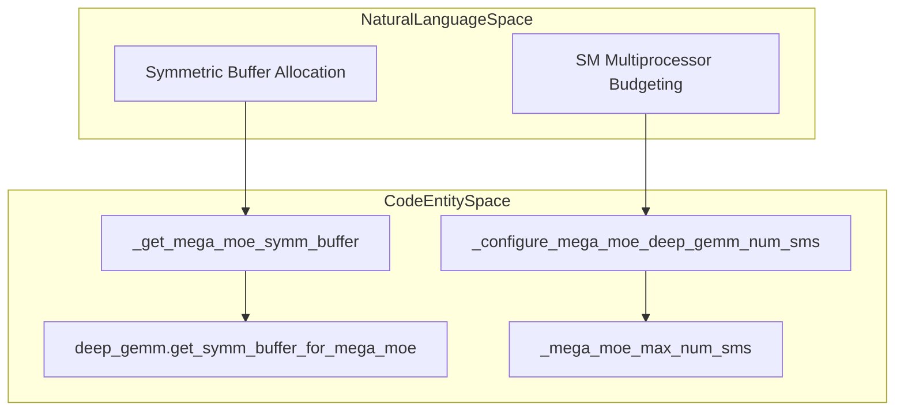

<!-- source: DeepWiki mcp.deepwiki.com · repo sgl-project/sglang · page 8.4 MoE Quantization and Optimization · fetched 2026-10-30 -->

# MoE Quantization and Optimization

Relevant source files

The following files were used as context for generating this wiki page:

- [.github/workflows/auto-tune.yml](.github/workflows/auto-tune.yml)
- [.pre-commit-config.yaml](.pre-commit-config.yaml)
- [docker/Dockerfile.cu134](docker/Dockerfile.cu134)
- [python/sglang/kernels/jit/csrc/deepseek_v4/mega_moe_pre_dispatch.cuh](python/sglang/kernels/jit/csrc/deepseek_v4/mega_moe_pre_dispatch.cuh)
- [python/sglang/kernels/jit/csrc/gemm/per_token_group_quant.cuh](python/sglang/kernels/jit/csrc/gemm/per_token_group_quant.cuh)
- [python/sglang/kernels/ops/moe/__init__.py](python/sglang/kernels/ops/moe/__init__.py)
- [python/sglang/kernels/ops/moe/dsv4.py](python/sglang/kernels/ops/moe/dsv4.py)
- [python/sglang/kernels/ops/moe/mega_gate.py](python/sglang/kernels/ops/moe/mega_gate.py)
- [python/sglang/kernels/ops/quantization/per_token_group_quant.py](python/sglang/kernels/ops/quantization/per_token_group_quant.py)
- [python/sglang/srt/arg_groups/mega_moe_hook.py](python/sglang/srt/arg_groups/mega_moe_hook.py)
- [python/sglang/srt/layers/deep_gemm_wrapper/compile_utils.py](python/sglang/srt/layers/deep_gemm_wrapper/compile_utils.py)
- [python/sglang/srt/layers/deep_gemm_wrapper/entrypoint.py](python/sglang/srt/layers/deep_gemm_wrapper/entrypoint.py)
- [python/sglang/srt/layers/moe/mega_gate.py](python/sglang/srt/layers/moe/mega_gate.py)
- [python/sglang/srt/layers/moe/mega_moe.py](python/sglang/srt/layers/moe/mega_moe.py)
- [python/sglang/srt/layers/quantization/fp8_activation.py](python/sglang/srt/layers/quantization/fp8_activation.py)
- [scripts/lint/check_dockerfile_wheel_pins.py](scripts/lint/check_dockerfile_wheel_pins.py)
- [test/README.md](test/README.md)
- [test/manual/dsv4/test_wo_a_fp8_sm90.py](test/manual/dsv4/test_wo_a_fp8_sm90.py)
- [test/manual/kernels/bench_dense_swiglu_quant.py](test/manual/kernels/bench_dense_swiglu_quant.py)
- [test/registered/attention/test_aiter_cross_layer_kv_guard.py](test/registered/attention/test_aiter_cross_layer_kv_guard.py)
- [test/registered/attention/test_aiter_swa_kv_pool_resolver.py](test/registered/attention/test_aiter_swa_kv_pool_resolver.py)
- [test/registered/kernels/benchmark/quantization/bench_per_token_group_quant.py](test/registered/kernels/benchmark/quantization/bench_per_token_group_quant.py)
- [test/registered/kernels/ops/moe/test_mega_moe_pre_dispatch.py](test/registered/kernels/ops/moe/test_mega_moe_pre_dispatch.py)
- [test/registered/kernels/ops/moe/test_moe_align_small_numel.py](test/registered/kernels/ops/moe/test_moe_align_small_numel.py)
- [test/registered/kernels/ops/quantization/test_per_token_group_quant.py](test/registered/kernels/ops/quantization/test_per_token_group_quant.py)
- [test/registered/unit/layers/moe/test_mega_moe_deepgemm_api.py](test/registered/unit/layers/moe/test_mega_moe_deepgemm_api.py)
- [test/registered/unit/layers/quantization/test_dense_swiglu_fp8.py](test/registered/unit/layers/quantization/test_dense_swiglu_fp8.py)
- [test/registered/unit/layers/quantization/test_fp8_blockwise_linear_backends.py](test/registered/unit/layers/quantization/test_fp8_blockwise_linear_backends.py)
- [test/registered/unit/models/test_mamba2.py](test/registered/unit/models/test_mamba2.py)

## Purpose and Scope

This page covers Mixture-of-Experts (MoE) specific quantization and optimization paths in SGLang, including MXFP4 weight and activation preparation, FlashInfer CUTLASS and TRT-LLM runner interfaces, DeepGEMM MegaMoE (`[python/sglang/srt/layers/moe/mega_moe.py:14-183]()`), DeepGEMM JIT precompilation utils (`[python/sglang/srt/layers/deep_gemm_wrapper/compile_utils.py:59-111]()`), MegaGate (`[python/sglang/srt/layers/moe/mega_gate.py:35-96]()`), and process-wide SM budgeting and dispatch interfaces. It details how the runtime constrains kernel selections, manages memory buffers via `deep_gemm.get_symm_buffer_for_mega_moe` (`[python/sglang/srt/layers/moe/mega_moe.py:148-158]()`), and enforces hardware compatibility constraints (`[python/sglang/srt/arg_groups/mega_moe_hook.py:27-48]()`).

Sources: [python/sglang/srt/layers/moe/mega_moe.py:14-183](), [python/sglang/srt/layers/deep_gemm_wrapper/compile_utils.py:59-111](), [python/sglang/srt/arg_groups/mega_moe_hook.py:27-48]()

## Quantization Methods Overview

MoE quantization schemes in SGLang are distinguished by weight/activation formats, scale conventions, and runner invocation paths.

| Quantization Method / Path | Weight Format & Layout | Activation / Scale Conventions | Code-Level Role |
|---|---|---|---|
| **DeepGEMM MegaMoE** (`fp8xfp4`, `mxf4xmxf4`, `nvfp4xnvfp4`) | Block-scaled FP8 or FP4 weights with TMA alignment | Dynamic block-wise scales stored in symmetric buffers | `mega_moe.py` chooses MMA type and allocates/caches buffers via `_get_mega_moe_symm_buffer` [python/sglang/srt/layers/moe/mega_moe.py:56-60](), [python/sglang/srt/layers/moe/mega_moe.py:119-158]() |
| **FlashInfer CUTLASS Generic MoE** | BF16/FP16, FP8, or packed NVFP4 | Input and weight scale tensors passed via `quant_scales` | `FlashInferCutlassMoeQuantInfo` payload passed to `cutlass_fused_moe` [python/sglang/srt/layers/moe/moe_runner/flashinfer_cutlass.py:50-69]() |
| **CUTLASS MXFP4 MoE** | MXFP4 packed weights with E8M0 block scales | MXFP8 activations or Humming W4A8 triplet | `FlashInferCutlassMxfp4MoeQuantInfo` records weight layouts and path flags [python/sglang/srt/layers/moe/moe_runner/flashinfer_cutlass.py:112-154]() |
| **FlashInfer TRT-LLM MXFP4 MoE** | Packed FP4 weights with inverse block scales | Grouped top-k with sigmoid scoring and correction bias | `Mxfp4FlashinferTrtllmMoEMethod` selects TRT-LLM fused-MoE execution `[python/sglang/srt/layers/quantization/mxfp4_flashinfer_trtllm_moe.py:120-169]()` |

Sources: [python/sglang/srt/layers/moe/mega_moe.py:56-60](), [python/sglang/srt/layers/moe/mega_moe.py:119-158](), [python/sglang/srt/layers/moe/moe_runner/flashinfer_cutlass.py:50-69](), [python/sglang/srt/layers/moe/moe_runner/flashinfer_cutlass.py:112-154]()

## MoE Quantization Architecture and Component Mapping

The quantization and runner boundary carries packed weights, scale tensors, activation configurations, and optional fused-activation parameters. 

### Diagram: Natural Language Space to Code Entity Space (Quantization Payloads)

Sources: [python/sglang/srt/layers/moe/moe_runner/flashinfer_cutlass.py:50-69](), [python/sglang/srt/layers/moe/moe_runner/flashinfer_cutlass.py:112-154](), [python/sglang/srt/layers/quantization/mxfp4_flashinfer_trtllm_moe.py:120-169]()

## MXFP4 MoE Quantization and Layout Preparation

The MXFP4 TRT-LLM method initializes packed `w13_weight` and `w2_weight` parameters with block size 32 (`[python/sglang/srt/layers/quantization/mxfp4_flashinfer_trtllm_moe.py:55-102]()`). Intermediate dimensions are padded to multiples of 128 after tensor-parallel weight loading, inserting zero tails into weight tensors and neutral scale tails into inverse-scale tensors.

`Mxfp4FlashinferTrtllmMoEMethod.configure_bypassed_topk` validates configuration constraints (grouped top-k, sigmoid scoring, correction bias, no custom routing function) before enabling the bypassed top-k path (`[python/sglang/srt/layers/quantization/mxfp4_flashinfer_trtllm_moe.py:120-174]()`).

Sources: [python/sglang/srt/layers/quantization/mxfp4_flashinfer_trtllm_moe.py:55-174]()

## DeepGEMM and CUTLASS Kernels, JIT Precompilation, and Buffer Management

### DeepGEMM JIT Precompilation & Compilation Locks
DeepGEMM kernels are compiled via `compile_utils.py`, which supports fast warmup (`_FAST_WARMUP`) by selectively compiling frequent batch sizes (`[python/sglang/srt/layers/deep_gemm_wrapper/compile_utils.py:66-92]()`). To avoid redundant compilation across distributed ranks sharing `DG_JIT_CACHE_DIR`, `_local_rank_compile_lock` uses file locking (`fcntl.flock`) on `DeepGemmKernelType` groups (`[python/sglang/srt/layers/deep_gemm_wrapper/compile_utils.py:127-147]()`).

### DeepGEMM MegaMoE Buffer and SM Budgeting
`mega_moe.py` selects MMA types via `_mega_moe_mma_type` (`[python/sglang/srt/layers/moe/mega_moe.py:56-60]()`) and validates dimensions via `check_mega_moe_shapes` (`[python/sglang/srt/layers/moe/mega_moe.py:100-117]()`). Symmetric buffers are managed and cached by `_get_mega_moe_symm_buffer` (`[python/sglang/srt/layers/moe/mega_moe.py:119-158]()`).

SM budgeting is handled by `_configure_mega_moe_deep_gemm_num_sms` (`[python/sglang/srt/layers/moe/mega_moe.py:77-97]()`), which respects process-wide SM reservations (`SGLANG_OPT_DEEPGEMM_MEGA_MOE_RESERVED_SMS`) without conflicting with outer contexts.

### Diagram: Natural Language Space to Code Entity Space (DeepGEMM Buffer Flow)

Sources: [python/sglang/srt/layers/deep_gemm_wrapper/compile_utils.py:66-147](), [python/sglang/srt/layers/moe/mega_moe.py:56-158]()

## Two-Batch Overlap (TBO) and Expert Parallelism Coordination

Validation logic in `mega_moe_hook.py` ensures compatibility with distributed execution (`[python/sglang/srt/arg_groups/mega_moe_hook.py:27-48]()`). Specifically, `--moe-a2a-backend megamoe` is incompatible with two-batch overlap (`--enable-two-batch-overlap`) due to the absence of split `dispatch_a` / `combine_a` primitives in the fused kernel (`[python/sglang/srt/arg_groups/mega_moe_hook.py:31-37]()`).

Sources: [python/sglang/srt/arg_groups/mega_moe_hook.py:27-48]()

## Expert Specialization, MegaGate, and Activation Fusion

`mega_gate.py` provides optimized gating for DeepSeek-V4 (`[python/sglang/srt/layers/moe/mega_gate.py:35-81]()`). `mega_gate_supported` verifies that the device is SM100-class, the model is `deepseek_v41`, waterfilling is disabled, and gate weights are contiguous `torch.bfloat16` with appropriate dimensions (`[python/sglang/srt/layers/moe/mega_gate.py:35-81]()`).

`should_use_mega_gate` further verifies forward mode (`decode` or `target_verify`), row count constraints (`_MEGA_GATE_MAX_ROWS`), and contiguous BF16 inputs (`[python/sglang/srt/layers/moe/mega_gate.py:84-96]()`).

Sources: [python/sglang/srt/layers/moe/mega_gate.py:35-96]()

## Optimization Techniques and Operational Checks

- **MegaMoE Shape Alignment:** `check_mega_moe_shapes` enforces scale-group and intermediate dimension multiples (`[python/sglang/srt/layers/moe/mega_moe.py:100-117]()`).
- **MXFP4 CUTLASS Padding:** `_pad_intermediate_size` pads local intermediate sizes to 128 elements (`[python/sglang/srt/layers/quantization/mxfp4_flashinfer_trtllm_moe.py:55-102]()`).
- **Per-Token Group Quantization JIT:** `per_token_group_quant` kernels (`[python/sglang/kernels/jit/csrc/gemm/per_token_group_quant.cuh:104-151]()`) support UE8M0 and FP32 scale stores with alignment verification and unaligned tail padding.

Sources: [python/sglang/srt/layers/moe/mega_moe.py:100-117](), [python/sglang/srt/layers/quantization/mxfp4_flashinfer_trtllm_moe.py:55-102](), [python/sglang/kernels/jit/csrc/gemm/per_token_group_quant.cuh:104-151]()

---

