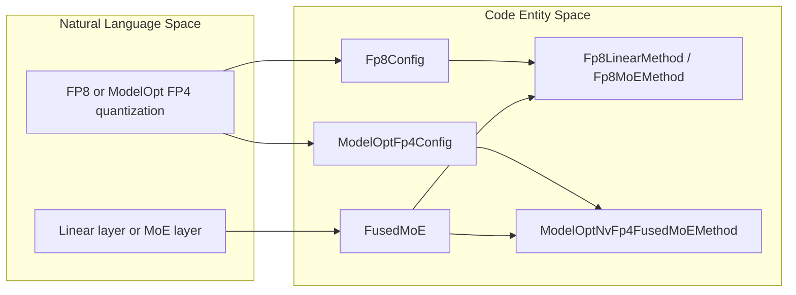
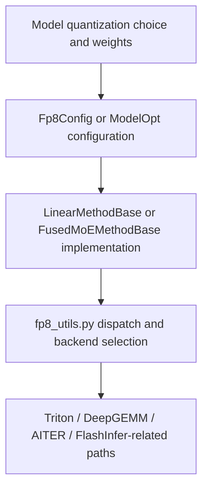
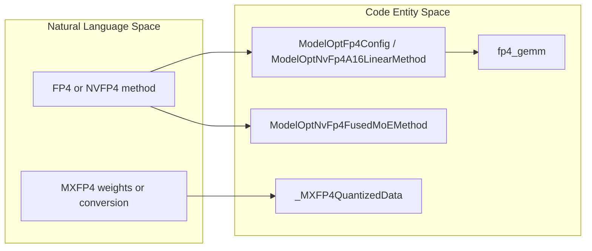

<!-- source: DeepWiki mcp.deepwiki.com · repo sgl-project/sglang · page 9 Quantization System · fetched 2026-10-30 -->

# Quantization System

Relevant source files

The following files were used as context for generating this wiki page:

- [python/sglang/kernels/ops/moe/ep_moe_kernels.py](python/sglang/kernels/ops/moe/ep_moe_kernels.py)
- [python/sglang/srt/layers/modelopt_utils.py](python/sglang/srt/layers/modelopt_utils.py)
- [python/sglang/srt/layers/moe/__init__.py](python/sglang/srt/layers/moe/__init__.py)
- [python/sglang/srt/layers/moe/ep_moe/layer.py](python/sglang/srt/layers/moe/ep_moe/layer.py)
- [python/sglang/srt/layers/moe/flashinfer_trtllm_moe.py](python/sglang/srt/layers/moe/flashinfer_trtllm_moe.py)
- [python/sglang/srt/layers/moe/fused_moe_triton/layer.py](python/sglang/srt/layers/moe/fused_moe_triton/layer.py)
- [python/sglang/srt/layers/moe/moe_runner/deep_gemm.py](python/sglang/srt/layers/moe/moe_runner/deep_gemm.py)
- [python/sglang/srt/layers/moe/moe_runner/flashinfer_trtllm.py](python/sglang/srt/layers/moe/moe_runner/flashinfer_trtllm.py)
- [python/sglang/srt/layers/moe/moe_runner/runner.py](python/sglang/srt/layers/moe/moe_runner/runner.py)
- [python/sglang/srt/layers/moe/token_dispatcher/__init__.py](python/sglang/srt/layers/moe/token_dispatcher/__init__.py)
- [python/sglang/srt/layers/moe/token_dispatcher/base.py](python/sglang/srt/layers/moe/token_dispatcher/base.py)
- [python/sglang/srt/layers/moe/token_dispatcher/deepep_v2.py](python/sglang/srt/layers/moe/token_dispatcher/deepep_v2.py)
- [python/sglang/srt/layers/moe/utils.py](python/sglang/srt/layers/moe/utils.py)
- [python/sglang/srt/layers/quantization/compressed_tensors/schemes/compressed_tensors_w4a4_nvfp4_moe.py](python/sglang/srt/layers/quantization/compressed_tensors/schemes/compressed_tensors_w4a4_nvfp4_moe.py)
- [python/sglang/srt/layers/quantization/fp8.py](python/sglang/srt/layers/quantization/fp8.py)
- [python/sglang/srt/layers/quantization/fp8_utils.py](python/sglang/srt/layers/quantization/fp8_utils.py)
- [python/sglang/srt/layers/quantization/modelopt_quant.py](python/sglang/srt/layers/quantization/modelopt_quant.py)
- [python/sglang/srt/layers/quantization/unquant.py](python/sglang/srt/layers/quantization/unquant.py)
- [python/sglang/srt/model_loader/checkpoint_quantization.py](python/sglang/srt/model_loader/checkpoint_quantization.py)
- [python/sglang/srt/model_loader/utils.py](python/sglang/srt/model_loader/utils.py)
- [test/manual/layers/moe/test_simulate_balanced_routing.py](test/manual/layers/moe/test_simulate_balanced_routing.py)
- [test/manual/quant/test_compressed_tensors_fp8_block_ue8m0.py](test/manual/quant/test_compressed_tensors_fp8_block_ue8m0.py)
- [test/registered/backends/test_flashinfer_nvfp4_online_moe_backend.py](test/registered/backends/test_flashinfer_nvfp4_online_moe_backend.py)
- [test/registered/backends/test_flashinfer_trtllm_gen_moe_backend.py](test/registered/backends/test_flashinfer_trtllm_gen_moe_backend.py)
- [test/registered/kernels/ops/moe/test_minimax_quant_scatter.py](test/registered/kernels/ops/moe/test_minimax_quant_scatter.py)
- [test/registered/kernels/ops/moe/test_round_robin_ep_balance.py](test/registered/kernels/ops/moe/test_round_robin_ep_balance.py)
- [test/registered/rl/test_update_weights_from_disk_blackwell.py](test/registered/rl/test_update_weights_from_disk_blackwell.py)
- [test/registered/unit/layers/moe/test_deepep_v2_masked_slab.py](test/registered/unit/layers/moe/test_deepep_v2_masked_slab.py)
- [test/registered/unit/layers/quantization/test_deepgemm_ue8m0_requant.py](test/registered/unit/layers/quantization/test_deepgemm_ue8m0_requant.py)
- [test/registered/unit/layers/quantization/test_modelopt_nvfp4_moe_scales.py](test/registered/unit/layers/quantization/test_modelopt_nvfp4_moe_scales.py)
- [test/registered/unit/layers/test_fp8_bpreshuffle_dense_linear_mi35x.py](test/registered/unit/layers/test_fp8_bpreshuffle_dense_linear_mi35x.py)
- [test/registered/unit/layers/test_fp8_bpreshuffle_producer_mi35x.py](test/registered/unit/layers/test_fp8_bpreshuffle_producer_mi35x.py)
- [test/registered/unit/layers/test_fp8_bpreshuffle_scale.py](test/registered/unit/layers/test_fp8_bpreshuffle_scale.py)
- [test/registered/unit/model_loader/test_modelopt_loader.py](test/registered/unit/model_loader/test_modelopt_loader.py)
- [test/registered/unit/models/test_kimi_k3_bfa_overlap.py](test/registered/unit/models/test_kimi_k3_bfa_overlap.py)
- [test/registered/unit/test_checkpoint_quantization.py](test/registered/unit/test_checkpoint_quantization.py)

## Purpose and Scope

SGLang’s quantization system connects model quantization formats to layer-specific methods and hardware-aware execution paths. This parent page outlines those relationships; use the child pages for configuration details and individual method implementations. The codebase includes quantization support for linear and MoE layers, with FP8, ModelOpt FP4, and unquantized fallback paths among the implementations shown here. [python/sglang/srt/layers/quantization/fp8.py:49-80]() [python/sglang/srt/layers/quantization/modelopt_quant.py:32-59]() [python/sglang/srt/layers/quantization/unquant.py:29-33]()

Sources: [python/sglang/srt/layers/quantization/fp8.py:49-80]() [python/sglang/srt/layers/quantization/modelopt_quant.py:32-59]() [python/sglang/srt/layers/quantization/unquant.py:29-33]()

---

## Quantization Configuration and Registry

Quantization methods share base interfaces such as `QuantizationConfig`, `LinearMethodBase`, and `FusedMoEMethodBase`. Concrete methods, including `Fp8Config` and ModelOpt configurations, provide paths for linear and MoE execution. The details of configuration discovery, compressed-tensors schemes, and method registration belong in the child page. [python/sglang/srt/layers/quantization/fp8.py:49-54]() [python/sglang/srt/layers/quantization/modelopt_quant.py:32-42]() [python/sglang/srt/layers/moe/fused_moe_triton/layer.py:59-69]()

**Natural-language quantization choices to code entities**

Sources: [python/sglang/srt/layers/quantization/fp8.py:49-54]() [python/sglang/srt/layers/quantization/modelopt_quant.py:32-42]() [python/sglang/srt/layers/moe/fused_moe_triton/layer.py:59-69]()

For details, see [Quantization Configuration and Registry](#9.1).

---

## FP8 and ModelOpt Quantization

The FP8 implementation combines quantization methods in `fp8.py` with utilities and kernel dispatch in `fp8_utils.py`. The utility module imports FP8 GEMM and quantization operations, including Triton and DeepGEMM block-FP8 paths. ModelOpt integrates FP8 and FP4 methods and uses GEMM and MoE-related components; backend availability and platform influence the execution paths. [python/sglang/srt/layers/quantization/fp8.py:15-80]() [python/sglang/srt/layers/quantization/fp8_utils.py:10-56]() [python/sglang/srt/layers/quantization/modelopt_quant.py:32-59]()

**FP8 and ModelOpt method flow**

Sources: [python/sglang/srt/layers/quantization/fp8.py:49-80]() [python/sglang/srt/layers/quantization/fp8_utils.py:10-56]() [python/sglang/srt/layers/quantization/modelopt_quant.py:32-59]()

For details, see [FP8 and ModelOpt Quantization](#9.2).

---

## FP4 and MXFP4 Quantization

The codebase contains FP4 and microscaled-format utilities alongside ModelOpt FP4 methods. For example, `modelopt_quant.py` defines an `fp4_gemm` custom operation that attempts a specialized NVFP4 GEMM path before using FlashInfer when available. FP4-related method selection also appears in the MoE layer’s quantization imports. Architecture constraints and the specific FP4, MXFP4, NVFP4, Marlin, and Quark paths are covered by the child page. [python/sglang/srt/layers/quantization/modelopt_quant.py:38-59]() [python/sglang/srt/layers/quantization/modelopt_quant.py:136-184]() [python/sglang/srt/layers/moe/fused_moe_triton/layer.py:63-69]()

**FP4-related concepts to code entities**

Sources: [python/sglang/srt/layers/quantization/modelopt_quant.py:32-42]() [python/sglang/srt/layers/quantization/modelopt_quant.py:136-184]() [python/sglang/srt/layers/quantization/fp8_utils.py:99-108]() [python/sglang/srt/layers/moe/fused_moe_triton/layer.py:63-69]()

For details, see [FP4 and MXFP4 Quantization](#9.3).

---

## INT8 and Other Quantization Methods

Quantization is not limited to the FP8 and FP4 paths summarized above. The quantization package includes method interfaces used by multiple implementations, and model execution can also use unquantized methods via `UnquantizedLinearMethod` and `UnquantizedFusedMoEMethod`. Detailed implementations of INT8, AWQ, GPTQ, QServe, GGUF, AutoRound, Petit, ModelSlim, BitsAndBytes, and quantized KV caches are scoped to the child page. [python/sglang/srt/layers/quantization/fp8.py:49-54]() [python/sglang/srt/layers/quantization/unquant.py:29-33]()

Sources: [python/sglang/srt/layers/quantization/fp8.py:49-54]() [python/sglang/srt/layers/quantization/unquant.py:29-33]()

For details, see [INT8 and Other Quantization Methods](#9.4).

---

## Child Pages for Details

- [Quantization Configuration and Registry](#9.1) — Quantization configuration classes, factory, compressed-tensors schemes, and method registration.
- [FP8 and ModelOpt Quantization](#9.2) — FP8, ModelOpt integration, block-wise quantization, and DeepGEMM wrapper.
- [FP4 and MXFP4 Quantization](#9.3) — FP4, MXFP4, NVFP4, microscaling, architecture support, Marlin utilities, and Quark schemes.
- [INT8 and Other Quantization Methods](#9.4) — INT8, AWQ, GPTQ, QServe, GGUF, AutoRound, Petit, ModelSlim, BitsAndBytes, and quantized KV cache.

Sources: [python/sglang/srt/layers/quantization/fp8.py:49-80]() [python/sglang/srt/layers/quantization/modelopt_quant.py:32-59]() [python/sglang/srt/layers/quantization/unquant.py:29-33]()

---

