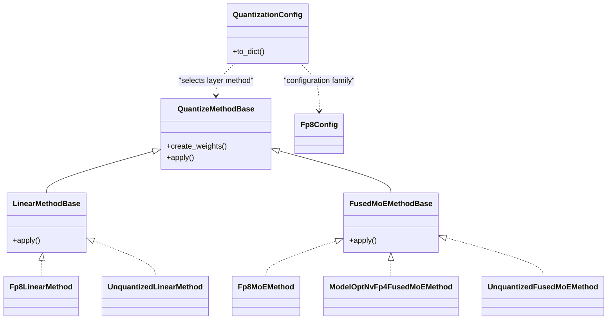
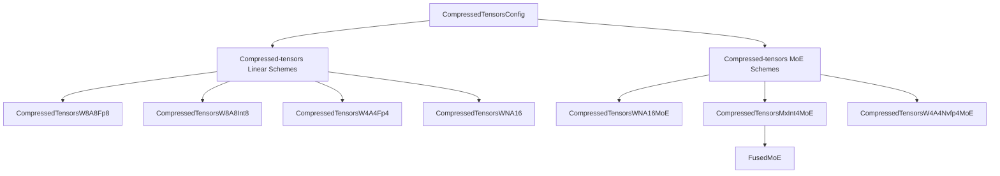

<!-- source: DeepWiki mcp.deepwiki.com · repo sgl-project/sglang · page 9.1 Quantization Configuration and Registry · fetched 2026-10-30 -->

# Quantization Configuration and Registry

<details>
<summary>Relevant source files</summary>

The following files were used as context for generating this wiki page:

- [python/sglang/kernels/ops/moe/ep_moe_kernels.py](python/sglang/kernels/ops/moe/ep_moe_kernels.py)
- [python/sglang/srt/arg_groups/model_overrides/__init__.py](python/sglang/srt/arg_groups/model_overrides/__init__.py)
- [python/sglang/srt/configs/__init__.py](python/sglang/srt/configs/__init__.py)
- [python/sglang/srt/configs/minimax_vl.py](python/sglang/srt/configs/minimax_vl.py)
- [python/sglang/srt/configs/model_config.py](python/sglang/srt/configs/model_config.py)
- [python/sglang/srt/entrypoints/openai/usage_processor.py](python/sglang/srt/entrypoints/openai/usage_processor.py)
- [python/sglang/srt/function_call/base_format_detector.py](python/sglang/srt/function_call/base_format_detector.py)
- [python/sglang/srt/function_call/function_call_parser.py](python/sglang/srt/function_call/function_call_parser.py)
- [python/sglang/srt/function_call/minimax_m3.py](python/sglang/srt/function_call/minimax_m3.py)
- [python/sglang/srt/layers/modelopt_utils.py](python/sglang/srt/layers/modelopt_utils.py)
- [python/sglang/srt/layers/moe/__init__.py](python/sglang/srt/layers/moe/__init__.py)
- [python/sglang/srt/layers/moe/ep_moe/layer.py](python/sglang/srt/layers/moe/ep_moe/layer.py)
- [python/sglang/srt/layers/moe/flashinfer_trtllm_moe.py](python/sglang/srt/layers/moe/flashinfer_trtllm_moe.py)
- [python/sglang/srt/layers/moe/fused_moe_triton/layer.py](python/sglang/srt/layers/moe/fused_moe_triton/layer.py)
- [python/sglang/srt/layers/moe/moe_runner/deep_gemm.py](python/sglang/srt/layers/moe/moe_runner/deep_gemm.py)
- [python/sglang/srt/layers/moe/moe_runner/flashinfer_trtllm.py](python/sglang/srt/layers/moe/moe_runner/flashinfer_trtllm.py)
- [python/sglang/srt/layers/moe/moe_runner/runner.py](python/sglang/srt/layers/moe/moe_runner/runner.py)
- [python/sglang/srt/layers/moe/token_dispatcher/__init__.py](python/sglang/srt/layers/moe/token_dispatcher/__init__.py)
- [python/sglang/srt/layers/moe/token_dispatcher/base.py](python/sglang/srt/layers/moe/token_dispatcher/base.py)
- [python/sglang/srt/layers/moe/token_dispatcher/deepep_v2.py](python/sglang/srt/layers/moe/token_dispatcher/deepep_v2.py)
- [python/sglang/srt/layers/moe/utils.py](python/sglang/srt/layers/moe/utils.py)
- [python/sglang/srt/layers/quantization/__init__.py](python/sglang/srt/layers/quantization/__init__.py)
- [python/sglang/srt/layers/quantization/base_config.py](python/sglang/srt/layers/quantization/base_config.py)
- [python/sglang/srt/layers/quantization/compressed_tensors/schemes/compressed_tensors_w4a4_nvfp4_moe.py](python/sglang/srt/layers/quantization/compressed_tensors/schemes/compressed_tensors_w4a4_nvfp4_moe.py)
- [python/sglang/srt/layers/quantization/fp8.py](python/sglang/srt/layers/quantization/fp8.py)
- [python/sglang/srt/layers/quantization/fp8_utils.py](python/sglang/srt/layers/quantization/fp8_utils.py)
- [python/sglang/srt/layers/quantization/modelopt_quant.py](python/sglang/srt/layers/quantization/modelopt_quant.py)
- [python/sglang/srt/layers/quantization/unquant.py](python/sglang/srt/layers/quantization/unquant.py)
- [python/sglang/srt/model_loader/checkpoint_quantization.py](python/sglang/srt/model_loader/checkpoint_quantization.py)
- [python/sglang/srt/model_loader/utils.py](python/sglang/srt/model_loader/utils.py)
- [python/sglang/srt/parser/reasoning_parser.py](python/sglang/srt/parser/reasoning_parser.py)
- [python/sglang/srt/parser/template_detection.py](python/sglang/srt/parser/template_detection.py)
- [python/sglang/srt/utils/hf_transformers/common.py](python/sglang/srt/utils/hf_transformers/common.py)
- [test/manual/layers/moe/test_simulate_balanced_routing.py](test/manual/layers/moe/test_simulate_balanced_routing.py)
- [test/manual/quant/test_compressed_tensors_fp8_block_ue8m0.py](test/manual/quant/test_compressed_tensors_fp8_block_ue8m0.py)
- [test/registered/backends/test_flashinfer_nvfp4_online_moe_backend.py](test/registered/backends/test_flashinfer_nvfp4_online_moe_backend.py)
- [test/registered/backends/test_flashinfer_trtllm_gen_moe_backend.py](test/registered/backends/test_flashinfer_trtllm_gen_moe_backend.py)
- [test/registered/kernels/ops/moe/test_minimax_quant_scatter.py](test/registered/kernels/ops/moe/test_minimax_quant_scatter.py)
- [test/registered/kernels/ops/moe/test_round_robin_ep_balance.py](test/registered/kernels/ops/moe/test_round_robin_ep_balance.py)
- [test/registered/rl/test_update_weights_from_disk_blackwell.py](test/registered/rl/test_update_weights_from_disk_blackwell.py)
- [test/registered/unit/function_call/test_minimax_m3_detector.py](test/registered/unit/function_call/test_minimax_m3_detector.py)
- [test/registered/unit/layers/moe/test_deepep_v2_masked_slab.py](test/registered/unit/layers/moe/test_deepep_v2_masked_slab.py)
- [test/registered/unit/layers/quantization/test_deepgemm_ue8m0_requant.py](test/registered/unit/layers/quantization/test_deepgemm_ue8m0_requant.py)
- [test/registered/unit/layers/quantization/test_modelopt_nvfp4_moe_scales.py](test/registered/unit/layers/quantization/test_modelopt_nvfp4_moe_scales.py)
- [test/registered/unit/layers/test_fp8_bpreshuffle_dense_linear_mi35x.py](test/registered/unit/layers/test_fp8_bpreshuffle_dense_linear_mi35x.py)
- [test/registered/unit/layers/test_fp8_bpreshuffle_producer_mi35x.py](test/registered/unit/layers/test_fp8_bpreshuffle_producer_mi35x.py)
- [test/registered/unit/layers/test_fp8_bpreshuffle_scale.py](test/registered/unit/layers/test_fp8_bpreshuffle_scale.py)
- [test/registered/unit/model_loader/test_modelopt_loader.py](test/registered/unit/model_loader/test_modelopt_loader.py)
- [test/registered/unit/models/test_kimi_k3_bfa_overlap.py](test/registered/unit/models/test_kimi_k3_bfa_overlap.py)
- [test/registered/unit/parser/test_reasoning_parser.py](test/registered/unit/parser/test_reasoning_parser.py)
- [test/registered/unit/parser/test_template_manager.py](test/registered/unit/parser/test_template_manager.py)
- [test/registered/unit/test_checkpoint_quantization.py](test/registered/unit/test_checkpoint_quantization.py)

</details>


## Purpose and Scope

This page documents the quantization configuration and registration layer in SGLang’s `python/sglang/srt/layers/quantization/` package. It covers the `QuantizationConfig` interface, the `get_quantization_config` factory and registry, compressed-tensors schemes, and how linear and MoE layers use quantization methods. [python/sglang/srt/layers/quantization/base_config.py:1-1]() [python/sglang/srt/layers/quantization/__init__.py:1-1]() [python/sglang/srt/layers/linear.py:140-161]()  

Sources: [python/sglang/srt/layers/quantization/base_config.py:1-1]() [python/sglang/srt/layers/quantization/__init__.py:1-1]() [python/sglang/srt/layers/linear.py:140-161]()

---

## Quantization Registry Overview

The registry is the lookup point between a quantization name and the configuration class used to represent that choice. The package-level registry and `get_quantization_config` factory map user-facing options to concrete configuration classes [python/sglang/srt/layers/quantization/__init__.py:1-1]().

The following names and classes are referenced by the quantization subsystem:

| Quantization name or family | Configuration or implementation symbol | Notes |
|---|---|---|
| `fp8` | `Fp8Config` | FP8 configuration and method implementations are imported from `fp8.py`. [python/sglang/srt/layers/quantization/fp8.py:49-54]() |
| ModelOpt FP4 | `ModelOptNvFp4FusedMoEMethod` | ModelOpt quantization code includes FP4 GEMM registration and backend dispatch. [python/sglang/srt/layers/quantization/modelopt_quant.py:32-42]() [python/sglang/srt/layers/quantization/modelopt_quant.py:136-184]() |
| `compressed-tensors` | `CompressedTensorsConfig` | The configuration and scheme module paths define compressed-tensors formats. [python/sglang/srt/layers/quantization/compressed_tensors/compressed_tensors.py:117-141]() |
| Quark | `QuarkConfig` | Quark configuration and scheme modules provide alternative quant schemes. [python/sglang/srt/layers/quantization/quark/quark.py:12-32]() |
| Unquantized | `UnquantizedLinearMethod`, `UnquantizedFusedMoEMethod` | The unquantized implementations are imported by the FP8 and MoE layer modules. [python/sglang/srt/layers/quantization/unquant.py:29-33]() [python/sglang/srt/layers/quantization/fp8.py:84-87]() |

### Factory and Registry Boundary

`get_quantization_config` serves as the named factory for resolving a quantization selection to configuration. At the layer boundary, `QuantizationConfig` is imported by `linear.py`, `fp8.py`, `modelopt_quant.py`, and the fused MoE layer [python/sglang/srt/layers/linear.py:47-52]() [python/sglang/srt/layers/quantization/fp8.py:49-54]() [python/sglang/srt/layers/quantization/modelopt_quant.py:32-37]() [python/sglang/srt/layers/moe/fused_moe_triton/layer.py:59-69]().

**Diagram: Quantization names and code entities bridging Natural Language to Code**

```mermaid
graph LR
  subgraph "NaturalLanguageSpace"
    Request[""Quantization Selection""]
  end
  subgraph "CodeEntitySpace"
    Factory[""get_quantization_config()""]
    Registry[""QUANTIZATION_METHODS Registry""]
    Fp8[""Fp8Config""]
    ModelOpt[""ModelOptNvFp4FusedMoEMethod""]
    Compressed[""CompressedTensorsConfig""]
    Quark[""QuarkConfig""]
    Layers[""LinearBase and FusedMoE""]
  end

  Request --> Factory
  Factory --> Registry
  Registry --> Fp8
  Registry --> ModelOpt
  Registry --> Compressed
  Registry --> Quark
  Fp8 --> Layers
  ModelOpt --> Layers
  Compressed --> Layers
  Quark --> Layers
```

Sources: [python/sglang/srt/layers/quantization/__init__.py:1-1]() [python/sglang/srt/layers/quantization/fp8.py:49-54]() [python/sglang/srt/layers/quantization/modelopt_quant.py:32-42]() [python/sglang/srt/layers/moe/fused_moe_triton/layer.py:59-69]()

---

## Configuration Class Hierarchy

`QuantizationConfig`, `QuantizeMethodBase`, `LinearMethodBase`, and `FusedMoEMethodBase` form the core quantization abstraction hierarchy imported across model-loading and layer modules [python/sglang/srt/layers/quantization/fp8.py:49-54]() [python/sglang/srt/layers/quantization/modelopt_quant.py:32-37]().

Concrete methods are scoped to layer types. For example, the FP8 module imports `QuantizationConfig`, `QuantizeMethodBase`, and `LinearMethodBase`, while the fused MoE layer imports `FusedMoEMethodBase` along with `Fp8MoEMethod`, `ModelOptNvFp4FusedMoEMethod`, and `UnquantizedFusedMoEMethod` [python/sglang/srt/layers/quantization/fp8.py:49-54]() [python/sglang/srt/layers/moe/fused_moe_triton/layer.py:59-69]().

**Diagram: Configuration-to-method code class hierarchy**



Sources: [python/sglang/srt/layers/quantization/fp8.py:49-54]() [python/sglang/srt/layers/quantization/modelopt_quant.py:32-42]() [python/sglang/srt/layers/quantization/unquant.py:29-33]() [python/sglang/srt/layers/moe/fused_moe_triton/layer.py:59-69]()

---

## Quantization Method Selection and Registration Flow

The configuration-to-method boundary separates model-level quantization selection from the implementation applied by individual layers. `LinearBase` imports `QuantizationConfig` and `QuantizeMethodBase`, while `FusedMoE` evaluates `self.quant_method` to adapt dispatch behavior [python/sglang/srt/layers/linear.py:47-52]() [python/sglang/srt/layers/moe/fused_moe_triton/layer.py:105-127]() [python/sglang/srt/layers/moe/fused_moe_triton/layer.py:153-156]().

The `WEIGHT_LOADER_V2_SUPPORTED` list in `linear.py` explicitly names quantization method implementations supported by the loader path, including `CompressedTensorsLinearMethod`, `Fp8LinearMethod`, `ModelOptFp8LinearMethod`, `ModelOptFp4LinearMethod`, and `QuarkLinearMethod` [python/sglang/srt/layers/linear.py:140-161]().

**Diagram: Selection and loading flow bridging Natural Language to Code**

```mermaid
flowchart LR
  subgraph "NaturalLanguageSpace"
    UserChoice[""Model Quantization Option""]
  end
  subgraph "CodeEntitySpace"
    Factory[""get_quantization_config()""]
    Config[""QuantizationConfig""]
    Linear[""LinearBase""]
    LinearMethod[""LinearMethodBase""]
    Moe[""FusedMoE""]
    MoeMethod[""FusedMoEMethodBase""]
    LoaderList[""WEIGHT_LOADER_V2_SUPPORTED""]
  end

  UserChoice --> Factory
  Factory --> Config
  Config --> Linear
  Linear --> LinearMethod
  Config --> Moe
  Moe --> MoeMethod
  LinearMethod -. "loader support validation" .-> LoaderList
```

Sources: [python/sglang/srt/layers/quantization/__init__.py:1-1]() [python/sglang/srt/layers/linear.py:47-52]() [python/sglang/srt/layers/linear.py:140-161]() [python/sglang/srt/layers/moe/fused_moe_triton/layer.py:105-127]() [python/sglang/srt/layers/moe/fused_moe_triton/layer.py:153-156]()

---

## Compressed-Tensors Schemes and MoE Integration

Compressed-tensors configurations are structured around `CompressedTensorsConfig` and scheme implementations [python/sglang/srt/layers/quantization/compressed_tensors/compressed_tensors.py:117-141]().

| Scope | Referenced scheme symbols |
|---|---|
| Linear | `CompressedTensorsW8A8Fp8`, `CompressedTensorsW8A8Int8`, `CompressedTensorsW4A4Fp4`, `CompressedTensorsWNA16`. [python/sglang/srt/layers/quantization/compressed_tensors/schemes/__init__.py:26-32]() |
| MoE | `CompressedTensorsWNA16MoE`, `CompressedTensorsMxInt4MoE`, `CompressedTensorsW4A4Nvfp4MoE`. [python/sglang/srt/layers/quantization/compressed_tensors/schemes/compressed_tensors_wNa16_moe.py:65-94]() [python/sglang/srt/layers/quantization/compressed_tensors/schemes/compressed_tensors_w4a4_mxint4_moe.py:49-82]() [python/sglang/srt/layers/quantization/compressed_tensors/schemes/compressed_tensors_w4a4_nvfp4_moe.py:33-43]() |
| MoE base | `CompressedTensorsMoEScheme`. [python/sglang/srt/layers/quantization/compressed_tensors/schemes/compressed_tensors_scheme.py:16-16]() |

`FusedMoE` imports and utilizes `CompressedTensorsMxInt4MoE` alongside FP8 and ModelOpt variants [python/sglang/srt/layers/moe/fused_moe_triton/layer.py:59-69]().

**Diagram: Compressed-tensors schemes and layers**



Sources: [python/sglang/srt/layers/quantization/compressed_tensors/compressed_tensors.py:117-141]() [python/sglang/srt/layers/quantization/compressed_tensors/schemes/__init__.py:26-32]() [python/sglang/srt/layers/quantization/compressed_tensors/schemes/compressed_tensors_scheme.py:16-16]() [python/sglang/srt/layers/quantization/compressed_tensors/schemes/compressed_tensors_wNa16_moe.py:65-94]() [python/sglang/srt/layers/quantization/compressed_tensors/schemes/compressed_tensors_w4a4_mxint4_moe.py:49-82]() [python/sglang/srt/layers/quantization/compressed_tensors/schemes/compressed_tensors_w4a4_nvfp4_moe.py:33-43]() [python/sglang/srt/layers/moe/fused_moe_triton/layer.py:59-69]()

---

## Related Method Registration and Backend Dispatch

Quantization method selection operates independently of runner backends. `MoeRunnerBackend` defines execution targets such as `DEEP_GEMM`, `TRITON`, `FLASHINFER_TRTLLM`, `CUTLASS`, `MARLIN`, and `AITER` [python/sglang/srt/layers/moe/utils.py:112-216](). 

`fp8.py` combines `Fp8Config`, `Fp8LinearMethod`, and `Fp8MoEMethod` with hardware-specific dispatcher integrations, distinguishing between quantization definitions and runtime kernel execution [python/sglang/srt/layers/quantization/fp8.py:31-43]() [python/sglang/srt/layers/quantization/fp8.py:49-80]().

Sources: [python/sglang/srt/layers/moe/utils.py:112-216]() [python/sglang/srt/layers/quantization/fp8.py:31-43]() [python/sglang/srt/layers/quantization/fp8.py:49-80]() [python/sglang/srt/layers/linear.py:140-161]()

---

## Summary

- `get_quantization_config` and the package registry coordinate configuration resolution [python/sglang/srt/layers/quantization/__init__.py:1-1]().
- `QuantizationConfig`, `QuantizeMethodBase`, `LinearMethodBase`, and `FusedMoEMethodBase` constitute the configuration and method abstraction hierarchy [python/sglang/srt/layers/quantization/fp8.py:49-54]() [python/sglang/srt/layers/quantization/modelopt_quant.py:32-37]().
- Compressed-tensors defines separate linear and MoE scheme configurations integrated directly into `FusedMoE` [python/sglang/srt/layers/quantization/compressed_tensors/schemes/__init__.py:26-32]() [python/sglang/srt/layers/moe/fused_moe_triton/layer.py:59-69]().
- Quantization method selection is decoupled from MoE runner backend selection [python/sglang/srt/layers/moe/utils.py:112-216]().

Sources: [python/sglang/srt/layers/quantization/__init__.py:1-1]() [python/sglang/srt/layers/quantization/fp8.py:49-54]() [python/sglang/srt/layers/quantization/modelopt_quant.py:32-37]() [python/sglang/srt/layers/linear.py:47-52]() [python/sglang/srt/layers/linear.py:140-161]() [python/sglang/srt/layers/moe/fused_moe_triton/layer.py:59-69]() [python/sglang/srt/layers/moe/utils.py:112-216]()

---

