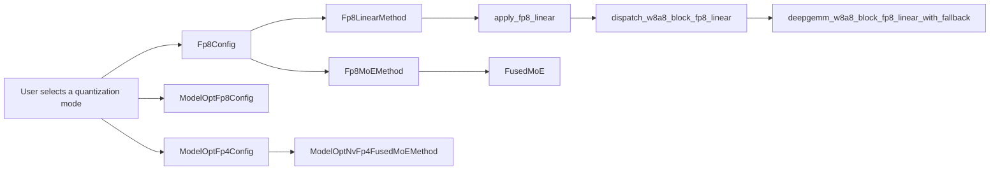
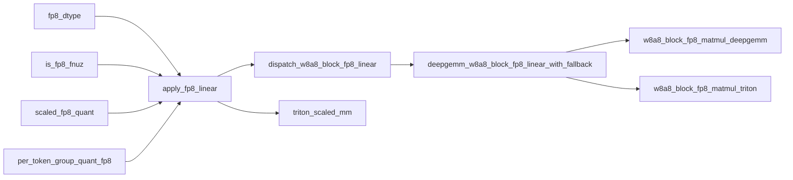

<!-- source: DeepWiki mcp.deepwiki.com · repo sgl-project/sglang · page 9.2 FP8 and ModelOpt Quantization · fetched 2026-10-30 -->

# FP8 and ModelOpt Quantization

Relevant source files

The following files were used as context for generating this wiki page:

- [python/sglang/kernels/jit/csrc/gemm/per_token_group_quant.cuh](python/sglang/kernels/jit/csrc/gemm/per_token_group_quant.cuh)
- [python/sglang/kernels/ops/moe/ep_moe_kernels.py](python/sglang/kernels/ops/moe/ep_moe_kernels.py)
- [python/sglang/kernels/ops/quantization/per_token_group_quant.py](python/sglang/kernels/ops/quantization/per_token_group_quant.py)
- [python/sglang/srt/layers/deep_gemm_wrapper/compile_utils.py](python/sglang/srt/layers/deep_gemm_wrapper/compile_utils.py)
- [python/sglang/srt/layers/deep_gemm_wrapper/entrypoint.py](python/sglang/srt/layers/deep_gemm_wrapper/entrypoint.py)
- [python/sglang/srt/layers/modelopt_utils.py](python/sglang/srt/layers/modelopt_utils.py)
- [python/sglang/srt/layers/moe/__init__.py](python/sglang/srt/layers/moe/__init__.py)
- [python/sglang/srt/layers/moe/ep_moe/layer.py](python/sglang/srt/layers/moe/ep_moe/layer.py)
- [python/sglang/srt/layers/moe/flashinfer_trtllm_moe.py](python/sglang/srt/layers/moe/flashinfer_trtllm_moe.py)
- [python/sglang/srt/layers/moe/fused_moe_triton/layer.py](python/sglang/srt/layers/moe/fused_moe_triton/layer.py)
- [python/sglang/srt/layers/moe/moe_runner/deep_gemm.py](python/sglang/srt/layers/moe/moe_runner/deep_gemm.py)
- [python/sglang/srt/layers/moe/moe_runner/flashinfer_trtllm.py](python/sglang/srt/layers/moe/moe_runner/flashinfer_trtllm.py)
- [python/sglang/srt/layers/moe/moe_runner/runner.py](python/sglang/srt/layers/moe/moe_runner/runner.py)
- [python/sglang/srt/layers/moe/token_dispatcher/__init__.py](python/sglang/srt/layers/moe/token_dispatcher/__init__.py)
- [python/sglang/srt/layers/moe/token_dispatcher/base.py](python/sglang/srt/layers/moe/token_dispatcher/base.py)
- [python/sglang/srt/layers/moe/token_dispatcher/deepep_v2.py](python/sglang/srt/layers/moe/token_dispatcher/deepep_v2.py)
- [python/sglang/srt/layers/moe/utils.py](python/sglang/srt/layers/moe/utils.py)
- [python/sglang/srt/layers/quantization/compressed_tensors/schemes/compressed_tensors_w4a4_nvfp4_moe.py](python/sglang/srt/layers/quantization/compressed_tensors/schemes/compressed_tensors_w4a4_nvfp4_moe.py)
- [python/sglang/srt/layers/quantization/fp8.py](python/sglang/srt/layers/quantization/fp8.py)
- [python/sglang/srt/layers/quantization/fp8_activation.py](python/sglang/srt/layers/quantization/fp8_activation.py)
- [python/sglang/srt/layers/quantization/fp8_utils.py](python/sglang/srt/layers/quantization/fp8_utils.py)
- [python/sglang/srt/layers/quantization/modelopt_quant.py](python/sglang/srt/layers/quantization/modelopt_quant.py)
- [python/sglang/srt/layers/quantization/unquant.py](python/sglang/srt/layers/quantization/unquant.py)
- [python/sglang/srt/model_loader/checkpoint_quantization.py](python/sglang/srt/model_loader/checkpoint_quantization.py)
- [python/sglang/srt/model_loader/utils.py](python/sglang/srt/model_loader/utils.py)
- [test/manual/dsv4/test_wo_a_fp8_sm90.py](test/manual/dsv4/test_wo_a_fp8_sm90.py)
- [test/manual/kernels/bench_dense_swiglu_quant.py](test/manual/kernels/bench_dense_swiglu_quant.py)
- [test/manual/layers/moe/test_simulate_balanced_routing.py](test/manual/layers/moe/test_simulate_balanced_routing.py)
- [test/manual/quant/test_compressed_tensors_fp8_block_ue8m0.py](test/manual/quant/test_compressed_tensors_fp8_block_ue8m0.py)
- [test/registered/backends/test_flashinfer_nvfp4_online_moe_backend.py](test/registered/backends/test_flashinfer_nvfp4_online_moe_backend.py)
- [test/registered/backends/test_flashinfer_trtllm_gen_moe_backend.py](test/registered/backends/test_flashinfer_trtllm_gen_moe_backend.py)
- [test/registered/kernels/benchmark/quantization/bench_per_token_group_quant.py](test/registered/kernels/benchmark/quantization/bench_per_token_group_quant.py)
- [test/registered/kernels/ops/moe/test_minimax_quant_scatter.py](test/registered/kernels/ops/moe/test_minimax_quant_scatter.py)
- [test/registered/kernels/ops/moe/test_round_robin_ep_balance.py](test/registered/kernels/ops/moe/test_round_robin_ep_balance.py)
- [test/registered/kernels/ops/quantization/test_per_token_group_quant.py](test/registered/kernels/ops/quantization/test_per_token_group_quant.py)
- [test/registered/rl/test_update_weights_from_disk_blackwell.py](test/registered/rl/test_update_weights_from_disk_blackwell.py)
- [test/registered/unit/layers/moe/test_deepep_v2_masked_slab.py](test/registered/unit/layers/moe/test_deepep_v2_masked_slab.py)
- [test/registered/unit/layers/quantization/test_deepgemm_ue8m0_requant.py](test/registered/unit/layers/quantization/test_deepgemm_ue8m0_requant.py)
- [test/registered/unit/layers/quantization/test_dense_swiglu_fp8.py](test/registered/unit/layers/quantization/test_dense_swiglu_fp8.py)
- [test/registered/unit/layers/quantization/test_fp8_blockwise_linear_backends.py](test/registered/unit/layers/quantization/test_fp8_blockwise_linear_backends.py)
- [test/registered/unit/layers/quantization/test_modelopt_nvfp4_moe_scales.py](test/registered/unit/layers/quantization/test_modelopt_nvfp4_moe_scales.py)
- [test/registered/unit/layers/test_fp8_bpreshuffle_dense_linear_mi35x.py](test/registered/unit/layers/test_fp8_bpreshuffle_dense_linear_mi35x.py)
- [test/registered/unit/layers/test_fp8_bpreshuffle_producer_mi35x.py](test/registered/unit/layers/test_fp8_bpreshuffle_producer_mi35x.py)
- [test/registered/unit/layers/test_fp8_bpreshuffle_scale.py](test/registered/unit/layers/test_fp8_bpreshuffle_scale.py)
- [test/registered/unit/model_loader/test_modelopt_loader.py](test/registered/unit/model_loader/test_modelopt_loader.py)
- [test/registered/unit/models/test_kimi_k3_bfa_overlap.py](test/registered/unit/models/test_kimi_k3_bfa_overlap.py)
- [test/registered/unit/test_checkpoint_quantization.py](test/registered/unit/test_checkpoint_quantization.py)

## Purpose and Scope

This page describes SGLang’s FP8 and ModelOpt quantization paths, focusing on E4M3, block-wise quantization, backend dispatch, and the DeepGEMM integration. It distinguishes dense linear-layer execution from MoE execution and summarizes the ModelOpt loader/configuration interface, hardware platform accommodations (such as AMD aiter/gfx950 and Hopper/Blackwell paths), and JIT compilation wrappers.

Sources: [python/sglang/srt/layers/quantization/fp8.py:55-80](), [python/sglang/srt/layers/quantization/fp8_utils.py:10-35](), [python/sglang/srt/layers/moe/moe_runner/deep_gemm.py:18-39](), [test/registered/unit/model_loader/test_modelopt_loader.py:24-43]()

---

## System Overview

Quantization configuration and execution are distributed across specialized modules: `fp8.py` contains the FP8 quantization methods (`Fp8Config`, `Fp8LinearMethod`, `Fp8MoEMethod`); `fp8_utils.py` imports quantization and GEMM primitives and exposes dispatch-related helpers; `modelopt_quant.py` integrates ModelOpt configuration alongside FP8/FP4 implementations; and MoE runner modules (`deep_gemm.py`, `flashinfer_trtllm.py`, `ep_moe/layer.py`) bind quantization metadata to expert computation.

### Configuration and execution relationships

**Diagram: Configuration names mapped to runtime code entities**

The diagram maps configuration names and user option strings to the underlying Python classes and functions responsible for building linear and MoE layers.

Sources: [python/sglang/srt/layers/quantization/fp8.py:55-80](), [python/sglang/srt/layers/quantization/modelopt_quant.py:32-49](), [python/sglang/srt/layers/moe/fused_moe_triton/layer.py:59-69]()

---

## FP8 Configuration and Data Flow

### FP8 methods and quantization primitives

`fp8.py` imports `fp8_dtype`, `is_fp8_fnuz`, `per_token_group_quant_fp8`, and `scaled_fp8_quant` from the FP8 kernel module [python/sglang/srt/layers/quantization/fp8.py:15-20](). At the lower-level utility layer, `fp8_utils.py` imports GEMM implementations including `triton_scaled_mm`, `w8a8_block_fp8_matmul_deepgemm`, and `w8a8_block_fp8_matmul_triton`, alongside static and per-token-group quantization kernels [python/sglang/srt/layers/quantization/fp8_utils.py:10-27]().

### E4M3 representation

The visible MoE DeepGEMM implementation selects `torch.float8_e4m3fn` as its activation dtype when the weight dtype is not BF16 [python/sglang/srt/layers/moe/moe_runner/deep_gemm.py:130-141](). `DeepEPMoE` sets its FP8 dtype to `torch.float8_e4m3fn` when configured with an `Fp8Config` [python/sglang/srt/layers/moe/ep_moe/layer.py:151-166](). Hardware format variants like FNUZ (used on certain AMD GPUs) are handled via `is_fp8_fnuz()` checks [python/sglang/srt/layers/quantization/fp8.py:127-139]().

**Diagram: FP8 primitive and backend relationships**

This diagram illustrates how linear layers invoke `apply_fp8_linear`, dispatching to DeepGEMM or Triton backend kernels depending on shape and hardware capabilities.

Sources: [python/sglang/srt/layers/quantization/fp8.py:15-20](), [python/sglang/srt/layers/quantization/fp8.py:44-80](), [python/sglang/srt/layers/quantization/fp8_utils.py:10-27](), [python/sglang/srt/layers/moe/moe_runner/deep_gemm.py:130-141]()

---

## ModelOpt Integration

### ModelOpt quantization names

ModelOpt integration supports configuration schemas such as `modelopt_fp8`, `modelopt_fp4`, and `modelopt` (auto-detected) [test/registered/unit/model_loader/test_modelopt_loader.py:98-115](). Metadata parsers map `FP8` to `modelopt_fp8`, `FP4`/`NVFP4` to `modelopt_fp4`, `MXFP8` to `mxfp8`, and mixed-precision schemes to `w4afp8` [test/registered/unit/model_loader/test_modelopt_loader.py:141-159]().

### FP4 execution components

The module registers a custom operation `fp4_gemm` which attempts to invoke Qwen3X NVFP4 acceleration (`try_qwen3x_nvfp4_gemm`) or falls back to FlashInfer’s `mm_fp4` for `w4a4` or `mm_bf16_fp4` for `w4a16` [python/sglang/srt/layers/quantization/modelopt_quant.py:136-184]().

Sources: [python/sglang/srt/layers/quantization/modelopt_quant.py:38-49](), [python/sglang/srt/layers/quantization/modelopt_quant.py:121-184](), [test/registered/unit/model_loader/test_modelopt_loader.py:98-159]()

---

## Per-Token and Block-Wise Quantization Kernels

### Granularity and block scales

Block-scale support uses parameter classes like `BlockQuantScaleParameter` and conversion utilities such as `block_fp8_scale_to_e8m0_128`, `block_fp8_scale_to_mxfp8_e8m0`, and `requant_block_scale_ue8m0_for_deepgemm` [python/sglang/srt/layers/quantization/fp8.py:44-48](), [python/sglang/srt/layers/quantization/fp8.py:55-80]().

### Scale Representation and DeepGEMM Memory Budgeting

`deep_gemm.py` includes helper functions to calculate activation and scale memory overhead. For instance, `_estimate_masked_standard_layout_peak_bytes` computes peak memory requirements using padded token block sizes (multiples of 256) and tensor dimensions for gate-up, down projections, and quantization scales (such as UE8M0 packed scales) [python/sglang/srt/layers/moe/moe_runner/deep_gemm.py:130-170]().

Sources: [python/sglang/srt/layers/quantization/fp8.py:15-48](), [python/sglang/srt/layers/quantization/fp8_utils.py:10-15](), [python/sglang/srt/layers/moe/moe_runner/deep_gemm.py:130-170]()

---

## DeepGEMM Wrapper and JIT Compilation

The DeepGEMM integration relies on a JIT compilation and caching pipeline managed under `sglang.srt.layers.deep_gemm_wrapper` [python/sglang/srt/layers/deep_gemm_wrapper/compile_utils.py:1-50]().

### Compilation Modes and Warmup

- **Fast Warmup (`SGLANG_JIT_DEEPGEMM_FAST_WARMUP`)**: Limits compilation to a representative sample of batch sizes (`M` dimensions) to accelerate startup while covering typical decode and prefill workloads [python/sglang/srt/layers/deep_gemm_wrapper/compile_utils.py:66-92]().
- **Cache Locking**: Uses file-based locking (`_local_rank_compile_lock`) in `DG_JIT_CACHE_DIR` to prevent redundant parallel compilation across local rank processes [python/sglang/srt/layers/deep_gemm_wrapper/compile_utils.py:126-147]().
- **Kernel Types**: Supports specialized DeepGEMM kernel variants including grouped GEMM with masked/contiguous layouts and block-scaled FP8 GEMMs (`DeepGemmKernelType`) [python/sglang/srt/layers/deep_gemm_wrapper/compile_utils.py:113-122]().

Sources: [python/sglang/srt/layers/deep_gemm_wrapper/compile_utils.py:1-184]()

---

## Linear and MoE Implementations

Quantized linear layers (`Fp8LinearMethod`) and MoE layers (`Fp8MoEMethod`, `ModelOptNvFp4FusedMoEMethod`) integrate with runners such as DeepGEMM, FlashInfer, CUTLASS, and AITER [python/sglang/srt/layers/quantization/fp8.py:55-80](), [python/sglang/srt/layers/moe/fused_moe_triton/layer.py:59-73]().

Expert-parallel layers (`DeepEPMoE`) inspect the quantization configuration (`Fp8Config` or `W4AFp8Config`) during initialization to configure dispatch routines and block quantization flags [python/sglang/srt/layers/moe/ep_moe/layer.py:62-166]().

Sources: [python/sglang/srt/layers/quantization/fp8.py:55-80](), [python/sglang/srt/layers/moe/fused_moe_triton/layer.py:59-73](), [python/sglang/srt/layers/moe/ep_moe/layer.py:62-166]()

---

## References

- `python/sglang/srt/layers/quantization/fp8.py` — FP8 methods, configuration classes, and primitive bindings. [python/sglang/srt/layers/quantization/fp8.py:15-80]()
- `python/sglang/srt/layers/quantization/fp8_utils.py` — Block-FP8 dispatch helpers, aiter/Triton routing, and scale utilities. [python/sglang/srt/layers/quantization/fp8_utils.py:10-189]()
- `python/sglang/srt/layers/quantization/modelopt_quant.py` — ModelOpt configurations and FP4 custom GEMM registration. [python/sglang/srt/layers/quantization/modelopt_quant.py:32-184]()
- `python/sglang/srt/layers/moe/moe_runner/deep_gemm.py` — DeepGEMM MoE runner, scale budgeting, and activation casts. [python/sglang/srt/layers/moe/moe_runner/deep_gemm.py:11-170]()
- `python/sglang/srt/layers/deep_gemm_wrapper/compile_utils.py` — JIT compilation pipeline, fast warmup logic, and cache locking. [python/sglang/srt/layers/deep_gemm_wrapper/compile_utils.py:1-184]()

---

