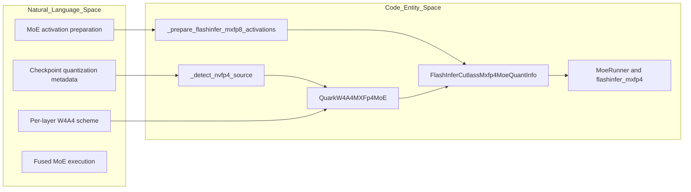
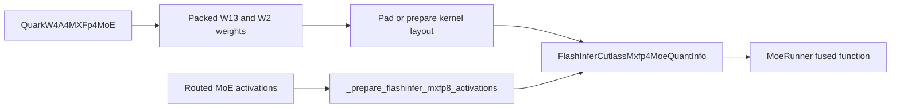
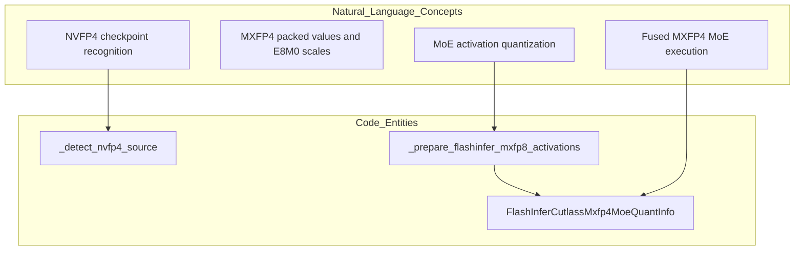

<!-- source: DeepWiki mcp.deepwiki.com · repo sgl-project/sglang · page 9.3 FP4 and MXFP4 Quantization · fetched 2026-10-30 -->

# FP4 and MXFP4 Quantization

<details>
<summary>Relevant source files</summary>

The following files were used as context for generating this wiki page:

- [benchmark/kernels/attention/bench_flash_attention_tmem_red_max.py](benchmark/kernels/attention/bench_flash_attention_tmem_red_max.py)
- [docs/cookbook/autoregressive/Qwen/Qwen3.5.mdx](docs/cookbook/autoregressive/Qwen/Qwen3.5.mdx)
- [docs/src/snippets/autoregressive/qwen35-deployment.jsx](docs/src/snippets/autoregressive/qwen35-deployment.jsx)
- [python/sglang/kernels/ops/attention/flash_attn/cute/flash_fwd_sm100.py](python/sglang/kernels/ops/attention/flash_attn/cute/flash_fwd_sm100.py)
- [python/sglang/kernels/ops/attention/flash_attn/cute/softmax.py](python/sglang/kernels/ops/attention/flash_attn/cute/softmax.py)
- [python/sglang/srt/configs/load_config.py](python/sglang/srt/configs/load_config.py)
- [python/sglang/srt/hardware_backend/npu/graph_runner/vit_npu_graph_runner.py](python/sglang/srt/hardware_backend/npu/graph_runner/vit_npu_graph_runner.py)
- [python/sglang/srt/layers/attention/vision.py](python/sglang/srt/layers/attention/vision.py)
- [python/sglang/srt/layers/linear.py](python/sglang/srt/layers/linear.py)
- [python/sglang/srt/layers/moe/moe_runner/flashinfer_cutedsl.py](python/sglang/srt/layers/moe/moe_runner/flashinfer_cutedsl.py)
- [python/sglang/srt/layers/moe/moe_runner/flashinfer_cutlass.py](python/sglang/srt/layers/moe/moe_runner/flashinfer_cutlass.py)
- [python/sglang/srt/layers/moe/token_dispatcher/flashinfer.py](python/sglang/srt/layers/moe/token_dispatcher/flashinfer.py)
- [python/sglang/srt/layers/quantization/dequantization.py](python/sglang/srt/layers/quantization/dequantization.py)
- [python/sglang/srt/layers/quantization/mxfp4.py](python/sglang/srt/layers/quantization/mxfp4.py)
- [python/sglang/srt/layers/quantization/mxfp4_flashinfer_cutlass_moe.py](python/sglang/srt/layers/quantization/mxfp4_flashinfer_cutlass_moe.py)
- [python/sglang/srt/layers/quantization/nvfp4_online.py](python/sglang/srt/layers/quantization/nvfp4_online.py)
- [python/sglang/srt/layers/quantization/quark/quark.py](python/sglang/srt/layers/quantization/quark/quark.py)
- [python/sglang/srt/layers/quantization/quark/schemes/quark_w4a4_mxfp4.py](python/sglang/srt/layers/quantization/quark/schemes/quark_w4a4_mxfp4.py)
- [python/sglang/srt/layers/quantization/quark/schemes/quark_w4a4_mxfp4_moe.py](python/sglang/srt/layers/quantization/quark/schemes/quark_w4a4_mxfp4_moe.py)
- [python/sglang/srt/layers/quantization/quark/utils.py](python/sglang/srt/layers/quantization/quark/utils.py)
- [python/sglang/srt/model_executor/model_runner_components/load_model_utils.py](python/sglang/srt/model_executor/model_runner_components/load_model_utils.py)
- [python/sglang/srt/model_loader/loader.py](python/sglang/srt/model_loader/loader.py)
- [python/sglang/srt/model_loader/weight_utils.py](python/sglang/srt/model_loader/weight_utils.py)
- [python/sglang/srt/models/glm5_next_nextn.py](python/sglang/srt/models/glm5_next_nextn.py)
- [python/sglang/srt/multimodal/internvl_vit_cuda_graph_runner.py](python/sglang/srt/multimodal/internvl_vit_cuda_graph_runner.py)
- [python/sglang/srt/multimodal/vit_cuda_graph_runner.py](python/sglang/srt/multimodal/vit_cuda_graph_runner.py)
- [scripts/ci/amd/check_hf_cache_space.sh](scripts/ci/amd/check_hf_cache_space.sh)
- [test/registered/amd/accuracy/mi35x/test_qwen38_mxfp4_eval_mi35x.py](test/registered/amd/accuracy/mi35x/test_qwen38_mxfp4_eval_mi35x.py)
- [test/registered/e2e/models_large/test_deepseek_v3_cutedsl_4gpu.py](test/registered/e2e/models_large/test_deepseek_v3_cutedsl_4gpu.py)
- [test/registered/ep/test_flashinfer_a2a.py](test/registered/ep/test_flashinfer_a2a.py)
- [test/registered/kernels/ops/attention/test_flash_attention_4_sm103.py](test/registered/kernels/ops/attention/test_flash_attention_4_sm103.py)
- [test/registered/unit/layers/attention/test_vision_backend_selection.py](test/registered/unit/layers/attention/test_vision_backend_selection.py)
- [test/registered/unit/layers/attention/test_vision_max_seqlen.py](test/registered/unit/layers/attention/test_vision_max_seqlen.py)
- [test/registered/unit/layers/moe/test_flashinfer_cutlass_swiglu_params.py](test/registered/unit/layers/moe/test_flashinfer_cutlass_swiglu_params.py)
- [test/registered/unit/layers/moe/test_flashinfer_dispatcher.py](test/registered/unit/layers/moe/test_flashinfer_dispatcher.py)
- [test/registered/unit/layers/moe/test_moe_runner_config_placement.py](test/registered/unit/layers/moe/test_moe_runner_config_placement.py)
- [test/registered/unit/layers/quantization/test_mxfp4_flashinfer_activation_prep.py](test/registered/unit/layers/quantization/test_mxfp4_flashinfer_activation_prep.py)
- [test/registered/unit/layers/quantization/test_mxfp4_sm120_cutlass.py](test/registered/unit/layers/quantization/test_mxfp4_sm120_cutlass.py)
- [test/registered/unit/layers/quantization/test_mxfp4_sm90_cutlass.py](test/registered/unit/layers/quantization/test_mxfp4_sm90_cutlass.py)
- [test/registered/unit/layers/quantization/test_nvfp4_online_weight_loader.py](test/registered/unit/layers/quantization/test_nvfp4_online_weight_loader.py)
- [test/registered/unit/layers/quantization/test_quark_config.py](test/registered/unit/layers/quantization/test_quark_config.py)
- [test/registered/unit/layers/quantization/test_quark_shared_expert_online_mxfp4_loader.py](test/registered/unit/layers/quantization/test_quark_shared_expert_online_mxfp4_loader.py)
- [test/registered/unit/layers/quantization/test_quark_utils.py](test/registered/unit/layers/quantization/test_quark_utils.py)
- [test/registered/unit/model_loader/test_prefetch_checkpoints.py](test/registered/unit/model_loader/test_prefetch_checkpoints.py)
- [test/registered/unit/models/test_glm5_next_modelopt.py](test/registered/unit/models/test_glm5_next_modelopt.py)
- [test/registered/unit/multimodal/test_vit_cuda_graph_metadata_cuda.py](test/registered/unit/multimodal/test_vit_cuda_graph_metadata_cuda.py)
- [test/registered/unit/multimodal/test_vit_cuda_graph_runner.py](test/registered/unit/multimodal/test_vit_cuda_graph_runner.py)
- [test/registered/unit/multimodal/test_vit_npu_graph_runner.py](test/registered/unit/multimodal/test_vit_npu_graph_runner.py)

</details>


## Purpose and Scope

This section documents SGLang’s FP4-related quantization paths: MXFP4 microscaling, NVFP4 checkpoint detection, Quark W4A4 schemes, and the MoE execution interfaces visible in the supplied source excerpts. It covers packed weights and scales, activation preparation, hardware-dependent dispatch, and the boundary between quantization methods and fused MoE runners. [python/sglang/srt/layers/quantization/mxfp4.py:68-118]() [python/sglang/srt/layers/quantization/quark/quark.py:50-124]() [python/sglang/srt/layers/moe/moe_runner/flashinfer_cutlass.py:50-70]()

Sources: [python/sglang/srt/layers/quantization/mxfp4.py:68-118]() [python/sglang/srt/layers/quantization/quark/quark.py:50-124]() [python/sglang/srt/layers/moe/moe_runner/flashinfer_cutlass.py:50-70]()

---

## System Architecture Overview

The quantization configuration and execution path connects checkpoint metadata to a per-layer scheme, then to a dense-layer or MoE implementation. The supplied code shows Quark selecting and describing schemes, `Mxfp4MoEMethod`-related utilities preparing MXFP4 data, and FlashInfer runner payloads carrying packed weights and scale tensors to fused MoE calls. [python/sglang/srt/layers/quantization/quark/quark.py:24-40]() [python/sglang/srt/layers/quantization/mxfp4.py:120-183]() [python/sglang/srt/layers/moe/moe_runner/flashinfer_cutlass.py:1-7]()

### High-Level Dataflow Mapping: Natural Language Space → Code Entity Space



Sources: [python/sglang/srt/layers/quantization/quark/quark.py:50-124]() [python/sglang/srt/layers/quantization/quark/schemes/quark_w4a4_mxfp4_moe.py:126-162]() [python/sglang/srt/layers/quantization/mxfp4.py:78-118]() [python/sglang/srt/layers/moe/moe_runner/flashinfer_cutlass.py:112-165]()

### Execution Roles

| Code entity | Role |
|---|---|
| `_detect_nvfp4_source()` | Recognizes supported ModelOpt and AMD Quark NVFP4 source metadata and rejects compressed-tensors NVFP4 online requantization. [python/sglang/srt/layers/quantization/quark/quark.py:74-124]() |
| `_parse_nvfp4_excludes()` | Reads producer exclusion fields and normalizes non-`re:` patterns into regex-form entries. [python/sglang/srt/layers/quantization/quark/quark.py:50-71]() |
| `QuarkW4A4MXFp4MoE` | Holds MoE weight/input quantization configuration and validates per-group quantization for both. [python/sglang/srt/layers/quantization/quark/schemes/quark_w4a4_mxfp4_moe.py:126-162]() |
| `_prepare_flashinfer_mxfp8_activations()` | Selects an activation preparation route and returns the original input, optional packed top-k data, quantized input, and scales. [python/sglang/srt/layers/quantization/mxfp4.py:78-118]() |
| `FlashInferCutlassMxfp4MoeQuantInfo` | Carries MXFP4 MoE weights, E8M0 block scales, optional global scale and model-specific fields for the CUTLASS runner. [python/sglang/srt/layers/moe/moe_runner/flashinfer_cutlass.py:112-155]() |

Sources: [python/sglang/srt/layers/quantization/quark/quark.py:50-124]() [python/sglang/srt/layers/quantization/quark/schemes/quark_w4a4_mxfp4_moe.py:126-162]() [python/sglang/srt/layers/quantization/mxfp4.py:78-118]() [python/sglang/srt/layers/moe/moe_runner/flashinfer_cutlass.py:112-155]()

---

## NVFP4 and ModelOpt Source Detection

`_detect_nvfp4_source()` identifies supported NVFP4 checkpoint sources using the checkpoint’s `quantization_config` dictionary. For ModelOpt-style metadata, it accepts `quant_method` values `modelopt`, `modelopt_fp4`, or `nvfp4` when `quant_algo` is absent, `NVFP4`, or `FP4`. For Quark metadata, it checks for a two-element global weight configuration: static per-group FP4 with group size 16, followed by static per-tensor FP8 E4M3. [python/sglang/srt/layers/quantization/quark/quark.py:74-118]()

Compressed-tensors NVFP4 is explicitly not supported for online MXFP4 requantization; the detector raises `NotImplementedError` for those quantization method names. [python/sglang/srt/layers/quantization/quark/quark.py:119-123]()

`_parse_nvfp4_excludes()` reads the first truthy producer-specific exclusion list among `ignore`, `exclude_modules`, and `exclude`. Existing `re:` entries pass through unchanged; other entries are converted from fnmatch-style patterns to regex entries. [python/sglang/srt/layers/quantization/quark/quark.py:50-71]()

The module defines `_MXFP4_TARGET_SPEC` as static per-group FP4 weights and dynamic per-group FP4 inputs, both with group size 32 and E8M0 scales. It also defines a per-tensor FP8 E4M3 target shape through `_fp8_per_tensor_spec()`. [python/sglang/srt/layers/quantization/quark/quark.py:127-165]()

Sources: [python/sglang/srt/layers/quantization/quark/quark.py:50-71]() [python/sglang/srt/layers/quantization/quark/quark.py:74-123]() [python/sglang/srt/layers/quantization/quark/quark.py:127-165]()

---

## MXFP4 Microscaling and Data Representation

MXFP4 stores two 4-bit values in each byte and associates groups of values with E8M0 scales. In the Quark dense scheme, the source defines `OCP_MX_BLOCK_SIZE = 32`; its MXFP4 decode table maps the 16 nibble values to `0`, `±0.5`, `±1`, `±1.5`, `±2`, `±3`, `±4`, and `±6`. [python/sglang/srt/layers/quantization/quark/schemes/quark_w4a4_mxfp4.py:119-137]()

The MXFP4 MoE scheme requires both weight and input qschemes to be `per_group`; construction raises a `ValueError` otherwise. It records whether input scales are static from the input configuration’s `is_dynamic` field. [python/sglang/srt/layers/quantization/quark/schemes/quark_w4a4_mxfp4_moe.py:126-149]()

### Packed Data and Scale Flow

| Stage | Representation or operation |
|---|---|
| Serialized weight | FP4 nibbles are packed two per `uint8`; weight scales use E8M0 bytes. [python/sglang/srt/layers/quantization/quark/schemes/quark_w4a4_mxfp4.py:119-137]() |
| MXFP4 MoE configuration | `QuarkW4A4MXFp4MoE` accepts per-group weight and input quantization schemes. [python/sglang/srt/layers/quantization/quark/schemes/quark_w4a4_mxfp4_moe.py:126-149]() |
| Activation preparation for FlashInfer | `_prepare_flashinfer_mxfp8_activations()` can take a routed quantization handoff, use FlashInfer’s MXFP8 quantizer, or invoke `per_token_group_quant` with group size 32 and UE8M0 scales. [python/sglang/srt/layers/quantization/mxfp4.py:78-118]() |

Sources: [python/sglang/srt/layers/quantization/quark/schemes/quark_w4a4_mxfp4.py:119-137]() [python/sglang/srt/layers/quantization/quark/schemes/quark_w4a4_mxfp4_moe.py:126-149]() [python/sglang/srt/layers/quantization/mxfp4.py:78-118]()

### Activation Preparation for FlashInfer

`_prepare_flashinfer_mxfp8_activations(x, hidden_size)` returns four values: the possibly flattened original input, optional packed top-k data, quantized activations, and activation scales. When the input width equals `hidden_size`, it flattens dimensions above two and checks `route_quant_handoff` for an existing routed quantization result. A handoff’s scales are viewed as `float8_e4m3fn`. [python/sglang/srt/layers/quantization/mxfp4.py:78-94]()

Without a handoff, the function uses `flashinfer_mxfp8_quantize` for padded-width inputs or for the specified SM107 non-FP32 case. Otherwise, it uses `per_token_group_quant` with group size 32 and UE8M0 scaling, then views the returned scales as E4M3. [python/sglang/srt/layers/quantization/mxfp4.py:95-117]()

### Activation Preparation Flow

```mermaid
flowchart TD
    Input["x and hidden_size"] --> Width["Check x.shape[-1] against hidden_size"]
    Width -->| "Exact width" | Flatten["Flatten dimensions above rank two"]
    Flatten --> Handoff["route_quant_handoff.take(x)"]
    Handoff -->| "Prepared result exists" | Ready["Return handed-off quantized activations and scales"]
    Handoff -->| "No prepared result" | Select["Select fallback quantizer"]
    Width -->| "Different width" | Select
    Select -->| "Padded width or SM107 condition" | FI["flashinfer_mxfp8_quantize"]
    Select -->| "Other exact-width case" | Group["per_token_group_quant: group_size 32, UE8M0"]
    FI --> Ready
    Group --> Ready
```

Sources: [python/sglang/srt/layers/quantization/mxfp4.py:78-117]()

---

## SM100 and FlashInfer MoE Execution

The FlashInfer CUTLASS MoE module defines a `FlashInferCutlassMxfp4MoeQuantInfo` payload containing W13 and W2 packed weights, their E8M0 block scales, and optional fields for global scaling, Humming residual scales, biases, SwiGLU parameters, and padded hidden size. Its documentation describes an SM90 path consuming interleaved weights/scales and an SM120 path consuming checkpoint-packed MXFP4 weights and block-interleaved scales with MXFP8 activations. [python/sglang/srt/layers/moe/moe_runner/flashinfer_cutlass.py:112-155]()

Sources: [python/sglang/srt/layers/moe/moe_runner/flashinfer_cutlass.py:112-155]()

### MoE Execution: Configuration to Kernel Payload



Sources: [python/sglang/srt/layers/quantization/quark/schemes/quark_w4a4_mxfp4_moe.py:126-149]() [python/sglang/srt/layers/quantization/mxfp4.py:78-118]() [python/sglang/srt/layers/moe/moe_runner/flashinfer_cutlass.py:112-165]()

---

## SM90 Mixed-Input Path and Marlin Boundary

The MXFP4 module conditionally imports FlashInfer’s SM90 mixed-GEMM weight and scale interleaving helpers. If those symbols are unavailable, it sets the helper references to `None` and records that the optional SM90 CUTLASS MXFP4 support is unavailable, while allowing unrelated code paths to import. [python/sglang/srt/layers/quantization/mxfp4.py:120-142]()

The supplied SM90 unit-test excerpt documents a test that exercises the `_process_weights_for_sm90_cutlass` and `_apply_sm90_cutlass` plumbing against direct FlashInfer `cutlass_fused_moe` calls, covering W4A16 and Humming W4A8 paths. The test is gated to Hopper SM90 without SM100 promotion. [test/registered/unit/layers/quantization/test_mxfp4_sm90_cutlass.py:1-7]() [test/registered/unit/layers/quantization/test_mxfp4_sm90_cutlass.py:43-52]()

Marlin-related utilities are within the requested topic, but their implementation is not present in the supplied file contents. This page therefore does not describe Marlin helper behavior or claim specific Marlin FP4 dispatch semantics.

Sources: [python/sglang/srt/layers/quantization/mxfp4.py:120-142]() [test/registered/unit/layers/quantization/test_mxfp4_sm90_cutlass.py:1-7]() [test/registered/unit/layers/quantization/test_mxfp4_sm90_cutlass.py:43-52]()

---

## Quark W4A4 Schemes

`QuarkLinearScheme` and `QuarkMoEScheme` are imported into the Quark configuration module alongside the concrete `QuarkW4A4MXFP4`, `QuarkW4A4MXFp4MoE`, `QuarkW4A8MXFp4MoE`, and FP8 scheme classes. This establishes distinct scheme types for dense linear and MoE quantization. [python/sglang/srt/layers/quantization/quark/quark.py:24-32]()

### `QuarkW4A4MXFp4MoE`

`QuarkW4A4MXFp4MoE` stores weight and input quantization dictionaries, checkpoint serialization state, and an optional dequantization configuration. It requires per-group qschemes for both weights and activations. When the checkpoint is not already MXFP4-serialized, the constructor requires AMD `gfx95x` FP4 hardware support and logs that online MXFP4 quantization may affect prediction quality. [python/sglang/srt/layers/quantization/quark/schemes/quark_w4a4_mxfp4_moe.py:126-160]()

The scheme includes `_pad_tp_chunks()` and `_rank_chunk_padding_loader()` helpers. The loader pads each tensor-parallel rank’s intermediate chunk for the relevant W1/W2/W3 shards before delegating to the original weight loader. [python/sglang/srt/layers/quantization/quark/schemes/quark_w4a4_mxfp4_moe.py:62-95]()

On ROCm, the scheme imports AITER shuffle utilities when AITER is active. It has architecture- and environment-dependent logic for scale layouts and weight shuffling, including a `gfx1250` A8W4 case controlled by `AITER_FORCE_A8W4` and `SGLANG_MOE_SHUFFLE_GFX1250`. [python/sglang/srt/layers/quantization/quark/schemes/quark_w4a4_mxfp4_moe.py:46-60]() [python/sglang/srt/layers/quantization/quark/schemes/quark_w4a4_mxfp4_moe.py:98-121]()

### `QuarkW4A4MXFp4`

The dense Quark scheme defines a 32-element MXFP4 block size and helpers for AITER ASM scale swizzling. `_asm_fp4_scale_swizzle()` transforms a row-major scale matrix into the AITER tile order; `_shuffle_asm_fp4_act_scale()` pads activation scales with the E8M0 encoding for 1.0 before applying the swizzle. [python/sglang/srt/layers/quantization/quark/schemes/quark_w4a4_mxfp4.py:29-87]()

The dense scheme also defines an AITER-specific adapter for already-quantized activations. `_asm_fp4_prequantized_input()` accepts only a two-element `(x_fp4, x_scales)` tuple, views the packed activation as `float4_e2m1fn_x2`, and shuffles the activation scales for the ASM GEMM path. [python/sglang/srt/layers/quantization/quark/schemes/quark_w4a4_mxfp4.py:90-106]()

Sources: [python/sglang/srt/layers/quantization/quark/quark.py:24-32]() [python/sglang/srt/layers/quantization/quark/schemes/quark_w4a4_mxfp4_moe.py:46-60]() [python/sglang/srt/layers/quantization/quark/schemes/quark_w4a4_mxfp4_moe.py:62-160]() [python/sglang/srt/layers/quantization/quark/schemes/quark_w4a4_mxfp4.py:29-117]()

---

## Quantization and Runner Data Flow

The following diagram maps user-facing quantization concepts directly to code entities used in the supplied implementation excerpts. [python/sglang/srt/layers/quantization/quark/quark.py:50-124]() [python/sglang/srt/layers/quantization/quark/schemes/quark_w4a4_mxfp4.py:119-137]() [python/sglang/srt/layers/quantization/mxfp4.py:78-118]() [python/sglang/srt/layers/moe/moe_runner/flashinfer_cutlass.py:112-165]()

### FP4 Concepts to Code Entities



Sources: [python/sglang/srt/layers/quantization/quark/quark.py:74-124]() [python/sglang/srt/layers/quantization/quark/utils.py:145-190]() [python/sglang/srt/layers/quantization/quark/schemes/quark_w4a4_mxfp4.py:119-137]() [python/sglang/srt/layers/quantization/mxfp4.py:78-118]() [python/sglang/srt/layers/moe/moe_runner/flashinfer_cutlass.py:112-155]()

---

## Summary Table: FP4 and MXFP4 Paths

| Path | Configuration or data shape | Execution details |
|---|---|---|
| ModelOpt NVFP4 source | `quant_method` in `modelopt`, `modelopt_fp4`, or `nvfp4`, with supported `quant_algo` values. [python/sglang/srt/layers/quantization/quark/quark.py:74-96]() | Recognized by `_detect_nvfp4_source()` as an NVFP4 source marker. [python/sglang/srt/layers/quantization/quark/quark.py:74-96]() |
| Quark NVFP4 source | Static per-group FP4 weights with group size 16 plus static per-tensor FP8 E4M3 scale metadata. [python/sglang/srt/layers/quantization/quark/quark.py:97-118]() | Recognized by `_detect_nvfp4_source()`; compressed-tensors NVFP4 online requantization is rejected. [python/sglang/srt/layers/quantization/quark/quark.py:119-123]() |
| MXFP4 dense | Packed FP4 nibbles and E8M0 scales; dense block decode uses 32 values per scale. [python/sglang/srt/layers/quantization/quark/schemes/quark_w4a4_mxfp4.py:119-137]() | Expands to BF16 weights. [python/sglang/srt/layers/quantization/quark/schemes/quark_w4a4_mxfp4.py:119-137]() |
| MXFP4 MoE | Per-group weight and input qschemes. [python/sglang/srt/layers/quantization/quark/schemes/quark_w4a4_mxfp4_moe.py:126-149]() | Uses scheme-specific weight handling and supported MoE execution paths. [python/sglang/srt/layers/quantization/quark/schemes/quark_w4a4_mxfp4_moe.py:126-160]() |
| FlashInfer MXFP4 MoE | Packed W13/W2 weights, E8M0 scales, and optional path-specific payload fields. [python/sglang/srt/layers/moe/moe_runner/flashinfer_cutlass.py:112-155]() | Executed via FlashInfer CUTLASS MoE kernel wrappers. [python/sglang/srt/layers/moe/moe_runner/flashinfer_cutlass.py:112-155]() |

Sources: [python/sglang/srt/layers/quantization/quark/quark.py:74-123]() [python/sglang/srt/layers/quantization/quark/schemes/quark_w4a4_mxfp4.py:119-137]() [python/sglang/srt/layers/quantization/quark/schemes/quark_w4a4_mxfp4_moe.py:126-160]() [python/sglang/srt/layers/moe/moe_runner/flashinfer_cutlass.py:112-155]()

---

