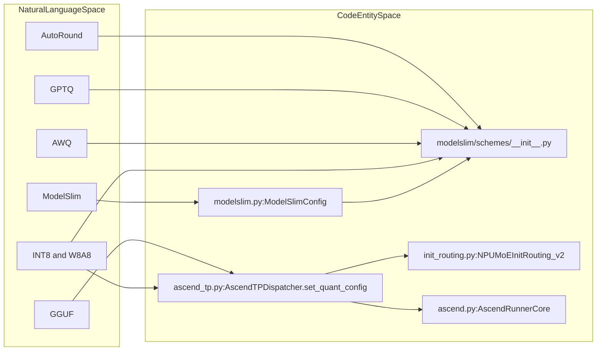
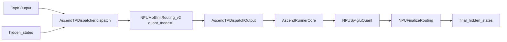

<!-- source: DeepWiki mcp.deepwiki.com · repo sgl-project/sglang · page 9.4 INT8 and Other Quantization Methods · fetched 2026-10-30 -->

# INT8 and Other Quantization Methods

Relevant source files

The following files were used as context for generating this wiki page:

- [docs/docs/advanced_features/quantization.mdx](docs/docs/advanced_features/quantization.mdx)
- [docs/docs/hardware-platforms/ascend-npus/optimization/quantization.mdx](docs/docs/hardware-platforms/ascend-npus/optimization/quantization.mdx)
- [python/sglang/kernels/jit/csrc/elementwise/activation.cuh](python/sglang/kernels/jit/csrc/elementwise/activation.cuh)
- [python/sglang/kernels/ops/activation/activation.py](python/sglang/kernels/ops/activation/activation.py)
- [python/sglang/kernels/ops/activation/minimax_m3_swiglu.py](python/sglang/kernels/ops/activation/minimax_m3_swiglu.py)
- [python/sglang/kernels/ops/attention/fused_qk_rmsnorm_rope_gate.py](python/sglang/kernels/ops/attention/fused_qk_rmsnorm_rope_gate.py)
- [python/sglang/kernels/ops/layernorm/gemma4_fused_ops.py](python/sglang/kernels/ops/layernorm/gemma4_fused_ops.py)
- [python/sglang/multimodal_gen/test/unit/test_ernie_rope_geglu_fusion.py](python/sglang/multimodal_gen/test/unit/test_ernie_rope_geglu_fusion.py)
- [python/sglang/srt/hardware_backend/npu/moe/activation.py](python/sglang/srt/hardware_backend/npu/moe/activation.py)
- [python/sglang/srt/hardware_backend/npu/moe/init_routing.py](python/sglang/srt/hardware_backend/npu/moe/init_routing.py)
- [python/sglang/srt/hardware_backend/npu/moe/matmul.py](python/sglang/srt/hardware_backend/npu/moe/matmul.py)
- [python/sglang/srt/hardware_backend/npu/moe/quant.py](python/sglang/srt/hardware_backend/npu/moe/quant.py)
- [python/sglang/srt/hardware_backend/npu/quantization/fp4_moe_methods.py](python/sglang/srt/hardware_backend/npu/quantization/fp4_moe_methods.py)
- [python/sglang/srt/hardware_backend/npu/quantization/linear_method_npu.py](python/sglang/srt/hardware_backend/npu/quantization/linear_method_npu.py)
- [python/sglang/srt/hardware_backend/npu/quantization/moe_methods.py](python/sglang/srt/hardware_backend/npu/quantization/moe_methods.py)
- [python/sglang/srt/hardware_backend/npu/quantization/online_moe_methods.py](python/sglang/srt/hardware_backend/npu/quantization/online_moe_methods.py)
- [python/sglang/srt/hardware_backend/npu/utils.py](python/sglang/srt/hardware_backend/npu/utils.py)
- [python/sglang/srt/layers/moe/cutlass_moe.py](python/sglang/srt/layers/moe/cutlass_moe.py)
- [python/sglang/srt/layers/moe/cutlass_w4a8_moe.py](python/sglang/srt/layers/moe/cutlass_w4a8_moe.py)
- [python/sglang/srt/layers/moe/fused_moe_triton/fused_marlin_moe.py](python/sglang/srt/layers/moe/fused_moe_triton/fused_marlin_moe.py)
- [python/sglang/srt/layers/moe/moe_runner/ascend.py](python/sglang/srt/layers/moe/moe_runner/ascend.py)
- [python/sglang/srt/layers/moe/moe_runner/marlin.py](python/sglang/srt/layers/moe/moe_runner/marlin.py)
- [python/sglang/srt/layers/moe/token_dispatcher/ascend_tp.py](python/sglang/srt/layers/moe/token_dispatcher/ascend_tp.py)
- [python/sglang/srt/layers/moe/token_dispatcher/deepep.py](python/sglang/srt/layers/moe/token_dispatcher/deepep.py)
- [python/sglang/srt/layers/quantization/gguf.py](python/sglang/srt/layers/quantization/gguf.py)
- [python/sglang/srt/layers/quantization/marlin_utils.py](python/sglang/srt/layers/quantization/marlin_utils.py)
- [python/sglang/srt/layers/quantization/marlin_utils_fp4.py](python/sglang/srt/layers/quantization/marlin_utils_fp4.py)
- [python/sglang/srt/layers/quantization/modelslim/modelslim.py](python/sglang/srt/layers/quantization/modelslim/modelslim.py)
- [python/sglang/srt/layers/quantization/modelslim/schemes/__init__.py](python/sglang/srt/layers/quantization/modelslim/schemes/__init__.py)
- [python/sglang/srt/layers/quantization/modelslim/schemes/modelslim_mxfp4.py](python/sglang/srt/layers/quantization/modelslim/schemes/modelslim_mxfp4.py)
- [python/sglang/srt/layers/quantization/modelslim/schemes/modelslim_mxfp4_w4a8.py](python/sglang/srt/layers/quantization/modelslim/schemes/modelslim_mxfp4_w4a8.py)
- [python/sglang/srt/layers/quantization/modelslim/schemes/modelslim_mxfp8.py](python/sglang/srt/layers/quantization/modelslim/schemes/modelslim_mxfp8.py)
- [python/sglang/srt/layers/quantization/modelslim/schemes/modelslim_w4a4_mxfp4_moe.py](python/sglang/srt/layers/quantization/modelslim/schemes/modelslim_w4a4_mxfp4_moe.py)
- [python/sglang/srt/layers/quantization/modelslim/schemes/modelslim_w4a8_mxfp4_moe.py](python/sglang/srt/layers/quantization/modelslim/schemes/modelslim_w4a8_mxfp4_moe.py)
- [python/sglang/srt/layers/quantization/mxfp4_marlin_moe.py](python/sglang/srt/layers/quantization/mxfp4_marlin_moe.py)
- [python/sglang/srt/layers/quantization/npu_mxfp4.py](python/sglang/srt/layers/quantization/npu_mxfp4.py)
- [python/sglang/srt/layers/quantization/npu_mxfp4_w4a4.py](python/sglang/srt/layers/quantization/npu_mxfp4_w4a4.py)
- [python/sglang/srt/layers/quantization/w4afp8.py](python/sglang/srt/layers/quantization/w4afp8.py)
- [test/registered/kernels/benchmark/moe/bench_fp8_per_token_to_per_tensor_quant.py](test/registered/kernels/benchmark/moe/bench_fp8_per_token_to_per_tensor_quant.py)
- [test/registered/kernels/ops/activation/test_activation.py](test/registered/kernels/ops/activation/test_activation.py)
- [test/registered/kernels/ops/attention/test_fused_qk_rmsnorm_rope_gate.py](test/registered/kernels/ops/attention/test_fused_qk_rmsnorm_rope_gate.py)
- [test/registered/kernels/ops/moe/test_fp8_per_token_to_per_tensor_quant.py](test/registered/kernels/ops/moe/test_fp8_per_token_to_per_tensor_quant.py)
- [test/registered/kernels/ops/moe/test_marlin_moe.py](test/registered/kernels/ops/moe/test_marlin_moe.py)
- [test/registered/kernels/ops/moe/test_moe_tma_down_padding_rows.py](test/registered/kernels/ops/moe/test_moe_tma_down_padding_rows.py)
- [test/registered/npu/basic_function/pd_disaggregation/test_npu_pd_decode_retraction_backup.py](test/registered/npu/basic_function/pd_disaggregation/test_npu_pd_decode_retraction_backup.py)
- [test/registered/rotary/test_mrope_axis_map.py](test/registered/rotary/test_mrope_axis_map.py)
- [test/registered/unit/layers/moe/test_deepep_import_guard.py](test/registered/unit/layers/moe/test_deepep_import_guard.py)
- [test/registered/unit/layers/moe/test_w4afp8_deepep_dtype.py](test/registered/unit/layers/moe/test_w4afp8_deepep_dtype.py)
- [test/registered/unit/layers/moe/test_w4afp8_deepep_post_reorder.py](test/registered/unit/layers/moe/test_w4afp8_deepep_post_reorder.py)
- [test/registered/unit/layers/quantization/test_modelslim_mxfp8.py](test/registered/unit/layers/quantization/test_modelslim_mxfp8.py)
- [test/registered/unit/npu/quantization/test_fp4_moe_methods.py](test/registered/unit/npu/quantization/test_fp4_moe_methods.py)
- [test/registered/unit/npu/test_npu_gemma_rmsnorm.py](test/registered/unit/npu/test_npu_gemma_rmsnorm.py)

## Purpose and Scope

This page covers INT8, AWQ, GPTQ, QServe, GGUF, AutoRound, Petit, ModelSlim, BitsAndBytes, and quantized KV cache formats (such as FP8 and FP4 KV cache). It details the quantization concepts, platform support, configuration workflows, and implementation mechanics found in the SGLang codebase. SGLang separates **offline quantization** (loading pre-quantized weights directly during inference) from **online quantization** (dynamically computing scaling parameters at runtime). For pre-quantized models, the documentation advises users not to pass `--quantization` to avoid enabling conflicting online quantization passes [docs/docs/advanced_features/quantization.mdx:6-17]().

Sources: [docs/docs/advanced_features/quantization.mdx:6-17]()

---

## Quantization Method Overview and Registry

SGLang integrates various quantization methods across multiple hardware backends (NVIDIA GPUs, AMD GPUs, Ascend NPUs, and Intel CPUs). Behavior is dictated by the model checkpoint configuration, target hardware, and backend kernel dispatch.

| Method or Family | Documented Support and Notes |
|---|---|
| `blockwise_int8` | NVIDIA and AMD; implemented using Triton kernels [docs/docs/advanced_features/quantization.mdx:67-71]() |
| `w8a8_int8` | Supported on NVIDIA and AMD hardware [docs/docs/advanced_features/quantization.mdx:74-78]() |
| `awq` | Supported on NVIDIA (JIT CUDA kernels), AMD (Triton dequantization), and Ascend (CANN kernels) [docs/docs/advanced_features/quantization.mdx:88-92]() |
| `gptq` | Supported on Ascend and Intel CPUs with AMX; deprecated/removed on NVIDIA and AMD in favor of `gptq_marlin` [docs/docs/advanced_features/quantization.mdx:95-100]() |
| `gguf` | Supported on NVIDIA (`sgl-kernel` CUDA kernels) and Ascend (CPU pre-dequantization at load time) [docs/docs/advanced_features/quantization.mdx:144-149]() |
| `auto-round` | Platform-agnostic (Intel auto-round) on NVIDIA and AMD, with partial CANN-backed support on Ascend [docs/docs/advanced_features/quantization.mdx:116-120]() |
| `modelopt` | NVIDIA-only (Hopper/SM90+ required for FP8, Marlin/native Blackwell support for FP4) [docs/docs/advanced_features/quantization.mdx:151-164]() |

Sources: [docs/docs/advanced_features/quantization.mdx:23-25](), [docs/docs/advanced_features/quantization.mdx:67-149](), [docs/docs/advanced_features/quantization.mdx:151-164]()

### From Method Names to Code Entities

The diagram below connects high-level quantization concepts to their corresponding code entities within SGLang's NPU and quantization subsystems.

**Diagram: Quantization methods mapped to implementation entities**

Sources: [python/sglang/srt/layers/quantization/modelslim/modelslim.py:91-142](), [python/sglang/srt/layers/quantization/modelslim/schemes/__init__.py:7-35](), [python/sglang/srt/layers/moe/token_dispatcher/ascend_tp.py:51-95](), [python/sglang/srt/hardware_backend/npu/moe/init_routing.py:83-118](), [python/sglang/srt/layers/moe/moe_runner/ascend.py:117-171]()

---

## INT8 (W8A8) Quantization Implementation

`W8A8` specifies 8-bit precision for both weights and activations. For Ascend NPUs using ModelSlim checkpoints, scheme implementations such as `ModelSlimW8A8Int8` and `ModelSlimW8A8Int8MoE` handle weights and layer transformations [python/sglang/srt/layers/quantization/modelslim/modelslim.py:18-30](). 

`ModelSlimConfig` parses quantization descriptions, processes ignore lists, handles `packed_modules_mapping`, and automatically patches `RMSNorm` initialization when `norm.bias` is present in the configuration [python/sglang/srt/layers/quantization/modelslim/modelslim.py:91-142]().

In the MoE execution path, token dispatchers coordinate quantization-aware routing. `AscendTPDispatcher` configures `NPUMoEInitRouting_v2` with `quant_mode=1` for INT8 processing, returning permuted hidden states, expert token counts, and per-token scales [python/sglang/srt/layers/moe/token_dispatcher/ascend_tp.py:76-95](), [python/sglang/srt/hardware_backend/npu/moe/init_routing.py:83-118](). `AscendRunnerCore` pairs this with `NPUSwigluQuant` to execute fused dequantization, activation, and requantization operations via `torch.ops.npu.npu_dequant_swiglu_quant` [python/sglang/srt/layers/moe/moe_runner/ascend.py:172-180](), [python/sglang/srt/hardware_backend/npu/moe/activation.py:31-39]().

**Diagram: Ascend TP INT8 MoE data path**

Sources: [python/sglang/srt/layers/moe/token_dispatcher/ascend_tp.py:76-126](), [python/sglang/srt/hardware_backend/npu/moe/init_routing.py:83-118](), [python/sglang/srt/layers/moe/moe_runner/ascend.py:172-180](), [python/sglang/srt/hardware_backend/npu/moe/activation.py:31-39]()

---

## AWQ, GPTQ, QServe, and GGUF Quantization

### AWQ
AWQ is supported across NVIDIA (using JIT-compiled CUDA kernels), AMD (using Triton dequantization paths), and Ascend NPUs (using CANN kernels) [docs/docs/advanced_features/quantization.mdx:88-92](). On Ascend, AWQ W4A16 is integrated for both dense linear layers and MoE architectures.

### GPTQ
GPTQ execution on NVIDIA and AMD has been largely superseded by `gptq_marlin` for performance reasons [docs/docs/advanced_features/quantization.mdx:95-100](). GPTQ remains supported via CANN kernels on Ascend NPUs and through CPU AMX backends [docs/docs/advanced_features/quantization.mdx:95-100]().

### QServe
QServe is targeted within SGLang's broader quantization scope. Specific configuration flags, checkpoint structures, and kernel integration are managed via modular linear methods and backend registries.

### GGUF
GGUF format support utilizes optimized CUDA kernels within `sgl-kernel` on NVIDIA hardware and performs CPU-based pre-dequantization at model load time on Ascend NPUs [docs/docs/advanced_features/quantization.mdx:144-149](). When GGUF configuration dictionaries specify `quant_type == "gguf"` alongside tensor parallelism, `AscendTPDispatcher.set_quant_config` wraps routing finalization with `AllGatherFinalizeRoutingWrapper` [python/sglang/srt/layers/moe/token_dispatcher/ascend_tp.py:63-95]().

Sources: [docs/docs/advanced_features/quantization.mdx:88-100](), [docs/docs/advanced_features/quantization.mdx:144-149](), [python/sglang/srt/layers/moe/token_dispatcher/ascend_tp.py:63-95]()

---

## AutoRound, Petit, ModelSlim, and BitsAndBytes

### AutoRound
`auto-round` offers platform-agnostic weight compression (originating from Intel AutoRound) with native execution paths on NVIDIA/AMD and CANN kernel fallback on Ascend NPUs [docs/docs/advanced_features/quantization.mdx:116-120]().

### Petit
Petit represents an additional supported quantization integration structured around SGLang's modular quantization config layout.

### ModelSlim
`ModelSlimConfig` serves as the primary configuration handler for Huawei ModelSlim NPU quantization [python/sglang/srt/layers/quantization/modelslim/modelslim.py:91-142](). It processes quantization descriptions, normalizes DeepSeek V4 head keys (`hc_head_`), maps `block_sparse_moe` aliases, and applies RMSNorm weight/bias patches (`npu_wrapper_rmsnorm_init` and `npu_wrapper_rmsnorm_forward`) to ensure compatibility with Ascend execution constraints [python/sglang/srt/layers/quantization/modelslim/modelslim.py:48-142](). Scheme definitions cover dense and MoE variations such as `ModelSlimW8A8Int8`, `ModelSlimW8A8Int8MoE`, `ModelSlimW4A4Int4`, and various MXFP4/MXFP8 formats [python/sglang/srt/layers/quantization/modelslim/schemes/__init__.py:7-35]().

### BitsAndBytes
BitsAndBytes integration facilitates low-bit weight loading and dynamic dequantization workflows within the model loading pipeline.

Sources: [docs/docs/advanced_features/quantization.mdx:116-120](), [python/sglang/srt/layers/quantization/modelslim/modelslim.py:48-142](), [python/sglang/srt/layers/quantization/modelslim/schemes/__init__.py:7-35]()

---

## Quantized KV Cache (FP8 and FP4 KV)

Quantized KV cache mechanisms (such as FP8 and FP4 KV caches) reduce memory footprint and increase effective batch capacity during generation. SGLang coordinates KV cache quantization through engine configuration parameters that instruct the `ModelRunner` and memory allocators (`ReqToTokenPool`, `TokenToKVPool`) to allocate lower-precision cache buffers (e.g., `torch.float8_e4m3fn` or compressed formats). Attention backends (such as FlashInfer and custom `sgl-kernel` attention operators) consume these quantized KV buffers directly during prefill and decode passes by applying per-tensor or per-block scaling factors retrieved from the attention metadata.

Sources: [docs/docs/advanced_features/quantization.mdx:23-25]()

---

## Online and Offline Quantization

Offline quantization loads pre-quantized weights generated via calibration datasets (such as AWQ and GPTQ statistics), bypassing runtime quantization overhead [docs/docs/advanced_features/quantization.mdx:6-17](). Online quantization computes scaling factors dynamically during inference (similar to NVIDIA's delayed scaling in Transformer Engine) [docs/docs/advanced_features/quantization.mdx:6-17](). 

For Ascend ModelSlim deployments, configuration JSON files (`quant_model_description.json` or `config.json`) are automatically inspected at load time to configure linear and MoE layers without requiring manual `--quantization` arguments [docs/docs/hardware-platforms/ascend-npus/optimization/quantization.mdx:6-8]().

Sources: [docs/docs/advanced_features/quantization.mdx:6-17](), [docs/docs/hardware-platforms/ascend-npus/optimization/quantization.mdx:6-8]()

---

