# Page: Overview

# Overview

<details>
<summary>Relevant source files</summary>

The following files were used as context for generating this wiki page:

- [.github/workflows/release-pypi-nightly.yml](.github/workflows/release-pypi-nightly.yml)
- [.github/workflows/release-pypi-pr.yml](.github/workflows/release-pypi-pr.yml)
- [3rdparty/amd/wheel/sglang/pyproject.toml](3rdparty/amd/wheel/sglang/pyproject.toml)
- [docker/Dockerfile](docker/Dockerfile)
- [docs/docs/references/environment_variables.mdx](docs/docs/references/environment_variables.mdx)
- [python/pyproject.toml](python/pyproject.toml)
- [python/pyproject_cpu.toml](python/pyproject_cpu.toml)
- [python/pyproject_npu.toml](python/pyproject_npu.toml)
- [python/pyproject_other.toml](python/pyproject_other.toml)
- [python/pyproject_xpu.toml](python/pyproject_xpu.toml)
- [python/sglang/benchmark/one_batch.py](python/sglang/benchmark/one_batch.py)
- [python/sglang/srt/arg_groups/attention_hook.py](python/sglang/srt/arg_groups/attention_hook.py)
- [python/sglang/srt/arg_groups/overrides.py](python/sglang/srt/arg_groups/overrides.py)
- [python/sglang/srt/arg_groups/pd_disaggregation_hook.py](python/sglang/srt/arg_groups/pd_disaggregation_hook.py)
- [python/sglang/srt/disaggregation/role_switch.py](python/sglang/srt/disaggregation/role_switch.py)
- [python/sglang/srt/distributed/bootstrap.py](python/sglang/srt/distributed/bootstrap.py)
- [python/sglang/srt/distributed/parallel_state.py](python/sglang/srt/distributed/parallel_state.py)
- [python/sglang/srt/entrypoints/engine.py](python/sglang/srt/entrypoints/engine.py)
- [python/sglang/srt/environ.py](python/sglang/srt/environ.py)
- [python/sglang/srt/function_call/deepseekv32_detector.py](python/sglang/srt/function_call/deepseekv32_detector.py)
- [python/sglang/srt/function_call/kimik2_detector.py](python/sglang/srt/function_call/kimik2_detector.py)
- [python/sglang/srt/layers/dp_attention.py](python/sglang/srt/layers/dp_attention.py)
- [python/sglang/srt/managers/schedule_batch.py](python/sglang/srt/managers/schedule_batch.py)
- [python/sglang/srt/managers/scheduler.py](python/sglang/srt/managers/scheduler.py)
- [python/sglang/srt/mem_cache/common.py](python/sglang/srt/mem_cache/common.py)
- [python/sglang/srt/model_executor/model_runner.py](python/sglang/srt/model_executor/model_runner.py)
- [python/sglang/srt/runtime_context.py](python/sglang/srt/runtime_context.py)
- [python/sglang/srt/server_args.py](python/sglang/srt/server_args.py)
- [python/sglang/srt/utils/common.py](python/sglang/srt/utils/common.py)
- [python/sglang/srt/utils/json_response.py](python/sglang/srt/utils/json_response.py)
- [scripts/update_nightly_whl_index.py](scripts/update_nightly_whl_index.py)
- [test/manual/test_forward_split_prefill.py](test/manual/test_forward_split_prefill.py)
- [test/manual/test_vlm_accuracy.py](test/manual/test_vlm_accuracy.py)
- [test/registered/function_call/test_kimik2_detector.py](test/registered/function_call/test_kimik2_detector.py)
- [test/registered/moe/test_cutedsl_moe.py](test/registered/moe/test_cutedsl_moe.py)
- [test/registered/unit/disaggregation/test_pd_role_switch.py](test/registered/unit/disaggregation/test_pd_role_switch.py)
- [test/registered/unit/function_call/test_deepseekv4_detector.py](test/registered/unit/function_call/test_deepseekv4_detector.py)
- [test/registered/unit/function_call/test_json_schema_constraint.py](test/registered/unit/function_call/test_json_schema_constraint.py)
- [test/registered/unit/function_call/test_structural_tag_excludes.py](test/registered/unit/function_call/test_structural_tag_excludes.py)
- [test/registered/unit/function_call/test_unknown_tool_name.py](test/registered/unit/function_call/test_unknown_tool_name.py)
- [test/registered/unit/server_args/test_server_args.py](test/registered/unit/server_args/test_server_args.py)
- [test/registered/unit/test_model_overrides.py](test/registered/unit/test_model_overrides.py)
- [test/registered/unit/test_runtime_context.py](test/registered/unit/test_runtime_context.py)
- [test/registered/unit/utils/test_common.py](test/registered/unit/utils/test_common.py)
- [test/registered/unit/utils/test_json_response.py](test/registered/unit/utils/test_json_response.py)

</details>


## Purpose and Scope

SGLang is a high-performance serving framework for large language models (LLMs) and vision-language models (VLMs), optimized for low-latency and high-throughput inference [python/pyproject.toml:14-14](). It provides a complete runtime environment featuring automatic prefix caching via `RadixAttention`, multi-tier memory management, speculative decoding, and multi-dimensional parallelism across tensor, pipeline, expert, and data dimensions [python/pyproject.toml:14-14]().

This page serves as a high-level parent overview of the SGLang architecture, components, and design principles. Detailed explorations of repository layout, entry points, and low-level dataflow are delegated to child pages.

Sources: [python/pyproject.toml:14-14]()

---

## Architectural Overview and Process Model

SGLang utilizes a multi-process architecture to isolate resource profiles, bypass Python's Global Interpreter Lock (GIL), and maximize concurrency. CPU-bound tasks such as tokenization, request parsing, and scheduling run in separate processes from GPU-bound model execution [python/sglang/srt/entrypoints/engine.py:28-34](). The core server arguments are defined in `ServerArgs` [python/sglang/srt/server_args.py:700-700](), which encapsulates various configuration options for the runtime.

Diagram: SGLang Process Architecture Mapping to Code Entities

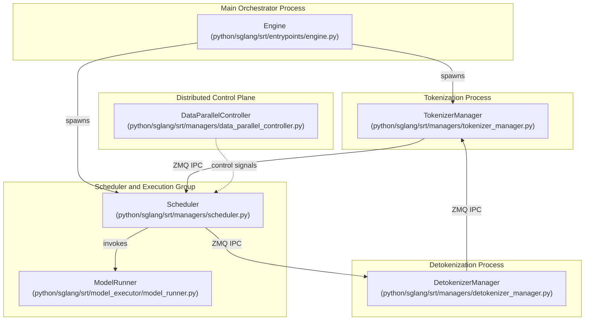

Sources: [python/sglang/srt/entrypoints/engine.py:28-34](), [python/sglang/srt/managers/scheduler.py:14-14](), [python/sglang/srt/server_args.py:700-700]()

---

## Request Lifecycle and Dataflow

Incoming requests flow from client APIs through the asynchronous engine stack, getting tokenized, matched against prefix caches, scheduled into batches, executed on hardware accelerators, and finally detokenized back into text streams [python/sglang/srt/entrypoints/engine.py:73-100](). The `ScheduleBatch` [python/sglang/srt/managers/schedule_batch.py:49-50]() is managed by the `Scheduler` [python/sglang/srt/managers/scheduler.py:14-14](), while the `ForwardBatch` [python/sglang/srt/managers/schedule_batch.py:51-52]() is managed by the `ModelRunner` [python/sglang/srt/model_executor/model_runner.py:14-14]().

Diagram: Request Lifecycle and Dataflow Mapping to Code Entities

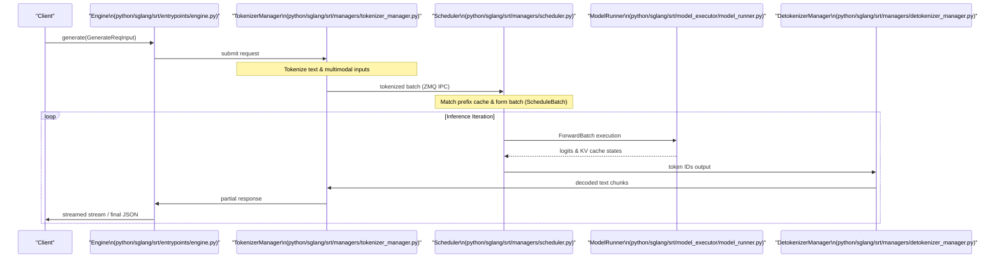

Sources: [python/sglang/srt/entrypoints/engine.py:73-100](), [python/sglang/srt/managers/scheduler.py:14-14](), [python/sglang/srt/model_executor/model_runner.py:14-14](), [python/sglang/srt/managers/schedule_batch.py:49-52]()

---

## Core Runtime Components

- **Engine**: Orchestrates subprocesses and exposes Python generation APIs (`python/sglang/srt/entrypoints/engine.py`) [python/sglang/srt/entrypoints/engine.py:64-64]().
- **TokenizerManager**: Handles asynchronous text and multimodal tokenization (`python/sglang/srt/managers/tokenizer_manager.py`) [python/sglang/srt/entrypoints/engine.py:110-110]().
- **Scheduler**: Manages GPU memory allocation, prefix caching, batch formation, and execution scheduling (`python/sglang/srt/managers/scheduler.py`) [python/sglang/srt/managers/scheduler.py:14-14]().
- **ModelRunner**: Executes forward passes, CUDA graphs, and tensor operations (`python/sglang/srt/model_executor/model_runner.py`) [python/sglang/srt/model_executor/model_runner.py:14-14]().
- **DetokenizerManager**: Translates output token sequences back into strings (`python/sglang/srt/managers/detokenizer_manager.py`) [python/sglang/srt/entrypoints/engine.py:71-71]().
- **ServerArgs**: A dataclass defining all configurable parameters for the SGLang server, including model paths, memory settings, parallelism strategies, and more (`python/sglang/srt/server_args.py`) [python/sglang/srt/server_args.py:700-700]().

Sources: [python/sglang/srt/entrypoints/engine.py:64-110](), [python/sglang/srt/managers/scheduler.py:14-14](), [python/sglang/srt/model_executor/model_runner.py:14-14](), [python/sglang/srt/server_args.py:700-700]()

---

## Memory Management and Caching

SGLang manages KV cache efficiently via pooled allocators (`ReqToTokenPool`, `TokenToKVPool`) and tree-structured prefix sharing (`RadixCache`) to minimize redundant computations across requests [python/pyproject.toml:14-16](). The `Memory` argument group within `ServerArgs` [python/sglang/srt/server_args.py:161-162]() controls these aspects.

Sources: [python/pyproject.toml:14-16](), [python/sglang/srt/server_args.py:161-162]()

---

## Child Pages & Further Reading

For deep technical details and specific implementation guides, refer to the child pages:
- [Repository Layout, Major Packages, and Entry Points](#1.1) — Orient new contributors to the monorepo layout and entry points.
- [Core Concepts and Dataflow (Tokenizer → Scheduler → ModelRunner → Detokenizer)](#1.2) — Detailed conceptual request lifecycle and runtime roles.

---

# Page: Repository Layout, Major Packages, and Entry Points

# Repository Layout, Major Packages, and Entry Points

<details>
<summary>Relevant source files</summary>

The following files were used as context for generating this wiki page:

- [.github/workflows/release-pypi-nightly.yml](.github/workflows/release-pypi-nightly.yml)
- [.github/workflows/release-pypi-pr.yml](.github/workflows/release-pypi-pr.yml)
- [3rdparty/amd/wheel/sglang/pyproject.toml](3rdparty/amd/wheel/sglang/pyproject.toml)
- [docker/Dockerfile](docker/Dockerfile)
- [docs/cards/logos/iquestlab.png](docs/cards/logos/iquestlab.png)
- [docs/cards/logos/perplexity.png](docs/cards/logos/perplexity.png)
- [docs/cookbook/autoregressive/DeepReinforce/Ornith-1.0.mdx](docs/cookbook/autoregressive/DeepReinforce/Ornith-1.0.mdx)
- [docs/cookbook/autoregressive/DeepReinforce/Ornith-1.5.mdx](docs/cookbook/autoregressive/DeepReinforce/Ornith-1.5.mdx)
- [docs/cookbook/autoregressive/Perplexity/PPLX-Decider-v1-27B.mdx](docs/cookbook/autoregressive/Perplexity/PPLX-Decider-v1-27B.mdx)
- [docs/cookbook/autoregressive/Perplexity/PPLX-Decider-v1.1-27B.mdx](docs/cookbook/autoregressive/Perplexity/PPLX-Decider-v1.1-27B.mdx)
- [docs/cookbook/autoregressive/intro.mdx](docs/cookbook/autoregressive/intro.mdx)
- [docs/docs.json](docs/docs.json)
- [docs/docs/supported-models/decision_models.mdx](docs/docs/supported-models/decision_models.mdx)
- [docs/src/snippets/configs/ornith-ai/ornith-1.5.jsx](docs/src/snippets/configs/ornith-ai/ornith-1.5.jsx)
- [docs/src/snippets/configs/perplexity-ai/pplx-decider-v1-27b-benchmarks.jsx](docs/src/snippets/configs/perplexity-ai/pplx-decider-v1-27b-benchmarks.jsx)
- [docs/src/snippets/configs/perplexity-ai/pplx-decider-v1-27b.jsx](docs/src/snippets/configs/perplexity-ai/pplx-decider-v1-27b.jsx)
- [docs/src/snippets/configs/perplexity-ai/pplx-decider-v1.1-27b-benchmarks.jsx](docs/src/snippets/configs/perplexity-ai/pplx-decider-v1.1-27b-benchmarks.jsx)
- [docs/src/snippets/configs/perplexity-ai/pplx-decider-v1.1-27b.jsx](docs/src/snippets/configs/perplexity-ai/pplx-decider-v1.1-27b.jsx)
- [docs/src/snippets/configs/popular-models.jsx](docs/src/snippets/configs/popular-models.jsx)
- [python/pyproject.toml](python/pyproject.toml)
- [python/pyproject_cpu.toml](python/pyproject_cpu.toml)
- [python/pyproject_npu.toml](python/pyproject_npu.toml)
- [python/pyproject_other.toml](python/pyproject_other.toml)
- [python/pyproject_xpu.toml](python/pyproject_xpu.toml)
- [python/sglang/srt/entrypoints/engine.py](python/sglang/srt/entrypoints/engine.py)
- [python/sglang/srt/entrypoints/openai/serving_base.py](python/sglang/srt/entrypoints/openai/serving_base.py)
- [python/sglang/srt/entrypoints/openai/serving_decisions.py](python/sglang/srt/entrypoints/openai/serving_decisions.py)
- [python/sglang/srt/entrypoints/systemone/protocol.py](python/sglang/srt/entrypoints/systemone/protocol.py)
- [python/sglang/srt/entrypoints/systemone/serving.py](python/sglang/srt/entrypoints/systemone/serving.py)
- [python/sglang/srt/function_call/deepseekv32_detector.py](python/sglang/srt/function_call/deepseekv32_detector.py)
- [python/sglang/srt/function_call/kimik2_detector.py](python/sglang/srt/function_call/kimik2_detector.py)
- [python/sglang/srt/utils/common.py](python/sglang/srt/utils/common.py)
- [python/sglang/srt/utils/json_response.py](python/sglang/srt/utils/json_response.py)
- [scripts/update_nightly_whl_index.py](scripts/update_nightly_whl_index.py)
- [test/registered/function_call/test_kimik2_detector.py](test/registered/function_call/test_kimik2_detector.py)
- [test/registered/lora/test_lora_openai_api.py](test/registered/lora/test_lora_openai_api.py)
- [test/registered/moe/test_cutedsl_moe.py](test/registered/moe/test_cutedsl_moe.py)
- [test/registered/unit/entrypoints/openai/test_serving_decisions.py](test/registered/unit/entrypoints/openai/test_serving_decisions.py)
- [test/registered/unit/function_call/test_deepseekv4_detector.py](test/registered/unit/function_call/test_deepseekv4_detector.py)
- [test/registered/unit/function_call/test_json_schema_constraint.py](test/registered/unit/function_call/test_json_schema_constraint.py)
- [test/registered/unit/function_call/test_structural_tag_excludes.py](test/registered/unit/function_call/test_structural_tag_excludes.py)
- [test/registered/unit/function_call/test_unknown_tool_name.py](test/registered/unit/function_call/test_unknown_tool_name.py)
- [test/registered/unit/utils/test_common.py](test/registered/unit/utils/test_common.py)
- [test/registered/unit/utils/test_json_response.py](test/registered/unit/utils/test_json_response.py)

</details>


This page provides a detailed technical orientation to the SGLang monorepo layout, illustrating the major packages and their roles, along with the main user-facing entry points. SGLang is a high-performance serving framework for Large Language Models (LLMs) and Vision Language Models (VLMs), designed for scalability and multi-hardware platform support using a multi-process architecture [python/sglang/srt/entrypoints/engine.py:1-211]().

---

## Monorepo Layout

The SGLang repository consists of the following key directories, each with a distinct purpose in building, deploying, or running components of the framework:

| Directory | Description |
|---|---|
| `python/` | Core Python package implementing the SGLang Runtime (SRT), CLI tools, API entrypoints, multimodal generation (diffusion), and various utilities [python/pyproject.toml:14-21](). |
| `sgl-kernel/` | High-performance kernel implementations targeting CUDA, ROCm, CPU (AMX), including attention, MoE, quantization, and fused kernels [python/pyproject.toml:80-80](). |
| `sgl-model-gateway/` | A high-throughput model routing gateway supporting multi-node orchestration, worker load balancing, and workflow management. |
| `experimental/sgl-router/` | Experimental Rust-based lightweight router implementing KV-event-driven cache-aware routing with Kubernetes EndpointSlice discovery and static worker pools. |
| `rust/` | Rust extension crates including `sglang-grpc` which provides a performant Rust-based gRPC server and protobuf bindings. |
| `tools/` | Utility tools, including the `sglang-simulator` for offline trace replay and workload simulation. |
| `docs/` | Documentation source files for SGLang features, tutorials, and API references. |
| `examples/` | Code examples illustrating SGLang's DSL, API usage, multimodal model integration, and runtime features. |
| `scripts/` | Development, Continuous Integration (CI), benchmarking, release, and utility scripts aiding development and deployment workflows [python/pyproject.toml:217-218](). |
| `.agents/` | Internal skill and agent scripts aiding debugging and development workflows. |

### Diagram: Repository to Code Entity Mapping

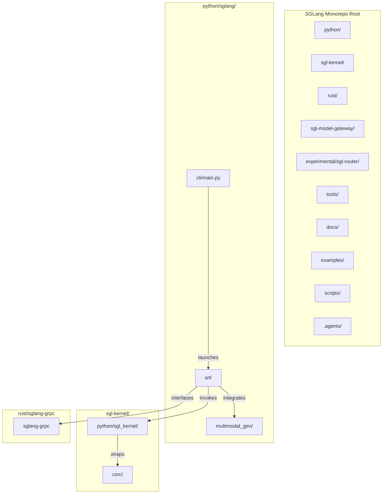
Sources: [python/pyproject.toml:14-21](), [python/sglang/srt/entrypoints/engine.py:1-211](), [python/pyproject.toml:80-80](), [python/pyproject.toml:220-224]()

---

## Major Packages

### 1. `sglang` (Python Core)

SGLang's primary Python package providing the runtime (SRT), command-line interface, HTTP and Python APIs, diffusion runtime, and utilities.

- **Runtime (`srt/`)**: Implements the core serving runtime including multi-process managers:
  - `TokenizerManager`: Runs as a separate subprocess managing all tokenization tasks, converting user input text into token IDs to feed the model [python/sglang/srt/entrypoints/engine.py:201-202]().
  - `Scheduler`: Core batch scheduler responsible for request multiplexing, batching, and scheduling requests to model runner processes efficiently [python/sglang/srt/managers/scheduler.py:1-1]().
  - `DetokenizerManager`: Runs separately to detokenize output token streams and deliver the final textual response [python/sglang/srt/managers/detokenizer_manager.py:1-1]().

- **Command-Line Interface (`cli/`)**: The CLI entrypoint (`sglang.cli.main:main`) enables launching servers, running inference engines, managing model weights and LoRA adapters, and utility commands. This CLI is the main front-facing user interface for running and configuring SGLang [python/pyproject.toml:217-218]().

- **Multimodal Generation (`multimodal_gen/`)**: Provides runtime support for diffusion-based image, video, and vision-language models built using DiT architectures. This module integrates tightly with the core runtime to enable multimodal serving [python/pyproject.toml:220-224]().

Sources: [python/pyproject.toml:14-21](), [python/sglang/srt/entrypoints/engine.py:201-202](), [python/pyproject.toml:217-218](), [python/pyproject.toml:220-224](), [python/sglang/srt/managers/scheduler.py:1-1](), [python/sglang/srt/managers/detokenizer_manager.py:1-1]()

### 2. `sgl-kernel` (Kernel Implementations)

The `sgl-kernel` directory contains a collection of highly optimized inference kernels targeting multiple hardware platforms:

- CUDA kernels including custom attention, quantization (FP8, FP4, INT8), fused MoE operators, and elementwise operations.
- Support for AMD ROCm and Intel AMX CPU kernels.
- It exposes Python bindings packaged as `sglang-kernel` for integration with the Python runtime [python/pyproject.toml:80-80]().

Sources: [python/pyproject.toml:80-80]()

### 3. Rust Extensions (`rust/`)

- Contains Rust crates including `sglang-grpc`, a high-performance gRPC server implementation using protobuf that supports streaming APIs and integrates with the Python runtime for high-throughput serving.

Sources: [docker/Dockerfile:188-194]()

### 4. `sgl-model-gateway/`

- A scalable model gateway service enabling routing, load balancing, worker lifecycle management, and workflow orchestration for multiple models in production environments.

### 5. `experimental/sgl-router/`

- An experimental Rust-based lightweight router implementing KV-event-driven cache-aware routing with Kubernetes EndpointSlice discovery and static worker pools.

### 6. `tools/`

- Contains utility tools like the `sglang-simulator` for offline trace replay, workload simulation, and testing.

### 7. `docs/`

- The documentation source files, including guides, API references, and tutorials.

### 8. `examples/`

- Example programs demonstrating the usage of SGLang features, the frontend language, API clients, and multimodal integrations.

### 9. `scripts/`

- Development scripts for CI/CD workflows, benchmarking, profiling, and release automation [python/pyproject.toml:217-218]().

### 10. `.agents/`

- Internal skill and agent scripts included to support debugging, testing, and agentic inference workflows.

Sources: [python/pyproject.toml:217-218]()

---

## Primary User Entry Points

The SGLang system offers three main entry points for users to interact with the serving runtime:

### 1. Command Line Interface (CLI)

- The primary user-facing CLI interface is the `sglang` command line tool.
- Invokes the main entrypoint at `python/sglang/cli/main.py` which processes commands including server launch.
- Command-line arguments control server launch, model selection, runtime config, and utilities.
- CLI translates arguments into structured `ServerArgs` configuration objects used by the runtime [python/sglang/srt/server_args.py:14-19]().

Sources: [python/pyproject.toml:217-218](), [python/sglang/srt/server_args.py:14-19]()

### 2. HTTP Server (OpenAI-Compatible API)

- Implements a FastAPI-based HTTP server exposing industry-standard endpoints such as `/v1/chat/completions`, `/v1/completions`, and `/v1/embeddings`.
- Supports Anthropic and Ollama-compatible APIs as well.
- Runs as the parent process and coordinates with tokenizer, scheduler, and detokenizer subprocesses communicating over ZeroMQ sockets for efficient inter-process communication and batching.
- The HTTP server accepts requests, sends tokenized input to the `TokenizerManager` subprocess, schedules inference via `Scheduler` and `ModelRunner` subprocesses, detokenizes output, then streams JSON completion results back to the client [python/sglang/srt/entrypoints/openai/serving_base.py:14-18](), [python/sglang/srt/entrypoints/engine.py:68-100]().
- Specific endpoints like `/v1/decisions` and `/v1/systemone` are SGLang extensions that turn a chat model into a decision model, allowing it to answer typed choice, score, and yes/no questions with probabilities without generating text [docs/docs/supported-models/decision_models.mdx:1-7](), [test/registered/unit/entrypoints/openai/test_serving_decisions.py:18-20](). These endpoints are handled by `OpenAIServingDecisions` and `SystemOneServing` classes respectively [python/sglang/srt/entrypoints/openai/serving_decisions.py:1-1](), [python/sglang/srt/entrypoints/systemone/serving.py:1-1]().

Sources: [python/sglang/srt/entrypoints/engine.py:68-100](), [python/sglang/srt/entrypoints/openai/serving_base.py:14-18](), [docs/docs/supported-models/decision_models.mdx:1-7](), [test/registered/unit/entrypoints/openai/test_serving_decisions.py:18-20](), [python/sglang/srt/entrypoints/openai/serving_decisions.py:1-1](), [python/sglang/srt/entrypoints/systemone/serving.py:1-1]()

### 3. Python Engine API

- The `Engine` class in the runtime (`srt/entrypoints/engine.py`) offers a programmatic interface to the serving runtime.
- Enables asynchronous token generation, batch dispatch to the scheduler, tokenizer/detokenizer direct calls, and dynamic model weight updates.
- This interface is intended for embedding SGLang inference capabilities into Python applications without the HTTP server overhead [python/sglang/srt/entrypoints/engine.py:62-94]().

Sources: [python/sglang/srt/entrypoints/engine.py:62-94]()

---

## Internal Data Flow at Server Entry Points

### Diagram: Request Lifecycle Through Server Components

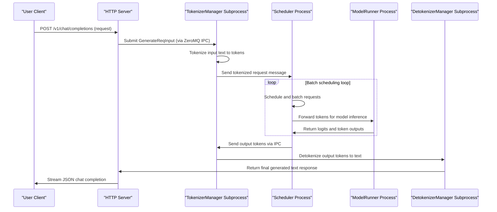
This flow diagram reveals how an incoming request progresses through the major processes, leveraging asynchronous IPC and batching to achieve high throughput and low latency.
Sources: [python/sglang/srt/entrypoints/engine.py:68-100](), [python/sglang/srt/entrypoints/openai/serving_base.py:113-146](), [python/sglang/srt/managers/tokenizer_manager.py:14-15]()

---

## Build and Dependency Management

- **Python Packaging:** The project uses `pyproject.toml` with `setuptools` and `setuptools-rust` for building Python packages and Rust extensions.
- **Dependencies:** Core dependencies include `torch`, `transformers`, `fastapi`, `uvicorn`, `pyzmq`, and multiple extras for diffusion models, distributed serving, tracing, and platform-specific builds [python/pyproject.toml:24-102]().
- **Rust Extensions:** Rust crates are compiled and integrated with Python runtime via `setuptools-rust` bindings.
- **Docker:** The provided multi-stage Dockerfile sets up the NVIDIA CUDA 13 environment, installs system dependencies and build tools, and compiles the SGLang Python module and kernel dependencies [docker/Dockerfile:1-126]().

Sources: [python/pyproject.toml:1-102](), [docker/Dockerfile:1-126]()

---

## Summary Table: Directory Roles and Primary User Interfaces

| Component | Primary Code Location | Description | Entry Point / Usage |
|---|---|---|---|
| Core Python Runtime (SRT) | `python/sglang/srt/` | Tokenization, scheduling, model execution, detokenization | `sglang.cli.main:main`, `Engine` class |
| CLI | `python/sglang/cli/main.py` | Command line tool with commands for server launch, model management | `sglang` CLI |
| Diffusion Generation | `python/sglang/multimodal_gen/` | Diffusion-based image/video generation runtime | APIs and CLI |
| Kernel Library | `sgl-kernel/` | CUDA, ROCm, CPU optimized kernels (Attention, MoE, Quantization) | Python bindings via `sglang-kernel` wheel |
| Rust Extensions (gRPC server) | `rust/sglang-grpc/` | High-performance gRPC server and protobuf interfaces | gRPC server via Python wrapper |
| Model Gateway | `sgl-model-gateway/` | Model routing, worker pooling, load balancing, orchestration | Multi-model routing gateway |
| Experimental Router | `experimental/sgl-router/` | Rust-based KV-event-driven cache-aware router for advanced routing | Experimental routing service |
| Documentation | `docs/` | Documentation source files, API references, usage guides | HTML/PDF docs |
| Tools | `tools/` | Utility tools including simulator and offline workload trace playback | CLI tools and simulation runners |
| Scripts | `scripts/` | Utility, CI/CD, benchmarking, profiling, and environment setup scripts | Developer and CI tooling |
| Agent Scripts | `.agents/` | Internal skills and agent scripts for development and debugging workflows | Agent SDK, skill runners |

Sources: [python/pyproject.toml:71-233](), [docker/Dockerfile:1-126]()

---

This detailed layout and orientation should help new contributors understand the structure of the SGLang repository, the purpose of each major component, and how the main user entry points relate to the internal multi-process architecture for scalable LLM and VLM serving.

---

# Page: Core Concepts and Dataflow (Tokenizer → Scheduler → ModelRunner → Detokenizer)

# Core Concepts and Dataflow (Tokenizer → Scheduler → ModelRunner → Detokenizer)

<details>
<summary>Relevant source files</summary>

The following files were used as context for generating this wiki page:

- [docs/docs/advanced_features/hicache_design.mdx](docs/docs/advanced_features/hicache_design.mdx)
- [docs/docs/references/environment_variables.mdx](docs/docs/references/environment_variables.mdx)
- [docs/docs/references/production_metrics.mdx](docs/docs/references/production_metrics.mdx)
- [python/sglang/benchmark/one_batch.py](python/sglang/benchmark/one_batch.py)
- [python/sglang/srt/arg_groups/attention_hook.py](python/sglang/srt/arg_groups/attention_hook.py)
- [python/sglang/srt/arg_groups/overrides.py](python/sglang/srt/arg_groups/overrides.py)
- [python/sglang/srt/arg_groups/pd_disaggregation_hook.py](python/sglang/srt/arg_groups/pd_disaggregation_hook.py)
- [python/sglang/srt/disaggregation/role_switch.py](python/sglang/srt/disaggregation/role_switch.py)
- [python/sglang/srt/distributed/bootstrap.py](python/sglang/srt/distributed/bootstrap.py)
- [python/sglang/srt/distributed/parallel_state.py](python/sglang/srt/distributed/parallel_state.py)
- [python/sglang/srt/entrypoints/http_server.py](python/sglang/srt/entrypoints/http_server.py)
- [python/sglang/srt/environ.py](python/sglang/srt/environ.py)
- [python/sglang/srt/layers/dp_attention.py](python/sglang/srt/layers/dp_attention.py)
- [python/sglang/srt/managers/data_parallel_controller.py](python/sglang/srt/managers/data_parallel_controller.py)
- [python/sglang/srt/managers/detokenizer_manager.py](python/sglang/srt/managers/detokenizer_manager.py)
- [python/sglang/srt/managers/io_struct.py](python/sglang/srt/managers/io_struct.py)
- [python/sglang/srt/managers/multi_tokenizer_mixin.py](python/sglang/srt/managers/multi_tokenizer_mixin.py)
- [python/sglang/srt/managers/schedule_batch.py](python/sglang/srt/managers/schedule_batch.py)
- [python/sglang/srt/managers/scheduler.py](python/sglang/srt/managers/scheduler.py)
- [python/sglang/srt/managers/tokenizer_control_mixin.py](python/sglang/srt/managers/tokenizer_control_mixin.py)
- [python/sglang/srt/managers/tokenizer_manager.py](python/sglang/srt/managers/tokenizer_manager.py)
- [python/sglang/srt/mem_cache/common.py](python/sglang/srt/mem_cache/common.py)
- [python/sglang/srt/model_executor/model_runner.py](python/sglang/srt/model_executor/model_runner.py)
- [python/sglang/srt/ray/data_parallel_controller.py](python/sglang/srt/ray/data_parallel_controller.py)
- [python/sglang/srt/ray/engine.py](python/sglang/srt/ray/engine.py)
- [python/sglang/srt/runtime_context.py](python/sglang/srt/runtime_context.py)
- [python/sglang/srt/server_args.py](python/sglang/srt/server_args.py)
- [test/manual/test_forward_split_prefill.py](test/manual/test_forward_split_prefill.py)
- [test/manual/test_vlm_accuracy.py](test/manual/test_vlm_accuracy.py)
- [test/registered/unit/disaggregation/test_pd_role_switch.py](test/registered/unit/disaggregation/test_pd_role_switch.py)
- [test/registered/unit/entrypoints/test_server_info.py](test/registered/unit/entrypoints/test_server_info.py)
- [test/registered/unit/managers/test_data_parallel_controller.py](test/registered/unit/managers/test_data_parallel_controller.py)
- [test/registered/unit/managers/test_multi_tokenizer_mixin.py](test/registered/unit/managers/test_multi_tokenizer_mixin.py)
- [test/registered/unit/managers/test_tokenizer_manager_rid_cleanup.py](test/registered/unit/managers/test_tokenizer_manager_rid_cleanup.py)
- [test/registered/unit/server_args/test_server_args.py](test/registered/unit/server_args/test_server_args.py)
- [test/registered/unit/test_model_overrides.py](test/registered/unit/test_model_overrides.py)
- [test/registered/unit/test_runtime_context.py](test/registered/unit/test_runtime_context.py)

</details>


## Purpose and Scope

This page describes the high-level request lifecycle in the SGLang Runtime (SRT), from an incoming request through tokenization, scheduling, model execution, and response decoding. It focuses on the responsibilities of the runtime managers, the handoffs between stages, and the distinction between scheduling data and model-execution data. It does not attempt to document individual scheduling policies, model kernels, or transport implementations in depth. [python/sglang/srt/entrypoints/http_server.py:14-18](), [python/sglang/srt/managers/schedule_batch.py:42-54]()

Sources: [python/sglang/srt/entrypoints/http_server.py:14-18](), [python/sglang/srt/managers/schedule_batch.py:42-54]()

---

## 1. Request Lifecycle Overview

The runtime organizes a generation request into several conceptual stages:

1. **Request ingress and tokenization.** `TokenizerManager` is the process responsible for tokenizing text; the HTTP server imports it alongside request and response entrypoint components. A raw generation request is represented by `GenerateReqInput`, and tokenized generation requests have dedicated IPC types. [python/sglang/srt/managers/tokenizer_manager.py:14-14](), [python/sglang/srt/entrypoints/http_server.py:166-175](), [python/sglang/srt/managers/io_struct.py:176-181](), [python/sglang/srt/managers/io_struct.py:80-114]()
2. **Scheduling and batch formation.** `Scheduler` manages a tensor-parallel GPU worker. Its scheduling representation, `ScheduleBatch`, groups high-level request data; individual requests are represented by `Req`. [python/sglang/srt/managers/scheduler.py:14-15](), [python/sglang/srt/managers/schedule_batch.py:42-54]()
3. **Model execution.** `ModelRunner` executes model forward passes. The runtime documentation for the batch structures describes `ForwardBatch` as the low-level representation constructed from a `ScheduleBatch` for model execution. [python/sglang/srt/model_executor/model_runner.py:14-15](), [python/sglang/srt/managers/schedule_batch.py:47-54]()
4. **Output decoding and return.** The HTTP server imports `run_detokenizer_process` as part of the runtime entrypoint setup. The end-to-end lifecycle therefore includes a detokenization stage between token-ID results and text responses; detailed detokenizer behavior is outside the provided source excerpts. [python/sglang/srt/entrypoints/http_server.py:82-87]()

### Diagram: Request Lifecycle Mapped to Runtime Entities


Sources: [python/sglang/srt/entrypoints/http_server.py:82-87](), [python/sglang/srt/managers/tokenizer_manager.py:14-14](), [python/sglang/srt/managers/io_struct.py:80-114](), [python/sglang/srt/managers/io_struct.py:176-181](), [python/sglang/srt/managers/scheduler.py:14-15](), [python/sglang/srt/managers/schedule_batch.py:42-54](), [python/sglang/srt/model_executor/model_runner.py:14-15]()

### Diagram: Natural-Language Stages and Code Entities

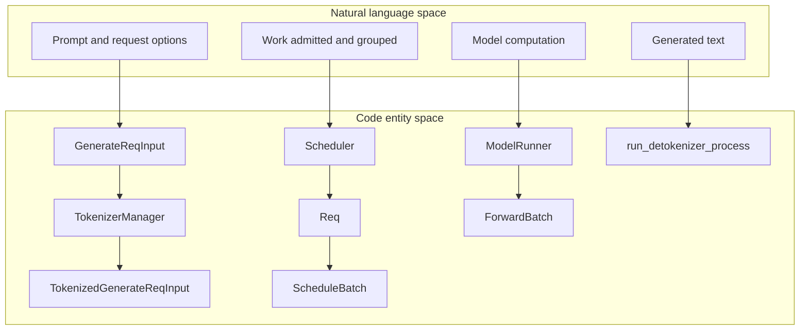

Sources: [python/sglang/srt/managers/tokenizer_manager.py:14-14](), [python/sglang/srt/managers/io_struct.py:80-114](), [python/sglang/srt/managers/io_struct.py:176-181](), [python/sglang/srt/managers/scheduler.py:14-15](), [python/sglang/srt/managers/schedule_batch.py:42-54](), [python/sglang/srt/model_executor/model_runner.py:14-15](), [python/sglang/srt/entrypoints/http_server.py:82-87]()

---

## 2. Core Runtime Components and Their Roles

### 2.1 TokenizerManager

`TokenizerManager` is described as a process that tokenizes text. Its module imports request structures such as `GenerateReqInput` and `TokenizedGenerateReqInput`, as well as multimodal processor utilities, which situates it at the input-preparation boundary of the request lifecycle. [python/sglang/srt/managers/tokenizer_manager.py:14-14](), [python/sglang/srt/managers/tokenizer_manager.py:80-119]()

The IPC definitions are centralized in `io_struct.py`, whose module documentation identifies `TokenizerManager`, `DetokenizerManager`, and `Scheduler` as communicating processes. `BaseReq` and `BaseBatchReq` provide common request-ID and routing fields for single-request and batched payloads. [python/sglang/srt/managers/io_struct.py:14-20](), [python/sglang/srt/managers/io_struct.py:86-108]()

Sources: [python/sglang/srt/managers/tokenizer_manager.py:14-14](), [python/sglang/srt/managers/tokenizer_manager.py:80-119](), [python/sglang/srt/managers/io_struct.py:14-20](), [python/sglang/srt/managers/io_struct.py:86-108]()

### 2.2 Scheduler

`Scheduler` manages a tensor-parallel GPU worker. Its high-level role in the lifecycle is to organize request work into schedule batches before model execution. [python/sglang/srt/managers/scheduler.py:14-15](), [python/sglang/srt/managers/schedule_batch.py:42-54]()

The batch documentation distinguishes the scheduler’s representation from the runner’s: `ScheduleBatch` contains high-level scheduling information and is mostly CPU-side, while `ForwardBatch` contains low-level tensor data and is mostly GPU-side. This boundary is the main conceptual transformation between scheduling a request and executing it. [python/sglang/srt/managers/schedule_batch.py:45-54]()

Sources: [python/sglang/srt/managers/scheduler.py:14-15](), [python/sglang/srt/managers/schedule_batch.py:42-54]()

### 2.3 ModelRunner

`ModelRunner` runs model forward passes. It is associated with `ForwardBatch`, the low-level batch representation used by the model-execution stage; the batch documentation states that `ForwardBatch` is constructed directly from a `ScheduleBatch` by `ForwardBatch.init_new`. [python/sglang/srt/model_executor/model_runner.py:14-15](), [python/sglang/srt/managers/schedule_batch.py:47-54]()

In the broader runtime, execution configuration and parallel state are exposed through `runtime_context`; the scheduler imports accessors for these configuration namespaces, while `ModelRunner` imports model, attention, sampling, cache, and forward-batch components. These dependencies place execution within a configured runtime, rather than making the model pass an isolated function call. [python/sglang/srt/managers/scheduler.py:31-49](), [python/sglang/srt/model_executor/model_runner.py:87-119]()

Sources: [python/sglang/srt/model_executor/model_runner.py:14-15](), [python/sglang/srt/managers/schedule_batch.py:47-54](), [python/sglang/srt/managers/scheduler.py:31-49](), [python/sglang/srt/model_executor/model_runner.py:87-119]()

### 2.4 DetokenizerManager

The HTTP server imports `run_detokenizer_process` alongside `run_scheduler_process` and `init_tokenizer_manager`, identifying detokenization as a distinct runtime process in the server setup. `io_struct.py` likewise names `DetokenizerManager` among the processes whose transferred objects it defines. The available excerpts do not show the detokenizer’s decoding or streaming implementation, so this page treats it only as the output-side stage of the lifecycle. [python/sglang/srt/entrypoints/http_server.py:82-87](), [python/sglang/srt/managers/io_struct.py:14-20]()

Sources: [python/sglang/srt/entrypoints/http_server.py:82-87](), [python/sglang/srt/managers/io_struct.py:14-20]()

---

## 3. Data Structure Transitions Through the Pipeline

The request path uses different representations at its API, IPC, scheduling, and execution boundaries. `GenerateReqInput` represents generation input; tokenized-generation IPC types are defined separately. Within the scheduler, `Req` and `ScheduleBatch` represent request-level and batch-level scheduling data. `ForwardBatch` represents low-level model-execution data and is constructed from `ScheduleBatch`. [python/sglang/srt/managers/io_struct.py:80-114](), [python/sglang/srt/managers/io_struct.py:176-181](), [python/sglang/srt/managers/schedule_batch.py:42-54]()

| Representation | Lifecycle role | What the available source establishes |
|---|---|---|
| `GenerateReqInput` | Input request | The request type is defined as a generation input structure. [python/sglang/srt/managers/io_struct.py:176-181]() |
| `TokenizedGenerateReqInput` | Tokenized request payload | It is among the IPC structures imported by the tokenizer manager and scheduler. [python/sglang/srt/managers/tokenizer_manager.py:80-114](), [python/sglang/srt/managers/scheduler.py:122-194]() |
| `Req` | Per-request scheduling state | The batch module documents `Req` as an individual request represented within scheduler-managed work. [python/sglang/srt/managers/schedule_batch.py:42-54]() |
| `ScheduleBatch` | Scheduler-side batch | It contains high-level scheduling data, most of which is on the CPU. [python/sglang/srt/managers/schedule_batch.py:45-50]() |
| `ForwardBatch` | Model-execution batch | It contains low-level tensor data, most of which consists of GPU tensors, and is built from `ScheduleBatch`. [python/sglang/srt/managers/schedule_batch.py:51-54]() |
| `BatchTokenIDOutput` | Output-side IPC structure | The type is imported by the tokenizer manager; its full processing path is not shown in the supplied excerpts. [python/sglang/srt/managers/tokenizer_manager.py:80-114]() |

The `io_struct.py` module is explicitly scoped to objects transferred between runtime processes, while `schedule_batch.py` describes the scheduler-to-runner transformation. Together, these establish two distinct kinds of boundary: serialized request/result messages between processes, and a conversion from scheduler-oriented batch state to execution-oriented batch state. [python/sglang/srt/managers/io_struct.py:14-20](), [python/sglang/srt/managers/schedule_batch.py:42-54]()

Sources: [python/sglang/srt/managers/io_struct.py:14-20](), [python/sglang/srt/managers/io_struct.py:80-114](), [python/sglang/srt/managers/io_struct.py:176-181](), [python/sglang/srt/managers/tokenizer_manager.py:80-114](), [python/sglang/srt/managers/scheduler.py:122-194](), [python/sglang/srt/managers/schedule_batch.py:42-54]()

---

## 4. IPC Boundaries and Communication

`io_struct.py` defines objects transferred between `TokenizerManager`, `DetokenizerManager`, and `Scheduler`, and is intentionally focused on IPC structure definitions. Its request bases include `rid` and `http_worker_ipc` for single requests, and `rids` and `http_worker_ipcs` for batched requests. [python/sglang/srt/managers/io_struct.py:14-20](), [python/sglang/srt/managers/io_struct.py:86-108]()

The tokenizer manager imports ZeroMQ and its asynchronous API, while the IPC module imports ZeroMQ and defines serialization support. These imports support identifying ZeroMQ as part of the runtime communication layer; the supplied excerpts do not establish every socket direction or the exact transport used for each individual message type. [python/sglang/srt/managers/tokenizer_manager.py:50-56](), [python/sglang/srt/managers/io_struct.py:46-50]()

### Diagram: Runtime Roles and IPC Dataflow

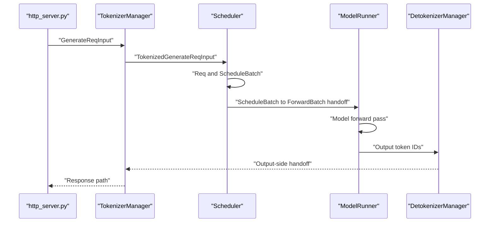

Sources: [python/sglang/srt/entrypoints/http_server.py:82-87](), [python/sglang/srt/managers/io_struct.py:14-20](), [python/sglang/srt/managers/io_struct.py:176-181](), [python/sglang/srt/managers/schedule_batch.py:42-54](), [python/sglang/srt/model_executor/model_runner.py:14-15]()

### IPC Boundaries Summary

| Boundary | Evidence in the supplied sources | Interpretation |
|---|---|---|
| Runtime managers ↔ IPC structures | `io_struct.py` explicitly identifies `TokenizerManager`, `DetokenizerManager`, and `Scheduler` as processes using its transfer objects. [python/sglang/srt/managers/io_struct.py:14-20]() | The file provides shared message definitions for these manager boundaries. |
| Tokenizer manager ↔ ZeroMQ layer | `tokenizer_manager.py` imports `zmq` and `zmq.asyncio`. [python/sglang/srt/managers/tokenizer_manager.py:50-56]() | ZeroMQ is present in the tokenizer manager’s communication dependencies. |
| Scheduler batch → model execution | `schedule_batch.py` states that `ForwardBatch` is constructed from `ScheduleBatch` by `ForwardBatch.init_new`. [python/sglang/srt/managers/schedule_batch.py:47-54]() | This is a data-representation handoff; it should not be confused with proof of a particular process transport. |
| Server process setup | `http_server.py` imports `init_tokenizer_manager`, `run_detokenizer_process`, and `run_scheduler_process`. [python/sglang/srt/entrypoints/http_server.py:82-87]() | These names identify the runtime process entrypoints involved in serving. |

The process roles and data structures are explicit in the sources; details such as the exact socket topology and serialization mode for every message are not established by the provided excerpts. [python/sglang/srt/managers/io_struct.py:14-20](), [python/sglang/srt/managers/tokenizer_manager.py:50-56]()

Sources: [python/sglang/srt/entrypoints/http_server.py:82-87](), [python/sglang/srt/managers/io_struct.py:14-20](), [python/sglang/srt/managers/io_struct.py:86-108](), [python/sglang/srt/managers/tokenizer_manager.py:50-56](), [python/sglang/srt/managers/schedule_batch.py:47-54]()

---

## Summary

The conceptual request path crosses several runtime roles: `TokenizerManager` handles text tokenization, `Scheduler` manages work for a tensor-parallel GPU worker, `ModelRunner` runs model forward passes, and the server setup includes a detokenizer process. [python/sglang/srt/managers/tokenizer_manager.py:14-14](), [python/sglang/srt/managers/scheduler.py:14-15](), [python/sglang/srt/model_executor/model_runner.py:14-15](), [python/sglang/srt/entrypoints/http_server.py:82-87]()

At the central batch boundary, `ScheduleBatch` carries high-level, mostly CPU-side scheduling data, while `ForwardBatch` carries low-level, mostly GPU-side tensor data and is constructed from the schedule batch. IPC structures in `io_struct.py` define messages shared among the tokenizer, scheduler, and detokenizer managers. [python/sglang/srt/managers/schedule_batch.py:42-54](), [python/sglang/srt/managers/io_struct.py:14-20]()

Sources: [python/sglang/srt/entrypoints/http_server.py:82-87](), [python/sglang/srt/managers/io_struct.py:14-20](), [python/sglang/srt/managers/schedule_batch.py:42-54](), [python/sglang/srt/managers/scheduler.py:14-15](), [python/sglang/srt/managers/tokenizer_manager.py:14-14](), [python/sglang/srt/model_executor/model_runner.py:14-15]()

---

# Page: Installation and Deployment

# Installation and Deployment

<details>
<summary>Relevant source files</summary>

The following files were used as context for generating this wiki page:

- [.github/workflows/release-pypi-nightly.yml](.github/workflows/release-pypi-nightly.yml)
- [.github/workflows/release-pypi-pr.yml](.github/workflows/release-pypi-pr.yml)
- [3rdparty/amd/wheel/sglang/pyproject.toml](3rdparty/amd/wheel/sglang/pyproject.toml)
- [docker/Dockerfile](docker/Dockerfile)
- [python/pyproject.toml](python/pyproject.toml)
- [python/pyproject_cpu.toml](python/pyproject_cpu.toml)
- [python/pyproject_npu.toml](python/pyproject_npu.toml)
- [python/pyproject_other.toml](python/pyproject_other.toml)
- [python/pyproject_xpu.toml](python/pyproject_xpu.toml)
- [python/sglang/srt/entrypoints/engine.py](python/sglang/srt/entrypoints/engine.py)
- [python/sglang/srt/function_call/deepseekv32_detector.py](python/sglang/srt/function_call/deepseekv32_detector.py)
- [python/sglang/srt/function_call/kimik2_detector.py](python/sglang/srt/function_call/kimik2_detector.py)
- [python/sglang/srt/utils/common.py](python/sglang/srt/utils/common.py)
- [python/sglang/srt/utils/json_response.py](python/sglang/srt/utils/json_response.py)
- [scripts/update_nightly_whl_index.py](scripts/update_nightly_whl_index.py)
- [test/registered/function_call/test_kimik2_detector.py](test/registered/function_call/test_kimik2_detector.py)
- [test/registered/moe/test_cutedsl_moe.py](test/registered/moe/test_cutedsl_moe.py)
- [test/registered/unit/function_call/test_deepseekv4_detector.py](test/registered/unit/function_call/test_deepseekv4_detector.py)
- [test/registered/unit/function_call/test_json_schema_constraint.py](test/registered/unit/function_call/test_json_schema_constraint.py)
- [test/registered/unit/function_call/test_structural_tag_excludes.py](test/registered/unit/function_call/test_structural_tag_excludes.py)
- [test/registered/unit/function_call/test_unknown_tool_name.py](test/registered/unit/function_call/test_unknown_tool_name.py)
- [test/registered/unit/utils/test_common.py](test/registered/unit/utils/test_common.py)
- [test/registered/unit/utils/test_json_response.py](test/registered/unit/utils/test_json_response.py)

</details>


## Purpose and Scope

This page is a high-level guide to the main ways to install and deploy SGLang. It connects package and platform choices to container and distributed serving, and links to child pages for detailed procedures.

Sources: [python/pyproject.toml:11-17](), [python/sglang/srt/entrypoints/engine.py:14-18]()

---

## Package and Runtime Overview

SGLang is distributed as the `sglang` Python package. Its project metadata defines Python requirements, dependencies, optional extras, and the `sglang` CLI entry point. The runtime engine entry point is implemented in `python/sglang/srt/entrypoints/engine.py`; its imports show the managers and platform abstractions used to initialize serving. [python/pyproject.toml:11-17](), [python/pyproject.toml:216-218](), [python/sglang/srt/entrypoints/engine.py:14-18](), [python/sglang/srt/entrypoints/engine.py:66-117]()

The dependency manifests vary by platform. The default project manifest includes the core dependency set and optional extras; separate manifests describe CPU, XPU, and NPU dependency choices, while `pyproject_other.toml` includes extras for ROCm, MUSA, and Apple MPS. [python/pyproject.toml:24-103](), [python/pyproject_other.toml:19-85](), [python/pyproject_other.toml:122-171](), [python/pyproject_other.toml:173-214](), [python/pyproject_cpu.toml:18-77](), [python/pyproject_xpu.toml:18-75](), [python/pyproject_npu.toml:18-71]()

**Installation and runtime entities**

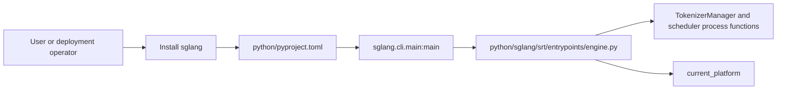

Sources: [python/pyproject.toml:11-17](), [python/pyproject.toml:216-218](), [python/sglang/srt/entrypoints/engine.py:66-117]()

---

## Installation Methods

The package metadata defines `sglang` and optional extras for features such as diffusion, tracing, HTTP/2, Ray, and testing. The repository also contains platform-specific manifests, so installation choices depend on the target hardware and its compatible PyTorch stack. [python/pyproject.toml:11-17](), [python/pyproject.toml:110-204](), [python/pyproject_other.toml:19-85]()

For PyPI installation, source builds, and platform-specific installation procedures, see [Installation Methods](#2.1). For platform dependency choices, see [Hardware Platform Configuration](#2.2).

Sources: [python/pyproject.toml:1-17](), [python/pyproject.toml:110-204](), [python/pyproject_other.toml:19-85]()

---

## Hardware Platform Configuration

The runtime utilities include cached checks for CUDA, HIP, NPU, XPU, CPU, and MUSA availability. The project’s manifests define different dependency sets for platforms including CUDA, ROCm, CPU, XPU, NPU, MUSA, and Apple MPS. [python/sglang/srt/utils/common.py:139-164](), [python/sglang/srt/utils/common.py:168-235](), [python/pyproject.toml:24-103](), [python/pyproject_other.toml:122-214](), [python/pyproject_cpu.toml:18-77](), [python/pyproject_xpu.toml:18-75](), [python/pyproject_npu.toml:18-71]()

The platform-specific manifests are the installation layer; runtime detection is a separate layer. For the supported backends and configuration details, see [Hardware Platform Configuration](#2.2).

**Hardware choice mapped to detection and dependency manifests**

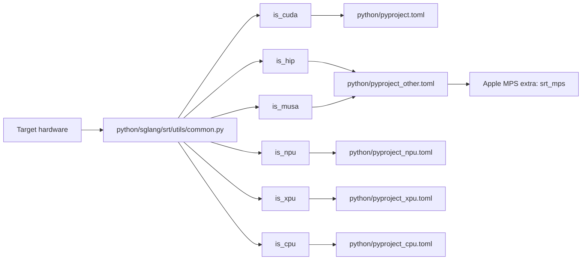

Sources: [python/sglang/srt/utils/common.py:139-164](), [python/sglang/srt/utils/common.py:168-235](), [python/pyproject.toml:24-103](), [python/pyproject_other.toml:122-214](), [python/pyproject_cpu.toml:18-77](), [python/pyproject_xpu.toml:18-75](), [python/pyproject_npu.toml:18-71]()

---

## Docker Deployment

The provided `docker/Dockerfile` defaults to an NVIDIA CUDA base image, creates a Python virtual environment, installs system dependencies, and uses BuildKit stages for dependency and framework build work. Its dependency stage installs an `sglang-kernel` wheel and sets up Rust for native extensions. [docker/Dockerfile:1-8](), [docker/Dockerfile:40-60](), [docker/Dockerfile:62-132](), [docker/Dockerfile:158-207]()

For image variants, build options, and container deployment guidance, see [Docker Deployment](#2.3).

**Docker build entities**

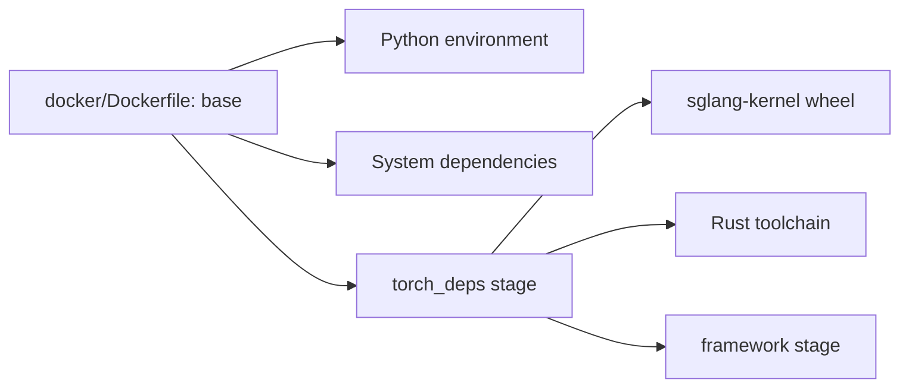

Sources: [docker/Dockerfile:1-8](), [docker/Dockerfile:40-60](), [docker/Dockerfile:62-132](), [docker/Dockerfile:158-207]()

---

## Multi-Node and Distributed Deployment

The engine entry point imports process launch functions for the scheduler and data-parallel controller, along with the tokenizer and detokenizer managers. These are the runtime components relevant to serving setup; this page does not specify cluster initialization or network behavior. [python/sglang/srt/entrypoints/engine.py:66-110]()

For multi-node setup, distributed initialization, network configuration, and Kubernetes-native fleet orchestration, see [Multi-Node and Distributed Deployment](#2.4).

**Deployment concepts mapped to engine entities**

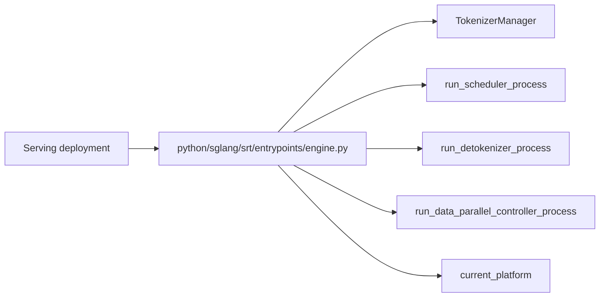

Sources: [python/sglang/srt/entrypoints/engine.py:66-117]()

---

## Further Reading

- [Installation Methods](#2.1) — PyPI installation, source builds, and platform-specific procedures.
- [Hardware Platform Configuration](#2.2) — Platform detection and hardware-specific dependencies.
- [Docker Deployment](#2.3) — Docker builds, image variants, and container deployment.
- [Multi-Node and Distributed Deployment](#2.4) — Distributed setup, networking, and Kubernetes-native fleet orchestration.

Sources: [python/pyproject.toml:11-17](), [python/sglang/srt/utils/common.py:139-235](), [docker/Dockerfile:1-8](), [python/sglang/srt/entrypoints/engine.py:66-117]()

---

# Page: Installation Methods

# Installation Methods

<details>
<summary>Relevant source files</summary>

The following files were used as context for generating this wiki page:

- [.github/workflows/release-pypi-nightly.yml](.github/workflows/release-pypi-nightly.yml)
- [.github/workflows/release-pypi-pr.yml](.github/workflows/release-pypi-pr.yml)
- [3rdparty/amd/wheel/sglang/pyproject.toml](3rdparty/amd/wheel/sglang/pyproject.toml)
- [docker/Dockerfile](docker/Dockerfile)
- [python/pyproject.toml](python/pyproject.toml)
- [python/pyproject_cpu.toml](python/pyproject_cpu.toml)
- [python/pyproject_npu.toml](python/pyproject_npu.toml)
- [python/pyproject_other.toml](python/pyproject_other.toml)
- [python/pyproject_xpu.toml](python/pyproject_xpu.toml)
- [python/sglang/srt/entrypoints/engine.py](python/sglang/srt/entrypoints/engine.py)
- [python/sglang/srt/function_call/deepseekv32_detector.py](python/sglang/srt/function_call/deepseekv32_detector.py)
- [python/sglang/srt/function_call/kimik2_detector.py](python/sglang/srt/function_call/kimik2_detector.py)
- [python/sglang/srt/utils/common.py](python/sglang/srt/utils/common.py)
- [python/sglang/srt/utils/json_response.py](python/sglang/srt/utils/json_response.py)
- [scripts/update_nightly_whl_index.py](scripts/update_nightly_whl_index.py)
- [test/registered/function_call/test_kimik2_detector.py](test/registered/function_call/test_kimik2_detector.py)
- [test/registered/moe/test_cutedsl_moe.py](test/registered/moe/test_cutedsl_moe.py)
- [test/registered/unit/function_call/test_deepseekv4_detector.py](test/registered/unit/function_call/test_deepseekv4_detector.py)
- [test/registered/unit/function_call/test_json_schema_constraint.py](test/registered/unit/function_call/test_json_schema_constraint.py)
- [test/registered/unit/function_call/test_structural_tag_excludes.py](test/registered/unit/function_call/test_structural_tag_excludes.py)
- [test/registered/unit/function_call/test_unknown_tool_name.py](test/registered/unit/function_call/test_unknown_tool_name.py)
- [test/registered/unit/utils/test_common.py](test/registered/unit/utils/test_common.py)
- [test/registered/unit/utils/test_json_response.py](test/registered/unit/utils/test_json_response.py)

</details>


## Purpose and Scope

This page documents the available SGLang installation paths: installing the Python package and its declared dependencies, building from source, and selecting platform-specific package configurations. The project metadata describes SGLang as a serving framework for large language models and vision-language models. Container image construction is covered separately in **2.3 Docker Deployment**; runtime hardware detection is covered in **2.2 Hardware Platform Configuration**. [python/pyproject.toml:11-17]()

Sources: [python/pyproject.toml:11-17]()

---

## Installation Architecture Overview

SGLang’s package metadata is split across several project configuration files. The main `python/pyproject.toml` declares the default package and its dependencies, while `pyproject_cpu.toml`, `pyproject_xpu.toml`, `pyproject_npu.toml`, and `pyproject_other.toml` define additional platform-oriented package configurations and dependency sets. [python/pyproject.toml:11-24](), [python/pyproject_cpu.toml:6-19](), [python/pyproject_xpu.toml:5-18](), [python/pyproject_npu.toml:5-18](), [python/pyproject_other.toml:5-23]()

The default package requires Python 3.11 or later and uses a setuptools build backend. Its build requirements include `setuptools-rust`, `setuptools-scm`, and a pinned PyTorch build dependency. The default project metadata also declares a dynamic version and a console script named `sglang`. [python/pyproject.toml:1-16](), [python/pyproject.toml:216-219]()

### Installation Artifact Flow

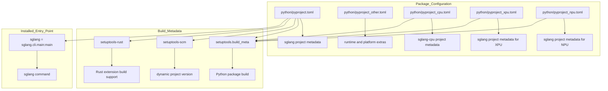

Sources: [python/pyproject.toml:1-16](), [python/pyproject.toml:216-219](), [python/pyproject_cpu.toml:1-11](), [python/pyproject_xpu.toml:1-10](), [python/pyproject_npu.toml:1-10](), [python/pyproject_other.toml:1-10]()

---

## Method 1: PyPI Installation

The main project is named `sglang`, declares Python `>=3.11`, and lists its runtime requirements in the default project dependency array. Those dependencies include PyTorch, serving and API libraries, tokenizer and model utilities, and packages for kernel and accelerator integrations. [python/pyproject.toml:11-17](), [python/pyproject.toml:24-103]()

The base package also defines optional dependency groups for capabilities that are not included in the ordinary dependency list. These include `checkpoint-engine`, `instanttensor`, `runai`, `diffusion`, `ray`, `tracing`, `http2`, `fastokens`, `test`, `dev`, and `all`. The `all` extra composes the `diffusion`, `fastokens`, `http2`, and `tracing` extras. [python/pyproject.toml:110-204]()

| Installation concern | Package metadata location | What it controls |
|---|---|---|
| Base runtime requirements | `dependencies` | Dependencies installed for the main `sglang` project. [python/pyproject.toml:11-24]() |
| Optional features | `project.optional-dependencies` | Named extras, including `diffusion`, `tracing`, `http2`, and `ray`. [python/pyproject.toml:110-162]() |
| Development and test requirements | `test`, `dev` extras | Test dependencies and the development extra that includes `sglang[test]`. [python/pyproject.toml:164-198]() |
| Aggregate feature installation | `all` extra | Combines the `diffusion`, `fastokens`, `http2`, and `tracing` extras. [python/pyproject.toml:199-204]() |
| Package command | `project.scripts` | Registers `sglang` and `killall_sglang` console commands. [python/pyproject.toml:216-219]() |

The metadata declares the PyPI simple index as the default index for `uv`. The project’s dependency specifications include environment markers for selected platform- and architecture-specific packages, so dependency resolution can vary with the installation environment. [python/pyproject.toml:105-108](), [python/pyproject.toml:24-103]()

Sources: [python/pyproject.toml:11-17](), [python/pyproject.toml:24-108](), [python/pyproject.toml:110-204](), [python/pyproject.toml:216-219]()

---

## Method 2: Source Builds and Kernel Compilation

The main project uses `setuptools.build_meta` with build requirements that include `setuptools>=61.0`, `setuptools-rust>=1.11`, `setuptools-scm>=8.0`, `torch==2.14.1`, and `wheel`. The project version is dynamic, and package data configuration includes files under the `sglang` runtime and kernel package trees. [python/pyproject.toml:1-9](), [python/pyproject.toml:11-16](), [python/pyproject.toml:220-225]()

`setuptools-rust` is part of the declared build system. The Docker build configuration also installs a Rust toolchain in its `torch_deps` stage and identifies Rust extensions such as `sglang-grpc` as a use case. This is evidence of Rust extension support in the build environment; it is not, by itself, a complete host source-build procedure. [python/pyproject.toml:1-9](), [docker/Dockerfile:176-193]()

For the Docker build’s CUDA path, `sglang-kernel` is installed from a prebuilt wheel. The Dockerfile pins its version through `SGL_KERNEL_VERSION`, checks the configured CUDA version, and uses `--no-deps` when installing the wheel so that the installer does not pull PyTorch from the default package index. This is a container-build procedure, not a general instruction to compile the kernel from source. [docker/Dockerfile:11-14](), [docker/Dockerfile:179-203]()

| Build area | Configuration evidence |
|---|---|
| Python build backend | `setuptools.build_meta` in the main project metadata. [python/pyproject.toml:1-9]() |
| Rust build integration | `setuptools-rust` is a build requirement; the Docker build installs Rust before assembling the framework stage. [python/pyproject.toml:1-9](), [docker/Dockerfile:188-193]() |
| Version generation | The project declares a dynamic version and uses `setuptools-scm`; the platform-specific metadata shown also declares a version-file path and fallback version. [python/pyproject.toml:11-16](), [python/pyproject_cpu.toml:157-164](), [python/pyproject_npu.toml:157-162](), [python/pyproject_xpu.toml:173-178]() |
| Kernel dependency in Docker | The Docker build installs the configured `sglang-kernel` wheel and guards its supported CUDA version. [docker/Dockerfile:195-203]() |

Sources: [python/pyproject.toml:1-16](), [python/pyproject.toml:220-225](), [python/pyproject_cpu.toml:157-164](), [python/pyproject_npu.toml:157-162](), [python/pyproject_xpu.toml:173-178](), [docker/Dockerfile:176-203]()

---

## Platform-Specific Installation

Platform-specific configuration files make dependency choices explicit rather than relying on one identical dependency set for every backend. The files shown define configurations for CUDA-oriented installation, CPU, XPU, NPU, and a collection of other platform configurations. The presence of a platform configuration does not by itself establish that all combinations of hardware, operating system, and package versions are supported. [python/pyproject.toml:24-103](), [python/pyproject_cpu.toml:6-19](), [python/pyproject_xpu.toml:5-18](), [python/pyproject_npu.toml:5-18](), [python/pyproject_other.toml:5-23]()

### 1. NVIDIA CUDA

The main `python/pyproject.toml` declares the default `sglang` project and includes CUDA-oriented dependencies such as `cuda-python`, `flash-attn-4`, `flashinfer_python[cu13]`, `humming-kernels[cu13]`, and `sglang-kernel`. It pins PyTorch and several accelerator-related packages in the project dependency list. [python/pyproject.toml:11-16](), [python/pyproject.toml:24-103]()

The Dockerfile’s shown CUDA dependency stage accepts a `CUDA_VERSION` build argument, checks it against `13.0.3`, and installs a versioned `sglang-kernel` wheel. Those details describe the Docker build configuration and should not be treated as a universal host installation recipe. [docker/Dockerfile:1-3](), [docker/Dockerfile:179-203]()

Sources: [python/pyproject.toml:11-16](), [python/pyproject.toml:24-103](), [docker/Dockerfile:1-3](), [docker/Dockerfile:179-203]()

### 2. AMD ROCm (HIP)

`python/pyproject_other.toml` defines HIP-related optional dependency groups, including `srt_hip`, `srt_hip_rocm724`, and `srt_hip_rocm101`. These groups combine the runtime dependencies with platform-specific PyTorch versions and packages such as `petit_kernel` and `wave-lang`; the variants differ in their declared PyTorch and compressed-tensors pins. [python/pyproject_other.toml:111-150]()

A separate AMD wheel project is defined in `3rdparty/amd/wheel/sglang/pyproject.toml` under the project name `amd-sglang`. Its `rocm720` group declares AMD-hosted PyTorch, Triton, torchaudio, and torchvision wheels, as well as an ROCm-specific `sglang-kernel` wheel. The file documents an installation combination using the `srt_hip` and `rocm720` extras. [3rdparty/amd/wheel/sglang/pyproject.toml:5-16](), [3rdparty/amd/wheel/sglang/pyproject.toml:69-86]()

Sources: [python/pyproject_other.toml:111-150](), [3rdparty/amd/wheel/sglang/pyproject.toml:5-16](), [3rdparty/amd/wheel/sglang/pyproject.toml:69-86]()

### 3. Intel XPU

`python/pyproject_xpu.toml` pins XPU builds of PyTorch, torchaudio, and torchvision. It also declares an `sglang-kernel-xpu` wheel by direct URL, and its build requirements include an XPU-specific PyTorch build. [python/pyproject_xpu.toml:1-3](), [python/pyproject_xpu.toml:60-68]()

The XPU configuration has its own project dependency set and optional groups, including `diffusion`, `ray`, `tracing`, `test`, `dev`, and `all`. The `all` group shown combines diffusion and tracing extras. [python/pyproject_xpu.toml:77-132]()

Sources: [python/pyproject_xpu.toml:1-3](), [python/pyproject_xpu.toml:60-75](), [python/pyproject_xpu.toml:77-132]()

### 4. CPU

`python/pyproject_cpu.toml` defines the project name `sglang-cpu`, requires Python 3.11 or later, and declares CPU-oriented dependencies, including `torch==2.14.0`, `triton==3.8.0`, and an `intel-openmp` dependency guarded by the `x86_64` platform marker. [python/pyproject_cpu.toml:6-16](), [python/pyproject_cpu.toml:18-77]()

The runtime utility `is_cpu()` does not infer CPU mode solely from the presence of a CPU. It first checks whether `SGLANG_USE_CPU_ENGINE` is set to `"1"` and then checks for a supported x86 or ARM host CPU. [python/sglang/srt/utils/common.py:202-224]()

Sources: [python/pyproject_cpu.toml:6-16](), [python/pyproject_cpu.toml:18-77](), [python/sglang/srt/utils/common.py:202-224]()

### 5. Ascend NPU

`python/pyproject_npu.toml` defines an NPU-oriented `sglang` project configuration. Its dependencies include the serving runtime packages and do not declare a PyTorch package in the shown main dependency list. It defines an empty `srt_npu` extra, an `all_npu` extra that includes diffusion, and a `dev_npu` extra that includes both `all_npu` and tests. [python/pyproject_npu.toml:5-18](), [python/pyproject_npu.toml:18-71](), [python/pyproject_npu.toml:113-116]()

At runtime, `is_npu()` returns `False` if `torch.npu` is absent. If the module exists but reports no available NPU device, the function raises a `RuntimeError`; otherwise, it returns `True`. [python/sglang/srt/utils/common.py:188-198]()

Sources: [python/pyproject_npu.toml:5-18](), [python/pyproject_npu.toml:18-71](), [python/pyproject_npu.toml:113-116](), [python/sglang/srt/utils/common.py:188-198]()

### 6. Moore Threads MUSA and Apple Silicon MPS

`python/pyproject_other.toml` defines `srt_musa` with a platform-specific stack that includes `torch_musa`, `torchada`, MUSA-specific kernel packages, and pinned versions of related components. It also defines `diffusion_musa` as a separate optional group. [python/pyproject_other.toml:173-203]()

The same file defines `srt_mps`, which includes `mlx`, `mlx-lm`, and pinned PyTorch-related dependencies. A separate `diffusion_mps` group contains dependencies for diffusion workloads. [python/pyproject_other.toml:205-226]()

The runtime helper `is_musa()` checks for a MUSA version on `torch.version` and then attempts to import `torchada`; it returns `False` if either check fails. [python/sglang/srt/utils/common.py:227-235]()

Sources: [python/pyproject_other.toml:173-226](), [python/sglang/srt/utils/common.py:227-235]()

---

## Installation Implementation Details

The packaging metadata provides a connection between install-time configuration and runtime entry points. The package registers `sglang.cli.main:main` as the `sglang` console script. The runtime engine module imports managers and process launch functions, including `TokenizerManager`, `run_detokenizer_process`, and `run_scheduler_process`; it also defines `init_tokenizer_manager`, which constructs a tokenizer manager and initializes templates. [python/pyproject.toml:216-219](), [python/sglang/srt/entrypoints/engine.py:66-110](), [python/sglang/srt/entrypoints/engine.py:195-208]()

### Relationship Diagram: Package Metadata to Runtime Entry Points

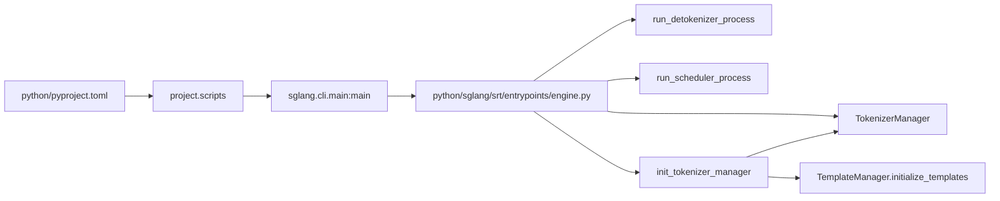

Sources: [python/pyproject.toml:216-219](), [python/sglang/srt/entrypoints/engine.py:66-110](), [python/sglang/srt/entrypoints/engine.py:195-208]()

### Versioning and Console Scripts

The main `pyproject.toml` declares a dynamic project version. Platform-specific CPU, NPU, and XPU metadata shown here use `setuptools-scm`, set `python/sglang/_version.py` as the version file, and specify a fallback version for editable installs without Git metadata. [python/pyproject.toml:11-16](), [python/pyproject_cpu.toml:157-164](), [python/pyproject_npu.toml:157-162](), [python/pyproject_xpu.toml:173-178]()

The main project registers two console scripts: `sglang`, mapped to `sglang.cli.main:main`, and `killall_sglang`, mapped to `sglang.cli.killall:main`. The XPU, NPU, and CPU project files shown register `sglang` as a console script. [python/pyproject.toml:216-219](), [python/pyproject_cpu.toml:124-125](), [python/pyproject_npu.toml:122-124](), [python/pyproject_xpu.toml:138-140]()

Sources: [python/pyproject.toml:11-16](), [python/pyproject.toml:216-219](), [python/pyproject_cpu.toml:124-125](), [python/pyproject_cpu.toml:157-164](), [python/pyproject_npu.toml:122-124](), [python/pyproject_npu.toml:157-162](), [python/pyproject_xpu.toml:138-140](), [python/pyproject_xpu.toml:173-178]()

---

## Summary

SGLang’s installation configuration is organized around a default `sglang` project and platform-specific metadata for CPU, XPU, NPU, and other backends. The main project declares its runtime dependencies and optional feature groups; platform metadata supplies backend-specific pins and wheels where applicable. Source-build support is reflected in the setuptools build configuration and Rust build integration, while the Docker build has its own CUDA and kernel-wheel installation path. [python/pyproject.toml:1-16](), [python/pyproject.toml:24-103](), [python/pyproject.toml:110-204](), [python/pyproject_cpu.toml:6-19](), [python/pyproject_xpu.toml:5-18](), [python/pyproject_npu.toml:5-18](), [python/pyproject_other.toml:5-23](), [docker/Dockerfile:176-203]()

For container deployment workflows, refer to **2.3 Docker Deployment**. For hardware runtime configuration and detection, refer to **2.2 Hardware Platform Configuration**.

Sources: [python/pyproject.toml:1-16](), [python/pyproject.toml:24-103](), [python/pyproject.toml:110-204](), [python/pyproject_cpu.toml:6-19](), [python/pyproject_xpu.toml:5-18](), [python/pyproject_npu.toml:5-18](), [python/pyproject_other.toml:5-23](), [docker/Dockerfile:176-203]()

---

## References

- [python/pyproject.toml]()
- [python/pyproject_other.toml]()
- [python/pyproject_cpu.toml]()
- [python/pyproject_xpu.toml]()
- [python/pyproject_npu.toml]()
- [3rdparty/amd/wheel/sglang/pyproject.toml]()
- [docker/Dockerfile]()
- [python/sglang/srt/utils/common.py]()
- [python/sglang/srt/entrypoints/engine.py]()

---

# Page: Hardware Platform Configuration

# Hardware Platform Configuration

<details>
<summary>Relevant source files</summary>

The following files were used as context for generating this wiki page:

- [.github/workflows/nightly-test-intel-wheel.yml](.github/workflows/nightly-test-intel-wheel.yml)
- [.github/workflows/nightly-test-intel.yml](.github/workflows/nightly-test-intel.yml)
- [.github/workflows/pr-test-xpu.yml](.github/workflows/pr-test-xpu.yml)
- [.github/workflows/release-docker-intel-xpu-nightly.yml](.github/workflows/release-docker-intel-xpu-nightly.yml)
- [.github/workflows/xpu-ci-job-monitor.yml](.github/workflows/xpu-ci-job-monitor.yml)
- [docker/xpu.Dockerfile](docker/xpu.Dockerfile)
- [docs/docs/hardware-platforms/plugin.mdx](docs/docs/hardware-platforms/plugin.mdx)
- [docs/docs/hardware-platforms/xpu.mdx](docs/docs/hardware-platforms/xpu.mdx)
- [python/sglang/kernels/ops/speculative/spec_tree.py](python/sglang/kernels/ops/speculative/spec_tree.py)
- [python/sglang/srt/hardware_backend/npu/graph_runner/npu_cudagraph_backend.py](python/sglang/srt/hardware_backend/npu/graph_runner/npu_cudagraph_backend.py)
- [python/sglang/srt/platforms/__init__.py](python/sglang/srt/platforms/__init__.py)
- [python/sglang/srt/platforms/cpu.py](python/sglang/srt/platforms/cpu.py)
- [python/sglang/srt/platforms/cuda.py](python/sglang/srt/platforms/cuda.py)
- [python/sglang/srt/platforms/device_mixin.py](python/sglang/srt/platforms/device_mixin.py)
- [python/sglang/srt/platforms/interface.py](python/sglang/srt/platforms/interface.py)
- [python/sglang/srt/platforms/musa.py](python/sglang/srt/platforms/musa.py)
- [python/sglang/srt/platforms/npu.py](python/sglang/srt/platforms/npu.py)
- [python/sglang/srt/platforms/rocm.py](python/sglang/srt/platforms/rocm.py)
- [python/sglang/srt/platforms/sail.py](python/sglang/srt/platforms/sail.py)
- [python/sglang/srt/platforms/xpu.py](python/sglang/srt/platforms/xpu.py)
- [python/sglang/srt/speculative/adaptive_runtime_state.py](python/sglang/srt/speculative/adaptive_runtime_state.py)
- [python/sglang/srt/speculative/adaptive_spec_params.py](python/sglang/srt/speculative/adaptive_spec_params.py)
- [python/sglang/srt/utils/torch_memory_saver_adapter.py](python/sglang/srt/utils/torch_memory_saver_adapter.py)
- [python/sglang/test/ci/ci_utils.py](python/sglang/test/ci/ci_utils.py)
- [python/sglang/test/xpu/__init__.py](python/sglang/test/xpu/__init__.py)
- [python/sglang/test/xpu/simple_eval_gsm8k_xpu_mixin.py](python/sglang/test/xpu/simple_eval_gsm8k_xpu_mixin.py)
- [python/sglang/test/xpu/test_xpu_utils.py](python/sglang/test/xpu/test_xpu_utils.py)
- [scripts/ci/utils/xpu_job_monitor.py](scripts/ci/utils/xpu_job_monitor.py)
- [scripts/ci/xpu/xpu_ci_start_container.sh](scripts/ci/xpu/xpu_ci_start_container.sh)
- [test/registered/spec/eagle/test_adaptive_speculative.py](test/registered/spec/eagle/test_adaptive_speculative.py)
- [test/registered/spec/test_frozen_kv_mtp.py](test/registered/spec/test_frozen_kv_mtp.py)
- [test/registered/spec/test_gemma4_mtp_31b_extra.py](test/registered/spec/test_gemma4_mtp_31b_extra.py)
- [test/registered/unit/distributed/test_get_default_distributed_backend.py](test/registered/unit/distributed/test_get_default_distributed_backend.py)
- [test/registered/unit/distributed/test_oot_group_coordinator_hooks.py](test/registered/unit/distributed/test_oot_group_coordinator_hooks.py)
- [test/registered/unit/platforms/test_platform_interface.py](test/registered/unit/platforms/test_platform_interface.py)
- [test/registered/unit/spec/test_adaptive_runtime_state.py](test/registered/unit/spec/test_adaptive_runtime_state.py)
- [test/registered/unit/spec/test_adaptive_spec_params.py](test/registered/unit/spec/test_adaptive_spec_params.py)
- [test/registered/unit/spec/test_oot_eagle_hooks.py](test/registered/unit/spec/test_oot_eagle_hooks.py)
- [test/registered/xpu/llm_models/test_xpu_gemma_4_26b_a4b.py](test/registered/xpu/llm_models/test_xpu_gemma_4_26b_a4b.py)
- [test/registered/xpu/llm_models/test_xpu_llama_3_1_8b.py](test/registered/xpu/llm_models/test_xpu_llama_3_1_8b.py)
- [test/registered/xpu/llm_models/test_xpu_nemotron_3_nano_30b_a3b.py](test/registered/xpu/llm_models/test_xpu_nemotron_3_nano_30b_a3b.py)
- [test/registered/xpu/llm_models/test_xpu_qwen3_30b_a3b.py](test/registered/xpu/llm_models/test_xpu_qwen3_30b_a3b.py)
- [test/registered/xpu/llm_models/test_xpu_qwen3_5_35b_a3b.py](test/registered/xpu/llm_models/test_xpu_qwen3_5_35b_a3b.py)
- [test/registered/xpu/llm_models/test_xpu_qwen3_5_9b.py](test/registered/xpu/llm_models/test_xpu_qwen3_5_9b.py)
- [test/registered/xpu/test_deepseek_ocr_2_olmbench.py](test/registered/xpu/test_deepseek_ocr_2_olmbench.py)
- [test/registered/xpu/test_triton_attention_backend.py](test/registered/xpu/test_triton_attention_backend.py)
- [test/registered/xpu/test_xpu_flux2_dev.py](test/registered/xpu/test_xpu_flux2_dev.py)
- [test/registered/xpu/test_xpu_memory_saver.py](test/registered/xpu/test_xpu_memory_saver.py)
- [test/registered/xpu/test_xpu_zimage_turbo.py](test/registered/xpu/test_xpu_zimage_turbo.py)

</details>


This page provides a technical explanation of how SGLang detects hardware platforms at runtime, supports CUDA, ROCm, NPU, XPU, CPU, and MLX/MPS backends, manages platform-specific dependencies, and exposes out-of-tree (OOT) platform extension mechanisms.

---

## 1. Platform Detection and Resolution Lifecycle

SGLang determines the active hardware backend at runtime through cached introspection queries against PyTorch and environment variables. The platform selection logic is coordinated by module-level lazy singletons and discovery hooks in `python/sglang/srt/platforms/__init__.py` and `python/sglang/srt/platforms/interface.py` [python/sglang/srt/platforms/__init__.py:1-12](), [python/sglang/srt/platforms/interface.py:1-11]().

The base class `DeviceMixin` (`python/sglang/srt/platforms/device_mixin.py`) defines shared device identity queries (`is_cuda()`, `is_rocm()`, `is_npu()`, `is_xpu()`, `is_cpu()`, `is_musa()`, `is_mps()`, `is_sail()`) [test/registered/unit/platforms/test_platform_interface.py:91-100](). Subclassing `SRTPlatform` binds these device traits to runtime subsystem factories such as attention backends, graph runners, and memory pools [python/sglang/srt/platforms/interface.py:106-179]().

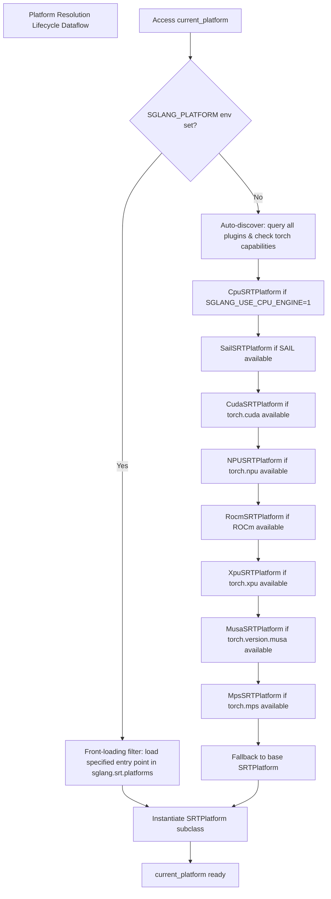
Sources: [python/sglang/srt/platforms/__init__.py:75-107](), [python/sglang/srt/platforms/interface.py:106-179](), [test/registered/unit/platforms/test_platform_interface.py:91-100]()

---

## 2. Supported Platforms and Build Configurations

SGLang structures its platform-specific Python dependencies and build targets across distinct dependency files and configuration matrices.

| Platform | Device Type | Detection Function | Build Config File | Kernel Package |
|:---|:---|:---|:---|:---|
| NVIDIA CUDA | GPU | `_is_cuda_available()` [python/sglang/srt/platforms/__init__.py:38-39]() | `python/pyproject.toml` | `sglang-kernel` |
| AMD ROCm (HIP) | GPU | `_is_rocm_available()` [python/sglang/srt/platforms/__init__.py:42-43]() | `python/pyproject_other.toml` | `sglang-kernel` (ROCm) |
| Intel XPU | GPU | `_is_xpu_available()` [python/sglang/srt/platforms/__init__.py:58-59]() | `python/pyproject_xpu.toml` | `sgl-kernel-xpu` |
| Intel CPU | CPU | `_is_cpu_available()` [python/sglang/srt/platforms/__init__.py:49-50]() | `python/pyproject_cpu.toml` | `sglang-kernel-cpu` |
| Ascend NPU | NPU | `_is_npu_available()` [python/sglang/srt/platforms/__init__.py:53-54]() | `python/pyproject_npu.toml` | `sgl-kernel-npu` |
| Moore Threads GPU | GPU | `_is_musa_available()` [python/sglang/srt/platforms/__init__.py:61-68]() | `python/pyproject_other.toml` | `srt_musa` extra |
| Apple Silicon MPS | GPU | `_is_mps_available()` [python/sglang/srt/platforms/__init__.py:71-72]() | `python/pyproject_other.toml` | `srt_mps` extra |

### Dependency Ecosystem Mapping

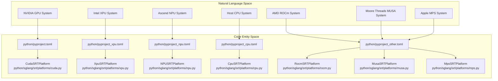
Sources: [python/sglang/srt/platforms/__init__.py:21-29](), [python/sglang/srt/platforms/__init__.py:38-72]()

---

## 3. Out-of-Tree (OOT) Plugin System

External hardware vendors can integrate custom platform runtimes without modifying the core SGLang codebase by implementing setuptools entry points under the `sglang.srt.platforms` group [docs/docs/hardware-platforms/plugin.mdx:11-38]().

### Plugin Contract and Lifecycle
An OOT platform must subclass `SRTPlatform` (`python/sglang/srt/platforms/interface.py`) and expose an activation callback matching [docs/docs/hardware-platforms/plugin.mdx:56-61]():
```python
def activate() -> str | None:
    """Return the platform class qualname when this hardware is available."""
```

The runtime loader (`_resolve_platform` in `python/sglang/srt/platforms/__init__.py`) discovers these plugins dynamically [python/sglang/srt/platforms/__init__.py:112-138]() and validates their compute capabilities before assigning them to `current_platform`.

Sources: [docs/docs/hardware-platforms/plugin.mdx:11-116](), [python/sglang/srt/platforms/__init__.py:112-138](), [python/sglang/srt/platforms/interface.py:76-86]()

---

## 4. Platform-Specific Backend Subsystems

Each platform implementation overrides specific hooks in `SRTPlatform` to inject custom graph runners, memory pools, and compilation backends:

- **Ascend NPU**: Implements `NPUCudaGraphBackend` (`python/sglang/srt/hardware_backend/npu/graph_runner/npu_cudagraph_backend.py`) using `torch.npu.NPUGraph` and `replay_with_input_update` to rebind input shapes dynamically [python/sglang/srt/hardware_backend/npu/graph_runner/npu_cudagraph_backend.py:1-46](). Specialized memory pools like `NPUDeepSeekV4SingleKVPool` manage complex KV caching structures [python/sglang/srt/hardware_backend/npu/dsv4/dsv4_memory_pool.py:40-94]().
- **Intel XPU**: Integrates through `XpuSRTPlatform` (`python/sglang/srt/platforms/xpu.py`), leveraging `sgl-kernel-xpu` and optimized oneAPI kernels for Triton and grouped GEMM operations. The `docker/xpu.Dockerfile` [docker/xpu.Dockerfile:1-111]() details the installation of `torch==2.14.0+xpu` and `sgl-kernel-xpu` from source or prebuilt wheels. XPU CI workflows (`.github/workflows/pr-test-xpu.yml`, `.github/workflows/nightly-test-intel.yml`) ensure continuous validation on Intel hardware [pr-test-xpu.yml:1-346](), [nightly-test-intel.yml:1-456]().
- **Intel CPU**: Utilizes `CpuSRTPlatform` (`python/sglang/srt/platforms/cpu.py`) with `intel-openmp` threading and AMX extensions for high-performance CPU serving.

Sources: [python/sglang/srt/hardware_backend/npu/graph_runner/npu_cudagraph_backend.py:1-46](), [python/sglang/srt/hardware_backend/npu/dsv4/dsv4_memory_pool.py:40-94](), [python/sglang/srt/platforms/xpu.py](), [python/sglang/srt/platforms/cpu.py](), [docker/xpu.Dockerfile:1-111](), [.github/workflows/pr-test-xpu.yml:1-345](), [.github/workflows/nightly-test-intel.yml:1-455]()

---

# Page: Docker Deployment

# Docker Deployment

<details>
<summary>Relevant source files</summary>

The following files were used as context for generating this wiki page:

- [.github/workflows/auto-tune.yml](.github/workflows/auto-tune.yml)
- [.github/workflows/nightly-test-amd.yml](.github/workflows/nightly-test-amd.yml)
- [.github/workflows/pr-test-amd.yml](.github/workflows/pr-test-amd.yml)
- [.github/workflows/release-docker-amd-gfx1151-nightly.yml](.github/workflows/release-docker-amd-gfx1151-nightly.yml)
- [.github/workflows/release-docker-amd-rocm10.yml](.github/workflows/release-docker-amd-rocm10.yml)
- [.github/workflows/release-docker-amd-rocm720-nightly.yml](.github/workflows/release-docker-amd-rocm720-nightly.yml)
- [.github/workflows/release-docker-amd.yml](.github/workflows/release-docker-amd.yml)
- [.github/workflows/release-whl-kernel-xpu.yml](.github/workflows/release-whl-kernel-xpu.yml)
- [.github/workflows/release-whl-kernel.yml](.github/workflows/release-whl-kernel.yml)
- [.pre-commit-config.yaml](.pre-commit-config.yaml)
- [3rdparty/amd/wheel/README.md](3rdparty/amd/wheel/README.md)
- [3rdparty/amd/wheel/sgl-kernel/build_rocm.sh](3rdparty/amd/wheel/sgl-kernel/build_rocm.sh)
- [3rdparty/amd/wheel/sgl-kernel/rename_wheels_rocm.sh](3rdparty/amd/wheel/sgl-kernel/rename_wheels_rocm.sh)
- [docker/Dockerfile.cu134](docker/Dockerfile.cu134)
- [docker/patches/sgl-kernel-gfx1151.sh](docker/patches/sgl-kernel-gfx1151.sh)
- [docker/rocm-gfx1151.Dockerfile](docker/rocm-gfx1151.Dockerfile)
- [docker/rocm.Dockerfile](docker/rocm.Dockerfile)
- [python/sglang/kernels/aot/csrc/elementwise/pos_enc.cu](python/sglang/kernels/aot/csrc/elementwise/pos_enc.cu)
- [python/sglang/kernels/jit/csrc/deepseek_v4/mega_moe_pre_dispatch.cuh](python/sglang/kernels/jit/csrc/deepseek_v4/mega_moe_pre_dispatch.cuh)
- [python/sglang/kernels/ops/moe/__init__.py](python/sglang/kernels/ops/moe/__init__.py)
- [python/sglang/kernels/ops/moe/dsv4.py](python/sglang/kernels/ops/moe/dsv4.py)
- [python/sglang/kernels/ops/moe/mega_gate.py](python/sglang/kernels/ops/moe/mega_gate.py)
- [python/sglang/multimodal_gen/test/unit/test_diffusion_import_isolation.py](python/sglang/multimodal_gen/test/unit/test_diffusion_import_isolation.py)
- [python/sglang/srt/arg_groups/mega_moe_hook.py](python/sglang/srt/arg_groups/mega_moe_hook.py)
- [python/sglang/srt/layers/moe/mega_gate.py](python/sglang/srt/layers/moe/mega_gate.py)
- [python/sglang/srt/layers/moe/mega_moe.py](python/sglang/srt/layers/moe/mega_moe.py)
- [scripts/ci/amd/amd_ci_install_dependency.sh](scripts/ci/amd/amd_ci_install_dependency.sh)
- [scripts/ci/amd/amd_ci_start_container.sh](scripts/ci/amd/amd_ci_start_container.sh)
- [scripts/ci/amd/amd_ci_start_container_disagg.sh](scripts/ci/amd/amd_ci_start_container_disagg.sh)
- [scripts/ci/utils/git_clone_with_retry.sh](scripts/ci/utils/git_clone_with_retry.sh)
- [scripts/lint/check_dockerfile_wheel_pins.py](scripts/lint/check_dockerfile_wheel_pins.py)
- [scripts/release/get_version_tag.py](scripts/release/get_version_tag.py)
- [scripts/update_kernel_whl_index.py](scripts/update_kernel_whl_index.py)
- [test/README.md](test/README.md)
- [test/registered/amd/perf/mi35x/test_qwen35_fp8_ar_fusion_mi35x.py](test/registered/amd/perf/mi35x/test_qwen35_fp8_ar_fusion_mi35x.py)
- [test/registered/amd/test_deepseek_v32_basic.py](test/registered/amd/test_deepseek_v32_basic.py)
- [test/registered/amd/test_kimi_k2_instruct.py](test/registered/amd/test_kimi_k2_instruct.py)
- [test/registered/amd/test_moriep_small.py](test/registered/amd/test_moriep_small.py)
- [test/registered/amd/test_moriep_small_extra.py](test/registered/amd/test_moriep_small_extra.py)
- [test/registered/amd/test_qwen3_coder_next_8gpu.py](test/registered/amd/test_qwen3_coder_next_8gpu.py)
- [test/registered/attention/test_aiter_cross_layer_kv_guard.py](test/registered/attention/test_aiter_cross_layer_kv_guard.py)
- [test/registered/attention/test_aiter_swa_kv_pool_resolver.py](test/registered/attention/test_aiter_swa_kv_pool_resolver.py)
- [test/registered/basic_perf/test_vlm_serving_aiter.py](test/registered/basic_perf/test_vlm_serving_aiter.py)
- [test/registered/dllm/test_llada2_mini_amd.py](test/registered/dllm/test_llada2_mini_amd.py)
- [test/registered/kernels/ops/moe/test_mega_moe_pre_dispatch.py](test/registered/kernels/ops/moe/test_mega_moe_pre_dispatch.py)
- [test/registered/kernels/ops/moe/test_moe_align_small_numel.py](test/registered/kernels/ops/moe/test_moe_align_small_numel.py)
- [test/registered/rotary/test_rope_rocm.py](test/registered/rotary/test_rope_rocm.py)
- [test/registered/unit/layers/moe/test_mega_moe_deepgemm_api.py](test/registered/unit/layers/moe/test_mega_moe_deepgemm_api.py)
- [test/registered/unit/models/test_mamba2.py](test/registered/unit/models/test_mamba2.py)
- [test/run_suite.py](test/run_suite.py)

</details>


This page documents the Docker deployment strategy for SGLang, detailing Docker image variants, multi-stage build architectures, platform-specific configurations (NVIDIA CUDA, AMD ROCm, Huawei NPU, Intel XPU), core build arguments, CI/CD release pipelines, and container deployment best practices.

---

## Overview

SGLang provides containerized deployment options as the primary vehicle for running high-performance large language model (LLM) and vision-language model (VLM) serving engines in production. The container build infrastructure utilizes a **multi-stage Docker build** pattern to isolate heavy compilation dependencies from lean, security-hardened production runtime environments.

- **Framework Image**: Contains complete development tools, source code, JIT compilers, profiling utilities, and build dependencies.
- **Runtime Image**: A minimized production image containing only necessary shared libraries, Python wheel installations, and runtime entrypoints.

This approach enables rapid iteration during development while shipping optimized runtime containers ready for production deployment.

Sources: `[docker/Dockerfile.cu134:1-1155]()`

---

## Image Variants and Multi-Stage Build Architecture

### Multi-Stage Build Flow

The multi-stage build architecture leverages Docker BuildKit to parallelize compilation tasks across specialized build targets before assembling the final images. This improves build times and creates clean separation between build and runtime environments.

```mermaid
graph TB
    subgraph "Base Stage [docker/Dockerfile.cu134]"
        uv_stage["uv_builder"]
        base["base_image[\"nvidia/cuda:*-cudnn-devel\"]"]
        base_deps["SystemDependencies[\"Python3.12,GDRCopy,BuildTools\"]"]
    end
    
    subgraph "Parallel Builder Stages [docker/Dockerfile.cu134]"
        torch_deps["torch_deps[\"sgl-kernel_install\"]"]
        deepep_builder["deepep_builder[\"NCCL_EP_RDMA\"]"]
        mooncake_builder["mooncake_builder[\"TransferEngine\"]"]
        gateway_builder["gateway_builder[\"Rust_Router_Gateway\"]"]
    end
    
    subgraph "Framework Stage [docker/Dockerfile.cu134]"
        framework["framework_final[\"DevelopmentImage\"]"]
    end
    
    subgraph "Runtime Stage [docker/Dockerfile.cu134]"
        runtime["runtime_final[\"ProductionImage\"]"]
        runtime_deps["MinimalRuntimeBase"]
        copy_packages["CopyPackages[\"/opt/sglang\"]"]
    end
    
    uv_stage --> base_deps
    base --> base_deps
    base_deps --> torch_deps
    torch_deps --> deepep_builder
    base_deps --> gateway_builder
    
    deepep_builder --> framework
    mooncake_builder --> framework
    gateway_builder --> framework
    
    runtime_base["NvidiaCUDA_Base"] --> runtime_deps
    framework --> copy_packages
    copy_packages --> runtime
    runtime_deps --> runtime
```

- **Base Stage**: Setup of OS-level dependencies and runtime essentials such as Python 3.12, GDRCopy (for NVIDIA GPU direct RDMA), and build-essential tools. The `uv` stage provides the `uv` package manager for efficient Python environment setup `[docker/Dockerfile.cu134:58-69]()`.
- **Parallel Builder Stages**: Independent build processes for:
  - `torch_deps`: Installing the core `sgl-kernel` wheel matching the target CUDA version. This stage also installs the Rust toolchain for `setuptools-rust` extensions like `sglang-grpc`.
  - `deepep_builder`: Components related to distributed expert parallelism with NCCL and RDMA.
  - `mooncake_builder`: Mooncake transfer engine compilation.
  - `gateway_builder`: Builds the Rust-based `sgl-router` and `sgl-model-gateway` components.

- **Framework Stage**: Combines outputs of builder stages into a comprehensive development image including source code, build artifacts, tooling, and runtime libraries.

- **Runtime Stage**: Creates lean images containing only runtime dependencies and installed Python packages, ensuring minimal attack surface and fast start times in production.

Sources: `[docker/Dockerfile.cu134:1-1155]()`

---

### Platform Support and Image Variants

SGLang supports multiple hardware platforms with distinct build pipelines and package dependencies. Each platform has its own Dockerfile or PyPI project configuration to resolve platform-specific dependencies and optimizations.

| Platform       | Build Configuration       | Image Registry / PyPI Package           | Target Hardware Features                                        |
|----------------|---------------------------|-----------------------------------------|----------------------------------------------------------------|
| NVIDIA CUDA    | `docker/Dockerfile.cu134` | `lmsysorg/sglang` (Docker Hub)          | SM80, SM90, SM100 GPU architectures                            |
| AMD ROCm       | `docker/rocm.Dockerfile`  | `lmsysorg/sglang-rocm` (Docker Hub)     | AMD MI30x (gfx942), MI35x (gfx950) GPUs                       |
| Huawei NPU     | `docker/npu.Dockerfile`   | `lmsysorg/sglang` (Docker Hub)          | Huawei Ascend 910b and A3 NPUs                                 |
| Intel XPU      | `python/pyproject_xpu.toml`| PyPI package `sglang` with XPU dependencies| Intel Data Center GPU Max                                      |
| CPU Only       | `python/pyproject_cpu.toml`| PyPI package `sglang-cpu`                | x86_64/ARM CPUs, no GPU                                        |

Sources: `[docker/Dockerfile.cu134:1-1155]()`, `[docker/rocm.Dockerfile:1-126]()`

---

### ROCm Component Mapping from Natural Language to Code Entities

This diagram bridges natural language system descriptions to Dockerfile build args and code entities for the AMD ROCm build pipeline.

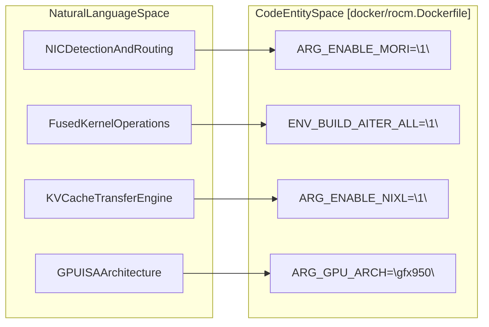

These build arguments enable advanced features such as MoRI NIC support, AITER fused-kernel ops, NIXL disaggregation backends, and selection of the target AMD GPU ISA.

Sources: `[docker/rocm.Dockerfile:26-41]()`, `[scripts/ci/amd/amd_ci_install_dependency.sh:1-159]()`

---

## Core Docker Build Arguments

The Docker build system exposes multiple tuning arguments allowing customization of the build scope and target platform.

| Argument              | Default       | Description                                                  |
|-----------------------|---------------|--------------------------------------------------------------|
| `CUDA_VERSION`        | `13.4.1`      | Target CUDA Toolkit version for NVIDIA base image `[docker/Dockerfile.cu134:26]()` |
| `BUILD_TYPE`          | `all`         | Controls what components are built (`all` = full build) `[docker/Dockerfile.cu134:30]()` |
| `BRANCH_TYPE`         | `remote`      | Source code fetch method (`local`=local build, `remote`=git) `[docker/Dockerfile.cu134:31]()` |
| `GPU_ARCH`            | `gfx950`      | Target GPU architecture for ROCm builds `[docker/rocm.Dockerfile:58]()` |
| `ENABLE_MORI`         | `0`           | Enable MoRI NIC auto-detection and RDMA support `[docker/rocm.Dockerfile:26-34]()` |
| `ENABLE_NIXL`         | `1`           | Enable NIXL backend for prefill/decode disaggregation `[docker/rocm.Dockerfile:36-41]()` |
| `SGL_KERNEL_VERSION`  | e.g. `0.4.10` | Version of the `sglang-kernel` wheel to install `[docker/Dockerfile.cu134:16]()` |

These arguments propagate through the build stages to select dependencies, compiler flags, and package versions, yielding highly customized Docker images.

Sources: `[docker/Dockerfile.cu134:14-32]()`, `[docker/rocm.Dockerfile:26-58]()`

---

## CI/CD and Release Pipelines

SGLang manages continuous integration and Docker image publishing using GitHub Actions workflows, enabling automated builds, testing, and release management.

Key workflows:

- **Development & Nightly Builds**: Scheduled or manual triggers build development and nightly images with date-stamped or commit-sha tags (e.g. `lmsysorg/sglang:dev`, `lmsysorg/sglang:nightly-dev-{date}-{sha}`). Examples include `release-docker-amd-rocm720-nightly.yml` `[.github/workflows/release-docker-amd-rocm720-nightly.yml:1-165]()` and `release-docker-amd-rocm10.yml` `[.github/workflows/release-docker-amd-rocm10.yml:1-154]()`.
- **Versioned Releases**: Trigger on tag creation to produce multi-platform release images, covering NVIDIA CUDA, AMD ROCm, and Huawei NPU variants.
- **Local Registry Mirroring**: Images are mirrored to local private registries to mitigate public Docker Hub rate limits during concurrent test runs and deployment.

These pipelines integrate with multi-architecture builds and use BuildKit's caching features for efficient incremental builds.

Sources: `[.github/workflows/release-docker-amd-rocm720-nightly.yml:1-165]()`, `[.github/workflows/release-docker-amd-rocm10.yml:1-154]()`, `[.github/workflows/pr-test-amd.yml:1-170]()`, `[.github/workflows/nightly-test-amd.yml:1-165]()`

---

## Deployment Best Practices and Container Execution

To maximize performance, deployed containers should be configured with careful device and IPC settings.

```mermaid
graph TD
    subgraph "NaturalLanguageSpace"
        container_launch["ContainerLaunchOrchestration"]
        engine_runtime["EngineRuntimeExecution"]
    end

    subgraph "CodeEntitySpace [scripts/ci/amd/amd_ci_start_container.sh]"
        docker_run["docker_run[\"--gpus all --device /dev/dri\"]"]
        ipc_host["--ipc=\"host\""]
        shm_size["--shm-size=\"32g\""]
        net_host["--network=\"host\""]
    end

    subgraph "CodeEntitySpace [python/sglang/srt/entrypoints/engine.py]"
        server_args["ServerArgs"]
        engine_init["EngineInit"]
    end

    container_launch --> docker_run
    docker_run --> ipc_host
    docker_run --> shm_size
    docker_run --> net_host
    ipc_host --> server_args
    net_host --> server_args
    server_args --> engine_runtime
    engine_runtime --> engine_init
```

Recommended container launch options:

- Map all GPU devices (`--gpus all`) or specific devices (AMD: `--device=/dev/kfd --device=/dev/dri` plus `--group-add video`).
- Use IPC sharing mode (`--ipc=host`) for intra-container shared memory and CUDA IPC communication.
- Enlarge shared memory partition (`--shm-size 32g`) for large token and KV caches communication.
- Employ host networking (`--network=host`) for minimal network latency.

### Example Launch Commands

- **NVIDIA CUDA**

```bash
docker run --rm -it --gpus all --shm-size 32g -p 30000:30000 \
  -v ~/.cache/huggingface:/root/.cache/huggingface \
  --ipc=host \
  lmsysorg/sglang:latest-runtime \
  python3 -m sglang.launch_server --model-path meta-llama/Llama-3.1-8B-Instruct \
  --host 0.0.0.0 --port 30000
```

- **AMD ROCm**

```bash
docker run --rm -it --device=/dev/kfd --device=/dev/dri --group-add video \
  -e GPU_ARCH=gfx950 -e MORI_DEVICE_NIC=mlx5 \
  --ipc=host --network=host \
  lmsysorg/sglang-rocm:latest-runtime \
  python3 -m sglang.launch_server --model-path meta-llama/Llama-3.1-8B-Instruct \
  --host 0.0.0.0 --port 30000
```

These flags provide optimized environment for distributed GPU scheduling, kernel acceleration, and fast IPC pathways between processes.

Sources: `[scripts/ci/amd/amd_ci_start_container.sh:1-128]()`, `[scripts/ci/amd/amd_ci_start_container_disagg.sh:1-120]()`

---

## Dependency Management by Platform

SGLang segregates platform-specific runtime dependencies and Python package versioning into distinct project configuration files. This avoids package version conflicts and ensures platform-optimized builds.

| Platform      | Configuration File           | Description                           |
|---------------|------------------------------|-------------------------------------|
| NVIDIA CUDA   | `python/pyproject.toml`      | Main CUDA wheel and runtime deps    |
| AMD ROCm      | `python/pyproject_other.toml` (extras `dev_hip`, `dev_hip_rocm724`) | ROCm-enabled PyTorch stacks and Triton kernels `[scripts/ci/amd/amd_ci_install_dependency.sh:91-96]()` |
| Intel XPU     | `python/pyproject_xpu.toml`  | Intel XPU backend and dependencies  |
| CPU Only      | `python/pyproject_cpu.toml`  | CPU-only runtime and packages       |
| Huawei NPU    | `python/pyproject_npu.toml`  | Huawei NPU backend and dependencies |

This modular dependency system facilitates targeted installation for heterogeneous hardware, leveraging latest features and GPU backends per platform.

Sources: `[scripts/ci/amd/amd_ci_install_dependency.sh:28-97]()`

---

Sources:  
`[.github/workflows/nightly-test-amd.yml:1-165]()`  
`[.github/workflows/pr-test-amd.yml:1-170]()`  
`[.github/workflows/release-docker-amd-rocm10.yml:1-154]()`  
`[.github/workflows/release-docker-amd-rocm720-nightly.yml:1-165]()`  
`[docker/Dockerfile.cu134:1-1155]()`  
`[docker/rocm.Dockerfile:1-126]()`  
`[scripts/ci/amd/amd_ci_install_dependency.sh:1-159]()`  
`[scripts/ci/amd/amd_ci_start_container.sh:1-128]()`  
`[scripts/ci/amd/amd_ci_start_container_disagg.sh:1-120]()`

---

# Page: Multi-Node and Distributed Deployment

# Multi-Node and Distributed Deployment

<details>
<summary>Relevant source files</summary>

The following files were used as context for generating this wiki page:

- [docs/docs/references/environment_variables.mdx](docs/docs/references/environment_variables.mdx)
- [python/sglang/benchmark/one_batch.py](python/sglang/benchmark/one_batch.py)
- [python/sglang/srt/arg_groups/attention_hook.py](python/sglang/srt/arg_groups/attention_hook.py)
- [python/sglang/srt/arg_groups/overrides.py](python/sglang/srt/arg_groups/overrides.py)
- [python/sglang/srt/arg_groups/pd_disaggregation_hook.py](python/sglang/srt/arg_groups/pd_disaggregation_hook.py)
- [python/sglang/srt/disaggregation/role_switch.py](python/sglang/srt/disaggregation/role_switch.py)
- [python/sglang/srt/distributed/bootstrap.py](python/sglang/srt/distributed/bootstrap.py)
- [python/sglang/srt/distributed/parallel_state.py](python/sglang/srt/distributed/parallel_state.py)
- [python/sglang/srt/environ.py](python/sglang/srt/environ.py)
- [python/sglang/srt/layers/dp_attention.py](python/sglang/srt/layers/dp_attention.py)
- [python/sglang/srt/managers/schedule_batch.py](python/sglang/srt/managers/schedule_batch.py)
- [python/sglang/srt/managers/scheduler.py](python/sglang/srt/managers/scheduler.py)
- [python/sglang/srt/mem_cache/common.py](python/sglang/srt/mem_cache/common.py)
- [python/sglang/srt/mem_cache/storage/eic/eic_storage.py](python/sglang/srt/mem_cache/storage/eic/eic_storage.py)
- [python/sglang/srt/mem_cache/storage/hf3fs/mini_3fs_metadata_server.py](python/sglang/srt/mem_cache/storage/hf3fs/mini_3fs_metadata_server.py)
- [python/sglang/srt/mem_cache/storage/hf3fs/storage_hf3fs.py](python/sglang/srt/mem_cache/storage/hf3fs/storage_hf3fs.py)
- [python/sglang/srt/model_executor/model_runner.py](python/sglang/srt/model_executor/model_runner.py)
- [python/sglang/srt/runtime_context.py](python/sglang/srt/runtime_context.py)
- [python/sglang/srt/server_args.py](python/sglang/srt/server_args.py)
- [python/sglang/test/kits/pd_parity_kit.py](python/sglang/test/kits/pd_parity_kit.py)
- [python/sglang/test/server_fixtures/disaggregation_fixture.py](python/sglang/test/server_fixtures/disaggregation_fixture.py)
- [test/manual/test_forward_split_prefill.py](test/manual/test_forward_split_prefill.py)
- [test/manual/test_vlm_accuracy.py](test/manual/test_vlm_accuracy.py)
- [test/registered/cp/test_deepseek_v4_flash_fp4_b200_cp.py](test/registered/cp/test_deepseek_v4_flash_fp4_b200_cp.py)
- [test/registered/disaggregation/test_disaggregation_aarch64.py](test/registered/disaggregation/test_disaggregation_aarch64.py)
- [test/registered/disaggregation/test_disaggregation_basic.py](test/registered/disaggregation/test_disaggregation_basic.py)
- [test/registered/disaggregation/test_disaggregation_decode_radix_cache.py](test/registered/disaggregation/test_disaggregation_decode_radix_cache.py)
- [test/registered/disaggregation/test_disaggregation_different_tp.py](test/registered/disaggregation/test_disaggregation_different_tp.py)
- [test/registered/disaggregation/test_disaggregation_dp_attention.py](test/registered/disaggregation/test_disaggregation_dp_attention.py)
- [test/registered/disaggregation/test_disaggregation_dsv4.py](test/registered/disaggregation/test_disaggregation_dsv4.py)
- [test/registered/disaggregation/test_disaggregation_hisparse.py](test/registered/disaggregation/test_disaggregation_hisparse.py)
- [test/registered/disaggregation/test_disaggregation_hybrid_attention.py](test/registered/disaggregation/test_disaggregation_hybrid_attention.py)
- [test/registered/disaggregation/test_disaggregation_inkling_mxfp8.py](test/registered/disaggregation/test_disaggregation_inkling_mxfp8.py)
- [test/registered/disaggregation/test_disaggregation_kimi_linear.py](test/registered/disaggregation/test_disaggregation_kimi_linear.py)
- [test/registered/disaggregation/test_disaggregation_nixl.py](test/registered/disaggregation/test_disaggregation_nixl.py)
- [test/registered/disaggregation/test_disaggregation_pp.py](test/registered/disaggregation/test_disaggregation_pp.py)
- [test/registered/hicache/test_hicache_storage_3fs_backend.py](test/registered/hicache/test_hicache_storage_3fs_backend.py)
- [test/registered/pp/test_pp_gemma4.py](test/registered/pp/test_pp_gemma4.py)
- [test/registered/pp/test_pp_single_node.py](test/registered/pp/test_pp_single_node.py)
- [test/registered/pp/test_pp_single_node_extra.py](test/registered/pp/test_pp_single_node_extra.py)
- [test/registered/unit/disaggregation/test_pd_role_switch.py](test/registered/unit/disaggregation/test_pd_role_switch.py)
- [test/registered/unit/server_args/test_server_args.py](test/registered/unit/server_args/test_server_args.py)
- [test/registered/unit/test_model_overrides.py](test/registered/unit/test_model_overrides.py)
- [test/registered/unit/test_runtime_context.py](test/registered/unit/test_runtime_context.py)

</details>


## Purpose and scope

This page describes the distributed-runtime mechanisms visible in the provided code: how parallel ranks are derived, how distributed process groups are organized, and how network-related utilities enter server configuration. Kubernetes-native fleet orchestration is an operational concern beyond the runtime mechanisms shown here; the available source excerpts do not establish a Kubernetes controller or fleet-orchestration implementation. [python/sglang/srt/runtime_context.py:95-157](), [python/sglang/srt/distributed/parallel_state.py:9-23](), [python/sglang/srt/server_args.py:61-65]()

Sources: [python/sglang/srt/runtime_context.py:95-157](), [python/sglang/srt/distributed/parallel_state.py:9-23](), [python/sglang/srt/server_args.py:61-65]()

---

## Multi-Node Deployment Overview

Distributed execution separates two related concerns: assigning processes to parallel ranks, and creating the distributed environment and model-parallel groups those ranks use. The documented lifecycle in `parallel_state.py` initializes the distributed environment first, then initializes model-parallel groups; teardown destroys the model-parallel groups before the distributed environment. [python/sglang/srt/distributed/parallel_state.py:9-23]()

`runtime_context.py` provides rank and width calculations used to describe the topology. Its helpers derive WORLD size, TP/PP rank coordinates, and attention/MoE widths from configuration. These calculations describe rank layout; they do not themselves create process groups. [python/sglang/srt/runtime_context.py:73-103](), [python/sglang/srt/runtime_context.py:106-157](), [python/sglang/srt/runtime_context.py:173-183]()

| Code entity | Role established by the provided source |
|---|---|
| `init_distributed_environment` | First step in the distributed lifecycle; initializes the distributed environment. [python/sglang/srt/distributed/parallel_state.py:9-19]() |
| `initialize_model_parallel` | Lifecycle step for initializing model-parallel groups after the distributed environment. [python/sglang/srt/distributed/parallel_state.py:13-19]() |
| `destroy_model_parallel` | Teardown step for model-parallel groups. [python/sglang/srt/distributed/parallel_state.py:18-19]() |
| `destroy_distributed_environment` | Teardown step for the distributed environment. [python/sglang/srt/distributed/parallel_state.py:18-19]() |
| `spawn_world_rank` | Computes a WORLD rank from launcher TP and PP ranks using the resolved configuration. [python/sglang/srt/runtime_context.py:95-104]() |
| `derive_spawn_ranks` | Derives TP, PP, attention-CP, and MoE rank coordinates from a WORLD rank and topology widths. [python/sglang/srt/runtime_context.py:106-134]() |
| `derive_parallel_widths` | Derives attention and MoE parallel widths and DCP settings. [python/sglang/srt/runtime_context.py:137-157]() |

### Diagram: Deployment concepts mapped to runtime entities

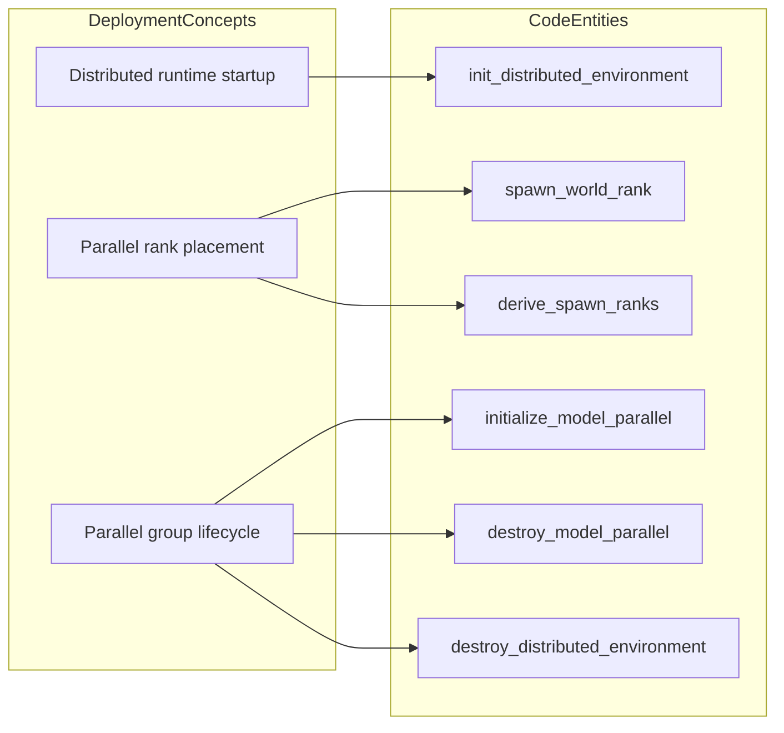

Sources: [python/sglang/srt/distributed/parallel_state.py:9-23](), [python/sglang/srt/runtime_context.py:95-134]()

---

## Distributed Initialization Architecture

### Coordination parameters and rank derivation

`spawn_world_rank(server_args, tp_rank, pp_rank)` obtains a resolving view of the server configuration and computes the WORLD rank as `ep_join_rank_offset + tp_size * pp_rank + tp_rank`. The ordering makes TP ranks contiguous within a PP stage; the PP coordinate advances by a stride of `tp_size`. [python/sglang/srt/runtime_context.py:95-104](), [python/sglang/srt/runtime_context.py:106-120]()

`derive_spawn_ranks` reverses this mapping after subtracting `ep_join_rank_offset`: TP rank is the local WORLD rank modulo `tp_size`, and PP rank is integer division by `tp_size`. It then derives attention-CP and MoE rank coordinates from the TP rank and configured widths. [python/sglang/srt/runtime_context.py:106-134]()

`derive_parallel_widths` computes `attn_tp_size` by dividing TP width by attention-DP and attention-CP widths. It computes `moe_tp_size` from TP width, MoE-EP width, and MoE-DP width; DCP is enabled when configured, and its attention width is otherwise set to one. [python/sglang/srt/runtime_context.py:73-76](), [python/sglang/srt/runtime_context.py:137-157]()

### Diagram: Rank coordinates mapped to code entities

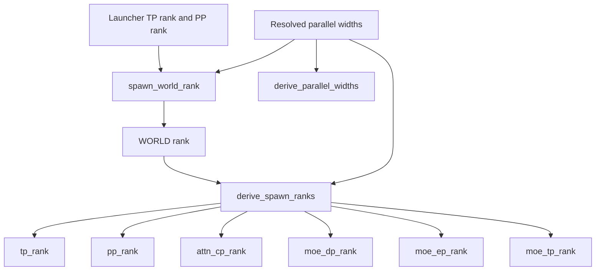

Sources: [python/sglang/srt/runtime_context.py:73-76](), [python/sglang/srt/runtime_context.py:95-157]()

### Process-group lifecycle

The distributed-state module describes an explicit lifecycle: call `init_distributed_environment`, optionally call `initialize_model_parallel`, execute distributed work, then destroy model-parallel groups and the distributed environment. Applications that need a distributed environment but not model or pipeline parallelism may omit model-parallel initialization and teardown. [python/sglang/srt/distributed/parallel_state.py:9-23]()

The module imports PyTorch Distributed process-group types and contains group-registration and collective-operation infrastructure. `inplace_all_reduce` resolves a named group from the registered groups and delegates the reduction to its coordinator. [python/sglang/srt/distributed/parallel_state.py:43-45](), [python/sglang/srt/distributed/parallel_state.py:177-192]()

Sources: [python/sglang/srt/distributed/parallel_state.py:9-23](), [python/sglang/srt/distributed/parallel_state.py:43-45](), [python/sglang/srt/distributed/parallel_state.py:177-192]()

---

## Kubernetes-Native Fleet Orchestration

Kubernetes-native fleet orchestration is in scope for deployment planning, but no Kubernetes resource definitions, controller implementation, or fleet-management code is included in the provided source excerpts. Therefore this page does not prescribe SGLang-specific `StatefulSet`, `Job`, service-discovery, or pod-placement behavior.

At the runtime boundary, an orchestrator must arrange for participating processes to receive a consistent topology and reach the rendezvous/network endpoints required by the deployment. Rank mapping and process-group lifecycle are implemented in the runtime; cluster scheduling and pod lifecycle are not demonstrated by the available sources. [python/sglang/srt/runtime_context.py:95-134](), [python/sglang/srt/distributed/parallel_state.py:9-23]()

### Diagram: Orchestration boundary

```mermaid
flowchart LR
    A["Kubernetes or other external orchestrator"] --> B["Launch SGLang processes"]
    B --> C["runtime_context rank derivation"]
    C --> D["parallel_state distributed lifecycle"]
    A -. "Fleet scheduling implementation not shown in provided sources" .-> E["Cluster placement and lifecycle"]
```

Sources: [python/sglang/srt/runtime_context.py:95-134](), [python/sglang/srt/distributed/parallel_state.py:9-23]()

---

## Network Communication Stack

### Network-related configuration utilities

`server_args.py` imports `NetworkAddress`, `get_free_port_below_ephemeral`, and `wait_port_available` from `sglang.srt.utils.network`. This establishes that server-argument code has access to address and port utilities; the provided excerpt does not show their call sites or establish which ports are used for particular distributed services. [python/sglang/srt/server_args.py:61-65]()

`parallel_state.py` imports `get_local_ip_auto` from the same network utility module. The shown code establishes the dependency but does not expose its invocation or the rules used to choose an address. [python/sglang/srt/distributed/parallel_state.py:79-81]()

For deployment configuration, ensure that the addresses and ports selected by the actual launch path are reachable between participating processes. The excerpts provided here do not specify required firewall rules, interface-selection settings, rendezvous environment variables, or a port matrix; those details should be verified against the deployed launcher and the relevant network utility call sites.

Sources: [python/sglang/srt/server_args.py:61-65](), [python/sglang/srt/distributed/parallel_state.py:79-81]()

### Collective operations and group lookup

`parallel_state.py` registers `inplace_all_reduce` as a custom operation. At execution, it checks that `group_name` exists in `_groups`, resolves the registered coordinator, rejects a destroyed group, and invokes `_all_reduce_in_place`. [python/sglang/srt/distributed/parallel_state.py:177-192]()

The same excerpt defines `outplace_all_reduce` as a custom operation with a group name and method argument; the available lines do not show its implementation body, so its algorithmic variants are not documented here. [python/sglang/srt/distributed/parallel_state.py:194-198]()

### Data-parallel attention communication

`dp_attention.py` determines the deployment attention-DP replica count through `deployment_attn_dp_size()`. `dp_gather_width()` selects a gather width based on whether WORLD-wide gathering is enabled, whether a scoped gather slot is active, and the configured attention-DP width. `dp_gather_slot()` maps the process to its gather slot, including an elastic-scale path that maps a physical EP rank to a logical attention-DP rank. [python/sglang/srt/layers/dp_attention.py:60-82](), [python/sglang/srt/layers/dp_attention.py:103-120]()

`DpPaddingMode.get_dp_padding_mode` chooses between padding modes according to the gather width, batch type, token counts, and MoE all-to-all backend constraints. The excerpt specifies that the `pplx` backend requires `MAX_LEN`; it also describes conditions for choosing `SUM_LEN` on extend batches with multiple gather ranks. [python/sglang/srt/layers/dp_attention.py:164-192]()

### Diagram: Network and collective code path

```mermaid
flowchart LR
    A["ServerArgs network utility imports"] --> B["NetworkAddress"]
    A --> C["get_free_port_below_ephemeral"]
    A --> D["wait_port_available"]
    E["parallel_state network utility import"] --> F["get_local_ip_auto"]
    G["Registered process group"] --> H["inplace_all_reduce"]
    I["dp_gather_width"] --> J["DpPaddingMode.get_dp_padding_mode"]
    J --> K["MAX_LEN"]
    J --> L["SUM_LEN"]
```

Sources: [python/sglang/srt/server_args.py:61-65](), [python/sglang/srt/distributed/parallel_state.py:79-81](), [python/sglang/srt/distributed/parallel_state.py:177-192](), [python/sglang/srt/layers/dp_attention.py:60-82](), [python/sglang/srt/layers/dp_attention.py:164-192]()

---

## Prefill-Decode Disaggregation and Load Management

Disaggregation is represented in the scheduler by imports for prefill and decode mixins, queues, transfer-backend types, and metadata utilities. The supplied scheduler excerpt shows those dependencies but does not include the implementation paths that establish the complete transfer protocol, configuration validation, or inter-node network requirements. [python/sglang/srt/managers/scheduler.py:79-104]()

`ScheduleBatch` also imports `ScheduleBatchDisaggregationDecodeMixin`, `BaseKVSender`, and disaggregation mode definitions, showing that request-batch handling has disaggregation-specific components. Their behavior and transfer-engine selection cannot be detailed from the excerpted lines alone. [python/sglang/srt/managers/schedule_batch.py:95-100]()

For deployment, treat prefill/decode separation as a distinct topology that requires the relevant transfer backend and endpoints to be configured and reachable. Exact flags, supported backend choices, bootstrap exchanges, and transfer-port requirements are not established by the source content shown here. [python/sglang/srt/managers/scheduler.py:79-104](), [python/sglang/srt/managers/schedule_batch.py:95-100]()

Sources: [python/sglang/srt/managers/scheduler.py:79-104](), [python/sglang/srt/managers/schedule_batch.py:95-100]()

---

## Practical Configuration and Verification

Use the configuration and topology helpers as separate diagnostic layers:

1. Inspect resolved parallel configuration and derived widths. `runtime_context.py` exposes `parallel_widths_of` and `launch_world_size_of`; the latter computes initial WORLD width from `ep_join_rank_offset + tp_size * pp_size`. [python/sglang/srt/runtime_context.py:160-183]()
2. Check rank mapping with `spawn_world_rank` and `derive_spawn_ranks`, particularly when PP or an EP join offset is involved. [python/sglang/srt/runtime_context.py:95-134]()
3. Confirm the distributed lifecycle is followed: initialize the distributed environment, initialize required model-parallel groups, and destroy them in the documented order during shutdown. [python/sglang/srt/distributed/parallel_state.py:9-23]()
4. Verify network reachability using the actual launch path and configuration. The shown imports identify available address/port helpers but do not provide a complete port list or deployment-specific network policy. [python/sglang/srt/server_args.py:61-65](), [python/sglang/srt/distributed/parallel_state.py:79-81]()

Sources: [python/sglang/srt/runtime_context.py:95-134](), [python/sglang/srt/runtime_context.py:160-183](), [python/sglang/srt/distributed/parallel_state.py:9-23](), [python/sglang/srt/server_args.py:61-65]()

---

## References

- Distributed lifecycle and process-group infrastructure: [python/sglang/srt/distributed/parallel_state.py:9-23]()
- Network helper imports in server arguments: [python/sglang/srt/server_args.py:61-65]()
- Rank derivation and parallel-width calculations: [python/sglang/srt/runtime_context.py:73-183]()
- Data-parallel attention gather and padding decisions: [python/sglang/srt/layers/dp_attention.py:60-120](), [python/sglang/srt/layers/dp_attention.py:164-192]()
- Scheduler disaggregation dependencies: [python/sglang/srt/managers/scheduler.py:79-104]()
- Batch-level disaggregation dependencies: [python/sglang/srt/managers/schedule_batch.py:95-100]()

---

# Page: Core Server Architecture

# Core Server Architecture

<details>
<summary>Relevant source files</summary>

The following files were used as context for generating this wiki page:

- [docs/docs/advanced_features/hicache_design.mdx](docs/docs/advanced_features/hicache_design.mdx)
- [docs/docs/references/production_metrics.mdx](docs/docs/references/production_metrics.mdx)
- [python/sglang/srt/entrypoints/http_server.py](python/sglang/srt/entrypoints/http_server.py)
- [python/sglang/srt/managers/data_parallel_controller.py](python/sglang/srt/managers/data_parallel_controller.py)
- [python/sglang/srt/managers/detokenizer_manager.py](python/sglang/srt/managers/detokenizer_manager.py)
- [python/sglang/srt/managers/io_struct.py](python/sglang/srt/managers/io_struct.py)
- [python/sglang/srt/managers/multi_tokenizer_mixin.py](python/sglang/srt/managers/multi_tokenizer_mixin.py)
- [python/sglang/srt/managers/tokenizer_control_mixin.py](python/sglang/srt/managers/tokenizer_control_mixin.py)
- [python/sglang/srt/managers/tokenizer_manager.py](python/sglang/srt/managers/tokenizer_manager.py)
- [python/sglang/srt/ray/data_parallel_controller.py](python/sglang/srt/ray/data_parallel_controller.py)
- [python/sglang/srt/ray/engine.py](python/sglang/srt/ray/engine.py)
- [test/registered/unit/entrypoints/test_server_info.py](test/registered/unit/entrypoints/test_server_info.py)
- [test/registered/unit/managers/test_data_parallel_controller.py](test/registered/unit/managers/test_data_parallel_controller.py)
- [test/registered/unit/managers/test_multi_tokenizer_mixin.py](test/registered/unit/managers/test_multi_tokenizer_mixin.py)
- [test/registered/unit/managers/test_tokenizer_manager_rid_cleanup.py](test/registered/unit/managers/test_tokenizer_manager_rid_cleanup.py)

</details>


This page describes SGLang's multi-process server architecture, covering key processes, inter-process communication (IPC) mechanisms, and core configuration systems. It provides a high-level view to orient developers on how components interact and collaborate to serve inference requests efficiently.

## Purpose and Scope

SGLang employs a **multi-process architecture** separating tokenization, scheduling, model execution, and detokenization into dedicated processes. This design supports:

-   **Avoiding Python GIL contention:** Each major task runs in its own process, allowing independent CPU and GPU utilization [python/sglang/srt/managers/tokenizer_manager.py:14-58]().
-   **Asynchronous pipelining:** Tokenization, scheduling, and detokenization proceed concurrently, enabling high throughput [python/sglang/srt/managers/tokenizer_manager.py:14-58]().
-   **Distributed execution:** Supports parallelism strategies including Tensor, Pipeline, Data, and Expert Parallelism [python/sglang/srt/ray/engine.py:115-119]().
-   **Fault isolation:** Subprocess watchdogs monitor critical processes to increase resilience [python/sglang/srt/entrypoints/http_server.py:197-198]() [python/sglang/srt/managers/tokenizer_manager.py:202-202]().

The core architecture centers around four primary process types:

1.  **HTTP Server + Engine (Main Process):** Handles API requests and manages child process lifecycles [python/sglang/srt/entrypoints/http_server.py:15-79]() [python/sglang/srt/ray/engine.py:29-32]().
2.  **TokenizerManager (Subprocess):** Responsible for tokenizing requests and multimodal input encoding [python/sglang/srt/managers/tokenizer_manager.py:14-58]().
3.  **Scheduler (Subprocess):** Manages batching, KV cache memory, and forwards execution to the model runner [python/sglang/srt/managers/data_parallel_controller.py:55-55]().
4.  **DetokenizerManager (Subprocess):** Handles incremental detokenization of model outputs and returns text to the tokenizer [python/sglang/srt/managers/detokenizer_manager.py:14-184]().

For detailed architectural explanation of processes and IPC, server configuration, and tokenizer internals, see these child pages:
- [Multi-Process Architecture and IPC](#3.1) — Document the process model, ZMQ IPC channels, and inter-process communication patterns.
- [Server Configuration (ServerArgs)](#3.2) — Document ServerArgs parameters, the arg_groups resolution pipeline, runtime context, and their effects.
- [TokenizerManager and DetokenizerManager](#3.3) — Explain tokenization/detokenization processes, multi-tokenizer support, and template handling.

Sources:
- [python/sglang/srt/managers/tokenizer_manager.py:14-58]()
- [python/sglang/srt/entrypoints/http_server.py:197-198]()
- [python/sglang/srt/ray/engine.py:115-119]()
- [python/sglang/srt/ray/engine.py:29-32]()
- [python/sglang/srt/managers/data_parallel_controller.py:55-55]()
- [python/sglang/srt/managers/detokenizer_manager.py:14-184]()
- [python/sglang/srt/entrypoints/http_server.py:15-79]()
- [python/sglang/srt/managers/tokenizer_manager.py:202-202]()

---

## Multi-Process Design Overview

SGLang uses a multiprocess design with asynchronous ZeroMQ (ZMQ) communication channels connecting its core components. This architecture balances CPU and GPU workloads and allows each process to specialize while cooperating to serve requests efficiently.

The main request flow is:

-   Client sends requests to the **HTTP Server / Engine** [python/sglang/srt/entrypoints/http_server.py:15-79]().
-   The **Engine** forwards these requests to the **TokenizerManager**, which performs tokenization, multimodal encoding, and pre-processing [python/sglang/srt/managers/tokenizer_manager.py:14-58]().
-   The **TokenizerManager** sends tokenized batches over ZMQ sockets to the **Scheduler** process, managing batch formation, KV cache memory, and model forward execution through `ModelRunner` [python/sglang/srt/managers/data_parallel_controller.py:55-55]() [python/sglang/srt/ray/engine.py:35-35]().
-   The **Scheduler** forwards generated tokens via ZMQ to the **DetokenizerManager**, which decodes tokens into user-readable strings and streams results back [python/sglang/srt/managers/detokenizer_manager.py:14-184]().
-   The **TokenizerManager** relays the final string outputs back to the HTTP Server for client delivery.

### System Components & IPC — Mapping to Code

```mermaid
graph TB
    subgraph "Main_Process"
        HTTP["FastAPI_Server<br/>(http_server.py)"]
        Engine["Engine<br/>(engine.py)"]
    end
    
    subgraph "Tokenizer_Process"
        TokMgr["TokenizerManager<br/>(tokenizer_manager.py)"]
        MMProc["Multimodal_Processor<br/>(multimodal_processor.py)"]
        AsyncBatch["AsyncDynamicbatchTokenizer<br/>(async_dynamic_batch_tokenizer.py)"]
    end
    
    subgraph "Scheduler_Process"
        Scheduler["Scheduler<br/>(data_parallel_controller.py)"]
        ModelRunner["ModelRunner<br/>(ray/scheduler_actor.py)"]
        Runner["EagerRunner<br/>(runner.py)"]
    end
    
    subgraph "Detokenizer_Process"
        DetokMgr["DetokenizerManager<br/>(detokenizer_manager.py)"]
    end
    
    subgraph "IPC_Channels_ZMQ"
        IPC1["scheduler_input_ipc (ZMQ socket)"]
        IPC2["tokenizer_ipc (ZMQ socket)"]
        IPC3["detokenizer_ipc (ZMQ socket)"]
    end
    
    HTTP --> Engine
    Engine --> TokMgr
    
    TokMgr -- "TokenizedGenerateReqInput" --> IPC1
    IPC2 -- "BatchStrOutput" --> TokMgr
    
    IPC1 --> Scheduler
    Scheduler -- "BatchTokenIDOutput" --> IPC3
    
    IPC3 --> DetokMgr
    DetokMgr --> IPC2
    
    Scheduler --> ModelRunner
    ModelRunner --> Runner
```

This diagram associates natural system components with their defining code files:

-   HTTP Server (`http_server.py`) provides FastAPI-based external APIs [python/sglang/srt/entrypoints/http_server.py:15-79]().
-   The Engine (`engine.py`) manages subprocess lifecycles and request forwarding [python/sglang/srt/ray/engine.py:29-32]().
-   The TokenizerManager (`tokenizer_manager.py`) handles tokenization and multimodal processing [python/sglang/srt/managers/tokenizer_manager.py:14-58]().
-   Scheduler (`data_parallel_controller.py`) forms batches, manages KV cache, and coordinates model forward passes [python/sglang/srt/managers/data_parallel_controller.py:55-55]().
-   ModelRunner (`ray/scheduler_actor.py`) executes model inference [python/sglang/srt/ray/engine.py:35-35]().
-   DetokenizerManager (`detokenizer_manager.py`) performs incremental detokenization and streams text output [python/sglang/srt/managers/detokenizer_manager.py:14-184]().

For complete coverage of process lifecycles, ZMQ patterns, and IPC details, see [Multi-Process Architecture and IPC](#3.1).

Sources:
- [python/sglang/srt/entrypoints/http_server.py:15-79]()
- [python/sglang/srt/ray/engine.py:29-32]()
- [python/sglang/srt/managers/tokenizer_manager.py:14-58]()
- [python/sglang/srt/managers/data_parallel_controller.py:55-55]()
- [python/sglang/srt/ray/engine.py:35-35]()
- [python/sglang/srt/managers/detokenizer_manager.py:14-184]()

---

## Server Configuration (`ServerArgs`)

SGLang’s runtime configuration is centralized in the `ServerArgs` dataclass, which defines parameters controlling scheduling, parallelism, hardware assignment, model settings, and IPC port assignments [python/sglang/srt/server_args.py:175-179]().

This configuration flows through a multi-stage resolution pipeline:

-   Initial values come from command-line arguments, environment variables, and config files.
-   A layered resolution pipeline computes derived values based on hardware detection, platform specifics, and model capabilities.
-   The final configuration bundles are published as immutable typed contexts accessible at runtime [python/sglang/srt/runtime_context.py:151-168]().

### ServerArgs Resolution Flow

```mermaid
graph LR
    CLI["CLI Arguments / Config File"] --> Prepare["prepare_server_args<br/>(server_args.py)"]
    Prepare --> Resolve["arg_groups.pipeline<br/>run_resolution_pipeline"]
    Resolve --> Publish["publish()<br/>(runtime_context.py)"]
    Publish --> RuntimeBags["Typed Namespace Bags<br/>(ServerArgs, Parallel, Memory, Exec, etc.)"]
```

This approach ensures all server components share a consistent, validated, and immutable runtime configuration context, enabling safe concurrent operations and modular design. `ServerArgs` affects key areas such as batch size limits, parallelism topology (TP/PP/DP/EP), LoRA adapter loading, scheduler policies, and IPC endpoint ports.

For detailed parameter descriptions, resolution logic, and usage in runtime, see [Server Configuration (ServerArgs)](#3.2).

Sources:
- [python/sglang/srt/server_args.py:175-179]()
- [python/sglang/srt/runtime_context.py:151-168]()

---

## `TokenizerManager` and `DetokenizerManager`

Tokenization and detokenization are offloaded to specialized manager processes to reduce CPU contention on the main scheduler and model execution pipeline.

-   **TokenizerManager** manages input preprocessing including text tokenization, multimodal data encoding, chat template handling, and asynchronous batch tokenization. It also handles request lifecycle and state tracking [python/sglang/srt/managers/tokenizer_manager.py:14-58](). The `rid_to_state` dictionary within `TokenizerManager` tracks the state of each request, ensuring proper cleanup after completion or abortion [test/registered/unit/managers/test_tokenizer_manager_rid_cleanup.py:14-15]().

-   **DetokenizerManager** performs incremental detokenization of token ID batches generated by the model. It handles stop conditions and outputs decoded strings asynchronously back to the tokenizer manager [python/sglang/srt/managers/detokenizer_manager.py:14-184](). The `decode_status` dictionary, a `LimitedCapacityDict`, stores the incremental decoding status for each request, with a configurable maximum capacity to prevent memory exhaustion [python/sglang/srt/managers/detokenizer_manager.py:72-72]().

Using independent event loops and subprocess isolation improves throughput and latency by allowing tokenization and detokenization to proceed in parallel with scheduling and model running. These managers communicate with schedulers and the engine over well-defined ZMQ IPC channels to maintain modularity.

For in-depth coverage of tokenization/detokenization mechanics, multi-tokenizer routing, and template management, please refer to [TokenizerManager and DetokenizerManager](#3.3).

Sources:
- [python/sglang/srt/managers/tokenizer_manager.py:14-58]()
- [python/sglang/srt/managers/detokenizer_manager.py:14-184]()
- [python/sglang/srt/managers/multi_tokenizer_mixin.py:1-191]()
- [test/registered/unit/managers/test_tokenizer_manager_rid_cleanup.py:14-15]()
- [python/sglang/srt/managers/detokenizer_manager.py:72-72]()

---

# References and Further Reading

- [Multi-Process Architecture and IPC](#3.1)
- [Server Configuration (ServerArgs)](#3.2)
- [TokenizerManager and DetokenizerManager](#3.3)

---

# Page: Multi-Process Architecture and IPC

# Multi-Process Architecture and IPC

<details>
<summary>Relevant source files</summary>

The following files were used as context for generating this wiki page:

- [.github/workflows/release-pypi-nightly.yml](.github/workflows/release-pypi-nightly.yml)
- [.github/workflows/release-pypi-pr.yml](.github/workflows/release-pypi-pr.yml)
- [3rdparty/amd/wheel/sglang/pyproject.toml](3rdparty/amd/wheel/sglang/pyproject.toml)
- [docker/Dockerfile](docker/Dockerfile)
- [docs/docs/advanced_features/hicache_design.mdx](docs/docs/advanced_features/hicache_design.mdx)
- [docs/docs/references/production_metrics.mdx](docs/docs/references/production_metrics.mdx)
- [python/pyproject.toml](python/pyproject.toml)
- [python/pyproject_cpu.toml](python/pyproject_cpu.toml)
- [python/pyproject_npu.toml](python/pyproject_npu.toml)
- [python/pyproject_other.toml](python/pyproject_other.toml)
- [python/pyproject_xpu.toml](python/pyproject_xpu.toml)
- [python/sglang/srt/entrypoints/engine.py](python/sglang/srt/entrypoints/engine.py)
- [python/sglang/srt/entrypoints/http_server.py](python/sglang/srt/entrypoints/http_server.py)
- [python/sglang/srt/function_call/deepseekv32_detector.py](python/sglang/srt/function_call/deepseekv32_detector.py)
- [python/sglang/srt/function_call/kimik2_detector.py](python/sglang/srt/function_call/kimik2_detector.py)
- [python/sglang/srt/managers/data_parallel_controller.py](python/sglang/srt/managers/data_parallel_controller.py)
- [python/sglang/srt/managers/detokenizer_manager.py](python/sglang/srt/managers/detokenizer_manager.py)
- [python/sglang/srt/managers/io_struct.py](python/sglang/srt/managers/io_struct.py)
- [python/sglang/srt/managers/multi_tokenizer_mixin.py](python/sglang/srt/managers/multi_tokenizer_mixin.py)
- [python/sglang/srt/managers/tokenizer_control_mixin.py](python/sglang/srt/managers/tokenizer_control_mixin.py)
- [python/sglang/srt/managers/tokenizer_manager.py](python/sglang/srt/managers/tokenizer_manager.py)
- [python/sglang/srt/ray/data_parallel_controller.py](python/sglang/srt/ray/data_parallel_controller.py)
- [python/sglang/srt/ray/engine.py](python/sglang/srt/ray/engine.py)
- [python/sglang/srt/utils/common.py](python/sglang/srt/utils/common.py)
- [python/sglang/srt/utils/json_response.py](python/sglang/srt/utils/json_response.py)
- [scripts/update_nightly_whl_index.py](scripts/update_nightly_whl_index.py)
- [test/registered/function_call/test_kimik2_detector.py](test/registered/function_call/test_kimik2_detector.py)
- [test/registered/moe/test_cutedsl_moe.py](test/registered/moe/test_cutedsl_moe.py)
- [test/registered/unit/entrypoints/test_server_info.py](test/registered/unit/entrypoints/test_server_info.py)
- [test/registered/unit/function_call/test_deepseekv4_detector.py](test/registered/unit/function_call/test_deepseekv4_detector.py)
- [test/registered/unit/function_call/test_json_schema_constraint.py](test/registered/unit/function_call/test_json_schema_constraint.py)
- [test/registered/unit/function_call/test_structural_tag_excludes.py](test/registered/unit/function_call/test_structural_tag_excludes.py)
- [test/registered/unit/function_call/test_unknown_tool_name.py](test/registered/unit/function_call/test_unknown_tool_name.py)
- [test/registered/unit/managers/test_data_parallel_controller.py](test/registered/unit/managers/test_data_parallel_controller.py)
- [test/registered/unit/managers/test_multi_tokenizer_mixin.py](test/registered/unit/managers/test_multi_tokenizer_mixin.py)
- [test/registered/unit/managers/test_tokenizer_manager_rid_cleanup.py](test/registered/unit/managers/test_tokenizer_manager_rid_cleanup.py)
- [test/registered/unit/utils/test_common.py](test/registered/unit/utils/test_common.py)
- [test/registered/unit/utils/test_json_response.py](test/registered/unit/utils/test_json_response.py)

</details>


## Purpose and Scope

This page describes the SGLang Runtime (SRT) process roles and the inter-process communication (IPC) patterns visible in the provided implementation. It focuses on `Engine`, `TokenizerManager`, scheduler processes, the data-parallel controller, ZeroMQ sockets, and the typed IPC payloads defined in `io_struct.py`. [python/sglang/srt/entrypoints/engine.py:14-18](), [python/sglang/srt/managers/tokenizer_manager.py:14-14](), [python/sglang/srt/managers/io_struct.py:14-20]()

Sources: `[python/sglang/srt/entrypoints/engine.py:14-18]()`, `[python/sglang/srt/managers/tokenizer_manager.py:14-14]()`, `[python/sglang/srt/managers/io_struct.py:14-20]()`

---

## Process Architecture Overview

SRT separates request handling and model execution into cooperating runtime roles. `Engine` is an inference-server entry point and imports the manager and process-launch functions for the tokenizer, detokenizer, scheduler, and data-parallel controller. `init_tokenizer_manager` constructs a `TokenizerManager` and initializes a `TemplateManager`. [python/sglang/srt/entrypoints/engine.py:14-18](), [python/sglang/srt/entrypoints/engine.py:66-110](), [python/sglang/srt/entrypoints/engine.py:195-208]()

The `TokenizerManager` is documented as a process that tokenizes text. Its module imports both synchronous and asynchronous ZeroMQ APIs, along with request and output structures from `io_struct.py`. [python/sglang/srt/managers/tokenizer_manager.py:14-14](), [python/sglang/srt/managers/tokenizer_manager.py:50-56](), [python/sglang/srt/managers/tokenizer_manager.py:80-115]()

In data-parallel configurations, `DataParallelController` is responsible for dispatching requests to multiple data-parallel workers. Its constructor creates a ZMQ context and, on node rank zero, a `PULL` socket connected to the scheduler input IPC name. [python/sglang/srt/managers/data_parallel_controller.py:14-14](), [python/sglang/srt/managers/data_parallel_controller.py:158-184]()

### Process Architecture Diagram

```mermaid
graph TB
    Client["Client"]
    HTTP["HTTP server"]
    Engine["Engine"]
    TokenizerManager["TokenizerManager"]
    DataParallelController["DataParallelController"]
    SchedulerProcess["Scheduler process"]
    DetokenizerProcess["Detokenizer process"]
    ModelRunner["ModelRunner"]

    Client --> HTTP
    HTTP --> Engine
    Engine --> TokenizerManager
    Engine --> SchedulerProcess
    Engine --> DetokenizerProcess
    Engine --> DataParallelController
    TokenizerManager --> DataParallelController
    DataParallelController --> SchedulerProcess
    SchedulerProcess --> ModelRunner
    SchedulerProcess --> DetokenizerProcess
    DetokenizerProcess --> TokenizerManager
```

The diagram maps the runtime roles to entities imported or initialized by the engine and controller. It is a role-level overview; the shown source excerpts do not establish every connection in this diagram as a specific call path. [python/sglang/srt/entrypoints/engine.py:66-110](), [python/sglang/srt/entrypoints/engine.py:195-208](), [python/sglang/srt/managers/data_parallel_controller.py:158-184]()

Sources: `[python/sglang/srt/entrypoints/engine.py:66-110]()`, `[python/sglang/srt/entrypoints/engine.py:195-208]()`, `[python/sglang/srt/managers/data_parallel_controller.py:158-184]()`

---

## Process Components

### Main Process: Engine, HTTP Server, and TokenizerManager

`Engine` is described as the inference-server entry point and implements Python APIs for the inference engine. Its imports show the process and manager roles it coordinates, including `run_detokenizer_process`, `run_scheduler_process`, `run_data_parallel_controller_process`, and `TokenizerManager`. [python/sglang/srt/entrypoints/engine.py:14-18](), [python/sglang/srt/entrypoints/engine.py:66-110]()

`init_tokenizer_manager` selects a supplied `TokenizerManagerClass` or defaults to `TokenizerManager`, constructs it using `server_args` and `port_args`, then initializes `TemplateManager` with that manager and the configured model path. [python/sglang/srt/entrypoints/engine.py:195-208]()

The HTTP entry point is implemented with FastAPI and imports `Engine`, `init_tokenizer_manager`, `run_detokenizer_process`, and `run_scheduler_process`. The excerpt establishes these dependencies, but not the full HTTP request dispatch behavior. [python/sglang/srt/entrypoints/http_server.py:15-18](), [python/sglang/srt/entrypoints/http_server.py:82-87]()

| Component | Code entity | Role established by the shown source |
|---|---|---|
| Engine | `Engine` in `entrypoints/engine.py` | Inference engine entry point; imports process-launch functions and manager classes. [python/sglang/srt/entrypoints/engine.py:14-18](), [python/sglang/srt/entrypoints/engine.py:66-110]() |
| HTTP server | `entrypoints/http_server.py` | FastAPI-based HTTP entry point; imports engine and runtime process entry points. [python/sglang/srt/entrypoints/http_server.py:15-18](), [python/sglang/srt/entrypoints/http_server.py:82-87]() |
| TokenizerManager | `managers/tokenizer_manager.py` | Process documented as tokenizing text; imports IPC request structures and ZMQ APIs. [python/sglang/srt/managers/tokenizer_manager.py:14-14](), [python/sglang/srt/managers/tokenizer_manager.py:50-56](), [python/sglang/srt/managers/tokenizer_manager.py:80-115]() |
| TemplateManager | `parser/template_manager.py` | Initialized by `init_tokenizer_manager` alongside the tokenizer manager. [python/sglang/srt/entrypoints/engine.py:195-208]() |

Sources: `[python/sglang/srt/entrypoints/engine.py:14-18]()`, `[python/sglang/srt/entrypoints/engine.py:66-110]()`, `[python/sglang/srt/entrypoints/engine.py:195-208]()`, `[python/sglang/srt/entrypoints/http_server.py:15-18]()`, `[python/sglang/srt/entrypoints/http_server.py:82-87]()`, `[python/sglang/srt/managers/tokenizer_manager.py:14-14]()`, `[python/sglang/srt/managers/tokenizer_manager.py:50-56]()`

---

### Scheduler Process

`Engine` imports `run_scheduler_process` and `run_scheduler_process_with_init_pipe` from the data-parallel controller module, as well as `run_scheduler_process` from the scheduler module. This indicates that scheduler startup is part of the engine’s runtime composition; the available excerpts do not show the scheduler loop or its complete startup sequence. [python/sglang/srt/entrypoints/engine.py:66-71](), [python/sglang/srt/entrypoints/engine.py:109-110]()

`DataParallelController` accepts a scheduler-process callback in its constructor. It creates a ZMQ context sized using the number of DP ranks and, on node rank zero, receives from `port_args.scheduler_input_ipc_name` through a `PULL` socket. [python/sglang/srt/managers/data_parallel_controller.py:158-184]()

| Component | Code entity | Responsibility established by the shown source |
|---|---|---|
| Scheduler process entry point | `run_scheduler_process` | Imported by `Engine` and the data-parallel controller. [python/sglang/srt/entrypoints/engine.py:66-71](), [python/sglang/srt/entrypoints/engine.py:109-110](), [python/sglang/srt/managers/data_parallel_controller.py:53-56]() |
| Data-parallel controller | `DataParallelController` | Dispatches requests to multiple DP workers and initializes IPC reception from the tokenizer-side scheduler input name. [python/sglang/srt/managers/data_parallel_controller.py:14-14](), [python/sglang/srt/managers/data_parallel_controller.py:158-184]() |

Sources: `[python/sglang/srt/entrypoints/engine.py:66-71]()`, `[python/sglang/srt/entrypoints/engine.py:109-110]()`, `[python/sglang/srt/managers/data_parallel_controller.py:14-14]()`, `[python/sglang/srt/managers/data_parallel_controller.py:53-56]()`, `[python/sglang/srt/managers/data_parallel_controller.py:158-184]()`

---

### DetokenizerManager Process

`Engine` imports `run_detokenizer_process` from `detokenizer_manager.py`. `io_struct.py` identifies `TokenizerManager`, `DetokenizerManager`, and `Scheduler` as the processes whose transferred objects its structures define. The excerpts provided do not show the detokenizer process implementation or the exact socket endpoints it uses. [python/sglang/srt/entrypoints/engine.py:71-72](), [python/sglang/srt/managers/io_struct.py:14-20]()

`io_struct.py` defines `BatchTokenIDOutput` and `BatchStrOutput` among its imported types in the multi-tokenizer utilities; their names indicate batch-level token-ID and string output structures, but the supplied excerpts do not show their definitions or the detokenizer’s conversion behavior. [python/sglang/srt/managers/multi_tokenizer_mixin.py:44-61]()

Sources: `[python/sglang/srt/entrypoints/engine.py:71-72]()`, `[python/sglang/srt/managers/io_struct.py:14-20]()`, `[python/sglang/srt/managers/multi_tokenizer_mixin.py:44-61]()`

---

## IPC Channels and Communication Patterns

The runtime uses ZeroMQ through `pyzmq`. `io_struct.py` imports `zmq` and `zmq.asyncio`, while the `TokenizerManager` imports the same APIs and the synchronous/asynchronous socket helpers from `io_struct.py`. [python/sglang/srt/managers/io_struct.py:46-50](), [python/sglang/srt/managers/tokenizer_manager.py:50-56](), [python/sglang/srt/managers/tokenizer_manager.py:109-115]()

The provided code establishes one concrete socket setup: `DataParallelController` creates a `PULL` socket at `port_args.scheduler_input_ipc_name` when running on node rank zero. `SocketMapping` in `multi_tokenizer_mixin.py` lazily creates `PUSH` sockets for registered IPC names and sends outputs with `sock_send`. [python/sglang/srt/managers/data_parallel_controller.py:179-184](), [python/sglang/srt/managers/multi_tokenizer_mixin.py:88-115]()

The implementation excerpts do not establish the complete set of channel names, all socket peers, or a `DEALER`/`ROUTER` RPC channel. Those details are intentionally not inferred here.

### IPC Mechanisms

| Mechanism | Evidence-backed behavior |
|---|---|
| `PUSH` socket in `SocketMapping` | `_register_ipc_mapping` obtains a `PUSH` socket through `get_zmq_socket`; `send_output` registers a missing mapping and invokes `sock_send`. [python/sglang/srt/managers/multi_tokenizer_mixin.py:88-115]() |
| `PULL` socket in `DataParallelController` | On node rank zero, the controller obtains a `PULL` socket using `scheduler_input_ipc_name`. [python/sglang/srt/managers/data_parallel_controller.py:179-184]() |
| Synchronous and asynchronous helpers | `io_struct.py` imports `sock_recv`, `sock_send`, `async_sock_recv`, and `async_sock_send`; the imports alone do not specify all call-site patterns. [python/sglang/srt/managers/io_struct.py:46-50](), [python/sglang/srt/managers/io_struct.py:109-115]() |

### Message Structures and Routing Metadata

`io_struct.py` is explicitly scoped to objects transferred between `TokenizerManager`, `DetokenizerManager`, and `Scheduler`. `BaseReq` is a tagged `msgspec.Struct` for single-request IPC payloads and includes optional `rid` and `http_worker_ipc` fields. `BaseBatchReq` is the corresponding base for batched payloads and includes optional `rids` and `http_worker_ipcs`. [python/sglang/srt/managers/io_struct.py:14-20](), [python/sglang/srt/managers/io_struct.py:86-108]()

`PickleWrapper` stores arbitrary Python objects as bytes in msgpack IPC when a payload is not represented by a typed msgspec field. Its documentation distinguishes this mode from pickle IPC, where wrapping and unwrapping are no-ops and the wrapper is not used on the wire. [python/sglang/srt/managers/io_struct.py:121-132]()

| Structure | Purpose |
|---|---|
| `BaseReq` | Base for single-request IPC payloads; carries optional request ID and HTTP-worker IPC metadata. [python/sglang/srt/managers/io_struct.py:86-95]() |
| `BaseBatchReq` | Base for batched IPC payloads; carries optional request-ID and HTTP-worker IPC lists. [python/sglang/srt/managers/io_struct.py:97-108]() |
| `PickleWrapper` | Holds opaque serialized bytes for fields that cannot be represented as typed msgspec values in msgpack mode. [python/sglang/srt/managers/io_struct.py:121-132]() |
| `SessionParams` | Carries session and request-branch parameters, including session ID, request ID, insertion offset, and replacement options. [python/sglang/srt/managers/io_struct.py:134-156]() |

Sources: `[python/sglang/srt/managers/data_parallel_controller.py:179-184]()`, `[python/sglang/srt/managers/io_struct.py:14-20]()`, `[python/sglang/srt/managers/io_struct.py:46-50]()`, `[python/sglang/srt/managers/io_struct.py:86-108]()`, `[python/sglang/srt/managers/io_struct.py:109-115]()`, `[python/sglang/srt/managers/io_struct.py:121-132]()`, `[python/sglang/srt/managers/multi_tokenizer_mixin.py:88-115]()`

### ZMQ IPC Channel Diagram

```mermaid
flowchart LR
    TokenizerManager["TokenizerManager"]
    SocketMapping["SocketMapping"]
    SchedulerInput["scheduler_input_ipc_name"]
    DataParallelController["DataParallelController"]
    SchedulerProcess["Scheduler process"]

    TokenizerManager -->|"output registered by IPC name"| SocketMapping
    SocketMapping -->|"PUSH via get_zmq_socket"| SchedulerInput
    SchedulerInput -->|"PULL on node rank zero"| DataParallelController
    DataParallelController -->|"scheduler process callback"| SchedulerProcess
```

The diagram shows the specific socket construction and scheduler callback visible in the excerpts. It does not assert that `SocketMapping` is the unique sender to this particular channel. [python/sglang/srt/managers/multi_tokenizer_mixin.py:88-115](), [python/sglang/srt/managers/data_parallel_controller.py:158-184]()

Sources: `[python/sglang/srt/managers/multi_tokenizer_mixin.py:88-115]()`, `[python/sglang/srt/managers/data_parallel_controller.py:158-184]()`

---

## Data Flow and Request Lifecycle

The code excerpts support the following broad request path: IPC structures are defined for traffic among the tokenizer manager, detokenizer manager, and scheduler; the engine imports those manager/process entry points; and the data-parallel controller has a `PULL` socket associated with `scheduler_input_ipc_name`. [python/sglang/srt/managers/io_struct.py:14-20](), [python/sglang/srt/entrypoints/engine.py:66-110](), [python/sglang/srt/managers/data_parallel_controller.py:179-184]()

The shown code does not include the complete request-handler call sequence, scheduler-to-model execution code, or detokenizer response path. The sequence below therefore distinguishes the documented runtime roles from the concrete IPC operations shown.

### Request Path at the Process-Role Level

1. The HTTP server is a FastAPI entry point and imports the engine and runtime process entry points. [python/sglang/srt/entrypoints/http_server.py:15-18](), [python/sglang/srt/entrypoints/http_server.py:82-87]()
2. `Engine` imports `TokenizerManager`, scheduler and detokenizer process entry points, and data-parallel-controller startup functions. [python/sglang/srt/entrypoints/engine.py:66-110]()
3. `init_tokenizer_manager` constructs the tokenizer manager and initializes a `TemplateManager`. [python/sglang/srt/entrypoints/engine.py:195-208]()
4. `io_struct.py` defines IPC payload bases for single requests and batches, including request IDs and HTTP-worker routing metadata. [python/sglang/srt/managers/io_struct.py:86-108]()
5. In a data-parallel configuration, the controller receives from the scheduler input IPC name over a `PULL` socket on node rank zero. [python/sglang/srt/managers/data_parallel_controller.py:179-184]()

### Request Lifecycle Sequence Diagram

```mermaid
sequenceDiagram
    participant HTTP as "http_server.py"
    participant Engine as "Engine"
    participant TM as "TokenizerManager"
    participant SocketMapping as "SocketMapping"
    participant DPC as "DataParallelController"
    participant Scheduler as "Scheduler process"
    participant Detokenizer as "Detokenizer process"

    HTTP->>Engine: "Use runtime entry point"
    Engine->>TM: "Construct in init_tokenizer_manager"
    TM->>SocketMapping: "Output associated with IPC name"
    SocketMapping->>DPC: "PUSH socket; channel relationship not fully shown"
    DPC->>Scheduler: "PULL on scheduler_input_ipc_name; scheduler callback"
    Engine->>Detokenizer: "Imports run_detokenizer_process"
```

The diagram uses only call/import relationships and socket setup visible in the excerpts. It does not describe an unshown response sequence or claim that every deployment uses the data-parallel controller. [python/sglang/srt/entrypoints/http_server.py:82-87](), [python/sglang/srt/entrypoints/engine.py:66-110](), [python/sglang/srt/entrypoints/engine.py:195-208](), [python/sglang/srt/managers/multi_tokenizer_mixin.py:88-115](), [python/sglang/srt/managers/data_parallel_controller.py:158-184]()

Sources: `[python/sglang/srt/entrypoints/http_server.py:82-87]()`, `[python/sglang/srt/entrypoints/engine.py:66-110]()`, `[python/sglang/srt/entrypoints/engine.py:195-208]()`, `[python/sglang/srt/managers/multi_tokenizer_mixin.py:88-115]()`, `[python/sglang/srt/managers/data_parallel_controller.py:158-184]()`

---

## Implementation Details and Techniques

### Socket Ownership and Sending

`SocketMapping` owns a ZMQ context and a mapping from IPC names to sockets. It closes mapped sockets in `clear_all_sockets`. When an output is sent to an unregistered IPC name, `send_output` lazily registers a `PUSH` socket and then calls `sock_send`. If the IPC name is `None`, the method logs a warning and skips sending. [python/sglang/srt/managers/multi_tokenizer_mixin.py:88-115]()

### Data-Parallel Input Reception

`DataParallelController` creates a ZMQ context sized as `1 + num_dp_ranks`. On node rank zero, it creates `recv_from_tokenizer` as a `PULL` socket connected using `port_args.scheduler_input_ipc_name`. The controller also accepts a scheduler-process callback as a constructor argument. [python/sglang/srt/managers/data_parallel_controller.py:158-184]()

### Serialization and Correlation

`BaseReq` and `BaseBatchReq` provide request and batch IPC structure bases. Their `rid`/`rids` fields identify requests, while `http_worker_ipc`/`http_worker_ipcs` provide IPC routing metadata for HTTP workers. `PickleWrapper` supplies a bytes field for opaque values carried through msgpack serialization. [python/sglang/srt/managers/io_struct.py:86-108](), [python/sglang/srt/managers/io_struct.py:121-132]()

### Multi-HTTP-Worker Support

`multi_tokenizer_mixin.py` describes its role as supporting multi-HTTP-worker mode through multiple processes for handling requests and tokenization. Its imports include shared-memory utilities, ZMQ APIs, typed request/output structures, and socket send/receive helpers. [python/sglang/srt/managers/multi_tokenizer_mixin.py:17-20](), [python/sglang/srt/managers/multi_tokenizer_mixin.py:22-39](), [python/sglang/srt/managers/multi_tokenizer_mixin.py:44-61]()

Sources: `[python/sglang/srt/managers/multi_tokenizer_mixin.py:17-20]()`, `[python/sglang/srt/managers/multi_tokenizer_mixin.py:22-39]()`, `[python/sglang/srt/managers/multi_tokenizer_mixin.py:88-115]()`, `[python/sglang/srt/managers/data_parallel_controller.py:158-184]()`, `[python/sglang/srt/managers/io_struct.py:86-108]()`, `[python/sglang/srt/managers/io_struct.py:121-132]()`

---

## Summary Diagrams: Entity Mapping

### Natural Language System Entities ↔ Code Entities

```mermaid
flowchart LR
    Client["Inference client"]
    HTTP["HTTP API entry point"]
    HTTPModule["entrypoints/http_server.py"]
    Engine["Engine"]
    EngineModule["entrypoints/engine.py"]
    TokenizerManager["TokenizerManager"]
    TokenizerModule["managers/tokenizer_manager.py"]
    PayloadTypes["BaseReq and BaseBatchReq"]
    IOStruct["managers/io_struct.py"]

    Client --> HTTP
    HTTP --> HTTPModule
    HTTPModule --> Engine
    Engine --> EngineModule
    EngineModule --> TokenizerManager
    TokenizerManager --> TokenizerModule
    TokenizerModule --> PayloadTypes
    PayloadTypes --> IOStruct
```

This diagram bridges serving concepts to file and symbol names present in the implementation. The HTTP module imports the engine entry points; the engine initializes `TokenizerManager`; and `io_struct.py` defines IPC structure bases. [python/sglang/srt/entrypoints/http_server.py:82-87](), [python/sglang/srt/entrypoints/engine.py:195-208](), [python/sglang/srt/managers/io_struct.py:86-108]()

Sources: `[python/sglang/srt/entrypoints/http_server.py:82-87]()`, `[python/sglang/srt/entrypoints/engine.py:195-208]()`, `[python/sglang/srt/managers/io_struct.py:86-108]()`

---

### Process Boundaries and IPC Channels in Code Entity Space

```mermaid
flowchart LR
    SocketMapping["SocketMapping"]
    PushSocket["get_zmq_socket with zmq.PUSH"]
    SchedulerInput["port_args.scheduler_input_ipc_name"]
    PullSocket["get_zmq_socket with zmq.PULL"]
    DataParallelController["DataParallelController"]
    SchedulerCallback["run_scheduler_process_func"]
    SchedulerProcess["run_scheduler_process"]

    SocketMapping -->|"registers IPC name"| PushSocket
    PushSocket -->|"send_output uses sock_send"| SchedulerInput
    SchedulerInput -->|"connected by node rank zero"| PullSocket
    PullSocket --> DataParallelController
    DataParallelController -->|"constructor callback"| SchedulerCallback
    SchedulerCallback --> SchedulerProcess
```

This diagram maps the named scheduler-input channel and the socket operations to their code entities. It does not assert a direct connection between `SocketMapping` and that channel beyond the shared IPC-name-based pattern shown in the sources. [python/sglang/srt/managers/multi_tokenizer_mixin.py:88-115](), [python/sglang/srt/managers/data_parallel_controller.py:158-184](), [python/sglang/srt/managers/data_parallel_controller.py:53-56]()

Sources: `[python/sglang/srt/managers/multi_tokenizer_mixin.py:88-115]()`, `[python/sglang/srt/managers/data_parallel_controller.py:53-56]()`, `[python/sglang/srt/managers/data_parallel_controller.py:158-184]()`

---

## References

- Engine entry point, manager imports, and tokenizer-manager initialization: [python/sglang/srt/entrypoints/engine.py:14-18](), [python/sglang/srt/entrypoints/engine.py:66-110](), [python/sglang/srt/entrypoints/engine.py:195-208]()
- FastAPI HTTP entry point imports: [python/sglang/srt/entrypoints/http_server.py:15-18](), [python/sglang/srt/entrypoints/http_server.py:82-87]()
- IPC structure bases and opaque payload wrapper: [python/sglang/srt/managers/io_struct.py:14-20](), [python/sglang/srt/managers/io_struct.py:86-108](), [python/sglang/srt/managers/io_struct.py:121-132]()
- ZMQ `PUSH` socket mapping and output sending: [python/sglang/srt/managers/multi_tokenizer_mixin.py:88-115]()
- Data-parallel controller and scheduler input socket: [python/sglang/srt/managers/data_parallel_controller.py:158-184]()
- Runtime ZMQ imports: [python/sglang/srt/managers/tokenizer_manager.py:50-56](), [python/sglang/srt/managers/io_struct.py:46-50]()

---

# Page: Server Configuration (ServerArgs)

# Server Configuration (ServerArgs)

<details>
<summary>Relevant source files</summary>

The following files were used as context for generating this wiki page:

- [docs/docs/advanced_features/server_arguments.mdx](docs/docs/advanced_features/server_arguments.mdx)
- [docs/docs/advanced_features/server_arguments_undocumented.txt](docs/docs/advanced_features/server_arguments_undocumented.txt)
- [docs/docs/references/environment_variables.mdx](docs/docs/references/environment_variables.mdx)
- [python/sglang/benchmark/one_batch.py](python/sglang/benchmark/one_batch.py)
- [python/sglang/srt/arg_groups/arg_utils.py](python/sglang/srt/arg_groups/arg_utils.py)
- [python/sglang/srt/arg_groups/attention_hook.py](python/sglang/srt/arg_groups/attention_hook.py)
- [python/sglang/srt/arg_groups/cuda_graph_hook.py](python/sglang/srt/arg_groups/cuda_graph_hook.py)
- [python/sglang/srt/arg_groups/field_order.py](python/sglang/srt/arg_groups/field_order.py)
- [python/sglang/srt/arg_groups/fields/exec_.py](python/sglang/srt/arg_groups/fields/exec_.py)
- [python/sglang/srt/arg_groups/fields/schedule.py](python/sglang/srt/arg_groups/fields/schedule.py)
- [python/sglang/srt/arg_groups/fields/serving.py](python/sglang/srt/arg_groups/fields/serving.py)
- [python/sglang/srt/arg_groups/memory_hook.py](python/sglang/srt/arg_groups/memory_hook.py)
- [python/sglang/srt/arg_groups/model_hook.py](python/sglang/srt/arg_groups/model_hook.py)
- [python/sglang/srt/arg_groups/overrides.py](python/sglang/srt/arg_groups/overrides.py)
- [python/sglang/srt/arg_groups/pd_disaggregation_hook.py](python/sglang/srt/arg_groups/pd_disaggregation_hook.py)
- [python/sglang/srt/arg_groups/pipeline.py](python/sglang/srt/arg_groups/pipeline.py)
- [python/sglang/srt/arg_groups/platform_hook.py](python/sglang/srt/arg_groups/platform_hook.py)
- [python/sglang/srt/arg_groups/resolution_hooks.py](python/sglang/srt/arg_groups/resolution_hooks.py)
- [python/sglang/srt/arg_groups/serving_hook.py](python/sglang/srt/arg_groups/serving_hook.py)
- [python/sglang/srt/arg_groups/validation_hook.py](python/sglang/srt/arg_groups/validation_hook.py)
- [python/sglang/srt/disaggregation/role_switch.py](python/sglang/srt/disaggregation/role_switch.py)
- [python/sglang/srt/distributed/bootstrap.py](python/sglang/srt/distributed/bootstrap.py)
- [python/sglang/srt/distributed/parallel_state.py](python/sglang/srt/distributed/parallel_state.py)
- [python/sglang/srt/environ.py](python/sglang/srt/environ.py)
- [python/sglang/srt/layers/dp_attention.py](python/sglang/srt/layers/dp_attention.py)
- [python/sglang/srt/managers/schedule_batch.py](python/sglang/srt/managers/schedule_batch.py)
- [python/sglang/srt/managers/scheduler.py](python/sglang/srt/managers/scheduler.py)
- [python/sglang/srt/mem_cache/common.py](python/sglang/srt/mem_cache/common.py)
- [python/sglang/srt/mem_cache/unified_cache/linker_config.py](python/sglang/srt/mem_cache/unified_cache/linker_config.py)
- [python/sglang/srt/model_executor/model_runner.py](python/sglang/srt/model_executor/model_runner.py)
- [python/sglang/srt/model_executor/model_runner_components/layer_setup.py](python/sglang/srt/model_executor/model_runner_components/layer_setup.py)
- [python/sglang/srt/runtime_context.py](python/sglang/srt/runtime_context.py)
- [python/sglang/srt/server_args.py](python/sglang/srt/server_args.py)
- [test/manual/test_forward_split_prefill.py](test/manual/test_forward_split_prefill.py)
- [test/manual/test_vlm_accuracy.py](test/manual/test_vlm_accuracy.py)
- [test/registered/disaggregation/test_disaggregation_optimistic_prefill.py](test/registered/disaggregation/test_disaggregation_optimistic_prefill.py)
- [test/registered/unit/disaggregation/test_pd_role_switch.py](test/registered/unit/disaggregation/test_pd_role_switch.py)
- [test/registered/unit/managers/test_schedule_policy.py](test/registered/unit/managers/test_schedule_policy.py)
- [test/registered/unit/managers/test_scheduler_hicache_events.py](test/registered/unit/managers/test_scheduler_hicache_events.py)
- [test/registered/unit/managers/test_scheduler_prefill_decode_interval.py](test/registered/unit/managers/test_scheduler_prefill_decode_interval.py)
- [test/registered/unit/mem_cache/test_hicache_file_storage_path_unit.py](test/registered/unit/mem_cache/test_hicache_file_storage_path_unit.py)
- [test/registered/unit/model_executor/model_runner_components/test_layer_setup.py](test/registered/unit/model_executor/model_runner_components/test_layer_setup.py)
- [test/registered/unit/server_args/test_resolution_declarations.py](test/registered/unit/server_args/test_resolution_declarations.py)
- [test/registered/unit/server_args/test_resolution_hook_registry.py](test/registered/unit/server_args/test_resolution_hook_registry.py)
- [test/registered/unit/server_args/test_resolution_is_reproducible.py](test/registered/unit/server_args/test_resolution_is_reproducible.py)
- [test/registered/unit/server_args/test_server_args.py](test/registered/unit/server_args/test_server_args.py)
- [test/registered/unit/test_global_config_read_ratchet.py](test/registered/unit/test_global_config_read_ratchet.py)
- [test/registered/unit/test_model_overrides.py](test/registered/unit/test_model_overrides.py)
- [test/registered/unit/test_rocm_pageable_h2d_staging.py](test/registered/unit/test_rocm_pageable_h2d_staging.py)
- [test/registered/unit/test_runtime_context.py](test/registered/unit/test_runtime_context.py)
- [test/registered/unit/test_server_args_cli_metadata.py](test/registered/unit/test_server_args_cli_metadata.py)
- [test/registered/unit/test_server_args_migration.py](test/registered/unit/test_server_args_migration.py)
- [test/registered/unit/test_server_args_namespaces.py](test/registered/unit/test_server_args_namespaces.py)

</details>


This page documents the `ServerArgs` dataclass, the argument groups resolution pipeline, companion `PortArgs` configuration, and runtime context integration within the SGLang runtime (`SRT`). It explains how server parameters are declared, validated, resolved, overridden, and accessed consistently across different server components and runtime subsystems.

Sources: [`python/sglang/srt/server_args.py:1-186`](), [`python/sglang/srt/runtime_context.py:1-46`]()

---

## 1. `ServerArgs` Dataclass and Field Group Architecture

`ServerArgs` represents the central server configuration object containing all runtime parameters for serving LLMs and VLMs. Instead of a monolithic class, it is designed as a composition of **field groups**, each encapsulating logically related settings. This modular design facilitates organized declaration, parsing, and resolution.

The `ServerArgs` dataclass is defined in [`python/sglang/srt/server_args.py`](python/sglang/srt/server_args.py) and aggregates groups imported from their respective modules under `sglang.srt.arg_groups.fields.*`. These groups decorate their fields with argument metadata for CLI, environment, and config file integration.

### Major Field Groups in `ServerArgs`

| Field Group | Purpose | Selected Key Fields |
|-------------|---------|---------------------|
| **Model** `[python/sglang/srt/arg_groups/fields/model.py]()` | Model loading and architecture parameters | `model_path`, `revision`, `trust_remote_code`, `context_length`, `load_format` |
| **Parallel** `[python/sglang/srt/arg_groups/fields/parallel.py]()` | Distributed parallelism sizes and ranks | `tp_size` (tensor parallel), `pp_size` (pipeline parallel), `dp_size` (data parallel), `ep_size` (expert parallel), `attn_cp_size` (context parallel) |
| **Memory** `[python/sglang/srt/arg_groups/fields/memory.py]()` | Memory budgets and cache types | `mem_fraction_static`, `max_total_tokens`, `kv_cache_dtype` |
| **Schedule** `[python/sglang/srt/arg_groups/fields/schedule.py]()` | Scheduling policies and concurrency limits | `schedule_policy` (e.g. `fcfs`, `lpm`), `max_running_requests`, `chunked_prefill_size` |
| **Exec_*** `[python/sglang/srt/arg_groups/fields/exec_.py]()` | Execution kernels and CUDA graph settings | `attention_backend`, `cuda_graph`, `moe_runner_backend` |
| **Serving** `[python/sglang/srt/arg_groups/fields/serving.py]()` | Network binding and gRPC-related configs | `host`, `port`, `root_path`, `grpc_mode` |
| **Device** `[python/sglang/srt/arg_groups/fields/device.py]()` | Device-specific configurations | `device`, `dtype` |
| **Disagg** `[python/sglang/srt/arg_groups/fields/disagg.py]()` | Disaggregation settings | `disaggregation_mode`, `disaggregation_transfer_backend` |
| **Lora** `[python/sglang/srt/arg_groups/fields/lora.py]()` | LoRA adapter configurations | `lora_path`, `max_lora_adapters` |
| **Mm** `[python/sglang/srt/arg_groups/fields/mm.py]()` | Multimodal settings | `enable_mm_server`, `mm_image_cache_size` |
| **Observability** `[python/sglang/srt/arg_groups/fields/observability.py]()` | Monitoring and logging settings | `enable_opentelemetry`, `metrics_port` |
| **Spec** `[python/sglang/srt/arg_groups/fields/spec.py]()` | Speculative decoding settings | `enable_speculative_decoding`, `speculative_draft_model` |

This modular field-group hierarchy allows for independent evolution and plug-in extensions of the server configuration interface.

### Diagram: ServerArgs Composition (Natural Language to Code Entity Space)

```mermaid
graph TD
    SA["ServerArgs python/sglang/srt/server_args.py"] --> Model["Model Group python/sglang/srt/arg_groups/fields/model.py"]
    SA --> Parallel["Parallel Group python/sglang/srt/arg_groups/fields/parallel.py"]
    SA --> Memory["Memory Group python/sglang/srt/arg_groups/fields/memory.py"]
    SA --> Schedule["Schedule Group python/sglang/srt/arg_groups/fields/schedule.py"]
    SA --> Exec["Exec Groups python/sglang/srt/arg_groups/fields/exec_.py"]
    SA --> Serving["Serving Group python/sglang/srt/arg_groups/fields/serving.py"]
    SA --> Device["Device Group python/sglang/srt/arg_groups/fields/device.py"]
    SA --> Disagg["Disagg Group python/sglang/srt/arg_groups/fields/disagg.py"]
    SA --> Lora["Lora Group python/sglang/srt/arg_groups/fields/lora.py"]
    SA --> Mm["Mm Group python/sglang/srt/arg_groups/fields/mm.py"]
    SA --> Observability["Observability Group python/sglang/srt/arg_groups/fields/observability.py"]
    SA --> Spec["Spec Group python/sglang/srt/arg_groups/fields/spec.py"]

    Model --> ModelPath["model_path"]
    Parallel --> TPSize["tp_size"]
    Memory --> MemFrac["mem_fraction_static"]
    Schedule --> SchedPolicy["schedule_policy"]
    Exec --> AttentionBackend["attention_backend"]
    Serving --> Port["port"]
    Device --> DType["dtype"]
    Disagg --> DisaggMode["disaggregation_mode"]
    Lora --> LoraPath["lora_path"]
    Mm --> EnableMmServer["enable_mm_server"]
    Observability --> MetricsPort["metrics_port"]
    Spec --> EnableSpeculativeDecoding["enable_speculative_decoding"]
```

Sources: [`python/sglang/srt/server_args.py:116-182`](), [`python/sglang/srt/arg_groups/fields/model.py:1-50`](), [`python/sglang/srt/arg_groups/fields/parallel.py:1-50`](), [`python/sglang/srt/arg_groups/fields/memory.py:1-50`](), [`python/sglang/srt/arg_groups/fields/schedule.py:1-50`](), [`python/sglang/srt/arg_groups/fields/exec_.py:1-50`](), [`python/sglang/srt/arg_groups/fields/serving.py:1-50`](), [`python/sglang/srt/arg_groups/fields/device.py:1-50`](), [`python/sglang/srt/arg_groups/fields/disagg.py:1-50`](), [`python/sglang/srt/arg_groups/fields/lora.py:1-50`](), [`python/sglang/srt/arg_groups/fields/mm.py:1-50`](), [`python/sglang/srt/arg_groups/fields/observability.py:1-50`](), [`python/sglang/srt/arg_groups/fields/spec.py:1-50`]()

---

## 2. Argument Resolution Pipeline and Overrides

The configuration resolution pipeline transforms raw inputs (CLI, config files, environment variables) into a consistent resolved parameter set using a **declarative override mechanism**.

- The initial instantiation of `ServerArgs` applies raw parsing.
- Subsequent **validation and override hooks** (`*_hook.py`) run to:
  - Validate domain-specific constraints.
  - Inject model-specific parameter overrides.
  - Apply platform and runtime compatibility adjustments.

This design defers aggressive mutation during construction in favor of an authoritative **resolution stash** that records override declarations as mappings from field to resolved values (`python/sglang/srt/arg_groups/overrides.py`).

Access to effective configuration values happens via `resolution_result(server_args, field)` or through **resolution views**, ensuring late-bind consistent policy and enabling plugin extensibility.

### Diagram: Resolution Pipeline Dataflow (Natural Language to Code Entity Space)

```mermaid
graph LR
    Input["Raw Input CLI Env Config"] --> Init["ServerArgs.__post_init__"]
    Init --> Pipeline["run_resolution_pipeline python/sglang/srt/arg_groups/pipeline.py"]
    Pipeline --> Hooks["Hook Execution serving_hook parallel_hook model_hook"]
    Hooks --> Overrides["declare_resolution python/sglang/srt/arg_groups/overrides.py"]
    Overrides --> Stash["_resolved_overrides list ServerArgs attribute"]
    Stash --> Publish["publish python/sglang/srt/runtime_context.py"]
    Publish --> Bags["Config Namespace Bags get_exec get_parallel etc."]
```

Sources: [`python/sglang/srt/server_args.py:1-186`](), [`python/sglang/srt/arg_groups/overrides.py:1-187`](), [`test/registered/unit/server_args/test_server_args.py:98-135`](), [`python/sglang/srt/arg_groups/pipeline.py:20-27`](), [`python/sglang/srt/arg_groups/model_hook.py:1-50`]()

---

## 3. Companion IPC and Networking Configuration (`PortArgs`)

The `PortArgs` structure within [`python/sglang/srt/server_args.py`]() declares the endpoint strings and port numbers used for the inter-process communication (IPC) between server components. Managing these ensures seamless coordination between server subprocesses and distributed runtimes.

The typical IPC targets include:

| Field Name | Purpose | Target Component / Subprocess |
|---|---|---|
| `tokenizer_ipc_name` | ZMQ IPC socket name for tokenizer requests | `TokenizerManager` (manages tokenization subprocess) |
| `detokenizer_ipc_name` | ZMQ IPC socket name for detokenizer requests | `DetokenizerManager` |
| `scheduler_input_ipc_name` | IPC address for sending input batches to the scheduler | `Scheduler` (responsible for request scheduling) |
| `rpc_ipc_name` | Dealer/router IPC endpoint for RPC calls | `Scheduler` and worker backend communication |
| `metrics_ipc_name` | Socket endpoint for metrics collection | Observability/monitoring components |
| `nccl_port` | TCP port for PyTorch distributed NCCL bootstrap | Initialization of distributed groups across nodes |

These are set to default free ports if not specified explicitly, allowing dynamic environment adaption but also permitting fixed bindings for cluster deployment.

Sources: [`python/sglang/srt/server_args.py:67-68`](), [`python/sglang/srt/server_args.py:870-878`]()

---

## 4. Runtime Context Integration and Access

After full configuration resolution, the `ServerArgs` instance and its projected derived namespace bags are **published** into the process-global **RuntimeContext** (`sglang.srt.runtime_context`) for convenient access.

This approach avoids passing configuration objects through deep call stacks in critical runtime components, e.g., inside `ModelRunner` forward passes or IPC handlers.

The RuntimeContext separates concerns:

- `get_server_args()` returns the original raw argument snapshot.
- `get_exec()`, `get_parallel()`, `get_schedule()`, `get_model()`, and `get_serving()` provide read-only views filtered and resolved for their respective domains (execution parameters, parallelism, scheduling, model, and serving).
- `get_flags()` and `get_resources()` expose mutable runtime flags and OS-level handles.

### Runtime Context Publication and Consumption Diagram

```mermaid
graph TD
    EngineInit["Engine.__init__"] --> Publish["publish server_args"]
    Publish --> ContextStorage["RuntimeContext Storage python/sglang/srt/runtime_context.py"]
    
    ContextStorage --> GetServerArgs["get_server_args"]
    ContextStorage --> GetExec["get_exec"]
    ContextStorage --> GetParallel["get_parallel"]
    
    GetExec --> ModelRunner["ModelRunner python/sglang/srt/model_executor/model_runner.py"]
    GetParallel --> ParallelState["ParallelState python/sglang/srt/distributed/parallel_state.py"]
```

Sources: [`python/sglang/srt/runtime_context.py:1-46`](), [`python/sglang/srt/distributed/parallel_state.py:1-65`](), [`test/registered/unit/test_runtime_context.py:40-62`]()

---

# Summary

- `ServerArgs` modularly aggregates server configuration parameters in field groups, enabling organized declaration and CLI integration.
- Arguments are processed through a **resolution pipeline** with external override hooks to ensure correct, model-specific, and runtime-consistent settings.
- `PortArgs` provides critical IPC and network configuration enabling inter-process and distributed communication.
- Full resolved configuration is **published into RuntimeContext** for global, efficient, and safe access by runtime components without deep parameter passing.

This architecture balances flexibility, modularity, and runtime performance for SGLang's high-throughput serving platform.

---

# Appendix: Key Code Entities and Functions

| Entity / Function | Role / Description | File and Lines |
|---|---|---|
| `ServerArgs` | Main server configuration dataclass | [`python/sglang/srt/server_args.py:116-182`]() |
| `PortArgs` | IPC and networking argument group | [`python/sglang/srt/server_args.py:870-878`]() |
| `prepare_server_args(argv)` | Parses CLI argv to `ServerArgs` instance with overrides | [`python/sglang/srt/server_args.py:790-868`]() |
| `resolution_result(server_args, field)` | Reads resolved override or raw field value | [`python/sglang/srt/arg_groups/overrides.py:177-187`]() |
| `publish(server_args)` | Publishes resolved config to RuntimeContext singleton | [`python/sglang/srt/runtime_context.py:198-209`]() |
| `get_server_args()`, `get_exec()`, `get_parallel()` | RuntimeContext accessors for published config namespaces | [`python/sglang/srt/runtime_context.py:211-240`]() |
| `run_resolution_pipeline(server_args)` | Orchestrates the execution of all resolution hooks | [`python/sglang/srt/arg_groups/pipeline.py:20-27`]() |

Sources: [`python/sglang/srt/server_args.py:1-908`](), [`python/sglang/srt/runtime_context.py:1-2201`](), [`test/registered/unit/server_args/test_server_args.py:1-190`](), [`python/sglang/srt/arg_groups/overrides.py:1-187`](), [`python/sglang/srt/arg_groups/pipeline.py:1-50`]()

---

# Page: TokenizerManager and DetokenizerManager

# TokenizerManager and DetokenizerManager

<details>
<summary>Relevant source files</summary>

The following files were used as context for generating this wiki page:

- [docs/docs/advanced_features/hicache_design.mdx](docs/docs/advanced_features/hicache_design.mdx)
- [docs/docs/references/production_metrics.mdx](docs/docs/references/production_metrics.mdx)
- [python/sglang/srt/entrypoints/http_server.py](python/sglang/srt/entrypoints/http_server.py)
- [python/sglang/srt/managers/data_parallel_controller.py](python/sglang/srt/managers/data_parallel_controller.py)
- [python/sglang/srt/managers/detokenizer_manager.py](python/sglang/srt/managers/detokenizer_manager.py)
- [python/sglang/srt/managers/io_struct.py](python/sglang/srt/managers/io_struct.py)
- [python/sglang/srt/managers/multi_tokenizer_mixin.py](python/sglang/srt/managers/multi_tokenizer_mixin.py)
- [python/sglang/srt/managers/tokenizer_control_mixin.py](python/sglang/srt/managers/tokenizer_control_mixin.py)
- [python/sglang/srt/managers/tokenizer_manager.py](python/sglang/srt/managers/tokenizer_manager.py)
- [python/sglang/srt/ray/data_parallel_controller.py](python/sglang/srt/ray/data_parallel_controller.py)
- [python/sglang/srt/ray/engine.py](python/sglang/srt/ray/engine.py)
- [test/registered/unit/entrypoints/test_server_info.py](test/registered/unit/entrypoints/test_server_info.py)
- [test/registered/unit/managers/test_data_parallel_controller.py](test/registered/unit/managers/test_data_parallel_controller.py)
- [test/registered/unit/managers/test_multi_tokenizer_mixin.py](test/registered/unit/managers/test_multi_tokenizer_mixin.py)
- [test/registered/unit/managers/test_tokenizer_manager_rid_cleanup.py](test/registered/unit/managers/test_tokenizer_manager_rid_cleanup.py)

</details>


## Purpose and Scope

This document details the implementation, data flow, and architecture of the `TokenizerManager` (`python/sglang/srt/managers/tokenizer_manager.py`) and `DetokenizerManager` (`python/sglang/srt/managers/detokenizer_manager.py`) within SGLang’s multi-process inference engine (`srt`). These managers decouple CPU-bound text tokenization, multimodal feature handling, chat template parsing, and incremental detokenization from GPU-bound execution (`Scheduler` and `ModelRunner`), ensuring maximum hardware utilization and low-latency response streaming.

**This page covers:**
- The three-process runtime architecture and ZMQ IPC communication boundaries (`TokenizerManager`, `Scheduler`, `DetokenizerManager`).
- Initialization flows, request tracking state (`ReqState`), and multimodal padding/token assignment.
- Incremental detokenization via `DecodeStatus`, token ID batching, and reasoning/tool parser integration.
- Multi-tokenizer worker scaling via `MultiTokenizerRouter` (`python/sglang/srt/managers/multi_tokenizer_mixin.py`) and conversation formatting through `TemplateManager` (`python/sglang/srt/parser/template_manager.py`).

Sources: 
[python/sglang/srt/managers/tokenizer_manager.py:1-212](),
[python/sglang/srt/managers/detokenizer_manager.py:1-184]()

---

## Architecture Overview

### Three-Process Architecture for Tokenization and Detokenization

SGLang isolates text preparation and response generation from GPU tensor execution by partitioning the engine into three distinct operating system processes:

1. **`TokenizerManager` Process (`python/sglang/srt/managers/tokenizer_manager.py`)**:
   Listens to incoming requests from the HTTP FastAPI server (`python/sglang/srt/entrypoints/http_server.py`), loads HuggingFace tokenizers/processors, converts raw inputs into tokenized structures (`TokenizedGenerateReqInput`), and tracks request state with `rid_to_state`.

2. **`Scheduler` Process (`python/sglang/srt/managers/scheduler.py`)**:
   Performs batch scheduling, memory allocation, radix prefix matching, and calls `ModelRunner` for model forward computation.

3. **`DetokenizerManager` Process (`python/sglang/srt/managers/detokenizer_manager.py`)**:
   Receives batched token ID outputs (`BatchTokenIDOutput`) from scheduler, manages incremental decoding with `DecodeStatus` per request, runs reasoning and function-call parsing, and returns decoded strings (`BatchStrOutput`) to `TokenizerManager`.

**Diagram: Three-Process Architecture Bridge**

```mermaid
graph TB
    subgraph NaturalLanguageSpace
        HTTP["FastAPI Server<br/>http_server.py"]
    end

    subgraph CodeEntitySpaceTokenizerManagerProcess
        TM["TokenizerManager<br/>python/sglang/srt/managers/tokenizer_manager.py"]
        ReqState["ReqState<br/>rid_to_state dict"]
    end

    subgraph CodeEntitySpaceSchedulerProcess
        Sched["Scheduler<br/>scheduler.py"]
        MR["ModelRunner<br/>model_executor/model_runner.py"]
    end

    subgraph CodeEntitySpaceDetokenizerManagerProcess
        DM["DetokenizerManager<br/>python/sglang/srt/managers/detokenizer_manager.py"]
        DecodeStatus["DecodeStatus<br/>incremental decode cache"]
    end

    HTTP -->|"GenerateReqInput"| TM
    TM -->|"TokenizedGenerateReqInput via ZMQ PUSH"| Sched
    Sched -->|"ForwardBatch execution"| MR
    Sched -->|"BatchTokenIDOutput via ZMQ PUSH"| DM
    DM -->|"BatchStrOutput via ZMQ PUSH"| TM
    TM -->|"Streaming Response"| HTTP
```

Sources:
[python/sglang/srt/entrypoints/http_server.py:1-200](),
[python/sglang/srt/managers/tokenizer_manager.py:1-212](),
[python/sglang/srt/managers/detokenizer_manager.py:1-184]()

---

## TokenizerManager

### Responsibilities and Class Design

The `TokenizerManager` is responsible for intake of API requests, tokenizing raw text and multimodal inputs, managing per-request state, coordinating conversation template application, and sending tokenized batches to the scheduler.

| Responsibility | Code Symbol / File |
| :------------- | :--------------------------------------------------------- |
| Tokenizer and processor loading | `get_tokenizer()`, `get_processor()` from `hf_transformers_utils.py` [python/sglang/srt/utils/hf_transformers_utils.py:17]() |
| Request state tracking | `rid_to_state: Dict[str, ReqState]` (`tokenizer_manager.py`) [test/registered/unit/managers/test_tokenizer_manager_rid_cleanup.py:140-168]() |
| IPC socket communication | ZMQ Push/Pull sockets for communicating with Scheduler and Detokenizer [python/sglang/srt/managers/tokenizer_manager.py:199-211]() |
| LoRA adapter dynamic loading | `LoRARegistry` and adapter reference management [python/sglang/srt/lora/lora_registry.py:40-60]() |
| Multimodal input processing | Feature extraction and token placeholder assignment [python/sglang/srt/managers/tokenizer_manager.py:117-118]() |
| Chat template formatting | Integration with `TemplateManager` for conversation prompts [python/sglang/srt/parser/template_manager.py:1-100]() |

Sources:
[python/sglang/srt/managers/tokenizer_manager.py:1-212](),
[python/sglang/srt/utils/hf_transformers_utils.py:17](),
[python/sglang/srt/lora/lora_registry.py:40-60](),
[test/registered/unit/managers/test_tokenizer_manager_rid_cleanup.py:140-168]()

---

### Initialization and Startup Flow

The `TokenizerManager` startup flow involves:
- Loading model and server configuration (`ModelConfig`, `ServerArgs`).
- Loading tokenizer and processor via HuggingFace transformer utility functions.
- Detecting if multimodal processing is needed and importing encoders.
- Setting up ZMQ sockets for receiving detokenizer outputs and sending tokenized requests to scheduler.
- Initializing internal state mappings like `rid_to_state` and `LoRARegistry`.
- Launching async event loops for incoming requests and detokenizer events.

**Diagram: TokenizerManager Initialization Flow**

```mermaid
graph TB
    Init["TokenizerManager.__init__()"]
    LoadConfig["Load ModelConfig & ServerArgs"]
    LoadTok["Load tokenizer and processor via HF utils"]
    CheckMM{{"Is multimodal input supported?"}}
    InitMM["Initialize multimodal processor and import encoders"]
    SetupZMQ["Setup ZMQ sockets (recv_from_detokenizer, send_to_scheduler)"]
    InitState["Initialize rid_to_state and LoRA Registry"]

    Init --> LoadConfig
    LoadConfig --> LoadTok
    LoadTok --> CheckMM
    CheckMM -->|Yes| InitMM
    CheckMM -->|No| SetupZMQ
    InitMM --> SetupZMQ
    SetupZMQ --> InitState
```

Sources:
[python/sglang/srt/managers/tokenizer_manager.py:108-166](),
[python/sglang/srt/utils/hf_transformers_utils.py:17]()

---

### Request State Tracking (`ReqState`)

The `TokenizerManager` maintains a per-request state record in the `rid_to_state` dictionary, keyed by unique request IDs. Each `ReqState` tracks:
- Incremental outputs (token IDs, decoded texts).
- Completion flags.
- Async events that signal new token availability to HTTP handlers.
- Original request object, for reference to parameters.

**Class Diagram: Request State and TokenizerManager**

```mermaid
classDiagram
    class TokenizerManager {
        +Dict~str, ReqState~ rid_to_state
        +async def handle_generate_request()
        +async def loop_for_detokenizer()
    }

    class ReqState {
        +List~dict~ out_list
        +bool finished
        +asyncio.Event event
        +GenerateReqInput obj
        +str text
        +List~int~ output_ids
        +bool ttft_observed
    }

    TokenizerManager --> ReqState : manages
```

Sources:
[test/registered/unit/managers/test_tokenizer_manager_rid_cleanup.py:154-168]()

---

### Multimodal Input Processing

SGLang extends tokenization to multimodal data inputs (images, audio, video) by:
- Invoking modality-specific feature encoders accessible via `get_mm_processor()`.
- Extracting numeric embeddings and hashing input content.
- Mapping embeddings to virtual tokens by assigning unique token ID placeholders that do not conflict with textual token IDs.
- Inserting these placeholder tokens into the token sequences passed down the pipeline.

**Multimodal Processing Pipeline**

```mermaid
graph LR
    Input["Multimodal Input (image/video/audio)"]
    Processor["Feature extraction via get_mm_processor()"]
    HashContent["Compute hash of content"]
    Tokenize["Compute placeholder token: MM_PAD_SHIFT_VALUE + hash"]
    InsertTokens["Insert placeholders into token sequence"]
    ForwardToScheduler["Pass tokenized batch (including multimodal tokens)"]

    Input --> Processor --> HashContent --> Tokenize --> InsertTokens --> ForwardToScheduler
```

Sources:
[python/sglang/srt/managers/tokenizer_manager.py:117-118]()

---

## DetokenizerManager

### Responsibilities and Decoding Logic

The `DetokenizerManager` reverses token ID sequences to user-readable outputs. Its responsibilities include:
- IPC reception of `BatchTokenIDOutput` from the scheduler.
- Maintaining per-request incremental decode state (`DecodeStatus` objects) that cache decoded text fragments, read offsets, and manage partial decoding.
- Incremental decode updates allow streaming clients to receive output text as tokens are generated.
- Integration of `ReasoningParser` and `FunctionCallParser` to parse and recognize structured reasoning blocks or tool calls embedded in token sequences.
- Sending decoded and parsed outputs (`BatchStrOutput`) back to `TokenizerManager`.

**Detokenizer Execution Flow**

```mermaid
graph TB
    Recv["ZMQ PULL BatchTokenIDOutput from Scheduler"]
    Lookup["Lookup DecodeStatus for request ID (rid)"]
    AppendTokens["Append new tokens to decode_ids"]
    DecodeText["Decode tokens to text via tokenizer.decode()"]
    SliceUpdate["Extract new text using read_offset and surr_offset"]
    ParseReasoning["Invoke ReasoningParser / FunctionCallParser if applicable"]
    SendOutput["ZMQ PUSH BatchStrOutput to TokenizerManager"]

    Recv --> Lookup --> AppendTokens --> DecodeText --> SliceUpdate --> ParseReasoning --> SendOutput
```

Sources:
[python/sglang/srt/managers/detokenizer_manager.py:1-184]()

---

### DetokenizerManager Internal State (`DecodeStatus`)

`DecodeStatus` stores the decoding progress:
- `decoded_text` accumulates finalized output string.
- `decode_ids` list stores the incremental token IDs received.
- `surr_offset` and `read_offset` track position in the output string for incremental decoding.
- Supports methods to append newly decoded text chunks and produce contiguous string slices.

Sources:
[python/sglang/srt/managers/detokenizer_manager.py:75-101]()

---

## Inter-Process Communication (IPC)

### ZMQ Channel Configuration

IPC communication between the three processes uses ZeroMQ for asynchronous message passing:

| Channel Direction | Message Type | Description |
| :---------------- | :----------- | :---------------------------------------------------------- |
| TokenizerManager → Scheduler | `TokenizedGenerateReqInput` | Tokenized input batches sent for scheduling and model run [python/sglang/srt/managers/io_struct.py:86-110]() |
| Scheduler → DetokenizerManager | `BatchTokenIDOutput` | Batched token ID outputs from the model forward pass [python/sglang/srt/managers/io_struct.py:35-43]() |
| DetokenizerManager → TokenizerManager | `BatchStrOutput` | Detokenized batched text responses for streaming to client [python/sglang/srt/managers/io_struct.py:35-43]() |

**IPC Socket Mapping Diagram**

```mermaid
graph TB
    subgraph TokenizerManagerProcess
        TM_SEND["send_to_scheduler (ZMQ PUSH)"]
        TM_RECV["recv_from_detokenizer (ZMQ PULL)"]
    end

    subgraph SchedulerProcess
        SCHED_RECV["recv_from_tokenizer (ZMQ PULL)"]
        SCHED_SEND["send_to_detokenizer (ZMQ PUSH)"]
    end

    subgraph DetokenizerManagerProcess
        DM_RECV["recv_from_scheduler (ZMQ PULL)"]
        DM_SEND["send_to_tokenizer (ZMQ PUSH)"]
    end

    TM_SEND -.->|TokenizedGenerateReqInput| SCHED_RECV
    SCHED_SEND -.->|BatchTokenIDOutput| DM_RECV
    DM_SEND -.->|BatchStrOutput| TM_RECV
```

Sources:
[python/sglang/srt/managers/tokenizer_manager.py:199-211](),
[python/sglang/srt/managers/io_struct.py:35-110]()

---

## Advanced Features and Extensions

### Multi-Tokenizer Worker Mode for Scalability

To overcome Python GIL constraints and tokenizer latency spikes, SGLang supports multi-worker tokenizer dispatch:
- Configured by `tokenizer_worker_num` in `ServerArgs`.
- A `MultiTokenizerRouter` (`python/sglang/srt/managers/multi_tokenizer_mixin.py`) routes incoming requests among multiple tokenizer worker subprocesses.
- Tokenizer workers tokenize independently and push results to the scheduler through shared memory or ZMQ.

**Multi-Tokenizer Worker System Diagram**

```mermaid
graph TB
    Client["Client API Request (FastAPI)"]
    MultiRouter["MultiTokenizerRouter<br/>multi_tokenizer_mixin.py"]
    TokenizerWorkers["TokenizerWorker Pool<br/>(multiple processes)"]
    SchedulerProc["Scheduler Process<br/>scheduler.py"]

    Client --> MultiRouter
    MultiRouter -->|Round-robin or Hash-based| TokenizerWorkers
    TokenizerWorkers -->|Tokenized input via ZMQ or shared memory| SchedulerProc
```

Sources:
[python/sglang/srt/entrypoints/http_server.py:166-173](),
[python/sglang/srt/managers/multi_tokenizer_mixin.py:1-80]()

---

### Template Handling Integration

Conversation formatting and chat template management are carried out by `TemplateManager` integrated with `TokenizerManager`:
- Detects and applies model-specific conversation templates automatically.
- Manages system messages, user inputs, and chat turns with proper formatting for different model architectures.
- Supports structured generation tasks with specialized parsers for reasoning and function calls.

Sources:
[python/sglang/srt/entrypoints/http_server.py:187-190]()

---

### LoRA Adapter Dynamic Management

The runtime supports dynamic loading/unloading of LoRA adapters:
- `TokenizerManager` handles IPC requests with `LoadLoRAAdapterReqInput` to load adapters from disk or tensors.
- Uses `LoRARegistry` to track loaded adapters and map them to numeric references (`LoRARef`) assigned per request.
- Propagates LoRA loading to scheduler and model runners via control-plane IPC messages.

Sources:
[python/sglang/srt/managers/io_struct.py:98-147](),
[python/sglang/srt/lora/lora_registry.py:40-60]()

---

## Summary

`TokenizerManager` and `DetokenizerManager` form critical edges of the SGLang runtime pipeline:
- They separate CPU-bound tokenization and decoding tasks from GPU-heavy model execution.
- Support multimodal inputs using token placeholder assignment and embed extraction.
- Use ZeroMQ for efficient async IPC with the scheduler in a multi-process architecture.
- Enable multi-tokenizer parallelism to scale tokenization capacity.
- Integrate conversation template formatting and reasoning/tool parsing.
- Manage dynamic LoRA adapter loading for flexible model tuning.

Sources:
[python/sglang/srt/managers/tokenizer_manager.py:1-212](),
[python/sglang/srt/managers/detokenizer_manager.py:1-184](),
[python/sglang/srt/managers/multi_tokenizer_mixin.py:1-80](),
[python/sglang/srt/entrypoints/http_server.py:130-190](),
[python/sglang/srt/lora/lora_registry.py:40-60]()

---

# Page: Request Processing Pipeline

# Request Processing Pipeline

<details>
<summary>Relevant source files</summary>

The following files were used as context for generating this wiki page:

- [docs/docs/references/environment_variables.mdx](docs/docs/references/environment_variables.mdx)
- [python/sglang/benchmark/one_batch.py](python/sglang/benchmark/one_batch.py)
- [python/sglang/srt/arg_groups/attention_hook.py](python/sglang/srt/arg_groups/attention_hook.py)
- [python/sglang/srt/arg_groups/overrides.py](python/sglang/srt/arg_groups/overrides.py)
- [python/sglang/srt/arg_groups/pd_disaggregation_hook.py](python/sglang/srt/arg_groups/pd_disaggregation_hook.py)
- [python/sglang/srt/disaggregation/role_switch.py](python/sglang/srt/disaggregation/role_switch.py)
- [python/sglang/srt/distributed/bootstrap.py](python/sglang/srt/distributed/bootstrap.py)
- [python/sglang/srt/distributed/parallel_state.py](python/sglang/srt/distributed/parallel_state.py)
- [python/sglang/srt/environ.py](python/sglang/srt/environ.py)
- [python/sglang/srt/layers/dp_attention.py](python/sglang/srt/layers/dp_attention.py)
- [python/sglang/srt/managers/schedule_batch.py](python/sglang/srt/managers/schedule_batch.py)
- [python/sglang/srt/managers/scheduler.py](python/sglang/srt/managers/scheduler.py)
- [python/sglang/srt/mem_cache/common.py](python/sglang/srt/mem_cache/common.py)
- [python/sglang/srt/model_executor/model_runner.py](python/sglang/srt/model_executor/model_runner.py)
- [python/sglang/srt/runtime_context.py](python/sglang/srt/runtime_context.py)
- [python/sglang/srt/server_args.py](python/sglang/srt/server_args.py)
- [test/manual/test_forward_split_prefill.py](test/manual/test_forward_split_prefill.py)
- [test/manual/test_vlm_accuracy.py](test/manual/test_vlm_accuracy.py)
- [test/registered/unit/disaggregation/test_pd_role_switch.py](test/registered/unit/disaggregation/test_pd_role_switch.py)
- [test/registered/unit/server_args/test_server_args.py](test/registered/unit/server_args/test_server_args.py)
- [test/registered/unit/test_model_overrides.py](test/registered/unit/test_model_overrides.py)
- [test/registered/unit/test_runtime_context.py](test/registered/unit/test_runtime_context.py)

</details>


## Purpose and Scope

This document describes the end-to-end lifecycle of a request in SGLang, tracing its flow from arrival at the HTTP server, through tokenization, scheduling, model execution, and finally detokenization back to text output. The discussion focuses on core data structure transformations, process responsibilities, and interaction protocols across the multi-process architecture.

As a parent page, this section provides a high-level overview. Technical details such as request state management, scheduling algorithms, forward pass modes, and CUDA graph optimizations are covered in child pages for depth and clarity:

- [Request Lifecycle and Data Structures](#4.1) — Document request data structures (`Req`, `ScheduleBatch`, `ForwardBatch`), state transitions, and lifecycle management. [python/sglang/srt/managers/schedule_batch.py:40-52]()
- [Scheduler and Batch Formation](#4.2) — Explain scheduling policies (LPM, FCFS, HRRN), batch formation, memory budgeting, prefill delayer, and the DLLM scheduler mixin. [python/sglang/srt/managers/scheduler.py:14-15]()
- [Model Execution and Forward Pass](#4.3) — Document `ModelRunner`, forward pass modes (prefill/decode/extend/mixed), runner backends, and output processing. [python/sglang/srt/model_executor/forward_batch_info.py:122-124]()
- [CUDA Graphs and Performance Optimizations](#4.4) — Explain CUDA Graph capture/replay, piecewise and breakable CUDA graphs, batch size selection, and decode optimizations. [python/sglang/srt/model_executor/cuda_graph_config.py:103-108]()

Sources: [python/sglang/srt/managers/scheduler.py:14-17](), [python/sglang/srt/managers/schedule_batch.py:40-52](), [python/sglang/srt/model_executor/forward_batch_info.py:122-124](), [python/sglang/srt/model_executor/cuda_graph_config.py:103-108]()

---

## Overview

SGLang implements a multi-process request pipeline to maximize throughput and resource utilization by separating concerns across specialized subprocesses communicating predominantly via ZMQ IPC. Each request advances through multiple data representation layers optimized for each functional stage of the pipeline.

### Code Entity Space Bridge: Core Processes

```mermaid
graph LR
    Client["Client"]
    HTTPServer["HTTPServerProcess"]
    TokenizerMgr["TokenizerManager<br/>python/sglang/srt/managers/tokenizer_manager.py"]
    Scheduler["Scheduler<br/>class Scheduler<br/>python/sglang/srt/managers/scheduler.py"]
    DetokenizerMgr["DetokenizerManager"]

    Client -->|"POST /v1/chat/completions"| HTTPServer
    HTTPServer -->|"async send_to_tokenizer"| TokenizerMgr
    TokenizerMgr -->|"ZMQ PUSH"| Scheduler
    Scheduler -->|"ZMQ PUSH"| DetokenizerMgr
    DetokenizerMgr -->|"ZMQ PUSH"| TokenizerMgr
    TokenizerMgr -->|"asyncio Event"| HTTPServer
    HTTPServer -->|"SSE/JSON"| Client
```

Sources: [python/sglang/srt/managers/scheduler.py:14-15](), [python/sglang/srt/server_args.py:178-179]()

- **HTTP Server**: Receives client-facing API requests and initiates processing [python/sglang/srt/server_args.py:178-179]().
- **TokenizerManager**: Applies chat templates, performs tokenization and multimodal feature extraction, producing tokenized requests for scheduling.
- **Scheduler**: Manages request queuing, scheduling policies, batching, allocating memory, and dispatching GPU execution batches [python/sglang/srt/managers/scheduler.py:14-15]().
- **DetokenizerManager**: Processes token output batches asynchronously for text detokenization and streaming.

---

## Request Data Structure Transformations

A request undergoes multiple transformations, represented by distinct data structures tailored to each pipeline stage:

```mermaid
graph TB
    subgraph HTTPLayer["HTTP Layer"]
        GenReq["GenerateReqInput"]
    end

    subgraph TokenizerLayer["Tokenizer Layer"]
        TokReq["TokenizedGenerateReqInput"]
    end

    subgraph SchedulerLayer["Scheduler Layer"]
        Req["Req<br/>python/sglang/srt/managers/schedule_batch.py:40"]
        ScheduleBatch["ScheduleBatch<br/>python/sglang/srt/managers/schedule_batch.py:47"]
    end

    subgraph ModelRunnerLayer["Model Runner Layer"]
        ForwardBatch["ForwardBatch<br/>python/sglang/srt/model_executor/forward_batch_info.py:122"]
    end

    GenReq -->|"TokenizerManager"| TokReq
    TokReq -->|"Scheduler"| Req
    Req -->|"Scheduler"| ScheduleBatch
    ScheduleBatch -->|"ForwardBatch.init_new"| ForwardBatch
```

Sources: [python/sglang/srt/managers/schedule_batch.py:40-52](), [python/sglang/srt/model_executor/forward_batch_info.py:122]()

| Data Structure | Location | Role |
|---|---|---|
| `GenerateReqInput` | `python/sglang/srt/managers/io_struct.py` | Raw client API request input including text, multimodal content, sampling parameters. |
| `TokenizedGenerateReqInput` | `python/sglang/srt/managers/io_struct.py` | Tokenized input with input IDs, embeddings, multimodal features. |
| `Req` | `python/sglang/srt/managers/schedule_batch.py:40` | Scheduler-internal request tracking scheduling state, batching, memory handles, and runtime metadata. |
| `ScheduleBatch` | `python/sglang/srt/managers/schedule_batch.py:47` | Group of `Req` forming a single execution batch for a model forward pass with aligned memory layouts. |
| `ForwardBatch` | `python/sglang/srt/model_executor/forward_batch_info.py:122` | GPU-optimized batch input to `ModelRunner`, including input tensors and space for output buffers. |

---

## Process-Level Pipeline Details

### 1. HTTP Server Process

- Exposes OpenAI-compatible endpoints using FastAPI.
- Parses incoming HTTP requests into API-specific request objects.
- Dispatches requests asynchronously to `TokenizerManager`.
- Coordinates streaming outputs back to clients.

For details, see the [API Interfaces](#13) section.

Sources: [python/sglang/srt/server_args.py:178-179]()

---

### 2. TokenizerManager Process

- Applies chat templates and prompt formatting.
- Tokenizes text inputs and encodes multimodal features into embeddings.
- Generates `TokenizedGenerateReqInput` objects.
- Sends tokenized requests asynchronously via ZMQ to the `Scheduler` process.

For tokenizer internals and chat templates, see [TokenizerManager and DetokenizerManager](#3.3).

Sources: [python/sglang/srt/managers/scheduler.py:14-15]()

---

### 3. Scheduler Process

- Core component managing request queues and batch formation.
- Implements scheduling policies like LPM (Longest Prefix Match), FCFS (First-Come, First-Served), and HRRN (Highest Response Ratio Next) [python/sglang/srt/managers/scheduler.py:200-201]().
- Forms `ScheduleBatch` groups from `Req` objects based on policy and scheduling heuristics.
- Manages memory budgeting within `ReqToTokenPool` and related cache structures, including `UnifiedRadixCache` [python/sglang/srt/mem_cache/common.py:23]().
- Interfaces with the `ModelRunner` by creating `ForwardBatch` objects from `ScheduleBatch` instances.
- Supports both unified and disaggregated execution, including prefill and decode disaggregation flows [python/sglang/srt/disaggregation/decode.py:83-85](), [python/sglang/srt/disaggregation/prefill.py:91-95]().
- Supports speculative decoding integration and DLLM discrete diffusion models via mixins [python/sglang/srt/dllm/mixin/scheduler.py:1-10]().

For scheduling policies, batch formation, and memory management, see [Scheduler and Batch Formation](#4.2).

Sources: [python/sglang/srt/managers/scheduler.py:14-15](), [python/sglang/srt/managers/schedule_batch.py:47-52](), [python/sglang/srt/disaggregation/decode.py:83-85](), [python/sglang/srt/disaggregation/prefill.py:91-95](), [python/sglang/srt/dllm/mixin/scheduler.py:1-10](), [python/sglang/srt/mem_cache/common.py:23]()

---

### 4. DetokenizerManager Process

- Converts output token ID sequences back into strings asynchronously.
- Supports incremental UTF-8 decoding to enable streaming output chunks.
- Manages output buffering, stop token checks, length limit enforcement, and output retraction for speculative decoding.
- Sends streaming events and signals completion to upper layers (e.g. HTTP server).

For batch result processing and output handling, see [Request Lifecycle and Data Structures](#4.1).

Sources: [python/sglang/srt/managers/scheduler.py:14-17]()

---

## Execution Phases Overview

Requests undergo several well-defined phases within the inference pipeline:

| Phase | Description |
|---|---|
| **Tokenization** | Raw input text and multimodal data is tokenized with chat template application. |
| **Prefill Phase** | Handles input context extension, populating KV caches, potentially overlapping with disaggregation and memory management. [python/sglang/srt/disaggregation/prefill.py:91-95]() |
| **Decode Phase** | Incremental token generation in the decoder, emitting tokens one or few at a time, with support for batching and CUDA graph acceleration. [python/sglang/srt/disaggregation/decode.py:83-85]() |
| **Detokenization** | Converts token IDs asynchronously back to text strings for streaming or complete buffered responses. |

Sources: [python/sglang/srt/disaggregation/prefill.py:91-95](), [python/sglang/srt/disaggregation/decode.py:83-85]()

---

## Streaming vs Non-Streaming Modes

- **Streaming Mode**: Output tokens are delivered incrementally via an async push-based generator interfacing with the DetokenizerManager, enabling real-time partial responses.
- **Non-Streaming Mode**: Outputs are buffered in memory and returned upon completion or meeting stopping conditions, such as max length or stop sequences.

Request states retain partial tokens and detokenized text for coordination of streaming responses. Streaming sessions are managed by `StreamingSession` which handles KV record and tree lock ownership [python/sglang/srt/managers/schedule_batch.py:155-157]().

For streaming session management and request lifecycle states, see [Request Lifecycle and Data Structures](#4.1).

Sources: [python/sglang/srt/managers/schedule_batch.py:40-52]()

---

## Natural Language Space to Code Entity Bridge: Scheduling and Forward Execution

```mermaid
graph LR
    subgraph SchedulerLayer["Scheduler Layer"]
        Req["Req<br/>python/sglang/srt/managers/schedule_batch.py:40"]
        Scheduler["Scheduler<br/>class Scheduler<br/>python/sglang/srt/managers/scheduler.py"]
        ScheduleBatch["ScheduleBatch<br/>python/sglang/srt/managers/schedule_batch.py:47"]
        PrefillAdder["PrefillAdder<br/>python/sglang/srt/managers/scheduler_components/prefill_adder.py"]
        UnifiedRadixCache["UnifiedRadixCache<br/>python/sglang/srt/mem_cache/unified_radix_cache.py"]
    end

    subgraph ModelRunnerLayer["ModelRunner Layer"]
        ForwardBatch["ForwardBatch<br/>python/sglang/srt/model_executor/forward_batch_info.py:122"]
        ModelRunner["ModelRunner<br/>python/sglang/srt/model_executor/model_runner.py"]
    end

    Req --> Scheduler
    Scheduler --> PrefillAdder
    PrefillAdder --> UnifiedRadixCache
    Scheduler --> ScheduleBatch
    ScheduleBatch -->|init_new| ForwardBatch
    ForwardBatch --> ModelRunner
```

Sources: [python/sglang/srt/managers/schedule_batch.py:40-52](), [python/sglang/srt/managers/scheduler.py:14-15](), [python/sglang/srt/model_executor/forward_batch_info.py:122-124](), [python/sglang/srt/managers/scheduler_components/prefill_adder.py:1-10](), [python/sglang/srt/mem_cache/unified_radix_cache.py:1-208]()

---

## Summary

The SGLang request processing pipeline orchestrates requests across multiple isolated processes with well-defined data structure transformations:

- Requests arrive and are tokenized with template application in the TokenizerManager.
- Scheduled by the Scheduler which forms execution batches and handles memory management.
- GPU execution is performed by ModelRunner with support for multiple forward pass modes and backends.
- Generated tokens are asynchronously detokenized and streamed back via the DetokenizerManager.

For in-depth explanation of request and batch data structures, scheduling policies and memory budgeting, execution modes, and CUDA graph optimizations, please consult the child pages:

- [Request Lifecycle and Data Structures](#4.1)
- [Scheduler and Batch Formation](#4.2)
- [Model Execution and Forward Pass](#4.3)
- [CUDA Graphs and Performance Optimizations](#4.4)

Sources: [python/sglang/srt/managers/scheduler.py:14-17](), [python/sglang/srt/managers/schedule_batch.py:40-52](), [python/sglang/srt/model_executor/forward_batch_info.py:122-124]()

---

# Page: Request Lifecycle and Data Structures

# Request Lifecycle and Data Structures

<details>
<summary>Relevant source files</summary>

The following files were used as context for generating this wiki page:

- [docs/docs/references/environment_variables.mdx](docs/docs/references/environment_variables.mdx)
- [python/sglang/benchmark/one_batch.py](python/sglang/benchmark/one_batch.py)
- [python/sglang/srt/arg_groups/attention_hook.py](python/sglang/srt/arg_groups/attention_hook.py)
- [python/sglang/srt/arg_groups/overrides.py](python/sglang/srt/arg_groups/overrides.py)
- [python/sglang/srt/arg_groups/pd_disaggregation_hook.py](python/sglang/srt/arg_groups/pd_disaggregation_hook.py)
- [python/sglang/srt/disaggregation/role_switch.py](python/sglang/srt/disaggregation/role_switch.py)
- [python/sglang/srt/distributed/bootstrap.py](python/sglang/srt/distributed/bootstrap.py)
- [python/sglang/srt/distributed/parallel_state.py](python/sglang/srt/distributed/parallel_state.py)
- [python/sglang/srt/dllm/mixin/scheduler.py](python/sglang/srt/dllm/mixin/scheduler.py)
- [python/sglang/srt/environ.py](python/sglang/srt/environ.py)
- [python/sglang/srt/layers/dp_attention.py](python/sglang/srt/layers/dp_attention.py)
- [python/sglang/srt/managers/schedule_batch.py](python/sglang/srt/managers/schedule_batch.py)
- [python/sglang/srt/managers/scheduler.py](python/sglang/srt/managers/scheduler.py)
- [python/sglang/srt/managers/scheduler_components/batch_result_processor.py](python/sglang/srt/managers/scheduler_components/batch_result_processor.py)
- [python/sglang/srt/managers/scheduler_components/output_streamer.py](python/sglang/srt/managers/scheduler_components/output_streamer.py)
- [python/sglang/srt/managers/utils.py](python/sglang/srt/managers/utils.py)
- [python/sglang/srt/mem_cache/allocation.py](python/sglang/srt/mem_cache/allocation.py)
- [python/sglang/srt/mem_cache/common.py](python/sglang/srt/mem_cache/common.py)
- [python/sglang/srt/model_executor/model_runner.py](python/sglang/srt/model_executor/model_runner.py)
- [python/sglang/srt/runtime_context.py](python/sglang/srt/runtime_context.py)
- [python/sglang/srt/server_args.py](python/sglang/srt/server_args.py)
- [test/manual/test_forward_split_prefill.py](test/manual/test_forward_split_prefill.py)
- [test/manual/test_vlm_accuracy.py](test/manual/test_vlm_accuracy.py)
- [test/registered/scheduler/test_retract_decode_logprob.py](test/registered/scheduler/test_retract_decode_logprob.py)
- [test/registered/unit/disaggregation/test_pd_role_switch.py](test/registered/unit/disaggregation/test_pd_role_switch.py)
- [test/registered/unit/managers/test_batch_result_processor_hidden_states.py](test/registered/unit/managers/test_batch_result_processor_hidden_states.py)
- [test/registered/unit/managers/test_batch_result_processor_mamba_boundary.py](test/registered/unit/managers/test_batch_result_processor_mamba_boundary.py)
- [test/registered/unit/managers/test_batch_result_processor_spec_grammar.py](test/registered/unit/managers/test_batch_result_processor_spec_grammar.py)
- [test/registered/unit/managers/test_mm_token_counts.py](test/registered/unit/managers/test_mm_token_counts.py)
- [test/registered/unit/managers/test_output_streamer_customized_info.py](test/registered/unit/managers/test_output_streamer_customized_info.py)
- [test/registered/unit/managers/test_output_streamer_logprobs.py](test/registered/unit/managers/test_output_streamer_logprobs.py)
- [test/registered/unit/managers/test_scheduler_chunked_req_gate.py](test/registered/unit/managers/test_scheduler_chunked_req_gate.py)
- [test/registered/unit/mem_cache/test_dllm_fdfo_kv_reuse.py](test/registered/unit/mem_cache/test_dllm_fdfo_kv_reuse.py)
- [test/registered/unit/server_args/test_server_args.py](test/registered/unit/server_args/test_server_args.py)
- [test/registered/unit/spec/test_decode_bookkeeping_ownership.py](test/registered/unit/spec/test_decode_bookkeeping_ownership.py)
- [test/registered/unit/test_model_overrides.py](test/registered/unit/test_model_overrides.py)
- [test/registered/unit/test_runtime_context.py](test/registered/unit/test_runtime_context.py)

</details>


## Purpose and scope

This page documents how request and batch data are represented across the SGLang Runtime (SRT) execution path. It focuses on the relationship between `Req`, `ScheduleBatch`, and `ForwardBatch`, state transitions during execution, and batch result processing via `SchedulerBatchResultProcessor`. [python/sglang/srt/managers/schedule_batch.py:42-54]() [python/sglang/srt/model_executor/forward_batch_info.py:14-26]() [python/sglang/srt/managers/scheduler_components/batch_result_processor.py:96-117]()

Sources: [python/sglang/srt/managers/schedule_batch.py:42-54](), [python/sglang/srt/model_executor/forward_batch_info.py:14-26](), [python/sglang/srt/managers/scheduler_components/batch_result_processor.py:96-117]()

---

## Overview

The central batch transformation documented in the code is:

`ScheduleBatch` → `ForwardBatch`

`ScheduleBatch` is managed by `Scheduler` and carries high-level scheduling information, most of it residing on the CPU. `ForwardBatch` is managed by `ModelRunner`, contains lower-level data consisting primarily of GPU tensors, and is constructed directly from a `ScheduleBatch`. [python/sglang/srt/managers/schedule_batch.py:42-54]() [python/sglang/srt/model_executor/forward_batch_info.py:14-26]()

### Lifecycle mapped to code entities

The diagram connects the runtime concepts to the named classes and methods present in the codebase.

**Diagram: "Request and batch concepts mapped to code entities"**

```mermaid
graph LR
    Request["Request work item"]
    Req["Req"]
    Scheduling["Scheduling"]
    Scheduler["Scheduler"]
    Batch["High-level scheduling batch"]
    ScheduleBatch["ScheduleBatch"]
    Conversion["ForwardBatch.init_new"]
    Execution["Model execution"]
    ForwardBatch["ForwardBatch"]
    ModelRunner["ModelRunner"]

    Request --> Req
    Scheduling --> Scheduler
    Req --> ScheduleBatch
    Scheduler --> ScheduleBatch
    ScheduleBatch --> Conversion
    Conversion --> ForwardBatch
    ForwardBatch --> ModelRunner
    Execution --> ModelRunner
```

Sources: [python/sglang/srt/managers/schedule_batch.py:42-54](), [python/sglang/srt/model_executor/forward_batch_info.py:14-26]()

---

## Core data structures

### `Req`

`Req` represents an individual request inside the scheduler and memory management layers. It tracks request state, input token IDs, output IDs, generation parameters (`SamplingParams`), time statistics (`ReqTimeStats`), and key-value cache allocation metadata (`ReqKVInfo`). [python/sglang/srt/managers/schedule_batch.py:42-54]() [python/sglang/srt/mem_cache/common.py:30-33]()

Sources: [python/sglang/srt/managers/schedule_batch.py:42-54](), [python/sglang/srt/mem_cache/common.py:30-33]()

### `ScheduleBatch`

`ScheduleBatch` is the high-level batch representation managed by `Scheduler` (`python/sglang/srt/managers/scheduler.py`). It contains collections of `Req` objects, batch-level token counts, sampling batch information, and disaggregation metadata, keeping most data on the CPU. [python/sglang/srt/managers/schedule_batch.py:42-54]() [python/sglang/srt/managers/scheduler.py:14-14]()

Sources: [python/sglang/srt/managers/schedule_batch.py:42-54](), [python/sglang/srt/managers/scheduler.py:14-14]()

### `ForwardBatch`

`ForwardBatch` is the lower-level execution representation managed by `ModelRunner` (`python/sglang/srt/model_executor/model_runner.py`). It contains low-level data and GPU tensors required to execute forward passes (such as input ids, positions, cumulative sequence lengths, and KV pool indices). It is constructed from a `ScheduleBatch`. [python/sglang/srt/model_executor/forward_batch_info.py:14-26]() [python/sglang/srt/model_executor/model_runner.py:14-14]()

Sources: [python/sglang/srt/model_executor/forward_batch_info.py:14-26](), [python/sglang/srt/model_executor/model_runner.py:14-14]()

---

## Batch data flow and conversion

The scheduler works with high-level `ScheduleBatch` objects, which are transformed into `ForwardBatch` structures before being dispatched to the model runner for execution.

**Diagram: "Scheduler-to-runner batch conversion flow"**

```mermaid
flowchart LR
    Scheduler["python/sglang/srt/managers/scheduler.py"]
    ScheduleBatch["ScheduleBatch"]
    InitNew["ForwardBatch.init_new"]
    ForwardBatch["ForwardBatch"]
    ModelRunner["python/sglang/srt/model_executor/model_runner.py"]

    Scheduler --> ScheduleBatch
    ScheduleBatch --> InitNew
    InitNew --> ForwardBatch
    ForwardBatch --> ModelRunner
```

Sources: [python/sglang/srt/managers/schedule_batch.py:42-54](), [python/sglang/srt/model_executor/forward_batch_info.py:14-26]()

---

## State transitions and lifecycle boundaries

Requests transition through several states during their lifecycle, from waiting in the queue, undergoing prefill (or chunked prefill), generating decode tokens, to reaching completion (via stop strings, max tokens, or abort requests). When a request finishes or is aborted, its allocated KV cache slots are released back to the allocator or tree cache. [python/sglang/srt/managers/scheduler_components/batch_result_processor.py:96-135]() [python/sglang/srt/mem_cache/common.py:74-137]()

Sources: [python/sglang/srt/managers/scheduler_components/batch_result_processor.py:96-135](), [python/sglang/srt/mem_cache/common.py:74-137]()

---

## Batch result processing

Batch results returned from the model runner are processed by `SchedulerBatchResultProcessor` (`python/sglang/srt/managers/scheduler_components/batch_result_processor.py`). This component handles updating request states, collecting logprobs, streaming outputs via `SchedulerOutputStreamer`, managing beam search coordination, and releasing KV cache memory for completed requests. [python/sglang/srt/managers/scheduler_components/batch_result_processor.py:96-135]()

Sources: [python/sglang/srt/managers/scheduler_components/batch_result_processor.py:96-135]()

---

## Dataflow summary

| Concept | Established role | Implementation evidence |
|---|---|---|
| `Req` | Individual request tracking parameters, states, tokens, and KV info. | [python/sglang/srt/managers/schedule_batch.py:42-54]() [python/sglang/srt/mem_cache/common.py:30-33]() |
| `ScheduleBatch` | High-level batch managed by `Scheduler`, mostly CPU-side. | [python/sglang/srt/managers/schedule_batch.py:42-54]() |
| `ForwardBatch` | Lower-level execution batch managed by `ModelRunner` with GPU tensors. | [python/sglang/srt/model_executor/forward_batch_info.py:14-26]() |
| `SchedulerBatchResultProcessor` | Processes batch outputs, updates request states, and releases cache. | [python/sglang/srt/managers/scheduler_components/batch_result_processor.py:96-135]() |

Sources: [python/sglang/srt/managers/schedule_batch.py:42-54](), [python/sglang/srt/model_executor/forward_batch_info.py:14-26](), [python/sglang/srt/managers/scheduler_components/batch_result_processor.py:96-135]()

---

# Page: Scheduler and Batch Formation

# Scheduler and Batch Formation

<details>
<summary>Relevant source files</summary>

The following files were used as context for generating this wiki page:

- [python/sglang/kernels/jit/csrc/speculative/tree.cuh](python/sglang/kernels/jit/csrc/speculative/tree.cuh)
- [python/sglang/srt/hardware_backend/mlx/profiler.py](python/sglang/srt/hardware_backend/mlx/profiler.py)
- [python/sglang/srt/managers/async_d2h_copy_worker.py](python/sglang/srt/managers/async_d2h_copy_worker.py)
- [python/sglang/srt/managers/cache_controller.py](python/sglang/srt/managers/cache_controller.py)
- [python/sglang/srt/managers/schedule_policy.py](python/sglang/srt/managers/schedule_policy.py)
- [python/sglang/srt/managers/scheduler_components/invariant_checker.py](python/sglang/srt/managers/scheduler_components/invariant_checker.py)
- [python/sglang/srt/managers/scheduler_components/pool_stats_observer.py](python/sglang/srt/managers/scheduler_components/pool_stats_observer.py)
- [python/sglang/srt/mem_cache/base_prefix_cache.py](python/sglang/srt/mem_cache/base_prefix_cache.py)
- [python/sglang/srt/mem_cache/buffer_mode/pipeline.py](python/sglang/srt/mem_cache/buffer_mode/pipeline.py)
- [python/sglang/srt/mem_cache/cache_init_params.py](python/sglang/srt/mem_cache/cache_init_params.py)
- [python/sglang/srt/mem_cache/hicache_storage.py](python/sglang/srt/mem_cache/hicache_storage.py)
- [python/sglang/srt/mem_cache/hybrid_cache/hybrid_cache_controller.py](python/sglang/srt/mem_cache/hybrid_cache/hybrid_cache_controller.py)
- [python/sglang/srt/mem_cache/hybrid_cache/hybrid_pool_assembler.py](python/sglang/srt/mem_cache/hybrid_cache/hybrid_pool_assembler.py)
- [python/sglang/srt/mem_cache/hybrid_cache/linker_pool_assembler.py](python/sglang/srt/mem_cache/hybrid_cache/linker_pool_assembler.py)
- [python/sglang/srt/mem_cache/kv_cache_builder.py](python/sglang/srt/mem_cache/kv_cache_builder.py)
- [python/sglang/srt/mem_cache/memory_pool_host.py](python/sglang/srt/mem_cache/memory_pool_host.py)
- [python/sglang/srt/mem_cache/storage/file/__init__.py](python/sglang/srt/mem_cache/storage/file/__init__.py)
- [python/sglang/srt/mem_cache/storage/file/lru_file_evictor.py](python/sglang/srt/mem_cache/storage/file/lru_file_evictor.py)
- [python/sglang/srt/mem_cache/storage/mooncake_store/README.md](python/sglang/srt/mem_cache/storage/mooncake_store/README.md)
- [python/sglang/srt/mem_cache/storage/mooncake_store/mooncake_store.py](python/sglang/srt/mem_cache/storage/mooncake_store/mooncake_store.py)
- [python/sglang/srt/mem_cache/unified_radix_cache.py](python/sglang/srt/mem_cache/unified_radix_cache.py)
- [python/sglang/srt/session/streaming_session.py](python/sglang/srt/session/streaming_session.py)
- [python/sglang/test/kits/anthropic_messages_kit.py](python/sglang/test/kits/anthropic_messages_kit.py)
- [python/sglang/test/kits/json_mode_kit.py](python/sglang/test/kits/json_mode_kit.py)
- [test/registered/constrained_decoding/test_constrained_decoding.py](test/registered/constrained_decoding/test_constrained_decoding.py)
- [test/registered/kernels/ops/mamba/test_mtp_hicache.py](test/registered/kernels/ops/mamba/test_mtp_hicache.py)
- [test/registered/radix_cache/unified_radix_tree/linker/test_unified_cache_linker_kimi_linear.py](test/registered/radix_cache/unified_radix_tree/linker/test_unified_cache_linker_kimi_linear.py)
- [test/registered/scheduler/test_async_d2h_copy_worker_server.py](test/registered/scheduler/test_async_d2h_copy_worker_server.py)
- [test/registered/scheduler/test_retract_decode.py](test/registered/scheduler/test_retract_decode.py)
- [test/registered/tokenizer/test_skip_tokenizer_init.py](test/registered/tokenizer/test_skip_tokenizer_init.py)
- [test/registered/unit/disaggregation/test_prefill_result_polling.py](test/registered/unit/disaggregation/test_prefill_result_polling.py)
- [test/registered/unit/dllm/test_gemma4_uniform_lifecycle.py](test/registered/unit/dllm/test_gemma4_uniform_lifecycle.py)
- [test/registered/unit/hardware_backend/mlx/test_metal_profiler.py](test/registered/unit/hardware_backend/mlx/test_metal_profiler.py)
- [test/registered/unit/layers/test_minicpm_sparse_cache.py](test/registered/unit/layers/test_minicpm_sparse_cache.py)
- [test/registered/unit/managers/scheduler_components/test_invariant_checker.py](test/registered/unit/managers/scheduler_components/test_invariant_checker.py)
- [test/registered/unit/managers/test_async_d2h_copy_worker.py](test/registered/unit/managers/test_async_d2h_copy_worker.py)
- [test/registered/unit/managers/test_auxiliary_output.py](test/registered/unit/managers/test_auxiliary_output.py)
- [test/registered/unit/managers/test_disagg_idle_step_counters.py](test/registered/unit/managers/test_disagg_idle_step_counters.py)
- [test/registered/unit/managers/test_kv_page_invariants.py](test/registered/unit/managers/test_kv_page_invariants.py)
- [test/registered/unit/managers/test_multimodal_abort_cleanup.py](test/registered/unit/managers/test_multimodal_abort_cleanup.py)
- [test/registered/unit/managers/test_prefill_adder.py](test/registered/unit/managers/test_prefill_adder.py)
- [test/registered/unit/managers/test_scheduler_chunked_abort_race.py](test/registered/unit/managers/test_scheduler_chunked_abort_race.py)
- [test/registered/unit/managers/test_scheduler_pause_generation.py](test/registered/unit/managers/test_scheduler_pause_generation.py)
- [test/registered/unit/managers/test_scheduler_timeouts.py](test/registered/unit/managers/test_scheduler_timeouts.py)
- [test/registered/unit/mem_cache/test_buffer_mode_sidecar.py](test/registered/unit/mem_cache/test_buffer_mode_sidecar.py)
- [test/registered/unit/mem_cache/test_hicache_file_lru_unit.py](test/registered/unit/mem_cache/test_hicache_file_lru_unit.py)
- [test/registered/unit/mem_cache/test_hicache_staged_write_back_dispatch.py](test/registered/unit/mem_cache/test_hicache_staged_write_back_dispatch.py)
- [test/registered/unit/mem_cache/test_hybrid_pool_assembler.py](test/registered/unit/mem_cache/test_hybrid_pool_assembler.py)
- [test/registered/unit/mem_cache/test_linker_pool_assembler.py](test/registered/unit/mem_cache/test_linker_pool_assembler.py)
- [test/registered/unit/mem_cache/test_mooncake_group_semantics.py](test/registered/unit/mem_cache/test_mooncake_group_semantics.py)
- [test/registered/unit/mem_cache/test_mooncake_tenant_config.py](test/registered/unit/mem_cache/test_mooncake_tenant_config.py)
- [test/registered/unit/mem_cache/test_storage_prefetch_lifecycle.py](test/registered/unit/mem_cache/test_storage_prefetch_lifecycle.py)
- [test/registered/unit/mem_cache/test_streaming_session_unit.py](test/registered/unit/mem_cache/test_streaming_session_unit.py)
- [test/registered/unit/mem_cache/test_unified_hicache_regressions.py](test/registered/unit/mem_cache/test_unified_hicache_regressions.py)
- [test/registered/unit/utils/test_weight_versions.py](test/registered/unit/utils/test_weight_versions.py)

</details>


## Purpose and Scope

This page details the implementation of SGLang’s scheduler and batch formation subsystem, central to its efficient serving of large language and vision-language models. It covers:

- The scheduling policies implemented (LPM, FCFS, HRRN, DFS, ROUTING_KEY).
- The mechanics of batch formation and memory budgeting.
- The *prefill delayer* component that manages admission control to prevent spikes.
- The discrete diffusion LLM (DLLM) scheduler mixin and its special scheduling logic.

We describe the key classes, functions, dataflow through these components, and how they interlock with memory allocators and radix cache backends to optimize throughput and latency [python/sglang/srt/managers/schedule_policy.py:1-177](), [python/sglang/srt/mem_cache/unified_radix_cache.py:200-206]().

---

## Scheduler Architecture and Scheduling Policies

The scheduler manages request queuing, prioritization, batch formation, and dispatch for model execution. It uses different scheduling policies to decide the order in which requests are processed, aiming to maximize cache reuse, fairness, and throughput.

### Supported Scheduling Policies

SGLang implements several scheduling policies selectable at runtime, influencing how pending requests in the waiting queue are ordered before forming batches:

| Scheduling Policy | Enum Identifier | Description |
| :---------------- | :-------------- | :---------- |
| **FCFS (First-Come-First-Served)** | `CacheAgnosticPolicy.FCFS` | Processes requests strictly in arrival order. |
| **LPM (Longest Prefix Match)** | `CacheAwarePolicy.LPM` | Prioritizes requests with the longest prefix matched in the radix cache, promoting reuse. |
| **DFS (Depth-First Search Weighting)** | `CacheAwarePolicy.DFS_WEIGHT` | Uses weighted DFS heuristic to order requests maximizing prefix reuse depth. |
| **HRRN (Highest Response Ratio Next)** | `CacheAwarePolicy.HRRN` | Balances waiting time and expected service time to prevent starvation of requests. |
| **SHORTEST_PREFILL_FIRST** | `CacheAwarePolicy.SHORTEST_PREFILL_FIRST` | Prioritizes requests with shorter prefill lengths. |

These policies are implemented within the `SchedulePolicy` class and related helpers like `PrefillAdder`. They involve priority calculations, prefix length evaluation from radix cache matches, and token aging for fairness [python/sglang/srt/managers/schedule_policy.py:1-177]().

Sources:
- [python/sglang/srt/managers/schedule_policy.py:1-177]()

### Priority Scheduling and Preemption

When priority scheduling is enabled, the scheduler supports preemption: it can retract lower priority requests from running batches back into the waiting queue. This reclaims KV cache memory and GPU resources, preventing starvation and ensuring higher-priority requests complete timely under memory constraints.

Preemption decisions interact with admission controls and token budgets inside `PrefillAdder`, which governs whether to admit or defer requests based on memory availability [test/registered/unit/managers/test_prefill_adder.py:167-173]().

Sources:
- [test/registered/unit/managers/test_prefill_adder.py:167-173]()

### Prefix Matching for Cache Reuse

To maximize efficiency, the scheduler performs prefix matching of incoming requests' token streams against radix tree caches (e.g., `UnifiedRadixCache`). This process finds the longest prefix of tokens already cached in KV memory, enabling incremental computation reuse.

The prefix matching is executed via the cache's `match_prefix` method with parameters like `RadixKey` constructed from the request's tokens, optional extra keys, and cache salts. The match returns a `MatchResult` indicating matched length and cache nodes [python/sglang/srt/mem_cache/base_prefix_cache.py:65-74]().

Matching results update the request's internal fields: `prefix_indices`, `last_node`, and `best_match_node`. This matching step enables cache-aware scheduling policies to prioritize requests with significant reuse potential.

Additionally, prefix lengths are clipped based on sliding window attention sizes to avoid stale cache reuse beyond active model contexts [python/sglang/srt/session/streaming_session.py:128-145]().

**Example of prefix matching snippet:**

```python
match_result = tree_cache.match_prefix(
    MatchPrefixParams(
        key=RadixKey(token_ids=token_ids, extra_key=req.extra_key, limit=key_limit, cache_salt=req.cache_salt),
        cow_mamba=cow_mamba,
        req=req if include_req else None,
    )
)
req.prefix_indices = match_result.device_indices
req.last_node = match_result.last_device_node
req.best_match_node = match_result.best_match_node
```
Sources:
- [python/sglang/srt/session/streaming_session.py:128-145]()
- [python/sglang/srt/mem_cache/base_prefix_cache.py:65-74]()

---

## Batch Formation and Memory Budgeting

### Overview of Batch Formation

The scheduler dynamically assembles execution batches by selecting requests from the ordered waiting queue. It seeks to fill batches that respect both token count limits and memory constraints, maximizing GPU utilization.

Batch formation is governed by `PrefillAdder`, which attempts to admit requests based on their token needs while enforcing memory/token budgets. Requests that cannot fit are deferred or chunked.

Sources:
- [test/registered/unit/managers/test_prefill_adder.py:1-2020]()

### Memory Budgeting

Memory is accounted via two principal pools:

- **ReqToTokenPool:** Maps request IDs to token slot allocations [python/sglang/srt/mem_cache/memory_pool.py]().
- **TokenToKVPool:** Manages GPU memory allocations serving as the KV cache for tokens [python/sglang/srt/mem_cache/memory_pool.py]().

The scheduler queries these allocators through interfaces (`BaseTokenToKVPoolAllocator`) and uses radix cache backends (e.g., `UnifiedRadixCache`) to track usage, trigger eviction, and verify available capacity before admitting tokens [python/sglang/srt/mem_cache/base_prefix_cache.py:56-62]().

This dual-layer memory budgeting prevents out-of-memory errors by carefully admitting requests only if the KV cache has enough space to store their tokens.

Sources:
- [python/sglang/srt/mem_cache/base_prefix_cache.py:56-62]()

### Batch Execution Modes

The scheduler distinguishes the forward pass batch mode, affecting execution and memory handling:

| Forward Mode | Description |
| :----------- | :---------- |
| **PREFILL** | Insert new tokens into KV cache (input prefix). |
| **DECODE** | Extend existing tokens (incremental token generation). |
| **MIXED** | Mixed prefill and decode tokens in batch (hybrid mode). |
| **DLLM** | Special schedule for discrete diffusion LLM denoising. |

Batch formation logic adapts depending on the forward mode, including admission budgeting and token accounting [test/registered/unit/managers/test_scheduler_pause_generation.py:132-133]().

Sources:
- [test/registered/unit/managers/test_scheduler_pause_generation.py:132-133]()

### Chunked Prefill Scheduling

To avoid starvation of short decode requests by large prefill inputs, long prefill requests can be chunked. The scheduler breaks large prefill segments into smaller chunks limited by token budgets.

These chunks are admitted stepwise; the remaining tokens are tracked by `rem_chunk_tokens` until the full request is scheduled and completed. This ensures balanced batching between large and small requests [python/sglang/srt/managers/schedule_policy.py:103-109]().

Sources:
- [python/sglang/srt/managers/schedule_policy.py:103-109]()

---

## Prefill Delayer

To regulate peak memory consumption from bursts of prefill requests, the scheduler integrates a *Prefill Delayer* component (`PrefillDelayerSinglePassExecutor`).

This module monitors:

- Prefill token watermarks (maximum safe tokens before memory pressure).
- Waiting queue length and dynamics.
- Historical admission rates and batch sizes.

Based on this state, it dynamically delays admitting new prefill batches by one or more forward passes, smoothing memory usage spikes and reducing out-of-memory risks.

This pacing logic is especially crucial during high load scenarios with many large prefill requests [python/sglang/srt/managers/schedule_policy.py:5]().

Sources:
- [python/sglang/srt/managers/schedule_policy.py:5]()

---

## Specialized DLLM Scheduler Mixin

For discrete diffusion language models (DLLMs) such as LLaDA2 and SDAR, SGLang extends the scheduler with a specialized mixin: `SchedulerDllmMixin`.

This mixin overrides batch formation logic, incorporating:

- Diffusion denoising step scheduling,
- Sampling schedule coordination,
- Masked language model prefix caching adaptations.

This specialized scheduler enables efficient memory use and batching for DLLM inference, adapting the core scheduler mechanisms to the particular workflow of diffusion LLM denoising [python/sglang/srt/managers/schedule_policy.py:45]().

Sources:
- [python/sglang/srt/managers/schedule_policy.py:45]()

---

## Scheduler and Batch Formation Dataflow

### Key Classes and Data

| Name | Role | Location |
| :--- | :--- | :------- |
| `Scheduler` | Main scheduler class managing queues, policies, and batch formation. | `python/sglang/srt/managers/scheduler.py` |
| `ScheduleBatch` | Represents a CPU-side scheduled batch with request list and metadata. | `python/sglang/srt/managers/schedule_batch.py` |
| `ForwardBatch` | GPU-resident data batch constructed from `ScheduleBatch` used by the ModelRunner. | `python/sglang/srt/model_executor/forward_batch_info.py` |
| `SchedulePolicy` | Implements scheduling policies LPM, FCFS, HRRN, DFS, routing key, and admission control. | `python/sglang/srt/managers/schedule_policy.py` |
| `PrefillAdder` | Admission control enforcing token and memory budgeting for prefill tokens. | `python/sglang/srt/managers/schedule_policy.py` |
| `PrefillDelayerSinglePassExecutor` | Controls pacing and admission delay of prefill batches to avoid memory spikes. | `python/sglang/srt/managers/schedule_policy.py:5` |
| `UnifiedRadixCache` | Radix tree prefix cache backend managing prefix KV token trees and cache reuse. | `python/sglang/srt/mem_cache/unified_radix_cache.py` |
| `SchedulerDllmMixin` | DLLM-specific scheduler mixin handling denoising steps and mask prefix caching. | `python/sglang/srt/managers/schedule_policy.py:45` |

Sources:
- [python/sglang/srt/managers/schedule_policy.py]()
- [python/sglang/srt/managers/schedule_policy.py:5]()
- [python/sglang/srt/mem_cache/unified_radix_cache.py]()
- [python/sglang/srt/managers/schedule_policy.py:45]()

---

### Data Flow Diagram: From Request to Batch Formation

```mermaid
graph TD
    UserRequest["User Request"] --> Req["Req (sglang.srt.managers.schedule_batch.Req)"]
    Req --> WaitingQueue["Waiting Queue (Scheduler.waiting_reqs)"]
    WaitingQueue -->|Prefix Match| PrefixMatch[/"MatchPrefixParams (sglang.srt.mem_cache.base_prefix_cache.MatchPrefixParams)"/]
    PrefixMatch --> PrefillDelayer["PrefillDelayerSinglePassExecutor (sglang.srt.managers.schedule_policy.PrefillDelayerSinglePassExecutor)"]
    PrefillDelayer --> PrefillAdder["PrefillAdder (sglang.srt.managers.schedule_policy.PrefillAdder)"]
    PrefillAdder --> BatchFormation["Batch Formation (Scheduler._schedule)"]
    BatchFormation --> Cache["UnifiedRadixCache (sglang.srt.mem_cache.unified_radix_cache.UnifiedRadixCache)"]
    Cache --> ScheduleBatch["ScheduleBatch Object (sglang.srt.managers.schedule_batch.ScheduleBatch)"]
    ScheduleBatch --> ForwardBatch["ForwardBatch (sglang.srt.model_executor.forward_batch_info.ForwardBatch)"]
```

This flow walks from receiving user requests, prefix matching against radix caches for reuse, through prefill admission control, to final batch formation for model execution.

Sources:  
- [python/sglang/srt/session/streaming_session.py:128-145]()  
- [python/sglang/srt/managers/schedule_policy.py:5]()  
- [python/sglang/srt/mem_cache/unified_radix_cache.py:200-206]()  
- [python/sglang/srt/mem_cache/base_prefix_cache.py:65-74]()

---

### Mapping of Natural Language Components to Code Entities

```mermaid
graph LR
    subgraph "Natural Language Components"
        WaitingQueueNL["Waiting Queue"]
        RunningBatchNL["Running Batch"]
        TreeCacheNL["Radix Cache"]
        PrefillDelayerNL["Prefill Admission Delayer"]
        DLLMSchedulerNL["DLLM Scheduler Mixin"]
    end

    subgraph "Code Entities"
        SchedulerC["Scheduler (sglang.srt.managers.scheduler.Scheduler)"]
        SchedulePolicyC["SchedulePolicy (sglang.srt.managers.schedule_policy.SchedulePolicy)"]
        PrefillAdderC["PrefillAdder (sglang.srt.managers.schedule_policy.PrefillAdder)"]
        UnifiedRadixCacheC["UnifiedRadixCache (sglang.srt.mem_cache.unified_radix_cache.UnifiedRadixCache)"]
        PrefillDelayerClassC["PrefillDelayerSinglePassExecutor (sglang.srt.managers.schedule_policy.PrefillDelayerSinglePassExecutor)"]
        SchedulerDllmMixinC["SchedulerDllmMixin (sglang.srt.managers.schedule_policy.SchedulerDllmMixin)"]
    end

    WaitingQueueNL --> PrefillAdderC
    RunningBatchNL --> SchedulerC
    TreeCacheNL --> UnifiedRadixCacheC
    PrefillDelayerNL --> PrefillDelayerClassC
    SchedulerC --> SchedulePolicyC
    SchedulerC --> PrefillDelayerClassC
    SchedulerC --> SchedulerDllmMixinC
```

This diagram clarifies the relationships between high-level scheduling concepts and actual code classes and modules.

Sources:  
- [python/sglang/srt/managers/schedule_policy.py:1-177]()  
- [python/sglang/srt/managers/schedule_policy.py:5]()  
- [python/sglang/srt/managers/schedule_policy.py:45]()  
- [python/sglang/srt/mem_cache/unified_radix_cache.py:200-206]()

---

## Summary

SGLang's scheduler is a complex system balancing multiple competing objectives: maximizing KV cache reuse via prefix matching, handling multiple scheduling policies, maintaining memory budgeting for large KV caches, allowing preemption for priority, and enabling batch formation that suits heterogeneous execution modes.

This system achieves high throughput and low latency by integrating:

- Cache-aware scheduling policies (LPM, DFS, HRRN),
- Memory-aware admission via `PrefillAdder` and radix caches,
- Prefill pacing through `PrefillDelayerSinglePassExecutor` to avoid memory spikes,
- Specialized DLLM scheduling for diffusion LLMs,
- Close cooperation with GPU memory allocators and radix cache backends.

Understanding this integration is crucial for contributors working on request scheduling, memory management, and performance optimization.

---

# References

- [`python/sglang/srt/managers/schedule_policy.py:1-177`]()
- [`python/sglang/srt/managers/schedule_policy.py:5`]()
- [`python/sglang/srt/mem_cache/unified_radix_cache.py:200-206`]()
- [`python/sglang/srt/managers/schedule_policy.py:45`]()
- [`python/sglang/srt/mem_cache/base_prefix_cache.py:65-74`]()
- [`test/registered/unit/managers/test_prefill_adder.py:167-173`]()
- [`python/sglang/srt/session/streaming_session.py:128-145`]()
- [`test/registered/unit/managers/test_scheduler_pause_generation.py:132-133`]()

---

# Page: Model Execution and Forward Pass

# Model Execution and Forward Pass

<details>
<summary>Relevant source files</summary>

The following files were used as context for generating this wiki page:

- [docs/docs/references/environment_variables.mdx](docs/docs/references/environment_variables.mdx)
- [python/sglang/benchmark/one_batch.py](python/sglang/benchmark/one_batch.py)
- [python/sglang/srt/arg_groups/attention_hook.py](python/sglang/srt/arg_groups/attention_hook.py)
- [python/sglang/srt/arg_groups/cp_tp_group_sharing_hook.py](python/sglang/srt/arg_groups/cp_tp_group_sharing_hook.py)
- [python/sglang/srt/arg_groups/overrides.py](python/sglang/srt/arg_groups/overrides.py)
- [python/sglang/srt/arg_groups/pd_disaggregation_hook.py](python/sglang/srt/arg_groups/pd_disaggregation_hook.py)
- [python/sglang/srt/disaggregation/role_switch.py](python/sglang/srt/disaggregation/role_switch.py)
- [python/sglang/srt/distributed/bootstrap.py](python/sglang/srt/distributed/bootstrap.py)
- [python/sglang/srt/distributed/parallel_state.py](python/sglang/srt/distributed/parallel_state.py)
- [python/sglang/srt/environ.py](python/sglang/srt/environ.py)
- [python/sglang/srt/layers/attention/dsa/dsa_backend_mtp_precompute.py](python/sglang/srt/layers/attention/dsa/dsa_backend_mtp_precompute.py)
- [python/sglang/srt/layers/attention/dsa/dsa_indexer.py](python/sglang/srt/layers/attention/dsa/dsa_indexer.py)
- [python/sglang/srt/layers/attention/dsa/utils.py](python/sglang/srt/layers/attention/dsa/utils.py)
- [python/sglang/srt/layers/attention/dsa_backend.py](python/sglang/srt/layers/attention/dsa_backend.py)
- [python/sglang/srt/layers/cp/base.py](python/sglang/srt/layers/cp/base.py)
- [python/sglang/srt/layers/cp/bcg/interleave_bcg.py](python/sglang/srt/layers/cp/bcg/interleave_bcg.py)
- [python/sglang/srt/layers/cp/interleave.py](python/sglang/srt/layers/cp/interleave.py)
- [python/sglang/srt/layers/cp/padding.py](python/sglang/srt/layers/cp/padding.py)
- [python/sglang/srt/layers/cp/utils.py](python/sglang/srt/layers/cp/utils.py)
- [python/sglang/srt/layers/cp/zigzag.py](python/sglang/srt/layers/cp/zigzag.py)
- [python/sglang/srt/layers/dp_attention.py](python/sglang/srt/layers/dp_attention.py)
- [python/sglang/srt/layers/moe/flashinfer_megamoe_autotune.py](python/sglang/srt/layers/moe/flashinfer_megamoe_autotune.py)
- [python/sglang/srt/layers/utils/cp_utils.py](python/sglang/srt/layers/utils/cp_utils.py)
- [python/sglang/srt/managers/schedule_batch.py](python/sglang/srt/managers/schedule_batch.py)
- [python/sglang/srt/managers/scheduler.py](python/sglang/srt/managers/scheduler.py)
- [python/sglang/srt/mem_cache/common.py](python/sglang/srt/mem_cache/common.py)
- [python/sglang/srt/model_executor/model_runner.py](python/sglang/srt/model_executor/model_runner.py)
- [python/sglang/srt/model_executor/runner/base_runner.py](python/sglang/srt/model_executor/runner/base_runner.py)
- [python/sglang/srt/model_executor/runner/eager_runner.py](python/sglang/srt/model_executor/runner/eager_runner.py)
- [python/sglang/srt/model_executor/runner/flashinfer_autotune.py](python/sglang/srt/model_executor/runner/flashinfer_autotune.py)
- [python/sglang/srt/models/deepseek_common/attention_forward_methods/forward_mla.py](python/sglang/srt/models/deepseek_common/attention_forward_methods/forward_mla.py)
- [python/sglang/srt/runtime_context.py](python/sglang/srt/runtime_context.py)
- [python/sglang/srt/server_args.py](python/sglang/srt/server_args.py)
- [test/manual/test_forward_split_prefill.py](test/manual/test_forward_split_prefill.py)
- [test/manual/test_vlm_accuracy.py](test/manual/test_vlm_accuracy.py)
- [test/registered/cp/test_cp_strategy_unit.py](test/registered/cp/test_cp_strategy_unit.py)
- [test/registered/cp/test_dsa_prefill_cp.py](test/registered/cp/test_dsa_prefill_cp.py)
- [test/registered/unit/disaggregation/test_pd_role_switch.py](test/registered/unit/disaggregation/test_pd_role_switch.py)
- [test/registered/unit/model_executor/runner/test_flashinfer_autotune_sync.py](test/registered/unit/model_executor/runner/test_flashinfer_autotune_sync.py)
- [test/registered/unit/server_args/test_server_args.py](test/registered/unit/server_args/test_server_args.py)
- [test/registered/unit/test_model_overrides.py](test/registered/unit/test_model_overrides.py)
- [test/registered/unit/test_runtime_context.py](test/registered/unit/test_runtime_context.py)

</details>


## Purpose and Scope

This page provides a detailed technical overview of the model execution pipeline in SGLang, focusing on how scheduled request batches are transformed into GPU-resident data structures (`ForwardBatch`), the handling of different forward pass modes (`prefill`, `decode`, `extend`, `mixed`), the selection and operation of runner backends (`EagerRunner`, `DecodeCudaGraphRunner`, etc.), and subsequent output processing including logits handling and sampling.

Key architectural components documented here include the `ModelRunner` class orchestrating forward passes, the `ForwardMode` enumeration describing forward pass types, various runner backend implementations optimizing CUDA graph usage, and the memory pool management underlying CUDA graph execution.

Sources: [python/sglang/srt/model_executor/model_runner.py:14-181](), [python/sglang/srt/model_executor/forward_batch_info.py:17-185](), [python/sglang/srt/model_executor/runner/eager_runner.py:83-156]()

---

## System Overview & Data Flow

Model execution transforms input batches from request-level scheduling into device-specific tensors optimized for efficient GPU processing across process boundaries.

```mermaid
graph TB
    subgraph NaturalLanguageSpace
        UserReq["User Prompt + Sampling Parameters"]
    end

    subgraph CodeEntitySpace
        subgraph SchedulerProcess
            SB["ScheduleBatch<br/>python/sglang/srt/managers/schedule_batch.py"]
        end
        
        subgraph IPCChannel
            MWB["ModelWorkerBatch (Serialized)<br/>python/sglang/srt/managers/schedule_batch.py"]
        end
        
        subgraph WorkerProcess
            FB["ForwardBatch (Device tensors)<br/>python/sglang/srt/model_executor/forward_batch_info.py"]
            MR["ModelRunner<br/>python/sglang/srt/model_executor/model_runner.py"]
            Model["Model Forward<br/>Model.forward()"]
            LP["LogitsProcessor<br/>python/sglang/srt/layers/logits_processor.py"]
            Sampler["Sampler<br/>python/sglang/srt/layers/sampler.py"]
        end
    end
    
    UserReq --> SB
    SB -->|"serialize_and_send"| MWB
    MWB -->|"ForwardBatch.init_new"| FB
    FB --> MR
    MR --> Model
    Model -->|"logits"| LP
    LP --> Sampler
    Sampler -->|"sampled tokens"| UserReq
```

#### Explanation:

-   **`ScheduleBatch`**: High-level batch combining multiple requests, containing token IDs, metadata, and scheduling info at CPU host.
-   **`ModelWorkerBatch`**: Serialized form of `ScheduleBatch` transmitted across IPC boundaries.
-   **`ForwardBatch`**: GPU-resident batch created from `ModelWorkerBatch`, including device-pinned tensors and cache state.
-   **`ModelRunner`**: Core logic that executes forward passes on the `ForwardBatch` using selected runner backends.
-   **`Model.forward`**: Actual model network forward call producing logits.
-   **`LogitsProcessor`**: Applies logprob transformations and penalties.
-   **`Sampler`**: Samples tokens from processed logits to produce final output tokens.

Sources: [python/sglang/srt/managers/schedule_batch.py:40-52](), [python/sglang/srt/model_executor/forward_batch_info.py:17-26](), [python/sglang/srt/model_executor/model_runner.py:14-15]()

---

## Batch Data Structure Transformations and Forward Modes

### Data Representations

| Data Structure | Location | Responsibility |
|:---------------|:---------|:---------------|
| `ScheduleBatch` | CPU (host) | High-level scheduling info, request metadata |
| `ModelWorkerBatch` | CPU / serialization | IPC-friendly serialized batch for transmission |
| `ForwardBatch` | GPU device | Low-level tensor inputs and cache state |

The conversion from `ModelWorkerBatch` to `ForwardBatch` pins host memory, transfers to GPU asynchronously when possible, and prepares indices and masks required for forward execution [python/sglang/srt/model_executor/forward_batch_info.py:17-80]().

Sources: [python/sglang/srt/managers/schedule_batch.py:42-54](), [python/sglang/srt/model_executor/forward_batch_info.py:17-80]()

---

### ForwardMode Enumeration

The `ForwardMode` enum directs the model's forward behavior for different token generation phases:

| Mode | Meaning | Usage Context |
|:-----|:--------|:--------------|
| `EXTEND` | Extend prompt tokens, typically prefill mode | Feeding new prompt tokens into KV cache |
| `DECODE` | Autoregressive decoding, generating one token at a time | Standard next-token generation |
| `MIXED` | Combined extend + decode within chunked prefill (hybrid mode) | Chunked prompt forwarding overlapping with decode phase |
| `IDLE` | Placeholder mode, no tokens processed, marks worker idle | Internal synchronization during parallelism |
| `DRAFT_DECODE` | Speculative decoding: draft model generates tokens | Draft model generating initial tokens for verification [python/sglang/srt/speculative/spec_info.py:64-70]() |
| `DRAFT_EXTEND_V2` | Speculative decoding: draft model extends tokens | Draft model extending a sequence of tokens [python/sglang/srt/speculative/spec_info.py:64-70]() |
| `TARGET_VERIFY` | Speculative decoding: target model verifies draft tokens | Target model verifying tokens proposed by a draft model [python/sglang/srt/speculative/spec_info.py:64-70]() |
| `DLLM_EXTEND` | Denoising LLM: extend tokens | Denoising LLM extending a sequence of tokens [python/sglang/srt/dllm/config.py:1-10]() |

Sources: [python/sglang/srt/model_executor/forward_batch_info.py:176-185](), [python/sglang/srt/speculative/spec_info.py:64-70](), [python/sglang/srt/dllm/config.py:1-10]()

---

## Runner Backends and CUDA Graph Architecture

SGLang supports multiple runner backends encapsulating different CUDA graph strategies to optimize kernel launches and forward pass performance.

### Runner Types and Execution Phase Mapping

```mermaid
graph TB
    subgraph ExecutionPhase
        Prefill["Prefill (Prompt Extension)"]
        Decode["Decode (Token Generation)"]
        DraftDecode["Draft Decode (Speculative)"]
        DraftExtend["Draft Extend (Speculative)"]
        TargetVerify["Target Verify (Speculative)"]
        DllmExtend["DLLM Extend"]
    end

    subgraph RunnerBackend
        Eager["EagerRunner<br/>(eager_runner.py)"]
        DecodeGraph["DecodeCudaGraphRunner<br/>(decode_cuda_graph_runner.py)"]
        EagleDraftGraph["EAGLEDraftCudaGraphRunner<br/>(eagle_draft_cuda_graph_runner.py)"]
        EagleDraftExtendGraph["EAGLEDraftExtendCudaGraphRunner<br/>(eagle_draft_extend_cuda_graph_runner.py)"]
        MultiLayerEagleExtendGraph["MultiLayerEagleMultiStepDraftExtendCudaGraphRunner<br/>(multi_layer_eagle_draft_extend_cuda_graph_runner.py)"]
        NPUGraph["NPUGraphRunner<br/>(npu_graph_runner.py)"]
    end

    Prefill --> Eager
    Prefill --> DecodeGraph
    Decode --> DecodeGraph
    Decode --> Eager
    DraftDecode --> EagleDraftGraph
    DraftDecode --> NPUGraph
    DraftExtend --> EagleDraftExtendGraph
    DraftExtend --> MultiLayerEagleExtendGraph
    DraftExtend --> NPUGraph
    TargetVerify --> DecodeGraph
    DllmExtend --> DecodeGraph
```

-   **`EagerRunner`**: Executes forward pass eagerly without CUDA graph capture. Useful for debugging and flexibility [python/sglang/srt/model_executor/runner/eager_runner.py:83-156]().
-   **`DecodeCudaGraphRunner`**: Base class for CUDA graph runners, handling decode, target verify, and DLLM extend modes [python/sglang/srt/model_executor/runner/decode_cuda_graph_runner.py:14-24]().
-   **Speculative Runners**: Specialized CUDA graph runners (`EAGLEDraftCudaGraphRunner`, `EAGLEDraftExtendCudaGraphRunner`, etc.) optimize multi-step draft generation and tree verification.

Sources: [python/sglang/srt/model_executor/runner/eager_runner.py:83-156](), [python/sglang/srt/model_executor/runner/decode_cuda_graph_runner.py:14-24](), [python/sglang/srt/speculative/eagle_draft_cuda_graph_runner.py:1-174]()

---

## Forward Pass Execution Pipeline and Memory Pool Management

`ModelRunner` is the central orchestrator of forward passes. It receives a `ForwardBatch`, inspects the `ForwardMode`, and dispatches to the correct model forward variant (`prefill_forward`, `decode_forward`, `mixed_forward`, etc.) [python/sglang/srt/model_executor/model_runner.py:14-181]().

Key steps:
1.  **Batch conversion**: Converting CPU input (`ScheduleBatch` → `ModelWorkerBatch` → `ForwardBatch`).
2.  **Runner selection**: Based on configuration and hardware platform, picking the suitable runner backend.
3.  **Forward execution**: Running the forward method on the network, accelerated by CUDA graph runners.
4.  **Output capture**: Capturing logits and ancillary outputs for post-processing and sampling.

CUDA graph backends rely on preallocated shared GPU memory pools (`CudaGraphBufferRegistry`) to handle contiguous workspace allocations once per process, reducing overhead during capture and avoiding fragmentation [python/sglang/srt/model_executor/cuda_graph_buffer_registry.py:1-67]().

Sources: [python/sglang/srt/model_executor/model_runner.py:14-181](), [python/sglang/srt/model_executor/cuda_graph_buffer_registry.py:1-67]()

---

## Output Processing and Logits Handling

After model forward calls produce raw logits, these undergo processing before token sampling:

-   **Logprob computation and penalties**: The `LogitsProcessor` applies temperature scaling, frequency and presence penalties, and repetition penalties [python/sglang/srt/layers/logits_processor.py:37-76]().
-   **Sampling**: Processed logits are fed into sampling algorithms (top-k, top-p, greedy, temperature sampling) via the `sampler` module [python/sglang/srt/layers/sampler.py:1-100]().
-   **Output tokens**: Sampled tokens are sent back upstream to the scheduler or HTTP frontend.

```mermaid
graph LR
    ModelRunner["ModelRunner"]
    ModelForward["Model.forward()"]
    LogitsProcessor["LogitsProcessor<br/>python/sglang/srt/layers/logits_processor.py"]
    Sampler["Sampler<br/>python/sglang/srt/layers/sampler.py"]
    OutputTokens["Generated Tokens"]

    ModelRunner --> ModelForward
    ModelForward --> LogitsProcessor
    LogitsProcessor --> Sampler
    Sampler --> OutputTokens
```

Sources: [python/sglang/srt/layers/logits_processor.py:37-76](), [python/sglang/srt/model_executor/model_runner.py:80-87](), [python/sglang/srt/layers/sampler.py:1-100]()

---

# References

-   `ModelRunner` and forward pass logic: [python/sglang/srt/model_executor/model_runner.py:1-181]()
-   `ForwardBatch`, `ForwardMode`: [python/sglang/srt/model_executor/forward_batch_info.py:1-185]()
-   Runner backends implementations: [python/sglang/srt/model_executor/runner/eager_runner.py:83-156](), [python/sglang/srt/model_executor/runner/decode_cuda_graph_runner.py:14-24]()
-   CUDA graph memory pool (`CudaGraphBufferRegistry`): [python/sglang/srt/model_executor/cuda_graph_buffer_registry.py:1-67]()
-   Logprob processing and sampling: [python/sglang/srt/layers/logits_processor.py:37-76](), [python/sglang/srt/layers/sampler.py:1-100]()

---

# Page: CUDA Graphs and Performance Optimizations

# CUDA Graphs and Performance Optimizations

<details>
<summary>Relevant source files</summary>

The following files were used as context for generating this wiki page:

- [python/sglang/srt/distributed/device_communicators/shm_broadcast.py](python/sglang/srt/distributed/device_communicators/shm_broadcast.py)
- [python/sglang/srt/hardware_backend/xpu/graph_runner/xpu_graph_runner.py](python/sglang/srt/hardware_backend/xpu/graph_runner/xpu_graph_runner.py)
- [python/sglang/srt/layers/logprob_processor.py](python/sglang/srt/layers/logprob_processor.py)
- [python/sglang/srt/layers/logsumexp.py](python/sglang/srt/layers/logsumexp.py)
- [python/sglang/srt/managers/scheduler_components/dp_attn.py](python/sglang/srt/managers/scheduler_components/dp_attn.py)
- [python/sglang/srt/model_executor/cuda_graph_buffer_registry.py](python/sglang/srt/model_executor/cuda_graph_buffer_registry.py)
- [python/sglang/srt/model_executor/cuda_graph_config.py](python/sglang/srt/model_executor/cuda_graph_config.py)
- [python/sglang/srt/model_executor/input_buffers.py](python/sglang/srt/model_executor/input_buffers.py)
- [python/sglang/srt/model_executor/model_runner_components/cuda_graph_setup.py](python/sglang/srt/model_executor/model_runner_components/cuda_graph_setup.py)
- [python/sglang/srt/model_executor/model_runner_components/startup_weight_load.py](python/sglang/srt/model_executor/model_runner_components/startup_weight_load.py)
- [python/sglang/srt/model_executor/runner/__init__.py](python/sglang/srt/model_executor/runner/__init__.py)
- [python/sglang/srt/model_executor/runner/base_cuda_graph_runner.py](python/sglang/srt/model_executor/runner/base_cuda_graph_runner.py)
- [python/sglang/srt/model_executor/runner/prefill_cuda_graph_runner.py](python/sglang/srt/model_executor/runner/prefill_cuda_graph_runner.py)
- [python/sglang/srt/model_executor/runner_backend/base_cuda_graph_backend.py](python/sglang/srt/model_executor/runner_backend/base_cuda_graph_backend.py)
- [python/sglang/srt/model_executor/runner_backend/breakable_cuda_graph_backend.py](python/sglang/srt/model_executor/runner_backend/breakable_cuda_graph_backend.py)
- [python/sglang/srt/model_executor/runner_backend/full_cuda_graph_backend.py](python/sglang/srt/model_executor/runner_backend/full_cuda_graph_backend.py)
- [python/sglang/srt/model_executor/runner_backend/tc_piecewise_cuda_graph_backend.py](python/sglang/srt/model_executor/runner_backend/tc_piecewise_cuda_graph_backend.py)
- [python/sglang/srt/model_executor/runner_backend/utils.py](python/sglang/srt/model_executor/runner_backend/utils.py)
- [python/sglang/srt/model_executor/runner_backend_utils/breakable_cuda_graph/breakable_cuda_graph.py](python/sglang/srt/model_executor/runner_backend_utils/breakable_cuda_graph/breakable_cuda_graph.py)
- [python/sglang/srt/model_executor/runner_backend_utils/breakable_cuda_graph/context.py](python/sglang/srt/model_executor/runner_backend_utils/breakable_cuda_graph/context.py)
- [python/sglang/srt/model_executor/runner_backend_utils/breakable_cuda_graph/cuda_utils.py](python/sglang/srt/model_executor/runner_backend_utils/breakable_cuda_graph/cuda_utils.py)
- [python/sglang/srt/model_executor/runner_utils/buffers.py](python/sglang/srt/model_executor/runner_utils/buffers.py)
- [python/sglang/srt/model_executor/runner_utils/pool.py](python/sglang/srt/model_executor/runner_utils/pool.py)
- [python/sglang/srt/utils/stale_shm_cleanup.py](python/sglang/srt/utils/stale_shm_cleanup.py)
- [test/registered/cuda_graph/full_prefill/test_full_cuda_graph_prefill.py](test/registered/cuda_graph/full_prefill/test_full_cuda_graph_prefill.py)
- [test/registered/unit/configs/test_multimodal_piecewise_cuda_graph.py](test/registered/unit/configs/test_multimodal_piecewise_cuda_graph.py)
- [test/registered/unit/layers/test_logprob_chunk_stitching.py](test/registered/unit/layers/test_logprob_chunk_stitching.py)
- [test/registered/unit/layers/test_logprob_fast_input.py](test/registered/unit/layers/test_logprob_fast_input.py)
- [test/registered/unit/managers/scheduler_components/test_dp_attn.py](test/registered/unit/managers/scheduler_components/test_dp_attn.py)
- [test/registered/unit/model_executor/model_runner_components/test_cuda_graph_setup.py](test/registered/unit/model_executor/model_runner_components/test_cuda_graph_setup.py)
- [test/registered/unit/model_executor/model_runner_components/test_startup_weight_load.py](test/registered/unit/model_executor/model_runner_components/test_startup_weight_load.py)
- [test/registered/unit/model_executor/runner/test_decode_cuda_graph_runner.py](test/registered/unit/model_executor/runner/test_decode_cuda_graph_runner.py)
- [test/registered/unit/model_executor/runner/test_hidden_state_graph_recapture.py](test/registered/unit/model_executor/runner/test_hidden_state_graph_recapture.py)
- [test/registered/unit/model_executor/runner/test_prefill_cuda_graph_padding.py](test/registered/unit/model_executor/runner/test_prefill_cuda_graph_padding.py)
- [test/registered/unit/model_executor/runner_backend/test_backend_resolution.py](test/registered/unit/model_executor/runner_backend/test_backend_resolution.py)
- [test/registered/unit/model_executor/runner_backend/test_full_cuda_graph_backend.py](test/registered/unit/model_executor/runner_backend/test_full_cuda_graph_backend.py)
- [test/registered/unit/model_executor/runner_utils/test_graph_pool_borrow.py](test/registered/unit/model_executor/runner_utils/test_graph_pool_borrow.py)
- [test/registered/unit/model_executor/test_cuda_graph_buffer_registry.py](test/registered/unit/model_executor/test_cuda_graph_buffer_registry.py)
- [test/registered/unit/model_executor/test_prefill_cuda_graph_runner.py](test/registered/unit/model_executor/test_prefill_cuda_graph_runner.py)
- [test/registered/utils/test_stale_shm_cleanup.py](test/registered/utils/test_stale_shm_cleanup.py)

</details>


## Purpose and Scope

This page describes SGLang’s CUDA graph paths for prefill and decode: capture and replay, full, breakable, and `torch.compile` piecewise prefill backends, shape and batch padding, and the static buffers used to feed captured graphs. The available code excerpts cover prefill backend selection and setup, shared graph buffers, graph backend behavior, attention handling, and selected decode-buffer definitions. [python/sglang/srt/model_executor/runner/prefill_cuda_graph_runner.py:14-35]() [python/sglang/srt/model_executor/model_runner_components/cuda_graph_setup.py:38-43]() [python/sglang/srt/model_executor/runner_utils/buffers.py:14-20]()

Sources: [python/sglang/srt/model_executor/runner/prefill_cuda_graph_runner.py:14-35]() [python/sglang/srt/model_executor/model_runner_components/cuda_graph_setup.py:38-43]() [python/sglang/srt/model_executor/runner_utils/buffers.py:14-20]()

## CUDA Graphs Overview

A CUDA graph captures GPU work into a reusable execution graph. In SGLang’s full backend, a `FullCudaGraphBackend` instance stores graphs and outputs keyed by shape; capture uses warmup forwards before capturing the graph. [python/sglang/srt/model_executor/runner_backend/full_cuda_graph_backend.py:99-123]() [python/sglang/srt/model_executor/runner_backend/full_cuda_graph_backend.py:137-169]()

Graph replay requires stable input storage and compatible shapes. The `CudaGraphBufferRegistry` mirrors `ForwardBatch` attributes into graph-resident buffers, while the static buffer dataclasses provide phase-specific storage. [python/sglang/srt/model_executor/cuda_graph_buffer_registry.py:14-23]() [python/sglang/srt/model_executor/runner_utils/buffers.py:14-20]()

### Prefill Backend Choices

`PrefillCudaGraphRunner` documents four prefill settings: `breakable`, `full`, `tc_piecewise`, and `disabled`. `disabled` is handled at the model-runner level, so no prefill graph runner is constructed. [python/sglang/srt/model_executor/runner/prefill_cuda_graph_runner.py:14-35]()

| Backend | Capture and replay approach | Batch and metadata considerations |
|---|---|---|
| `breakable` | `BreakableCudaGraphBackend` captures segments without `torch.compile`. | Captures the transformer body with one request slot. Multi-request prefill is supported by running attention metadata and the LM-head/logits tail outside the captured body. [python/sglang/srt/model_executor/runner/prefill_cuda_graph_runner.py:16-22]() |
| `full` | `FullCudaGraphBackend` captures one graph per `num_tokens` bucket for the captured transformer body. | Uses a configured number of request slots; replay pads tokens to a bucket and pads unused request slots with zero-length sentinels. Batches larger than the captured slot count fall back to eager execution. Attention metadata is refreshed out of graph against the slot-padded batch. [python/sglang/srt/model_executor/runner/prefill_cuda_graph_runner.py:23-30]() |
| `tc_piecewise` | `TcPiecewiseCudaGraphBackend` uses `torch.compile`; per-shape compiled/captured pieces reside in the compiler’s internal cache. | Supports multi-request prefill. [python/sglang/srt/model_executor/runner/prefill_cuda_graph_runner.py:31-34]() |
| `disabled` | The model-runner layer handles the setting. | The prefill graph runner is not constructed. [python/sglang/srt/model_executor/runner/prefill_cuda_graph_runner.py:35]() |

Sources: [python/sglang/srt/model_executor/runner/prefill_cuda_graph_runner.py:14-35]()

## CUDA Graph Runner and Replay Data Flow

The prefill path is selected through `resolve_prefill_backend` and the backend classes imported by `PrefillCudaGraphRunner`. During replay, the graph needs stable storage for batch inputs; the buffer registry provides a `ForwardBatch`-to-slot mirror, while backend-private buffers remain owned by the attention backend. [python/sglang/srt/model_executor/runner/prefill_cuda_graph_runner.py:77-105]() [python/sglang/srt/model_executor/cuda_graph_buffer_registry.py:14-23]()

### Diagram: Prefill Workload to Graph Backend Entities

```mermaid
flowchart LR
    Workload["PrefillOrEXTENDWorkload"] --> Runner["PrefillCudaGraphRunner"]
    Runner --> Resolve["resolve_prefill_backend"]
    Resolve --> Breakable["BreakableCudaGraphBackend"]
    Resolve --> Full["FullCudaGraphBackend"]
    Resolve --> Piecewise["TcPiecewiseCudaGraphBackend"]
    Runner --> Batch["ForwardBatch"]
    Batch --> Registry["CudaGraphBufferRegistry"]
    Registry --> Slots["GraphSlot buffers"]
    Slots --> Breakable
    Slots --> Full
    Slots --> Piecewise
```

Sources: [python/sglang/srt/model_executor/runner/prefill_cuda_graph_runner.py:77-105]() [python/sglang/srt/model_executor/cuda_graph_buffer_registry.py:14-23]() [python/sglang/srt/model_executor/cuda_graph_buffer_registry.py:155-170]()

### Static Inputs, Slots, and Padding

`CudaGraphBufferRegistry` is the graph-buffer mirror for `ForwardBatch`. Each `GraphSlot` mirrors a batch attribute, and its name must match that attribute so `fill_from` can read it from the batch and replay can expose the slot view back on a batch. Slot shape and slicing are defined with respect to batch-size and token axes. [python/sglang/srt/model_executor/cuda_graph_buffer_registry.py:14-23]() [python/sglang/srt/model_executor/cuda_graph_buffer_registry.py:155-170]()

The registry defines padding policies for regions beyond the raw batch or token counts. `KEEP_PAD` leaves the tail unchanged when the caller guarantees it will not be read; `FILL_SENTINEL` resets it to a slot-specific sentinel; `ZERO` clears it; `FOREACH_COPY` copies only raw elements; and `FILL_ONCE` initializes the buffer at allocation rather than every replay. [python/sglang/srt/model_executor/cuda_graph_buffer_registry.py:106-133]()

For eligible CUDA copies, the registry may use `torch._foreach_copy_` or the `try_small_copy` helper; otherwise it groups copies by source and destination dtype and applies foreach copies or individual `copy_` operations. [python/sglang/srt/model_executor/cuda_graph_buffer_registry.py:45-81]()

| Policy | Behavior |
|---|---|
| `KEEP_PAD` | Leave the padded region as-is; the caller must ensure it will not be read. [python/sglang/srt/model_executor/cuda_graph_buffer_registry.py:106-113]() |
| `FILL_SENTINEL` | Reset the padded region to the slot’s `pad_value`. [python/sglang/srt/model_executor/cuda_graph_buffer_registry.py:109-114]() |
| `ZERO` | Reset the padded region to zero; the documented examples include `out_cache_loc` and `req_pool_indices`. [python/sglang/srt/model_executor/cuda_graph_buffer_registry.py:113-117]() |
| `FOREACH_COPY` | Copy raw elements while leaving the padded region unchanged. [python/sglang/srt/model_executor/cuda_graph_buffer_registry.py:118-121]() |
| `FILL_ONCE` | Initialize the whole buffer once at allocation and do not reset it per iteration. [python/sglang/srt/model_executor/cuda_graph_buffer_registry.py:122-125]() |

Sources: [python/sglang/srt/model_executor/cuda_graph_buffer_registry.py:14-23]() [python/sglang/srt/model_executor/cuda_graph_buffer_registry.py:45-81]() [python/sglang/srt/model_executor/cuda_graph_buffer_registry.py:106-170]()

### Diagram: Replay Buffer Population

```mermaid
flowchart TD
    Batch["ForwardBatch"] --> Fill["CudaGraphBufferRegistry.fill_from"]
    Fill --> Context["FillContext"]
    Context --> Slot["GraphSlot"]
    Slot --> Policy{"PaddingPolicy"}
    Policy --> Keep["KEEP_PAD"]
    Policy --> Sentinel["FILL_SENTINEL"]
    Policy --> Zero["ZERO"]
    Policy --> Copy["FOREACH_COPY"]
    Policy --> Once["FILL_ONCE"]
    Keep --> Replay["Captured graph replay"]
    Sentinel --> Replay
    Zero --> Replay
    Copy --> Replay
    Once --> Replay
```

Sources: [python/sglang/srt/model_executor/cuda_graph_buffer_registry.py:106-170]() [python/sglang/srt/model_executor/cuda_graph_buffer_registry.py:135-152]()

## Full, Breakable, and Piecewise Prefill Graphs

### Full CUDA Graphs

`FullCudaGraphBackend` stores captured graphs and their outputs in dictionaries keyed by shape. It also tracks a graph memory pool, the graph runner, and a capture stream. Its capture session obtains the global graph memory pool and assigns its pool ID before capture. [python/sglang/srt/model_executor/runner_backend/full_cuda_graph_backend.py:99-135]()

For each shape, `capture_one` runs the forward function twice as warmup before graph capture. The warmups synchronize the device and barrier the tensor-parallel group; the implementation also supports a post-warmup hook and optional output-buffer reuse. [python/sglang/srt/model_executor/runner_backend/full_cuda_graph_backend.py:137-169]()

For prefill, the documented `full` behavior uses token buckets and a configured request-slot capacity. It pads tokens to the nearest bucket and unused request slots with zero-length sentinels; if the live batch exceeds the captured slot count, it uses eager execution. Attention metadata is refreshed out of graph against the padded batch. [python/sglang/srt/model_executor/runner/prefill_cuda_graph_runner.py:23-30]()

### Breakable CUDA Graphs

`BreakableCudaGraphBackend` captures graph segments separated by eager break markers; it does not use `torch.compile`. The backend documentation describes attention and Mamba boundaries as break points, with attention metadata recomputed at replay outside captured segments. [python/sglang/srt/model_executor/runner_backend/breakable_cuda_graph_backend.py:14-17]() [python/sglang/srt/model_executor/runner_backend/breakable_cuda_graph_backend.py:60-63]()

A capture session sets up the graph pool and enables breakable capture. For each shape, `capture_one` performs two warmup forwards, creates a `BreakableCUDAGraph`, and captures the forward under `BreakableCUDAGraphCapture`. Capture inputs are retained because CUDA graphs retain tensor addresses, not Python tensor lifetimes. [python/sglang/srt/model_executor/runner_backend/breakable_cuda_graph_backend.py:96-111]() [python/sglang/srt/model_executor/runner_backend/breakable_cuda_graph_backend.py:113-159]()

For prefill, the breakable backend captures the transformer body with one request slot. Its multi-request support keeps attention metadata and the LM-head/logits tail outside the captured body. [python/sglang/srt/model_executor/runner/prefill_cuda_graph_runner.py:16-22]()

### `torch.compile` Piecewise Graphs

The `tc_piecewise` backend wraps the model with `torch.compile`. Its per-shape compiled/captured pieces are kept in the compiler’s internal cache, and the prefill runner documentation states that it supports multi-request prefill. [python/sglang/srt/model_executor/runner/prefill_cuda_graph_runner.py:31-34]()

### Diagram: Capture and Replay by Backend

```mermaid
flowchart TD
    Select["PrefillBackendSelection"] --> Full["FullCudaGraphBackend"]
    Select --> Breakable["BreakableCudaGraphBackend"]
    Select --> Piecewise["TcPiecewiseCudaGraphBackend"]
    Full --> FullCapture["CapturePerNumTokensBucket"]
    FullCapture --> FullReplay["ReplayPaddedTokenAndRequestAxes"]
    Breakable --> Segmented["CaptureTransformerBodyAsSegments"]
    Segmented --> Eager["EagerAttentionMetadataAndLmHeadLogitsTail"]
    Eager --> BreakReplay["ReplaySegmentsWithLiveBatchMetadata"]
    Piecewise --> Compile["TorchCompileWrapsModel"]
    Compile --> Cache["PerShapePiecesInCompileCache"]
    Cache --> PieceReplay["ReplayCompiledCapturedPieces"]
```

Sources: [python/sglang/srt/model_executor/runner/prefill_cuda_graph_runner.py:16-34]() [python/sglang/srt/model_executor/runner_backend/breakable_cuda_graph_backend.py:60-63]() [python/sglang/srt/model_executor/runner_backend/full_cuda_graph_backend.py:99-123]()

## Attention Behavior Around Prefill Graphs

`RadixAttention.forward` identifies when execution is inside a breakable graph or full prefill graph. When the prefill attention wrapper is enabled and the batch is an extend operation inside prefill graph scope, attention uses `_eager_attention` for breakable and full prefill graphs. Otherwise it uses real-row handling when applicable or delegates to the active attention backend. [python/sglang/srt/layers/radix_attention.py:114-176]()

This division allows graph-captured transformer work to coexist with attention execution that handles live prefill metadata. The prefill runner documentation specifically describes out-of-graph attention metadata refresh for full graphs, and out-of-graph attention metadata and logits-tail execution for breakable graphs. [python/sglang/srt/layers/radix_attention.py:133-176]() [python/sglang/srt/model_executor/runner/prefill_cuda_graph_runner.py:16-30]()

Sources: [python/sglang/srt/layers/radix_attention.py:114-176]() [python/sglang/srt/model_executor/runner/prefill_cuda_graph_runner.py:16-30]()

## Batch Size and Token Bucket Selection

Prefill graph capture uses a set of token sizes, and full prefill uses one graph per `num_tokens` bucket. During replay, full prefill rounds the token count up to a bucket and pads request slots to the configured capture capacity; batches larger than that capacity fall back to eager execution. [python/sglang/srt/model_executor/runner/prefill_cuda_graph_runner.py:23-30]()

The prefill runner defines a maximum token-padding factor of 2 to avoid excessive extra model work when a sparse bucket list forces replay at a larger captured size. It also defines geometric chunked-prefix variants `(1, 2, 4, 8, 16)` because prefix attention adds a loop body per chunk. [python/sglang/srt/model_executor/runner/prefill_cuda_graph_runner.py:155-161]()

The supplied excerpts identify `get_batch_sizes_to_capture` as part of the runner API imported during CUDA graph setup, but do not include its implementation or enough detail to specify its full selection algorithm. [python/sglang/srt/model_executor/model_runner_components/cuda_graph_setup.py:38-43]()

Sources: [python/sglang/srt/model_executor/runner/prefill_cuda_graph_runner.py:23-30]() [python/sglang/srt/model_executor/runner/prefill_cuda_graph_runner.py:155-161]() [python/sglang/srt/model_executor/model_runner_components/cuda_graph_setup.py:38-43]()

## Decode Buffers and Performance Considerations

`DecodeInputBuffers` is the static-buffer dataclass backing decode-phase capture and replay. It includes stable storage for token inputs, request indices, sequence lengths, cache locations, positions, masks, logits, and other optional decode inputs. The shown `create` method allocates these tensors at configured maximum batch and token dimensions and initializes several of them with zero or sentinel values. [python/sglang/srt/model_executor/runner_utils/buffers.py:14-20]() [python/sglang/srt/model_executor/runner_utils/buffers.py:106-174]()

The shared copy path in `runner_utils/buffers.py` attempts `try_small_copy` for CUDA tensors and otherwise groups copies by dtype pair before using `torch._foreach_copy_` or individual copies. [python/sglang/srt/model_executor/runner_utils/buffers.py:40-64]()

For prefill attention, graph padding must be bounded: the runner’s documented padding-factor limit exists because replay executes every padded token in the bucket. A larger bucket can therefore trade fewer graph shapes and lower launch overhead for more model work per replay. [python/sglang/srt/model_executor/runner/prefill_cuda_graph_runner.py:155-161]()

Sources: [python/sglang/srt/model_executor/runner_utils/buffers.py:14-20]() [python/sglang/srt/model_executor/runner_utils/buffers.py:40-64]() [python/sglang/srt/model_executor/runner_utils/buffers.py:106-174]() [python/sglang/srt/model_executor/runner/prefill_cuda_graph_runner.py:155-161]()

## Distributed Admission and Compatibility

The scheduler’s DP-attention component imports CUDA graph backend and configuration checks, the prefill graph runner, and `ForwardMode`. Its `MLPSyncBatchInfo` carries per-rank eligibility flags for decode, draft, and prefill CUDA graphs, alongside token counts and forward-mode information. [python/sglang/srt/managers/scheduler_components/dp_attn.py:29-37]() [python/sglang/srt/managers/scheduler_components/dp_attn.py:145-174]()

The same file’s `_spec_input_cuda_graph_compatible` helper treats absent, idle, and prebuilt batches as permissive; otherwise it checks speculative input compatibility through `spec_info.cuda_graph_compatible`. [python/sglang/srt/managers/scheduler_components/dp_attn.py:83-100]()

Sources: [python/sglang/srt/managers/scheduler_components/dp_attn.py:29-37]() [python/sglang/srt/managers/scheduler_components/dp_attn.py:83-100]() [python/sglang/srt/managers/scheduler_components/dp_attn.py:145-174]()

## Diagram: Runtime Names to Graph Code Entities

```mermaid
flowchart LR
    Prefill["EXTENDPrefill"] --> Runner["PrefillCudaGraphRunner"]
    Runner --> Config["cuda_graph_config.prefill"]
    Config --> Resolver["resolve_prefill_backend"]
    Resolver --> Full["FullCudaGraphBackend"]
    Resolver --> Breakable["BreakableCudaGraphBackend"]
    Resolver --> Piecewise["TcPiecewiseCudaGraphBackend"]
    Batch["ForwardBatch"] --> Registry["CudaGraphBufferRegistry"]
    Registry --> Slot["GraphSlot"]
    Slot --> Backend["CaptureAndReplayBackend"]
    Attention["RadixAttention.forward"] --> BreakableState["IsInBreakableCudaGraph"]
    Attention --> FullState["IsInFullPrefillGraph"]
```

Sources: [python/sglang/srt/model_executor/runner/prefill_cuda_graph_runner.py:14-35]() [python/sglang/srt/model_executor/runner/prefill_cuda_graph_runner.py:77-105]() [python/sglang/srt/model_executor/cuda_graph_buffer_registry.py:14-23]() [python/sglang/srt/model_executor/cuda_graph_buffer_registry.py:155-170]() [python/sglang/srt/layers/radix_attention.py:133-176]()

## Summary of Key Classes and Concepts

| Concept | Code entity | Role |
|---|---|---|
| Prefill graph runner | `PrefillCudaGraphRunner` [python/sglang/srt/model_executor/runner/prefill_cuda_graph_runner.py:14-35]() | Selects and executes the configured prefill graph backend. |
| Full graph backend | `FullCudaGraphBackend` [python/sglang/srt/model_executor/runner_backend/full_cuda_graph_backend.py:99-123]() | Stores graphs and outputs by shape and manages a graph capture session. |
| Breakable graph backend | `BreakableCudaGraphBackend` [python/sglang/srt/model_executor/runner_backend/breakable_cuda_graph_backend.py:60-63]() | Captures graph segments around eager break markers. |
| Prefill piecewise backend | `TcPiecewiseCudaGraphBackend` [python/sglang/srt/model_executor/runner/prefill_cuda_graph_runner.py:31-34]() | Uses `torch.compile` and its per-shape internal cache. |
| Shared graph buffer mirror | `CudaGraphBufferRegistry` [python/sglang/srt/model_executor/cuda_graph_buffer_registry.py:14-23]() | Maps `ForwardBatch` attributes to graph-resident buffer slots. |
| Buffer slot | `GraphSlot` [python/sglang/srt/model_executor/cuda_graph_buffer_registry.py:155-170]() | Defines the mirrored attribute and its buffer shape/slicing behavior. |
| Decode input buffers | `DecodeInputBuffers` [python/sglang/srt/model_executor/runner_utils/buffers.py:106-126]() | Holds static decode inputs and related graph buffers. |
| Attention layer | `RadixAttention.forward` [python/sglang/srt/layers/radix_attention.py:114-176]() | Selects eager attention handling or delegates to the configured backend. |
| DP graph eligibility | `MLPSyncBatchInfo` [python/sglang/srt/managers/scheduler_components/dp_attn.py:145-174]() | Carries per-rank CUDA graph admission and batch information. |

Sources: [python/sglang/srt/model_executor/runner/prefill_cuda_graph_runner.py:14-35]() [python/sglang/srt/model_executor/runner_backend/full_cuda_graph_backend.py:99-123]() [python/sglang/srt/model_executor/runner_backend/breakable_cuda_graph_backend.py:60-63]() [python/sglang/srt/model_executor/cuda_graph_buffer_registry.py:14-23]() [python/sglang/srt/model_executor/cuda_graph_buffer_registry.py:155-170]() [python/sglang/srt/model_executor/runner_utils/buffers.py:106-126]() [python/sglang/srt/layers/radix_attention.py:114-176]() [python/sglang/srt/managers/scheduler_components/dp_attn.py:145-174]()

---

# Page: Memory Management and KV Cache

# Memory Management and KV Cache

<details>
<summary>Relevant source files</summary>

The following files were used as context for generating this wiki page:

- [python/sglang/kernels/ops/kvcache/kv_read_table.py](python/sglang/kernels/ops/kvcache/kv_read_table.py)
- [python/sglang/kernels/ops/memory/virtual_slot.py](python/sglang/kernels/ops/memory/virtual_slot.py)
- [python/sglang/srt/layers/attention/attention_registry.py](python/sglang/srt/layers/attention/attention_registry.py)
- [python/sglang/srt/mem_cache/allocator/unified_hybrid_swa.py](python/sglang/srt/mem_cache/allocator/unified_hybrid_swa.py)
- [python/sglang/srt/mem_cache/allocator/unified_mamba.py](python/sglang/srt/mem_cache/allocator/unified_mamba.py)
- [python/sglang/srt/mem_cache/allocator/unified_sub_pool.py](python/sglang/srt/mem_cache/allocator/unified_sub_pool.py)
- [python/sglang/srt/mem_cache/kv_cache_configurator.py](python/sglang/srt/mem_cache/kv_cache_configurator.py)
- [python/sglang/srt/mem_cache/kv_index_translator.py](python/sglang/srt/mem_cache/kv_index_translator.py)
- [python/sglang/srt/mem_cache/memory_pool.py](python/sglang/srt/mem_cache/memory_pool.py)
- [python/sglang/srt/mem_cache/unified_cache/cache_action.py](python/sglang/srt/mem_cache/unified_cache/cache_action.py)
- [python/sglang/srt/mem_cache/unified_memory_pool.py](python/sglang/srt/mem_cache/unified_memory_pool.py)
- [python/sglang/srt/model_executor/model_runner_components/kv_pool_runtime.py](python/sglang/srt/model_executor/model_runner_components/kv_pool_runtime.py)
- [python/sglang/srt/model_executor/pool_configurator.py](python/sglang/srt/model_executor/pool_configurator.py)
- [python/sglang/srt/speculative/draft_utils.py](python/sglang/srt/speculative/draft_utils.py)
- [test/registered/unit/disaggregation/test_unified_memory_move_gate.py](test/registered/unit/disaggregation/test_unified_memory_move_gate.py)
- [test/registered/unit/mem_cache/test_full_loc_fast_path.py](test/registered/unit/mem_cache/test_full_loc_fast_path.py)
- [test/registered/unit/mem_cache/test_kv_index_translator.py](test/registered/unit/mem_cache/test_kv_index_translator.py)
- [test/registered/unit/mem_cache/test_multi_ended_allocator.py](test/registered/unit/mem_cache/test_multi_ended_allocator.py)
- [test/registered/unit/mem_cache/test_swa_locked_full_recover_unified.py](test/registered/unit/mem_cache/test_swa_locked_full_recover_unified.py)
- [test/registered/unit/mem_cache/test_unified_free_no_host_sync.py](test/registered/unit/mem_cache/test_unified_free_no_host_sync.py)
- [test/registered/unit/mem_cache/test_unified_hicache_transfer_lifecycle.py](test/registered/unit/mem_cache/test_unified_hicache_transfer_lifecycle.py)
- [test/registered/unit/mem_cache/test_unified_mha_views.py](test/registered/unit/mem_cache/test_unified_mha_views.py)
- [test/registered/unit/mem_cache/test_unified_mla_block_table.py](test/registered/unit/mem_cache/test_unified_mla_block_table.py)
- [test/registered/unit/mem_cache/test_unified_mla_views.py](test/registered/unit/mem_cache/test_unified_mla_views.py)
- [test/registered/unit/mem_cache/test_unified_tri_pool.py](test/registered/unit/mem_cache/test_unified_tri_pool.py)
- [test/registered/unit/model_executor/test_kv_canary_headroom.py](test/registered/unit/model_executor/test_kv_canary_headroom.py)
- [test/registered/unit/model_executor/test_pool_configurator.py](test/registered/unit/model_executor/test_pool_configurator.py)
- [test/registered/unit/model_executor/test_unified_out_cache_loc_rebind.py](test/registered/unit/model_executor/test_unified_out_cache_loc_rebind.py)

</details>


This page documents SGLang's memory management system and KV (Key-Value) cache architecture. It covers the hierarchical caching subsystem, memory pools, prefix sharing mechanisms, and their integration with the scheduler and model execution pipeline.

## Overview

SGLang implements a sophisticated **three-tier hierarchical caching system** designed to maximize GPU memory efficiency while minimizing recomputation. The system is built around two core abstractions:

1.  **Memory Pools**: Manage physical memory allocation at request and token levels. The key components include `ReqToTokenPool` which maps requests to token segments, and `TokenToKVPoolAllocator` variants which organize token indices into the physical KV cache [python/sglang/srt/mem_cache/memory_pool.py:18-19]().

2.  **Prefix Caches**: Enable intelligent sharing of computed KV cache across requests sharing common prefixes using a radix tree structure called the `RadixCache`. This structure supports unified multi-component caches such as full KV cache, Mamba MoE state cache, and SWA (Sliding Window Attention) cache [python/sglang/srt/mem_cache/kv_cache_configurator.py:43-62]().

The memory hierarchy spans:

-   **L1 (Device)**: GPU VRAM containing actively executing requests' KV caches managed by various `TokenToKVPool` implementations [python/sglang/srt/mem_cache/memory_pool.py:18-21]().

-   **L2 (Host)**: CPU RAM pools holding evicted or prefetched KV data to bridge device memory and storage.

-   **L3 (Storage)**: Persistent or distributed storage backends for cold or large KV cache data with asynchronous IO and transfer support.

Together, these layers coordinate caching, eviction, and sharing to optimize latency and throughput for serving large language and vision-language models.

For details on the child components, see the linked child pages below.

**Sources:**
[python/sglang/srt/mem_cache/memory_pool.py:18-21](),
[python/sglang/srt/mem_cache/kv_cache_configurator.py:43-62]()

---

## Memory Pool Architecture

SGLang separates the abstraction of requests and tokens from physical KV storage through a layered pool design, enhancing efficient memory management and reuse.

### Key Components

-   **ReqToTokenPool**: Allocates tokens per request, mapping each request’s token ranges into a global token index space [python/sglang/srt/mem_cache/memory_pool.py:18-19]().

-   **TokenToKVPoolAllocator**: Allocates physical KV cache slots to tokens, coordinating indices with the physical KV cache memory. Several variants support differing model architectures and hardware platforms [python/sglang/srt/mem_cache/kv_cache_configurator.py:43-62]().

-   **KVCache**: The actual buffer holding KV pairs in GPU or host memory [python/sglang/srt/mem_cache/memory_pool.py:20-21]().

The system supports specialized `TokenToKVPool` classes tailored to different model and attention architectures:

-   **MHATokenToKVPool**: For Multi-Head Attention (MHA) workloads [python/sglang/srt/mem_cache/kv_cache_configurator.py:76]().

-   **MLATokenToKVPool**: For Multi-Head Latent Attention architectures (e.g., DeepSeek) [python/sglang/srt/mem_cache/kv_cache_configurator.py:79]().

-   **DSATokenToKVPool**: For Native Structured Attention (NSA/DSA) models [python/sglang/srt/mem_cache/kv_cache_configurator.py:72]().

-   **SWAKVPool**: Supports Sliding Window Attention caching [python/sglang/srt/mem_cache/swa_memory_pool.py:1]().

-   **MambaSlotAllocator**: Specialized slot allocator for Mamba states used in hierarchical caching [python/sglang/srt/mem_cache/allocator/mamba.py:68]().

### Diagram: Memory Pools and Relationships in SGLang

```mermaid
graph TB
    subgraph "Request-Level Mapping"
        ReqToTokenPool["ReqToTokenPool (python/sglang/srt/mem_cache/memory_pool.py)"]
        TokenIndices["req_to_token: token indices tensor"]
        ReqToTokenPool --> TokenIndices
    end

    subgraph "Token-Level Allocators (python/sglang/srt/mem_cache/kv_cache_configurator.py)"
        BaseAllocator["BaseTokenToKVPoolAllocator"]
        MHATokenPool["MHATokenToKVPool"]
        MLATokenPool["MLATokenToKVPool"]
        DSATokenPool["DSATokenToKVPool"]
        SWAPool["SWAKVPool (python/sglang/srt/mem_cache/swa_memory_pool.py)"]
        MambaPool["MambaSlotAllocator (python/sglang/srt/mem_cache/allocator/mamba.py)"]

        BaseAllocator -.-> MHATokenPool
        BaseAllocator -.-> MLATokenPool
        BaseAllocator -.-> DSATokenPool
        BaseAllocator -.-> SWAPool
        BaseAllocator -.-> MambaPool
    end

    subgraph "Physical KV Cache Storage"
        KVCache["KVCache Buffer (GPU/Host Memory) (python/sglang/srt/mem_cache/memory_pool.py)"]
    end

    ReqToTokenPool -->|token indices| BaseAllocator
    MHATokenPool --> KVCache
    MLATokenPool --> KVCache
    DSATokenPool --> KVCache
    SWAPool --> KVCache
    MambaPool --> KVCache
```

This architecture provides a modular abstraction to manage memory for diverse model types, facilitating cache reuse and efficient memory reclamation. The `ReqToTokenPool` ensures requests receive token allocations within global memory limits, while the `TokenToKVPoolAllocator` variants handle the detailed mapping and physical KV cache buffer management.

For details, see [Memory Pools and Token-to-KV Mapping](#5.1).

**Sources:**
[python/sglang/srt/mem_cache/memory_pool.py:18-21](),
[python/sglang/srt/mem_cache/kv_cache_configurator.py:43-62](),
[python/sglang/srt/mem_cache/kv_cache_configurator.py:70-79](),
[python/sglang/srt/mem_cache/swa_memory_pool.py:1](),
[python/sglang/srt/mem_cache/allocator/mamba.py:68]()

---

## RadixCache and Prefix Sharing

SGLang leverages a **radix tree** data structure to enable **prefix sharing** of KV cache between requests. This allows the reuse of cached KV computations for input sequences sharing common token prefixes.

### Core Concepts:

-   **RadixCache Tree Nodes:** Each node represents a prefix substring of tokens and holds references to KV cache segments corresponding to that prefix [python/sglang/srt/mem_cache/memory_pool.py:18-21]().

-   **UnifiedRadixCache:** A unified management layer over multiple cache components (FULL KV cache, Mamba MoE state cache, SWA cache), handling node state, reference counting, and eviction policies [python/sglang/srt/mem_cache/kv_cache_configurator.py:43-62]().

-   **Reference Counting and Locking:** Nodes maintain reference counts from active requests or execution holders to prevent eviction of in-use cache data.

-   **Unified LRU Eviction:** A global, per-component least recently used (LRU) eviction scheme fairly manages memory pressure across all cache types and tiers.

### Diagram: UnifiedRadixCache Node and Component Structure

```mermaid
graph LR
    UTRoot["UnifiedTreeNode (Root)"]
    PrefixA["UnifiedTreeNode: Prefix 'System Prompt'"]
    PrefixB["UnifiedTreeNode: Prefix 'Query A'"]

    UTRoot --> PrefixA
    PrefixA --> PrefixB

    subgraph "Cache Components (UnifiedRadixCache)"
        FULL["FULL Component (ComponentType.FULL)"]
        MAMBA["MAMBA Component (ComponentType.MAMBA)"]
        SWA["SWA Component (ComponentType.SWA)"]
    end

    PrefixA -.-> FULL
    PrefixA -.-> MAMBA
    PrefixB -.-> SWA
```

### Prefix Request Matching and Eviction

-   The scheduler and batch formation leverage prefix matching for requests to share existing KV cache nodes, reducing redundant computation.

-   Locks and reference counts ensure that cached nodes currently in use by live requests or execution phases cannot be evicted prematurely.

-   Eviction decisions use unified LRU by accounting for combined component sizes and node states to keep caching consistent and balanced.

For comprehensive data structures, runtime locking behaviors, eviction policies, and cross-language radix tree implementations (Rust and C++), see [RadixCache and Prefix Sharing](#5.2).

**Sources:**
[python/sglang/srt/mem_cache/memory_pool.py:18-21](),
[python/sglang/srt/mem_cache/kv_cache_configurator.py:43-62]()

---

## HiCache Multi-Tier Storage

SGLang's **HiCache** is a hierarchical multi-tier cache system that spans device, host, and storage levels for KV cache management.

### Architecture Overview

-   **Device Tier (L1):** Contains the active KV cache in GPU memory managed by `TokenToKVPool` instances and radix caches for fast access.

-   **Host Tier (L2):** Holds evicted or prefetched KV cache blocks in CPU RAM pools, serving as a buffer between fast device memory and persistent storage.

-   **Storage Tier (L3):** Persistent storage backends hold cold KV cache data and provide asynchronous loading, including distributed backends and high-performance solutions.

### HiCache Components

-   **HiRadixCache:** Coordinates device/host tiers and integrates with prefix caches to provide a seamless caching hierarchy.

-   **HiCacheController:** Manages runtime events, cache backend attachment/detachment, and orchestrates transfers and evictions.

-   **KV Cache Events:** Structures monitor cache hits, misses, evictions, and IO operations for observability and optimization.

HiCache enables scaling beyond single device memory limits through intelligent tiering without sacrificing cache consistency or latency.

For a detailed breakdown of architecture, memory pools, events, and backend management, see [HiCache Multi-Tier Storage](#5.3).

**Sources:**
[python/sglang/srt/mem_cache/kv_cache_configurator.py:43-62]()

---

## Storage Backends and Transfer Optimization

SGLang supports multiple sophisticated **storage backends** designed for distributed, disaggregated, and heterogeneous caching needs.

### Backend Implementations

-   **Mooncake & Distributed Backends:** RDMA-enabled distributed backends facilitating KV cache synchronization between prefill and decode workers with high throughput and low latency.

-   **Filesystem and Memory Backends:** Provide filesystem-backed, memory-cached, or segmented VRAM/DRAM solutions with asynchronously managed transfer queues.

### Transfer and Async Operations

-   **Transfer Queues:** Queue abstractions batch contiguous memory blocks for efficient transfers across tiers, reducing overhead.

-   **Asynchronous Pipelines:** Background threads and async operations implement non-blocking prefetch, eviction, and reload phases that preserve throughput during model execution.

This integration ensures smooth data movement between storage mediums while minimizing stalls and resource contention.

See [Storage Backends and Transfer Optimization](#5.4) for the full design and backends descriptions.

**Sources:**
[python/sglang/srt/mem_cache/memory_pool.py:18-21]()

---

## Summary Diagram: From Natural Language Request to Hierarchical KV Cache Storage and Code Entities

```mermaid
graph LR
    NL["Natural Language Input"]

    NL -->|Tokenization| TokenizerMgr["TokenizerManager (tokenizes input)"]
    TokenizerMgr -->|Scheduling| Scheduler["Scheduler (forms ScheduleBatch)"]
    Scheduler -->|Memory allocation| ReqToTokenPool["ReqToTokenPool (python/sglang/srt/mem_cache/memory_pool.py)"]
    ReqToTokenPool -->|Token indices| TokenToKVPoolAllocator["TokenToKVPoolAllocator (python/sglang/srt/mem_cache/kv_cache_configurator.py)"]

    subgraph "Memory Pools (Device Tier)"
        TokenToKVPoolAllocator --> MHATokenToKVPool["MHATokenToKVPool (python/sglang/srt/mem_cache/kv_cache_configurator.py)"]
        TokenToKVPoolAllocator --> MLATokenToKVPool["MLATokenToKVPool (python/sglang/srt/mem_cache/kv_cache_configurator.py)"]
        TokenToKVPoolAllocator --> DSATokenToKVPool["DSATokenToKVPool (python/sglang/srt/mem_cache/kv_cache_configurator.py)"]
        TokenToKVPoolAllocator --> SWAKVPool["SWAKVPool (python/sglang/srt/mem_cache/swa_memory_pool.py)"]
    end

    TokenToKVPoolAllocator -->|Physical storage| KVCacheBuffer["KVCache Buffer (GPU/Host Memory) (python/sglang/srt/mem_cache/memory_pool.py)"]

    Scheduler -->|Prefix sharing & reuse| UnifiedRadixCache["UnifiedRadixCache (python/sglang/srt/mem_cache/unified_memory_pool.py)"]
    UnifiedRadixCache -->|Manages cache components| RadixComponents["Components: FULL, MAMBA, SWA"]

    KVCacheBuffer --> HiRadixCache["HiRadixCache (Hierarchical Multi-Tier Cache)"]
    HiRadixCache --> HiCacheController["HiCacheController (runtime cache coordination)"]
    HiCacheController --> StorageBackends["Storage Backends"]
```

This diagram illustrates the interaction flow from natural language input through tokenization, scheduling, memory pool allocation, prefix sharing via radix caches, hierarchical device/host/storage cache tiers, and connection to storage backends—highlighting key classes and entities in code for easy reference.

**Sources:**
[python/sglang/srt/mem_cache/memory_pool.py:18-21](),
[python/sglang/srt/mem_cache/kv_cache_configurator.py:43-62](),
[python/sglang/srt/mem_cache/unified_memory_pool.py:14-24]()

---

For detailed technical information, data structures, and runtime behaviors, see the child pages:

-   [Memory Pools and Token-to-KV Mapping](#5.1)
-   [RadixCache and Prefix Sharing](#5.2)
-   [HiCache Multi-Tier Storage](#5.3)
-   [Storage Backends and Transfer Optimization](#5.4)

---

# Page: Memory Pools and Token-to-KV Mapping

# Memory Pools and Token-to-KV Mapping

<details>
<summary>Relevant source files</summary>

The following files were used as context for generating this wiki page:

- [python/sglang/kernels/ops/kvcache/kv_read_table.py](python/sglang/kernels/ops/kvcache/kv_read_table.py)
- [python/sglang/kernels/ops/memory/virtual_slot.py](python/sglang/kernels/ops/memory/virtual_slot.py)
- [python/sglang/srt/hardware_backend/npu/allocator_npu.py](python/sglang/srt/hardware_backend/npu/allocator_npu.py)
- [python/sglang/srt/layers/attention/attention_registry.py](python/sglang/srt/layers/attention/attention_registry.py)
- [python/sglang/srt/managers/hisparse_coordinator.py](python/sglang/srt/managers/hisparse_coordinator.py)
- [python/sglang/srt/mem_cache/allocator/__init__.py](python/sglang/srt/mem_cache/allocator/__init__.py)
- [python/sglang/srt/mem_cache/allocator/base.py](python/sglang/srt/mem_cache/allocator/base.py)
- [python/sglang/srt/mem_cache/allocator/hisparse.py](python/sglang/srt/mem_cache/allocator/hisparse.py)
- [python/sglang/srt/mem_cache/allocator/paged.py](python/sglang/srt/mem_cache/allocator/paged.py)
- [python/sglang/srt/mem_cache/allocator/swa.py](python/sglang/srt/mem_cache/allocator/swa.py)
- [python/sglang/srt/mem_cache/allocator/token.py](python/sglang/srt/mem_cache/allocator/token.py)
- [python/sglang/srt/mem_cache/allocator/unified_hybrid_swa.py](python/sglang/srt/mem_cache/allocator/unified_hybrid_swa.py)
- [python/sglang/srt/mem_cache/allocator/unified_mamba.py](python/sglang/srt/mem_cache/allocator/unified_mamba.py)
- [python/sglang/srt/mem_cache/allocator/unified_sub_pool.py](python/sglang/srt/mem_cache/allocator/unified_sub_pool.py)
- [python/sglang/srt/mem_cache/hisparse_memory_pool.py](python/sglang/srt/mem_cache/hisparse_memory_pool.py)
- [python/sglang/srt/mem_cache/index_key_cache.py](python/sglang/srt/mem_cache/index_key_cache.py)
- [python/sglang/srt/mem_cache/kv_cache_configurator.py](python/sglang/srt/mem_cache/kv_cache_configurator.py)
- [python/sglang/srt/mem_cache/kv_index_translator.py](python/sglang/srt/mem_cache/kv_index_translator.py)
- [python/sglang/srt/mem_cache/memory_pool.py](python/sglang/srt/mem_cache/memory_pool.py)
- [python/sglang/srt/mem_cache/swa_memory_pool.py](python/sglang/srt/mem_cache/swa_memory_pool.py)
- [python/sglang/srt/mem_cache/unified_cache/cache_action.py](python/sglang/srt/mem_cache/unified_cache/cache_action.py)
- [python/sglang/srt/mem_cache/unified_memory_pool.py](python/sglang/srt/mem_cache/unified_memory_pool.py)
- [python/sglang/srt/model_executor/model_runner_components/kv_pool_runtime.py](python/sglang/srt/model_executor/model_runner_components/kv_pool_runtime.py)
- [python/sglang/srt/model_executor/pool_configurator.py](python/sglang/srt/model_executor/pool_configurator.py)
- [python/sglang/srt/speculative/draft_utils.py](python/sglang/srt/speculative/draft_utils.py)
- [test/registered/kernels/ops/kvcache/test_dsa_index_cache_move.py](test/registered/kernels/ops/kvcache/test_dsa_index_cache_move.py)
- [test/registered/unit/disaggregation/test_unified_memory_move_gate.py](test/registered/unit/disaggregation/test_unified_memory_move_gate.py)
- [test/registered/unit/managers/test_hisparse_unit.py](test/registered/unit/managers/test_hisparse_unit.py)
- [test/registered/unit/mem_cache/test_full_loc_fast_path.py](test/registered/unit/mem_cache/test_full_loc_fast_path.py)
- [test/registered/unit/mem_cache/test_hisparse_allocator.py](test/registered/unit/mem_cache/test_hisparse_allocator.py)
- [test/registered/unit/mem_cache/test_index_key_cache_move.py](test/registered/unit/mem_cache/test_index_key_cache_move.py)
- [test/registered/unit/mem_cache/test_kv_index_translator.py](test/registered/unit/mem_cache/test_kv_index_translator.py)
- [test/registered/unit/mem_cache/test_multi_ended_allocator.py](test/registered/unit/mem_cache/test_multi_ended_allocator.py)
- [test/registered/unit/mem_cache/test_paged_free_segment.py](test/registered/unit/mem_cache/test_paged_free_segment.py)
- [test/registered/unit/mem_cache/test_swa_cpu_copy_filter.py](test/registered/unit/mem_cache/test_swa_cpu_copy_filter.py)
- [test/registered/unit/mem_cache/test_swa_locked_full_recover_unified.py](test/registered/unit/mem_cache/test_swa_locked_full_recover_unified.py)
- [test/registered/unit/mem_cache/test_swa_unittest.py](test/registered/unit/mem_cache/test_swa_unittest.py)
- [test/registered/unit/mem_cache/test_unified_free_no_host_sync.py](test/registered/unit/mem_cache/test_unified_free_no_host_sync.py)
- [test/registered/unit/mem_cache/test_unified_hicache_transfer_lifecycle.py](test/registered/unit/mem_cache/test_unified_hicache_transfer_lifecycle.py)
- [test/registered/unit/mem_cache/test_unified_mha_views.py](test/registered/unit/mem_cache/test_unified_mha_views.py)
- [test/registered/unit/mem_cache/test_unified_mla_block_table.py](test/registered/unit/mem_cache/test_unified_mla_block_table.py)
- [test/registered/unit/mem_cache/test_unified_mla_views.py](test/registered/unit/mem_cache/test_unified_mla_views.py)
- [test/registered/unit/mem_cache/test_unified_tri_pool.py](test/registered/unit/mem_cache/test_unified_tri_pool.py)
- [test/registered/unit/model_executor/test_kv_canary_headroom.py](test/registered/unit/model_executor/test_kv_canary_headroom.py)
- [test/registered/unit/model_executor/test_pool_configurator.py](test/registered/unit/model_executor/test_pool_configurator.py)
- [test/registered/unit/model_executor/test_unified_out_cache_loc_rebind.py](test/registered/unit/model_executor/test_unified_out_cache_loc_rebind.py)

</details>


## Purpose and Scope

This page documents SGLang's memory pool architecture that supports efficient mapping from logical requests to tokens, and from tokens to physical key-value (KV) cache memory. It explains fundamental components such as:

- `ReqToTokenPool`: manages the mapping from concurrent requests to their tokens [python/sglang/srt/mem_cache/memory_pool.py:18-21]().
- `TokenToKVPoolAllocator` and its derivatives: allocators managing tokens' physical KV slot allocations [python/sglang/srt/mem_cache/allocator/base.py:41-57]().
- `KVCache`: holds the actual physical KV cache tensors [python/sglang/srt/mem_cache/memory_pool.py:20-21]().
- Specialized memory pools like `MambaPool` for state-space models [python/sglang/srt/mem_cache/memory_pool.py:238-288]() and `SWAKVPool` for sliding window attention [python/sglang/srt/mem_cache/swa_memory_pool.py:21-173]().
- Diverse allocator strategies including paged allocations, hybrid pools, hierarchical sparse allocations, and unified memory pools [python/sglang/srt/mem_cache/kv_cache_configurator.py:44-63]().
- KV index translation and mapping between different pool regions [python/sglang/srt/mem_cache/swa_memory_pool.py:147-148]().
- The SWA memory pool implementation specifics [python/sglang/srt/mem_cache/allocator/swa.py:41-107]().

These components collectively provide the basis for optimized, large-scale memory management, eviction, sharing, and quantization in SGLang's serving framework.

Sources: [python/sglang/srt/mem_cache/memory_pool.py:17-21](), [python/sglang/srt/mem_cache/kv_cache_configurator.py:68-82](), [python/sglang/srt/mem_cache/swa_memory_pool.py:21-173](), [python/sglang/srt/mem_cache/allocator/base.py:41-57]()

---

## Memory Pool Architecture Overview

SGLang's memory management is layered in two main levels and specialized extensions:

```mermaid
graph TB
    subgraph Level1["ReqToTokenPool (Req to Token Mapping)"]
        Req["Request (Req)"]
        ReqToToken["ReqToTokenPool [memory_pool.py]"]
        TokenIndices["Token Indices (logical token positions)"]
    end

    subgraph Level2["TokenToKVPoolAllocator and KVCache"]
        TokenToKV["BaseTokenToKVPoolAllocator [allocator/base.py]"]
        KVCache["KVCache [memory_pool.py]"]
        PhysicalMemory["Physical Device Memory (k_buffer, v_buffer)"]
    end

    subgraph SpecializedPools["Specialized Pools and Allocators"]
        MambaPool["MambaPool [memory_pool.py]"]
        HybridPool["HybridReqToTokenPool [memory_pool.py]"]
        SWA["SWAKVPool [swa_memory_pool.py]"]
        HiSparse["HiSparseTokenToKVPoolAllocator [allocator/hisparse.py]"]
        UnifiedKVPool["UnifiedKVPool [unified_memory_pool.py]"]
    end

    Req -->|"alloc(reqs)"| ReqToToken
    ReqToToken -->|"stores token indices"| TokenIndices
    TokenIndices -->|"token index lookup"| TokenToKV
    TokenToKV -->|"manages allocation"| KVCache
    KVCache -->|"backed by"| PhysicalMemory

    HybridPool -.-> ReqToToken
    HybridPool --> MambaPool
    SWA --> TokenToKV
    HiSparse --> TokenToKV
    UnifiedKVPool --> KVCache
```

**Explanation:**

- **ReqToTokenPool** maps each concurrent request slot to its token indices, serving as the logical layer [python/sglang/srt/mem_cache/memory_pool.py:18-21]().
- **TokenToKVPoolAllocator** manages the mapping of tokens to physical slots in the KV cache [python/sglang/srt/mem_cache/allocator/base.py:41-57]().
- **KVCache** exposes the actual device memory buffers holding keys and values [python/sglang/srt/mem_cache/memory_pool.py:20-21]().
- Specialized pools extend this architecture to support hybrid attention + state-space models (`HybridReqToTokenPool`), sliding-window attention (`SWAKVPool`), hierarchical sparse caching (`HiSparseTokenToKVPoolAllocator`), and the `UnifiedKVPool` for shared buffer management [python/sglang/srt/mem_cache/swa_memory_pool.py:21-173](), [python/sglang/srt/mem_cache/unified_memory_pool.py:14-24]().

Sources: [python/sglang/srt/mem_cache/memory_pool.py:17-21](), [python/sglang/srt/mem_cache/kv_cache_configurator.py:68-82](), [python/sglang/srt/mem_cache/swa_memory_pool.py:21-173](), [python/sglang/srt/mem_cache/allocator/base.py:41-57](), [python/sglang/srt/mem_cache/unified_memory_pool.py:14-24]()

---

## ReqToTokenPool: Request to Token Index Mapping

The `ReqToTokenPool` is a core runtime structure mapping concurrent requests to their *logical* token indices [python/sglang/srt/mem_cache/memory_pool.py:18-21]().

| Attribute | Type | Description |
|---|---|---|
| `size` | `int` | Max number of concurrent requests |
| `max_context_len`| `int` | Max tokens per request |
| `req_to_token` | `torch.Tensor` | Tensor of shape `[size + 1, max_context_len]`, mapping request slots to tokens |
| `free_slots` | `List[int]` | Stack of free request slots (1-based) |

**Key points:**

- The 0th row of `req_to_token` is a dummy slot filled with zeros, reserved for kernels that may access out-of-bounds indices without causing illegal writes.
- Allocation of request slots is done through `alloc(reqs)`, which assigns tokens to a free slot.
- Supports token mapping updates for prefill and decode operations.
- Writes to the token mapping use a straightforward `write` method assigning token indices to slots.

Sources: [python/sglang/srt/mem_cache/memory_pool.py:18-21, 290-300]()

---

## TokenToKVPoolAllocator and KVCache: Physical Memory Management

### Overview

This level manages mapping from *logical tokens* to *physical KV cache slots*, operating over the actual KV buffers [python/sglang/srt/mem_cache/memory_pool.py:19-21]().

### Allocator Variants and Responsibilities

- **`TokenToKVPoolAllocator`**: Base class managing mapping and allocation of tokens to KV slots [python/sglang/srt/mem_cache/allocator/base.py:41-57]().
- **`PagedTokenToKVPoolAllocator`**: Uses page-aligned token groups for improved memory locality and reduced fragmentation [python/sglang/srt/mem_cache/allocator/paged.py:1-50]().
- **`SWATokenToKVPoolAllocator`**: Specialized for sliding window attention, managing dual pools for full and sliding-window KV caches [python/sglang/srt/mem_cache/allocator/swa.py:41-60]().
- **`HiSparseTokenToKVPoolAllocator`**: Implements hierarchical sparse caching with token residency across GPU and host memory, using a paging model [python/sglang/srt/mem_cache/allocator/hisparse.py:1-50]().
- **`UnifiedMambaTokenToKVPoolAllocator`**: Manages allocations within a `UnifiedKVPool` for Mamba models [python/sglang/srt/mem_cache/allocator/unified_mamba.py:1-50]().
- **`UnifiedSWATokenToKVPoolAllocator`**: Manages allocations within a `UnifiedKVPool` for SWA models [python/sglang/srt/mem_cache/allocator/unified_hybrid_swa.py:1-50]().

### KVCache: Physical Tensor Buffers

`KVCache` provides the actual contiguous memory tensors `k_cache` and `v_cache` on the device, storing keys and values of tokens [python/sglang/srt/mem_cache/memory_pool.py:20-21]().

### Physical Writing of KV Cache

The internal helper `_set_kv_buffer_impl` in `memory_pool.py` performs efficient batched copies of key and value tensors into their physical KV locations [python/sglang/srt/mem_cache/memory_pool.py:158-190](). It uses platform-optimized kernels based on device and data shape:

- **On CUDA/HIP**: Uses `store_cache` Triton kernels for rapid transfers [python/sglang/srt/mem_cache/memory_pool.py:174-184]().
- **On XPU**: Uses an XPU-specific kernel variant `store_cache_xpu` [python/sglang/srt/mem_cache/memory_pool.py:186-191]().
- **Fallback**: Uses naive tensor copy.

Sources: [python/sglang/srt/mem_cache/memory_pool.py:19-21, 148-191](), [python/sglang/srt/mem_cache/allocator/swa.py:41-107](), [python/sglang/srt/mem_cache/allocator/base.py:41-57]()

---

## MambaPool: State-Space Model Cache

`MambaPool` supports state-space models (SSMs) which require caching *convolutional states* and *temporal states* rather than classic KV caches [python/sglang/srt/mem_cache/memory_pool.py:238-288]().

- `conv_state` stores convolutional intermediate states.
- `temporal_state` stores SSM-related temporal states per token.
- For speculative decoding, an intermediate SSM tensor extends capacity to draft tokens.

Upon allocation, all buffers are zero-initialized, guaranteeing clean state for index computations.

Sources: [python/sglang/srt/mem_cache/memory_pool.py:238-288]()

---

## SWA (Sliding Window Attention) Memory Pool

`SWAKVPool` facilitates hybrid caching for Sliding Window Attention (SWA) architectures by holding **two KV sub-pools:** [python/sglang/srt/mem_cache/swa_memory_pool.py:21-173]()

- **Full attention pool**: For full attention layers.
- **SWA pool**: For sliding window attention layers.

It manages:

- Two separate token-to-KV pools and allocators (full and SWA).
- Mapping from full attention token indices to their corresponding SWA indices.
- Memory saver mode enabling transparent reclaiming and lazy compaction.

The pool tracks layers mapping to full and SWA attention sets and maintains pointers for transfer and eviction coordination.

Core methods:
- `register_mapping(full_to_swa_index_mapping)`: Registers the mapping tensor from full slots to SWA slots [python/sglang/srt/mem_cache/swa_memory_pool.py:156-157]().
- `finalize_backing(config)`: Adjusts sub-pools after sizing [python/sglang/srt/mem_cache/swa_memory_pool.py:149-154]().

The SWA token-to-KV allocator (`SWATokenToKVPoolAllocator`) manages two coupled allocators (`full_attn_allocator` and `swa_attn_allocator`) and coordinates allocations across them with a shared free slot pool to ensure consistency and efficient reuse [python/sglang/srt/mem_cache/allocator/swa.py:41-107]().

Sources: [python/sglang/srt/mem_cache/swa_memory_pool.py:21-173](), [python/sglang/srt/mem_cache/allocator/swa.py:41-107]()

---

## HiSparse: Hierarchical Sparse Memory Pool and Manager

The HiSparse scheme implements hierarchical caching that partitions token memory between:

- **GPU device memory** for resident tokens.
- **Host memory (PagedHostPool)** as a fallback paging space.

### Dataflow: Token Movement Under HiSparse

```mermaid
sequenceDiagram
    participant Scheduler as "Scheduler [scheduler.py]"
    participant HiSparseCoord as "HiSparseCoordinator [hisparse_coordinator.py]"
    participant HostPool as "PagedHostPool [common.py]"
    participant DevicePool as "HiSparseDSATokenToKVPool [hisparse_memory_pool.py]"

    Scheduler->>HiSparseCoord: "prefill_backup(reqs)"
    HiSparseCoord->>HostPool: "store tokens into host memory"

    Note over HiSparseCoord, DevicePool: During decode phase:
    HiSparseCoord->>HiSparseCoord: "select top-k resident tokens"
    HiSparseCoord->>DevicePool: "page in top-k tokens to device memory"
```

- On prefill, token blocks are stored in the host memory pool.
- In decode, the coordinator selects a top-k subset for residency and pages tokens into device memory.
- The device pool employs a translation table to map token logical locations into physical GPU slots [python/sglang/srt/mem_cache/hisparse_memory_pool.py:36-138]().

Sources: [python/sglang/srt/managers/hisparse_coordinator.py:1-187](), [python/sglang/srt/mem_cache/hisparse_memory_pool.py:1-100]()

---

## UnifiedKVPool: Shared Buffer for Multiple Sub-Pools

The `UnifiedKVPool` provides a single physical `uint8` byte buffer that is shared by multiple sub-pools [python/sglang/srt/mem_cache/unified_memory_pool.py:14-24]().

### Key Concepts

- **Sub-Pools**: The `UnifiedKVPool` contains multiple sub-pools defined by `SubPoolSpec` (e.g., `MHASubPoolSpec`, `MambaSubPoolSpec`) [python/sglang/srt/mem_cache/unified_memory_pool.py:106-116]().
- **`MultiEndedAllocator`**: Each sub-pool uses a allocator to manage virtual-to-physical page mappings within the shared buffer [python/sglang/srt/mem_cache/unified_memory_pool.py:17-24]().
- **Envelope-Major Layout**: A slot's data for all its layers is stored in one contiguous byte envelope [python/sglang/srt/mem_cache/unified_memory_pool.py:19-21]().

Sources: [python/sglang/srt/mem_cache/unified_memory_pool.py:14-24]()

---

## KV Index Translation and Mapping

Memory pools maintain auxiliary mappings to translate between token indices and physical KV cache slots:

- **SWA pools:** Maintain a `full_to_swa_index_mapping` tensor mapping each full attention slot index to its corresponding sliding window pool slot [python/sglang/srt/mem_cache/swa_memory_pool.py:156-157]().
- **HiSparse pools:** Translate logical token locations into physical slices using efficient tables.
- **Unified pools:** Map virtual token IDs to physical page indices via allocator tables [python/sglang/srt/mem_cache/unified_memory_pool.py:22-24]().

Sources: [python/sglang/srt/mem_cache/swa_memory_pool.py:156-157](), [python/sglang/srt/mem_cache/unified_memory_pool.py:14-24]()

---

# Diagrams Bridging Natural Language to Code Entities

## Diagram 1: End-to-End Request Flow to Memory Pools

```mermaid
graph TD
    NLReq["User Request (NaturalLanguage API)"]
    Tokenizer["TokenizerManager (tokenization)"]
    Scheduler["Scheduler (schedule & batch formation)"]
    ReqToToken["ReqToTokenPool [memory_pool.py]"]
    TokenToKV["BaseTokenToKVPoolAllocator [allocator/base.py]"]
    KVCacheMem["KVCache [memory_pool.py]"]

    NLReq -->|tokenize| Tokenizer
    Tokenizer -->|forward batch| Scheduler
    Scheduler -->|allocate request slots| ReqToToken
    ReqToToken -->|map tokens| TokenToKV
    TokenToKV -->|manage physical buffers| KVCacheMem
```

Sources: [python/sglang/srt/mem_cache/memory_pool.py:17-21](), [python/sglang/srt/mem_cache/allocator/base.py:41-57]()

---

## Diagram 2: Key Memory Pool Classes and Relations

```mermaid
classDiagram
    class ReqToTokenPool {
        +int size
        +int max_context_len
        +torch.Tensor req_to_token
        +List~int~ free_slots
        +alloc(reqs)
        +write(indices, values)
    }

    class BaseTokenToKVPoolAllocator {
        <<interface>>
        +allocate_tokens()
        +free_tokens()
    }

    class KVCache {
        +torch.Tensor k_buffer
        +torch.Tensor v_buffer
    }

    class MambaPool {
        +conv_state: List~Tensor~
        +temporal_state: Tensor
        +allocate()
    }

    class SWAKVPool {
        +KVCache full_kv_pool
        +KVCache swa_kv_pool
        +register_mapping()
    }

    ReqToTokenPool --> BaseTokenToKVPoolAllocator : uses
    BaseTokenToKVPoolAllocator --> KVCache : manages
    SWAKVPool --> KVCache : contains
```

Sources: [python/sglang/srt/mem_cache/memory_pool.py:17-21](), [python/sglang/srt/mem_cache/allocator/base.py:41-57](), [python/sglang/srt/mem_cache/swa_memory_pool.py:21-48]()

---

# References

- `ReqToTokenPool` and core memory pool logic: [python/sglang/srt/mem_cache/memory_pool.py]()
- KV cache physical buffers and allocator interfaces: [python/sglang/srt/mem_cache/allocator/base.py:41-57]()
- SWAKVPool and SWA allocator details: [python/sglang/srt/mem_cache/swa_memory_pool.py](), [python/sglang/srt/mem_cache/allocator/swa.py]()
- HiSparse allocator and coordinator for hierarchical caching: [python/sglang/srt/mem_cache/allocator/hisparse.py](), [python/sglang/srt/managers/hisparse_coordinator.py]()
- Unified Memory Pool: [python/sglang/srt/mem_cache/unified_memory_pool.py]()

---

# Page: RadixCache and Prefix Sharing

# RadixCache and Prefix Sharing

<details>
<summary>Relevant source files</summary>

The following files were used as context for generating this wiki page:

- [docs/docs/advanced_features/radix_eviction_policy.mdx](docs/docs/advanced_features/radix_eviction_policy.mdx)
- [python/sglang/srt/disaggregation/kv_events.py](python/sglang/srt/disaggregation/kv_events.py)
- [python/sglang/srt/managers/scheduler_components/kv_events_publisher.py](python/sglang/srt/managers/scheduler_components/kv_events_publisher.py)
- [python/sglang/srt/mem_cache/events.py](python/sglang/srt/mem_cache/events.py)
- [python/sglang/srt/mem_cache/evict_policy.py](python/sglang/srt/mem_cache/evict_policy.py)
- [python/sglang/srt/mem_cache/radix_cache.py](python/sglang/srt/mem_cache/radix_cache.py)
- [python/sglang/srt/mem_cache/rust_tree_core/adapter.py](python/sglang/srt/mem_cache/rust_tree_core/adapter.py)
- [python/sglang/srt/mem_cache/unified_cache/unified_tree_core.py](python/sglang/srt/mem_cache/unified_cache/unified_tree_core.py)
- [python/sglang/srt/mem_cache/unified_cache/unified_tree_core_interface.py](python/sglang/srt/mem_cache/unified_cache/unified_tree_core_interface.py)
- [python/sglang/srt/mem_cache/utils.py](python/sglang/srt/mem_cache/utils.py)
- [python/sglang/test/kits/basic_api_contract_kit.py](python/sglang/test/kits/basic_api_contract_kit.py)
- [python/sglang/test/kits/basic_scheduler_stress_kit.py](python/sglang/test/kits/basic_scheduler_stress_kit.py)
- [rust/sglang-radix-tree/src/components/full.rs](rust/sglang-radix-tree/src/components/full.rs)
- [rust/sglang-radix-tree/src/components/mamba.rs](rust/sglang-radix-tree/src/components/mamba.rs)
- [rust/sglang-radix-tree/src/components/mod.rs](rust/sglang-radix-tree/src/components/mod.rs)
- [rust/sglang-radix-tree/src/components/swa.rs](rust/sglang-radix-tree/src/components/swa.rs)
- [rust/sglang-radix-tree/src/python_bindings.rs](rust/sglang-radix-tree/src/python_bindings.rs)
- [rust/sglang-radix-tree/src/tests/components/base.rs](rust/sglang-radix-tree/src/tests/components/base.rs)
- [rust/sglang-radix-tree/src/tests/components/full.rs](rust/sglang-radix-tree/src/tests/components/full.rs)
- [rust/sglang-radix-tree/src/tests/components/mamba.rs](rust/sglang-radix-tree/src/tests/components/mamba.rs)
- [rust/sglang-radix-tree/src/tests/components/swa.rs](rust/sglang-radix-tree/src/tests/components/swa.rs)
- [rust/sglang-radix-tree/src/tests/unified_tree_core.rs](rust/sglang-radix-tree/src/tests/unified_tree_core.rs)
- [rust/sglang-radix-tree/src/unified_tree_core.rs](rust/sglang-radix-tree/src/unified_tree_core.rs)
- [test/manual/dsv4/test_dsv4_flash_sanity_dp4.py](test/manual/dsv4/test_dsv4_flash_sanity_dp4.py)
- [test/manual/dsv4/test_dsv4_flash_sanity_tp8.py](test/manual/dsv4/test_dsv4_flash_sanity_tp8.py)
- [test/registered/attention/test_deterministic.py](test/registered/attention/test_deterministic.py)
- [test/registered/attention/test_gemma4_swa_triton_oob_regression.py](test/registered/attention/test_gemma4_swa_triton_oob_regression.py)
- [test/registered/radix_cache/test_radix_attention.py](test/registered/radix_cache/test_radix_attention.py)
- [test/registered/radix_cache/test_radix_cache_hit.py](test/registered/radix_cache/test_radix_cache_hit.py)
- [test/registered/radix_cache/unified_radix_tree/test_unified_radix_cache_hicache_pp_kl.py](test/registered/radix_cache/unified_radix_tree/test_unified_radix_cache_hicache_pp_kl.py)
- [test/registered/radix_cache/unified_radix_tree/test_unified_radix_cache_kl_cp.py](test/registered/radix_cache/unified_radix_tree/test_unified_radix_cache_kl_cp.py)
- [test/registered/radix_cache/unified_radix_tree/test_unified_radix_cache_kl_dcp.py](test/registered/radix_cache/unified_radix_tree/test_unified_radix_cache_kl_dcp.py)
- [test/registered/radix_cache/unified_radix_tree/test_unified_radix_cache_kl_dsv4.py](test/registered/radix_cache/unified_radix_tree/test_unified_radix_cache_kl_dsv4.py)
- [test/registered/radix_cache/unified_radix_tree/test_unified_radix_cache_kl_full.py](test/registered/radix_cache/unified_radix_tree/test_unified_radix_cache_kl_full.py)
- [test/registered/radix_cache/unified_radix_tree/test_unified_radix_cache_kl_glm52.py](test/registered/radix_cache/unified_radix_tree/test_unified_radix_cache_kl_glm52.py)
- [test/registered/radix_cache/unified_radix_tree/test_unified_radix_cache_kl_hybrid_bitexact.py](test/registered/radix_cache/unified_radix_tree/test_unified_radix_cache_kl_hybrid_bitexact.py)
- [test/registered/radix_cache/unified_radix_tree/test_unified_radix_cache_kl_mamba.py](test/registered/radix_cache/unified_radix_tree/test_unified_radix_cache_kl_mamba.py)
- [test/registered/radix_cache/unified_radix_tree/test_unified_radix_cache_kl_mimo.py](test/registered/radix_cache/unified_radix_tree/test_unified_radix_cache_kl_mimo.py)
- [test/registered/radix_cache/unified_radix_tree/test_unified_radix_cache_kl_swa.py](test/registered/radix_cache/unified_radix_tree/test_unified_radix_cache_kl_swa.py)
- [test/registered/rl/test_patch_torch.py](test/registered/rl/test_patch_torch.py)
- [test/registered/scheduler/test_load_snapshot_server.py](test/registered/scheduler/test_load_snapshot_server.py)
- [test/registered/unit/disaggregation/test_kv_events.py](test/registered/unit/disaggregation/test_kv_events.py)
- [test/registered/unit/mem_cache/test_mamba_unittest.py](test/registered/unit/mem_cache/test_mamba_unittest.py)
- [test/registered/unit/mem_cache/test_radix_cache_unit.py](test/registered/unit/mem_cache/test_radix_cache_unit.py)
- [test/registered/unit/mem_cache/test_rust_tree_core_integration.py](test/registered/unit/mem_cache/test_rust_tree_core_integration.py)
- [test/registered/unit/mem_cache/test_tlru_eviction_policy.py](test/registered/unit/mem_cache/test_tlru_eviction_policy.py)

</details>


## Purpose and Scope

This document details SGLang's `RadixCache` and unified radix tree systems, implemented to provide compact radix prefix trees that enable efficient prefix sharing of Key-Value (KV) caches across concurrent requests. By sharing cached states for common input token prefixes, SGLang reduces redundant prefill computations and dynamic memory allocations for large language and vision-language model workloads.

We examine core data structures (`RadixKey`, `UnifiedTreeNode`), prefix matching, insertion workflows (`InsertParams`, `InsertResult`), lock reference management, eviction policies, specialized cache variants (`UnifiedRadixCache`), the Rust-backed radix tree implementation (`sglang-radix-tree`), and their integration with the scheduler for memory-aware request handling.

For related memory management internals, see [Memory Pools and Token-to-KV Mapping (5.1)](5.1), and for hierarchical storage extensions, see [HiCache Multi-Tier Storage (5.3)](5.3).

Sources:  
- `python/sglang/srt/mem_cache/radix_cache.py:59-182`  
- `python/sglang/srt/mem_cache/unified_cache/unified_tree_core.py:1-12`  

---

## RadixCache Tree Structure and Unified Components

SGLang organizes cached KV tokens into a radix tree data structure, where each node represents a contiguous segment of tokens from input prefixes, mapped to device and/or host memory pools. This tree structure enables key operations such as shared prefix matching, inserting suffixes, and eviction in a coordinated manner.

The `UnifiedRadixCache` acts as the unified cache front-end, managing multiple cache components and delegating tree operations to a backend tree core (either Python or Rust implemented) [python/sglang/srt/mem_cache/unified_cache/unified_tree_core.py:3-12](). It supports several main component types registered in the system:
- `FULL` — full attention key-value caches [rust/sglang-radix-tree/src/components/full.rs:1-15]()
- `SWA` — sliding window attention caching [rust/sglang-radix-tree/src/components/swa.rs:1-15]()
- `MAMBA` — auxiliary state management for advanced cache layouts [rust/sglang-radix-tree/src/components/mamba.rs:1-15]()

### Key Data Structures

- **RadixKey**: Wraps a sequence of tokens (`token_ids`) with extra metadata including optional namespace keys (`extra_key`), cache salt strings (`cache_salt`) for tenant isolation, and support for a bigram view mode (used by EAGLE speculative decoding) [python/sglang/srt/mem_cache/radix_cache.py:59-114](). It offers efficient slicing and prefix matching aligned to page sizes.

- **UnifiedTreeNode**: Represents a node in the radix tree with children nodes keyed by tokens, references to parent nodes, and an array of per-component state data (`ComponentData`) [python/sglang/srt/mem_cache/unified_cache/unified_tree_core.py:112-160](). Includes timestamps for LRU eviction, hash values for cache events, priority, and linkage pointers for per-component LRU lists.

```mermaid
graph TB
    subgraph "NaturalLanguageSpace"
        A["Unified Radix Cache Front-End"]
        B["Tree Core Engine"]
        C["Radix Tree Node"]
        D["Radix Key Token Sequence"]
        E["Per-Component LRU List"]
    end

    subgraph "CodeEntitySpace"
        URC["UnifiedRadixCache"]
        UTC["UnifiedTreeCore<br/>(unified_tree_core.py / unified_tree_core.rs)"]
        UTN["UnifiedTreeNode<br/>(unified_tree_core.py:112-160)"]
        RK["RadixKey<br/>(radix_cache.py:59-114)"]
        LRU["UnifiedLRUList<br/>(unified_lru_list.rs)"]
    end

    A --> URC
    B --> UTC
    C --> UTN
    D --> RK
    E --> LRU

    URC -->|delegates tree ops| UTC
    UTC -->|manages arena and nodes| UTN
    UTN -->|stores token sequences| RK
    UTN -->|tracked in| LRU
```

*Figure: Mapping of RadixCache core natural language concepts to code entities*

Sources:  
- `python/sglang/srt/mem_cache/radix_cache.py:59-114`  
- `python/sglang/srt/mem_cache/unified_cache/unified_tree_core.py:3-160`  
- `rust/sglang-radix-tree/src/components/full.rs:1-15`  
- `rust/sglang-radix-tree/src/components/swa.rs:1-15`  
- `rust/sglang-radix-tree/src/components/mamba.rs:1-15`  

---

## Prefix Matching and Splitting Algorithm

A core operation of the radix cache is prefix matching, which identifies the longest cached token prefix shared between the request’s tokens and existing radix tree nodes. This enables reuse of cached KV states and avoids duplicated prefill effort.

Prefix matching relies on `MatchPrefixParams` and returns a `MatchResult` containing metrics such as `device_prefix_len`, `last_device_node_id`, and cache actions [rust/sglang-radix-tree/src/unified_tree_core.rs:134-170](). `RadixKey` provides primitive matching methods like `match()` and `match_at()` to calculate shared prefixes aligned to page boundaries [python/sglang/srt/mem_cache/radix_cache.py:178-187]().

During a match, the radix tree is traversed recursively while comparing token sequences in nodes. When a partial mismatch occurs inside a node, a node split operation restructures the tree to maintain proper prefix segmentation.

### Prefix Matching Workflow

```mermaid
sequenceDiagram
    participant SP as "SchedulePolicy<br/>(schedule_policy.py)"
    participant URC as "UnifiedRadixCache<br/>(unified_radix_cache.py)"
    participant UTC as "UnifiedTreeCore<br/>(unified_tree_core.py)"
    participant UTN as "UnifiedTreeNode<br/>(unified_tree_core.py)"

    SP->>URC: match_prefix_for_req(req)
    URC->>UTC: match_prefix(MatchPrefixParams(RadixKey))
    UTC->>UTN: Traverse radix nodes matching token sequences
    Note over UTN: On partial mismatch -> split node
    UTN-->>UTC: Return MatchResult (device_prefix_len, matched nodes)
    UTC-->>URC: Return matched prefix details
```

*Figure: Data flow for prefix matching across scheduler and radix tree modules*

Splitting nodes during prefix matching triggers tree restructuring coordinated via `InsertParams` and step-by-step resumption handles (`begin_insert`, `resume_insert`) [rust/sglang-radix-tree/src/python_bindings.rs:20-25]().

Sources:  
- `python/sglang/srt/mem_cache/radix_cache.py:178-187`  
- `rust/sglang-radix-tree/src/unified_tree_core.rs:134-170`  
- `rust/sglang-radix-tree/src/python_bindings.rs:20-25`  

---

## Insertion, Lock Reference Management, and Streaming Sessions

After prefix matching, unmatched suffix tokens are inserted as new nodes in the radix tree with their associated KV cache tensors. Insertions use `InsertParams` encapsulating keys and device-side values [rust/sglang-radix-tree/src/python_bindings.rs:20-25]().

To prevent eviction of nodes currently in use, reference counts are handled by increment and decrement operations (`inc_lock_ref` / `dec_lock_ref`) which return receipts (`IncLockRefResult` / `DecLockRefParams`) detailing anchors and component lock UUIDs [rust/sglang-radix-tree/src/unified_tree_core.rs:73-127](). These receipts enable precise multi-component and multi-thread lock management enhancing concurrency safety.

Streaming sessions are supported via session slots that maintain virtual sentinel nodes (`_VirtualNode`), representing session-owned KV state with specialized no-op locking semantics.

Sources:  
- `rust/sglang-radix-tree/src/python_bindings.rs:20-25`  
- `rust/sglang-radix-tree/src/unified_tree_core.rs:73-127`  

---

## Eviction Policies and Memory Management

Memory pressure triggers eviction mechanisms in radix caches targeting unlocked leaf nodes holding KV slots. Eviction operations receive parameters encapsulated in `EvictParams` indicating how many tokens to evict by component, and return corresponding base eviction results (`BaseEvictionResult`, `EvictDeviceLeafResult`, `EvictDeviceNextNodeResult`) containing device and host freed tensor lists and eviction tracking metrics [python/sglang/srt/mem_cache/unified_cache/unified_tree_core_interface.py:22-70]().

These coordinated evictions keep the cache size within limits while maintaining correct reuse semantics for shared prefixes and sliding windows.

Sources:  
- `python/sglang/srt/mem_cache/unified_cache/unified_tree_core_interface.py:22-70`  

---

## The Rust/C++ Radix Tree Implementation (`sglang-radix-tree`)

To minimize Python interpreter overhead in critical paths, SGLang offers a Rust-based radix tree core implemented in the `sglang-radix-tree` crate. This Rust core mirrors the Python `UnifiedTreeCoreInterface` and manages node arena allocation, LRU list updates, node splits, eviction queues, and concurrency control efficiently [rust/sglang-radix-tree/src/python_bindings.rs:1-46]().

The Rust crate exposes PyO3 bindings allowing it to plug into the Python runtime seamlessly, serving as a backend via `RustUnifiedTreeCore` when enabled or when higher performance is required [test/registered/unit/mem_cache/test_rust_tree_core_integration.py:57-60]().

Sources:  
- `rust/sglang-radix-tree/src/python_bindings.rs:1-46`  
- `test/registered/unit/mem_cache/test_rust_tree_core_integration.py:57-60`  

---

## Scheduler Integration and Code Architecture Mapping

The SGLang scheduler uses radix cache prefix matching to optimize request dispatch and batch formation, reusing cached KV states and enabling prefix sharing.

```mermaid
graph TD
    subgraph "NaturalLanguageSpace"
        SP["Scheduler Policy"]
        URC["Unified Radix Cache"]
        UTC["Unified Tree Core"]
        AL["Token-to-KV Allocator"]
    end

    subgraph "CodeEntitySpace"
        SP_CODE["SchedulePolicy<br/>(schedule_policy.py)"]
        URC_CODE["UnifiedRadixCache<br/>(unified_radix_cache.py)"]
        UTC_CODE["RustUnifiedTreeCore / UnifiedTreeCore<br/>(adapter.py, unified_tree_core.py)"]
        AL_CODE["TokenToKVPoolAllocator<br/>(token.py)"]
    end

    SP --> SP_CODE
    URC --> URC_CODE
    UTC --> UTC_CODE
    AL --> AL_CODE

    SP_CODE -->|calls match_prefix_for_req| URC_CODE
    URC_CODE -->|delegates operations| UTC_CODE
    URC_CODE -->|manages memory pools| AL_CODE
```

*Figure: Code entity mapping showing interactions between scheduler, radix cache, and memory pools*

Sources:  
- `python/sglang/srt/mem_cache/unified_radix_cache.py:1-50`  
- `python/sglang/srt/mem_cache/rust_tree_core/adapter.py:1-60`  

---

# Summary

SGLang's radix caching system is a foundational component enabling efficient memory reuse and prefix sharing across concurrent model requests. This system combines Python-controlled layered components with performant radix tree cores (including a Rust implementation via `sglang-radix-tree`) and supports streaming session state management to reduce prefill overhead and memory usage. The unified radix tree cache supports multiple component types (`FULL`, `SWA`, `MAMBA`), advanced prefix matching, node splitting algorithms, and seamless integration with the scheduler to provide high-throughput serving of large language and vision-language models.

---

# Page: HiCache Multi-Tier Storage

# HiCache Multi-Tier Storage

<details>
<summary>Relevant source files</summary>

The following files were used as context for generating this wiki page:

- [benchmark/hicache/bench_host_memory_migration.py](benchmark/hicache/bench_host_memory_migration.py)
- [docs/docs/advanced_features/hicache_best_practices.mdx](docs/docs/advanced_features/hicache_best_practices.mdx)
- [python/sglang/srt/arg_groups/fields/memory.py](python/sglang/srt/arg_groups/fields/memory.py)
- [python/sglang/srt/arg_groups/hicache_hook.py](python/sglang/srt/arg_groups/hicache_hook.py)
- [python/sglang/srt/managers/cache_controller.py](python/sglang/srt/managers/cache_controller.py)
- [python/sglang/srt/managers/schedule_policy.py](python/sglang/srt/managers/schedule_policy.py)
- [python/sglang/srt/managers/scheduler_components/metrics_reporter.py](python/sglang/srt/managers/scheduler_components/metrics_reporter.py)
- [python/sglang/srt/mem_cache/base_prefix_cache.py](python/sglang/srt/mem_cache/base_prefix_cache.py)
- [python/sglang/srt/mem_cache/buffer_mode/pipeline.py](python/sglang/srt/mem_cache/buffer_mode/pipeline.py)
- [python/sglang/srt/mem_cache/cache_init_params.py](python/sglang/srt/mem_cache/cache_init_params.py)
- [python/sglang/srt/mem_cache/hicache_storage.py](python/sglang/srt/mem_cache/hicache_storage.py)
- [python/sglang/srt/mem_cache/hybrid_cache/hybrid_cache_controller.py](python/sglang/srt/mem_cache/hybrid_cache/hybrid_cache_controller.py)
- [python/sglang/srt/mem_cache/hybrid_cache/hybrid_pool_assembler.py](python/sglang/srt/mem_cache/hybrid_cache/hybrid_pool_assembler.py)
- [python/sglang/srt/mem_cache/hybrid_cache/linker_pool_assembler.py](python/sglang/srt/mem_cache/hybrid_cache/linker_pool_assembler.py)
- [python/sglang/srt/mem_cache/kv_cache_builder.py](python/sglang/srt/mem_cache/kv_cache_builder.py)
- [python/sglang/srt/mem_cache/memory_pool_host.py](python/sglang/srt/mem_cache/memory_pool_host.py)
- [python/sglang/srt/mem_cache/pool_host/base.py](python/sglang/srt/mem_cache/pool_host/base.py)
- [python/sglang/srt/mem_cache/pool_host/common.py](python/sglang/srt/mem_cache/pool_host/common.py)
- [python/sglang/srt/mem_cache/pool_host/dsa.py](python/sglang/srt/mem_cache/pool_host/dsa.py)
- [python/sglang/srt/mem_cache/pool_host/mamba.py](python/sglang/srt/mem_cache/pool_host/mamba.py)
- [python/sglang/srt/mem_cache/pool_host/mha.py](python/sglang/srt/mem_cache/pool_host/mha.py)
- [python/sglang/srt/mem_cache/pool_host/mla.py](python/sglang/srt/mem_cache/pool_host/mla.py)
- [python/sglang/srt/mem_cache/registry.py](python/sglang/srt/mem_cache/registry.py)
- [python/sglang/srt/mem_cache/storage/file/__init__.py](python/sglang/srt/mem_cache/storage/file/__init__.py)
- [python/sglang/srt/mem_cache/storage/file/lru_file_evictor.py](python/sglang/srt/mem_cache/storage/file/lru_file_evictor.py)
- [python/sglang/srt/mem_cache/storage/mooncake_store/README.md](python/sglang/srt/mem_cache/storage/mooncake_store/README.md)
- [python/sglang/srt/mem_cache/storage/mooncake_store/mooncake_direct_linker.py](python/sglang/srt/mem_cache/storage/mooncake_store/mooncake_direct_linker.py)
- [python/sglang/srt/mem_cache/storage/mooncake_store/mooncake_store.py](python/sglang/srt/mem_cache/storage/mooncake_store/mooncake_store.py)
- [python/sglang/srt/mem_cache/storage/umbp/umbp_direct_linker.py](python/sglang/srt/mem_cache/storage/umbp/umbp_direct_linker.py)
- [python/sglang/srt/mem_cache/unified_cache/components/base.py](python/sglang/srt/mem_cache/unified_cache/components/base.py)
- [python/sglang/srt/mem_cache/unified_cache/components/full.py](python/sglang/srt/mem_cache/unified_cache/components/full.py)
- [python/sglang/srt/mem_cache/unified_cache/components/mamba.py](python/sglang/srt/mem_cache/unified_cache/components/mamba.py)
- [python/sglang/srt/mem_cache/unified_cache/components/swa.py](python/sglang/srt/mem_cache/unified_cache/components/swa.py)
- [python/sglang/srt/mem_cache/unified_cache/linker_factory.py](python/sglang/srt/mem_cache/unified_cache/linker_factory.py)
- [python/sglang/srt/mem_cache/unified_cache/unified_cache_linker.py](python/sglang/srt/mem_cache/unified_cache/unified_cache_linker.py)
- [python/sglang/srt/mem_cache/unified_radix_cache.py](python/sglang/srt/mem_cache/unified_radix_cache.py)
- [python/sglang/srt/observability/metrics_collector.py](python/sglang/srt/observability/metrics_collector.py)
- [python/sglang/srt/observability/scheduler_stage_metrics.py](python/sglang/srt/observability/scheduler_stage_metrics.py)
- [python/sglang/srt/session/streaming_session.py](python/sglang/srt/session/streaming_session.py)
- [test/registered/kernels/ops/mamba/test_mtp_hicache.py](test/registered/kernels/ops/mamba/test_mtp_hicache.py)
- [test/registered/observability/test_metrics.py](test/registered/observability/test_metrics.py)
- [test/registered/radix_cache/test_mamba_cache_kl.py](test/registered/radix_cache/test_mamba_cache_kl.py)
- [test/registered/radix_cache/unified_radix_tree/linker/test_unified_cache_linker_kimi_linear.py](test/registered/radix_cache/unified_radix_tree/linker/test_unified_cache_linker_kimi_linear.py)
- [test/registered/radix_cache/unified_radix_tree/linker/test_unified_cache_linker_kl_dsv4.py](test/registered/radix_cache/unified_radix_tree/linker/test_unified_cache_linker_kl_dsv4.py)
- [test/registered/radix_cache/unified_radix_tree/linker/test_unified_cache_linker_kl_glm52.py](test/registered/radix_cache/unified_radix_tree/linker/test_unified_cache_linker_kl_glm52.py)
- [test/registered/unit/managers/test_prefill_adder.py](test/registered/unit/managers/test_prefill_adder.py)
- [test/registered/unit/managers/test_scheduler_on_idle_load.py](test/registered/unit/managers/test_scheduler_on_idle_load.py)
- [test/registered/unit/mem_cache/test_asymmetric_mha_pool_host_unit.py](test/registered/unit/mem_cache/test_asymmetric_mha_pool_host_unit.py)
- [test/registered/unit/mem_cache/test_buffer_mode_sidecar.py](test/registered/unit/mem_cache/test_buffer_mode_sidecar.py)
- [test/registered/unit/mem_cache/test_external_linker_factory.py](test/registered/unit/mem_cache/test_external_linker_factory.py)
- [test/registered/unit/mem_cache/test_hicache_dcp_host_pool.py](test/registered/unit/mem_cache/test_hicache_dcp_host_pool.py)
- [test/registered/unit/mem_cache/test_hicache_file_lru_unit.py](test/registered/unit/mem_cache/test_hicache_file_lru_unit.py)
- [test/registered/unit/mem_cache/test_hicache_host_register.py](test/registered/unit/mem_cache/test_hicache_host_register.py)
- [test/registered/unit/mem_cache/test_hicache_staged_write_back_dispatch.py](test/registered/unit/mem_cache/test_hicache_staged_write_back_dispatch.py)
- [test/registered/unit/mem_cache/test_hicache_storage_registration_hook.py](test/registered/unit/mem_cache/test_hicache_storage_registration_hook.py)
- [test/registered/unit/mem_cache/test_hybrid_pool_assembler.py](test/registered/unit/mem_cache/test_hybrid_pool_assembler.py)
- [test/registered/unit/mem_cache/test_linker_pool_assembler.py](test/registered/unit/mem_cache/test_linker_pool_assembler.py)
- [test/registered/unit/mem_cache/test_mamba_donated_alloc_ratio.py](test/registered/unit/mem_cache/test_mamba_donated_alloc_ratio.py)
- [test/registered/unit/mem_cache/test_mem_pool_host.py](test/registered/unit/mem_cache/test_mem_pool_host.py)
- [test/registered/unit/mem_cache/test_mla_host_dedup_primitives.py](test/registered/unit/mem_cache/test_mla_host_dedup_primitives.py)
- [test/registered/unit/mem_cache/test_mooncake_group_semantics.py](test/registered/unit/mem_cache/test_mooncake_group_semantics.py)
- [test/registered/unit/mem_cache/test_mooncake_tenant_config.py](test/registered/unit/mem_cache/test_mooncake_tenant_config.py)
- [test/registered/unit/mem_cache/test_registry.py](test/registered/unit/mem_cache/test_registry.py)
- [test/registered/unit/mem_cache/test_storage_prefetch_lifecycle.py](test/registered/unit/mem_cache/test_storage_prefetch_lifecycle.py)
- [test/registered/unit/mem_cache/test_streaming_session_unit.py](test/registered/unit/mem_cache/test_streaming_session_unit.py)
- [test/registered/unit/mem_cache/test_umbp_direct_linker_rank_keys.py](test/registered/unit/mem_cache/test_umbp_direct_linker_rank_keys.py)
- [test/registered/unit/mem_cache/test_unified_cache_linker.py](test/registered/unit/mem_cache/test_unified_cache_linker.py)
- [test/registered/unit/mem_cache/test_unified_hicache_regressions.py](test/registered/unit/mem_cache/test_unified_hicache_regressions.py)
- [test/registered/unit/observability/test_forward_pass_metrics.py](test/registered/unit/observability/test_forward_pass_metrics.py)
- [test/registered/unit/observability/test_scheduler_stage_metrics.py](test/registered/unit/observability/test_scheduler_stage_metrics.py)
- [test/registered/unit/observability/test_stat_loggers_di.py](test/registered/unit/observability/test_stat_loggers_di.py)

</details>


## Purpose and Scope

This document details the hierarchical multi-tier storage system implemented by HiCache in the SGLang codebase. HiCache extends the `UnifiedRadixCache` and `HiRadixCache` architecture to a multi-tier key-value (KV) cache designed to scale KV capacity beyond device memory (GPU) limits by orchestrating caching across three tiers:

- **L1 (Device/GPU memory):** Fastest access, low latency, smallest capacity.
- **L2 (Host/CPU memory):** Larger capacity with medium latency, acts as a staging area.
- **L3 (Distributed Storage Backends):** Large or virtually unlimited capacity with high latency.

The page explains the HiCache design and implementation, including memory pool management, cache event signaling, key classes like `HiCacheController`, `HiSparse` memory pools (`HiSparseHostPoolMixin`), interaction with storage backends (`HiCacheStorage`, `MooncakeStore`), and runtime backend attach/detach mechanisms.

Sources: [`python/sglang/srt/mem_cache/unified_radix_cache.py:1-199](), [`python/sglang/srt/mem_cache/hybrid_cache/hybrid_pool_assembler.py:1-194](), [`python/sglang/srt/managers/cache_controller.py:1-196](), [`python/sglang/srt/mem_cache/hicache_storage.py:1-191]()

---

## Three-Tier Storage Architecture

HiCache models the KV cache as a hierarchical memory system with distinct physical and logical tiers that split capacity and responsibilities.

```mermaid
graph TB
    subgraph "L1: Device/GPU Memory"
        DevicePool["MHATokenToKVPool"]
    end

    subgraph "L2: Host/CPU Memory"
        HostPool["HostKVCache"]
    end

    subgraph "L3: Distributed Storage Backends"
        Mooncake["MooncakeStore"]
    end

    subgraph "Control Layer"
        HiCacheController["HiCacheController"]
        UnifiedRadixCache["UnifiedRadixCache"]
    end

    UnifiedRadixCache --> HiCacheController
    HiCacheController -->|"write() L1->L2"| HostPool
    HiCacheController -->|"load() L2->L1"| DevicePool
    HostPool <--> DevicePool

    HiCacheController -->|"prefetch L3->L2"| Mooncake
    HiCacheController -->|"backup L2->L3"| Mooncake
    HostPool <--> Mooncake
```

- **Device Pool (L1):** Manages fast GPU-resident KV tensors backed by allocators like `MHATokenToKVPool` and others to hold active KV caches [`python/sglang/srt/mem_cache/unified_radix_cache.py:204-207`]().
- **Host Pool (L2):** Memory-resident pools implemented as subclasses of `HostKVCache` hold a larger latent copy for overflow and stage transfers [`python/sglang/srt/mem_cache/pool_host/base.py:71-76`]().
- **Storage Tier (L3):** Pluggable backend storages expose persistent or distributed memory, including RDMA-backed `MooncakeStore` [`python/sglang/srt/mem_cache/storage/mooncake_store/mooncake_store.py:38-48`]().

Sources: [`python/sglang/srt/mem_cache/unified_radix_cache.py:199-219](), [`python/sglang/srt/managers/cache_controller.py:1-196](), [`python/sglang/srt/mem_cache/hicache_storage.py:1-191]()

---

## HiCacheController: Orchestrating Tier Operations

The `HiCacheController` is the central component responsible for managing asynchronous data movement, synchronization, and consistency across the three cache tiers. It operates multiple concurrent queues, streams, and threads to efficiently transfer cache tokens between device, host, and storage layers.

| Responsibility | Description | Reference |
|---|---|---|
| Write to L2 | Transfers evicted tokens from GPU device pool to host pool | [`python/sglang/srt/managers/cache_controller.py:112-128`]() |
| Load to L1 | Loads tokens from host pool to GPU device pool on demand | [`python/sglang/srt/managers/cache_controller.py:112-128`]() |
| Prefetch from L3 | Asynchronously fetches missing tokens from storage to host | [`python/sglang/srt/mem_cache/hybrid_cache/hybrid_cache_controller.py:143-187`]() |
| Backup to L3 | Persists host pool tokens to storage backend asynchronously | [`python/sglang/srt/mem_cache/hybrid_cache/hybrid_cache_controller.py:128-142`]() |

### Internal Queues and Threads

```mermaid
graph TB
    subgraph "HiCacheController Internal Queues"
        WriteQueue["write_queue"]
        LoadQueue["load_queue"]
    end

    subgraph "Device/GPU Streams"
        WriteStream["write_stream"]
        LoadStream["load_stream"]
    end

    subgraph "Storage Operations Threads"
        PrefetchThread["prefetch_thread"]
        BackupThread["backup_thread"]
    end

    WriteQueue --> WriteStream
    LoadQueue --> LoadStream    
    PrefetchThread --> Storage["HiCacheStorage"]
    BackupThread --> Storage
```

- **Operation:** `write_queue` buffers tokens evicted from the device cache that must be saved in host memory. `load_queue` schedules tokens to be loaded back into device memory for decoding.
- **Streams:** CUDA/HIP streams asynchronously execute device-host transfers, leveraging JIT kernels or copy kernels.
- **Storage Threads:** Background threads manage prefetch and backup operations to/from storage backends asynchronously.

Sources: [`python/sglang/srt/managers/cache_controller.py:53-196](), [`python/sglang/srt/mem_cache/hybrid_cache/hybrid_cache_controller.py:128-188]()

---

## L2 Host Memory and HiSparse Memory Pools

### HostKVCache and Its Subclasses

The L2 host pools implement the abstract base class `HostKVCache` which provides:
- Host-side buffers backed by pinned memory or specialized allocators to hold KV cache data offloaded from GPU memory.
- Page-aligned token slot allocation with free lists (`free_slots`, `release_slots`) and thread synchronization (`RLock`).

Typical host pool implementations include:
- **`MHATokenToKVPoolHost`**: wraps MHA device pools; manages k/v tensors with concurrency and staging.
- **`MLATokenToKVPoolHost`**: supports MLA pools with specialized staging and batching [`python/sglang/srt/mem_cache/pool_host/mla.py:35-36`]().
- **`LogicalHostPool`**: a pure-logical anchor pool that does not own any backing buffer but manages page-aligned tokens [`python/sglang/srt/mem_cache/memory_pool_host.py:87-93`]().

### HiSparse Memory Pool Support

To support sparse and compressed KV cache layouts (e.g., DeepSeek-V4), host pools mix in `HiSparseHostPoolMixin` which adds:
- Granular page buffer tracking of sparse tokens/indexers [`python/sglang/srt/mem_cache/pool_host/hisparse.py:1-50`]().
- Management of separate compressed KV buffers and indexer buffers.

Sources: [`python/sglang/srt/mem_cache/memory_pool_host.py:71-135](), [`python/sglang/srt/mem_cache/pool_host/base.py:71-76]()

---

## L3 Storage Backend System

The L3 storage tier abstracts persistent or distributed storage for KV cache pages through the abstract base class `HiCacheStorage` [`python/sglang/srt/mem_cache/hicache_storage.py:1-25`]().

### HiCacheStorage Interface
- `batch_exists_v2`: Queries from a batch of cache keys which pages exist in storage, respecting per-pool hit policies (`PoolHitPolicy`) [`python/sglang/srt/mem_cache/hicache_storage.py:124-138`]().
- `batch_get_v2` / `batch_set_v2`: Batched retrieval and saving operations for cache pages using `PoolTransfer` descriptors [`python/sglang/srt/mem_cache/hicache_storage.py:141-160`]().

### MooncakeStore Backend
- `MooncakeStore` is an RDMA-backed distributed storage backend offering multi-node shared KV cache [`python/sglang/srt/mem_cache/storage/mooncake_store/mooncake_store.py:38-48`]().
- Integrates `MooncakeHostTensorAllocator` using `MooncakeHostMemAllocator` to allocate pinned tensor memory [`python/sglang/srt/mem_cache/storage/mooncake_store/mooncake_store.py:38-78`]().

Sources: [`python/sglang/srt/mem_cache/hicache_storage.py:1-191](), [`python/sglang/srt/mem_cache/storage/mooncake_store/mooncake_store.py:38-118]()

---

## KV Cache Event System

HiCache uses an event-driven system to track cache operation lifecycles and synchronization:
- `LayerLoadingEvent`: Tracks per-layer loading progress using device events (`device_module.Event`) for precise overlap and synchronization [`python/sglang/srt/managers/cache_controller.py:65-81`]().
- `LayerDoneCounter`: Manages multi-buffer producer-consumer synchronization states across forward passes and layer transfers [`python/sglang/srt/managers/cache_controller.py:83-111`]().

Sources: [`python/sglang/srt/managers/cache_controller.py:65-111]()

---

## Runtime Attach/Detach of Backends and Pools

HiCache supports dynamic runtime reconfiguration of cache backend attachments and multi-pool layouts:
- **Attach Storage Backend:** Enables dynamic attachment of a new storage backend at runtime via controller methods.
- **Register Sidecar Pools:** Allows registering new sidecar `SidecarPoolSpec` or `PoolEntry` instances representing additional host pools dynamically [`python/sglang/srt/mem_cache/hicache_storage.py:162-169]() [`python/sglang/srt/mem_cache/kv_cache_builder.py:153-160`]().

Sources: [`python/sglang/srt/mem_cache/hicache_storage.py:162-169](), [`python/sglang/srt/mem_cache/kv_cache_builder.py:123-160]()

---

## System Overview Diagram (Code Entity Space)

```mermaid
flowchart TD
    subgraph "Code Entities"
        HiradixCache["UnifiedRadixCache<br/>(unified_radix_cache.py)"]
        CacheController["HiCacheController<br/>(managers/cache_controller.py)"]
        HybridCacheCtrl["HybridCacheController<br/>(hybrid_cache/hybrid_cache_controller.py)"]
        HostKVCacheCls["HostKVCache<br/>(pool_host/base.py)"]
        MLAPoolHost["MLATokenToKVPoolHost<br/>(pool_host/mla.py)"]
        MooncakeStoreCls["MooncakeStore<br/>(storage/mooncake_store/mooncake_store.py)"]
        LogicalHostPoolCls["LogicalHostPool<br/>(memory_pool_host.py)"]
    end

    HiradixCache --> CacheController
    CacheController --> HybridCacheCtrl
    HybridCacheCtrl --> HostKVCacheCls
    HostKVCacheCls --> MLAPoolHost
    HostKVCacheCls --> LogicalHostPoolCls
    HybridCacheCtrl --> MooncakeStoreCls
```

Sources: [`python/sglang/srt/mem_cache/unified_radix_cache.py:199-219](), [`python/sglang/srt/managers/cache_controller.py:1-196](), [`python/sglang/srt/mem_cache/hybrid_cache/hybrid_cache_controller.py:1-50](), [`python/sglang/srt/mem_cache/pool_host/mla.py:35-36](), [`python/sglang/srt/mem_cache/storage/mooncake_store/mooncake_store.py:38-48](), [`python/sglang/srt/mem_cache/memory_pool_host.py:87-120]()

---

## Detailed Data Flow Diagram

```mermaid
sequenceDiagram
    participant Scheduler as Scheduler
    participant HiRadix as UnifiedRadixCache
    participant Controller as HiCacheController
    participant DevicePool as MHATokenToKVPool (L1)
    participant HostPool as HostKVCache (L2)
    participant Storage as MooncakeStore (L3)

    Scheduler->>HiRadix: Match prefix / cache lookup
    HiRadix->>Controller: Schedule load/write/prefetch ops
    Controller->>DevicePool: Load tokens from HostPool (L2 -> L1)
    Controller->>HostPool: Write evicted tokens (L1 -> L2)
    Controller->>Storage: Prefetch missing tokens (L3 -> L2)
    HostPool->>DevicePool: IO transfer
    Storage->>HostPool: Transfer completion
```

Sources: [`python/sglang/srt/mem_cache/unified_radix_cache.py:199-219](), [`python/sglang/srt/managers/cache_controller.py:1-196](), [`python/sglang/srt/mem_cache/storage/mooncake_store/mooncake_store.py:38-48]()

---

# Summary

The HiCache multi-tier storage system significantly extends effective KV cache capacity for LLM serving in SGLang by integrating GPU device pools (L1), host memory pools (L2), and distributed storage backends (L3). Managed by `HiCacheController` and `UnifiedRadixCache`, asynchronous transfers and event-driven synchronization ensure high performance and correctness across tiers.

Sources: [`python/sglang/srt/mem_cache/unified_radix_cache.py:1-199](), [`python/sglang/srt/managers/cache_controller.py:1-196](), [`python/sglang/srt/mem_cache/hicache_storage.py:1-191]()

---

# Page: Storage Backends and Transfer Optimization

# Storage Backends and Transfer Optimization

<details>
<summary>Relevant source files</summary>

The following files were used as context for generating this wiki page:

- [python/sglang/srt/managers/cache_controller.py](python/sglang/srt/managers/cache_controller.py)
- [python/sglang/srt/managers/schedule_policy.py](python/sglang/srt/managers/schedule_policy.py)
- [python/sglang/srt/mem_cache/base_prefix_cache.py](python/sglang/srt/mem_cache/base_prefix_cache.py)
- [python/sglang/srt/mem_cache/buffer_mode/pipeline.py](python/sglang/srt/mem_cache/buffer_mode/pipeline.py)
- [python/sglang/srt/mem_cache/cache_init_params.py](python/sglang/srt/mem_cache/cache_init_params.py)
- [python/sglang/srt/mem_cache/hicache_storage.py](python/sglang/srt/mem_cache/hicache_storage.py)
- [python/sglang/srt/mem_cache/hybrid_cache/hybrid_cache_controller.py](python/sglang/srt/mem_cache/hybrid_cache/hybrid_cache_controller.py)
- [python/sglang/srt/mem_cache/hybrid_cache/hybrid_pool_assembler.py](python/sglang/srt/mem_cache/hybrid_cache/hybrid_pool_assembler.py)
- [python/sglang/srt/mem_cache/hybrid_cache/linker_pool_assembler.py](python/sglang/srt/mem_cache/hybrid_cache/linker_pool_assembler.py)
- [python/sglang/srt/mem_cache/kv_cache_builder.py](python/sglang/srt/mem_cache/kv_cache_builder.py)
- [python/sglang/srt/mem_cache/memory_pool_host.py](python/sglang/srt/mem_cache/memory_pool_host.py)
- [python/sglang/srt/mem_cache/storage/eic/eic_storage.py](python/sglang/srt/mem_cache/storage/eic/eic_storage.py)
- [python/sglang/srt/mem_cache/storage/file/__init__.py](python/sglang/srt/mem_cache/storage/file/__init__.py)
- [python/sglang/srt/mem_cache/storage/file/lru_file_evictor.py](python/sglang/srt/mem_cache/storage/file/lru_file_evictor.py)
- [python/sglang/srt/mem_cache/storage/hf3fs/mini_3fs_metadata_server.py](python/sglang/srt/mem_cache/storage/hf3fs/mini_3fs_metadata_server.py)
- [python/sglang/srt/mem_cache/storage/hf3fs/storage_hf3fs.py](python/sglang/srt/mem_cache/storage/hf3fs/storage_hf3fs.py)
- [python/sglang/srt/mem_cache/storage/mooncake_store/README.md](python/sglang/srt/mem_cache/storage/mooncake_store/README.md)
- [python/sglang/srt/mem_cache/storage/mooncake_store/mooncake_store.py](python/sglang/srt/mem_cache/storage/mooncake_store/mooncake_store.py)
- [python/sglang/srt/mem_cache/unified_radix_cache.py](python/sglang/srt/mem_cache/unified_radix_cache.py)
- [python/sglang/srt/session/streaming_session.py](python/sglang/srt/session/streaming_session.py)
- [python/sglang/test/kits/pd_parity_kit.py](python/sglang/test/kits/pd_parity_kit.py)
- [python/sglang/test/server_fixtures/disaggregation_fixture.py](python/sglang/test/server_fixtures/disaggregation_fixture.py)
- [test/registered/cp/test_deepseek_v4_flash_fp4_b200_cp.py](test/registered/cp/test_deepseek_v4_flash_fp4_b200_cp.py)
- [test/registered/disaggregation/test_disaggregation_aarch64.py](test/registered/disaggregation/test_disaggregation_aarch64.py)
- [test/registered/disaggregation/test_disaggregation_basic.py](test/registered/disaggregation/test_disaggregation_basic.py)
- [test/registered/disaggregation/test_disaggregation_decode_radix_cache.py](test/registered/disaggregation/test_disaggregation_decode_radix_cache.py)
- [test/registered/disaggregation/test_disaggregation_different_tp.py](test/registered/disaggregation/test_disaggregation_different_tp.py)
- [test/registered/disaggregation/test_disaggregation_dp_attention.py](test/registered/disaggregation/test_disaggregation_dp_attention.py)
- [test/registered/disaggregation/test_disaggregation_dsv4.py](test/registered/disaggregation/test_disaggregation_dsv4.py)
- [test/registered/disaggregation/test_disaggregation_hisparse.py](test/registered/disaggregation/test_disaggregation_hisparse.py)
- [test/registered/disaggregation/test_disaggregation_hybrid_attention.py](test/registered/disaggregation/test_disaggregation_hybrid_attention.py)
- [test/registered/disaggregation/test_disaggregation_inkling_mxfp8.py](test/registered/disaggregation/test_disaggregation_inkling_mxfp8.py)
- [test/registered/disaggregation/test_disaggregation_kimi_linear.py](test/registered/disaggregation/test_disaggregation_kimi_linear.py)
- [test/registered/disaggregation/test_disaggregation_nixl.py](test/registered/disaggregation/test_disaggregation_nixl.py)
- [test/registered/disaggregation/test_disaggregation_pp.py](test/registered/disaggregation/test_disaggregation_pp.py)
- [test/registered/hicache/test_hicache_storage_3fs_backend.py](test/registered/hicache/test_hicache_storage_3fs_backend.py)
- [test/registered/kernels/ops/mamba/test_mtp_hicache.py](test/registered/kernels/ops/mamba/test_mtp_hicache.py)
- [test/registered/pp/test_pp_gemma4.py](test/registered/pp/test_pp_gemma4.py)
- [test/registered/pp/test_pp_single_node.py](test/registered/pp/test_pp_single_node.py)
- [test/registered/pp/test_pp_single_node_extra.py](test/registered/pp/test_pp_single_node_extra.py)
- [test/registered/radix_cache/unified_radix_tree/linker/test_unified_cache_linker_kimi_linear.py](test/registered/radix_cache/unified_radix_tree/linker/test_unified_cache_linker_kimi_linear.py)
- [test/registered/unit/managers/test_prefill_adder.py](test/registered/unit/managers/test_prefill_adder.py)
- [test/registered/unit/mem_cache/test_buffer_mode_sidecar.py](test/registered/unit/mem_cache/test_buffer_mode_sidecar.py)
- [test/registered/unit/mem_cache/test_hicache_file_lru_unit.py](test/registered/unit/mem_cache/test_hicache_file_lru_unit.py)
- [test/registered/unit/mem_cache/test_hicache_staged_write_back_dispatch.py](test/registered/unit/mem_cache/test_hicache_staged_write_back_dispatch.py)
- [test/registered/unit/mem_cache/test_hybrid_pool_assembler.py](test/registered/unit/mem_cache/test_hybrid_pool_assembler.py)
- [test/registered/unit/mem_cache/test_linker_pool_assembler.py](test/registered/unit/mem_cache/test_linker_pool_assembler.py)
- [test/registered/unit/mem_cache/test_mooncake_group_semantics.py](test/registered/unit/mem_cache/test_mooncake_group_semantics.py)
- [test/registered/unit/mem_cache/test_mooncake_tenant_config.py](test/registered/unit/mem_cache/test_mooncake_tenant_config.py)
- [test/registered/unit/mem_cache/test_storage_prefetch_lifecycle.py](test/registered/unit/mem_cache/test_storage_prefetch_lifecycle.py)
- [test/registered/unit/mem_cache/test_streaming_session_unit.py](test/registered/unit/mem_cache/test_streaming_session_unit.py)
- [test/registered/unit/mem_cache/test_unified_hicache_regressions.py](test/registered/unit/mem_cache/test_unified_hicache_regressions.py)

</details>


This page documents the storage backends (Mooncake, HF3FS, LMCache, NIXL), internal transfer queues, asynchronous operations, the buffer-mode pipeline, and object storage loading mechanisms used in SGLang's hierarchical KV cache system. These components optimize large-scale storage and retrieval of KV cache data across device memory, host memory, and persistent storage.

---

## 1. Storage Backend Architecture and Initialization

SGLang extends its KV cache hierarchy beyond GPU and CPU memory tiers by integrating external L3 storage backends for offloading cold KV cache data. This system enables efficient eviction, persistence, multi-node sharing, and reuse.

The abstraction `HiCacheStorage` (defined in [python/sglang/srt/mem_cache/hicache_storage.py:167-172]()) specifies the interface for external storage backends implementing key-value storage operations tailored for multi-pool cache transfers.

The hierarchy is orchestrated primarily through two controller components:

- **HiRadixCache**: Organizes cache nodes and manages hierarchical radix cache indexing, controlling cache misses and eviction writing.
- **HiCacheController** ([python/sglang/srt/managers/cache_controller.py]()): Manages asynchronous transfers between host memory and storage backends with internal operation queues.

The initialization sequence for storage backend setup involves parsing backend configuration, creating the `HiCacheController`, and attaching the appropriate backend instance via a factory pattern:

```mermaid
graph TD
    "HiRadixCache" ["HiRadixCache.__init__"] --> "ParseConfig" ["_parse_storage_backend_extra_config"]
    ParseConfig --> "CreateController" ["HiCacheController.__init__"]
    CreateController --> "AttachBackend" ["attach_storage_backend"]
    AttachBackend --> "BackendFactory" ["StorageBackendFactory.create_backend"]
    
    BackendFactory -->|"mooncake"| "MooncakeStore" ["MooncakeStore"]
    BackendFactory -->|"hf3fs"| "HF3FS" ["HiCacheHF3FS"]
    BackendFactory -->|"lmcache"| "LMCache" ["LMCRadixCache"]
    BackendFactory -->|"nixl"| "NIXL" ["HiCacheNIXL"]
    
    MooncakeStore --> "RegisterMemPool" ["register_mem_host_pool_v2"]
    HF3FS --> RegisterMemPool
    LMCache --> RegisterMemPool
    NIXL --> RegisterMemPool
```

Each backend registers with the host memory pool, ensuring coherent memory management and data layout.

Sources: `python/sglang/srt/managers/cache_controller.py:169-181`(), `python/sglang/srt/mem_cache/storage/mooncake_store/mooncake_store.py:35-184`()

---

## 2. Supported Storage Backends Overview

SGLang supports multiple distinct storage backends varying in protocol, deployment mode, and feature set. These backends implement the `HiCacheStorage` interface for consistent multi-pool KV cache transfer operations.

| **Backend** | **Transport / Deployment** | **Use Case** | **Key Features** |
| :---------- | :------------------------- | :----------- | :--------------- |
| `mooncake` | RDMA/ROCE-based network | Distributed multi-node KV cache sharing | Zero-copy RDMA transfers, multi-node synchronization, tenant and metrics support. Implements `MooncakeStore` with zero-copy host tensor allocator. |
| `hf3fs` | User-space filesystem (UsrBio) | Local high-performance storage | Asynchronous batch IO, `io_uring`-based async, metadata-driven cache consistency. |
| `lmcache` | LMCache protocol | Cross-framework cache sharing | Radix-tree based unified cache, supports sidecar pools and nested radix key usage. |
| `nixl` | Custom NIXL protocol | Interconnect storage | Low-latency hierarchical caching with fine-grained page transfer and compression-aware pooling. |

Sources: `python/sglang/srt/mem_cache/storage/mooncake_store/mooncake_store.py:35-68`(), `python/sglang/srt/mem_cache/storage/hf3fs/storage_hf3fs.py`()

---

## 3. Transfer Queues and Asynchronous Operations

The **HiCacheController** ([python/sglang/srt/managers/cache_controller.py]()) and derived **HybridCacheController** ([python/sglang/srt/mem_cache/hybrid_cache/hybrid_cache_controller.py:20-21]()) manage transfer operations asynchronously via several internal queues designed to overlap work efficiently:

- **write_queue**: For Device (GPU) → Host (CPU) transfers on eviction; accumulated dirty KV pages staged and flushed.
- **load_queue**: For Host → Device transfers to bring back evicted cache on a hit.
- **prefetch_queue**: For Storage → Host async prefetching, warming host memory caches before device demand.
- **backup_queue**: For Host → Storage asynchronous backup, persisting evicted cache pages externally.

These queues enable decoupling of device eviction/loading from slow storage access, mounted with multi-threaded and event-driven synchronization primitives in CUDA/ROCm streams and CPU threads.

### Transfer Queue Dataflow Diagram

```mermaid
graph TD
    subgraph "L1: GPU Memory"
        "DeviceKV" ["MHATokenToKVPool / MLATokenToKVPool"]
    end
    
    subgraph "L2: CPU Memory"
        "HostKV" ["HostKVCache / MLATokenToKVPoolHost"]
    end
    
    subgraph "L3: External Storage"
        "Storage" ["HiCacheStorage"]
    end
    
    subgraph "Transfer Queues and Operations"
        "WriteQ" ["write_queue"]
        "LoadQ" ["load_queue"]
        "PrefetchQ" ["prefetch_queue"]
        "BackupQ" ["backup_queue"]
    end
    
    DeviceKV -->|"Evict dirty pages"| WriteQ
    WriteQ -->|"Async Device to Host copy"| HostKV
    HostKV -->|"Restore on demand"| LoadQ
    LoadQ -->|"Async Host to Device copy"| DeviceKV
    Storage -->|"Prefetch requests"| PrefetchQ
    PrefetchQ -->|"Async read"| HostKV
    HostKV -->|"Backup dirty pages"| BackupQ
    BackupQ -->|"Async write"| Storage
```

This design maximizes throughput by overlapping asynchronous GPU data movement, host CPU staging, and persistent storage IO.

Sources: `python/sglang/srt/managers/cache_controller.py:100-188`(), `python/sglang/srt/mem_cache/hybrid_cache/hybrid_cache_controller.py:42-45`()

---

## 4. Buffer-Mode Pipeline for Host Memory

With the **buffer-only mode** enabled (`--hicache-host-memory-mode buffer_only`), SGLang turns host memory into a transient streaming buffer instead of a persistent caching pool. This approach is implemented by the `BufferModePipeline` ([python/sglang/srt/mem_cache/buffer_mode/pipeline.py]()).

- On backup, a unified FIFO intent queue accepts admission requests for device→host staging. The pipeline issues head-of-line staging transfer launches to device memory, then stores to persistent storage asynchronously. Storage completion frees the staging buffers.
- On loading, completed storage fetches produce host bounce buffers owned by the operation. Prefill admission reallocates device tokens, initiates host→device staged transfers in layers, then inserts KV data into radix cache structure while releasing bounce buffers.

### BufferModePipeline Dataflow Diagram

```mermaid
graph TD
    subgraph "BufferModePipeline Backup"
        "BackupIntent" ["_UnifiedBackupIntent FIFO"]
        "D2HLaunch" ["Host Staging Transfer Launch"]
        "StorageWrite" ["Async Storage Write"]
        "AckFree" ["Storage ACK & Free Staging"]
        
        BackupIntent --> D2HLaunch --> StorageWrite --> AckFree
    end
    
    subgraph "BufferModePipeline Load"
        "StorageFetch" ["Completed Storage Fetch"]
        "HostBounce" ["_StagedPrefetch Host Bounce Buffer"]
        "PrefillAdmission" ["Prefill Admission & Device Allocation"]
        "LayerH2DTransfer" ["Layer-Gated Host→Device Transfers"]
        "TreeInsert" ["KV Cache Tree Insert & Buffer Free"]
        
        StorageFetch --> HostBounce --> PrefillAdmission --> LayerH2DTransfer --> TreeInsert
    end
```

This pipeline reduces host memory pressure by avoiding long-lived residency and engages layered asynchronous transfers for high throughput.

Sources: `python/sglang/srt/mem_cache/buffer_mode/pipeline.py`(), `python/sglang/srt/mem_cache/unified_radix_cache.py:45-48`()

---

## 5. MooncakeStore Backend and Zero-Copy Tensor Allocation

The `MooncakeStore` backend provides high-speed distributed multi-node cache sharing leveraging RDMA/RoCE technology. It facilitates near zero-copy lifecycle by pooling memory pages that are directly allocated and managed with native Mooncake allocators.

The `MooncakeHostTensorAllocator` class ([python/sglang/srt/mem_cache/storage/mooncake_store/mooncake_store.py:38-78]()) wraps Mooncake's host memory allocator and exposes allocated buffers as PyTorch tensors without an additional CPU copy. This enables SGLang to manipulate Mooncake memory transparently in Python runtime seamlessly.

```python
class MooncakeHostTensorAllocator(HostTensorAllocator):
    def allocate(self, dims: tuple, dtype: torch.dtype, device: str = "cpu") -> torch.Tensor:
        size = product_of_dims * element_size
        ptr_int = self.allocator.alloc(size)
        c_array = (ctypes.c_byte * size).from_address(ptr_int)
        tensor = torch.frombuffer(c_array, dtype=torch.uint8, count=size)
        return tensor.view(dims)
```

By allocating native memory and constructing a tensor view directly on it, this eliminates expensive host-to-host copies when mapping external buffers.

Sources: `python/sglang/srt/mem_cache/storage/mooncake_store/mooncake_store.py:38-78`()

---

## 6. Prefetching Policies and Transfer Timeouts

To prevent scheduler blockage on slow L3 storage reads, SGLang applies a linear prefetch timeout policy integrated into the `HiCacheStorageConfig` and enforced during storage fetch operations.

This policy stipulates:

| Parameter | Default | Description |
| :-------- | :------ | :---------- |
| `base` | 2.0 sec | Base overhead time before timeout checking |
| `per_ki_token` | 0.1 sec | Additional timeout added per 1024 prefetched tokens |
| `max` | 30.0 sec | Maximum upper bound timeout cap |

These parameters are configured through storage extra config in `HiRadixCache` and `HiCacheStorage`.

This allows short or empty prefetches to proceed quickly while avoiding indefinite waits on very large or slow fetches.

Sources: `python/sglang/srt/mem_cache/hicache_storage.py`()

---

## 7. Host Storage Pools and Compression Backends

Each device pool has a corresponding host KV cache pool managing memory residency and backing buffer allocations. `MLATokenToKVPoolHost`, `MHATokenToKVPoolHost`, `DeepSeekV4PagedHostPool`, and `LogicalHostPool` ([python/sglang/srt/mem_cache/memory_pool_host.py:87-120]()) implement host pools for different compressed or uncompressed KV layouts, with page-aligned allocations, staging buffers, and kernel pointers for fast device copy.

The `build_kv_host_pool` method in `hybrid_pool_assembler.py` ([python/sglang/srt/mem_cache/hybrid_cache/hybrid_pool_assembler.py:160-194]()) selects the appropriate host pool class based on whether MLA or MHA pool is used, and synchronizes sizing across distributed ranks.

The host pools support efficient batched page transfers with JIT-compiled kernels or CPU fallback paths for staging KV cache data between device and host. They also support DCP (context parallelism) with widened page strides to handle parallel token copies.

Sources:
- `python/sglang/srt/mem_cache/hybrid_cache/hybrid_pool_assembler.py:160-194`()
- `python/sglang/srt/mem_cache/pool_host/mla.py`()
- `python/sglang/srt/mem_cache/pool_host/mha.py`()
- `python/sglang/srt/mem_cache/memory_pool_host.py:87-120`()

---

## 8. Summary Diagram: Storage Backend and Transfer System Entities

```mermaid
graph TD
    subgraph "Storage Backends"
        "MooncakeStore" ["MooncakeStore / MooncakeHostTensorAllocator"]
        "HF3FS" ["HiCacheHF3FS"]
        "LMCache" ["LMCRadixCache"]
        "NIXL" ["HiCacheNIXL"]
    end
    
    subgraph "Cache Controller Layer"
        "HiCacheController" ["HiCacheController"]
        "HybridCacheController" ["HybridCacheController"]
    end
    
    subgraph "Host Memory Pools"
        "MLATokenToKVPoolHost" ["MLATokenToKVPoolHost"]
        "MHATokenToKVPoolHost" ["MHATokenToKVPoolHost"]
        "DeepSeekV4PagedHostPool" ["DeepSeekV4PagedHostPool"]
        "LogicalHostPool" ["LogicalHostPool"]
    end
    
    subgraph "Device Memory Layer"
        "MHATokenToKVPool" ["MHATokenToKVPool"]
        "MLATokenToKVPool" ["MLATokenToKVPool"]
    end
    
    MHATokenToKVPool --> MHATokenToKVPoolHost
    MLATokenToKVPool --> MLATokenToKVPoolHost
    MLATokenToKVPoolHost --> HiCacheController
    MHATokenToKVPoolHost --> HiCacheController
    DeepSeekV4PagedHostPool --> HybridCacheController
    LogicalHostPool --> HybridCacheController
    
    HiCacheController -->|"queues"| HybridCacheController
    HiCacheController -->|"storage access"| MooncakeStore
    HiCacheController -->|"storage access"| HF3FS
    HiCacheController -->|"storage access"| LMCache
    HiCacheController -->|"storage access"| NIXL
```

This diagram maps system names to the key classes managing storage backends, cache controllers, and host memory pools, showing their relationships for transfer operations.

Sources: `python/sglang/srt/managers/cache_controller.py`(), `python/sglang/srt/mem_cache/hybrid_cache/hybrid_cache_controller.py`(), `python/sglang/srt/mem_cache/storage/mooncake_store/mooncake_store.py`()

---

This concludes the detailed documentation on storage backends and transfer optimization mechanisms used in SGLang. These layers collectively provide scalable, efficient, and distributed KV cache management for high-performance serving of large language and vision models.

---

# Page: Distributed Execution Strategies

# Distributed Execution Strategies

<details>
<summary>Relevant source files</summary>

The following files were used as context for generating this wiki page:

- [docs/docs/references/environment_variables.mdx](docs/docs/references/environment_variables.mdx)
- [python/sglang/benchmark/one_batch.py](python/sglang/benchmark/one_batch.py)
- [python/sglang/srt/arg_groups/attention_hook.py](python/sglang/srt/arg_groups/attention_hook.py)
- [python/sglang/srt/arg_groups/overrides.py](python/sglang/srt/arg_groups/overrides.py)
- [python/sglang/srt/arg_groups/pd_disaggregation_hook.py](python/sglang/srt/arg_groups/pd_disaggregation_hook.py)
- [python/sglang/srt/disaggregation/role_switch.py](python/sglang/srt/disaggregation/role_switch.py)
- [python/sglang/srt/distributed/bootstrap.py](python/sglang/srt/distributed/bootstrap.py)
- [python/sglang/srt/distributed/parallel_state.py](python/sglang/srt/distributed/parallel_state.py)
- [python/sglang/srt/environ.py](python/sglang/srt/environ.py)
- [python/sglang/srt/layers/dp_attention.py](python/sglang/srt/layers/dp_attention.py)
- [python/sglang/srt/managers/schedule_batch.py](python/sglang/srt/managers/schedule_batch.py)
- [python/sglang/srt/managers/scheduler.py](python/sglang/srt/managers/scheduler.py)
- [python/sglang/srt/mem_cache/common.py](python/sglang/srt/mem_cache/common.py)
- [python/sglang/srt/model_executor/model_runner.py](python/sglang/srt/model_executor/model_runner.py)
- [python/sglang/srt/runtime_context.py](python/sglang/srt/runtime_context.py)
- [python/sglang/srt/server_args.py](python/sglang/srt/server_args.py)
- [test/manual/test_forward_split_prefill.py](test/manual/test_forward_split_prefill.py)
- [test/manual/test_vlm_accuracy.py](test/manual/test_vlm_accuracy.py)
- [test/registered/unit/disaggregation/test_pd_role_switch.py](test/registered/unit/disaggregation/test_pd_role_switch.py)
- [test/registered/unit/server_args/test_server_args.py](test/registered/unit/server_args/test_server_args.py)
- [test/registered/unit/test_model_overrides.py](test/registered/unit/test_model_overrides.py)
- [test/registered/unit/test_runtime_context.py](test/registered/unit/test_runtime_context.py)

</details>


This page provides a high-level overview of the distributed execution strategies supported in SGLang for serving large language models (LLMs) and vision-language models (VLMs). The framework supports a variety of parallelism methods designed to scale model inference efficiently across devices and nodes. Distributed execution enables high throughput, optimized memory usage, and flexible deployment topologies for demanding workloads.

Key parallelism strategies covered include:

- **Tensor Parallelism (TP)**
- **Pipeline Parallelism (PP)**
- **Expert Parallelism (EP)**
- **Data Parallelism (DP) and DP Attention**
- **Context Parallelism (CP/DCP)**
- **Prefill-Decode Disaggregation and PD-Multiplexing**
- **Elastic Expert Parallelism**

Detailed technical treatments and implementation details are provided on dedicated child pages linked below.

---

## 6.1. Overview of Parallelism Dimensions

SGLang supports multiple orthogonal parallelism dimensions that can be composed to exploit hardware and model characteristics. These parallelism dimensions are configured via fields in `ServerArgs` [python/sglang/srt/server_args.py:171-173]() and resolved through `parallel_widths_of` [python/sglang/srt/runtime_context.py:160-170]().

The primary dimensions are:
- **Tensor Parallelism (TP):** Shards model weights and activations across GPUs by tensor dimensions.
- **Pipeline Parallelism (PP):** Splits model layers sequentially across stages.
- **Expert Parallelism (EP):** Distributes MoE expert computation across devices [python/sglang/srt/runtime_context.py:153-154]().
- **Data Parallelism (DP):** Runs full model replicas or sharded subsets across multiple devices.
- **Context Parallelism (CP/DCP):** Splits attention computations for long-context support [python/sglang/srt/runtime_context.py:155-156]().

### Diagram: Parallelism Dimensions to Code Entities
```mermaid
graph TB
  subgraph ServerArgs_Config ["ServerArgs Configuration Space"]
    SA["ServerArgs (python/sglang/srt/server_args.py)"] --> PD["Parallelism Dimensions"]
  end

  subgraph Code_Entities ["Distributed Runtime Code Entities"]
    TP["Parallel.tp_size (python/sglang/srt/server_args.py)"]
    PP["Parallel.pp_size (python/sglang/srt/server_args.py)"]
    EP["Parallel.ep_size (python/sglang/srt/server_args.py)"]
    DP["Parallel.dp_size (python/sglang/srt/server_args.py)"]
    CP["Parallel.attn_cp_size (python/sglang/srt/server_args.py)"]
    DISAGG["Disagg.disaggregation_mode (python/sglang/srt/server_args.py)"]
    PARALLEL_STATE["GroupCoordinator & init_distributed_environment() \n(python/sglang/srt/distributed/parallel_state.py)"]
  end

  PD --> TP
  PD --> PP
  PD --> EP
  PD --> DP
  PD --> CP
  PD --> DISAGG
  TP --> PARALLEL_STATE
  PP --> PARALLEL_STATE
  DP --> PARALLEL_STATE
  EP --> PARALLEL_STATE
  CP --> PARALLEL_STATE
  DISAGG --> PARALLEL_STATE
```
Sources: [python/sglang/srt/distributed/parallel_state.py:10-24](), [python/sglang/srt/runtime_context.py:137-170](), [python/sglang/srt/server_args.py:171-173]()

---

## 6.2. Distributed Execution Initialization and Rank Management

SGLang manages distributed environment initialization centrally through `parallel_state` and `bootstrap`. During model runner startup, it initializes communication groups corresponding to different parallelism dimensions.

- `init_distributed_environment()` sets up global and subgroup process groups [python/sglang/srt/distributed/parallel_state.py:10-24]().
- `GroupCoordinator` handles communication contexts and collective operations [python/sglang/srt/distributed/parallel_state.py:176-190]().
- Ranks and parallel widths are derived systematically via `derive_spawn_ranks` and `parallel_widths_of` [python/sglang/srt/runtime_context.py:106-170]().
- Coordinate calculation: `WORLD_rank = ep_join_rank_offset + tp_size * pp_rank + tp_rank` [python/sglang/srt/runtime_context.py:95-103]().

### Diagram: Distributed Initialization Sequence
```mermaid
sequenceDiagram
  participant Scheduler as "Scheduler"
  participant ModelRunner as "ModelRunner"
  participant Bootstrap as "bootstrap.py"
  participant ParallelState as "parallel_state.py"
  participant TorchDist as "torch.distributed"

  Scheduler->>ModelRunner: init_parallel_runtime()
  ModelRunner->>Bootstrap: init_parallel_runtime() (python/sglang/srt/distributed/bootstrap.py)
  Bootstrap->>ParallelState: init_distributed_environment() (python/sglang/srt/distributed/parallel_state.py)
  ParallelState->>TorchDist: init_process_group() for WORLD
  Bootstrap->>ParallelState: initialize_model_parallel() (python/sglang/srt/distributed/parallel_state.py)
  ParallelState->>ParallelState: Create GroupCoordinators for TP, PP, EP, DP, CP
  ModelRunner->>Scheduler: Return communication groups and ranks
```
Sources: [python/sglang/srt/distributed/parallel_state.py:10-24](), [python/sglang/srt/runtime_context.py:95-170](), [python/sglang/srt/distributed/bootstrap.py]()

---

## 6.3. Tensor and Pipeline Parallelism

- **Tensor Parallelism (TP)** shards large weights and activations along tensor dimensions using NCCL collectives.
- **Pipeline Parallelism (PP)** breaks model layers into stages for pipelined execution.

Custom operations like `inplace_all_reduce` and `outplace_all_reduce` perform communication across ranks [python/sglang/srt/distributed/parallel_state.py:184-198]().

For details, see [Tensor and Pipeline Parallelism](#6.1).

Sources: [python/sglang/srt/distributed/parallel_state.py:184-198]()

---

## 6.4. Expert Parallelism for MoE Models

Expert Parallelism distributes Mixture-of-Experts layers across devices.
- Token dispatch uses backends like DeepEP, Mooncake, NIXL, and MORI.
- Managed by `EPLBManager` and `ExpertLocationUpdater` [python/sglang/srt/model_executor/model_runner.py:62-79]().
- Elastic EP manages rank fault recovery and dynamic rebalancing through `ElasticEPStateManager` [python/sglang/srt/model_executor/model_runner.py:43-55]().

### Diagram: Expert Parallelism Code Mapping
```mermaid
graph TB
  subgraph EPParallelism ["Expert Parallelism Code Entities"]
    InitMP["initialize_model_parallel() \n(python/sglang/srt/distributed/parallel_state.py)"]
    AllReduce["inplace_all_reduce() \n(python/sglang/srt/distributed/parallel_state.py)"]
    EPLBManager["EPLBManager \n(python/sglang/srt/eplb/eplb_manager.py)"]
    ExpertLocationUpdater["ExpertLocationUpdater \n(python/sglang/srt/eplb/expert_location_updater.py)"]
    ElasticEPStateManager["ElasticEPStateManager \n(python/sglang/srt/elastic_ep/elastic_ep.py)"]
  end

  InitMP --> AllReduce
  InitMP --> EPLBManager
  EPLBManager --> ExpertLocationUpdater
  ElasticEPStateManager --> EPLBManager
```
For details, see [Expert Parallelism for MoE Models](#6.2).

Sources: [python/sglang/srt/distributed/parallel_state.py:10-24](), [python/sglang/srt/model_executor/model_runner.py:43-79]()

---

## 6.5. Data Parallelism and DP Attention

- **DP Attention** implements fine-grained token-level sharding for attention computations across attention-DP replicas [python/sglang/srt/layers/dp_attention.py:60-70]().
- Padding modes (`MAX_LEN`, `SUM_LEN`) control token batching for DP communication [python/sglang/srt/layers/dp_attention.py:152-192]().
- Context Parallelism (CP/DCP) layers on top for long-context execution, configured via `Parallel.attn_cp_size` and `Parallel.dcp_size` [python/sglang/srt/runtime_context.py:137-170]().

For details, see [Data Parallelism and DP Attention](#6.3).

Sources: [python/sglang/srt/layers/dp_attention.py:60-192](), [python/sglang/srt/runtime_context.py:137-170]()

---

## 6.6. Prefill-Decode Disaggregation

Separates prefill and decode workloads onto dedicated worker pools or clusters for independent scaling and memory management. This is configured via disaggregation settings in `ServerArgs`.
- Coordinated via bootstrap servers and KV cache transfer backends.
- Supports PD-Multiplexing for dynamic role switching, managed by `role_switch` [python/sglang/srt/disaggregation/role_switch.py]() and integrated in `Scheduler` [python/sglang/srt/managers/scheduler.py:79-104]().

For details, see [Prefill-Decode Disaggregation](#6.4).

Sources: [python/sglang/srt/disaggregation/role_switch.py](), [python/sglang/srt/managers/scheduler.py:79-104]()

---

## Child Pages for Detailed Design and Usage

- [Tensor and Pipeline Parallelism](#6.1)
- [Expert Parallelism for MoE Models](#6.2)
- [Data Parallelism and DP Attention](#6.3)
- [Prefill-Decode Disaggregation](#6.4)

---

# Page: Tensor and Pipeline Parallelism

# Tensor and Pipeline Parallelism

<details>
<summary>Relevant source files</summary>

The following files were used as context for generating this wiki page:

- [benchmark/kernels/all_reduce/benchmark_all_reduce.py](benchmark/kernels/all_reduce/benchmark_all_reduce.py)
- [benchmark/kernels/all_reduce/benchmark_fused_ar_rms_amd.py](benchmark/kernels/all_reduce/benchmark_fused_ar_rms_amd.py)
- [benchmark/kernels/all_reduce/benchmark_fused_ar_rms_quant_amd.py](benchmark/kernels/all_reduce/benchmark_fused_ar_rms_quant_amd.py)
- [benchmark/kernels/fused_moe_triton/benchmark_vllm_vs_sglang_fused_moe_triton.py](benchmark/kernels/fused_moe_triton/benchmark_vllm_vs_sglang_fused_moe_triton.py)
- [docs/docs/references/environment_variables.mdx](docs/docs/references/environment_variables.mdx)
- [examples/usage/modelopt_quantize_and_export.py](examples/usage/modelopt_quantize_and_export.py)
- [python/sglang/benchmark/one_batch.py](python/sglang/benchmark/one_batch.py)
- [python/sglang/srt/arg_groups/attention_hook.py](python/sglang/srt/arg_groups/attention_hook.py)
- [python/sglang/srt/arg_groups/overrides.py](python/sglang/srt/arg_groups/overrides.py)
- [python/sglang/srt/arg_groups/pd_disaggregation_hook.py](python/sglang/srt/arg_groups/pd_disaggregation_hook.py)
- [python/sglang/srt/disaggregation/role_switch.py](python/sglang/srt/disaggregation/role_switch.py)
- [python/sglang/srt/distributed/bootstrap.py](python/sglang/srt/distributed/bootstrap.py)
- [python/sglang/srt/distributed/communication_op.py](python/sglang/srt/distributed/communication_op.py)
- [python/sglang/srt/distributed/parallel_state.py](python/sglang/srt/distributed/parallel_state.py)
- [python/sglang/srt/environ.py](python/sglang/srt/environ.py)
- [python/sglang/srt/hardware_backend/mlx/kv_cache/auxiliary_state.py](python/sglang/srt/hardware_backend/mlx/kv_cache/auxiliary_state.py)
- [python/sglang/srt/hardware_backend/mlx/model_runner_stub.py](python/sglang/srt/hardware_backend/mlx/model_runner_stub.py)
- [python/sglang/srt/hardware_backend/mlx/scheduler_mixin.py](python/sglang/srt/hardware_backend/mlx/scheduler_mixin.py)
- [python/sglang/srt/layers/dp_attention.py](python/sglang/srt/layers/dp_attention.py)
- [python/sglang/srt/managers/schedule_batch.py](python/sglang/srt/managers/schedule_batch.py)
- [python/sglang/srt/managers/scheduler.py](python/sglang/srt/managers/scheduler.py)
- [python/sglang/srt/managers/scheduler_components/request_receiver.py](python/sglang/srt/managers/scheduler_components/request_receiver.py)
- [python/sglang/srt/managers/scheduler_pp_mixin.py](python/sglang/srt/managers/scheduler_pp_mixin.py)
- [python/sglang/srt/mem_cache/common.py](python/sglang/srt/mem_cache/common.py)
- [python/sglang/srt/model_executor/model_runner.py](python/sglang/srt/model_executor/model_runner.py)
- [python/sglang/srt/multiplex/multiplexing_mixin.py](python/sglang/srt/multiplex/multiplexing_mixin.py)
- [python/sglang/srt/runtime_context.py](python/sglang/srt/runtime_context.py)
- [python/sglang/srt/server_args.py](python/sglang/srt/server_args.py)
- [test/manual/test_forward_split_prefill.py](test/manual/test_forward_split_prefill.py)
- [test/manual/test_vlm_accuracy.py](test/manual/test_vlm_accuracy.py)
- [test/registered/ops/test_aiter_allreduce_fusion_amd.py](test/registered/ops/test_aiter_allreduce_fusion_amd.py)
- [test/registered/unit/disaggregation/test_pd_role_switch.py](test/registered/unit/disaggregation/test_pd_role_switch.py)
- [test/registered/unit/distributed/test_attn_cp_tp_broadcast.py](test/registered/unit/distributed/test_attn_cp_tp_broadcast.py)
- [test/registered/unit/hardware_backend/mlx/test_attention_patching.py](test/registered/unit/hardware_backend/mlx/test_attention_patching.py)
- [test/registered/unit/hardware_backend/mlx/test_max_running_requests.py](test/registered/unit/hardware_backend/mlx/test_max_running_requests.py)
- [test/registered/unit/hardware_backend/mlx/test_mlx_runner_pool_contract.py](test/registered/unit/hardware_backend/mlx/test_mlx_runner_pool_contract.py)
- [test/registered/unit/hardware_backend/mlx/test_scheduler_mixin.py](test/registered/unit/hardware_backend/mlx/test_scheduler_mixin.py)
- [test/registered/unit/managers/test_mamba_checkpoint_depth.py](test/registered/unit/managers/test_mamba_checkpoint_depth.py)
- [test/registered/unit/managers/test_mm_shm_error_consensus.py](test/registered/unit/managers/test_mm_shm_error_consensus.py)
- [test/registered/unit/managers/test_pp_cp_rank_offsets.py](test/registered/unit/managers/test_pp_cp_rank_offsets.py)
- [test/registered/unit/server_args/test_server_args.py](test/registered/unit/server_args/test_server_args.py)
- [test/registered/unit/test_model_overrides.py](test/registered/unit/test_model_overrides.py)
- [test/registered/unit/test_runtime_context.py](test/registered/unit/test_runtime_context.py)

</details>


This document explains SGLang's implementation of **Tensor Parallelism (TP)** and **Pipeline Parallelism (PP)** for distributing model execution across multiple GPUs. These parallelism strategies enable serving large language models that exceed single-GPU memory capacity while improving throughput through parallel computation.

**Scope:** This page covers TP, including weight sharding and collective communication, and PP, including asynchronous pipeline scheduling and communication. For **Expert Parallelism** used in MoE models, see [6.2](). For **Data Parallelism** and batch splitting, see [6.3]().

---

## Tensor Parallelism Overview

**Tensor Parallelism (TP)** partitions model weights across multiple GPUs within the same layer. Each GPU holds a shard of the weight matrices and processes the same input tokens in parallel.

### Weight Sharding Strategy

SGLang implements Megatron-style weight partitioning in linear layers, enabling model scaling beyond single GPU memory. Two main sharding patterns are used:

| Layer Type | Sharding Dimension | Output Behavior | Communication |
| :-------------------- | :------------------------- | :--------------------------------------- | :------------------------- |
| `ColumnParallelLinear` | Output dimension (columns) | Each rank computes a shard of the output activations | Can require AllReduce or Gather to combine outputs |
| `RowParallelLinear` | Input dimension (rows) | Each rank processes input shards; output remains replicated or partly reduced | Optional AllReduce to aggregate partial results |

These approaches allow splitting large matrices and parallelizing matmuls across devices efficiently.

Sources:
- [python/sglang/srt/layers/linear.py:1-100]()

### Communication Mechanisms: NCCL and GroupCoordinator

Communication primitives essential for TP are implemented in `parallel_state.py`. Core concepts include:

- **`GroupCoordinator`**: An abstraction managing distributed process groups and communication operations such as `AllReduce`, `AllGather`, and `ReduceScatter`. It tracks communication backends and supports hardware platforms like CUDA, ROCm, and NPU [python/sglang/srt/distributed/parallel_state.py:176-190]().

- **AllReduce Implementations**:
  - `inplace_all_reduce(tensor, group_name)` performs an in-place all-reduce using the `GroupCoordinator` instance, leveraging NCCL or custom all-reduce methods according to platform and config [python/sglang/srt/distributed/parallel_state.py:183-190]().
  - `outplace_all_reduce(tensor, group_name, outplace_all_reduce_method)` supports out-of-place all-reduce with variable methods [python/sglang/srt/distributed/parallel_state.py:193-197]().

- **AllGather and ReduceScatter** collective operations are wrapped similarly to support tensor communication.

- **NPU (Ascend) Support**: `get_torch_distributed_pg_options` creates HCCL options for process groups, enabling buffer size tuning on Ascend NPUs [python/sglang/srt/distributed/parallel_state.py:103-118]().

- Custom all-reduce handlers support symmetric memory and alternative communication paths beyond NCCL.

Sources:
- [python/sglang/srt/distributed/parallel_state.py:103-118]()
- [python/sglang/srt/distributed/parallel_state.py:176-197]()

### Fused Communication and Kernel Execution

SGLang supports fusion of AllReduce communication with kernel computations to reduce overhead and latency:

- **FlashInfer AllReduce Fusion**: For CUDA platforms supporting FlashInfer, AllReduce can be fused with residual addition and normalization operations during the forward pass, reducing kernel launches and improving performance [python/sglang/srt/layers/communicator.py:191-196]().

- **Aiter AllReduce Fusion**: For AMD ROCm platforms, selective fusion of AllReduce with kernel launches optimizes throughput when specific conditions are met [python/sglang/srt/layers/communicator.py:99-110]().

This dynamic fusion behavior is enabled and configured based on hardware, backend selection, and environment flags.

Sources:
- [python/sglang/srt/layers/communicator.py:99-196]()

### Tensor Parallelism Data Flow and Code Entities

The execution and communication flow of Tensor Parallelism involves processing input tensors on partitioned weight shards, followed by collective communication to combine partial results:

Title: Tensor Parallelism Execution and Communication Data Flow
```mermaid
graph TB
    subgraph TP_Rank_N ["parallel_state.py"]
        Input0["Input [B, H]"]
        
        subgraph LinearLayers ["linear.py"]
            W1_0["ColumnParallelLinear"]
            Out1_0["PartialOutput [B, H/tp]"]
            W2_0["RowParallelLinear"]
        end
        
        PartialOut0["PartialOutput [B, H]"]
    end
    
    Input0 --> W1_0
    W1_0 --> Out1_0
    Out1_0 --> W2_0
    W2_0 --> PartialOut0
    
    PartialOut0 --> Coll["GroupCoordinator"]
    Coll --> AR["inplace_all_reduce"]
    AR --> FinalOut["FinalOutput [B, H]"]
```

Here the communication uses the `GroupCoordinator` abstraction which internally manages the NCCL or custom all-reduce operations for synchronization of shard outputs.

Sources:
- [python/sglang/srt/distributed/parallel_state.py:103-118]()
- [python/sglang/srt/distributed/parallel_state.py:176-197]()
- [python/sglang/srt/layers/communicator.py:99-196]()

---

## Pipeline Parallelism Overview

**Pipeline Parallelism (PP)** partitions the model’s layers across multiple GPU stages. Each stage holds a subset of layers, allowing the model to fit across multiple GPUs. Layer executions for requests are pipelined across stages using micro-batches, increasing throughput.

### Pipeline Scheduler (`SchedulerPPMixin`)

The pipeline scheduler is implemented as the `SchedulerPPMixin` class in `scheduler_pp_mixin.py`. It works within the scheduler to manage pipeline stage coordination asynchronously.

**Key Functions and Workflow:**

- **`event_loop_pp`**: The core asynchronous loop that manages the pipeline scheduling by receiving micro-batches, launching forwards, and sending outputs downstream [python/sglang/srt/managers/scheduler_pp_mixin.py:100-161]().

- **`_pp_can_skip_output_comm`**: Determines if output communication (send/recv) can be skipped based on batch type, such as for pure chunked outputs [python/sglang/srt/managers/scheduler_pp_mixin.py:46-55]().

- **`_pp_exchange_outputs_before_forward`**: Decides whether to perform output exchanges before launching the forward pass, supporting synchronization and tensor placement [python/sglang/srt/managers/scheduler_pp_mixin.py:58-71]().

- **`PPBatchMetadata`**: A dataclass holding snapshot information of pipeline micro-batches and auxiliary cache references relevant to pipeline scheduling [python/sglang/srt/managers/scheduler_pp_mixin.py:74-84]().

The scheduler interacts with pipeline ranks over the `pp_group` process group, managing proxy tensors transmit/receive and coordinating forward batch lifecycle.

Sources:
- [python/sglang/srt/managers/scheduler_pp_mixin.py:46-84]()
- [python/sglang/srt/managers/scheduler_pp_mixin.py:100-161]()

### Pipeline Scheduling Sequence

The microbatch lifecycle in pipeline scheduling includes ingestion, receiving input tensors, GPU forward execution, and asynchronous sending of outputs to the next pipeline stage.

Title: Pipeline Scheduling Sequence and Microbatch Lifecycle
```mermaid
sequenceDiagram
    participant PrevStage as "PipelineStageP-1"
    participant Scheduler as "SchedulerPPMixin"
    participant ModelExec as "ModelRunner"
    participant NextStage as "PipelineStageP+1"

    PrevStage->>Scheduler: "ingest_requests()"
    PrevStage->>Scheduler: "_pp_recv_proxy_tensors()"
    Scheduler->>ModelExec: "_pp_launch_batch()"
    ModelExec-->>Scheduler: "launch_event"
    Scheduler->>Scheduler: "_pp_process_batch_result()"
    Scheduler->>NextStage: "async send activations"
```

Stages interact through metadata and proxy tensors on the communication group `pp_group`.

Sources:
- [python/sglang/srt/managers/scheduler_pp_mixin.py:100-161]()

### MLX-Specific Pipeline Overlap Scheduling

For MLX (Apple Silicon) backends, SGLang employs a specialized overlap scheduling mixin, `SchedulerMlxOverlapMixin`, to pipeline MLX forward passes. This mixin keeps two lazy graphs in flight on the GPU while the scheduler performs CPU-side bookkeeping on the older one [python/sglang/srt/hardware_backend/mlx/scheduler_mixin.py:1-14]().

**Key Aspects:**

- **`event_loop_overlap_mlx`**: The core loop for MLX overlap scheduling, maintaining `pending_curr` and `pending_next` lazy graphs to maximize GPU utilization [python/sglang/srt/hardware_backend/mlx/scheduler_mixin.py:123-154]().
- **`MlxPendingJob`**: A dataclass representing an unfinished MLX job, holding the `MlxLaunch` object, a snapshot of the `ScheduleBatch`, and the associated requests [python/sglang/srt/hardware_backend/mlx/scheduler_mixin.py:38-71]().
- **`MlxLaunch`**: Encapsulates a lazily launched MLX forward pass, including lazy tokens and pending prefill, extend, or decode operations [python/sglang/srt/hardware_backend/mlx/tp_worker.py:51-67]().
- **Chained Decodes**: MLX's dependency tracking allows chained decodes where step N+1's graph reads step N's lazy writes, enabling back-to-back execution without idle gaps [python/sglang/srt/hardware_backend/mlx/scheduler_mixin.py:123-154]().
- **Breaking the Chain**: The chain is broken for non-decode operations (e.g., prefill/extend), new requests in the waiting queue, or when a request finishes, requiring a fresh "schedule + launch" step [python/sglang/srt/hardware_backend/mlx/scheduler_mixin.py:123-154]().
- **`MlxModelRunnerStub`**: A lightweight `ModelRunner` stub for MLX that skips PyTorch weight loading and KV cache allocation, creating only the minimal bookkeeping pools needed by the scheduler [python/sglang/srt/hardware_backend/mlx/model_runner_stub.py:97-103](). The actual inference is routed through `MlxModelRunner` [python/sglang/srt/hardware_backend/mlx/tp_worker.py:77-78]().

Sources:
- [python/sglang/srt/hardware_backend/mlx/scheduler_mixin.py:1-14]()
- [python/sglang/srt/hardware_backend/mlx/scheduler_mixin.py:38-71]()
- [python/sglang/srt/hardware_backend/mlx/scheduler_mixin.py:123-154]()
- [python/sglang/srt/hardware_backend/mlx/model_runner_stub.py:97-103]()
- [python/sglang/srt/hardware_backend/mlx/tp_worker.py:51-67]()
- [python/sglang/srt/hardware_backend/mlx/tp_worker.py:77-78]()

---

## NCCL and Custom Communication Overview

SGLang integrates various communication technologies to optimize distributed execution considering hardware diversity and performance.

### NCCL Communication

- NCCL communicators are wrapped and managed explicitly via `GroupCoordinator`. Each communication group has its own NCCL communicator per device, dynamically resolving streams for synchronization.

- The communication backend transparently supports CUDA NCCL, ROCm equivalents, and Ascend HCCL on NPUs.

### Custom All-Reduce

- To support alternative memory layouts or environments with shared symmetric memory, SGLang provides custom all-reduce implementations such as `CustomAllreduce` and `CustomAllReduceV2`.

- These custom paths are used selectively depending on environment variables, hardware constraints, and workload characteristics [python/sglang/srt/distributed/parallel_state.py:176-197]().

### Fusion and Backend Selection

- Communication fusion for all-reduce (e.g., FlashInfer fusion or Aiter fusion) is dynamically applied based on hardware capability and configured backends.

- The flags to activate fusions (`apply_flashinfer_allreduce_fusion`, `apply_aiter_all_reduce_fusion`) are evaluated within the communication layer [python/sglang/srt/layers/communicator.py:99-196]().

Sources:
- [python/sglang/srt/distributed/parallel_state.py:176-197]()
- [python/sglang/srt/layers/communicator.py:99-196]()

---

## Scheduler PP Mixin Code Entities and Data Flow

The pipeline scheduling subsystem coordinates the lifecycle of micro-batches traversing distributed pipeline stages.

Title: Scheduler PP Mixin Code Entities and Data Flow
```mermaid
graph TB
    SchedulerPPMixin["SchedulerPPMixin"]
    ForwardBatch["ForwardBatch"]
    ModelRunner["ModelRunner"]
    ProxyTensors["ProxyTensors"]
    PipelineRanks["PipelineRanks"]

    PipelineRanks -- "send request metadata" --> SchedulerPPMixin
    SchedulerPPMixin -- "ingest_requests()" --> PipelineRanks

    PipelineRanks -- "send proxy tensors" --> SchedulerPPMixin
    SchedulerPPMixin -- "_pp_recv_proxy_tensors()" --> ProxyTensors

    SchedulerPPMixin -- "_pp_launch_batch()" --> ModelRunner
    ModelRunner -- "launch GPU forward" --> ForwardBatch

    ForwardBatch -- "result" --> SchedulerPPMixin
    SchedulerPPMixin -- "async send output" --> PipelineRanks
```

This dataflow illustrates how:

- Pipeline ranks exchange control metadata and proxy tensor data with the scheduler mixin.
- The scheduler launches model execution asynchronously via `ModelRunner`, which returns batched results.
- Output tensors are sent asynchronously to the next pipeline stage.

Sources:
- [python/sglang/srt/managers/scheduler_pp_mixin.py:85-161]()
- [python/sglang/srt/distributed/parallel_state.py:176-197]()

---

## Summary

This page described SGLang's implementation and orchestration of Tensor and Pipeline Parallelism:

- **Tensor Parallelism** partitions weight matrices and performs collective communication for shard results using NCCL or custom backends managed by `GroupCoordinator` [python/sglang/srt/distributed/parallel_state.py:176-197]().
- **Pipeline Parallelism** asynchronously schedules micro-batches across pipeline stages using `SchedulerPPMixin`, exchanging hidden states and metadata through proxy tensors [python/sglang/srt/managers/scheduler_pp_mixin.py:46-161]().
- For MLX backends, `SchedulerMlxOverlapMixin` provides specialized overlap scheduling to pipeline lazy MLX forward passes [python/sglang/srt/hardware_backend/mlx/scheduler_mixin.py:1-14]().
- Communication fusion and backend selection dynamically optimize tensor synchronization overhead on different platforms [python/sglang/srt/layers/communicator.py:99-196]().
- Code entity diagrams map key components like layers, communication primitives, and scheduler mixin classes to their respective source modules for navigability.

These parallelization features allow SGLang to efficiently serve large language models scaled across multiple GPUs per node and across nodes.

---

Sources:
- [python/sglang/srt/layers/linear.py:1-100]()
- [python/sglang/srt/distributed/parallel_state.py:103-118]()
- [python/sglang/srt/distributed/parallel_state.py:176-197]()
- [python/sglang/srt/layers/communicator.py:99-196]()
- [python/sglang/srt/managers/scheduler_pp_mixin.py:46-84]()
- [python/sglang/srt/managers/scheduler_pp_mixin.py:100-161]()
- [python/sglang/srt/managers/scheduler_pp_mixin.py:85-161]()
- [python/sglang/srt/hardware_backend/mlx/scheduler_mixin.py:1-14]()
- [python/sglang/srt/hardware_backend/mlx/scheduler_mixin.py:38-71]()
- [python/sglang/srt/hardware_backend/mlx/scheduler_mixin.py:123-154]()
- [python/sglang/srt/hardware_backend/mlx/model_runner_stub.py:97-103]()
- [python/sglang/srt/hardware_backend/mlx/tp_worker.py:51-67]()
- [python/sglang/srt/hardware_backend/mlx/tp_worker.py:77-78]()

---

# Page: Expert Parallelism for MoE Models

# Expert Parallelism for MoE Models

<details>
<summary>Relevant source files</summary>

The following files were used as context for generating this wiki page:

- [python/sglang/kernels/jit/csrc/elementwise/activation.cuh](python/sglang/kernels/jit/csrc/elementwise/activation.cuh)
- [python/sglang/kernels/ops/activation/activation.py](python/sglang/kernels/ops/activation/activation.py)
- [python/sglang/kernels/ops/activation/minimax_m3_swiglu.py](python/sglang/kernels/ops/activation/minimax_m3_swiglu.py)
- [python/sglang/kernels/ops/gemm/smallm_fp8_gfx950/__init__.py](python/sglang/kernels/ops/gemm/smallm_fp8_gfx950/__init__.py)
- [python/sglang/kernels/ops/gemm/smallm_fp8_gfx950/smallm_fp8_gemm.hip](python/sglang/kernels/ops/gemm/smallm_fp8_gfx950/smallm_fp8_gemm.hip)
- [python/sglang/kernels/ops/moe/deepep_waterfill_kernels.py](python/sglang/kernels/ops/moe/deepep_waterfill_kernels.py)
- [python/sglang/kernels/ops/moe/fill_padded_rows.py](python/sglang/kernels/ops/moe/fill_padded_rows.py)
- [python/sglang/kernels/ops/moe/moe_sorting_small.py](python/sglang/kernels/ops/moe/moe_sorting_small.py)
- [python/sglang/kernels/ops/moe/mxfp8_moe_amd_gfx95.py](python/sglang/kernels/ops/moe/mxfp8_moe_amd_gfx95.py)
- [python/sglang/kernels/ops/moe/smallm_moe_gfx950/__init__.py](python/sglang/kernels/ops/moe/smallm_moe_gfx950/__init__.py)
- [python/sglang/kernels/ops/moe/smallm_moe_gfx950/smallm_moe.hip](python/sglang/kernels/ops/moe/smallm_moe_gfx950/smallm_moe.hip)
- [python/sglang/multimodal_gen/test/unit/test_ernie_rope_geglu_fusion.py](python/sglang/multimodal_gen/test/unit/test_ernie_rope_geglu_fusion.py)
- [python/sglang/srt/layers/moe/cutlass_moe.py](python/sglang/srt/layers/moe/cutlass_moe.py)
- [python/sglang/srt/layers/moe/cutlass_w4a8_moe.py](python/sglang/srt/layers/moe/cutlass_w4a8_moe.py)
- [python/sglang/srt/layers/moe/fused_moe_triton/fused_marlin_moe.py](python/sglang/srt/layers/moe/fused_moe_triton/fused_marlin_moe.py)
- [python/sglang/srt/layers/moe/moe_runner/aiter.py](python/sglang/srt/layers/moe/moe_runner/aiter.py)
- [python/sglang/srt/layers/moe/moe_runner/marlin.py](python/sglang/srt/layers/moe/moe_runner/marlin.py)
- [python/sglang/srt/layers/moe/token_dispatcher/deepep.py](python/sglang/srt/layers/moe/token_dispatcher/deepep.py)
- [python/sglang/srt/layers/moe/token_dispatcher/moriep.py](python/sglang/srt/layers/moe/token_dispatcher/moriep.py)
- [python/sglang/srt/layers/quantization/gguf.py](python/sglang/srt/layers/quantization/gguf.py)
- [python/sglang/srt/layers/quantization/marlin_utils.py](python/sglang/srt/layers/quantization/marlin_utils.py)
- [python/sglang/srt/layers/quantization/marlin_utils_fp4.py](python/sglang/srt/layers/quantization/marlin_utils_fp4.py)
- [python/sglang/srt/layers/quantization/mxfp4_marlin_moe.py](python/sglang/srt/layers/quantization/mxfp4_marlin_moe.py)
- [python/sglang/srt/layers/quantization/quark/schemes/quark_w8a8_fp8.py](python/sglang/srt/layers/quantization/quark/schemes/quark_w8a8_fp8.py)
- [python/sglang/srt/layers/quantization/w4afp8.py](python/sglang/srt/layers/quantization/w4afp8.py)
- [test/registered/amd/test_moe_sorting_small.py](test/registered/amd/test_moe_sorting_small.py)
- [test/registered/amd/test_smallm_fp8_proj_gfx950.py](test/registered/amd/test_smallm_fp8_proj_gfx950.py)
- [test/registered/amd/test_smallm_moe_gfx950.py](test/registered/amd/test_smallm_moe_gfx950.py)
- [test/registered/kernels/benchmark/moe/bench_fp8_per_token_to_per_tensor_quant.py](test/registered/kernels/benchmark/moe/bench_fp8_per_token_to_per_tensor_quant.py)
- [test/registered/kernels/ops/activation/test_activation.py](test/registered/kernels/ops/activation/test_activation.py)
- [test/registered/kernels/ops/moe/test_fp8_per_token_to_per_tensor_quant.py](test/registered/kernels/ops/moe/test_fp8_per_token_to_per_tensor_quant.py)
- [test/registered/kernels/ops/moe/test_marlin_moe.py](test/registered/kernels/ops/moe/test_marlin_moe.py)
- [test/registered/kernels/ops/moe/test_moe_tma_down_padding_rows.py](test/registered/kernels/ops/moe/test_moe_tma_down_padding_rows.py)
- [test/registered/unit/layers/moe/test_deepep_import_guard.py](test/registered/unit/layers/moe/test_deepep_import_guard.py)
- [test/registered/unit/layers/moe/test_w4afp8_deepep_dtype.py](test/registered/unit/layers/moe/test_w4afp8_deepep_dtype.py)
- [test/registered/unit/layers/moe/test_w4afp8_deepep_post_reorder.py](test/registered/unit/layers/moe/test_w4afp8_deepep_post_reorder.py)
- [test/registered/unit/layers/quantization/test_quark_w8a8_fp8_ptpc.py](test/registered/unit/layers/quantization/test_quark_w8a8_fp8_ptpc.py)

</details>


This page documents the Expert Parallelism (EP) implementation in SGLang for Mixture-of-Experts (MoE) models. It covers token dispatch backends (`DeepEP`, `Mooncake`, `NIXL`, and `MORI`), all-to-all communication mechanisms, expert load balancing (EPLB), and the Elastic EP system for dynamic cluster scaling.

---

## 1. Architecture Overview and Data Flow

Expert Parallelism partitions a model's expert weights across multiple devices. Input tokens are routed dynamically to the ranks owning the corresponding target experts. The dataflow of EP in SGLang proceeds through four core stages:

1.  **TopK Routing**: Computes gating scores and extracts top-$K$ expert indices per token via the routing mechanisms defined in `python/sglang/srt/layers/moe/topk.py` [python/sglang/srt/layers/moe/topk.py]().
2.  **Token Dispatch**: Packs and dispatches tokens across devices using all-to-all communication. Dispatchers are instantiated dynamically through `create_moe_dispatcher()` in `python/sglang/srt/layers/moe/fused_moe_triton/layer.py` [python/sglang/srt/layers/moe/fused_moe_triton/layer.py:163-189]().
3.  **Expert Compute**: Each rank executes its assigned local experts using MoE runner cores optimized for specific hardware and quantization formats. The central dispatcher/runner coordinator is managed via `MoeRunner` in `python/sglang/srt/layers/moe/moe_runner/runner.py` [python/sglang/srt/layers/moe/moe_runner/runner.py:53-110]().
4.  **Combine Outputs**: Combines expert outputs weighted by their routing scores, reordering them back to the original token sequence using kernel routines like `deepep_post_reorder_triton_kernel` in `python/sglang/kernels/ops/moe/ep_moe_kernels.py` [python/sglang/kernels/ops/moe/ep_moe_kernels.py:111-144]().

The following diagram bridges natural language concepts to concrete code entities in the codebase:

```mermaid
graph TB
    subgraph "NaturalLanguageSpace"
        A["InputTokens<br/>[M, HiddenSize]"]
    end

    subgraph "CodeEntitySpace"
        B["TopK.forward()<br/>python/sglang/srt/layers/moe/topk.py"]
        C["create_moe_dispatcher()<br/>python/sglang/srt/layers/moe/fused_moe_triton/layer.py"]
        D["DeepEPv2Dispatcher<br/>python/sglang/srt/layers/moe/token_dispatcher/deepep_v2.py"]
        E["MoeRunner<br/>python/sglang/srt/layers/moe/moe_runner/runner.py"]
        F["BaseDispatcher.combine()<br/>python/sglang/srt/layers/moe/token_dispatcher/base.py"]
        G["OutputTokens<br/>[M, HiddenSize]"]
    end

    A --> B
    B --> C
    C --> D
    D --> E
    E --> F
    F --> G
```

Sources:
- [python/sglang/srt/layers/moe/topk.py]()
- [python/sglang/srt/layers/moe/fused_moe_triton/layer.py:163-189]()
- [python/sglang/srt/layers/moe/moe_runner/runner.py:53-110]()
- [python/sglang/kernels/ops/moe/ep_moe_kernels.py:111-144]()

---

## 2. Token Dispatch Backends

SGLang supports multiple token dispatch backends for managing all-to-all communication. The enum class `MoeA2ABackend` in `python/sglang/srt/layers/moe/utils.py` lists available backends including `NONE`, `DEEPEP`, `MOONCAKE`, `NIXL`, `MORI`, `FLASHINFER`, and `DEEPEP_V2` [python/sglang/srt/layers/moe/utils.py:35-48]().

The factory function `create_moe_dispatcher()` (in `python/sglang/srt/layers/moe/fused_moe_triton/layer.py`) checks `get_moe_a2a_backend()` to instantiate the corresponding dispatcher class [python/sglang/srt/layers/moe/fused_moe_triton/layer.py:169-188]().

```mermaid
graph TB
    subgraph "FactoryDispatcher"
        H["create_moe_dispatcher()<br/>python/sglang/srt/layers/moe/fused_moe_triton/layer.py"]
    end

    subgraph "DispatchBackends"
        I["StandardDispatcher<br/>python/sglang/srt/layers/moe/token_dispatcher/standard.py"]
        J["DeepEPv2Dispatcher<br/>python/sglang/srt/layers/moe/token_dispatcher/deepep_v2.py"]
        K["FlashinferDispatcher<br/>python/sglang/srt/layers/moe/token_dispatcher/flashinfer.py"]
        L["AscendTPDispatcher<br/>python/sglang/srt/layers/moe/token_dispatcher/ascend_tp.py"]
        M["MoriEPDispatcher<br/>python/sglang/srt/layers/moe/token_dispatcher/moriep.py"]
    end

    H --> I
    H --> J
    H --> K
    H --> L
    H --> M
```

### Description of Major Dispatchers

-   **StandardDispatcher**: Handles local routing without cross-node all-to-all operations; used for single-node setups or pipeline fallbacks [python/sglang/srt/layers/moe/fused_moe_triton/layer.py:168-183]().
-   **DeepEPv2Dispatcher / MaybeTboDeepEPDispatcher**: Manages DeepEP v1 and v2 token dispatch. It utilizes communication buffers (`DeepEPBuffer`) and overlaps all-to-all communication with execution via Two-Batch Overlap [python/sglang/srt/layers/moe/token_dispatcher/deepep_v2.py:1-10](). The hook class `DeepEPPDispatchHooks` [python/sglang/srt/layers/moe/token_dispatcher/deepep.py:110-114]() supports custom dispatch extensions.
-   **FlashinferDispatcher**: Uses FlashInfer primitives and workspace buffers for asynchronous all-to-all dispatch and fusion [python/sglang/srt/layers/moe/token_dispatcher/flashinfer.py:41-45]().
-   **AscendTPDispatcher**: Specialized dispatcher routing tokens on Huawei Ascend NPU architectures [python/sglang/srt/layers/moe/fused_moe_triton/layer.py:170-171]().
-   **MoriEPDispatcher**: Implements MORI (MoE Optimized Routing Interface) dispatch tailored for low-latency paths and quantization formats such as MXFP8 [python/sglang/srt/layers/moe/token_dispatcher/moriep.py:163-192](). It uses `MoriEPPDispatchHooks` [python/sglang/srt/layers/moe/token_dispatcher/moriep.py:163-167]() for hook customization.

Sources:
- [python/sglang/srt/layers/moe/utils.py:35-48]()
- [python/sglang/srt/layers/moe/fused_moe_triton/layer.py:163-189]()
- [python/sglang/srt/layers/moe/token_dispatcher/deepep_v2.py:1-10]()
- [python/sglang/srt/layers/moe/token_dispatcher/deepep.py:110-114]()
- [python/sglang/srt/layers/moe/token_dispatcher/moriep.py:163-192]()
- [python/sglang/srt/layers/moe/token_dispatcher/moriep.py:163-167]()

---

## 3. All-to-All Communication and Two-Batch Overlap (TBO)

Token dispatch transmits token vectors across ranks based on expert assignments. To hide communication latency, SGLang employs:

-   **Two-Batch Overlap (TBO)**: Overlaps all-to-all communication for batch $N+1$ with the expert computations of batch $N$. Managed via `MaybeTboDeepEPDispatcher` in `python/sglang/srt/batch_overlap/two_batch_overlap.py` [python/sglang/srt/batch_overlap/two_batch_overlap.py]() and queried through `is_tbo_enabled()` in `python/sglang/srt/layers/moe/utils.py:100-102` [python/sglang/srt/layers/moe/utils.py:100-102]().
-   **Buffer Management**: Process-wide buffers are managed by `DeepEPBuffer` to avoid repeated device re-allocations [python/sglang/srt/layers/moe/token_dispatcher/deepep_v2.py:1-10]().
-   **MORI All-to-All**: Relies on `mori.ops.dispatch_combine_v2` for intranode/internode routing with logical receive row bounds and FP8 cast saturation guards [python/sglang/srt/layers/moe/token_dispatcher/moriep.py:62-70](), [python/sglang/srt/layers/moe/token_dispatcher/moriep.py:153-161]().

Sources:
- [python/sglang/srt/batch_overlap/two_batch_overlap.py]()
- [python/sglang/srt/layers/moe/utils.py:100-102]()
- [python/sglang/srt/layers/moe/token_dispatcher/moriep.py:62-70]()
- [python/sglang/srt/layers/moe/token_dispatcher/moriep.py:153-161]()
- [python/sglang/srt/layers/moe/token_dispatcher/deepep_v2.py:1-10]()

---

## 4. Expert Computation and Runner Backends

After token dispatch, each EP rank executes local experts via backend-specific runner cores managed by `MoeRunner` in `python/sglang/srt/layers/moe/moe_runner/runner.py:53-110` [python/sglang/srt/layers/moe/moe_runner/runner.py:53-110](). Supported runner cores include:

-   **DeepGemmRunnerCore**: Executes grouped GEMM kernels for FP8 blockwise, BF16, and unquantized expert computations via `python/sglang/srt/layers/moe/moe_runner/deep_gemm.py:1-40` [python/sglang/srt/layers/moe/moe_runner/deep_gemm.py:1-40](). It handles masked standard layout memory budgeting [python/sglang/srt/layers/moe/moe_runner/deep_gemm.py:116-128]() and activation fallbacks [python/sglang/srt/layers/moe/moe_runner/deep_gemm.py:173-189]().
-   **AiterRunnerCore**: Leverages Aiter's `fused_moe` kernel for AMD HIP platforms, supporting quantization types like `AiterQuantType.PER_TOKEN` and activation clamping (SwiGLU-OAI) [python/sglang/srt/layers/moe/moe_runner/aiter.py:118-131](), [python/sglang/srt/layers/moe/moe_runner/aiter.py:167-210]().
-   **FlashInferTrtllmRunnerCore**: Uses FlashInfer and TensorRT-LLM kernels with deferred output finalization [python/sglang/srt/layers/moe/moe_runner/flashinfer_trtllm.py:73-133]() and MXFP8 shuffle index caching [python/sglang/srt/layers/moe/moe_runner/flashinfer_trtllm.py:157-161]().

Sources:
- [python/sglang/srt/layers/moe/moe_runner/runner.py:53-110]()
- [python/sglang/srt/layers/moe/moe_runner/deep_gemm.py:1-40]()
- [python/sglang/srt/layers/moe/moe_runner/deep_gemm.py:116-128]()
- [python/sglang/srt/layers/moe/moe_runner/deep_gemm.py:173-189]()
- [python/sglang/srt/layers/moe/moe_runner/aiter.py:118-131]()
- [python/sglang/srt/layers/moe/moe_runner/aiter.py:167-210]()
- [python/sglang/srt/layers/moe/moe_runner/flashinfer_trtllm.py:73-133]()
- [python/sglang/srt/layers/moe/moe_runner/flashinfer_trtllm.py:157-161]()

---

## 5. Expert Load Balancing (EPLB)

Imbalance in MoE routing leads to skewed workloads across ranks. SGLang addresses this via the **Expert Parallel Load Balancer (EPLB)**:

-   **Global Expert Distribution Recording**: Tracks token counts per expert across ranks using `ExpertDistributionRecorder` in `python/sglang/srt/eplb/expert_distribution.py:135-151` [python/sglang/srt/eplb/expert_distribution.py:135-151]().
-   **Expert Location Remapping**: Dynamically remaps logical experts to physical ranks without restarting the model, utilizing metadata helpers from `python/sglang/srt/eplb/expert_location.py` [python/sglang/srt/eplb/expert_location.py]() and `python/sglang/srt/eplb/eplb_manager.py` [python/sglang/srt/eplb/eplb_manager.py]().

Sources:
- [python/sglang/srt/eplb/expert_distribution.py:135-151]()
- [python/sglang/srt/eplb/expert_location.py]()
- [python/sglang/srt/eplb/eplb_manager.py]()
- [python/sglang/srt/layers/moe/token_dispatcher/moriep.py:107-117]()

---

## 6. Elastic Expert Parallelism

Elastic EP enables dynamic scaling of the expert parallel group at runtime without dropping active requests:

-   **Scale Cohort**: Defined by `ScaleCohort` in `python/sglang/srt/elastic_ep/elastic_ep.py:30-36` [python/sglang/srt/elastic_ep/elastic_ep.py:30-36](). Registration and discovery are handled via `register_scale_cohort` [python/sglang/srt/elastic_ep/elastic_ep.py:38-53]() and `get_scale_cohort` [python/sglang/srt/elastic_ep/elastic_ep.py:55-63]() using a global TCP store.
-   **Dynamic DP-Attention Updates**: Updates data-parallel attention parameters (`attn_dp_size`, `attn_dp_rank`) upon topology transitions [python/sglang/srt/elastic_ep/elastic_ep.py:77-95]().
-   **Expert Backup and Migration**: Handled via `ExpertBackupManager` and `ExpertBackupClient` for weight replication across nodes [python/sglang/srt/elastic_ep/expert_backup_manager.py](), [python/sglang/srt/elastic_ep/expert_backup_client.py]().
-   **State Management**: Managed by `ElasticEPStateManager` in `python/sglang/srt/elastic_ep/elastic_ep.py:132-197` [python/sglang/srt/elastic_ep/elastic_ep.py:132-197]().

Sources:
- [python/sglang/srt/elastic_ep/expert_backup_manager.py]()
- [python/sglang/srt/elastic_ep/expert_backup_client.py]()
- [python/sglang/srt/elastic_ep/elastic_ep.py:30-36]()
- [python/sglang/srt/elastic_ep/elastic_ep.py:38-53]()
- [python/sglang/srt/elastic_ep/elastic_ep.py:55-63]()
- [python/sglang/srt/elastic_ep/elastic_ep.py:77-95]()
- [python/sglang/srt/elastic_ep/elastic_ep.py:132-197]()

---

# Page: Data Parallelism and DP Attention

# Data Parallelism and DP Attention

<details>
<summary>Relevant source files</summary>

The following files were used as context for generating this wiki page:

- [docs/docs/advanced_features/hicache_design.mdx](docs/docs/advanced_features/hicache_design.mdx)
- [docs/docs/references/production_metrics.mdx](docs/docs/references/production_metrics.mdx)
- [python/sglang/srt/arg_groups/cp_tp_group_sharing_hook.py](python/sglang/srt/arg_groups/cp_tp_group_sharing_hook.py)
- [python/sglang/srt/entrypoints/http_server.py](python/sglang/srt/entrypoints/http_server.py)
- [python/sglang/srt/layers/attention/dsa/dsa_backend_mtp_precompute.py](python/sglang/srt/layers/attention/dsa/dsa_backend_mtp_precompute.py)
- [python/sglang/srt/layers/attention/dsa/dsa_indexer.py](python/sglang/srt/layers/attention/dsa/dsa_indexer.py)
- [python/sglang/srt/layers/attention/dsa/utils.py](python/sglang/srt/layers/attention/dsa/utils.py)
- [python/sglang/srt/layers/attention/dsa_backend.py](python/sglang/srt/layers/attention/dsa_backend.py)
- [python/sglang/srt/layers/cp/base.py](python/sglang/srt/layers/cp/base.py)
- [python/sglang/srt/layers/cp/bcg/interleave_bcg.py](python/sglang/srt/layers/cp/bcg/interleave_bcg.py)
- [python/sglang/srt/layers/cp/interleave.py](python/sglang/srt/layers/cp/interleave.py)
- [python/sglang/srt/layers/cp/padding.py](python/sglang/srt/layers/cp/padding.py)
- [python/sglang/srt/layers/cp/utils.py](python/sglang/srt/layers/cp/utils.py)
- [python/sglang/srt/layers/cp/zigzag.py](python/sglang/srt/layers/cp/zigzag.py)
- [python/sglang/srt/layers/moe/flashinfer_megamoe_autotune.py](python/sglang/srt/layers/moe/flashinfer_megamoe_autotune.py)
- [python/sglang/srt/layers/utils/cp_utils.py](python/sglang/srt/layers/utils/cp_utils.py)
- [python/sglang/srt/managers/data_parallel_controller.py](python/sglang/srt/managers/data_parallel_controller.py)
- [python/sglang/srt/managers/detokenizer_manager.py](python/sglang/srt/managers/detokenizer_manager.py)
- [python/sglang/srt/managers/io_struct.py](python/sglang/srt/managers/io_struct.py)
- [python/sglang/srt/managers/multi_tokenizer_mixin.py](python/sglang/srt/managers/multi_tokenizer_mixin.py)
- [python/sglang/srt/managers/tokenizer_control_mixin.py](python/sglang/srt/managers/tokenizer_control_mixin.py)
- [python/sglang/srt/managers/tokenizer_manager.py](python/sglang/srt/managers/tokenizer_manager.py)
- [python/sglang/srt/model_executor/runner/base_runner.py](python/sglang/srt/model_executor/runner/base_runner.py)
- [python/sglang/srt/model_executor/runner/eager_runner.py](python/sglang/srt/model_executor/runner/eager_runner.py)
- [python/sglang/srt/model_executor/runner/flashinfer_autotune.py](python/sglang/srt/model_executor/runner/flashinfer_autotune.py)
- [python/sglang/srt/models/deepseek_common/attention_forward_methods/forward_mla.py](python/sglang/srt/models/deepseek_common/attention_forward_methods/forward_mla.py)
- [python/sglang/srt/ray/data_parallel_controller.py](python/sglang/srt/ray/data_parallel_controller.py)
- [python/sglang/srt/ray/engine.py](python/sglang/srt/ray/engine.py)
- [test/registered/cp/test_cp_strategy_unit.py](test/registered/cp/test_cp_strategy_unit.py)
- [test/registered/cp/test_dsa_prefill_cp.py](test/registered/cp/test_dsa_prefill_cp.py)
- [test/registered/unit/entrypoints/test_server_info.py](test/registered/unit/entrypoints/test_server_info.py)
- [test/registered/unit/managers/test_data_parallel_controller.py](test/registered/unit/managers/test_data_parallel_controller.py)
- [test/registered/unit/managers/test_multi_tokenizer_mixin.py](test/registered/unit/managers/test_multi_tokenizer_mixin.py)
- [test/registered/unit/managers/test_tokenizer_manager_rid_cleanup.py](test/registered/unit/managers/test_tokenizer_manager_rid_cleanup.py)
- [test/registered/unit/model_executor/runner/test_flashinfer_autotune_sync.py](test/registered/unit/model_executor/runner/test_flashinfer_autotune_sync.py)

</details>


## Purpose and Scope

This page documents SGLang's **Data Parallelism (DP)**, **DP Attention**, and **Context/Decode Context Parallelism (CP/DCP)** infrastructure. These features provide horizontal scalability by distributing request load across independent scheduler instances and sharding memory-intensive attention computations across specialized process groups.

This documentation covers the implementation of the `DataParallelController`, load balancing strategies (`LoadBalanceMethod` and `DPBudget`), DP attention communication collectives (`dp_gather_width`, `dp_slot_in`), padding modes encapsulated in `DpPaddingMode`, and the integration of context parallelism (CP) and decode context parallelism (DCP) through strategies like `InterleaveCPStrategy` and `ZigzagCPStrategy`.

Sources: [python/sglang/srt/managers/data_parallel_controller.py:89-187](), [python/sglang/srt/layers/cp/base.py:38-201](), [python/sglang/srt/layers/cp/interleave.py:1-174]()

---

## Configuration Parameters and Width Derivation

Data parallelism, DP attention, and context parallelism are primarily configured via server arguments (`ServerArgs`) and resolved through runtime utilities. These define dimensionalities such as `dp_size`, `enable_dp_attention`, `attn_cp_size` (for CP), and `dcp_size` (for decode CP).

Key runtime functions orchestrate the parallelism dimensions and rank assignment:
- **`derive_attention_widths`**: Computes attention DP and TP sizes given the overall TP size and the presence of CP and DP attention [python/sglang/srt/runtime_context.py:73-79]().
- **`derive_attention_ranks`**: Computes process ranks for DP, CP, and TP, with the rank layout ordered as `(dp_rank, cp_rank, tp_rank)` for efficient sharding [python/sglang/srt/runtime_context.py:81-95]().
- **`parallel_widths_of`**: Fetches a tuple of widths for DP, TP, CP, DCP, and MoE parallelism derived from the resolved config view [python/sglang/srt/runtime_context.py:166-183]().

Sources: [python/sglang/srt/runtime_context.py:73-183]()

---

## Architecture Overview and DataParallelController

### Process Topology

When DP is enabled, SGLang instantiates multiple independent scheduler processes or Ray actors for scalability. The `TokenizerManager` distributes tokenized requests to these schedulers through a `DataParallelController` instance that manages routing and load balancing.

Each scheduler corresponds to a DP rank and coordinates model execution with its local TP and CP subgroups. DP partitions the incoming workload at the request level, reducing per-scheduler load and GPU memory footprint.

### Data Flow Diagram: Natural Language to Code Entity Mapping for DP Routing

```mermaid
graph TB
    subgraph "NaturalLanguageSpace"
        Client["ClientHTTPRequest"] --> Tokenizer["TokenizerManager: Tokenize Request"]
        Tokenizer --> DPCtrl["DataParallelController: Route Request"]
        DPCtrl --> Worker0["SchedulerActor Rank 0"]
        DPCtrl --> Worker1["SchedulerActor Rank 1"]
        DPCtrl --> WorkerN["SchedulerActor Rank N"]
    end

    subgraph "CodeEntitySpace"
        RuntimeContext["runtime_context.py"]
        DPCtrlCode["DataParallelController (python/sglang/srt/managers/data_parallel_controller.py)"]
        LoadBalance["LoadBalanceMethod (python/sglang/srt/managers/data_parallel_controller.py)"]
        DPBudget["DPBudget (python/sglang/srt/managers/data_parallel_controller.py)"]
        SchedulerProc["run_scheduler_process (python/sglang/srt/managers/scheduler.py)"]

        RuntimeContext --> DPCtrlCode
        DPCtrlCode --> LoadBalance
        DPCtrlCode --> DPBudget
        DPCtrlCode --> SchedulerProc
    end

    Tokenizer -.-> RuntimeContext
    Client -.-> RuntimeContext
    DPCtrl -.-> RuntimeContext
```

Sources: [python/sglang/srt/managers/data_parallel_controller.py:89-187](), [python/sglang/srt/runtime_context.py:73-183]()

### Load Balancing Strategies

The `DataParallelController` supports multiple load balancing methods defined in `LoadBalanceMethod`:
- `ROUND_ROBIN`: Cycles through available DP ranks sequentially [python/sglang/srt/managers/data_parallel_controller.py:105-108]().
- `FOLLOW_BOOTSTRAP_ROOM`: Follows auxiliary bootstrap room availability [python/sglang/srt/managers/data_parallel_controller.py:109-110]().
- `TOTAL_REQUESTS`: Dispatches to the DP rank with the minimum total active and waiting requests using `DPBudget` [python/sglang/srt/managers/data_parallel_controller.py:110-140]().
- `TOTAL_TOKENS`: Balances load based on total running token counts with request count as a tie-breaker [python/sglang/srt/managers/data_parallel_controller.py:124-140]().

Sources: [python/sglang/srt/managers/data_parallel_controller.py:89-140]()

---

## DP Attention Optimization

### Conceptual Overview

Traditional DP requires each worker to hold a full KV cache, replicating memory linearly with the number of DP ranks. DP Attention introduces finer-grained sharding across an attention tensor parallel group that shards the KV cache along attention dimensions, reducing per-GPU memory linearly with DP size.

### DP Attention and DCP Topologies Diagram: Natural Language to Code Entity Mapping

```mermaid
graph TD
    subgraph "NaturalLanguageSpace"
        KVShard["KV Cache Sharding in Attention Group"] --> Comm["Distributed Attention Communication"]
        Comm --> LogitsAgg["Logits + LogSumExp Aggregation Across DP"]
    end

    subgraph "CodeEntitySpace"
        DPAttn["python/sglang/srt/layers/dp_attention.py"]
        ParallelState["python/sglang/srt/distributed/parallel_state.py"]
        GetGroupTP["get_attn_tp_group()"]
        GetGroupCP["get_attn_cp_group()"]
        DpPadding["DpPaddingMode (dp_attention.py)"]
        DcpPageTableCache["DcpPageTableCache (python/sglang/srt/layers/attention/dsa/dsa_dcp.py)"]
        DcpTrtllmSparseAttention["dcp_trtllm_sparse_attention (python/sglang/srt/layers/attention/dsa/dsa_dcp.py)"]
        CpLseAgOutRsMha["cp_lse_ag_out_rs_mha (python/sglang/srt/layers/dcp/comm.py)"]
        CpLseAgOutRsMla["cp_lse_ag_out_rs_mla (python/sglang/srt/layers/dcp/comm.py)"]
        CpLseAgOutRsMlaNpu["cp_lse_ag_out_rs_mla_npu (python/sglang/srt/layers/dcp/comm.py)"]
        AllGatherDcpKvCache["_all_gather_dcp_kv_cache (python/sglang/srt/layers/dcp/comm.py)"]

        DPAttn --> ParallelState
        ParallelState --> GetGroupTP
        ParallelState --> GetGroupCP
        DPAttn --> DpPadding
        DcpPageTableCache --> DcpTrtllmSparseAttention
        CpLseAgOutRsMha --> DcpTrtllmSparseAttention
        CpLseAgOutRsMla --> DcpTrtllmSparseAttention
        CpLseAgOutRsMlaNpu --> DcpTrtllmSparseAttention
        AllGatherDcpKvCache --> DcpTrtllmSparseAttention
    end

    KVShard -.-> DPAttn
    Comm -.-> DPAttn
    LogitsAgg -.-> DPAttn
```

Sources: [python/sglang/srt/layers/dp_attention.py:1-111](), [python/sglang/srt/distributed/parallel_state.py:9-24](), [python/sglang/srt/layers/attention/dsa/dsa_dcp.py:1-100](), [python/sglang/srt/layers/dcp/comm.py:45-181]()

---

## Padding Modes and Buffering in DP Attention

### DpPaddingMode

Due to variable sequence lengths across different DP ranks, effective communication requires padding strategy selection for shuffle and gather collectives. The `DpPaddingMode` supports two main modes:

| Mode | Description |
|---|---|
| `MAX_LEN` | Pad all sequences in the DP group to the maximum sequence length discovered among ranks. Required for symmetric memory and MoE all-to-all backends. |
| `SUM_LEN` | Pad sequences only to the sum of lengths across ranks (no wasted zero padding). Optimizes bandwidth when length distribution is uneven. |

Sources: [python/sglang/srt/layers/dp_attention.py:1-191]()

---

## Context Parallelism (CP) and Decode Context Parallelism (DCP)

### Overview

Context parallelism techniques permit splitting large request contexts and decoder computations by distributing KV caches and attention calculations across groups of ranks. Strategies include `InterleaveCPStrategy` ([python/sglang/srt/layers/cp/interleave.py]()) and `ZigzagCPStrategy` ([python/sglang/srt/layers/cp/zigzag.py]()), managed through the `ContextParallelStrategy` base class [python/sglang/srt/layers/cp/base.py:91-201]().

Runtime helpers like `is_cp_active` and `prepare_cp_forward` handle metadata creation and input sharding for active context-parallel forward passes [python/sglang/srt/layers/cp/utils.py:121-184]().

For DeepSeek Sparse Attention (DSA) models, specific CP optimizations are available. `is_dsa_enable_prefill_cp` checks if prefill CP is enabled for DSA, specifically for DeepSeek-V4 on HIP [python/sglang/srt/layers/attention/dsa/utils.py:83-116](). The `prepare_kv_for_attention` function in `dsa_backend.py` handles materializing KV data for attention, potentially deferring it or applying CP strategy-specific materialization [python/sglang/srt/layers/attention/dsa_backend.py:114-136]().

The `DcpPageTableCache` and `dcp_trtllm_sparse_attention` functions in `dsa_dcp.py` are specifically designed for Decode Context Parallelism (DCP) in DSA, localizing page tables and performing sparse attention across DCP ranks [python/sglang/srt/layers/attention/dsa/dsa_dcp.py:64-67]().

Communication primitives for DCP are defined in `python/sglang/srt/layers/dcp/comm.py`. These include:
- `cp_lse_ag_out_rs_mha`: Merges DCP partial attention outputs for MHA, performing an all-gather of LogSumExp (LSE) values and then a reduce-scatter of scaled outputs [python/sglang/srt/layers/dcp/comm.py:56-82]().
- `cp_lse_ag_out_rs_mla`: Merges DCP partial attention outputs for MLA, handling different LSE bases (natural log vs. base-2) and using a reduce-scatter for outputs [python/sglang/srt/layers/dcp/comm.py:85-123]().
- `cp_lse_ag_out_rs_mla_npu`: NPU-specific merge for DCP partial outputs in MLA, utilizing `torch_npu.npu_attention_update` [python/sglang/srt/layers/dcp/comm.py:126-159]().
- `_all_gather_dcp_kv_cache`: All-gathers DCP KV cache data, supporting FP8 dtypes by treating them as `uint8` views for byte copying [python/sglang/srt/layers/dcp/comm.py:161-181]().

Sources: [python/sglang/srt/layers/cp/base.py:91-201](), [python/sglang/srt/layers/cp/interleave.py:1-174](), [python/sglang/srt/layers/cp/utils.py:121-184](), [python/sglang/srt/layers/attention/dsa/utils.py:83-116](), [python/sglang/srt/layers/attention/dsa_backend.py:114-136](), [python/sglang/srt/layers/attention/dsa/dsa_dcp.py:64-67](), [python/sglang/srt/layers/dcp/comm.py:45-181]()

---

## Summary and Appendix

SGLang's data parallelism infrastructure combines the `DataParallelController` for workload routing with finely-tuned parallelism coordination via rank indexing and padding modes in DP attention communication.

| Name | Location | Description |
|---|---|---|
| `DataParallelController` | `python/sglang/srt/managers/data_parallel_controller.py` | Central DP request router managing load balancing. |
| `DPBudget` | `python/sglang/srt/managers/data_parallel_controller.py` | Tracks shm load snapshots and dispatches requests. |
| `ContextParallelStrategy` | `python/sglang/srt/layers/cp/base.py` | Base class for context parallel layouts. |
| `InterleaveCPStrategy` | `python/sglang/srt/layers/cp/interleave.py` | Interleave-based context parallel strategy. |
| `ZigzagCPStrategy` | `python/sglang/srt/layers/cp/zigzag.py` | Zigzag-based context parallel strategy. |
| `DcpPageTableCache` | `python/sglang/srt/layers/attention/dsa/dsa_dcp.py` | Manages page tables for Decode Context Parallelism in DSA. |
| `dcp_trtllm_sparse_attention` | `python/sglang/srt/layers/attention/dsa/dsa_dcp.py` | Performs sparse attention across DCP ranks for DSA. |
| `cp_lse_ag_out_rs_mha` | `python/sglang/srt/layers/dcp/comm.py` | Merges MHA attention outputs and LSEs across DCP ranks. |
| `cp_lse_ag_out_rs_mla` | `python/sglang/srt/layers/dcp/comm.py` | Merges MLA attention outputs and LSEs across DCP ranks. |
| `_all_gather_dcp_kv_cache` | `python/sglang/srt/layers/dcp/comm.py` | All-gathers KV cache data across DCP ranks. |

Sources: All files cited above.

---

# Page: Prefill-Decode Disaggregation

# Prefill-Decode Disaggregation

<details>
<summary>Relevant source files</summary>

The following files were used as context for generating this wiki page:

- [python/sglang/kernels/ops/kvcache/pd_dcp_gather.py](python/sglang/kernels/ops/kvcache/pd_dcp_gather.py)
- [python/sglang/srt/disaggregation/base/conn.py](python/sglang/srt/disaggregation/base/conn.py)
- [python/sglang/srt/disaggregation/common/conn.py](python/sglang/srt/disaggregation/common/conn.py)
- [python/sglang/srt/disaggregation/common/dcp_pack.py](python/sglang/srt/disaggregation/common/dcp_pack.py)
- [python/sglang/srt/disaggregation/common/staging_buffer.py](python/sglang/srt/disaggregation/common/staging_buffer.py)
- [python/sglang/srt/disaggregation/common/staging_handler.py](python/sglang/srt/disaggregation/common/staging_handler.py)
- [python/sglang/srt/disaggregation/common/utils.py](python/sglang/srt/disaggregation/common/utils.py)
- [python/sglang/srt/disaggregation/decode.py](python/sglang/srt/disaggregation/decode.py)
- [python/sglang/srt/disaggregation/fake/conn.py](python/sglang/srt/disaggregation/fake/conn.py)
- [python/sglang/srt/disaggregation/mooncake/conn.py](python/sglang/srt/disaggregation/mooncake/conn.py)
- [python/sglang/srt/disaggregation/mori/conn.py](python/sglang/srt/disaggregation/mori/conn.py)
- [python/sglang/srt/disaggregation/nixl/conn.py](python/sglang/srt/disaggregation/nixl/conn.py)
- [python/sglang/srt/disaggregation/prefill.py](python/sglang/srt/disaggregation/prefill.py)
- [python/sglang/srt/disaggregation/utils.py](python/sglang/srt/disaggregation/utils.py)
- [python/sglang/srt/mem_cache/storage/eic/eic_storage.py](python/sglang/srt/mem_cache/storage/eic/eic_storage.py)
- [python/sglang/srt/mem_cache/storage/hf3fs/mini_3fs_metadata_server.py](python/sglang/srt/mem_cache/storage/hf3fs/mini_3fs_metadata_server.py)
- [python/sglang/srt/mem_cache/storage/hf3fs/storage_hf3fs.py](python/sglang/srt/mem_cache/storage/hf3fs/storage_hf3fs.py)
- [python/sglang/test/kits/pd_parity_kit.py](python/sglang/test/kits/pd_parity_kit.py)
- [python/sglang/test/server_fixtures/disaggregation_fixture.py](python/sglang/test/server_fixtures/disaggregation_fixture.py)
- [test/registered/cp/test_deepseek_v4_flash_fp4_b200_cp.py](test/registered/cp/test_deepseek_v4_flash_fp4_b200_cp.py)
- [test/registered/disaggregation/test_disaggregation_aarch64.py](test/registered/disaggregation/test_disaggregation_aarch64.py)
- [test/registered/disaggregation/test_disaggregation_basic.py](test/registered/disaggregation/test_disaggregation_basic.py)
- [test/registered/disaggregation/test_disaggregation_decode_radix_cache.py](test/registered/disaggregation/test_disaggregation_decode_radix_cache.py)
- [test/registered/disaggregation/test_disaggregation_different_tp.py](test/registered/disaggregation/test_disaggregation_different_tp.py)
- [test/registered/disaggregation/test_disaggregation_dp_attention.py](test/registered/disaggregation/test_disaggregation_dp_attention.py)
- [test/registered/disaggregation/test_disaggregation_dsv4.py](test/registered/disaggregation/test_disaggregation_dsv4.py)
- [test/registered/disaggregation/test_disaggregation_hisparse.py](test/registered/disaggregation/test_disaggregation_hisparse.py)
- [test/registered/disaggregation/test_disaggregation_hybrid_attention.py](test/registered/disaggregation/test_disaggregation_hybrid_attention.py)
- [test/registered/disaggregation/test_disaggregation_inkling_mxfp8.py](test/registered/disaggregation/test_disaggregation_inkling_mxfp8.py)
- [test/registered/disaggregation/test_disaggregation_kimi_linear.py](test/registered/disaggregation/test_disaggregation_kimi_linear.py)
- [test/registered/disaggregation/test_disaggregation_nixl.py](test/registered/disaggregation/test_disaggregation_nixl.py)
- [test/registered/disaggregation/test_disaggregation_pp.py](test/registered/disaggregation/test_disaggregation_pp.py)
- [test/registered/hicache/test_hicache_storage_3fs_backend.py](test/registered/hicache/test_hicache_storage_3fs_backend.py)
- [test/registered/kernels/ops/kvcache/test_pd_dcp_gather.py](test/registered/kernels/ops/kvcache/test_pd_dcp_gather.py)
- [test/registered/pp/test_pp_gemma4.py](test/registered/pp/test_pp_gemma4.py)
- [test/registered/pp/test_pp_single_node.py](test/registered/pp/test_pp_single_node.py)
- [test/registered/pp/test_pp_single_node_extra.py](test/registered/pp/test_pp_single_node_extra.py)
- [test/registered/unit/disaggregation/test_dcp_pack.py](test/registered/unit/disaggregation/test_dcp_pack.py)
- [test/registered/unit/disaggregation/test_decode_queue_cleanup.py](test/registered/unit/disaggregation/test_decode_queue_cleanup.py)
- [test/registered/unit/disaggregation/test_deferred_decode_kv_release.py](test/registered/unit/disaggregation/test_deferred_decode_kv_release.py)
- [test/registered/unit/disaggregation/test_disaggregation_wire.py](test/registered/unit/disaggregation/test_disaggregation_wire.py)
- [test/registered/unit/disaggregation/test_fake_kv_sender.py](test/registered/unit/disaggregation/test_fake_kv_sender.py)
- [test/registered/unit/disaggregation/test_mooncake_deferred_kv_release.py](test/registered/unit/disaggregation/test_mooncake_deferred_kv_release.py)
- [test/registered/unit/disaggregation/test_mooncake_transfer_batching.py](test/registered/unit/disaggregation/test_mooncake_transfer_batching.py)
- [test/registered/unit/disaggregation/test_mori_deferred_kv_release.py](test/registered/unit/disaggregation/test_mori_deferred_kv_release.py)
- [test/registered/unit/disaggregation/test_nixl_backend_basic.py](test/registered/unit/disaggregation/test_nixl_backend_basic.py)
- [test/registered/unit/disaggregation/test_nixl_deferred_kv_release.py](test/registered/unit/disaggregation/test_nixl_deferred_kv_release.py)
- [test/registered/unit/managers/test_priority_scheduling_disaggregation.py](test/registered/unit/managers/test_priority_scheduling_disaggregation.py)
- [test/registered/unit/mem_cache/test_decode_radix_lock_ref.py](test/registered/unit/mem_cache/test_decode_radix_lock_ref.py)

</details>


## Purpose and Scope

Prefill-Decode (PD) disaggregation separates request processing into prefill and decode roles. The prefill side computes prompt KV state and sends it to the decode side; the decode side receives that state and uses it to continue generation. This page covers the request queues, bootstrap and transfer coordination, transport backends, cache/offload coordination, and role-switching hooks visible in the implementation. [python/sglang/srt/disaggregation/prefill.py:1-18](), [python/sglang/srt/disaggregation/decode.py:1-19]()

Sources: [python/sglang/srt/disaggregation/prefill.py:1-18](), [python/sglang/srt/disaggregation/decode.py:1-19]()

---

## Architecture to Code Entity Mapping

The implementation separates request lifecycle management from transport: `PrefillBootstrapQueue` and decode-side queues coordinate requests, while `CommonKVManager`, `CommonKVSender`, and `CommonKVReceiver` provide the shared transfer abstractions used by backend-specific managers. The prefill and decode modules import these shared abstractions, and the transport modules import the common manager and sender/receiver types. [python/sglang/srt/disaggregation/prefill.py:33-45](), [python/sglang/srt/disaggregation/decode.py:37-50](), [python/sglang/srt/disaggregation/common/conn.py:30-45](), [python/sglang/srt/disaggregation/mooncake/conn.py:18-27](), [python/sglang/srt/disaggregation/nixl/conn.py:21-29](), [python/sglang/srt/disaggregation/mori/conn.py:30-39]()

### Prefill-Decode Code Entity Architecture

```mermaid
graph LR
    subgraph "Prefill"
        PBQ["PrefillBootstrapQueue"]
        PKVS["CommonKVSender"]
        PKVM["CommonKVManager"]
    end

    subgraph "Decode"
        DPQ["DecodePreallocQueue"]
        DTQ["DecodeTransferQueue"]
        DKVR["CommonKVReceiver"]
        DKVM["CommonKVManager"]
    end

    subgraph "Transport"
        MKVM["MooncakeKVManager"]
        NKVM["NixlKVManager"]
        RKVM["MoriKVManager"]
    end

    PBQ --> PKVS
    PKVS --> PKVM
    DPQ --> DKVR
    DKVR --> DTQ
    PKVM --> MKVM
    PKVM --> NKVM
    PKVM --> RKVM
    DKVM --> MKVM
    DKVM --> NKVM
    DKVM --> RKVM
```

Sources: [python/sglang/srt/disaggregation/prefill.py:33-45](), [python/sglang/srt/disaggregation/prefill.py:172-197](), [python/sglang/srt/disaggregation/decode.py:37-50](), [python/sglang/srt/disaggregation/common/conn.py:30-45](), [python/sglang/srt/disaggregation/mooncake/conn.py:18-27](), [python/sglang/srt/disaggregation/nixl/conn.py:21-29](), [python/sglang/srt/disaggregation/mori/conn.py:30-39]()

---

## High-Level Architecture and Dataflow

The prefill server progresses each request through bootstrap, waiting, and inflight-transfer phases. It initializes a sender, waits for bootstrap completion, runs prefill, and polls the sender until transfer completion. The decode server initializes a receiver and preallocates KV capacity, polls transfer progress, constructs a prebuilt extend batch without rerunning prefill, and merges that batch into decoding. [python/sglang/srt/disaggregation/prefill.py:1-18](), [python/sglang/srt/disaggregation/decode.py:1-19]()

The common connection layer exposes `PrefillServerInfo`, which carries topology and cache compatibility fields such as attention TP/CP sizes, DP and PP sizes, page size, KV dtype/layout, and cache-sharding configuration. `KVArgs` describes the local KV and state buffers, including pointers, lengths, layer IDs, cache layout, page size, and parallel rank information. [python/sglang/srt/disaggregation/common/conn.py:119-148](), [python/sglang/srt/disaggregation/base/conn.py:57-120]()

### Request Dataflow: Lifecycle Names to Code Entities

```mermaid
flowchart LR
    Client["Request"]
    PBootstrap["PrefillBootstrapQueue"]
    PWaiting["Prefill waiting queue"]
    PForward["Prefill forward"]
    PInflight["disagg_prefill_inflight_queue"]
    Sender["CommonKVSender"]
    Receiver["CommonKVReceiver"]
    DPrealloc["DecodePreallocQueue"]
    DTransfer["DecodeTransferQueue"]
    DWaiting["Decode waiting queue"]
    Batch["PrebuiltExtendBatch"]
    Running["RunningBatch decode"]

    Client --> PBootstrap
    PBootstrap --> PWaiting
    PWaiting --> PForward
    PForward --> PInflight
    PInflight --> Sender
    Sender --> Receiver
    Receiver --> DPrealloc
    DPrealloc --> DTransfer
    DTransfer --> DWaiting
    DWaiting --> Batch
    Batch --> Running
```

Sources: [python/sglang/srt/disaggregation/prefill.py:1-18](), [python/sglang/srt/disaggregation/decode.py:1-19](), [python/sglang/srt/disaggregation/utils.py:181-204]()

---

## Core Components and Data Structures

### Disaggregation Modes and Poll States

`DisaggregationMode` defines `NULL`, `PREFILL`, and `DECODE`; `to_engine_type` maps these modes to the engine role strings `unified`, `prefill`, or `decode`. `KVPoll` represents transfer progress with `Failed`, `Bootstrapping`, `WaitingForInput`, `Transferring`, and `Success` states. [python/sglang/srt/disaggregation/utils.py:149-160](), [python/sglang/srt/disaggregation/base/conn.py:123-128]()

`TransferBackend` is imported by both lifecycle modules and used as a backend selection type in their setup interfaces. [python/sglang/srt/disaggregation/prefill.py:46-54](), [python/sglang/srt/disaggregation/decode.py:53-60]()

Sources: [python/sglang/srt/disaggregation/utils.py:149-160](), [python/sglang/srt/disaggregation/base/conn.py:123-128](), [python/sglang/srt/disaggregation/prefill.py:46-54](), [python/sglang/srt/disaggregation/decode.py:53-60]()

### Transfer Interfaces and Buffer Metadata

`BaseKVManager` defines the manager contract, including initialization and `register_to_bootstrap()`. Its class-level capability flags include host-destination support, role-switch support, and deferred decode KV release support; `teardown()` is the opt-in lifecycle hook for a manager that supports role switching. `BaseKVSender` and the shared connection module provide the sender/receiver abstractions used by the concrete backend modules. [python/sglang/srt/disaggregation/base/conn.py:131-169](), [python/sglang/srt/disaggregation/base/conn.py:172-184](), [python/sglang/srt/disaggregation/common/conn.py:30-45]()

`KVArgs` describes the source or destination memory layout. It includes KV pointers and lengths, auxiliary buffers, state components, layer IDs, cache dtype/layout, page size, GPU and parallel ranks, and optional host-buffer metadata. `StateType` identifies transferable nonstandard state such as Mamba, SWA, DSA, QSA, block scales, and DeepSeek-V4 request state. [python/sglang/srt/disaggregation/base/conn.py:17-40](), [python/sglang/srt/disaggregation/base/conn.py:57-120]()

Sources: [python/sglang/srt/disaggregation/base/conn.py:17-40](), [python/sglang/srt/disaggregation/base/conn.py:57-120](), [python/sglang/srt/disaggregation/base/conn.py:131-184](), [python/sglang/srt/disaggregation/common/conn.py:30-45]()

---

## Prefill Server Request Lifecycle

The prefill lifecycle has three stages:

1. **Bootstrap queue:** creates a sender for each request and polls until handshake and preallocation complete.
2. **Waiting queue:** uses `PrefillAdder` to select requests, runs the forward pass, then adds requests to the inflight queue.
3. **Inflight queue:** polls sender state without blocking and returns the request when transfer completes. [python/sglang/srt/disaggregation/prefill.py:1-18]()

`PrefillBootstrapQueue` receives the KV pool, metadata-buffer allocator and buffers, GPU and bootstrap port, scheduler, metrics recorder, and selected transfer backend. [python/sglang/srt/disaggregation/prefill.py:172-197]()

The module also contains `max_bootstrap_input_len()`, which computes an admission limit from capacity, page size, and shard size. `maybe_release_metadata_buffer()` frees an allocated metadata index and resets the request’s index to `-1`. [python/sglang/srt/disaggregation/prefill.py:146-169]()

### Prefill Request State Machine

```mermaid
stateDiagram-v2
    [*] --> BootstrapQueue: "initialize sender"
    BootstrapQueue --> WaitingQueue: "bootstrap complete"
    WaitingQueue --> PrefillForward: "PrefillAdder selects request"
    PrefillForward --> InflightQueue: "forward completes"
    InflightQueue --> InflightQueue: "poll sender"
    InflightQueue --> [*]: "transfer completes"
```

Sources: [python/sglang/srt/disaggregation/prefill.py:1-18](), [python/sglang/srt/disaggregation/prefill.py:146-197]()

---

## Decode Server Request Lifecycle

The decode lifecycle uses four stages: `PreallocQueue`, `TransferQueue`, `WaitingQueue`, and `RunningBatch`. The decode module’s lifecycle description specifies that it initializes a receiver, handshakes and preallocates KV when capacity is available, polls transfer state, constructs a `PrebuiltExtendBatch` while skipping the prefill forward, and merges the resolved batch into running decode. [python/sglang/srt/disaggregation/decode.py:1-19]()

`DecodeReqToTokenPool` expands request-row allocation beyond the configured running-request capacity. Its documented policy limits running requests to `size`, while preallocated and transferring requests can use the additional `pre_alloc_size` capacity. [python/sglang/srt/disaggregation/decode.py:167-200]()

### Decode Request State Machine

```mermaid
stateDiagram-v2
    [*] --> PreallocQueue: "create receiver"
    PreallocQueue --> TransferQueue: "handshake and allocation ready"
    TransferQueue --> TransferQueue: "poll receiver"
    TransferQueue --> WaitingQueue: "transfer complete"
    WaitingQueue --> PrebuiltExtendBatch: "populate metadata"
    PrebuiltExtendBatch --> RunningBatch: "merge for decode"
    RunningBatch --> [*]
```

Sources: [python/sglang/srt/disaggregation/decode.py:1-19](), [python/sglang/srt/disaggregation/decode.py:167-200]()

---

## Bootstrap Server and Prefill-Decode Coordination

`CommonKVBootstrapServer` is part of the shared connection layer and is imported by the Mooncake, NIXL, and MORI backend modules. `BaseKVManager.register_to_bootstrap()` defines the manager-level registration hook. [python/sglang/srt/disaggregation/common/conn.py:30-45](), [python/sglang/srt/disaggregation/base/conn.py:131-156](), [python/sglang/srt/disaggregation/mooncake/conn.py:18-27](), [python/sglang/srt/disaggregation/nixl/conn.py:21-29](), [python/sglang/srt/disaggregation/mori/conn.py:30-39]()

`PrefillServerInfo` is the topology record used by the shared connection layer. It includes attention TP/CP sizes, DP/PP sizes, page size, KV dtype, KV layout, allocation policy, optional cache-sharding state, and prefill HTTP port. [python/sglang/srt/disaggregation/common/conn.py:119-148]()

The common connection code reuses a thread-local `requests.Session` for bootstrap HTTP queries, keyed by bootstrap address. [python/sglang/srt/disaggregation/common/conn.py:79-100]()

### Coordination Data: Natural-Language Roles to Code Entities

```mermaid
sequenceDiagram
    participant Prefill as "PrefillBootstrapQueue"
    participant Manager as "CommonKVManager"
    participant Bootstrap as "CommonKVBootstrapServer"
    participant Decode as "DecodePreallocQueue"
    participant Receiver as "CommonKVReceiver"

    Prefill->>Manager: "register_to_bootstrap"
    Manager->>Bootstrap: "publish PrefillServerInfo"
    Decode->>Bootstrap: "query bootstrap address"
    Bootstrap-->>Decode: "topology and rank information"
    Decode->>Receiver: "initialize receiver and allocate"
    Receiver-->>Decode: "poll transfer state"
```

Sources: [python/sglang/srt/disaggregation/prefill.py:172-197](), [python/sglang/srt/disaggregation/base/conn.py:131-156](), [python/sglang/srt/disaggregation/common/conn.py:79-100](), [python/sglang/srt/disaggregation/common/conn.py:119-148](), [python/sglang/srt/disaggregation/decode.py:1-19]()

---

## KV Cache Transfer Backends

The implementation includes Mooncake, NIXL, and MORI connection modules. Each defines transfer metadata that identifies a bootstrap room and destination information, and each reuses abstractions from `common.conn`. [python/sglang/srt/disaggregation/mooncake/conn.py:18-27](), [python/sglang/srt/disaggregation/nixl/conn.py:21-29](), [python/sglang/srt/disaggregation/mori/conn.py:30-39]()

### Mooncake

Mooncake’s `TransferInfo` contains a room, endpoint and destination port, session ID, destination KV indices, auxiliary index, state indices, and a required destination-info count. It can also carry `decode_prefix_len` and device KV indices. [python/sglang/srt/disaggregation/mooncake/conn.py:28-36](), [python/sglang/srt/disaggregation/mooncake/conn.py:100-147]()

### NIXL

NIXL’s module defines prepared-state types and helper structures for laying out state transfers, and its `TransferInfo`/registration structures carry destination metadata. The code recognizes memory kinds `VRAM` and `DRAM` and supports state components including Mamba, SWA, DSA, QSA, block scales, and other request state. [python/sglang/srt/disaggregation/nixl/conn.py:78-107](), [python/sglang/srt/disaggregation/nixl/conn.py:113-175](), [python/sglang/srt/disaggregation/nixl/conn.py:204-212]()

### MORI

MORI imports `IOEngine`, engine and memory descriptors, and RDMA backend configuration types. Its `TransferInfo` includes a room, endpoint, destination port, engine key, destination KV indices, auxiliary index, state indices, expected destination-info count, and optional decode-prefix length. [python/sglang/srt/disaggregation/mori/conn.py:17-28](), [python/sglang/srt/disaggregation/mori/conn.py:128-194]()

### Transfer Metadata and Buffer Layout

```mermaid
flowchart LR
    Args["KVArgs"]
    Types["StateType"]
    PrefillBuf["Prefill KV and state buffers"]
    Wire["TransferInfo and registration metadata"]
    DecodeBuf["Decode destination buffers"]
    Poll["KVPoll status"]

    Args --> PrefillBuf
    Types --> PrefillBuf
    PrefillBuf --> Wire
    Wire --> DecodeBuf
    DecodeBuf --> Poll
```

Sources: [python/sglang/srt/disaggregation/base/conn.py:17-40](), [python/sglang/srt/disaggregation/base/conn.py:57-120](), [python/sglang/srt/disaggregation/mooncake/conn.py:100-147](), [python/sglang/srt/disaggregation/nixl/conn.py:78-107](), [python/sglang/srt/disaggregation/mori/conn.py:128-194]()

---

## KV Offload and Safe Cache Movement

Decode-side disaggregation imports `DecodeHiCachePreallocMixin`, `DecodeHiCacheTransferMixin`, and restore result/receiver types from `decode_hicache_mixin`. The decode module also imports HiCache storage transfer types, while the shared utilities define a move gate that accounts for transfer queues and the decode offload manager. [python/sglang/srt/disaggregation/decode.py:46-51](), [python/sglang/srt/disaggregation/decode.py:107-109](), [python/sglang/srt/disaggregation/utils.py:163-204]()

`unified_memory_disagg_move_gate(scheduler)` returns a predicate for preventing cache compaction from moving pages while they may be exposed to a peer transfer. On the prefill side, the gate checks the inflight queue and pending chunk request IDs. On the decode side, it checks the transfer queue, published preallocation destinations, and whether `decode_offload_manager` reports an inflight device transfer. [python/sglang/srt/disaggregation/utils.py:163-204]()

### Cache-Movement Gate

```mermaid
flowchart TD
    Gate["unified_memory_disagg_move_gate"]
    Mode{"disaggregation_mode"}
    PrefillCheck{"inflight queue empty and pending chunks empty"}
    DecodeCheck{"transfer queue empty"}
    Published{"no published preallocation destinations"}
    Offload{"no inflight device transfer"}
    Safe["allow cache movement"]
    Hold["block cache movement"]

    Gate --> Mode
    Mode -->|"PREFILL"| PrefillCheck
    Mode -->|"DECODE"| DecodeCheck
    PrefillCheck -->|"yes"| Safe
    PrefillCheck -->|"no"| Hold
    DecodeCheck --> Published
    Published --> Offload
    Offload -->|"yes"| Safe
    Offload -->|"no"| Hold
```

Sources: [python/sglang/srt/disaggregation/utils.py:163-204]()

---

## PD-Multiplexing and Role-Switching Hooks

The base manager interface provides opt-in support flags for role switching and deferred decode KV release. A manager that opts in to role switching is expected to implement `teardown()` to release transfer resources; the base implementation raises `NotImplementedError`. [python/sglang/srt/disaggregation/base/conn.py:158-169]()

For a node using a unified memory pool, `unified_memory_disagg_move_gate()` supplies a mode-specific safety predicate so compaction does not relocate pages while transfer or offload work may still access them. The decode predicate includes `decode_offload_manager.has_inflight_device_transfer()` in addition to queue and preallocation state. [python/sglang/srt/disaggregation/utils.py:163-204]()

### Role and Memory Coordination: Natural-Language Concepts to Code Entities

```mermaid
flowchart LR
    Role["PD role"]
    Mode["DisaggregationMode.PREFILL or DECODE"]
    Manager["BaseKVManager"]
    Switch["supports_role_switch"]
    Teardown["teardown"]
    Gate["unified_memory_disagg_move_gate"]
    Offload["decode_offload_manager"]
    Move["cache compaction or movement"]

    Role --> Mode
    Mode --> Manager
    Manager --> Switch
    Switch --> Teardown
    Mode --> Gate
    Offload --> Gate
    Gate --> Move
```

Sources: [python/sglang/srt/disaggregation/base/conn.py:131-169](), [python/sglang/srt/disaggregation/utils.py:149-160](), [python/sglang/srt/disaggregation/utils.py:163-204]()

---

## Implementation Notes and Tests

The disaggregation unit tests import decode queue types, `ScheduleBatchDisaggregationDecodeMixin`, and the Mooncake, NIXL, and MORI manager types. The wire tests also exercise state-index and transfer-layout helpers, including `setup_state_kv_args()` and transfer-entry construction. [test/registered/unit/disaggregation/test_disaggregation_wire.py:12-46]()

Decode queue cleanup tests cover prefill-info lookup behavior and the HiCache restore gate: they verify that a receiver’s terminal poll is combined with restore status, and that a pending restore can keep a successful transfer in the transferring state. [test/registered/unit/disaggregation/test_decode_queue_cleanup.py:40-58](), [test/registered/unit/disaggregation/test_decode_queue_cleanup.py:131-152]()

The NIXL basic tests exercise CPU-side initialization paths with mocked backend agents and environment configuration, including selection of the backend and device initialization in a worker thread. [test/registered/unit/disaggregation/test_nixl_backend_basic.py:83-148](), [test/registered/unit/disaggregation/test_nixl_backend_basic.py:150-183]()

Sources: [test/registered/unit/disaggregation/test_disaggregation_wire.py:12-46](), [test/registered/unit/disaggregation/test_decode_queue_cleanup.py:40-58](), [test/registered/unit/disaggregation/test_decode_queue_cleanup.py:131-152](), [test/registered/unit/disaggregation/test_nixl_backend_basic.py:83-183]()

---

## Summary

PD disaggregation divides request handling into prefill-side bootstrap, forward execution, and KV transfer, followed by decode-side preallocation, transfer polling, metadata-only batch construction, and token generation. The shared connection layer carries topology and buffer metadata; backend modules provide transport-specific transfer records and setup. Decode HiCache hooks and `unified_memory_disagg_move_gate()` connect PD transfer state to safe cache movement, while `BaseKVManager` exposes opt-in teardown support for role switching. [python/sglang/srt/disaggregation/prefill.py:1-18](), [python/sglang/srt/disaggregation/decode.py:1-19](), [python/sglang/srt/disaggregation/common/conn.py:119-148](), [python/sglang/srt/disaggregation/base/conn.py:131-169](), [python/sglang/srt/disaggregation/utils.py:163-204]()

Sources: [python/sglang/srt/disaggregation/prefill.py:1-18](), [python/sglang/srt/disaggregation/decode.py:1-19](), [python/sglang/srt/disaggregation/common/conn.py:119-148](), [python/sglang/srt/disaggregation/base/conn.py:131-169](), [python/sglang/srt/disaggregation/utils.py:163-204]()

---

# Page: Model Configuration and Loading

# Model Configuration and Loading

<details>
<summary>Relevant source files</summary>

The following files were used as context for generating this wiki page:

- [python/sglang/srt/arg_groups/model_overrides/__init__.py](python/sglang/srt/arg_groups/model_overrides/__init__.py)
- [python/sglang/srt/configs/__init__.py](python/sglang/srt/configs/__init__.py)
- [python/sglang/srt/configs/minimax_vl.py](python/sglang/srt/configs/minimax_vl.py)
- [python/sglang/srt/configs/model_config.py](python/sglang/srt/configs/model_config.py)
- [python/sglang/srt/entrypoints/openai/usage_processor.py](python/sglang/srt/entrypoints/openai/usage_processor.py)
- [python/sglang/srt/function_call/base_format_detector.py](python/sglang/srt/function_call/base_format_detector.py)
- [python/sglang/srt/function_call/function_call_parser.py](python/sglang/srt/function_call/function_call_parser.py)
- [python/sglang/srt/function_call/minimax_m3.py](python/sglang/srt/function_call/minimax_m3.py)
- [python/sglang/srt/layers/quantization/__init__.py](python/sglang/srt/layers/quantization/__init__.py)
- [python/sglang/srt/layers/quantization/base_config.py](python/sglang/srt/layers/quantization/base_config.py)
- [python/sglang/srt/parser/reasoning_parser.py](python/sglang/srt/parser/reasoning_parser.py)
- [python/sglang/srt/parser/template_detection.py](python/sglang/srt/parser/template_detection.py)
- [python/sglang/srt/utils/hf_transformers/common.py](python/sglang/srt/utils/hf_transformers/common.py)
- [test/registered/unit/function_call/test_minimax_m3_detector.py](test/registered/unit/function_call/test_minimax_m3_detector.py)
- [test/registered/unit/parser/test_reasoning_parser.py](test/registered/unit/parser/test_reasoning_parser.py)
- [test/registered/unit/parser/test_template_manager.py](test/registered/unit/parser/test_template_manager.py)

</details>


## Purpose and Scope

This page gives a high-level map of how SGLang resolves model configuration, prepares loading options, and connects model metadata to implementation support. It is a parent page; detailed configuration, loading, and architecture coverage is delegated to the child pages below. [python/sglang/srt/configs/model_config.py:29-47]()

- [ModelConfig System](#7.1) — `ModelConfig`, configuration derivation, Hugging Face integration, and validation.
- [Model Loading Pipeline](#7.2) — Model and weight loading, remote sources, weight utilities, and checkpoint integration.
- [Supported Model Architectures](#7.3) — Model families, architecture support, and registry details.

Sources: [python/sglang/srt/configs/model_config.py:29-47]()

## System Overview

Model setup spans configuration resolution and model construction. `ModelConfig` connects server arguments and Hugging Face configuration utilities with runtime metadata; the model loader uses that configuration alongside `LoadConfig` and weight utilities to prepare model weights. [python/sglang/srt/configs/model_config.py:25-47]()

The configuration and loading modules also connect to quantization support, platform-specific behavior, and model architecture lookup. This page outlines those relationships without documenting their internal decision logic. [python/sglang/srt/configs/model_config.py:29-47]()

### Model Loading Architecture Flow

```mermaid
graph LR
    ServerArgs["ServerArgs"] --> ModelConfig["ModelConfig"]
    ModelConfig --> HFConfig["get_config"]
    ModelConfig --> Architecture["get_model_architecture"]
    LoadConfig["LoadConfig"] --> Loader["model_loader/loader.py"]
    Architecture --> Loader
    Loader --> WeightUtils["model_loader/weight_utils.py"]
    WeightUtils --> Weights["Checkpoint weight iterators"]
```

Sources: [python/sglang/srt/configs/model_config.py:25-47]()

## ModelConfig System

`ModelConfig` is the configuration hub for model metadata and runtime-relevant choices. Its module integrates Hugging Face `PretrainedConfig` support with utilities for reading configuration and context length, as well as quantization, platform, and server-argument dependencies. [python/sglang/srt/configs/model_config.py:25-47]()

Hugging Face configuration handling includes a `_CONFIG_REGISTRY` of configuration classes and helpers for model-specific configuration resolution. For details on derivation, validation, and parser behavior, see [ModelConfig System](#7.1). [python/sglang/srt/utils/hf_transformers/common.py:112-188]()

### ModelConfig Initialization and Integration

```mermaid
graph LR
    ServerArgs["ServerArgs"] --> ModelConfig["ModelConfig"]
    ModelConfig --> HFHelpers["get_config / get_context_length"]
    HFHelpers --> ConfigRegistry["_CONFIG_REGISTRY"]
    ModelConfig --> QuantMethods["QUANTIZATION_METHODS"]
    ModelConfig --> Platform["get_platform"]
```

Sources: [python/sglang/srt/configs/model_config.py:25-47]()[python/sglang/srt/utils/hf_transformers/common.py:112-188]()

For details, see [ModelConfig System](#7.1).

## Model Loading Pipeline

The loader connects `ModelConfig` and `LoadConfig` to model-architecture lookup and weight-loading utilities. The available weight utilities include download helpers and iterators for formats such as safetensors, PyTorch, and GGUF.

The loading modules also reference remote connectors and remote-instance weight-transfer utilities. For the full loading flow, storage options, weight checking, and checkpoint integration, see [Model Loading Pipeline](#7.2).

### Loading Components and Code Entities

```mermaid
graph LR
    ModelConfig["ModelConfig"] --> ModelArchitecture["get_model_architecture"]
    LoadConfig["LoadConfig"] --> Loader["model_loader/loader.py"]
    ModelArchitecture --> Loader
    Loader --> DownloadWeights["download_weights_from_hf"]
    Loader --> SafeTensors["safetensors_weights_iterator"]
    Loader --> GGUF["gguf_quant_weights_iterator"]
    Loader --> RemoteTransfer["RemoteInstanceWeightLoaderBackend"]
```

Sources: [python/sglang/srt/model_loader/loader.py:45-49]()

For details, see [Model Loading Pipeline](#7.2).

## Supported Model Architectures

Model support is represented across configuration classes and architecture metadata. The Hugging Face configuration registry includes entries associated with families such as Bailing, ChatGLM, DeepSeek, Kimi, Qwen, Nemotron, Mamba, and MiniCPM; the exported configuration package also exposes additional model-specific configuration classes. [python/sglang/srt/utils/hf_transformers/common.py:116-188]()[python/sglang/srt/configs/__init__.py:1-95]()

These configuration entries are one part of support; the model loader separately resolves a model architecture from `ModelConfig`. Consult [Supported Model Architectures](#7.3) for the architecture registry and family-by-family coverage.

### Model Families and Configuration Entities

```mermaid
graph LR
    Families["Model families"] --> ConfigRegistry["_CONFIG_REGISTRY"]
    ConfigRegistry --> Bailing["BailingHybridConfig / BailingMM2Config"]
    ConfigRegistry --> DeepSeek["DeepseekVL2Config / Deepseek V4 aliases"]
    ConfigRegistry --> Kimi["KimiK3Config / KimiK25Config / KimiVLConfig"]
    ConfigRegistry --> Qwen["Qwen3_5Config / Qwen3NextConfig / Qwen4ExpConfig"]
    ConfigRegistry --> Nemotron["NemotronHConfig / JetNemotronConfig"]
    ConfigRegistry --> MiniCPM["MiniCPMV4_6Config / MiniCPMV4_7Config"]
    ConfigRegistry --> ModelConfig["ModelConfig"]
    ModelConfig --> ArchitectureLookup["get_model_architecture"]
```

Sources: [python/sglang/srt/utils/hf_transformers/common.py:116-188]()[python/sglang/srt/utils/hf_transformers/common.py:193-220]()[python/sglang/srt/configs/__init__.py:1-95]()

### Configuration Registry to Model Architecture Lookup

```mermaid
graph LR
    ModelFiles["Model configuration files"] --> ConfigExports["sglang/srt/configs/__init__.py"]
    ConfigExports --> HFRegistry["_CONFIG_REGISTRY"]
    HFRegistry --> HFConfig["AutoConfig / PretrainedConfig"]
    HFConfig --> ModelConfig["ModelConfig"]
    ModelConfig --> ArchitectureLookup["get_model_architecture"]
```

Sources: [python/sglang/srt/configs/__init__.py:1-95]()[python/sglang/srt/utils/hf_transformers/common.py:106-188]()

For details, see [Supported Model Architectures](#7.3).

---

# Page: ModelConfig System

# ModelConfig System

<details>
<summary>Relevant source files</summary>

The following files were used as context for generating this wiki page:

- [python/sglang/srt/arg_groups/model_overrides/__init__.py](python/sglang/srt/arg_groups/model_overrides/__init__.py)
- [python/sglang/srt/configs/__init__.py](python/sglang/srt/configs/__init__.py)
- [python/sglang/srt/configs/minimax_vl.py](python/sglang/srt/configs/minimax_vl.py)
- [python/sglang/srt/configs/model_config.py](python/sglang/srt/configs/model_config.py)
- [python/sglang/srt/entrypoints/openai/usage_processor.py](python/sglang/srt/entrypoints/openai/usage_processor.py)
- [python/sglang/srt/function_call/base_format_detector.py](python/sglang/srt/function_call/base_format_detector.py)
- [python/sglang/srt/function_call/function_call_parser.py](python/sglang/srt/function_call/function_call_parser.py)
- [python/sglang/srt/function_call/minimax_m3.py](python/sglang/srt/function_call/minimax_m3.py)
- [python/sglang/srt/layers/quantization/__init__.py](python/sglang/srt/layers/quantization/__init__.py)
- [python/sglang/srt/layers/quantization/base_config.py](python/sglang/srt/layers/quantization/base_config.py)
- [python/sglang/srt/parser/reasoning_parser.py](python/sglang/srt/parser/reasoning_parser.py)
- [python/sglang/srt/parser/template_detection.py](python/sglang/srt/parser/template_detection.py)
- [python/sglang/srt/utils/hf_transformers/common.py](python/sglang/srt/utils/hf_transformers/common.py)
- [test/registered/unit/function_call/test_minimax_m3_detector.py](test/registered/unit/function_call/test_minimax_m3_detector.py)
- [test/registered/unit/parser/test_reasoning_parser.py](test/registered/unit/parser/test_reasoning_parser.py)
- [test/registered/unit/parser/test_template_manager.py](test/registered/unit/parser/test_template_manager.py)

</details>


## Purpose and Scope

`ModelConfig` is the serving-side configuration layer for model metadata, handling architecture identification, configuration derivation, Hugging Face (HF) transformers integration, and validation logic in SGLang [python/sglang/srt/configs/model_config.py:15-71](). This page documents the configuration factory hook, HF configuration helpers, quantization configuration resolution, and validation mechanics.

Sources: `[python/sglang/srt/configs/model_config.py:15-71]()`

---

## Configuration Factory Registration

`register_model_config_factory` associates a `ServerArgs` subclass with a callable compatible with `ModelConfig.from_server_args` [python/sglang/srt/configs/model_config.py:54-71](). Registration must occur before resolution or model construction in each process. Re-registering the exact same factory is harmless, but registering a different factory for a type that already has one raises `ValueError` [python/sglang/srt/configs/model_config.py:64-71](). A factory registered for a more specific argument-record type takes precedence due to MRO lookup [python/sglang/srt/configs/model_config.py:58-63]().

| Entity | Role |
|---|---|
| `_MODEL_CONFIG_FACTORIES` | Stores factories keyed by `ServerArgs` subclass [python/sglang/srt/configs/model_config.py:51-71](). |
| `register_model_config_factory` | Validates argument types and records the factory [python/sglang/srt/configs/model_config.py:54-71](). |
| `ServerArgs` | Base type required for factory registrations [python/sglang/srt/configs/model_config.py:54-65](). |

The function raises `TypeError` if the supplied type is not a `ServerArgs` subclass, and `ValueError` if a conflict occurs [python/sglang/srt/configs/model_config.py:64-71]().

Sources: `[python/sglang/srt/configs/model_config.py:51-71]()`

---

## Core Types and Architecture Helpers

### Enumerations and Architecture Constants

`AttentionArch` defines `MLA`, `MHA`, and `SSM` categories, where SSM represents state-space models like Mamba and Mamba2 [python/sglang/srt/configs/model_config.py:148-152](). `ModelImpl` defines implementation choices including `AUTO`, `SGLANG`, `TRANSFORMERS`, and `MINDSPORE` [python/sglang/srt/configs/model_config.py:167-172]().

| Symbol | Values or examples | Source-level purpose |
|---|---|---|
| `AttentionArch` | `MLA`, `MHA`, `SSM` | Categorizes attention or state-space architecture [python/sglang/srt/configs/model_config.py:148-152](). |
| `ModelImpl` | `AUTO`, `SGLANG`, `TRANSFORMERS`, `MINDSPORE` | Names implementation backends [python/sglang/srt/configs/model_config.py:167-172](). |
| `PURE_MAMBA1_ARCHITECTURES` | `FalconMambaForCausalLM`, `MambaForCausalLM` | Identifies pure Mamba-1 architectures [python/sglang/srt/configs/model_config.py:156-159](). |
| `PURE_SSM_ARCHITECTURES` | `Mamba2ForCausalLM` plus pure Mamba-1 | Identifies pure state-space causal-LM architectures [python/sglang/srt/configs/model_config.py:164](). |

Sources: `[python/sglang/srt/configs/model_config.py:148-172]()`

### HF Config Accessors

`_hf_arch` reads the first entry in `architectures` from a config dictionary or `PretrainedConfig` object [python/sglang/srt/configs/model_config.py:174-181](). `_hf_attr` retrieves arbitrary attributes or keys safely [python/sglang/srt/configs/model_config.py:184-189](). `requires_mm_token_modalities` checks whether Bailing multimodal wrappers use modality-specific routers [python/sglang/srt/configs/model_config.py:105-113]().

Sources: `[python/sglang/srt/configs/model_config.py:80-86](), [python/sglang/srt/configs/model_config.py:105-113](), [python/sglang/srt/configs/model_config.py:174-189]()`

---

## HF Transformers Configuration Integration

The HF integration connects model metadata to custom `PretrainedConfig` subclasses registered in `_CONFIG_REGISTRY` [python/sglang/srt/utils/hf_transformers/common.py:117-190](). Depending on environment settings (`SGLANG_USE_MODELSCOPE`), `AutoConfig` and `GenerationConfig` are loaded from either ModelScope or transformers [python/sglang/srt/utils/hf_transformers/common.py:106-110]().

### Natural-Language to Code Entity Map: HF Configuration Resolution

This diagram bridges natural language concepts of configuration discovery to code entities in the codebase.

**Diagram: "HFConfigurationResolutionMap"**

```mermaid
flowchart LR
    subgraph "Natural Language Space"
        A["Select Model Loader"]
        B["Load Model Type Registry"]
        C["Apply Compatibility Overrides"]
    end

    subgraph "Code Entity Space"
        D["AutoConfig"]
        E["_CONFIG_REGISTRY"]
        F["PretrainedConfig"]
        G["_apply_deepseek_ocr_overrides"]
    end

    A --> D
    B --> E
    E --> F
    C --> G
```

Sources: `[python/sglang/srt/utils/hf_transformers/common.py:105-118](), [python/sglang/srt/utils/hf_transformers/config.py:20-49]()`

---

## Quantization Configuration and Registry

The quantization subsystem resolves quantization methods via `get_quantization_config`, inspecting `QUANTIZATION_METHODS` and platform-specific registries [python/sglang/srt/layers/quantization/__init__.py:159-186]().

### Natural-Language to Code Entity Map: Quantization Setup

This diagram maps quantization requirements to runtime registry lookups.

**Diagram: "QuantizationSystemMap"**

```mermaid
flowchart TD
    subgraph "Natural Language Space"
        S1["Select Quantization Scheme"]
        S2["Verify Platform Support"]
    end

    subgraph "Code Entity Space"
        C1["QuantizationConfig"]
        C2["QUANTIZATION_METHODS"]
        C3["get_quantization_config"]
        C4["current_platform"]
    end

    S1 --> C3
    S2 --> C4
    C3 --> C2
    C2 --> C1
```

Sources: `[python/sglang/srt/layers/quantization/__init__.py:159-186](), [python/sglang/srt/layers/quantization/base_config.py:163-184]()`

---

## Validation Logic and Model-Specific Helpers

`ModelConfig` and associated factories perform rigorous validation checks during initialization:

| Validation Rule | Target Entity / Function | Behavior |
|---|---|---|
| Factory Subclass Check | `register_model_config_factory` | Rejects non-`ServerArgs` types [python/sglang/srt/configs/model_config.py:64-65]() |
| Duplicate Factory Check | `register_model_config_factory` | Rejects conflicting factory registrations [python/sglang/srt/configs/model_config.py:66-71]() |
| Projection Layout Validation | `get_mimo_v2_fused_qkv_expected_tp_size` | Rejects unsupported `attention_projection_layout` values [python/sglang/srt/configs/model_config.py:124-134]() |
| Fused QKV Metadata Check | `get_mimo_v2_fused_qkv_expected_tp_size` | Requires `num_key_value_heads` when layout is `fused_qkv` [python/sglang/srt/configs/model_config.py:135-145]() |

Sources: `[python/sglang/srt/configs/model_config.py:54-71](), [python/sglang/srt/configs/model_config.py:124-145]()`

---

## Summary

The `ModelConfig` system unifies model architecture resolution, factory registration, configuration derivation from Hugging Face transformers, and quantization configuration mapping.

Sources: `[python/sglang/srt/configs/model_config.py:51-189](), [python/sglang/srt/utils/hf_transformers/common.py:105-188]()`

# End of 7.1 ModelConfig System

---

# Page: Model Loading Pipeline

# Model Loading Pipeline

<details>
<summary>Relevant source files</summary>

The following files were used as context for generating this wiki page:

- [docs/cookbook/autoregressive/Qwen/Qwen3.5.mdx](docs/cookbook/autoregressive/Qwen/Qwen3.5.mdx)
- [docs/src/snippets/autoregressive/qwen35-deployment.jsx](docs/src/snippets/autoregressive/qwen35-deployment.jsx)
- [python/sglang/srt/configs/load_config.py](python/sglang/srt/configs/load_config.py)
- [python/sglang/srt/layers/linear.py](python/sglang/srt/layers/linear.py)
- [python/sglang/srt/layers/quantization/dequantization.py](python/sglang/srt/layers/quantization/dequantization.py)
- [python/sglang/srt/layers/quantization/nvfp4_online.py](python/sglang/srt/layers/quantization/nvfp4_online.py)
- [python/sglang/srt/layers/quantization/quark/quark.py](python/sglang/srt/layers/quantization/quark/quark.py)
- [python/sglang/srt/layers/quantization/quark/schemes/quark_w4a4_mxfp4.py](python/sglang/srt/layers/quantization/quark/schemes/quark_w4a4_mxfp4.py)
- [python/sglang/srt/layers/quantization/quark/schemes/quark_w4a4_mxfp4_moe.py](python/sglang/srt/layers/quantization/quark/schemes/quark_w4a4_mxfp4_moe.py)
- [python/sglang/srt/layers/quantization/quark/utils.py](python/sglang/srt/layers/quantization/quark/utils.py)
- [python/sglang/srt/managers/scheduler_components/weight_updater.py](python/sglang/srt/managers/scheduler_components/weight_updater.py)
- [python/sglang/srt/model_executor/model_runner_components/load_model_utils.py](python/sglang/srt/model_executor/model_runner_components/load_model_utils.py)
- [python/sglang/srt/model_executor/model_runner_components/weight_updater.py](python/sglang/srt/model_executor/model_runner_components/weight_updater.py)
- [python/sglang/srt/model_loader/loader.py](python/sglang/srt/model_loader/loader.py)
- [python/sglang/srt/model_loader/weight_utils.py](python/sglang/srt/model_loader/weight_utils.py)
- [python/sglang/srt/models/glm5_next_nextn.py](python/sglang/srt/models/glm5_next_nextn.py)
- [python/sglang/srt/utils/weight_checker.py](python/sglang/srt/utils/weight_checker.py)
- [python/sglang/srt/utils/weight_checker_comparator.py](python/sglang/srt/utils/weight_checker_comparator.py)
- [python/sglang/srt/weight_sync/tensor_bucket.py](python/sglang/srt/weight_sync/tensor_bucket.py)
- [scripts/ci/amd/check_hf_cache_space.sh](scripts/ci/amd/check_hf_cache_space.sh)
- [test/registered/amd/accuracy/mi35x/test_qwen38_mxfp4_eval_mi35x.py](test/registered/amd/accuracy/mi35x/test_qwen38_mxfp4_eval_mi35x.py)
- [test/registered/rl/test_tensor_bucket.py](test/registered/rl/test_tensor_bucket.py)
- [test/registered/rl/test_weight_checker_e2e.py](test/registered/rl/test_weight_checker_e2e.py)
- [test/registered/unit/layers/quantization/test_nvfp4_online_weight_loader.py](test/registered/unit/layers/quantization/test_nvfp4_online_weight_loader.py)
- [test/registered/unit/layers/quantization/test_quark_config.py](test/registered/unit/layers/quantization/test_quark_config.py)
- [test/registered/unit/layers/quantization/test_quark_shared_expert_online_mxfp4_loader.py](test/registered/unit/layers/quantization/test_quark_shared_expert_online_mxfp4_loader.py)
- [test/registered/unit/layers/quantization/test_quark_utils.py](test/registered/unit/layers/quantization/test_quark_utils.py)
- [test/registered/unit/model_executor/test_weight_update_tensor_rank.py](test/registered/unit/model_executor/test_weight_update_tensor_rank.py)
- [test/registered/unit/model_loader/test_prefetch_checkpoints.py](test/registered/unit/model_loader/test_prefetch_checkpoints.py)
- [test/registered/unit/models/test_glm5_next_modelopt.py](test/registered/unit/models/test_glm5_next_modelopt.py)
- [test/registered/unit/models/test_glm_moe_gate_fp32.py](test/registered/unit/models/test_glm_moe_gate_fp32.py)
- [test/registered/unit/utils/test_weight_checker.py](test/registered/unit/utils/test_weight_checker.py)
- [test/registered/unit/utils/test_weight_checker_comparator.py](test/registered/unit/utils/test_weight_checker_comparator.py)
- [test/registered/unit/utils/test_weight_checker_cpu.py](test/registered/unit/utils/test_weight_checker_cpu.py)

</details>


## Purpose and scope

This page describes the model-loading components within SGLang, covering configuration metadata, loader and weight-utility responsibilities, remote and object-storage loading hooks, checkpoint-engine integration via runtime weight updates, and weight checking. The model loader imports checkpoint iterators, architecture resolvers, and post-load staging hooks, while `WeightChecker` provides snapshot, reset, comparison, and checksum actions across target and draft workers.

Sources: [python/sglang/srt/model_loader/loader.py:100-132](), [python/sglang/srt/utils/weight_checker.py:110-149]()

---

## 1. Overview and pipeline architecture

SGLang separates model metadata acquisition and weight discovery from model-specific parameter loading. `loader.py` imports architecture resolution functions (`get_model_architecture`), torch dtype settings (`set_default_torch_dtype`), quantization helpers, and various weight iterators and initialization utilities from `weight_utils.py`. 

The core flow proceeds from `ServerArgs` and `ModelConfig` resolution to architecture dispatch, file downloading, and streaming weight loading into PyTorch module hierarchies.

### Pipeline architecture diagram

```mermaid
flowchart LR
    subgraph "NaturalLanguageSpace"
        Args["ServerArgs"]
        ModelPath["model_path_or_checkpoint_URI"]
        LoadFormat["LoadConfig_and_LoadFormat"]
        CheckAction["Weight_check_action"]
    end

    subgraph "CodeEntitySpace"
        ModelConfig["ModelConfig"]
        HFConfig["get_config"]
        Arch["get_model_architecture"]
        Loader["model_loader/loader.py"]
        WeightUtils["model_loader/weight_utils.py"]
        Iterator["safetensors_weights_iterator_or_other_iterator"]
        Model["model_parameters"]
        Checker["WeightChecker.handle"]
    end

    Args --> ModelConfig
    ModelConfig --> HFConfig
    ModelConfig --> Arch
    Arch --> Loader
    ModelPath --> Loader
    LoadFormat --> Loader
    Loader --> WeightUtils
    WeightUtils --> Iterator
    Iterator --> Model
    CheckAction --> Checker
    Model --> Checker
```

Sources: [python/sglang/srt/configs/model_config.py:25-47](), [python/sglang/srt/model_loader/loader.py:100-132](), [python/sglang/srt/model_loader/weight_utils.py:5-6](), [python/sglang/srt/utils/weight_checker.py:110-149]()

### Natural-language concepts and code entities

Model loading maps configuration parameters and remote URIs onto concrete runtime classes and weight iterators.

```mermaid
flowchart TB
    subgraph "NaturalLanguageSpace"
        Metadata["Model_metadata"]
        Checkpoint["Checkpoint_files"]
        Quant["Quantization_selection"]
        Storage["Remote_or_object_storage"]
    end

    subgraph "CodeEntitySpace"
        MC["ModelConfig"]
        LC["LoadConfig"]
        ArchFn["get_model_architecture"]
        QuantFn["_get_quantization_config"]
        Safetensors["safetensors_weights_iterator"]
        PT["pt_weights_iterator"]
        GGUF["gguf_quant_weights_iterator"]
        RemoteBackend["RemoteInstanceWeightLoaderBackend"]
        ObjectURI["ObjectStorageModel"]
    end

    Metadata --> MC
    Checkpoint --> LC
    MC --> ArchFn
    MC --> QuantFn
    Checkpoint --> Safetensors
    Checkpoint --> PT
    Checkpoint --> GGUF
    Storage --> RemoteBackend
    Storage --> ObjectURI
```

Sources: [python/sglang/srt/model_loader/loader.py:45-50](), [python/sglang/srt/model_loader/loader.py:76-82](), [python/sglang/srt/model_loader/loader.py:100-132](), [python/sglang/srt/model_loader/loader.py:172-213](), [python/sglang/srt/model_loader/weight_utils.py:43-66]()

---

## 2. Hugging Face configuration and quantization setup

`ModelConfig` integrates Transformers configuration helpers (`PretrainedConfig`, `AutoConfig`) to derive model topology, context lengths, and hidden dimensions. 

The loader's `_get_quantization_config()` function queries `get_model_architecture(model_config)` to inspect model-specific packed module mappings (`packed_modules_mapping`) and prefix remap rules (`remap_prefix`). It accounts for quantization providers like Quark and ModelOpt, adjusting layer mappings for fused projection layers (such as `gate_up_proj` or MQA/GQA projections) before instantiating the final `QuantizationConfig` object.

### Quantization configuration resolution diagram

```mermaid
flowchart LR
    subgraph "NaturalLanguageSpace"
        ModelChoice["Model_architecture_and_quantization"]
        LoadChoice["Load_format_and_loading_options"]
        Device["Target_platform"]
    end

    subgraph "CodeEntitySpace"
        ModelConfig["ModelConfig"]
        LoadConfig["LoadConfig"]
        ResolveArch["get_model_architecture"]
        QuantFn["_get_quantization_config"]
        Packed["packed_modules_mapping"]
        GetQuant["get_quant_config"]
        QuantConfig["QuantizationConfig"]
    end

    ModelChoice --> ModelConfig
    LoadChoice --> LoadConfig
    Device --> QuantFn
    ModelConfig --> ResolveArch
    ResolveArch --> QuantFn
    LoadConfig --> QuantFn
    QuantFn --> Packed
    QuantFn --> GetQuant
    GetQuant --> QuantConfig
```

Sources: [python/sglang/srt/model_loader/loader.py:172-213](), [python/sglang/srt/configs/model_config.py:25-47]()

---

## 3. Weight loading pipeline and weight utilities

### Checkpoint discovery and locking

`weight_utils.py` coordinates weight downloading from Hugging Face Hub, snapshot caching, and concurrency safety. `get_lock()` uses a SHA-256 hash of the model name to construct a shared file lock in the system temporary directory or designated cache directory (`filelock.FileLock`), preventing race conditions when multiple worker processes initialize concurrently.

### Iterators and initialization utilities

SGLang supports multiple checkpoint formats through specialized weight iterators imported by `loader.py`:
- `safetensors_weights_iterator` and `buffered_multi_thread_safetensors_weights_iterator`
- `pt_weights_iterator` and `multi_thread_pt_weights_iterator`
- `gguf_quant_weights_iterator`
- `instanttensor_weights_iterator` and `np_cache_weights_iterator`

Additionally, helper utilities such as `initialize_dummy_weights`, `initialize_capture_safe_weights`, `filter_duplicate_safetensors_files`, and `maybe_add_mtp_safetensors` handle memory initialization and multi-token prediction (MTP) weight shards.

### Checkpoint prefetching

To optimize disk I/O latency, checkpoint prefetching leverages `CheckpointFilePrefetchHandle` and `_prefetch_all_checkpoints` to warm the OS page cache. Block sizes are configured via `SGLANG_PREFETCH_BLOCK_SIZE_MB`.

### Weight loading flow diagram

```mermaid
flowchart LR
    subgraph "NaturalLanguageSpace"
        Files["Checkpoint_shards"]
        Format["Checkpoint_format"]
        Prefetch["Optional_checkpoint_prefetch"]
    end

    subgraph "CodeEntitySpace"
        LoadConfig["LoadConfig"]
        Loader["loader.py"]
        Download["download_weights_from_hf"]
        PrefetchAll["_prefetch_all_checkpoints"]
        PrefetchHandle["CheckpointFilePrefetchHandle"]
        SafeIter["safetensors_weights_iterator"]
        PTIter["pt_weights_iterator"]
        GGUFIter["gguf_quant_weights_iterator"]
        Model["Model_weight_loading"]
    end

    Files --> Download
    Format --> LoadConfig
    LoadConfig --> Loader
    Loader --> Download
    Prefetch --> PrefetchAll
    PrefetchAll --> PrefetchHandle
    Download --> SafeIter
    Download --> PTIter
    Download --> GGUFIter
    SafeIter --> Model
    PTIter --> Model
    GGUFIter --> Model
```

Sources: [python/sglang/srt/model_loader/loader.py:111-132](), [python/sglang/srt/model_loader/weight_utils.py:143-155]()

---

## 4. Remote instance weight loading and object storage

### Remote instance weight loading

For distributed and disaggregated serving setups, `remote_instance_weight_loader_utils` provides `RemoteInstanceWeightLoaderBackend`, `get_remote_instance_transfer_engine_info_per_rank`, `register_memory_region`, and `trigger_transferring_weights_request`. These facilities enable peer-to-peer or cross-instance weight streaming directly between GPU memory spaces without serializing through host disk storage.

### Object-storage loading

Object storage and custom connector schemas (such as RunAI object URIs) are resolved using `parse_model_name`, `create_remote_connector`, and `set_runai_streamer_env()`. `ModelConfig` checks for object store prefixes via `is_runai_obj_uri` and `ObjectStorageModel`.

### Remote and object-storage integration diagram

```mermaid
flowchart LR
    subgraph "NaturalLanguageSpace"
        RemoteInstance["Remote_instance_weight_transfer"]
        ObjectURI["RunAI_object_storage_URI"]
        ConnectorName["Connector_model_name"]
    end

    subgraph "CodeEntitySpace"
        RemoteUtils["remote_instance_weight_loader_utils"]
        Backend["RemoteInstanceWeightLoaderBackend"]
        TransferInfo["get_remote_instance_transfer_engine_info_per_rank"]
        Register["register_memory_region"]
        Trigger["trigger_transferring_weights_request"]
        URIType["is_runai_obj_uri"]
        ObjectModel["ObjectStorageModel"]
        Connector["create_remote_connector"]
        ParseName["parse_model_name"]
        Streamer["set_runai_streamer_env"]
    end

    RemoteInstance --> RemoteUtils
    RemoteUtils --> Backend
    RemoteUtils --> TransferInfo
    RemoteUtils --> Register
    RemoteUtils --> Trigger
    ObjectURI --> URIType
    ObjectURI --> ObjectModel
    ConnectorName --> ParseName
    ParseName --> Connector
    ObjectModel --> Streamer
```

Sources: [python/sglang/srt/model_loader/loader.py:45-50](), [python/sglang/srt/model_loader/loader.py:76-82](), [python/sglang/srt/model_loader/loader.py:97-99](), [python/sglang/srt/model_loader/loader.py:111-132](), [python/sglang/srt/configs/model_config.py:39-47](), [python/sglang/srt/utils/hf_transformers/common.py:97-102]()

---

## 5. Checkpoint engine integration and weight updater

Online parameter updates (such as those required in RLHF training loops or dynamic weight refreshing) are managed through `SchedulerWeightUpdaterManager` [python/sglang/srt/managers/scheduler_components/weight_updater.py:87-99]() and `WeightUpdater` [python/sglang/srt/model_executor/model_runner_components/weight_updater.py:87-88]().

`SchedulerWeightUpdaterManager.update_weights_from_disk()` orchestrates in-place weight re-loading across target and draft runners:
1. Iterates through selected runners, calling `runner.weight_updater.update_weights_from_disk()` with the target `model_path`, `load_format`, and CUDA graph recapture flags [python/sglang/srt/managers/scheduler_components/weight_updater.py:138-151]().
2. Records weight version changes via `record_weight_version_after_update()` [python/sglang/srt/managers/scheduler_components/weight_updater.py:135-136]().
3. Flushes KV caches if requested and active via `flush_cache_after_weight_update()` [python/sglang/srt/managers/scheduler_components/weight_updater.py:120-133]().
4. Measures duration using `_observe_weight_load()` with source metrics collection [python/sglang/srt/managers/scheduler_components/weight_updater.py:105-118]().

Custom torch process groups for distributed weight synchronization (e.g., between an actor training engine and inference rollout workers) are initialized via `init_weights_update_group()` [python/sglang/srt/model_executor/model_runner_components/weight_updater.py:100-118]().

### Weight updater manager API diagram

```mermaid
flowchart TB
    Manager["SchedulerWeightUpdaterManager"]
    Select["Select_target_and_or_draft_runners"]
    Disk["update_weights_from_disk"]
    Runner["runner.weight_updater.update_weights_from_disk"]
    Version["record_weight_version_after_update"]
    Flush["flush_cache_after_weight_update"]
    GroupInit["init_weights_update_group"]
    GroupDestroy["destroy_weights_update_group"]
    Metrics["_observe_weight_load"]

    Manager --> Disk
    Disk --> Metrics
    Disk --> Select
    Select --> Runner
    Runner --> Version
    Runner --> Flush
    Manager --> GroupInit
    Manager --> GroupDestroy
```

Sources: [python/sglang/srt/managers/scheduler_components/weight_updater.py:87-118](), [python/sglang/srt/managers/scheduler_components/weight_updater.py:120-176](), [python/sglang/srt/model_executor/model_runner_components/weight_updater.py:87-118]()

---

## 6. Weight validation via `WeightChecker`

`WeightChecker` provides automated weight verification, debugging, and testing capabilities across parallel ranks [python/sglang/srt/utils/weight_checker.py:110-149]().

- **Snapshot (`_snapshot`)**: Copies current model parameter tensors into an aligned `_ArenaAllocator` backed by an `mmap` allocation, ensuring low overhead and clean memory isolation [python/sglang/srt/utils/weight_checker.py:151-168]().
- **Reset (`_reset_tensors`)**: Replaces tensor data with random values while respecting non-persistent buffer exclusions (such as rotary embedding caches and expert masks) and `_skip_weight_check` flags [python/sglang/srt/utils/weight_checker.py:60-80](), [python/sglang/srt/utils/weight_checker.py:169-183]().
- **Compare (`_compare`)**: Evaluates structural and numerical closeness against the captured snapshot using quantization-aware comparators (`compare_weights`) [python/sglang/srt/utils/weight_checker.py:14-20](), [python/sglang/srt/utils/weight_checker.py:185-205]().
- **Checksum (`_compute_checksum`)**: Computes SHA-256 digests over tensor states combined with `ParallelismInfo` (tensor-parallel, data-parallel, and pipeline-parallel ranks) to verify consistency across distributed workers [python/sglang/srt/utils/weight_checker.py:29-46](), [python/sglang/srt/utils/weight_checker.py:83-88]().

### WeightChecker data-flow diagram

```mermaid
flowchart LR
    Model["get_model_result"]
    Checker["WeightChecker"]
    Action["WeightChecker.handle"]
    Snapshot["_snapshot"]
    Reset["_reset_tensors"]
    Compare["_compare"]
    Checksum["_compute_checksum"]
    Arena["_ArenaAllocator_mmap"]
    Comparator["compare_weights_and_comparable_entries"]
    Hash["overall_checksum"]

    Model --> Checker
    Checker --> Action
    Action --> Snapshot
    Action --> Reset
    Action --> Compare
    Action --> Checksum
    Snapshot --> Arena
    Snapshot --> Compare
    Compare --> Comparator
    Checksum --> Hash
```

Sources: [python/sglang/srt/utils/weight_checker.py:29-46](), [python/sglang/srt/utils/weight_checker.py:83-108](), [python/sglang/srt/utils/weight_checker.py:110-205]()

---

## Summary

The model loading pipeline integrates configuration parsing (`ModelConfig`), format-agnostic weight iterators (`weight_utils.py`), remote streaming storage connectors, runtime weight updaters (`SchedulerWeightUpdaterManager`), and weight verification tooling (`WeightChecker`). This architecture enables robust initialization, efficient disk and network transfer, and reliable online parameter updates for high-performance LLM and VLM serving.

Sources: [python/sglang/srt/model_loader/loader.py:45-132](), [python/sglang/srt/managers/scheduler_components/weight_updater.py:138-176](), [python/sglang/srt/utils/weight_checker.py:110-149]()

---

# Page: Supported Model Architectures

# Supported Model Architectures

<details>
<summary>Relevant source files</summary>

The following files were used as context for generating this wiki page:

- [benchmark/kernels/bench_fused_rmsnorm_fp8_quant.py](benchmark/kernels/bench_fused_rmsnorm_fp8_quant.py)
- [docs/cookbook/autoregressive/DeepSeek/DeepSeek-V3_2.mdx](docs/cookbook/autoregressive/DeepSeek/DeepSeek-V3_2.mdx)
- [docs/cookbook/autoregressive/DeepSeek/DeepSeek-V4.mdx](docs/cookbook/autoregressive/DeepSeek/DeepSeek-V4.mdx)
- [docs/cookbook/autoregressive/GLM/GLM-5.1.mdx](docs/cookbook/autoregressive/GLM/GLM-5.1.mdx)
- [docs/cookbook/autoregressive/GLM/GLM-5.2.mdx](docs/cookbook/autoregressive/GLM/GLM-5.2.mdx)
- [docs/cookbook/autoregressive/GLM/GLM-5.3-Flash.mdx](docs/cookbook/autoregressive/GLM/GLM-5.3-Flash.mdx)
- [docs/cookbook/autoregressive/GLM/GLM-5.3.mdx](docs/cookbook/autoregressive/GLM/GLM-5.3.mdx)
- [docs/cookbook/autoregressive/GLM/GLM-5.mdx](docs/cookbook/autoregressive/GLM/GLM-5.mdx)
- [docs/cookbook/autoregressive/MiniMax/MiniMax-M2.7.mdx](docs/cookbook/autoregressive/MiniMax/MiniMax-M2.7.mdx)
- [docs/cookbook/autoregressive/Moonshotai/Kimi-K2.6.mdx](docs/cookbook/autoregressive/Moonshotai/Kimi-K2.6.mdx)
- [docs/cookbook/autoregressive/Moonshotai/Kimi-K3.mdx](docs/cookbook/autoregressive/Moonshotai/Kimi-K3.mdx)
- [docs/docs/hardware-platforms/ascend-npus/development/operator_performance_optimizing.mdx](docs/docs/hardware-platforms/ascend-npus/development/operator_performance_optimizing.mdx)
- [docs/docs/hardware-platforms/ascend-npus/model-deployment/tutorials/glm_5_3.mdx](docs/docs/hardware-platforms/ascend-npus/model-deployment/tutorials/glm_5_3.mdx)
- [docs/docs/hardware-platforms/ascend-npus/model-deployment/tutorials/glm_5_3_flash.mdx](docs/docs/hardware-platforms/ascend-npus/model-deployment/tutorials/glm_5_3_flash.mdx)
- [docs/docs/hardware-platforms/ascend-npus/optimization/profiling.mdx](docs/docs/hardware-platforms/ascend-npus/optimization/profiling.mdx)
- [docs/docs/hardware-platforms/ascend-npus/reference/support_features.mdx](docs/docs/hardware-platforms/ascend-npus/reference/support_features.mdx)
- [docs/docs/hardware-platforms/ascend-npus/reference/support_models.mdx](docs/docs/hardware-platforms/ascend-npus/reference/support_models.mdx)
- [docs/scripts/check_cookbook_configs.mjs](docs/scripts/check_cookbook_configs.mjs)
- [docs/src/snippets/_deployment.jsx](docs/src/snippets/_deployment.jsx)
- [docs/src/snippets/_kimi_k3_mamba_ratio_calculator.jsx](docs/src/snippets/_kimi_k3_mamba_ratio_calculator.jsx)
- [docs/src/snippets/_playground.jsx](docs/src/snippets/_playground.jsx)
- [docs/src/snippets/configs/LiquidAI/lfm2.5.jsx](docs/src/snippets/configs/LiquidAI/lfm2.5.jsx)
- [docs/src/snippets/configs/MiniMaxAI/minimax-h3.jsx](docs/src/snippets/configs/MiniMaxAI/minimax-h3.jsx)
- [docs/src/snippets/configs/deepseek-ai/deepseek-v4-benchmarks.jsx](docs/src/snippets/configs/deepseek-ai/deepseek-v4-benchmarks.jsx)
- [docs/src/snippets/configs/deepseek-ai/deepseek-v4.jsx](docs/src/snippets/configs/deepseek-ai/deepseek-v4.jsx)
- [docs/src/snippets/configs/moonshotai/kimi-k3-benchmarks.jsx](docs/src/snippets/configs/moonshotai/kimi-k3-benchmarks.jsx)
- [docs/src/snippets/configs/moonshotai/kimi-k3.jsx](docs/src/snippets/configs/moonshotai/kimi-k3.jsx)
- [docs/src/snippets/configs/zai-org/glm-5.2-benchmarks.jsx](docs/src/snippets/configs/zai-org/glm-5.2-benchmarks.jsx)
- [docs/src/snippets/configs/zai-org/glm-5.2.jsx](docs/src/snippets/configs/zai-org/glm-5.2.jsx)
- [docs/src/snippets/configs/zai-org/glm-5.3-benchmarks.jsx](docs/src/snippets/configs/zai-org/glm-5.3-benchmarks.jsx)
- [docs/src/snippets/configs/zai-org/glm-5.3-flash-benchmarks.jsx](docs/src/snippets/configs/zai-org/glm-5.3-flash-benchmarks.jsx)
- [docs/src/snippets/configs/zai-org/glm-5.3-flash.jsx](docs/src/snippets/configs/zai-org/glm-5.3-flash.jsx)
- [docs/src/snippets/configs/zai-org/glm-5.3.jsx](docs/src/snippets/configs/zai-org/glm-5.3.jsx)
- [python/sglang/srt/configs/laguna.py](python/sglang/srt/configs/laguna.py)
- [python/sglang/srt/layers/quantization/compressed_tensors/schemes/compressed_tensors_w8a8_fp8.py](python/sglang/srt/layers/quantization/compressed_tensors/schemes/compressed_tensors_w8a8_fp8.py)
- [python/sglang/srt/models/bailing_moe.py](python/sglang/srt/models/bailing_moe.py)
- [python/sglang/srt/models/bailing_moe_linear.py](python/sglang/srt/models/bailing_moe_linear.py)
- [python/sglang/srt/models/bailing_moe_v3.py](python/sglang/srt/models/bailing_moe_v3.py)
- [python/sglang/srt/models/dots3_common/modeling.py](python/sglang/srt/models/dots3_common/modeling.py)
- [python/sglang/srt/models/glm4_moe.py](python/sglang/srt/models/glm4_moe.py)
- [python/sglang/srt/models/glm4_moe_lite.py](python/sglang/srt/models/glm4_moe_lite.py)
- [python/sglang/srt/models/glm5_next.py](python/sglang/srt/models/glm5_next.py)
- [python/sglang/srt/models/gpt_oss.py](python/sglang/srt/models/gpt_oss.py)
- [python/sglang/srt/models/kimi_k3.py](python/sglang/srt/models/kimi_k3.py)
- [python/sglang/srt/models/laguna.py](python/sglang/srt/models/laguna.py)
- [python/sglang/srt/models/llada2.py](python/sglang/srt/models/llada2.py)
- [python/sglang/srt/models/llama.py](python/sglang/srt/models/llama.py)
- [python/sglang/srt/models/llama4.py](python/sglang/srt/models/llama4.py)
- [python/sglang/srt/models/llama_eagle.py](python/sglang/srt/models/llama_eagle.py)
- [python/sglang/srt/models/llama_eagle3.py](python/sglang/srt/models/llama_eagle3.py)
- [python/sglang/srt/models/mimo_v2.py](python/sglang/srt/models/mimo_v2.py)
- [python/sglang/srt/models/minimax_m2.py](python/sglang/srt/models/minimax_m2.py)
- [python/sglang/srt/models/minimax_m3.py](python/sglang/srt/models/minimax_m3.py)
- [python/sglang/srt/models/minimax_m3_vl.py](python/sglang/srt/models/minimax_m3_vl.py)
- [python/sglang/srt/models/ministral3.py](python/sglang/srt/models/ministral3.py)
- [python/sglang/srt/models/mistral_eagle.py](python/sglang/srt/models/mistral_eagle.py)
- [python/sglang/srt/models/mllama.py](python/sglang/srt/models/mllama.py)
- [python/sglang/srt/models/nemotron_nas.py](python/sglang/srt/models/nemotron_nas.py)
- [python/sglang/srt/models/qwen2.py](python/sglang/srt/models/qwen2.py)
- [python/sglang/srt/models/qwen2_eagle.py](python/sglang/srt/models/qwen2_eagle.py)
- [python/sglang/srt/models/qwen2_moe.py](python/sglang/srt/models/qwen2_moe.py)
- [python/sglang/srt/models/qwen3.py](python/sglang/srt/models/qwen3.py)
- [python/sglang/srt/models/qwen3_5.py](python/sglang/srt/models/qwen3_5.py)
- [python/sglang/srt/models/qwen3_5_mtp.py](python/sglang/srt/models/qwen3_5_mtp.py)
- [python/sglang/srt/models/qwen3_moe.py](python/sglang/srt/models/qwen3_moe.py)
- [python/sglang/srt/models/qwen3_next.py](python/sglang/srt/models/qwen3_next.py)
- [python/sglang/srt/models/qwen3_next_mtp.py](python/sglang/srt/models/qwen3_next_mtp.py)
- [python/sglang/srt/models/sarvam_moe.py](python/sglang/srt/models/sarvam_moe.py)
- [python/sglang/srt/models/sdar.py](python/sglang/srt/models/sdar.py)
- [python/sglang/srt/models/sdar_moe.py](python/sglang/srt/models/sdar_moe.py)
- [python/sglang/srt/models/step3p5.py](python/sglang/srt/models/step3p5.py)
- [test/registered/amd/test_qwen3_aiter_fused_qk_norm_rope.py](test/registered/amd/test_qwen3_aiter_fused_qk_norm_rope.py)
- [test/registered/kernels/ops/attention/test_q8kv8_dsa_nope_bf16_prefill.py](test/registered/kernels/ops/attention/test_q8kv8_dsa_nope_bf16_prefill.py)
- [test/registered/layers/test_layernorm_fusion.py](test/registered/layers/test_layernorm_fusion.py)
- [test/registered/unit/configs/test_laguna_config.py](test/registered/unit/configs/test_laguna_config.py)
- [test/registered/unit/layers/attention/test_dsa_q8kv8_bf16_prefill_routing.py](test/registered/unit/layers/attention/test_dsa_q8kv8_bf16_prefill_routing.py)
- [test/registered/unit/layers/test_kimi_attention_parallel_groups.py](test/registered/unit/layers/test_kimi_attention_parallel_groups.py)
- [test/registered/unit/layers/test_kimi_mlp_parallel_groups.py](test/registered/unit/layers/test_kimi_mlp_parallel_groups.py)
- [test/registered/unit/models/test_qwen3_5_mtp_quant_config.py](test/registered/unit/models/test_qwen3_5_mtp_quant_config.py)
- [test/registered/unit/models/test_qwen3_5_pipeline_parallel.py](test/registered/unit/models/test_qwen3_5_pipeline_parallel.py)

</details>


## Purpose and scope

This page describes SGLang’s model-architecture implementations, the registry-based selection of an implementation, and how model classes use shared runtime layers. It covers dense, hybrid, MoE, and multimodal families. The registry identifies a model implementation from HuggingFace configuration metadata; architecture support and hardware-specific execution paths are implemented in the corresponding model and layer modules. [python/sglang/srt/model_loader/utils.py:98-103](), [python/sglang/srt/configs/__init__.py:1-68]()

Sources: [python/sglang/srt/model_loader/utils.py:98-103](), [python/sglang/srt/configs/__init__.py:1-68]()

---

## Model registry and architecture resolution

SGLang selects model implementations using the `architectures` field in a HuggingFace configuration. `get_model_architecture()` reads the architecture name and resolves it through the model registry to an implementation module and class. The resulting model class is used by the loading path to construct the model. [python/sglang/srt/model_loader/utils.py:98-103](), [python/sglang/srt/configs/__init__.py:1-68]()

The registry lookup is distinct from the implementation itself: registry entries connect configuration names to Python classes, while model modules define model structure, forward behavior, and weight-loading logic. For example, the DeepSeek implementation imports `PretrainedConfig`, runtime attention and MoE layers, `ForwardBatch`, and model-loader utilities; Qwen3.5 similarly combines model configuration, attention and linear layers, `FusedMoE`, and weight-loader functions. [python/sglang/srt/models/deepseek_v2.py:38-41](), [python/sglang/srt/models/deepseek_v2.py:55-66](), [python/sglang/srt/models/deepseek_v2.py:106-116](), [python/sglang/srt/models/qwen3_5.py:36-45](), [python/sglang/srt/models/qwen3_5.py:80-116]()

### Registry lookup data flow

```mermaid
sequenceDiagram
    participant "ModelRunner"
    participant "get_model_architecture()"
    participant "ModelRegistry"
    participant "hf_config.architectures[0]"
    "ModelRunner"->>"get_model_architecture()": "resolve model architecture"
    "get_model_architecture()">>"hf_config.architectures[0]": "read architecture name"
    "hf_config.architectures[0]"-->>"get_model_architecture()": "HuggingFace architecture string"
    "get_model_architecture()">>"ModelRegistry": "lookup architecture"
    "ModelRegistry"-->>"get_model_architecture()": "implementation module and class"
    "get_model_architecture()"-->>"ModelRunner": "model class"
    "ModelRunner"->>"ModelRunner": "instantiate selected implementation"
```

Sources: [python/sglang/srt/model_loader/utils.py:98-103](), [python/sglang/srt/configs/__init__.py:1-68]()

---

## Model implementation interface and data flow

Model implementations are inference-oriented Python modules that build the layers needed for a particular architecture and expose forward execution compatible with the runtime. Implementations use shared runtime objects such as `ForwardBatch`, common attention and linear layers, and model-loader utilities. For instance, DeepSeek V2 imports `ForwardBatch`, `RadixAttention`, parallel linear layers, MoE routing utilities, and quantization configuration types. [python/sglang/srt/models/deepseek_v2.py:97-116](), [python/sglang/srt/models/deepseek_v2.py:140-167]()

Qwen3.5’s module similarly imports model-specific configuration types, `RadixAttention`, `RadixLinearAttention`, `FusedMoE`, and weight-loading helpers. These shared components let model modules express architecture-specific structure while relying on common runtime building blocks. [python/sglang/srt/models/qwen3_5.py:36-45](), [python/sglang/srt/models/qwen3_5.py:89-116]()

### From architecture name to model execution

```mermaid
flowchart LR
    "HF_config"["HuggingFace config"]
    "Architecture_name"["architectures[0]"]
    "get_model_architecture"["get_model_architecture()"]
    "Registry_entry"["ModelRegistry entry"]
    "Model_class"["Model implementation class"]
    "ForwardBatch"["ForwardBatch"]
    "Shared_layers"["RadixAttention / linear layers / FusedMoE"]
    "Outputs"["Model outputs"]

    "HF_config" --> "Architecture_name"
    "Architecture_name" --> "get_model_architecture"
    "get_model_architecture" --> "Registry_entry"
    "Registry_entry" --> "Model_class"
    "Model_class" --> "ForwardBatch"
    "ForwardBatch" --> "Shared_layers"
    "Shared_layers" --> "Outputs"
```

Sources: [python/sglang/srt/model_loader/utils.py:98-103](), [python/sglang/srt/models/deepseek_v2.py:97-116](), [python/sglang/srt/models/qwen3_5.py:89-116]()

---

## Supported dense and hybrid architectures

The following families have model implementations in the SGLang model package. The table identifies representative implementation files and the architectural traits visible in the provided source. It is not an exhaustive list of every model checkpoint or registry alias.

| Family | Representative implementation | Architecture notes |
|---|---|---|
| **LLaMA** | `models/llama.py`, `models/llama4.py` | LLaMA-family implementations include causal-language-model and LLaMA 4 paths. [python/sglang/srt/models/llama.py:1-40](), [python/sglang/srt/models/llama4.py:1-40]() |
| **Mistral** | `models/llama.py` | The model module includes a Mistral implementation alongside LLaMA-family support. [python/sglang/srt/models/llama.py:1-40]() |
| **Qwen** | `models/qwen2.py`, `models/qwen3.py`, `models/qwen3_5.py`, `models/qwen3_next.py` | Qwen implementations span dense, MoE, and hybrid paths. Qwen3.5 imports both conventional attention and linear-attention layers. [python/sglang/srt/models/qwen2.py:1-40](), [python/sglang/srt/models/qwen3.py:39-63](), [python/sglang/srt/models/qwen3_5.py:15-15](), [python/sglang/srt/models/qwen3_5.py:89-104](), [python/sglang/srt/models/qwen3_next.py:84-142]() |
| **GPT-OSS** | `models/gpt_oss.py` | The module defines an inference-only HuggingFace-compatible model and a `TinyGemmLinear` fast path guarded by device, shape, dtype, and configuration conditions. [python/sglang/srt/models/gpt_oss.py:16-16](), [python/sglang/srt/models/gpt_oss.py:135-174]() |
| **Nemotron-H** | `models/nemotron_h.py` | The model family has a dedicated implementation. [python/sglang/srt/models/nemotron_h.py:106-148]() |
| **Gemma** | `models/gemma4_causal.py` | A causal-language-model implementation is present for Gemma 4. [python/sglang/srt/models/gemma4_causal.py:1-40]() |
| **Laguna** | `models/laguna.py` | A dedicated Laguna model implementation is present. [python/sglang/srt/models/laguna.py:1-40]() |
| **Step** | `models/step3p5.py` | A dedicated Step3.5 implementation is present. [python/sglang/srt/models/step3p5.py:1-40]() |
| **Diffusion LLMs** | `models/llada2.py`, `models/sdar_moe.py` | LLaDA2 and SDAR model modules are present; diffusion-LLM scheduling and behavior are described separately. [python/sglang/srt/models/llada2.py:1-40](), [python/sglang/srt/models/sdar_moe.py:1-40]() |

Sources: [python/sglang/srt/models/llama.py:1-40](), [python/sglang/srt/models/llama4.py:1-40](), [python/sglang/srt/models/qwen2.py:1-40](), [python/sglang/srt/models/qwen3.py:39-63](), [python/sglang/srt/models/qwen3_5.py:15-15](), [python/sglang/srt/models/qwen3_5.py:89-104](), [python/sglang/srt/models/qwen3_next.py:84-142](), [python/sglang/srt/models/gpt_oss.py:16-16](), [python/sglang/srt/models/gpt_oss.py:135-174](), [python/sglang/srt/models/nemotron_h.py:106-148](), [python/sglang/srt/models/gemma4_causal.py:1-40](), [python/sglang/srt/models/laguna.py:1-40](), [python/sglang/srt/models/step3p5.py:1-40](), [python/sglang/srt/models/llada2.py:1-40](), [python/sglang/srt/models/sdar_moe.py:1-40]()

---

## Supported MoE and advanced architectures

MoE model implementations use shared routing and execution components, including `TopK`, `FusedMoE`, and expert-parallel implementation selection. A model may also provide architecture-specific gates, weight mappings, shared-expert behavior, and hardware-specific execution paths. Qwen2 MoE, for example, defines shared-expert helpers and imports `TopK`, `FusedMoE`, and expert-parallel utilities. [python/sglang/srt/models/qwen2_moe.py:65-74](), [python/sglang/srt/models/qwen2_moe.py:125-167]()

| Family | Representative implementation | Notable implementation details |
|---|---|---|
| **DeepSeek V2/V3/V4** | `models/deepseek_v2.py` | The module imports MLA attention support, DSA indexer components, MoE routing, and expert-parallel utilities. [python/sglang/srt/models/deepseek_v2.py:55-63](), [python/sglang/srt/models/deepseek_v2.py:67-77](), [python/sglang/srt/models/deepseek_v2.py:106-126]() |
| **Qwen2 MoE / Qwen3 MoE** | `models/qwen2_moe.py`, `models/qwen3_moe.py` | Qwen3 MoE reuses `Qwen2MoeMLP` and `Qwen2MoeModel` while providing Qwen3-specific configuration and attention handling. [python/sglang/srt/models/qwen3_moe.py:63-68]() |
| **Qwen3.5 MoE** | `models/qwen3_5.py` | The module describes inference-only Qwen3.5 and Qwen3.5 MoE implementations compatible with HuggingFace weights; it imports `FusedMoE` and model-specific configuration classes. [python/sglang/srt/models/qwen3_5.py:15-15](), [python/sglang/srt/models/qwen3_5.py:41-45](), [python/sglang/srt/models/qwen3_5.py:89-90]() |
| **GLM-4 MoE** | `models/glm4_moe.py` | The module describes inference-only GLM-4.5, 4.6, and 4.7 implementations compatible with HuggingFace weights and imports MoE routing and fused execution components. [python/sglang/srt/models/glm4_moe.py:15-15](), [python/sglang/srt/models/glm4_moe.py:60-72]() |
| **GLM-4 MoE Lite** | `models/glm4_moe_lite.py` | The module describes an inference-only GLM-4.7-Flash model and defines `Glm4MoeLiteSparseMoeBlock`. [python/sglang/srt/models/glm4_moe_lite.py:15-15](), [python/sglang/srt/models/glm4_moe_lite.py:173-195]() |
| **GLM-5 Next** | `models/glm5_next.py` | The module imports DeepSeek-derived MLA and MoE components and includes GLM OCR vision components. [python/sglang/srt/models/glm5_next.py:17-18](), [python/sglang/srt/models/glm5_next.py:88-110]() |
| **Kimi K3 / Kimi Linear** | `models/kimi_k3.py` | Kimi K3 is described as a KimiLinear text backbone with attention residual, latent MoE, SiTU activation, and MLA output-gate features. [python/sglang/srt/models/kimi_k3.py:1-7]() |
| **Bailing** | `models/bailing_moe.py`, `models/bailing_moe_linear.py`, `models/bailing_moe_v3.py` | Dedicated Bailing MoE and linear-attention model modules are present. [python/sglang/srt/models/bailing_moe.py:1-40](), [python/sglang/srt/models/bailing_moe_linear.py:1-40](), [python/sglang/srt/models/bailing_moe_v3.py:1-40]() |
| **MiniMax** | `models/minimax_m2.py`, `models/minimax_m3.py` | MiniMax M3 is an inference-only HuggingFace-compatible model adapted from DeepSeek and Mixtral implementations; it imports MoE and quantization components. [python/sglang/srt/models/minimax_m3.py:15-16](), [python/sglang/srt/models/minimax_m3.py:64-75]() |
| **GPT-OSS** | `models/gpt_oss.py` | The model module includes MoE routing and fused MoE dependencies. [python/sglang/srt/models/gpt_oss.py:49-58]() |
| **Other MoE families** | `models/mimo_v2.py`, `models/sarvam_moe.py`, `models/sdar_moe.py`, `models/step3p5.py` | Dedicated model modules are present for these families. [python/sglang/srt/models/mimo_v2.py:1-40](), [python/sglang/srt/models/sarvam_moe.py:1-40](), [python/sglang/srt/models/sdar_moe.py:1-40](), [python/sglang/srt/models/step3p5.py:1-40]() |

Sources: [python/sglang/srt/models/deepseek_v2.py:55-63](), [python/sglang/srt/models/deepseek_v2.py:67-77](), [python/sglang/srt/models/deepseek_v2.py:106-126](), [python/sglang/srt/models/qwen2_moe.py:65-74](), [python/sglang/srt/models/qwen2_moe.py:125-167](), [python/sglang/srt/models/qwen3_moe.py:63-68](), [python/sglang/srt/models/qwen3_5.py:15-15](), [python/sglang/srt/models/qwen3_5.py:41-45](), [python/sglang/srt/models/qwen3_5.py:89-90](), [python/sglang/srt/models/glm4_moe.py:15-15](), [python/sglang/srt/models/glm4_moe.py:60-72](), [python/sglang/srt/models/glm4_moe_lite.py:15-15](), [python/sglang/srt/models/glm4_moe_lite.py:173-195](), [python/sglang/srt/models/glm5_next.py:17-18](), [python/sglang/srt/models/glm5_next.py:88-110](), [python/sglang/srt/models/kimi_k3.py:1-7](), [python/sglang/srt/models/bailing_moe.py:1-40](), [python/sglang/srt/models/bailing_moe_linear.py:1-40](), [python/sglang/srt/models/bailing_moe_v3.py:1-40](), [python/sglang/srt/models/minimax_m2.py:1-40](), [python/sglang/srt/models/minimax_m3.py:15-16](), [python/sglang/srt/models/minimax_m3.py:64-75](), [python/sglang/srt/models/gpt_oss.py:49-58](), [python/sglang/srt/models/mimo_v2.py:1-40](), [python/sglang/srt/models/sarvam_moe.py:1-40](), [python/sglang/srt/models/sdar_moe.py:1-40](), [python/sglang/srt/models/step3p5.py:1-40]()

---

## Supported multimodal and vision-language architectures

Vision-language model implementations connect multimodal processing to a language-model backbone. The Kimi K3 module imports `KimiK3MultiModalProjector` and `KimiK3VisionTower` and uses multimodal input and feature utilities. Qwen3.5 imports `Qwen3VLForConditionalGeneration`, and GLM-5 Next imports GLM OCR vision components. [python/sglang/srt/models/kimi_k3.py:102-110](), [python/sglang/srt/models/kimi_k3.py:125-138](), [python/sglang/srt/models/qwen3_5.py:124-125](), [python/sglang/srt/models/glm5_next.py:103-110]()

| Family | Representative implementation | Integration notes |
|---|---|---|
| **Qwen VL** | `models/qwen3_vl.py` | Qwen3.5 imports `Qwen3VLForConditionalGeneration` as a model implementation dependency. [python/sglang/srt/models/qwen3_5.py:124-125]() |
| **Kimi K3 VL** | `models/kimi_k3_vl.py`, `models/kimi_k3.py` | The K3 model imports its vision tower and multimodal projector, alongside multimodal input and feature utilities. [python/sglang/srt/models/kimi_k3.py:102-110](), [python/sglang/srt/models/kimi_k3.py:125-138]() |
| **MiniMax M3 VL** | `models/minimax_m3_vl.py` | A dedicated multimodal model module is present. [python/sglang/srt/models/minimax_m3_vl.py:1-40]() |
| **GLM vision models** | `models/glm4v.py`, `models/glm5_next.py` | GLM-5 Next imports GLM OCR vision blocks, model, patch embedding, and patch merger components. [python/sglang/srt/models/glm5_next.py:103-110]() |
| **Gemma multimodal** | `models/gemma4_mm.py` | A dedicated Gemma 4 multimodal model module is present. [python/sglang/srt/models/gemma4_mm.py:1-40]() |
| **Nemotron vision-language** | `models/nano_nemotron_vl.py` | A dedicated Nano Nemotron VL module is present. [python/sglang/srt/models/nano_nemotron_vl.py:1-40]() |

Sources: [python/sglang/srt/models/kimi_k3.py:102-110](), [python/sglang/srt/models/kimi_k3.py:125-138](), [python/sglang/srt/models/qwen3_5.py:124-125](), [python/sglang/srt/models/glm5_next.py:103-110](), [python/sglang/srt/models/minimax_m3_vl.py:1-40](), [python/sglang/srt/models/gemma4_mm.py:1-40](), [python/sglang/srt/models/nano_nemotron_vl.py:1-40]()

---

## Natural language names mapped to code entities

The mappings below connect user-facing family names to searchable implementation modules and representative classes or components. They are implementation pointers, not a complete dump of registry keys. The registry resolution itself uses HuggingFace architecture names and maps them to internal implementation targets. [python/sglang/srt/model_loader/utils.py:98-103](), [python/sglang/srt/configs/__init__.py:1-68]()

### Diagram 1: Model families to implementation modules

```mermaid
flowchart LR
    subgraph "Natural_Language_Space"
        "LLaMA"["LLaMA"]
        "Mistral"["Mistral"]
        "Qwen"["Qwen"]
        "DeepSeek"["DeepSeek"]
        "GLM"["GLM"]
        "Kimi"["Kimi"]
        "Bailing"["Bailing"]
        "MiniMax"["MiniMax"]
        "Nemotron"["Nemotron"]
        "GPT_OSS"["GPT-OSS"]
    end
    subgraph "Code_Entity_Space"
        "llama_py"["python/sglang/srt/models/llama.py"]
        "llama4_py"["python/sglang/srt/models/llama4.py"]
        "qwen3_5_py"["python/sglang/srt/models/qwen3_5.py"]
        "qwen3_moe_py"["python/sglang/srt/models/qwen3_moe.py"]
        "deepseek_v2_py"["python/sglang/srt/models/deepseek_v2.py"]
        "glm4_moe_py"["python/sglang/srt/models/glm4_moe.py"]
        "glm5_next_py"["python/sglang/srt/models/glm5_next.py"]
        "kimi_k3_py"["python/sglang/srt/models/kimi_k3.py"]
        "bailing_moe_py"["python/sglang/srt/models/bailing_moe.py"]
        "minimax_m3_py"["python/sglang/srt/models/minimax_m3.py"]
        "nemotron_h_py"["python/sglang/srt/models/nemotron_h.py"]
        "gpt_oss_py"["python/sglang/srt/models/gpt_oss.py"]
    end
    "LLaMA" --> "llama_py"
    "LLaMA" --> "llama4_py"
    "Mistral" --> "llama_py"
    "Qwen" --> "qwen3_5_py"
    "Qwen" --> "qwen3_moe_py"
    "DeepSeek" --> "deepseek_v2_py"
    "GLM" --> "glm4_moe_py"
    "GLM" --> "glm5_next_py"
    "Kimi" --> "kimi_k3_py"
    "Bailing" --> "bailing_moe_py"
    "MiniMax" --> "minimax_m3_py"
    "Nemotron" --> "nemotron_h_py"
    "GPT_OSS" --> "gpt_oss_py"
```

Sources: [python/sglang/srt/models/llama.py:1-40](), [python/sglang/srt/models/llama4.py:1-40](), [python/sglang/srt/models/qwen3_5.py:15-15](), [python/sglang/srt/models/qwen3_moe.py:18-18](), [python/sglang/srt/models/deepseek_v2.py:19-19](), [python/sglang/srt/models/glm4_moe.py:15-15](), [python/sglang/srt/models/glm5_next.py:17-18](), [python/sglang/srt/models/kimi_k3.py:1-7](), [python/sglang/srt/models/bailing_moe.py:1-40](), [python/sglang/srt/models/minimax_m3.py:15-16](), [python/sglang/srt/models/nemotron_h.py:106-148](), [python/sglang/srt/models/gpt_oss.py:16-16]()

### Diagram 2: Model classes and shared runtime components

```mermaid
flowchart LR
    subgraph "Model_Implementations"
        "DeepseekV2ForCausalLM"["DeepseekV2ForCausalLM"]
        "Qwen2MoeMLP"["Qwen2MoeMLP"]
        "Qwen3Moe"["Qwen3 MoE implementation"]
        "Glm4MoeMLP"["Glm4MoeMLP"]
        "Glm4MoeLiteSparseMoeBlock"["Glm4MoeLiteSparseMoeBlock"]
        "KimiK3"["Kimi K3"]
        "Qwen3_5"["Qwen3.5"]
        "MiniMaxM3"["MiniMax M3"]
    end
    subgraph "Shared_Code_Entities"
        "ForwardBatch"["ForwardBatch"]
        "RadixAttention"["RadixAttention"]
        "RadixLinearAttention"["RadixLinearAttention"]
        "TopK"["TopK"]
        "FusedMoE"["FusedMoE"]
        "DeepseekV2AttentionMLA"["DeepseekV2AttentionMLA"]
        "WeightsMapper"["WeightsMapper"]
    end
    "DeepseekV2ForCausalLM" --> "ForwardBatch"
    "DeepseekV2ForCausalLM" --> "RadixAttention"
    "DeepseekV2ForCausalLM" --> "TopK"
    "DeepseekV2ForCausalLM" --> "FusedMoE"
    "DeepseekV2ForCausalLM" --> "DeepseekV2AttentionMLA"
    "Qwen2MoeMLP" --> "TopK"
    "Qwen2MoeMLP" --> "FusedMoE"
    "Qwen3Moe" --> "FusedMoE"
    "Glm4MoeMLP" --> "FusedMoE"
    "Glm4MoeLiteSparseMoeBlock" --> "FusedMoE"
    "KimiK3" --> "RadixLinearAttention"
    "KimiK3" --> "FusedMoE"
    "KimiK3" --> "WeightsMapper"
    "Qwen3_5" --> "RadixAttention"
    "Qwen3_5" --> "RadixLinearAttention"
    "Qwen3_5" --> "FusedMoE"
    "MiniMaxM3" --> "FusedMoE"
```

Sources: [python/sglang/srt/models/deepseek_v2.py:97-116](), [python/sglang/srt/models/deepseek_v2.py:153-167](), [python/sglang/srt/models/qwen2_moe.py:65-74](), [python/sglang/srt/models/qwen3_moe.py:45-68](), [python/sglang/srt/models/glm4_moe.py:60-75](), [python/sglang/srt/models/glm4_moe_lite.py:54-69](), [python/sglang/srt/models/kimi_k3.py:77-100](), [python/sglang/srt/models/qwen3_5.py:89-104](), [python/sglang/srt/models/minimax_m3.py:64-75]()

---

## MoE layer architecture and expert routing

MoE layers use a router to select experts for each token and execute the selected expert computations. The model modules share components such as `TopK`, `FusedMoE`, and expert-parallel implementation selection, while retaining model-specific routing and checkpoint handling. Qwen2 MoE also has helpers to identify shared experts and determine whether shared-expert fusion is valid for the active configuration and backend. [python/sglang/srt/models/qwen2_moe.py:65-74](), [python/sglang/srt/models/qwen2_moe.py:125-167]()

### MoE sparse block and routing flow

```mermaid
flowchart TD
    "hidden_states"["hidden_states"]
    "router"["Model-specific router"]
    "TopK"["TopK selection"]
    "FusedMoE"["FusedMoE expert execution"]
    "shared_experts"["Optional shared experts"]
    "combine"["Combine routed and shared outputs"]
    "layer_output"["Decoder layer output"]

    "hidden_states" --> "router"
    "router" --> "TopK"
    "TopK" --> "FusedMoE"
    "hidden_states" --> "shared_experts"
    "FusedMoE" --> "combine"
    "shared_experts" --> "combine"
    "combine" --> "layer_output"
```

Sources: [python/sglang/srt/models/qwen2_moe.py:65-74](), [python/sglang/srt/models/qwen2_moe.py:125-167](), [python/sglang/srt/models/glm4_moe.py:60-72](), [python/sglang/srt/models/glm4_moe_lite.py:54-69]()

---

## Summary

SGLang associates HuggingFace architecture metadata with Python model implementations through its model registry. Model modules define architecture-specific structures and weight handling while composing shared runtime components such as attention layers, parallel linear layers, `ForwardBatch`, and MoE execution utilities. [python/sglang/srt/model_loader/utils.py:98-103](), [python/sglang/srt/models/deepseek_v2.py:97-116](), [python/sglang/srt/models/qwen3_5.py:89-116]()

The model package includes dense, hybrid, MoE, and vision-language families, including LLaMA, Mistral, Qwen, DeepSeek, GLM, Kimi, Bailing, MiniMax, Nemotron, and GPT-OSS. The exact implementation selected depends on the configuration architecture name and its registry mapping. [python/sglang/srt/configs/__init__.py:1-68](), [python/sglang/srt/models/kimi_k3.py:1-7](), [python/sglang/srt/models/glm4_moe.py:15-15](), [python/sglang/srt/models/minimax_m3.py:15-16]()

Sources: [python/sglang/srt/model_loader/utils.py:98-103](), [python/sglang/srt/configs/__init__.py:1-68](), [python/sglang/srt/models/deepseek_v2.py:97-116](), [python/sglang/srt/models/qwen3_5.py:89-116](), [python/sglang/srt/models/kimi_k3.py:1-7](), [python/sglang/srt/models/glm4_moe.py:15-15](), [python/sglang/srt/models/minimax_m3.py:15-16]()

---

**End of 7.3 Supported Model Architectures**

---

# Page: MoE and DeepSeek Models

# MoE and DeepSeek Models

<details>
<summary>Relevant source files</summary>

The following files were used as context for generating this wiki page:

- [python/sglang/kernels/jit/csrc/deepseek_v4/flashmla_sched_meta.cuh](python/sglang/kernels/jit/csrc/deepseek_v4/flashmla_sched_meta.cuh)
- [python/sglang/kernels/ops/attention/dsv4/sparse_prefill_kernels.py](python/sglang/kernels/ops/attention/dsv4/sparse_prefill_kernels.py)
- [python/sglang/kernels/ops/attention/flash_mla_interface.py](python/sglang/kernels/ops/attention/flash_mla_interface.py)
- [python/sglang/kernels/ops/kvcache/__init__.py](python/sglang/kernels/ops/kvcache/__init__.py)
- [python/sglang/kernels/ops/kvcache/dsv41_window_layout.py](python/sglang/kernels/ops/kvcache/dsv41_window_layout.py)
- [python/sglang/kernels/ops/kvcache/dsv4_request_window_copy.py](python/sglang/kernels/ops/kvcache/dsv4_request_window_copy.py)
- [python/sglang/srt/arg_groups/deepseek_v4_hook.py](python/sglang/srt/arg_groups/deepseek_v4_hook.py)
- [python/sglang/srt/layers/attention/deepseek_v4_backend.py](python/sglang/srt/layers/attention/deepseek_v4_backend.py)
- [python/sglang/srt/layers/attention/deepseek_v4_backend_hip_radix.py](python/sglang/srt/layers/attention/deepseek_v4_backend_hip_radix.py)
- [python/sglang/srt/layers/attention/dsv4/compressor.py](python/sglang/srt/layers/attention/dsv4/compressor.py)
- [python/sglang/srt/layers/attention/dsv4/compressor_v2.py](python/sglang/srt/layers/attention/dsv4/compressor_v2.py)
- [python/sglang/srt/layers/attention/dsv4/sparse_prefill_utils.py](python/sglang/srt/layers/attention/dsv4/sparse_prefill_utils.py)
- [python/sglang/srt/mem_cache/deepseek_v4_memory_pool.py](python/sglang/srt/mem_cache/deepseek_v4_memory_pool.py)
- [python/sglang/srt/mem_cache/dsv41_request_window.py](python/sglang/srt/mem_cache/dsv41_request_window.py)
- [python/sglang/srt/models/deepseek_v2.py](python/sglang/srt/models/deepseek_v2.py)
- [python/sglang/srt/models/deepseek_v4.py](python/sglang/srt/models/deepseek_v4.py)
- [python/sglang/srt/models/deepseek_v4_nextn.py](python/sglang/srt/models/deepseek_v4_nextn.py)
- [test/manual/test_dsv41_ragged_prefill.py](test/manual/test_dsv41_ragged_prefill.py)
- [test/registered/attention/unittests/dsv4/test_deepseek_v4.py](test/registered/attention/unittests/dsv4/test_deepseek_v4.py)
- [test/registered/kernels/ops/attention/test_combine_topk_swa_indices.py](test/registered/kernels/ops/attention/test_combine_topk_swa_indices.py)
- [test/registered/kernels/ops/attention/test_flashmla_sched_meta.py](test/registered/kernels/ops/attention/test_flashmla_sched_meta.py)
- [test/registered/kernels/ops/attention/test_q8kv8_sparse_prefill_backend.py](test/registered/kernels/ops/attention/test_q8kv8_sparse_prefill_backend.py)
- [test/registered/unit/layers/test_dsv41_late_layer_tail_readers.py](test/registered/unit/layers/test_dsv41_late_layer_tail_readers.py)
- [test/registered/unit/mem_cache/test_dsv4_compressed_pools.py](test/registered/unit/mem_cache/test_dsv4_compressed_pools.py)

</details>


## Purpose and Scope

This parent page maps SGLang’s MoE and DeepSeek model areas at a high level. It connects model execution, attention and KV-cache components, expert routing, and optimization hooks; implementation details belong in the child pages. The DeepSeek-V4 model module imports `FusedMoE`, MoE utilities, attention components, and DeepSeek-specific transport and quantization helpers [python/sglang/srt/models/deepseek_v4.py:66-108](), [python/sglang/srt/models/deepseek_v4.py:149-168]().

For details, see [MoE Layer Architecture](#8.1), [DeepSeek Architecture and MLA](#8.2), [Expert Routing and Token Dispatch](#8.3), and [MoE Quantization and Optimization](#8.4).

Sources: `python/sglang/srt/models/deepseek_v4.py`

---

## MoE Layer Architecture

The DeepSeek-V4 model brings together `FusedMoE` and shared-expert utilities, alongside the model’s other layers [python/sglang/srt/models/deepseek_v4.py:93-102](). This page treats those imports as the high-level connection between model definition and MoE execution; it does not describe the internal expert computation or runner backends.

The surrounding codebase also exposes an MoE all-to-all backend lookup through `get_moe_a2a_backend`, and imports `OverlappedMoeTransport` and `_tbo_run_moe` for DeepSeek model execution [python/sglang/srt/models/deepseek_v4.py:96-102](), [python/sglang/srt/models/deepseek_v4.py:160-162](). For details on `FusedMoE`, expert computation, and MoE runner backends, see [MoE Layer Architecture](#8.1).

### MoE model-to-code overview

```mermaid
graph LR
    Model["DeepseekV4 model"]
    Fused["FusedMoE"]
    Shared["shared-expert utilities"]
    A2A["get_moe_a2a_backend"]
    Transport["OverlappedMoeTransport"]
    TBO["_tbo_run_moe"]
    Model --> Fused
    Model --> Shared
    Model --> A2A
    Model --> Transport
    Transport --> TBO
```

Sources: `python/sglang/srt/models/deepseek_v4.py:93-102`, `python/sglang/srt/models/deepseek_v4.py:160-162`

---

## DeepSeek Architecture and MLA

The DeepSeek-V4 model module builds on DeepSeek-V2 code and imports DeepSeek-V4-specific attention components, including `Compressor`, `DeepseekV41Compressor`, `DeepseekV41Indexer`, and `C4Indexer` [python/sglang/srt/models/deepseek_v4.py:27-31](), [python/sglang/srt/models/deepseek_v4.py:66-74](). It also imports `DeepseekV4AttnBackend`-related support through the backend’s own implementation, which connects attention metadata, sparse-indexing components, and the DeepSeek-V4 KV pool [python/sglang/srt/layers/attention/deepseek_v4_backend.py:57-75](), [python/sglang/srt/layers/attention/deepseek_v4_backend.py:113-121]().

At a high level, the model, attention backend, and specialized KV pool form the DeepSeek-specific execution path. The backend includes sparse-prefill and indexer components, while `DeepSeekV4TokenToKVPool` provides a model-specific cache implementation [python/sglang/srt/layers/attention/deepseek_v4_backend.py:57-75](), [python/sglang/srt/layers/attention/deepseek_v4_backend.py:113-121](), [python/sglang/srt/mem_cache/deepseek_v4_memory_pool.py:35-44](). For details on DeepSeek variants, MLA, DSA/DSV4 indexers, and NSA, see [DeepSeek Architecture and MLA](#8.2).

### DeepSeek concepts mapped to code entities

```mermaid
graph LR
    subgraph "Natural Language Space"
        Deepseek["DeepSeek model execution"]
        Sparse["Sparse attention and indexing"]
        Compress["Compressed KV storage"]
        Select["Backend selection"]
    end
    subgraph "Code Entity Space"
        Model["deepseek_v4.py"]
        Backend["DeepseekV4AttnBackend"]
        Indexer["C4Indexer"]
        V41Indexer["DeepseekV41Indexer"]
        Pool["DeepSeekV4TokenToKVPool"]
        Defaults["apply_deepseek_v4_defaults"]
    end
    Deepseek --> Model
    Sparse --> Backend
    Sparse --> Indexer
    Sparse --> V41Indexer
    Compress --> Pool
    Select --> Defaults
```

Sources: `python/sglang/srt/models/deepseek_v4.py:27-31`, `python/sglang/srt/models/deepseek_v4.py:66-74`, `python/sglang/srt/layers/attention/deepseek_v4_backend.py:57-75`, `python/sglang/srt/layers/attention/deepseek_v4_backend.py:113-121`, `python/sglang/srt/mem_cache/deepseek_v4_memory_pool.py:35-44`, `python/sglang/srt/arg_groups/deepseek_v4_hook.py:29-45`

---

## Expert Routing and Token Dispatch

The DeepSeek-V4 model imports `FusedMoE`, `get_moe_a2a_backend`, expert-count/shared-expert utilities, and `OverlappedMoeTransport` [python/sglang/srt/models/deepseek_v4.py:93-102](), [python/sglang/srt/models/deepseek_v4.py:160-162](). These imports identify the model’s connection points to MoE execution and transport; the detailed routing and dispatch mechanisms are covered in the child page.

The model also imports `get_global_expert_distribution_recorder`, indicating a connection to expert-distribution tracking [python/sglang/srt/models/deepseek_v4.py:55-57](). For details on TopK routing, token dispatch, hierarchical selection, and EPLB, see [Expert Routing and Token Dispatch](#8.3).

### Routing and dispatch concepts mapped to code entities

```mermaid
graph LR
    subgraph "Natural Language Space"
        Route["Expert routing"]
        Dispatch["Token transport"]
        Balance["Expert distribution tracking"]
    end
    subgraph "Code Entity Space"
        MoE["FusedMoE"]
        A2A["get_moe_a2a_backend"]
        Transport["OverlappedMoeTransport"]
        Run["_tbo_run_moe"]
        Recorder["get_global_expert_distribution_recorder"]
    end
    Route --> MoE
    Dispatch --> A2A
    Dispatch --> Transport
    Transport --> Run
    Balance --> Recorder
```

Sources: `python/sglang/srt/models/deepseek_v4.py:55-57`, `python/sglang/srt/models/deepseek_v4.py:93-102`, `python/sglang/srt/models/deepseek_v4.py:160-162`

---

## MoE Quantization and Optimization

The DeepSeek-V4 model imports FP8 quantization helpers and a DeepGEMM scale configuration, as well as platform-specific and fused-operation utilities [python/sglang/srt/models/deepseek_v4.py:39-49](), [python/sglang/srt/models/deepseek_v4.py:82-108](). It also imports overlapped MoE transport and `_tbo_run_moe`, linking model execution to an overlap path [python/sglang/srt/models/deepseek_v4.py:160-162](). These are entry points for understanding optimization in this model; this parent page does not prescribe backend or quantization selection.

DeepSeek-V4 backend defaults and validation are handled by `apply_deepseek_v4_defaults`, including attention-backend selection and constraints for particular configurations [python/sglang/srt/arg_groups/deepseek_v4_hook.py:29-45](), [python/sglang/srt/arg_groups/deepseek_v4_hook.py:67-117](). For details on MoE quantization, kernels, mega-MoE, two-batch overlap, and optimization techniques, see [MoE Quantization and Optimization](#8.4).

Sources: `python/sglang/srt/models/deepseek_v4.py:39-49`, `python/sglang/srt/models/deepseek_v4.py:82-108`, `python/sglang/srt/models/deepseek_v4.py:160-162`, `python/sglang/srt/arg_groups/deepseek_v4_hook.py:29-45`, `python/sglang/srt/arg_groups/deepseek_v4_hook.py:67-117`

---

# Page: MoE Layer Architecture

# MoE Layer Architecture

<details>
<summary>Relevant source files</summary>

The following files were used as context for generating this wiki page:

- [python/sglang/kernels/jit/csrc/gemm/marlin_moe/kernel.h](python/sglang/kernels/jit/csrc/gemm/marlin_moe/kernel.h)
- [python/sglang/kernels/jit/csrc/gemm/marlin_moe/marlin_template.h](python/sglang/kernels/jit/csrc/gemm/marlin_moe/marlin_template.h)
- [python/sglang/kernels/jit/csrc/gemm/marlin_moe/moe_wna16_marlin.cuh](python/sglang/kernels/jit/csrc/gemm/marlin_moe/moe_wna16_marlin.cuh)
- [python/sglang/kernels/jit/csrc/lora/trtllm_lora_temp/moe_lora_merged_align_kernel.cu](python/sglang/kernels/jit/csrc/lora/trtllm_lora_temp/moe_lora_merged_align_kernel.cu)
- [python/sglang/kernels/jit/csrc/moe/align_single_token.cuh](python/sglang/kernels/jit/csrc/moe/align_single_token.cuh)
- [python/sglang/kernels/jit/csrc/moe/moe_align_kernel.cu](python/sglang/kernels/jit/csrc/moe/moe_align_kernel.cu)
- [python/sglang/kernels/ops/lora/common/routing.py](python/sglang/kernels/ops/lora/common/routing.py)
- [python/sglang/kernels/ops/lora/moe/trtllm_lora_temp/moe_lora_merged_align.py](python/sglang/kernels/ops/lora/moe/trtllm_lora_temp/moe_lora_merged_align.py)
- [python/sglang/kernels/ops/lora/moe/trtllm_lora_temp/topk_softmax_pack.py](python/sglang/kernels/ops/lora/moe/trtllm_lora_temp/topk_softmax_pack.py)
- [python/sglang/kernels/ops/lora/moe/trtllm_lora_temp/virtual_experts.py](python/sglang/kernels/ops/lora/moe/trtllm_lora_temp/virtual_experts.py)
- [python/sglang/kernels/ops/lora/moe/virtual_experts.py](python/sglang/kernels/ops/lora/moe/virtual_experts.py)
- [python/sglang/kernels/ops/moe/ep_moe_kernels.py](python/sglang/kernels/ops/moe/ep_moe_kernels.py)
- [python/sglang/kernels/ops/moe/fused_moe_triton_kernels.py](python/sglang/kernels/ops/moe/fused_moe_triton_kernels.py)
- [python/sglang/kernels/ops/moe/moe_align.py](python/sglang/kernels/ops/moe/moe_align.py)
- [python/sglang/kernels/ops/moe/moe_align_single_token.py](python/sglang/kernels/ops/moe/moe_align_single_token.py)
- [python/sglang/kernels/ops/moe/moe_align_small_numel.py](python/sglang/kernels/ops/moe/moe_align_small_numel.py)
- [python/sglang/kernels/ops/moe/moe_wna16_marlin.py](python/sglang/kernels/ops/moe/moe_wna16_marlin.py)
- [python/sglang/srt/layers/modelopt_utils.py](python/sglang/srt/layers/modelopt_utils.py)
- [python/sglang/srt/layers/moe/__init__.py](python/sglang/srt/layers/moe/__init__.py)
- [python/sglang/srt/layers/moe/ep_moe/layer.py](python/sglang/srt/layers/moe/ep_moe/layer.py)
- [python/sglang/srt/layers/moe/flashinfer_trtllm_moe.py](python/sglang/srt/layers/moe/flashinfer_trtllm_moe.py)
- [python/sglang/srt/layers/moe/fused_moe_triton/layer.py](python/sglang/srt/layers/moe/fused_moe_triton/layer.py)
- [python/sglang/srt/layers/moe/moe_runner/deep_gemm.py](python/sglang/srt/layers/moe/moe_runner/deep_gemm.py)
- [python/sglang/srt/layers/moe/moe_runner/flashinfer_trtllm.py](python/sglang/srt/layers/moe/moe_runner/flashinfer_trtllm.py)
- [python/sglang/srt/layers/moe/moe_runner/runner.py](python/sglang/srt/layers/moe/moe_runner/runner.py)
- [python/sglang/srt/layers/moe/moe_runner/triton.py](python/sglang/srt/layers/moe/moe_runner/triton.py)
- [python/sglang/srt/layers/moe/moe_runner/triton_utils/fused_moe.py](python/sglang/srt/layers/moe/moe_runner/triton_utils/fused_moe.py)
- [python/sglang/srt/layers/moe/moe_runner/triton_utils/moe_align_block_size.py](python/sglang/srt/layers/moe/moe_runner/triton_utils/moe_align_block_size.py)
- [python/sglang/srt/layers/moe/token_dispatcher/__init__.py](python/sglang/srt/layers/moe/token_dispatcher/__init__.py)
- [python/sglang/srt/layers/moe/token_dispatcher/base.py](python/sglang/srt/layers/moe/token_dispatcher/base.py)
- [python/sglang/srt/layers/moe/token_dispatcher/deepep_v2.py](python/sglang/srt/layers/moe/token_dispatcher/deepep_v2.py)
- [python/sglang/srt/layers/moe/utils.py](python/sglang/srt/layers/moe/utils.py)
- [python/sglang/srt/layers/quantization/compressed_tensors/schemes/compressed_tensors_w4a4_nvfp4_moe.py](python/sglang/srt/layers/quantization/compressed_tensors/schemes/compressed_tensors_w4a4_nvfp4_moe.py)
- [python/sglang/srt/layers/quantization/fp8.py](python/sglang/srt/layers/quantization/fp8.py)
- [python/sglang/srt/layers/quantization/fp8_utils.py](python/sglang/srt/layers/quantization/fp8_utils.py)
- [python/sglang/srt/layers/quantization/modelopt_quant.py](python/sglang/srt/layers/quantization/modelopt_quant.py)
- [python/sglang/srt/layers/quantization/unquant.py](python/sglang/srt/layers/quantization/unquant.py)
- [python/sglang/srt/lora/lora_moe_runner_marlin.py](python/sglang/srt/lora/lora_moe_runner_marlin.py)
- [python/sglang/srt/lora/marlin_lora_temp/activation.py](python/sglang/srt/lora/marlin_lora_temp/activation.py)
- [python/sglang/srt/lora/marlin_lora_temp/direct_decode.py](python/sglang/srt/lora/marlin_lora_temp/direct_decode.py)
- [python/sglang/srt/lora/marlin_lora_temp/moe_runner.py](python/sglang/srt/lora/marlin_lora_temp/moe_runner.py)
- [python/sglang/srt/lora/trtllm_lora_temp/specialized_expand.py](python/sglang/srt/lora/trtllm_lora_temp/specialized_expand.py)
- [python/sglang/srt/model_loader/checkpoint_quantization.py](python/sglang/srt/model_loader/checkpoint_quantization.py)
- [python/sglang/srt/model_loader/utils.py](python/sglang/srt/model_loader/utils.py)
- [test/manual/layers/moe/test_simulate_balanced_routing.py](test/manual/layers/moe/test_simulate_balanced_routing.py)
- [test/manual/quant/test_compressed_tensors_fp8_block_ue8m0.py](test/manual/quant/test_compressed_tensors_fp8_block_ue8m0.py)
- [test/registered/backends/test_flashinfer_nvfp4_online_moe_backend.py](test/registered/backends/test_flashinfer_nvfp4_online_moe_backend.py)
- [test/registered/backends/test_flashinfer_trtllm_gen_moe_backend.py](test/registered/backends/test_flashinfer_trtllm_gen_moe_backend.py)
- [test/registered/kernels/ops/moe/test_marlin_packed_topk_unpack.py](test/registered/kernels/ops/moe/test_marlin_packed_topk_unpack.py)
- [test/registered/kernels/ops/moe/test_minimax_quant_scatter.py](test/registered/kernels/ops/moe/test_minimax_quant_scatter.py)
- [test/registered/kernels/ops/moe/test_moe_align_block_size.py](test/registered/kernels/ops/moe/test_moe_align_block_size.py)
- [test/registered/kernels/ops/moe/test_moe_wna16_marlin.py](test/registered/kernels/ops/moe/test_moe_wna16_marlin.py)
- [test/registered/kernels/ops/moe/test_round_robin_ep_balance.py](test/registered/kernels/ops/moe/test_round_robin_ep_balance.py)
- [test/registered/lora/test_virtual_experts_kernels.py](test/registered/lora/test_virtual_experts_kernels.py)
- [test/registered/rl/test_update_weights_from_disk_blackwell.py](test/registered/rl/test_update_weights_from_disk_blackwell.py)
- [test/registered/unit/layers/moe/test_deepep_v2_masked_slab.py](test/registered/unit/layers/moe/test_deepep_v2_masked_slab.py)
- [test/registered/unit/layers/quantization/test_deepgemm_ue8m0_requant.py](test/registered/unit/layers/quantization/test_deepgemm_ue8m0_requant.py)
- [test/registered/unit/layers/quantization/test_modelopt_nvfp4_moe_scales.py](test/registered/unit/layers/quantization/test_modelopt_nvfp4_moe_scales.py)
- [test/registered/unit/layers/test_fp8_bpreshuffle_dense_linear_mi35x.py](test/registered/unit/layers/test_fp8_bpreshuffle_dense_linear_mi35x.py)
- [test/registered/unit/layers/test_fp8_bpreshuffle_producer_mi35x.py](test/registered/unit/layers/test_fp8_bpreshuffle_producer_mi35x.py)
- [test/registered/unit/layers/test_fp8_bpreshuffle_scale.py](test/registered/unit/layers/test_fp8_bpreshuffle_scale.py)
- [test/registered/unit/lora/test_experimental_sgl_marlin_runtime_unit.py](test/registered/unit/lora/test_experimental_sgl_marlin_runtime_unit.py)
- [test/registered/unit/lora/test_experimental_sgl_marlin_shared_outer_reduce.py](test/registered/unit/lora/test_experimental_sgl_marlin_shared_outer_reduce.py)
- [test/registered/unit/model_loader/test_modelopt_loader.py](test/registered/unit/model_loader/test_modelopt_loader.py)
- [test/registered/unit/models/test_kimi_k3_bfa_overlap.py](test/registered/unit/models/test_kimi_k3_bfa_overlap.py)
- [test/registered/unit/test_checkpoint_quantization.py](test/registered/unit/test_checkpoint_quantization.py)

</details>


## Purpose and scope

This page describes the MoE layer and expert-computation architecture represented in the supplied SGLang source excerpts. It focuses on `FusedMoE`, the runner and dispatcher abstractions, expert GEMM computation, and the FlashInfer/TRT-LLM and DeepGEMM paths. Routing and token dispatch are treated here as interfaces to this layer; their algorithms are outside this page’s scope. [python/sglang/srt/layers/moe/fused_moe_triton/layer.py:25-50](), [python/sglang/srt/layers/moe/moe_runner/deep_gemm.py:25-39](), [python/sglang/srt/layers/moe/moe_runner/flashinfer_trtllm.py:25-37]()

Sources: [python/sglang/srt/layers/moe/fused_moe_triton/layer.py:25-50](), [python/sglang/srt/layers/moe/moe_runner/deep_gemm.py:25-39](), [python/sglang/srt/layers/moe/moe_runner/flashinfer_trtllm.py:25-37]()

---

## 1. MoE Layer Overview and High-Level Data Flow

An MoE layer connects top-k routing output to token dispatch, expert computation, and output combination. In the supplied implementation, `FusedMoE` imports the `TopKOutput` types and dispatcher interfaces, and `create_moe_dispatcher` selects a dispatcher using the configured all-to-all backend and hardware context. [python/sglang/srt/layers/moe/fused_moe_triton/layer.py:35-50](), [python/sglang/srt/layers/moe/fused_moe_triton/layer.py:171-186]()

The expert-computation path is represented by `MoeRunnerConfig` and runner backends. The Triton utility exposes `inplace_fused_experts`, which forwards its arguments to `fused_experts_impl`; the arguments include expert weights, top-k IDs and weights, activation, quantization metadata, and routing-scaling options. [python/sglang/srt/layers/moe/moe_runner/triton_utils/fused_moe.py:163-210]()

The diagram distinguishes layer-level concepts from concrete code entities. It does not imply that every model uses the same dispatcher, runner, activation, or quantization configuration. [python/sglang/srt/layers/moe/fused_moe_triton/layer.py:35-50](), [python/sglang/srt/layers/moe/fused_moe_triton/layer.py:171-186](), [python/sglang/srt/layers/moe/moe_runner/triton_utils/fused_moe.py:163-210]()

**Diagram: MoE layer data flow and code entities**

```mermaid
graph LR
    Input["hidden_states"] --> Routing["TopKOutput"]
    Routing --> Dispatch["BaseDispatcher"]
    Input --> Dispatch
    Dispatch --> Layer["FusedMoE.forward_impl"]
    Layer --> Runner["MoeRunner"]
    Runner --> Expert["w13_weight and w2_weight"]
    Expert --> Combine["CombineInput"]
    Combine --> Output["MoE output"]
    Layer -.-> Config["MoeRunnerConfig"]
    Layer -.-> Quant["FusedMoEMethodBase"]
    Dispatch -.-> Standard["StandardDispatcher"]
    Dispatch -.-> Flash["FlashinferDispatcher"]
    Dispatch -.-> DeepEP["DeepEPv2Dispatcher"]
```

Sources: [python/sglang/srt/layers/moe/fused_moe_triton/layer.py:25-50](), [python/sglang/srt/layers/moe/fused_moe_triton/layer.py:171-186](), [python/sglang/srt/layers/moe/moe_runner/triton_utils/fused_moe.py:163-210]()

---

## 2. `FusedMoE` and `DeepEPMoE` Layer Implementation

`FusedMoE` is the central layer implementation in `fused_moe_triton/layer.py`; its imports establish the interfaces it composes, including `MoeRunnerConfig`, `BaseDispatcher`, `TopKOutput`, and quantization methods derived from `FusedMoEMethodBase`. The supplied excerpt also defines `create_moe_dispatcher`, which chooses a dispatcher based on the configured all-to-all backend and platform. [python/sglang/srt/layers/moe/fused_moe_triton/layer.py:25-69](), [python/sglang/srt/layers/moe/fused_moe_triton/layer.py:171-186]()

`DeepEPMoE` subclasses `FusedMoE` and initializes its base with expert count, top-k, hidden and intermediate sizes, layer ID, shared-expert count, dtype, quantization configuration, activation, and routed scaling factor. Its constructor then sets a deprecation-path flag according to the selected backend, platform, and quantization conditions; when that flag is set, construction returns early. [python/sglang/srt/layers/moe/ep_moe/layer.py:62-99](), [python/sglang/srt/layers/moe/ep_moe/layer.py:101-152]()

The EP implementation’s documented class description says it is based on DeepEP and that Mooncake EP shares the same class interface. The shown method `_a2a_forward_with_output_impl` temporarily sets the extend-in-batch flag, invokes `forward_impl` with a `StandardTopKOutput`, copies the result into the supplied output, and restores the previous flag in a `finally` block. [python/sglang/srt/layers/moe/ep_moe/layer.py:62-68](), [python/sglang/srt/layers/moe/ep_moe/layer.py:180-198]()

**Diagram: Layer construction and composition**

```mermaid
graph TB
    Init["FusedMoE construction"] --> Config["MoeRunnerConfig"]
    Init --> Method["FusedMoEMethodBase"]
    Init --> Dispatcher["create_moe_dispatcher"]
    Dispatcher --> Standard["StandardDispatcher"]
    Dispatcher --> Flash["FlashinferDispatcher"]
    Dispatcher --> DeepEPv2["DeepEPv2Dispatcher"]
    Init --> Forward["FusedMoE.forward_impl"]
    Forward --> Runner["MoeRunner"]
    EP["DeepEPMoE"] --> Init
    EP --> A2A["DeepEPMoE._a2a_forward_with_output_impl"]
```

Sources: [python/sglang/srt/layers/moe/fused_moe_triton/layer.py:25-69](), [python/sglang/srt/layers/moe/fused_moe_triton/layer.py:171-186](), [python/sglang/srt/layers/moe/ep_moe/layer.py:62-99](), [python/sglang/srt/layers/moe/ep_moe/layer.py:180-198]()

### Key attributes and configuration

| Entity | Role established by the supplied code |
|---|---|
| `MoeRunnerConfig` | Runner configuration type imported by `FusedMoE`, the Triton utilities, and the DeepGEMM runner. [python/sglang/srt/layers/moe/fused_moe_triton/layer.py:25-30](), [python/sglang/srt/layers/moe/moe_runner/deep_gemm.py:25-34]() |
| `FusedMoEMethodBase` | Base type for MoE quantization methods used by the layer and dispatcher factory. [python/sglang/srt/layers/moe/fused_moe_triton/layer.py:59-62](), [python/sglang/srt/layers/quantization/fp8.py:49-53]() |
| `BaseDispatcher` | Dispatcher interface returned by `create_moe_dispatcher`. [python/sglang/srt/layers/moe/fused_moe_triton/layer.py:35-43](), [python/sglang/srt/layers/moe/fused_moe_triton/layer.py:171-186]() |
| `TopKOutput` | Routing-output interface used by `FusedMoE`; `DeepEPMoE` wraps top-k weights, IDs, and router logits in `StandardTopKOutput` for its shown forward path. [python/sglang/srt/layers/moe/fused_moe_triton/layer.py:45-50](), [python/sglang/srt/layers/moe/ep_moe/layer.py:192-196]() |
| `MoeRunnerBackend` | Backend enum containing runner choices such as `TRITON`, `DEEP_GEMM`, `FLASHINFER_TRTLLM`, `FLASHINFER_CUTLASS`, `AITER`, and `INTEL_XPU`. [python/sglang/srt/layers/moe/utils.py:112-216]() |

Sources: [python/sglang/srt/layers/moe/fused_moe_triton/layer.py:25-69](), [python/sglang/srt/layers/moe/fused_moe_triton/layer.py:171-186](), [python/sglang/srt/layers/moe/ep_moe/layer.py:180-198](), [python/sglang/srt/layers/moe/utils.py:112-216](), [python/sglang/srt/layers/quantization/fp8.py:49-53]()

---

## 3. Expert Weight Organization and Quantization Layouts

The Triton fused-expert interface accepts `w1` and `w2` tensors alongside top-k IDs and weights. It also accepts optional bias, activation, quantization flags and scale tensors, block shape, routed scaling, and gate/up layout options. This interface supports multiple execution configurations; the excerpt does not establish one universal physical shape or gate/up slicing convention for every quantization method and runner. [python/sglang/srt/layers/moe/moe_runner/triton_utils/fused_moe.py:163-195]()

The `FusedMoE` layer imports quantization implementations including `Fp8MoEMethod`, `ModelOptNvFp4FusedMoEMethod`, `UnquantizedFusedMoEMethod`, and `CompressedTensorsMxInt4MoE`. `fp8.py` also imports runner-specific quant-info types, including `DeepGemmMoeQuantInfo`, `FlashInferTrtllmFp8MoeQuantInfo`, and `TritonMoeQuantInfo`. [python/sglang/srt/layers/moe/fused_moe_triton/layer.py:59-69](), [python/sglang/srt/layers/quantization/fp8.py:31-42]()

The API makes quantization and layout choices explicit: the fused-expert call includes separate weight-scale and zero-point parameters for its two projections, activation scales, block shape, and a `gate_up_interleaved` option. Backend-specific weight preparation can therefore differ; the shown source does not justify a single weight-layout diagram applying to all backends. [python/sglang/srt/layers/moe/moe_runner/triton_utils/fused_moe.py:176-195]()

Sources: [python/sglang/srt/layers/moe/moe_runner/triton_utils/fused_moe.py:163-195](), [python/sglang/srt/layers/moe/fused_moe_triton/layer.py:59-69](), [python/sglang/srt/layers/quantization/fp8.py:31-42]()

---

## 4. MoE Runner Backends

`MoeRunnerBackend` is an enum in `moe/utils.py`. The supplied definition includes `AUTO`, `DEEP_GEMM`, `TRITON`, `TRITON_KERNELS`, `ASCEND`, FlashInfer/TRT-LLM variants, `FLASHINFER_CUTLASS`, `FLASHINFER_CUTEDSL`, `FLASHINFER_MXFP4`, `CUTLASS`, `MARLIN`, `HUMMING`, `AITER`, `HPC_OPS`, and `INTEL_XPU`, among others. [python/sglang/srt/layers/moe/utils.py:194-216]()

The enum’s predicates provide a stable way for other code to test backend families. For example, `is_flashinfer_trtllm()` recognizes both `FLASHINFER_TRTLLM` and `EXPERIMENTAL_SGL_TRTLLM`; `is_marlin()` similarly groups `MARLIN` and `EXPERIMENTAL_SGL_MARLIN`. [python/sglang/srt/layers/moe/utils.py:133-172]()

| Backend family or value | What the supplied source establishes |
|---|---|
| `TRITON` | A runner backend enum value; the fused-expert Triton utility defines `inplace_fused_experts` and `fused_experts_impl` entry points. [python/sglang/srt/layers/moe/utils.py:194-200](), [python/sglang/srt/layers/moe/moe_runner/triton_utils/fused_moe.py:163-210]() |
| `DEEP_GEMM` | A runner backend enum value; `deep_gemm.py` imports `MoeRunnerCore`, `RunnerInput`, and `RunnerOutput` and contains DeepGEMM-specific helpers and quantization/layout logic. [python/sglang/srt/layers/moe/utils.py:194-200](), [python/sglang/srt/layers/moe/moe_runner/deep_gemm.py:25-34]() |
| `FLASHINFER_TRTLLM` | A runner backend enum value; `flashinfer_trtllm.py` adapts FlashInfer routing and defines wrappers and deferred-finalize support. [python/sglang/srt/layers/moe/utils.py:194-205](), [python/sglang/srt/layers/moe/moe_runner/flashinfer_trtllm.py:25-37]() |
| `FLASHINFER_TRTLLM_ROUTED` | A separate runner backend value used for routed FlashInfer/TRT-LLM execution. [python/sglang/srt/layers/moe/utils.py:194-205]() |
| `FLASHINFER_CUTLASS`, `FLASHINFER_CUTEDSL`, `FLASHINFER_MXFP4` | Distinct backend values represented in the enum; selection details are not inferred here. [python/sglang/srt/layers/moe/utils.py:194-216]() |
| `AITER`, `ASCEND`, `INTEL_XPU` | Platform/backend values represented in the enum. [python/sglang/srt/layers/moe/utils.py:194-216]() |

Sources: [python/sglang/srt/layers/moe/utils.py:112-216](), [python/sglang/srt/layers/moe/moe_runner/triton_utils/fused_moe.py:163-210](), [python/sglang/srt/layers/moe/moe_runner/deep_gemm.py:25-34](), [python/sglang/srt/layers/moe/moe_runner/flashinfer_trtllm.py:25-37]()

---

## 5. FlashInfer, TRT-LLM, and DeepGEMM MoE Backends

### FlashInfer/TRT-LLM integration

`moe_runner/flashinfer_trtllm.py` imports the `trtllm_fp8_*` wrapper functions from `flashinfer_trtllm_moe.py`, including block-scale and per-tensor-scale variants, as well as routed variants. The file also defines routing adaptation and deferred-finalize support. [python/sglang/srt/layers/moe/moe_runner/flashinfer_trtllm.py:25-30]()

`_get_routing_for_flashinfer_routed` accepts either packed top-k routing or standard top-k output. For standard routing, it returns contiguous IDs and weights; when requested, it widens FP16 weights to contiguous FP32 for providers that accept BF16/FP32 scores. [python/sglang/srt/layers/moe/moe_runner/flashinfer_trtllm.py:181-199]()

The deferred-finalize mechanism uses a context variable controlled by `flashinfer_trtllm_deferred_finalize_context`. `finalize_flashinfer_trtllm_deferred_output` passes the stored GEMM2 output, expert weights, permuted-index mapping, optional shared output, and top-k value to `moe_finalize_fuse_shared`; it also determines whether to enable PDL through `trtllm_moe_enable_pdl`. [python/sglang/srt/layers/moe/moe_runner/flashinfer_trtllm.py:47-100]()

`_make_deferred_finalize_output` adapts the first three values of the FlashInfer result into `FlashInferTrtllmDeferredFinalizeOutput` and checks the expected dtypes of the expert weights, GEMM2 output, and index mapping. [python/sglang/srt/layers/moe/moe_runner/flashinfer_trtllm.py:87-132]()

### DeepGEMM integration

`deep_gemm.py` imports `MoeRunnerCore`, `RunnerInput`, and `RunnerOutput`, along with registration hooks for pre- and post-permute operations. It also imports DeepGEMM support and utilities for activation, expert-count padding, and per-token-group quantization. [python/sglang/srt/layers/moe/moe_runner/deep_gemm.py:11-39]()

The file contains memory-budget and peak-memory estimation helpers for a masked standard layout. The estimate accounts for padded token rows, activation and scale storage, intermediate gate/up output, and down-projection output; the configured budget fraction is validated to be in `(0, 1]`. [python/sglang/srt/layers/moe/moe_runner/deep_gemm.py:116-170]()

**Diagram: Runner-specific MoE execution and finalization**

```mermaid
graph TB
    TopK["TopKOutput"] --> Adapt["FlashInfer routing adaptation"]
    Adapt --> FlashCall["trtllm_fp8_*_moe wrapper"]
    FlashCall --> Deferred["FlashInferTrtllmDeferredFinalizeOutput"]
    Deferred --> Finalize["finalize_flashinfer_trtllm_deferred_output"]
    Shared["shared_output"] --> Finalize
    Finalize --> FusedOutput["moe_finalize_fuse_shared"]
    Input["RunnerInput"] --> DG["DeepGemmRunnerCore path"]
    DG --> Pre["register_pre_permute"]
    Pre --> GEMM["DeepGEMM grouped expert computation"]
    GEMM --> Post["register_post_permute"]
    Post --> Result["RunnerOutput"]
```

Sources: [python/sglang/srt/layers/moe/moe_runner/flashinfer_trtllm.py:25-37](), [python/sglang/srt/layers/moe/moe_runner/flashinfer_trtllm.py:47-132](), [python/sglang/srt/layers/moe/moe_runner/deep_gemm.py:11-39](), [python/sglang/srt/layers/moe/moe_runner/deep_gemm.py:116-170]()

---

## 6. Token Dispatchers and Expert Parallelism

The layer’s dispatcher factory obtains the MoE all-to-all backend and selects among dispatcher implementations. The shown branches include `AscendTPDispatcher` for the no-all-to-all NPU case, and the imported `StandardDispatcher`, `FlashinferDispatcher`, and `DeepEPv2Dispatcher` implementations. Some backend configurations bypass the dispatcher abstraction; the shown comment identifies Ascend FuseEP as an example. [python/sglang/srt/layers/moe/fused_moe_triton/layer.py:35-43](), [python/sglang/srt/layers/moe/fused_moe_triton/layer.py:171-186]()

The dispatcher backend enum is separate from the runner backend enum. `MoeA2ABackend` includes values such as `DEEPEP`, `MOONCAKE`, `NIXL`, `MORI`, `FLASHINFER`, `MEGAMOE`, `DEEPEP_V2`, and `PPLX`; `MoeRunnerBackend` represents expert-computation choices such as `TRITON`, `DEEP_GEMM`, and `FLASHINFER_TRTLLM`. [python/sglang/srt/layers/moe/utils.py:36-49](), [python/sglang/srt/layers/moe/utils.py:194-216]()

`DeepEPMoE` is the EP-facing layer subclass. Its class documentation identifies DeepEP as its basis and says Mooncake EP shares its interface. The exact communication operation and transport details are not established by the supplied excerpt. [python/sglang/srt/layers/moe/ep_moe/layer.py:62-68]()

Sources: [python/sglang/srt/layers/moe/fused_moe_triton/layer.py:35-43](), [python/sglang/srt/layers/moe/fused_moe_triton/layer.py:171-186](), [python/sglang/srt/layers/moe/utils.py:36-49](), [python/sglang/srt/layers/moe/utils.py:194-216](), [python/sglang/srt/layers/moe/ep_moe/layer.py:62-68]()

---

## 7. Natural Language to Code Entity Mapping

This diagram maps layer-level concepts to names that can be searched directly in the repository. The mappings are based on the imports, definitions, and interfaces in the cited source excerpts. [python/sglang/srt/layers/moe/fused_moe_triton/layer.py:25-50](), [python/sglang/srt/layers/moe/fused_moe_triton/layer.py:171-186](), [python/sglang/srt/layers/moe/moe_runner/triton_utils/fused_moe.py:163-210](), [python/sglang/srt/layers/moe/utils.py:36-49](), [python/sglang/srt/layers/moe/utils.py:194-216]()

**Diagram: MoE concepts mapped to code entities**

```mermaid
graph LR
    ConceptLayer["MoE layer"] --> EntityLayer["FusedMoE"]
    ConceptEPLayer["Expert-parallel layer"] --> EntityEPLayer["DeepEPMoE"]
    ConceptRouting["Router output"] --> EntityRouting["TopKOutput and StandardTopKOutput"]
    ConceptDispatch["Token dispatch"] --> EntityDispatch["BaseDispatcher and create_moe_dispatcher"]
    ConceptCompute["Expert computation"] --> EntityCompute["inplace_fused_experts and fused_experts_impl"]
    ConceptRunner["Runner configuration"] --> EntityRunner["MoeRunnerBackend and MoeRunnerConfig"]
    ConceptFlash["FlashInfer TRT-LLM path"] --> EntityFlash["flashinfer_trtllm_deferred_finalize_context"]
    ConceptDG["DeepGEMM runner"] --> EntityDG["MoeRunnerCore and DeepGemmMoeQuantInfo"]
```

Sources: [python/sglang/srt/layers/moe/fused_moe_triton/layer.py:25-50](), [python/sglang/srt/layers/moe/fused_moe_triton/layer.py:171-186](), [python/sglang/srt/layers/moe/ep_moe/layer.py:62-68](), [python/sglang/srt/layers/moe/moe_runner/triton_utils/fused_moe.py:163-210](), [python/sglang/srt/layers/moe/moe_runner/flashinfer_trtllm.py:47-100](), [python/sglang/srt/layers/moe/moe_runner/deep_gemm.py:25-34](), [python/sglang/srt/layers/moe/utils.py:36-49](), [python/sglang/srt/layers/moe/utils.py:194-216]()

The runner and communication backend names belong to different configuration dimensions: `MoeRunnerBackend` names the expert-computation implementation, while `MoeA2ABackend` names the all-to-all or dispatch implementation. This distinction is useful when tracing configuration and execution through `FusedMoE`. [python/sglang/srt/layers/moe/utils.py:36-49](), [python/sglang/srt/layers/moe/utils.py:194-216](), [python/sglang/srt/layers/moe/fused_moe_triton/layer.py:171-186]()

**Diagram: Runner backend and communication backend as separate choices**

```mermaid
graph TB
    Layer["FusedMoE"] --> RunnerChoice["MoeRunnerBackend"]
    Layer --> DispatchChoice["MoeA2ABackend"]
    RunnerChoice --> Triton["TRITON"]
    RunnerChoice --> DeepGemm["DEEP_GEMM"]
    RunnerChoice --> Trtllm["FLASHINFER_TRTLLM"]
    RunnerChoice --> Cutlass["FLASHINFER_CUTLASS"]
    DispatchChoice --> DeepEP["DEEPEP"]
    DispatchChoice --> Mooncake["MOONCAKE"]
    DispatchChoice --> Nixl["NIXL"]
    DispatchChoice --> FlashInfer["FLASHINFER"]
```

Sources: [python/sglang/srt/layers/moe/utils.py:36-49](), [python/sglang/srt/layers/moe/utils.py:194-216](), [python/sglang/srt/layers/moe/fused_moe_triton/layer.py:171-186]()

---

# Page: DeepSeek Architecture and MLA

# DeepSeek Architecture and MLA

<details>
<summary>Relevant source files</summary>

The following files were used as context for generating this wiki page:

- [python/sglang/kernels/jit/csrc/deepseek_v4/flashmla_sched_meta.cuh](python/sglang/kernels/jit/csrc/deepseek_v4/flashmla_sched_meta.cuh)
- [python/sglang/kernels/jit/csrc/deepseek_v4/fp4_indexer_rope.cuh](python/sglang/kernels/jit/csrc/deepseek_v4/fp4_indexer_rope.cuh)
- [python/sglang/kernels/ops/attention/dsv4/candidate_blocks.py](python/sglang/kernels/ops/attention/dsv4/candidate_blocks.py)
- [python/sglang/kernels/ops/attention/dsv4/fp4_indexer.py](python/sglang/kernels/ops/attention/dsv4/fp4_indexer.py)
- [python/sglang/kernels/ops/attention/dsv4/fp4_indexer_rope.py](python/sglang/kernels/ops/attention/dsv4/fp4_indexer_rope.py)
- [python/sglang/kernels/ops/attention/dsv4/fp4_rope_fake_quant.py](python/sglang/kernels/ops/attention/dsv4/fp4_rope_fake_quant.py)
- [python/sglang/kernels/ops/attention/dsv4/index_logits.py](python/sglang/kernels/ops/attention/dsv4/index_logits.py)
- [python/sglang/kernels/ops/attention/dsv4/sparse_prefill_kernels.py](python/sglang/kernels/ops/attention/dsv4/sparse_prefill_kernels.py)
- [python/sglang/kernels/ops/attention/flash_mla_interface.py](python/sglang/kernels/ops/attention/flash_mla_interface.py)
- [python/sglang/kernels/ops/communication/all_reduce_mhc.py](python/sglang/kernels/ops/communication/all_reduce_mhc.py)
- [python/sglang/kernels/ops/kvcache/__init__.py](python/sglang/kernels/ops/kvcache/__init__.py)
- [python/sglang/kernels/ops/kvcache/dsv41_window_layout.py](python/sglang/kernels/ops/kvcache/dsv41_window_layout.py)
- [python/sglang/kernels/ops/kvcache/dsv4_request_window_copy.py](python/sglang/kernels/ops/kvcache/dsv4_request_window_copy.py)
- [python/sglang/kernels/ops/layernorm/hc_combine_norm.py](python/sglang/kernels/ops/layernorm/hc_combine_norm.py)
- [python/sglang/kernels/ops/layernorm/mhc.py](python/sglang/kernels/ops/layernorm/mhc.py)
- [python/sglang/kernels/ops/layernorm/mhc_mega.py](python/sglang/kernels/ops/layernorm/mhc_mega.py)
- [python/sglang/srt/arg_groups/deepseek_v4_hook.py](python/sglang/srt/arg_groups/deepseek_v4_hook.py)
- [python/sglang/srt/batch_overlap/operations.py](python/sglang/srt/batch_overlap/operations.py)
- [python/sglang/srt/layers/attention/deepseek_v4_backend.py](python/sglang/srt/layers/attention/deepseek_v4_backend.py)
- [python/sglang/srt/layers/attention/deepseek_v4_backend_hip_radix.py](python/sglang/srt/layers/attention/deepseek_v4_backend_hip_radix.py)
- [python/sglang/srt/layers/attention/dsv4/compressor.py](python/sglang/srt/layers/attention/dsv4/compressor.py)
- [python/sglang/srt/layers/attention/dsv4/compressor_v2.py](python/sglang/srt/layers/attention/dsv4/compressor_v2.py)
- [python/sglang/srt/layers/attention/dsv4/indexer.py](python/sglang/srt/layers/attention/dsv4/indexer.py)
- [python/sglang/srt/layers/attention/dsv4/metadata.py](python/sglang/srt/layers/attention/dsv4/metadata.py)
- [python/sglang/srt/layers/attention/dsv4/sparse_prefill_utils.py](python/sglang/srt/layers/attention/dsv4/sparse_prefill_utils.py)
- [python/sglang/srt/layers/attention/dsv4/v41_indexer/__init__.py](python/sglang/srt/layers/attention/dsv4/v41_indexer/__init__.py)
- [python/sglang/srt/layers/attention/dsv4/v41_indexer/dense_blocks.py](python/sglang/srt/layers/attention/dsv4/v41_indexer/dense_blocks.py)
- [python/sglang/srt/layers/attention/dsv4/v41_indexer/full_topk.py](python/sglang/srt/layers/attention/dsv4/v41_indexer/full_topk.py)
- [python/sglang/srt/layers/attention/dsv4/v41_indexer/scoring.py](python/sglang/srt/layers/attention/dsv4/v41_indexer/scoring.py)
- [python/sglang/srt/layers/attention/dsv4/v41_indexer/sparse_table.py](python/sglang/srt/layers/attention/dsv4/v41_indexer/sparse_table.py)
- [python/sglang/srt/layers/attention/dsv4/v41_indexer/types.py](python/sglang/srt/layers/attention/dsv4/v41_indexer/types.py)
- [python/sglang/srt/layers/aux_hidden_states.py](python/sglang/srt/layers/aux_hidden_states.py)
- [python/sglang/srt/layers/radix_attention.py](python/sglang/srt/layers/radix_attention.py)
- [python/sglang/srt/layers/rocm_linear_utils.py](python/sglang/srt/layers/rocm_linear_utils.py)
- [python/sglang/srt/mem_cache/deepseek_v4_memory_pool.py](python/sglang/srt/mem_cache/deepseek_v4_memory_pool.py)
- [python/sglang/srt/mem_cache/dsv41_request_window.py](python/sglang/srt/mem_cache/dsv41_request_window.py)
- [python/sglang/srt/model_executor/forward_batch_deepseek_mha_mixin.py](python/sglang/srt/model_executor/forward_batch_deepseek_mha_mixin.py)
- [python/sglang/srt/models/deepseek_common/amd/deepseek_v2_hip_moe.py](python/sglang/srt/models/deepseek_common/amd/deepseek_v2_hip_moe.py)
- [python/sglang/srt/models/deepseek_common/attention_backend_handler.py](python/sglang/srt/models/deepseek_common/attention_backend_handler.py)
- [python/sglang/srt/models/deepseek_common/attention_forward_methods/__init__.py](python/sglang/srt/models/deepseek_common/attention_forward_methods/__init__.py)
- [python/sglang/srt/models/deepseek_common/attention_forward_methods/forward_methods.py](python/sglang/srt/models/deepseek_common/attention_forward_methods/forward_methods.py)
- [python/sglang/srt/models/deepseek_common/attention_forward_methods/forward_mha.py](python/sglang/srt/models/deepseek_common/attention_forward_methods/forward_mha.py)
- [python/sglang/srt/models/deepseek_common/attention_forward_methods/forward_mha_rocm.py](python/sglang/srt/models/deepseek_common/attention_forward_methods/forward_mha_rocm.py)
- [python/sglang/srt/models/deepseek_common/attention_forward_methods/forward_mla_fused_rope_rocm.py](python/sglang/srt/models/deepseek_common/attention_forward_methods/forward_mla_fused_rope_rocm.py)
- [python/sglang/srt/models/deepseek_common/attention_forward_methods/forward_mla_rocm.py](python/sglang/srt/models/deepseek_common/attention_forward_methods/forward_mla_rocm.py)
- [python/sglang/srt/models/deepseek_common/deepseek_weight_loader.py](python/sglang/srt/models/deepseek_common/deepseek_weight_loader.py)
- [python/sglang/srt/models/deepseek_common/utils.py](python/sglang/srt/models/deepseek_common/utils.py)
- [python/sglang/srt/models/deepseek_v2.py](python/sglang/srt/models/deepseek_v2.py)
- [python/sglang/srt/models/deepseek_v4.py](python/sglang/srt/models/deepseek_v4.py)
- [python/sglang/srt/models/deepseek_v4_boundary.py](python/sglang/srt/models/deepseek_v4_boundary.py)
- [python/sglang/srt/models/deepseek_v4_mhc.py](python/sglang/srt/models/deepseek_v4_mhc.py)
- [python/sglang/srt/models/deepseek_v4_nextn.py](python/sglang/srt/models/deepseek_v4_nextn.py)
- [test/manual/test_dsv41_ragged_prefill.py](test/manual/test_dsv41_ragged_prefill.py)
- [test/registered/attention/unittests/dsv4/test_deepseek_v4.py](test/registered/attention/unittests/dsv4/test_deepseek_v4.py)
- [test/registered/kernels/ops/attention/test_combine_topk_swa_indices.py](test/registered/kernels/ops/attention/test_combine_topk_swa_indices.py)
- [test/registered/kernels/ops/attention/test_dense_prefill_indexer.py](test/registered/kernels/ops/attention/test_dense_prefill_indexer.py)
- [test/registered/kernels/ops/attention/test_dsv41_prefill_sparse_indexer.py](test/registered/kernels/ops/attention/test_dsv41_prefill_sparse_indexer.py)
- [test/registered/kernels/ops/attention/test_flashmla_sched_meta.py](test/registered/kernels/ops/attention/test_flashmla_sched_meta.py)
- [test/registered/kernels/ops/attention/test_fp4_indexer.py](test/registered/kernels/ops/attention/test_fp4_indexer.py)
- [test/registered/kernels/ops/attention/test_q8kv8_sparse_prefill_backend.py](test/registered/kernels/ops/attention/test_q8kv8_sparse_prefill_backend.py)
- [test/registered/kernels/ops/gemm/test_minimax_fused_qkv_index_gemm.py](test/registered/kernels/ops/gemm/test_minimax_fused_qkv_index_gemm.py)
- [test/registered/kernels/ops/layernorm/test_mhc_aiter_hip.py](test/registered/kernels/ops/layernorm/test_mhc_aiter_hip.py)
- [test/registered/kernels/ops/layernorm/test_mhc_stream_mean.py](test/registered/kernels/ops/layernorm/test_mhc_stream_mean.py)
- [test/registered/unit/layers/test_dsv41_late_layer_tail_readers.py](test/registered/unit/layers/test_dsv41_late_layer_tail_readers.py)
- [test/registered/unit/layers/test_dsv4_nonpaged_indexer.py](test/registered/unit/layers/test_dsv4_nonpaged_indexer.py)
- [test/registered/unit/layers/test_radix_attention.py](test/registered/unit/layers/test_radix_attention.py)
- [test/registered/unit/mem_cache/test_dsv4_compressed_pools.py](test/registered/unit/mem_cache/test_dsv4_compressed_pools.py)
- [test/registered/unit/models/test_deepseek_mla_dispatch.py](test/registered/unit/models/test_deepseek_mla_dispatch.py)
- [test/registered/unit/models/test_deepseek_quark_block_fp8_loading.py](test/registered/unit/models/test_deepseek_quark_block_fp8_loading.py)
- [test/registered/unit/models/test_deepseek_v4_boundary.py](test/registered/unit/models/test_deepseek_v4_boundary.py)
- [test/registered/unit/models/test_nope_mha_k_cast.py](test/registered/unit/models/test_nope_mha_k_cast.py)
- [test/registered/unit/models/test_rocm_mla_absorb_fusion_gate.py](test/registered/unit/models/test_rocm_mla_absorb_fusion_gate.py)

</details>


## Purpose and Scope

This page explains the DeepSeek-V2/V3 attention path and the DeepSeek-V4/V4.1 architecture exposed by SGLang’s implementation. It focuses on MLA, DSA/V4 indexers, compressed and sliding-window KV storage, backend selection, and the relationship between these concepts and code entities. The available source excerpts do not expose every implementation body, so details are limited to behavior supported by the cited code and documentation. [python/sglang/srt/models/deepseek_common/attention_forward_methods/forward_mha.py:123-140](), [python/sglang/srt/models/deepseek_common/attention_forward_methods/forward_mla.py:116-161](), [docs/cookbook/autoregressive/DeepSeek/DeepSeek-V4_1.mdx:98-104]()

Sources: [python/sglang/srt/models/deepseek_common/attention_forward_methods/forward_mha.py:123-140](), [python/sglang/srt/models/deepseek_common/attention_forward_methods/forward_mla.py:116-161](), [docs/cookbook/autoregressive/DeepSeek/DeepSeek-V4_1.mdx:98-104]()

---

## DeepSeek Model Architecture

DeepSeek-V2/V3 attention in the supplied implementation is represented by `DeepseekV2AttentionMLA`. The MLA forward mixin is shared code that handles forward-mode decisions, indexer reuse, and attention preparation. The V3 attention comments document separate non-RoPE and RoPE query/key dimensions, plus a value dimension; they also describe MHA forward modes used for cases such as chunked KV processing. [python/sglang/srt/models/deepseek_common/attention_forward_methods/forward_mla.py:63-68](), [python/sglang/srt/models/deepseek_common/attention_forward_methods/forward_mla.py:116-161](), [python/sglang/srt/models/deepseek_common/attention_forward_methods/forward_mha.py:123-165]()

The supplied V4.1 deployment documentation describes a sparse-attention MoE model with 40 decoder layers, 384 routed experts selected at top-6, and one shared expert. It describes one 512-wide KV latent per position, reused as key and value across 64 query heads, with no separate value projection. [docs/cookbook/autoregressive/DeepSeek/DeepSeek-V4_1.mdx:98-104]()

| Model or concept | Implementation or architectural detail |
|---|---|
| DeepSeek-V2/V3 MLA | `DeepseekV2AttentionMLA` is the MLA module referenced by the shared forward mixin. [python/sglang/srt/models/deepseek_common/attention_forward_methods/forward_mla.py:63-68]() |
| DeepSeek-V3 attention dimensions | The implementation comments list `qk_nope_head_dim = 128`, `qk_rope_head_dim = 64`, `qk_head_dim = 192`, and `v_head_dim = 128`. [python/sglang/srt/models/deepseek_common/attention_forward_methods/forward_mha.py:123-128]() |
| DeepSeek-V4.1 attention | One 512-wide latent per position supplies key and value information for 64 query heads, according to the deployment architecture description. [docs/cookbook/autoregressive/DeepSeek/DeepSeek-V4_1.mdx:100-104]() |
| DeepSeek-V4.1 sparse retrieval | The documentation distinguishes KV source layers from index source layers and states that retrieving layers select a top-512 candidate set. [docs/cookbook/autoregressive/DeepSeek/DeepSeek-V4_1.mdx:102-104]() |

### Natural-language-to-code map

This diagram connects the architecture terms used in this page to searchable code symbols and paths. [python/sglang/srt/models/deepseek_common/attention_forward_methods/forward_mla.py:63-68](), [python/sglang/srt/models/deepseek_common/attention_forward_methods/forward_mla.py:116-161](), [python/sglang/srt/layers/attention/dsv4/indexer.py:19-42](), [python/sglang/srt/layers/attention/deepseek_v4_backend.py:57-93](), [python/sglang/srt/mem_cache/deepseek_v4_memory_pool.py:53-115]()

**Diagram: Architecture terms mapped to code entities**

```mermaid
flowchart LR
    NL["Natural language architecture"] --> MLA["Multi-head Latent Attention"]
    NL --> DSA["DeepSeek Sparse Attention"]
    NL --> V4["DeepSeek-V4 compressed and SWA attention"]
    NL --> KV["Compressed KV storage"]

    MLA --> FORWARD["DeepseekMLAForwardMixin"]
    MLA --> MLA_MODULE["DeepseekV2AttentionMLA"]
    DSA --> DSA_FORWARD["forward_dsa_indexer_for_mha"]
    DSA --> TOPK_BACKEND["DSATopKBackend"]
    V4 --> V4_BACKEND["DeepseekV4AttnBackend"]
    V4 --> INDEXER["C4IndexerBackendMixin"]
    KV --> POOL["DeepSeekV4TokenToKVPool"]
    KV --> COMPRESS["CompressorBackendMixin"]
```

Sources: [python/sglang/srt/models/deepseek_common/attention_forward_methods/forward_mla.py:63-68](), [python/sglang/srt/models/deepseek_common/attention_forward_methods/forward_mla.py:116-161](), [python/sglang/srt/layers/attention/dsv4/indexer.py:19-42](), [python/sglang/srt/layers/attention/deepseek_v4_backend.py:57-93](), [python/sglang/srt/mem_cache/deepseek_v4_memory_pool.py:53-115]()

---

## Multi-head Latent Attention (MLA)

### Forward path and dataflow

`DeepseekMLAForwardMixin` provides MLA-specific forward behavior around a `DeepseekV2AttentionMLA` module. It identifies DCP decode-related modes, initializes MLA execution state, decides whether an indexer should run, and gates a BMM-to-attention fusion path. The fusion predicate checks conditions including DCP size, prefill graph scope, DSA use, DeepGEMM use, LoRA activity, and learnable sink parameters. [python/sglang/srt/models/deepseek_common/attention_forward_methods/forward_mla.py:116-184]()

The code shown here does not complete projection and attention internals. The diagram therefore illustrates the supported execution relationship—attention module, forward mixin, backend, and KV pool—without asserting unshown projection internals. The implementation imports `get_attn_backend` and `get_token_to_kv_pool`; the forward-mixin logic uses `ForwardBatch` to make mode-dependent decisions. [python/sglang/srt/models/deepseek_common/attention_forward_methods/forward_mla.py:28-32](), [python/sglang/srt/models/deepseek_common/attention_forward_methods/forward_mla.py:116-161]()

**Diagram: MLA forward coordination**

```mermaid
flowchart LR
    BATCH["ForwardBatch"] --> MODE["is_dcp_mla_decode_phase"]
    BATCH --> INDEXER_DECISION["should_run_indexer"]
    MODULE["DeepseekV2AttentionMLA"] --> MIXIN["DeepseekMLAForwardMixin"]
    MODE --> MIXIN
    INDEXER_DECISION --> MIXIN
    MIXIN --> BACKEND["get_attn_backend"]
    MIXIN --> CACHE["get_token_to_kv_pool"]
    BACKEND --> OUTPUT["MLA attention result"]
```

Sources: [python/sglang/srt/models/deepseek_common/attention_forward_methods/forward_mla.py:28-32](), [python/sglang/srt/models/deepseek_common/attention_forward_methods/forward_mla.py:63-68](), [python/sglang/srt/models/deepseek_common/attention_forward_methods/forward_mla.py:116-184]()

### Indexer reuse and distributed modes

`is_dcp_mla_decode_phase` returns false when DCP size is one; otherwise it recognizes decode, target-verify, and DSA extend modes. `is_dcp_q_replicate_phase` identifies decode and target-verify when query projection replication is enabled. These checks let the forward path distinguish attention phases that need distributed handling. [python/sglang/srt/models/deepseek_common/attention_forward_methods/forward_mla.py:116-135]()

`should_run_indexer` prevents shared `skip_topk` layers from running an indexer whose weights are absent, and permits the NextN fallback when that layer has its own weights. The method’s comments also explain why missing carried top-k indices alone must not trigger recomputation: that could invoke an uninitialized indexer. [python/sglang/srt/models/deepseek_common/attention_forward_methods/forward_mla.py:142-161]()

The MHA-side `forward_dsa_indexer_for_mha` runs an indexer using hidden states, `q_lora`, positions, the forward batch, and layer ID. When speculative metadata requests a DSA seed, it requires returned top-k indices and writes them using `write_mtp_seed`. [python/sglang/srt/models/deepseek_common/attention_forward_methods/forward_mha.py:95-120]()

Sources: [python/sglang/srt/models/deepseek_common/attention_forward_methods/forward_mla.py:116-161](), [python/sglang/srt/models/deepseek_common/attention_forward_methods/forward_mha.py:95-120]()

### MHA and MLA execution modes

The DeepSeek-V3 MHA comments describe three paths: normal attention for an empty KV prefix, one-shot attention for a short prefix, and chunked-KV attention when the prefix exceeds the configured chunk capacity. In the chunked case, successive prefix chunks produce outputs and log-sum-exp values that are accumulated. [python/sglang/srt/models/deepseek_common/attention_forward_methods/forward_mha.py:142-165]()

`resolve_attn_backend` unwraps `TboAttnBackend`, selects the full-attention child of hybrid backends, and selects a prefill/decode child when a backend exposes `_select_backend`. This resolves the actual backend serving the current forward mode. [python/sglang/srt/models/deepseek_common/attention_forward_methods/forward_mha.py:45-66]()

| Path | Condition described in implementation comments | Effect |
|---|---|---|
| `forward_normal` | First chunked-prefill batch with no KV prefix. [python/sglang/srt/models/deepseek_common/attention_forward_methods/forward_mha.py:142-149]() | Performs attention over the current extended tokens. [python/sglang/srt/models/deepseek_common/attention_forward_methods/forward_mha.py:142-149]() |
| `forward_normal_one_shot` | Prefix fits within the configured chunk capacity. [python/sglang/srt/models/deepseek_common/attention_forward_methods/forward_mha.py:150-156]() | Uses combined prefix and extended KV indices. [python/sglang/srt/models/deepseek_common/attention_forward_methods/forward_mha.py:150-156]() |
| `forward_normal_chunked_kv` | Prefix exceeds maximum KV chunk capacity. [python/sglang/srt/models/deepseek_common/attention_forward_methods/forward_mha.py:157-165]() | Processes multiple KV chunks and accumulates partial attention results. [python/sglang/srt/models/deepseek_common/attention_forward_methods/forward_mha.py:157-165]() |

Sources: [python/sglang/srt/models/deepseek_common/attention_forward_methods/forward_mha.py:45-66](), [python/sglang/srt/models/deepseek_common/attention_forward_methods/forward_mha.py:123-165]()

---

## DSA, DSV4 Indexers, and Sparse Retrieval

### DSA indexer path

The shared MHA forward helper invokes an indexer with `hidden_states`, `q_lora`, `positions`, `forward_batch`, and `layer_id`. Its purpose is to populate indexer state and, when requested by speculative metadata, publish top-k indices as an MTP seed. [python/sglang/srt/models/deepseek_common/attention_forward_methods/forward_mha.py:95-120]()

`DSATopKBackend` is imported by the V4 attention backend, while the DSV4 indexer module exposes kernels and helpers including `plan_topk_v2`, `topk_transform_paged`, and `topk_transform_paged_v2`. The shown code establishes these integration points; it does not expose all scoring or selection implementation details. [python/sglang/srt/layers/attention/deepseek_v4_backend.py:53-70](), [python/sglang/srt/layers/attention/dsv4/indexer.py:19-42]()

### DSV4 indexer and candidate selection

The V4 attention backend imports `C4IndexerBackendMixin`, DSV4 indexer metadata types, and V4.1 indexer factories `make_candidate_indexer` and `make_full_topk_indexer`. It also imports `prefill_k_slots` and `SparseTableBackend`, connecting candidate scoring and sparse-table handling to backend execution. [python/sglang/srt/layers/attention/deepseek_v4_backend.py:69-95]()

The general DSV4 indexer module includes FP8 and FP4 quantization-related paths and paged MQA-logit helpers. For example, `fp8_paged_mqa_logits_torch` consumes a query, paged FP8 KV cache, weights, sequence lengths, and a page table; it computes per-token scores and masks positions beyond each sequence length. [python/sglang/srt/layers/attention/dsv4/indexer.py:73-103](), [python/sglang/srt/layers/attention/dsv4/indexer.py:106-145]()

V4.1’s documented retrieval design separates KV source layers and index source layers. The documentation states that extra index layers can rescore keys from a source layer, and that retrieving layers select top-512 candidates. These are model-specific architecture facts; the backend and indexer modules are the corresponding implementation areas. [docs/cookbook/autoregressive/DeepSeek/DeepSeek-V4_1.mdx:102-104](), [python/sglang/srt/layers/attention/deepseek_v4_backend.py:69-95]()

### Natural-language-to-code map: sparse attention

This diagram maps sparse retrieval terminology to the implementation symbols used for indexer execution, top-k handling, and backend metadata. [python/sglang/srt/models/deepseek_common/attention_forward_methods/forward_mha.py:95-120](), [python/sglang/srt/layers/attention/dsv4/indexer.py:19-42](), [python/sglang/srt/layers/attention/dsv4/indexer.py:82-145](), [python/sglang/srt/layers/attention/deepseek_v4_backend.py:57-95]()

**Diagram: Sparse retrieval terms mapped to code entities**

```mermaid
flowchart LR
    TERM["Sparse retrieval"] --> DSA["DSA indexer"]
    TERM --> CANDIDATES["Candidate selection"]
    TERM --> PAGED["Paged KV scoring"]
    TERM --> SPARSE["Sparse attention backend"]

    DSA --> CALL["forward_dsa_indexer_for_mha"]
    CALL --> SEED["write_mtp_seed"]
    CANDIDATES --> FACTORY["make_candidate_indexer"]
    CANDIDATES --> FULLTOPK["make_full_topk_indexer"]
    PAGED --> LOGITS["fp8_paged_mqa_logits_torch"]
    PAGED --> TRANSFORM["topk_transform_paged_v2"]
    SPARSE --> BACKEND["DSATopKBackend"]
    SPARSE --> TABLE["SparseTableBackend"]
```

Sources: [python/sglang/srt/models/deepseek_common/attention_forward_methods/forward_mha.py:95-120](), [python/sglang/srt/layers/attention/dsv4/indexer.py:19-42](), [python/sglang/srt/layers/attention/dsv4/indexer.py:82-145](), [python/sglang/srt/layers/attention/deepseek_v4_backend.py:57-95]()

### DSA and NSA terminology

The supplied code identifies DSA explicitly through `DSATopKBackend`, DSA utilities, and DSA indexer calls. The supplied documentation identifies V4.1 as sparse attention and describes its candidate retrieval design. These excerpts do not establish that NSA and DSA are interchangeable names, nor do they provide an NSA-specific implementation path; this page therefore treats DSA and V4 sparse retrieval as the code-supported topics. [python/sglang/srt/layers/attention/deepseek_v4_backend.py:53-59](), [python/sglang/srt/models/deepseek_common/attention_forward_methods/forward_mha.py:95-120](), [docs/cookbook/autoregressive/DeepSeek/DeepSeek-V4_1.mdx:100-104]()

Sources: [python/sglang/srt/layers/attention/deepseek_v4_backend.py:53-59](), [python/sglang/srt/models/deepseek_common/attention_forward_methods/forward_mha.py:95-120](), [docs/cookbook/autoregressive/DeepSeek/DeepSeek-V4_1.mdx:100-104]()

---

## DeepSeek-V4 Compressed KV and Sliding-Window Attention

### V4 KV organization

The V4.1 architecture description distinguishes compressed latents from a 128-position sliding window. It states that compressed latents are produced at source layers and shared forward, while the sliding-window state is computed per layer and remains bounded by the window size. It also describes compression ratios that change across layer ranges. [docs/cookbook/autoregressive/DeepSeek/DeepSeek-V4_1.mdx:100-104]()

The memory-pool helpers support compression ratios 2, 4, and 128 for compression-state rings. `collect_sources_by_ratio` validates configured ratios and groups source layers by ratio; ratios 1 and 2 use `kv_source_layers`, while ratios 4 and 128 use layers directly. [python/sglang/srt/mem_cache/deepseek_v4_memory_pool.py:60-115]()

`DeepSeekV4TokenToKVPool` is imported by the V4 attention backend and is the pool type used there. The memory-pool module also defines `resolve_compress_state_ring_size`, which derives draft-token count from speculative configuration before calculating ring capacity. [python/sglang/srt/layers/attention/deepseek_v4_backend.py:109-115](), [python/sglang/srt/mem_cache/deepseek_v4_memory_pool.py:60-91]()

**Diagram: V4 attention and compressed-state flow**

```mermaid
flowchart LR
    TOKENS["Token positions"] --> SWA["128-position SWA state"]
    TOKENS --> SOURCE["KV source layer"]
    SOURCE --> COMPRESS["Compressed KV state"]
    COMPRESS --> CONSUMER["Attention consumer layer"]
    INDEX_SOURCE["Index source layer"] --> TOPK["Top-k candidate indices"]
    TOPK --> CONSUMER
    SWA --> CONSUMER
    POOL["DeepSeekV4TokenToKVPool"] --> SWA
    POOL --> COMPRESS
```

Sources: [docs/cookbook/autoregressive/DeepSeek/DeepSeek-V4_1.mdx:100-104](), [python/sglang/srt/mem_cache/deepseek_v4_memory_pool.py:60-115](), [python/sglang/srt/layers/attention/deepseek_v4_backend.py:109-115]()

### Compression state and cache layout

The memory-pool code defines ring sizing for speculative and non-speculative use. For ratio 2, speculative sizing grows to a power of two based on draft-token count; for ratios 4 and 128, it selects different ring sizes, and online C128 compression can reduce the ring size to one subject to an MTP guard. [python/sglang/srt/mem_cache/deepseek_v4_memory_pool.py:60-79]()

The V4 attention backend imports compression metadata preparation, paged compressor data creation, KV layout handling, and dequantization helpers. The HIP backend shares the main V4 backend types and adds ROCm-specific sparse-prefill and attention operations. [python/sglang/srt/layers/attention/deepseek_v4_backend.py:23-43](), [python/sglang/srt/layers/attention/deepseek_v4_backend.py:59-75](), [python/sglang/srt/layers/attention/deepseek_v4_backend_hip_radix.py:23-75]()

Sources: [python/sglang/srt/mem_cache/deepseek_v4_memory_pool.py:60-79](), [python/sglang/srt/layers/attention/deepseek_v4_backend.py:23-75](), [python/sglang/srt/layers/attention/deepseek_v4_backend_hip_radix.py:23-75]()

---

## Attention Backend Selection and Platform Constraints

`apply_deepseek_v4_defaults` resolves the default V4 attention backend. Its selection logic chooses `flashmla_mega` only for DeepSeek-V4.1 on CUDA with supported SM100 hardware, FP8 E4M3 KV cache, and an allowed KV layout; otherwise it chooses `flashmla`. It also validates explicit `flashmla_mega` and `trtllm` choices. [python/sglang/srt/arg_groups/deepseek_v4_hook.py:29-42](), [python/sglang/srt/arg_groups/deepseek_v4_hook.py:45-93]()

For the `trtllm` backend, the shown validation requires CUDA and SM100/SM103 support, FP8 E4M3 KV cache, no HiSparse, no context parallelism, no PD disaggregation, and positive chunked-prefill size. The hook also sets a default `max_running_requests` of 256 when none is configured. [python/sglang/srt/arg_groups/deepseek_v4_hook.py:83-128]()

The V4 attention backend defines defaults including `SWA_WINDOW = 128` and `DEFAULT_INDEX_TOPK = 512`. The HIP backend defines the same constants and has a separate backend module with ROCm-specific attention, sparse-prefill, and indexer helpers. [python/sglang/srt/layers/attention/deepseek_v4_backend.py:156-163](), [python/sglang/srt/layers/attention/deepseek_v4_backend_hip_radix.py:130-136]()

| Backend/configuration behavior | Constraint or default |
|---|---|
| Automatic backend | `flashmla_mega` is selected only under the stated V4.1/CUDA/SM100/FP8/layout conditions; otherwise automatic selection returns `flashmla`. [python/sglang/srt/arg_groups/deepseek_v4_hook.py:29-42]() |
| `flashmla_mega` | Requires DeepSeek-V4.1 on CUDA with SM100/SM103 support. [python/sglang/srt/arg_groups/deepseek_v4_hook.py:74-81]() |
| `trtllm` | Requires FP8 E4M3 KV, chunked prefill, and excludes HiSparse, context parallelism, and PD disaggregation in the shown validation. [python/sglang/srt/arg_groups/deepseek_v4_hook.py:83-118]() |
| Prefill context parallelism | V4 accepts `interleave` or `zigzag`; zigzag is restricted to NPU in the shown validation. [python/sglang/srt/arg_groups/deepseek_v4_hook.py:143-158]() |

Sources: [python/sglang/srt/arg_groups/deepseek_v4_hook.py:29-42](), [python/sglang/srt/arg_groups/deepseek_v4_hook.py:74-128](), [python/sglang/srt/arg_groups/deepseek_v4_hook.py:143-158](), [python/sglang/srt/layers/attention/deepseek_v4_backend.py:156-163](), [python/sglang/srt/layers/attention/deepseek_v4_backend_hip_radix.py:130-136]()

---

## Quantization and Indexer Arithmetic

The V4 indexer imports FP4 and FP8 quantization helpers and selects FP8 dtype according to platform support. Its paged FP8 MQA-logit helper checks tensor layouts, gathers pages through a page table, computes scores, masks invalid positions using sequence lengths, and pads or truncates to the requested maximum sequence length. [python/sglang/srt/layers/attention/dsv4/indexer.py:19-42](), [python/sglang/srt/layers/attention/dsv4/indexer.py:73-145]()

The V4 memory-pool utility `get_dsv4_indexer_bytes_per_token` returns a different payload-and-scale byte estimate depending on whether the FP4 indexer is used. This supports memory accounting for compressed indexer tokens; it is separate from the model’s expert-weight quantization. [python/sglang/srt/mem_cache/deepseek_v4_memory_pool.py:53-58]()

Sources: [python/sglang/srt/layers/attention/dsv4/indexer.py:19-42](), [python/sglang/srt/layers/attention/dsv4/indexer.py:73-145](), [python/sglang/srt/mem_cache/deepseek_v4_memory_pool.py:53-58]()

---

## Speculative Decoding Integration

The V4 defaults hook restricts the shown speculative-algorithm choices to `EAGLE` and `DSPARK`; for EAGLE it requires `speculative_eagle_topk == 1`. [python/sglang/srt/arg_groups/deepseek_v4_hook.py:130-140]()

The V4.1 deployment documentation identifies DSpark as a bundled three-stage draft and gives the deployment flag `--speculative-algorithm DSPARK` with a configurable block size. The V4 memory pool includes draft-aware ring sizing and DSpark-specific SWA ring helpers, connecting speculative execution to cache-state allocation. [docs/src/snippets/configs/deepseek-ai/deepseek-v4_1.jsx:91-100](), [python/sglang/srt/mem_cache/deepseek_v4_memory_pool.py:60-79](), [python/sglang/srt/mem_cache/deepseek_v4_memory_pool.py:125-153]()

`DeepseekModelNextN` is an inference-only model class that constructs a `DeepseekV2DecoderLayer` with `is_nextn=True`, and defines token embedding and normalization components used by that model path. [python/sglang/srt/models/deepseek_nextn.py:15-16](), [python/sglang/srt/models/deepseek_nextn.py:58-90](), [python/sglang/srt/models/deepseek_nextn.py:119-140]()

Sources: [python/sglang/srt/arg_groups/deepseek_v4_hook.py:130-140](), [docs/src/snippets/configs/deepseek-ai/deepseek-v4_1.jsx:91-100](), [python/sglang/srt/mem_cache/deepseek_v4_memory_pool.py:60-79](), [python/sglang/srt/mem_cache/deepseek_v4_memory_pool.py:125-153](), [python/sglang/srt/models/deepseek_nextn.py:15-16](), [python/sglang/srt/models/deepseek_nextn.py:58-90]()

---

## Correctness Coverage

The DSV4 attention test module covers SWA-only cases through the `dsv4` backend, CUDA-graph-style decode cases, and compression-ratio cases including C2, C4, and C128. Its test comments state that the compression cases compare the attention integration against an independent PyTorch SWA plus extra-K reference, while compressor-math correctness is deferred in that test suite. [test/registered/attention/unittests/dsv4/test_deepseek_v4.py:1-12](), [test/registered/attention/unittests/dsv4/test_deepseek_v4.py:47-85](), [test/registered/attention/unittests/dsv4/test_deepseek_v4.py:86-150]()

The tests include eager extend/decode and CUDA-graph decode runner cases, and define target-verify cases for SWA and compressed paths. [test/registered/attention/unittests/dsv4/test_deepseek_v4.py:47-85](), [test/registered/attention/unittests/dsv4/test_deepseek_v4.py:152-181]()

Sources: [test/registered/attention/unittests/dsv4/test_deepseek_v4.py:1-12](), [test/registered/attention/unittests/dsv4/test_deepseek_v4.py:47-85](), [test/registered/attention/unittests/dsv4/test_deepseek_v4.py:86-181]()

---

## Key Code Entities

| Code symbol | Role in the supplied implementation excerpts |
|---|---|
| `DeepseekMLAForwardMixin` | MLA forward-mode checks, indexer-run policy, and BMM fusion eligibility. [python/sglang/srt/models/deepseek_common/attention_forward_methods/forward_mla.py:116-184]() |
| `DeepseekV2AttentionMLA` | Type referenced by the MLA forward mixin; V3 attention dimensions are documented in the MHA forward module. [python/sglang/srt/models/deepseek_common/attention_forward_methods/forward_mla.py:63-68](), [python/sglang/srt/models/deepseek_common/attention_forward_methods/forward_mha.py:123-128]() |
| `forward_dsa_indexer_for_mha` | Invokes an indexer and optionally publishes top-k indices as an MTP seed. [python/sglang/srt/models/deepseek_common/attention_forward_methods/forward_mha.py:95-120]() |
| `C4IndexerBackendMixin` | Indexer backend mixin imported by the V4 attention backend. [python/sglang/srt/layers/attention/deepseek_v4_backend.py:64-70]() |
| `make_candidate_indexer`, `make_full_topk_indexer` | V4.1 indexer factories imported by the V4 attention backend. [python/sglang/srt/layers/attention/deepseek_v4_backend.py:83-92]() |
| `SparseTableBackend` | Sparse-table backend imported by the V4 attention backend. [python/sglang/srt/layers/attention/deepseek_v4_backend.py:92-95]() |
| `DeepSeekV4TokenToKVPool` | V4 KV pool type imported by the attention backend. [python/sglang/srt/layers/attention/deepseek_v4_backend.py:109-115]() |
| `DeepseekModelNextN` | Inference-only NextN model containing a decoder layer configured with `is_nextn=True`. [python/sglang/srt/models/deepseek_nextn.py:15-16](), [python/sglang/srt/models/deepseek_nextn.py:58-60](), [python/sglang/srt/models/deepseek_nextn.py:119-137]() |
| `apply_deepseek_v4_defaults` | Resolves V4 attention defaults and validates backend/platform combinations. [python/sglang/srt/arg_groups/deepseek_v4_hook.py:45-128]() |

Sources: [python/sglang/srt/models/deepseek_common/attention_forward_methods/forward_mla.py:116-184](), [python/sglang/srt/models/deepseek_common/attention_forward_methods/forward_mha.py:95-128](), [python/sglang/srt/layers/attention/deepseek_v4_backend.py:64-115](), [python/sglang/srt/models/deepseek_nextn.py:15-16](), [python/sglang/srt/models/deepseek_nextn.py:58-60](), [python/sglang/srt/arg_groups/deepseek_v4_hook.py:45-128]()

---

## Summary

- The DeepSeek-V2/V3 MLA forward mixin makes execution decisions from `ForwardBatch`, including DCP phase checks, indexer reuse, and fusion eligibility. [python/sglang/srt/models/deepseek_common/attention_forward_methods/forward_mla.py:116-184]()
- The V3 MHA implementation documents normal, one-shot, and chunked-KV attention paths, and resolves nested or phase-specific attention backends. [python/sglang/srt/models/deepseek_common/attention_forward_methods/forward_mha.py:45-66](), [python/sglang/srt/models/deepseek_common/attention_forward_methods/forward_mha.py:142-165]()
- DSA indexing invokes an indexer and can provide top-k seeds for speculative execution; V4 backend modules connect indexer factories, top-k helpers, sparse tables, compression metadata, and attention execution. [python/sglang/srt/models/deepseek_common/attention_forward_methods/forward_mha.py:95-120](), [python/sglang/srt/layers/attention/deepseek_v4_backend.py:59-95]()
- V4.1 combines compressed KV state, bounded sliding-window state, and sparse candidate retrieval; the memory-pool utilities account for compression ratios and speculative ring sizing. [docs/cookbook/autoregressive/DeepSeek/DeepSeek-V4_1.mdx:100-104](), [python/sglang/srt/mem_cache/deepseek_v4_memory_pool.py:60-115]()
- V4 backend selection and validation depend on hardware, KV dtype, context-parallel settings, and prefill configuration. [python/sglang/srt/arg_groups/deepseek_v4_hook.py:29-42](), [python/sglang/srt/arg_groups/deepseek_v4_hook.py:74-128]()

Sources: [python/sglang/srt/models/deepseek_common/attention_forward_methods/forward_mla.py:116-184](), [python/sglang/srt/models/deepseek_common/attention_forward_methods/forward_mha.py:45-66](), [python/sglang/srt/models/deepseek_common/attention_forward_methods/forward_mha.py:95-120](), [python/sglang/srt/layers/attention/deepseek_v4_backend.py:59-95](), [docs/cookbook/autoregressive/DeepSeek/DeepSeek-V4_1.mdx:100-104](), [python/sglang/srt/mem_cache/deepseek_v4_memory_pool.py:60-115](), [python/sglang/srt/arg_groups/deepseek_v4_hook.py:29-42](), [python/sglang/srt/arg_groups/deepseek_v4_hook.py:74-128]()

---

# Page: Expert Routing and Token Dispatch

# Expert Routing and Token Dispatch

<details>
<summary>Relevant source files</summary>

The following files were used as context for generating this wiki page:

- [python/sglang/kernels/jit/csrc/deepseek_v4/hash_topk.cuh](python/sglang/kernels/jit/csrc/deepseek_v4/hash_topk.cuh)
- [python/sglang/kernels/jit/csrc/elementwise/activation.cuh](python/sglang/kernels/jit/csrc/elementwise/activation.cuh)
- [python/sglang/kernels/ops/activation/activation.py](python/sglang/kernels/ops/activation/activation.py)
- [python/sglang/kernels/ops/activation/minimax_m3_swiglu.py](python/sglang/kernels/ops/activation/minimax_m3_swiglu.py)
- [python/sglang/kernels/ops/moe/moe_fused_gate.py](python/sglang/kernels/ops/moe/moe_fused_gate.py)
- [python/sglang/multimodal_gen/test/unit/test_ernie_rope_geglu_fusion.py](python/sglang/multimodal_gen/test/unit/test_ernie_rope_geglu_fusion.py)
- [python/sglang/srt/layers/attention/wave_ops/decode_attention.py](python/sglang/srt/layers/attention/wave_ops/decode_attention.py)
- [python/sglang/srt/layers/moe/cutlass_moe.py](python/sglang/srt/layers/moe/cutlass_moe.py)
- [python/sglang/srt/layers/moe/cutlass_w4a8_moe.py](python/sglang/srt/layers/moe/cutlass_w4a8_moe.py)
- [python/sglang/srt/layers/moe/fused_moe_triton/fused_marlin_moe.py](python/sglang/srt/layers/moe/fused_moe_triton/fused_marlin_moe.py)
- [python/sglang/srt/layers/moe/hash_topk.py](python/sglang/srt/layers/moe/hash_topk.py)
- [python/sglang/srt/layers/moe/moe_runner/marlin.py](python/sglang/srt/layers/moe/moe_runner/marlin.py)
- [python/sglang/srt/layers/moe/token_dispatcher/deepep.py](python/sglang/srt/layers/moe/token_dispatcher/deepep.py)
- [python/sglang/srt/layers/moe/topk.py](python/sglang/srt/layers/moe/topk.py)
- [python/sglang/srt/layers/quantization/gguf.py](python/sglang/srt/layers/quantization/gguf.py)
- [python/sglang/srt/layers/quantization/marlin_utils.py](python/sglang/srt/layers/quantization/marlin_utils.py)
- [python/sglang/srt/layers/quantization/marlin_utils_fp4.py](python/sglang/srt/layers/quantization/marlin_utils_fp4.py)
- [python/sglang/srt/layers/quantization/mxfp4_marlin_moe.py](python/sglang/srt/layers/quantization/mxfp4_marlin_moe.py)
- [python/sglang/srt/layers/quantization/quark/schemes/quark_w8a8_fp8_moe.py](python/sglang/srt/layers/quantization/quark/schemes/quark_w8a8_fp8_moe.py)
- [python/sglang/srt/layers/quantization/w4afp8.py](python/sglang/srt/layers/quantization/w4afp8.py)
- [python/sglang/srt/multimodal/dsv41/vl_routing.py](python/sglang/srt/multimodal/dsv41/vl_routing.py)
- [test/registered/kernels/benchmark/moe/bench_fp8_per_token_to_per_tensor_quant.py](test/registered/kernels/benchmark/moe/bench_fp8_per_token_to_per_tensor_quant.py)
- [test/registered/kernels/ops/activation/test_activation.py](test/registered/kernels/ops/activation/test_activation.py)
- [test/registered/kernels/ops/moe/test_fp8_per_token_to_per_tensor_quant.py](test/registered/kernels/ops/moe/test_fp8_per_token_to_per_tensor_quant.py)
- [test/registered/kernels/ops/moe/test_glm53_shared_expert_fusion.py](test/registered/kernels/ops/moe/test_glm53_shared_expert_fusion.py)
- [test/registered/kernels/ops/moe/test_jit_grouped_topk.py](test/registered/kernels/ops/moe/test_jit_grouped_topk.py)
- [test/registered/kernels/ops/moe/test_marlin_moe.py](test/registered/kernels/ops/moe/test_marlin_moe.py)
- [test/registered/kernels/ops/moe/test_moe_fused_gate.py](test/registered/kernels/ops/moe/test_moe_fused_gate.py)
- [test/registered/kernels/ops/moe/test_moe_tma_down_padding_rows.py](test/registered/kernels/ops/moe/test_moe_tma_down_padding_rows.py)
- [test/registered/kernels/ops/moe/test_rocm_router_gate.py](test/registered/kernels/ops/moe/test_rocm_router_gate.py)
- [test/registered/moe/test_fused_append_remap_per_rank_shared_slots.py](test/registered/moe/test_fused_append_remap_per_rank_shared_slots.py)
- [test/registered/moe/test_topk_padded_region.py](test/registered/moe/test_topk_padded_region.py)
- [test/registered/unit/eplb/test_waterfill_eplb.py](test/registered/unit/eplb/test_waterfill_eplb.py)
- [test/registered/unit/layers/moe/test_deepep_import_guard.py](test/registered/unit/layers/moe/test_deepep_import_guard.py)
- [test/registered/unit/layers/moe/test_fused_shared_expert_scaling.py](test/registered/unit/layers/moe/test_fused_shared_expert_scaling.py)
- [test/registered/unit/layers/moe/test_w4afp8_deepep_dtype.py](test/registered/unit/layers/moe/test_w4afp8_deepep_dtype.py)
- [test/registered/unit/layers/moe/test_w4afp8_deepep_post_reorder.py](test/registered/unit/layers/moe/test_w4afp8_deepep_post_reorder.py)
- [test/registered/unit/models/test_glm_nextn_moe_ptpc.py](test/registered/unit/models/test_glm_nextn_moe_ptpc.py)
- [test/registered/unit/models/test_shared_experts_fusion_gates.py](test/registered/unit/models/test_shared_experts_fusion_gates.py)
- [test/registered/xpu/test_topk.py](test/registered/xpu/test_topk.py)

</details>


## Purpose and scope

This page describes the routing and dispatch concepts visible in the codebase: selecting experts from router scores, post-processing routed IDs, handling padded token rows and shared-expert slots, and dispatcher data structures (such as DeepEP and MORI/EP integration). It also explains how these code entities relate to expert parallelism, token dispatch, and EPLB (Expert Parallelism Load Balancing). [python/sglang/srt/layers/moe/topk.py:92-118](), [python/sglang/srt/layers/moe/token_dispatcher/deepep.py:116-146](), [python/sglang/srt/multimodal/dsv41/vl_routing.py:22-35]()

Sources: [python/sglang/srt/layers/moe/topk.py:92-118](), [python/sglang/srt/layers/moe/token_dispatcher/deepep.py:116-146](), [python/sglang/srt/multimodal/dsv41/vl_routing.py:22-35]()

---

## TopK Routing

TopK routing turns router outputs into expert IDs and weights for each token. In the codebase, routing can involve scoring, expert selection, post-processing IDs, optional padding masks, and optional recording of selected experts. The CUDA vision-routing path calls `moe_fused_gate`; the non-CUDA path performs scoring and selection with PyTorch operations. [python/sglang/srt/multimodal/dsv41/vl_routing.py:22-30](), [python/sglang/srt/multimodal/dsv41/vl_routing.py:35-80](), [python/sglang/srt/multimodal/dsv41/vl_routing.py:93-130]()

Sources: [python/sglang/srt/multimodal/dsv41/vl_routing.py:22-30](), [python/sglang/srt/multimodal/dsv41/vl_routing.py:35-80](), [python/sglang/srt/multimodal/dsv41/vl_routing.py:93-130]()

### Routing inputs, scores, and weights

`vision_topk` obtains a routing bound and expert-location dispatch information from `moe.topk.routing_inputs()`, unless the caller supplies them. It uses `transform_select_experts_inputs` with the gate’s correction bias and the dispatch information, then reads the TopK configuration. For CUDA, it calls `moe_fused_gate` with the configured `top_k`, `routed_scaling_factor`, renormalization settings, image-token-specific alternate bias, and any non-padded-token bound. [python/sglang/srt/multimodal/dsv41/vl_routing.py:22-47](), [python/sglang/srt/multimodal/dsv41/vl_routing.py:64-80]()

In the non-CUDA branch, `vision_topk` computes `sqrt(softplus(logits.float()))`, adds the selected bias for ranking, and chooses the routed experts with `topk`. It gathers weights from the un-biased scores, optionally appends shared-expert slots, optionally renormalizes, and optionally applies the routed scaling factor. [python/sglang/srt/multimodal/dsv41/vl_routing.py:93-121]()

The fused-gate kernel supports `sigmoid`, `sqrtsoftplus`, and `softmax` scoring identifiers. Its row-tiled router kernel loads scores and biases, applies the selected scoring function, and has compile-time options for grouped routing, routed scaling, renormalization, padding, and packed output. [python/sglang/kernels/ops/moe/moe_fused_gate.py:14-18](), [python/sglang/kernels/ops/moe/moe_fused_gate.py:99-144](), [python/sglang/kernels/ops/moe/moe_fused_gate.py:145-193]()

Sources: [python/sglang/srt/multimodal/dsv41/vl_routing.py:22-47](), [python/sglang/srt/multimodal/dsv41/vl_routing.py:64-80](), [python/sglang/srt/multimodal/dsv41/vl_routing.py:93-121](), [python/sglang/kernels/ops/moe/moe_fused_gate.py:14-18](), [python/sglang/kernels/ops/moe/moe_fused_gate.py:99-193]()

### Scoring and ranking details

For sigmoid routing, the Triton router kernel uses the sigmoid scores as the routing weights, while adding bias for ranking. The kernel comments explicitly distinguish ranking bias from the bias-free weight values. [python/sglang/kernels/ops/moe/moe_fused_gate.py:185-193]()

The small-M SM120 specialization shown in `moe_fused_gate.py` is narrower: it expects 512 experts, `topk == 22`, and between 1 and 16 rows, applies sigmoid scores plus bias to rank experts, then optionally renormalizes and scales the selected weights. [python/sglang/kernels/ops/moe/moe_fused_gate.py:21-60](), [python/sglang/kernels/ops/moe/moe_fused_gate.py:63-95]()

For the CUDA vision path, packed IDs are requested only when there are no shared slots, no expert-location dispatch information, MegaMoE is not active, routing simulation is disabled, and the configured runner backend is FlashInfer MXFP4. [python/sglang/srt/multimodal/dsv41/vl_routing.py:44-63]()

Sources: [python/sglang/kernels/ops/moe/moe_fused_gate.py:21-60](), [python/sglang/kernels/ops/moe/moe_fused_gate.py:63-95](), [python/sglang/kernels/ops/moe/moe_fused_gate.py:185-193](), [python/sglang/srt/multimodal/dsv41/vl_routing.py:44-63]()

### Routing outputs

The vision-routing path returns `StandardTopKOutput` containing weights, indices, and router logits. It returns `StandardTopKOutputPacked` when the CUDA path created a packed-ID buffer for the eligible FlashInfer MXFP4 case. [python/sglang/srt/multimodal/dsv41/vl_routing.py:81-92](), [python/sglang/srt/multimodal/dsv41/vl_routing.py:122-130]()

The optional Triton-kernels integration in `topk.py` constructs ragged metadata and returns gather indices, scatter indices, gate scales, and the selected expert count. That integration applies softmax either before or within the top-k operation according to `sm_first`; it rejects `simulated_ep != 1`. [python/sglang/srt/layers/moe/topk.py:52-87]()

Sources: [python/sglang/srt/multimodal/dsv41/vl_routing.py:81-92](), [python/sglang/srt/multimodal/dsv41/vl_routing.py:122-130](), [python/sglang/srt/layers/moe/topk.py:52-87]()

### Renormalization, scaling, and numerical safeguards

`topk.py` defines `_RENORMALIZE_SUM_EPSILON` as `1e-20`. Its comment explains that this avoids division by zero when sigmoid scores underflow to zero, which would otherwise produce `0/0` during weight renormalization. [python/sglang/srt/layers/moe/topk.py:149-158]()

In the non-CUDA vision path, the gathered routed weights are summed in float32. Shared-slot weights, if present, are appended using the routed sum and configured scaling factor; renormalization uses the epsilon, and output scaling is applied afterward when configured. [python/sglang/srt/multimodal/dsv41/vl_routing.py:102-121]()

The shared-expert scaling tests document an important contract: routed and shared contributions must receive their scale exactly once. They distinguish paths where the scaling factor is folded into TopK weights from paths where the MoE output is scaled afterward. [test/registered/unit/layers/moe/test_fused_shared_expert_scaling.py:1-1](), [test/registered/unit/layers/moe/test_fused_shared_expert_scaling.py:70-84]()

Sources: [python/sglang/srt/layers/moe/topk.py:149-158](), [python/sglang/srt/multimodal/dsv41/vl_routing.py:102-121](), [test/registered/unit/layers/moe/test_fused_shared_expert_scaling.py:1-1](), [test/registered/unit/layers/moe/test_fused_shared_expert_scaling.py:70-84]()

---

## Hierarchical Expert Selection

Hierarchical selection first constrains the candidate experts, then selects routed experts within that candidate set. In the fused-gate kernel, `N_GROUP`, `TOPK_GROUP`, and `EXPERTS_PER_GROUP` are compile-time inputs to the router, alongside the expert and TopK dimensions. These parameters identify grouped routing as part of the kernel’s supported routing configuration. [python/sglang/kernels/ops/moe/moe_fused_gate.py:99-130]()

Sources: [python/sglang/kernels/ops/moe/moe_fused_gate.py:99-144]()

### Correction bias and multimodal routing

`vision_topk` transforms router logits and correction bias using `transform_select_experts_inputs`. It also supports an alternate vision-language correction bias: when `input_ids` are supplied, image-token rows select `correction_bias_vl`, while other rows use the primary correction bias. [python/sglang/srt/multimodal/dsv41/vl_routing.py:35-43](), [python/sglang/srt/multimodal/dsv41/vl_routing.py:93-101]()

The fused-gate call receives `bias_alt`, `input_ids`, and `bias_alt_token_id`, allowing the kernel interface to select an alternate bias by token ID. The kernel signature also includes `HAS_TOKEN_BIAS` and `BIAS_ALT_TOKEN_ID` controls. [python/sglang/srt/multimodal/dsv41/vl_routing.py:64-80](), [python/sglang/kernels/ops/moe/moe_fused_gate.py:99-144](), [python/sglang/kernels/ops/moe/moe_fused_gate.py:168-183]()

Sources: [python/sglang/srt/multimodal/dsv41/vl_routing.py:35-43](), [python/sglang/srt/multimodal/dsv41/vl_routing.py:64-80](), [python/sglang/srt/multimodal/dsv41/vl_routing.py:93-101](), [python/sglang/kernels/ops/moe/moe_fused_gate.py:99-144](), [python/sglang/kernels/ops/moe/moe_fused_gate.py:168-183]()

### Hash routing

`HashTopK` maintains a non-trainable `tid2eid` lookup table with one expert-ID row per vocabulary token and `topk` columns. Its default initialization maps token IDs and expert offsets modulo the number of experts; a checkpoint can replace this initialized table. [python/sglang/srt/layers/moe/hash_topk.py:37-70](), [python/sglang/srt/layers/moe/hash_topk.py:88-103]()

Its Torch routing path supports `softmax`, `sigmoid`, and a default `sqrt(softplus)` scoring function. When there is one shared TopK slot, the routed IDs are gathered from `tid2eid` and their weights are gathered from the scores. [python/sglang/srt/layers/moe/hash_topk.py:145-172]()

`HashTopK` also has an optional waterfill balancer. If waterfill is enabled but the balancer has not been prepared, `_apply_waterfill` raises an error; otherwise it expands the TopK output through the balancer. [python/sglang/srt/layers/moe/hash_topk.py:134-143]()

Sources: [python/sglang/srt/layers/moe/hash_topk.py:37-70](), [python/sglang/srt/layers/moe/hash_topk.py:88-103](), [python/sglang/srt/layers/moe/hash_topk.py:134-172]()

---

## Routing Post-Processing and Shared-Expert Slots

`_finish_vision_topk` is the post-selection boundary in the vision-routing path. If routing simulation is enabled, it applies the simulation to IDs and weights. It then calls `_post_process_topk_ids`, records selected experts when recorder IDs are returned, and masks padded rows where required. [python/sglang/srt/multimodal/dsv41/vl_routing.py:133-175]()

The router supports fused shared-expert slots in addition to routed experts. In the non-CUDA vision path, shared IDs are appended after routed IDs, and the corresponding weights are added to the routing output. [python/sglang/srt/multimodal/dsv41/vl_routing.py:102-116]()

Sources: [python/sglang/srt/multimodal/dsv41/vl_routing.py:102-116](), [python/sglang/srt/multimodal/dsv41/vl_routing.py:133-175]()

---

## Padded Token Rows

Some routing calls carry a `num_token_non_padded` bound. The fused router kernel uses this value to distinguish live rows from padded rows, and the vision-routing post-processing path can mask padded rows’ IDs and zero their weights. [python/sglang/kernels/ops/moe/moe_fused_gate.py:145-186](), [python/sglang/srt/multimodal/dsv41/vl_routing.py:64-80](), [python/sglang/srt/multimodal/dsv41/vl_routing.py:168-175]()

Sources: [python/sglang/kernels/ops/moe/moe_fused_gate.py:145-186](), [python/sglang/srt/multimodal/dsv41/vl_routing.py:64-80](), [python/sglang/srt/multimodal/dsv41/vl_routing.py:168-175]()

---

## Dispatcher Abstraction and Token Dispatch

The codebase defines a dispatcher interface with `BaseDispatcher`, `DispatchOutput`, `DispatchOutputFormat`, `CombineInput`, and `CombineInputFormat`. For example, `DeepEPNormalDispatchOutput` and `DeepEPLLDispatchOutput` handle normal and low-latency modes in DeepEP integration. [python/sglang/srt/layers/moe/token_dispatcher/deepep.py:14-23](), [python/sglang/srt/layers/moe/token_dispatcher/deepep.py:116-146]()

Sources: [python/sglang/srt/layers/moe/token_dispatcher/deepep.py:14-23](), [python/sglang/srt/layers/moe/token_dispatcher/deepep.py:116-146]()

---

## Expert Load Balancing (EPLB) and Expert Location

Expert routing connects selection to expert-location metadata and distribution recording. `topk.py` imports `expert_location_dispatch`, `ExpertLocationDispatchInfo`, and `topk_ids_logical_to_physical`. The vision-routing path calls `transform_select_experts_inputs` and `_post_process_topk_ids` with expert-location dispatch information. [python/sglang/srt/layers/moe/topk.py:92-103](), [python/sglang/srt/multimodal/dsv41/vl_routing.py:29-36](), [python/sglang/srt/multimodal/dsv41/vl_routing.py:154-163]()

Sources: [python/sglang/srt/layers/moe/topk.py:92-103](), [python/sglang/srt/multimodal/dsv41/vl_routing.py:29-36](), [python/sglang/srt/multimodal/dsv41/vl_routing.py:154-163]()

---

## Routing and Dispatch Data Flow

The diagrams below map natural-language routing and dispatch concepts to code entities in the codebase.

### Diagram 1: Routing stages mapped to code entities

```mermaid
flowchart TD
    Input["RouterLogitsAndInputIds"]
    VisionTopK["vision_topk"]
    Transform["transform_select_experts_inputs"]
    Gate["moe_fused_gate"]
    TorchPath["PyTorchSqrtSoftplusAndTopk"]
    Finish["_finish_vision_topk"]
    PostProcess["_post_process_topk_ids"]
    Record["on_select_experts"]
    Output["StandardTopKOutputOrPacked"]

    Input --> VisionTopK
    VisionTopK --> Transform
    Transform --> Gate
    Transform --> TorchPath
    Gate --> Finish
    TorchPath --> Finish
    Finish --> PostProcess
    PostProcess --> Record
    PostProcess --> Output
```

Sources: [python/sglang/srt/multimodal/dsv41/vl_routing.py:22-35](), [python/sglang/srt/multimodal/dsv41/vl_routing.py:64-92](), [python/sglang/srt/multimodal/dsv41/vl_routing.py:93-130](), [python/sglang/srt/multimodal/dsv41/vl_routing.py:133-175]()

### Diagram 2: Expert-location and dispatch entities

```mermaid
flowchart LR
    LogicalSelection["LogicalExpertSelection"]
    TopKIds["topk_ids"]
    LocationInfo["ExpertLocationDispatchInfo"]
    TransformInputs["transform_select_experts_inputs"]
    PostProcessIds["_post_process_topk_ids"]
    DispatcherInterface["BaseDispatcher"]
    DeepEPOutput["DeepEPNormalDispatchOutput"]
    DistributionRecorder["get_global_expert_distribution_recorder"]

    LogicalSelection --> TopKIds
    TopKIds --> PostProcessIds
    LocationInfo --> TransformInputs
    LocationInfo --> PostProcessIds
    TransformInputs --> LogicalSelection
    PostProcessIds --> DispatcherInterface
    DispatcherInterface --> DeepEPOutput
    PostProcessIds --> DistributionRecorder
```

Sources: [python/sglang/srt/layers/moe/topk.py:98-103](), [python/sglang/srt/multimodal/dsv41/vl_routing.py:29-36](), [python/sglang/srt/multimodal/dsv41/vl_routing.py:154-167](), [python/sglang/srt/layers/moe/token_dispatcher/deepep.py:14-23](), [python/sglang/srt/layers/moe/token_dispatcher/deepep.py:116-127]()

---

## Sources

- [python/sglang/srt/layers/moe/topk.py:52-87]()
- [python/sglang/srt/layers/moe/topk.py:92-103]()
- [python/sglang/srt/layers/moe/topk.py:149-158]()
- [python/sglang/srt/layers/moe/hash_topk.py:37-70]()
- [python/sglang/srt/layers/moe/hash_topk.py:88-103]()
- [python/sglang/srt/layers/moe/hash_topk.py:134-172]()
- [python/sglang/srt/layers/moe/token_dispatcher/deepep.py:14-23]()
- [python/sglang/srt/layers/moe/token_dispatcher/deepep.py:116-146]()
- [python/sglang/srt/multimodal/dsv41/vl_routing.py:22-47]()
- [python/sglang/srt/multimodal/dsv41/vl_routing.py:64-92]()
- [python/sglang/srt/multimodal/dsv41/vl_routing.py:93-130]()
- [python/sglang/srt/multimodal/dsv41/vl_routing.py:133-175]()
- [python/sglang/kernels/ops/moe/moe_fused_gate.py:14-18]()
- [python/sglang/kernels/ops/moe/moe_fused_gate.py:21-95]()
- [python/sglang/kernels/ops/moe/moe_fused_gate.py:99-193]()
- [test/registered/unit/layers/moe/test_fused_shared_expert_scaling.py:1-1]()
- [test/registered/unit/layers/moe/test_fused_shared_expert_scaling.py:70-84]()

---

# Page: MoE Quantization and Optimization

# MoE Quantization and Optimization

<details>
<summary>Relevant source files</summary>

The following files were used as context for generating this wiki page:

- [.github/workflows/auto-tune.yml](.github/workflows/auto-tune.yml)
- [.pre-commit-config.yaml](.pre-commit-config.yaml)
- [docker/Dockerfile.cu134](docker/Dockerfile.cu134)
- [python/sglang/kernels/jit/csrc/deepseek_v4/mega_moe_pre_dispatch.cuh](python/sglang/kernels/jit/csrc/deepseek_v4/mega_moe_pre_dispatch.cuh)
- [python/sglang/kernels/jit/csrc/gemm/per_token_group_quant.cuh](python/sglang/kernels/jit/csrc/gemm/per_token_group_quant.cuh)
- [python/sglang/kernels/ops/moe/__init__.py](python/sglang/kernels/ops/moe/__init__.py)
- [python/sglang/kernels/ops/moe/dsv4.py](python/sglang/kernels/ops/moe/dsv4.py)
- [python/sglang/kernels/ops/moe/mega_gate.py](python/sglang/kernels/ops/moe/mega_gate.py)
- [python/sglang/kernels/ops/quantization/per_token_group_quant.py](python/sglang/kernels/ops/quantization/per_token_group_quant.py)
- [python/sglang/srt/arg_groups/mega_moe_hook.py](python/sglang/srt/arg_groups/mega_moe_hook.py)
- [python/sglang/srt/layers/deep_gemm_wrapper/compile_utils.py](python/sglang/srt/layers/deep_gemm_wrapper/compile_utils.py)
- [python/sglang/srt/layers/deep_gemm_wrapper/entrypoint.py](python/sglang/srt/layers/deep_gemm_wrapper/entrypoint.py)
- [python/sglang/srt/layers/moe/mega_gate.py](python/sglang/srt/layers/moe/mega_gate.py)
- [python/sglang/srt/layers/moe/mega_moe.py](python/sglang/srt/layers/moe/mega_moe.py)
- [python/sglang/srt/layers/quantization/fp8_activation.py](python/sglang/srt/layers/quantization/fp8_activation.py)
- [scripts/lint/check_dockerfile_wheel_pins.py](scripts/lint/check_dockerfile_wheel_pins.py)
- [test/README.md](test/README.md)
- [test/manual/dsv4/test_wo_a_fp8_sm90.py](test/manual/dsv4/test_wo_a_fp8_sm90.py)
- [test/manual/kernels/bench_dense_swiglu_quant.py](test/manual/kernels/bench_dense_swiglu_quant.py)
- [test/registered/attention/test_aiter_cross_layer_kv_guard.py](test/registered/attention/test_aiter_cross_layer_kv_guard.py)
- [test/registered/attention/test_aiter_swa_kv_pool_resolver.py](test/registered/attention/test_aiter_swa_kv_pool_resolver.py)
- [test/registered/kernels/benchmark/quantization/bench_per_token_group_quant.py](test/registered/kernels/benchmark/quantization/bench_per_token_group_quant.py)
- [test/registered/kernels/ops/moe/test_mega_moe_pre_dispatch.py](test/registered/kernels/ops/moe/test_mega_moe_pre_dispatch.py)
- [test/registered/kernels/ops/moe/test_moe_align_small_numel.py](test/registered/kernels/ops/moe/test_moe_align_small_numel.py)
- [test/registered/kernels/ops/quantization/test_per_token_group_quant.py](test/registered/kernels/ops/quantization/test_per_token_group_quant.py)
- [test/registered/unit/layers/moe/test_mega_moe_deepgemm_api.py](test/registered/unit/layers/moe/test_mega_moe_deepgemm_api.py)
- [test/registered/unit/layers/quantization/test_dense_swiglu_fp8.py](test/registered/unit/layers/quantization/test_dense_swiglu_fp8.py)
- [test/registered/unit/layers/quantization/test_fp8_blockwise_linear_backends.py](test/registered/unit/layers/quantization/test_fp8_blockwise_linear_backends.py)
- [test/registered/unit/models/test_mamba2.py](test/registered/unit/models/test_mamba2.py)

</details>


## Purpose and Scope

This page covers Mixture-of-Experts (MoE) specific quantization and optimization paths in SGLang, including MXFP4 weight and activation preparation, FlashInfer CUTLASS and TRT-LLM runner interfaces, DeepGEMM MegaMoE (`[python/sglang/srt/layers/moe/mega_moe.py:14-183]()`), DeepGEMM JIT precompilation utils (`[python/sglang/srt/layers/deep_gemm_wrapper/compile_utils.py:59-111]()`), MegaGate (`[python/sglang/srt/layers/moe/mega_gate.py:35-96]()`), and process-wide SM budgeting and dispatch interfaces. It details how the runtime constrains kernel selections, manages memory buffers via `deep_gemm.get_symm_buffer_for_mega_moe` (`[python/sglang/srt/layers/moe/mega_moe.py:148-158]()`), and enforces hardware compatibility constraints (`[python/sglang/srt/arg_groups/mega_moe_hook.py:27-48]()`).

Sources: [python/sglang/srt/layers/moe/mega_moe.py:14-183](), [python/sglang/srt/layers/deep_gemm_wrapper/compile_utils.py:59-111](), [python/sglang/srt/arg_groups/mega_moe_hook.py:27-48]()

## Quantization Methods Overview

MoE quantization schemes in SGLang are distinguished by weight/activation formats, scale conventions, and runner invocation paths.

| Quantization Method / Path | Weight Format & Layout | Activation / Scale Conventions | Code-Level Role |
|---|---|---|---|
| **DeepGEMM MegaMoE** (`fp8xfp4`, `mxf4xmxf4`, `nvfp4xnvfp4`) | Block-scaled FP8 or FP4 weights with TMA alignment | Dynamic block-wise scales stored in symmetric buffers | `mega_moe.py` chooses MMA type and allocates/caches buffers via `_get_mega_moe_symm_buffer` [python/sglang/srt/layers/moe/mega_moe.py:56-60](), [python/sglang/srt/layers/moe/mega_moe.py:119-158]() |
| **FlashInfer CUTLASS Generic MoE** | BF16/FP16, FP8, or packed NVFP4 | Input and weight scale tensors passed via `quant_scales` | `FlashInferCutlassMoeQuantInfo` payload passed to `cutlass_fused_moe` [python/sglang/srt/layers/moe/moe_runner/flashinfer_cutlass.py:50-69]() |
| **CUTLASS MXFP4 MoE** | MXFP4 packed weights with E8M0 block scales | MXFP8 activations or Humming W4A8 triplet | `FlashInferCutlassMxfp4MoeQuantInfo` records weight layouts and path flags [python/sglang/srt/layers/moe/moe_runner/flashinfer_cutlass.py:112-154]() |
| **FlashInfer TRT-LLM MXFP4 MoE** | Packed FP4 weights with inverse block scales | Grouped top-k with sigmoid scoring and correction bias | `Mxfp4FlashinferTrtllmMoEMethod` selects TRT-LLM fused-MoE execution `[python/sglang/srt/layers/quantization/mxfp4_flashinfer_trtllm_moe.py:120-169]()` |

Sources: [python/sglang/srt/layers/moe/mega_moe.py:56-60](), [python/sglang/srt/layers/moe/mega_moe.py:119-158](), [python/sglang/srt/layers/moe/moe_runner/flashinfer_cutlass.py:50-69](), [python/sglang/srt/layers/moe/moe_runner/flashinfer_cutlass.py:112-154]()

## MoE Quantization Architecture and Component Mapping

The quantization and runner boundary carries packed weights, scale tensors, activation configurations, and optional fused-activation parameters. 

### Diagram: Natural Language Space to Code Entity Space (Quantization Payloads)

```mermaid
graph TD
    subgraph "NaturalLanguageSpace"
        QConfig["MXFP4 Quantization Config"]
        RunnerSelect["Runner Backend Selection"]
    end
    subgraph "CodeEntitySpace"
        ClassMethod["Mxfp4FlashinferTrtllmMoEMethod"]
        InfoPayload["FlashInferCutlassMoeQuantInfo"]
        Mxfp4Payload["FlashInferCutlassMxfp4MoeQuantInfo"]
        RunnerEnum["MoeRunnerBackend"]
        KernelCall["cutlass_fused_moe"]
    end
    QConfig --> ClassMethod
    RunnerSelect --> RunnerEnum
    ClassMethod --> Mxfp4Payload
    InfoPayload --> KernelCall
    Mxfp4Payload --> KernelCall
```

Sources: [python/sglang/srt/layers/moe/moe_runner/flashinfer_cutlass.py:50-69](), [python/sglang/srt/layers/moe/moe_runner/flashinfer_cutlass.py:112-154](), [python/sglang/srt/layers/quantization/mxfp4_flashinfer_trtllm_moe.py:120-169]()

## MXFP4 MoE Quantization and Layout Preparation

The MXFP4 TRT-LLM method initializes packed `w13_weight` and `w2_weight` parameters with block size 32 (`[python/sglang/srt/layers/quantization/mxfp4_flashinfer_trtllm_moe.py:55-102]()`). Intermediate dimensions are padded to multiples of 128 after tensor-parallel weight loading, inserting zero tails into weight tensors and neutral scale tails into inverse-scale tensors.

`Mxfp4FlashinferTrtllmMoEMethod.configure_bypassed_topk` validates configuration constraints (grouped top-k, sigmoid scoring, correction bias, no custom routing function) before enabling the bypassed top-k path (`[python/sglang/srt/layers/quantization/mxfp4_flashinfer_trtllm_moe.py:120-174]()`).

Sources: [python/sglang/srt/layers/quantization/mxfp4_flashinfer_trtllm_moe.py:55-174]()

## DeepGEMM and CUTLASS Kernels, JIT Precompilation, and Buffer Management

### DeepGEMM JIT Precompilation & Compilation Locks
DeepGEMM kernels are compiled via `compile_utils.py`, which supports fast warmup (`_FAST_WARMUP`) by selectively compiling frequent batch sizes (`[python/sglang/srt/layers/deep_gemm_wrapper/compile_utils.py:66-92]()`). To avoid redundant compilation across distributed ranks sharing `DG_JIT_CACHE_DIR`, `_local_rank_compile_lock` uses file locking (`fcntl.flock`) on `DeepGemmKernelType` groups (`[python/sglang/srt/layers/deep_gemm_wrapper/compile_utils.py:127-147]()`).

### DeepGEMM MegaMoE Buffer and SM Budgeting
`mega_moe.py` selects MMA types via `_mega_moe_mma_type` (`[python/sglang/srt/layers/moe/mega_moe.py:56-60]()`) and validates dimensions via `check_mega_moe_shapes` (`[python/sglang/srt/layers/moe/mega_moe.py:100-117]()`). Symmetric buffers are managed and cached by `_get_mega_moe_symm_buffer` (`[python/sglang/srt/layers/moe/mega_moe.py:119-158]()`).

SM budgeting is handled by `_configure_mega_moe_deep_gemm_num_sms` (`[python/sglang/srt/layers/moe/mega_moe.py:77-97]()`), which respects process-wide SM reservations (`SGLANG_OPT_DEEPGEMM_MEGA_MOE_RESERVED_SMS`) without conflicting with outer contexts.

### Diagram: Natural Language Space to Code Entity Space (DeepGEMM Buffer Flow)

```mermaid
graph TD
    subgraph "NaturalLanguageSpace"
        BufferAlloc["Symmetric Buffer Allocation"]
        SMAllocation["SM Multiprocessor Budgeting"]
    end
    subgraph "CodeEntitySpace"
        SymBufferFunc["_get_mega_moe_symm_buffer"]
        ConfigureSMS["_configure_mega_moe_deep_gemm_num_sms"]
        DeepGemmAPI["deep_gemm.get_symm_buffer_for_mega_moe"]
        MaxSMS["_mega_moe_max_num_sms"]
    end
    BufferAlloc --> SymBufferFunc
    SMAllocation --> ConfigureSMS
    ConfigureSMS --> MaxSMS
    SymBufferFunc --> DeepGemmAPI
```

Sources: [python/sglang/srt/layers/deep_gemm_wrapper/compile_utils.py:66-147](), [python/sglang/srt/layers/moe/mega_moe.py:56-158]()

## Two-Batch Overlap (TBO) and Expert Parallelism Coordination

Validation logic in `mega_moe_hook.py` ensures compatibility with distributed execution (`[python/sglang/srt/arg_groups/mega_moe_hook.py:27-48]()`). Specifically, `--moe-a2a-backend megamoe` is incompatible with two-batch overlap (`--enable-two-batch-overlap`) due to the absence of split `dispatch_a` / `combine_a` primitives in the fused kernel (`[python/sglang/srt/arg_groups/mega_moe_hook.py:31-37]()`).

Sources: [python/sglang/srt/arg_groups/mega_moe_hook.py:27-48]()

## Expert Specialization, MegaGate, and Activation Fusion

`mega_gate.py` provides optimized gating for DeepSeek-V4 (`[python/sglang/srt/layers/moe/mega_gate.py:35-81]()`). `mega_gate_supported` verifies that the device is SM100-class, the model is `deepseek_v41`, waterfilling is disabled, and gate weights are contiguous `torch.bfloat16` with appropriate dimensions (`[python/sglang/srt/layers/moe/mega_gate.py:35-81]()`).

`should_use_mega_gate` further verifies forward mode (`decode` or `target_verify`), row count constraints (`_MEGA_GATE_MAX_ROWS`), and contiguous BF16 inputs (`[python/sglang/srt/layers/moe/mega_gate.py:84-96]()`).

Sources: [python/sglang/srt/layers/moe/mega_gate.py:35-96]()

## Optimization Techniques and Operational Checks

- **MegaMoE Shape Alignment:** `check_mega_moe_shapes` enforces scale-group and intermediate dimension multiples (`[python/sglang/srt/layers/moe/mega_moe.py:100-117]()`).
- **MXFP4 CUTLASS Padding:** `_pad_intermediate_size` pads local intermediate sizes to 128 elements (`[python/sglang/srt/layers/quantization/mxfp4_flashinfer_trtllm_moe.py:55-102]()`).
- **Per-Token Group Quantization JIT:** `per_token_group_quant` kernels (`[python/sglang/kernels/jit/csrc/gemm/per_token_group_quant.cuh:104-151]()`) support UE8M0 and FP32 scale stores with alignment verification and unaligned tail padding.

Sources: [python/sglang/srt/layers/moe/mega_moe.py:100-117](), [python/sglang/srt/layers/quantization/mxfp4_flashinfer_trtllm_moe.py:55-102](), [python/sglang/kernels/jit/csrc/gemm/per_token_group_quant.cuh:104-151]()

---

# Page: Quantization System

# Quantization System

<details>
<summary>Relevant source files</summary>

The following files were used as context for generating this wiki page:

- [python/sglang/kernels/ops/moe/ep_moe_kernels.py](python/sglang/kernels/ops/moe/ep_moe_kernels.py)
- [python/sglang/srt/layers/modelopt_utils.py](python/sglang/srt/layers/modelopt_utils.py)
- [python/sglang/srt/layers/moe/__init__.py](python/sglang/srt/layers/moe/__init__.py)
- [python/sglang/srt/layers/moe/ep_moe/layer.py](python/sglang/srt/layers/moe/ep_moe/layer.py)
- [python/sglang/srt/layers/moe/flashinfer_trtllm_moe.py](python/sglang/srt/layers/moe/flashinfer_trtllm_moe.py)
- [python/sglang/srt/layers/moe/fused_moe_triton/layer.py](python/sglang/srt/layers/moe/fused_moe_triton/layer.py)
- [python/sglang/srt/layers/moe/moe_runner/deep_gemm.py](python/sglang/srt/layers/moe/moe_runner/deep_gemm.py)
- [python/sglang/srt/layers/moe/moe_runner/flashinfer_trtllm.py](python/sglang/srt/layers/moe/moe_runner/flashinfer_trtllm.py)
- [python/sglang/srt/layers/moe/moe_runner/runner.py](python/sglang/srt/layers/moe/moe_runner/runner.py)
- [python/sglang/srt/layers/moe/token_dispatcher/__init__.py](python/sglang/srt/layers/moe/token_dispatcher/__init__.py)
- [python/sglang/srt/layers/moe/token_dispatcher/base.py](python/sglang/srt/layers/moe/token_dispatcher/base.py)
- [python/sglang/srt/layers/moe/token_dispatcher/deepep_v2.py](python/sglang/srt/layers/moe/token_dispatcher/deepep_v2.py)
- [python/sglang/srt/layers/moe/utils.py](python/sglang/srt/layers/moe/utils.py)
- [python/sglang/srt/layers/quantization/compressed_tensors/schemes/compressed_tensors_w4a4_nvfp4_moe.py](python/sglang/srt/layers/quantization/compressed_tensors/schemes/compressed_tensors_w4a4_nvfp4_moe.py)
- [python/sglang/srt/layers/quantization/fp8.py](python/sglang/srt/layers/quantization/fp8.py)
- [python/sglang/srt/layers/quantization/fp8_utils.py](python/sglang/srt/layers/quantization/fp8_utils.py)
- [python/sglang/srt/layers/quantization/modelopt_quant.py](python/sglang/srt/layers/quantization/modelopt_quant.py)
- [python/sglang/srt/layers/quantization/unquant.py](python/sglang/srt/layers/quantization/unquant.py)
- [python/sglang/srt/model_loader/checkpoint_quantization.py](python/sglang/srt/model_loader/checkpoint_quantization.py)
- [python/sglang/srt/model_loader/utils.py](python/sglang/srt/model_loader/utils.py)
- [test/manual/layers/moe/test_simulate_balanced_routing.py](test/manual/layers/moe/test_simulate_balanced_routing.py)
- [test/manual/quant/test_compressed_tensors_fp8_block_ue8m0.py](test/manual/quant/test_compressed_tensors_fp8_block_ue8m0.py)
- [test/registered/backends/test_flashinfer_nvfp4_online_moe_backend.py](test/registered/backends/test_flashinfer_nvfp4_online_moe_backend.py)
- [test/registered/backends/test_flashinfer_trtllm_gen_moe_backend.py](test/registered/backends/test_flashinfer_trtllm_gen_moe_backend.py)
- [test/registered/kernels/ops/moe/test_minimax_quant_scatter.py](test/registered/kernels/ops/moe/test_minimax_quant_scatter.py)
- [test/registered/kernels/ops/moe/test_round_robin_ep_balance.py](test/registered/kernels/ops/moe/test_round_robin_ep_balance.py)
- [test/registered/rl/test_update_weights_from_disk_blackwell.py](test/registered/rl/test_update_weights_from_disk_blackwell.py)
- [test/registered/unit/layers/moe/test_deepep_v2_masked_slab.py](test/registered/unit/layers/moe/test_deepep_v2_masked_slab.py)
- [test/registered/unit/layers/quantization/test_deepgemm_ue8m0_requant.py](test/registered/unit/layers/quantization/test_deepgemm_ue8m0_requant.py)
- [test/registered/unit/layers/quantization/test_modelopt_nvfp4_moe_scales.py](test/registered/unit/layers/quantization/test_modelopt_nvfp4_moe_scales.py)
- [test/registered/unit/layers/test_fp8_bpreshuffle_dense_linear_mi35x.py](test/registered/unit/layers/test_fp8_bpreshuffle_dense_linear_mi35x.py)
- [test/registered/unit/layers/test_fp8_bpreshuffle_producer_mi35x.py](test/registered/unit/layers/test_fp8_bpreshuffle_producer_mi35x.py)
- [test/registered/unit/layers/test_fp8_bpreshuffle_scale.py](test/registered/unit/layers/test_fp8_bpreshuffle_scale.py)
- [test/registered/unit/model_loader/test_modelopt_loader.py](test/registered/unit/model_loader/test_modelopt_loader.py)
- [test/registered/unit/models/test_kimi_k3_bfa_overlap.py](test/registered/unit/models/test_kimi_k3_bfa_overlap.py)
- [test/registered/unit/test_checkpoint_quantization.py](test/registered/unit/test_checkpoint_quantization.py)

</details>


## Purpose and Scope

SGLang’s quantization system connects model quantization formats to layer-specific methods and hardware-aware execution paths. This parent page outlines those relationships; use the child pages for configuration details and individual method implementations. The codebase includes quantization support for linear and MoE layers, with FP8, ModelOpt FP4, and unquantized fallback paths among the implementations shown here. [python/sglang/srt/layers/quantization/fp8.py:49-80]() [python/sglang/srt/layers/quantization/modelopt_quant.py:32-59]() [python/sglang/srt/layers/quantization/unquant.py:29-33]()

Sources: [python/sglang/srt/layers/quantization/fp8.py:49-80]() [python/sglang/srt/layers/quantization/modelopt_quant.py:32-59]() [python/sglang/srt/layers/quantization/unquant.py:29-33]()

---

## Quantization Configuration and Registry

Quantization methods share base interfaces such as `QuantizationConfig`, `LinearMethodBase`, and `FusedMoEMethodBase`. Concrete methods, including `Fp8Config` and ModelOpt configurations, provide paths for linear and MoE execution. The details of configuration discovery, compressed-tensors schemes, and method registration belong in the child page. [python/sglang/srt/layers/quantization/fp8.py:49-54]() [python/sglang/srt/layers/quantization/modelopt_quant.py:32-42]() [python/sglang/srt/layers/moe/fused_moe_triton/layer.py:59-69]()

**Natural-language quantization choices to code entities**

```mermaid
graph LR
    subgraph "Natural Language Space"
        Choice["FP8 or ModelOpt FP4 quantization"]
        LayerType["Linear layer or MoE layer"]
    end
    subgraph "Code Entity Space"
        Fp8Config["Fp8Config"]
        Fp8Methods["Fp8LinearMethod / Fp8MoEMethod"]
        ModelOptConfig["ModelOptFp4Config"]
        ModelOptMoE["ModelOptNvFp4FusedMoEMethod"]
        FusedMoE["FusedMoE"]
    end
    Choice --> Fp8Config
    Fp8Config --> Fp8Methods
    Choice --> ModelOptConfig
    ModelOptConfig --> ModelOptMoE
    LayerType --> FusedMoE
    FusedMoE --> Fp8Methods
    FusedMoE --> ModelOptMoE
```

Sources: [python/sglang/srt/layers/quantization/fp8.py:49-54]() [python/sglang/srt/layers/quantization/modelopt_quant.py:32-42]() [python/sglang/srt/layers/moe/fused_moe_triton/layer.py:59-69]()

For details, see [Quantization Configuration and Registry](#9.1).

---

## FP8 and ModelOpt Quantization

The FP8 implementation combines quantization methods in `fp8.py` with utilities and kernel dispatch in `fp8_utils.py`. The utility module imports FP8 GEMM and quantization operations, including Triton and DeepGEMM block-FP8 paths. ModelOpt integrates FP8 and FP4 methods and uses GEMM and MoE-related components; backend availability and platform influence the execution paths. [python/sglang/srt/layers/quantization/fp8.py:15-80]() [python/sglang/srt/layers/quantization/fp8_utils.py:10-56]() [python/sglang/srt/layers/quantization/modelopt_quant.py:32-59]()

**FP8 and ModelOpt method flow**

```mermaid
graph TD
    Input["Model quantization choice and weights"]
    Config["Fp8Config or ModelOpt configuration"]
    LayerMethod["LinearMethodBase or FusedMoEMethodBase implementation"]
    Dispatch["fp8_utils.py dispatch and backend selection"]
    Kernels["Triton / DeepGEMM / AITER / FlashInfer-related paths"]
    Input --> Config
    Config --> LayerMethod
    LayerMethod --> Dispatch
    Dispatch --> Kernels
```

Sources: [python/sglang/srt/layers/quantization/fp8.py:49-80]() [python/sglang/srt/layers/quantization/fp8_utils.py:10-56]() [python/sglang/srt/layers/quantization/modelopt_quant.py:32-59]()

For details, see [FP8 and ModelOpt Quantization](#9.2).

---

## FP4 and MXFP4 Quantization

The codebase contains FP4 and microscaled-format utilities alongside ModelOpt FP4 methods. For example, `modelopt_quant.py` defines an `fp4_gemm` custom operation that attempts a specialized NVFP4 GEMM path before using FlashInfer when available. FP4-related method selection also appears in the MoE layer’s quantization imports. Architecture constraints and the specific FP4, MXFP4, NVFP4, Marlin, and Quark paths are covered by the child page. [python/sglang/srt/layers/quantization/modelopt_quant.py:38-59]() [python/sglang/srt/layers/quantization/modelopt_quant.py:136-184]() [python/sglang/srt/layers/moe/fused_moe_triton/layer.py:63-69]()

**FP4-related concepts to code entities**

```mermaid
graph LR
    subgraph "Natural Language Space"
        FP4Choice["FP4 or NVFP4 method"]
        MXChoice["MXFP4 weights or conversion"]
    end
    subgraph "Code Entity Space"
        ModelOptFP4["ModelOptFp4Config / ModelOptNvFp4A16LinearMethod"]
        FP4Gemm["fp4_gemm"]
        QuantUtil["_MXFP4QuantizedData"]
        MoEImport["ModelOptNvFp4FusedMoEMethod"]
    end
    FP4Choice --> ModelOptFP4
    ModelOptFP4 --> FP4Gemm
    FP4Choice --> MoEImport
    MXChoice --> QuantUtil
```

Sources: [python/sglang/srt/layers/quantization/modelopt_quant.py:32-42]() [python/sglang/srt/layers/quantization/modelopt_quant.py:136-184]() [python/sglang/srt/layers/quantization/fp8_utils.py:99-108]() [python/sglang/srt/layers/moe/fused_moe_triton/layer.py:63-69]()

For details, see [FP4 and MXFP4 Quantization](#9.3).

---

## INT8 and Other Quantization Methods

Quantization is not limited to the FP8 and FP4 paths summarized above. The quantization package includes method interfaces used by multiple implementations, and model execution can also use unquantized methods via `UnquantizedLinearMethod` and `UnquantizedFusedMoEMethod`. Detailed implementations of INT8, AWQ, GPTQ, QServe, GGUF, AutoRound, Petit, ModelSlim, BitsAndBytes, and quantized KV caches are scoped to the child page. [python/sglang/srt/layers/quantization/fp8.py:49-54]() [python/sglang/srt/layers/quantization/unquant.py:29-33]()

Sources: [python/sglang/srt/layers/quantization/fp8.py:49-54]() [python/sglang/srt/layers/quantization/unquant.py:29-33]()

For details, see [INT8 and Other Quantization Methods](#9.4).

---

## Child Pages for Details

- [Quantization Configuration and Registry](#9.1) — Quantization configuration classes, factory, compressed-tensors schemes, and method registration.
- [FP8 and ModelOpt Quantization](#9.2) — FP8, ModelOpt integration, block-wise quantization, and DeepGEMM wrapper.
- [FP4 and MXFP4 Quantization](#9.3) — FP4, MXFP4, NVFP4, microscaling, architecture support, Marlin utilities, and Quark schemes.
- [INT8 and Other Quantization Methods](#9.4) — INT8, AWQ, GPTQ, QServe, GGUF, AutoRound, Petit, ModelSlim, BitsAndBytes, and quantized KV cache.

Sources: [python/sglang/srt/layers/quantization/fp8.py:49-80]() [python/sglang/srt/layers/quantization/modelopt_quant.py:32-59]() [python/sglang/srt/layers/quantization/unquant.py:29-33]()

---

# Page: Quantization Configuration and Registry

# Quantization Configuration and Registry

<details>
<summary>Relevant source files</summary>

The following files were used as context for generating this wiki page:

- [python/sglang/kernels/ops/moe/ep_moe_kernels.py](python/sglang/kernels/ops/moe/ep_moe_kernels.py)
- [python/sglang/srt/arg_groups/model_overrides/__init__.py](python/sglang/srt/arg_groups/model_overrides/__init__.py)
- [python/sglang/srt/configs/__init__.py](python/sglang/srt/configs/__init__.py)
- [python/sglang/srt/configs/minimax_vl.py](python/sglang/srt/configs/minimax_vl.py)
- [python/sglang/srt/configs/model_config.py](python/sglang/srt/configs/model_config.py)
- [python/sglang/srt/entrypoints/openai/usage_processor.py](python/sglang/srt/entrypoints/openai/usage_processor.py)
- [python/sglang/srt/function_call/base_format_detector.py](python/sglang/srt/function_call/base_format_detector.py)
- [python/sglang/srt/function_call/function_call_parser.py](python/sglang/srt/function_call/function_call_parser.py)
- [python/sglang/srt/function_call/minimax_m3.py](python/sglang/srt/function_call/minimax_m3.py)
- [python/sglang/srt/layers/modelopt_utils.py](python/sglang/srt/layers/modelopt_utils.py)
- [python/sglang/srt/layers/moe/__init__.py](python/sglang/srt/layers/moe/__init__.py)
- [python/sglang/srt/layers/moe/ep_moe/layer.py](python/sglang/srt/layers/moe/ep_moe/layer.py)
- [python/sglang/srt/layers/moe/flashinfer_trtllm_moe.py](python/sglang/srt/layers/moe/flashinfer_trtllm_moe.py)
- [python/sglang/srt/layers/moe/fused_moe_triton/layer.py](python/sglang/srt/layers/moe/fused_moe_triton/layer.py)
- [python/sglang/srt/layers/moe/moe_runner/deep_gemm.py](python/sglang/srt/layers/moe/moe_runner/deep_gemm.py)
- [python/sglang/srt/layers/moe/moe_runner/flashinfer_trtllm.py](python/sglang/srt/layers/moe/moe_runner/flashinfer_trtllm.py)
- [python/sglang/srt/layers/moe/moe_runner/runner.py](python/sglang/srt/layers/moe/moe_runner/runner.py)
- [python/sglang/srt/layers/moe/token_dispatcher/__init__.py](python/sglang/srt/layers/moe/token_dispatcher/__init__.py)
- [python/sglang/srt/layers/moe/token_dispatcher/base.py](python/sglang/srt/layers/moe/token_dispatcher/base.py)
- [python/sglang/srt/layers/moe/token_dispatcher/deepep_v2.py](python/sglang/srt/layers/moe/token_dispatcher/deepep_v2.py)
- [python/sglang/srt/layers/moe/utils.py](python/sglang/srt/layers/moe/utils.py)
- [python/sglang/srt/layers/quantization/__init__.py](python/sglang/srt/layers/quantization/__init__.py)
- [python/sglang/srt/layers/quantization/base_config.py](python/sglang/srt/layers/quantization/base_config.py)
- [python/sglang/srt/layers/quantization/compressed_tensors/schemes/compressed_tensors_w4a4_nvfp4_moe.py](python/sglang/srt/layers/quantization/compressed_tensors/schemes/compressed_tensors_w4a4_nvfp4_moe.py)
- [python/sglang/srt/layers/quantization/fp8.py](python/sglang/srt/layers/quantization/fp8.py)
- [python/sglang/srt/layers/quantization/fp8_utils.py](python/sglang/srt/layers/quantization/fp8_utils.py)
- [python/sglang/srt/layers/quantization/modelopt_quant.py](python/sglang/srt/layers/quantization/modelopt_quant.py)
- [python/sglang/srt/layers/quantization/unquant.py](python/sglang/srt/layers/quantization/unquant.py)
- [python/sglang/srt/model_loader/checkpoint_quantization.py](python/sglang/srt/model_loader/checkpoint_quantization.py)
- [python/sglang/srt/model_loader/utils.py](python/sglang/srt/model_loader/utils.py)
- [python/sglang/srt/parser/reasoning_parser.py](python/sglang/srt/parser/reasoning_parser.py)
- [python/sglang/srt/parser/template_detection.py](python/sglang/srt/parser/template_detection.py)
- [python/sglang/srt/utils/hf_transformers/common.py](python/sglang/srt/utils/hf_transformers/common.py)
- [test/manual/layers/moe/test_simulate_balanced_routing.py](test/manual/layers/moe/test_simulate_balanced_routing.py)
- [test/manual/quant/test_compressed_tensors_fp8_block_ue8m0.py](test/manual/quant/test_compressed_tensors_fp8_block_ue8m0.py)
- [test/registered/backends/test_flashinfer_nvfp4_online_moe_backend.py](test/registered/backends/test_flashinfer_nvfp4_online_moe_backend.py)
- [test/registered/backends/test_flashinfer_trtllm_gen_moe_backend.py](test/registered/backends/test_flashinfer_trtllm_gen_moe_backend.py)
- [test/registered/kernels/ops/moe/test_minimax_quant_scatter.py](test/registered/kernels/ops/moe/test_minimax_quant_scatter.py)
- [test/registered/kernels/ops/moe/test_round_robin_ep_balance.py](test/registered/kernels/ops/moe/test_round_robin_ep_balance.py)
- [test/registered/rl/test_update_weights_from_disk_blackwell.py](test/registered/rl/test_update_weights_from_disk_blackwell.py)
- [test/registered/unit/function_call/test_minimax_m3_detector.py](test/registered/unit/function_call/test_minimax_m3_detector.py)
- [test/registered/unit/layers/moe/test_deepep_v2_masked_slab.py](test/registered/unit/layers/moe/test_deepep_v2_masked_slab.py)
- [test/registered/unit/layers/quantization/test_deepgemm_ue8m0_requant.py](test/registered/unit/layers/quantization/test_deepgemm_ue8m0_requant.py)
- [test/registered/unit/layers/quantization/test_modelopt_nvfp4_moe_scales.py](test/registered/unit/layers/quantization/test_modelopt_nvfp4_moe_scales.py)
- [test/registered/unit/layers/test_fp8_bpreshuffle_dense_linear_mi35x.py](test/registered/unit/layers/test_fp8_bpreshuffle_dense_linear_mi35x.py)
- [test/registered/unit/layers/test_fp8_bpreshuffle_producer_mi35x.py](test/registered/unit/layers/test_fp8_bpreshuffle_producer_mi35x.py)
- [test/registered/unit/layers/test_fp8_bpreshuffle_scale.py](test/registered/unit/layers/test_fp8_bpreshuffle_scale.py)
- [test/registered/unit/model_loader/test_modelopt_loader.py](test/registered/unit/model_loader/test_modelopt_loader.py)
- [test/registered/unit/models/test_kimi_k3_bfa_overlap.py](test/registered/unit/models/test_kimi_k3_bfa_overlap.py)
- [test/registered/unit/parser/test_reasoning_parser.py](test/registered/unit/parser/test_reasoning_parser.py)
- [test/registered/unit/parser/test_template_manager.py](test/registered/unit/parser/test_template_manager.py)
- [test/registered/unit/test_checkpoint_quantization.py](test/registered/unit/test_checkpoint_quantization.py)

</details>


## Purpose and Scope

This page documents the quantization configuration and registration layer in SGLang’s `python/sglang/srt/layers/quantization/` package. It covers the `QuantizationConfig` interface, the `get_quantization_config` factory and registry, compressed-tensors schemes, and how linear and MoE layers use quantization methods. [python/sglang/srt/layers/quantization/base_config.py:1-1]() [python/sglang/srt/layers/quantization/__init__.py:1-1]() [python/sglang/srt/layers/linear.py:140-161]()  

Sources: [python/sglang/srt/layers/quantization/base_config.py:1-1]() [python/sglang/srt/layers/quantization/__init__.py:1-1]() [python/sglang/srt/layers/linear.py:140-161]()

---

## Quantization Registry Overview

The registry is the lookup point between a quantization name and the configuration class used to represent that choice. The package-level registry and `get_quantization_config` factory map user-facing options to concrete configuration classes [python/sglang/srt/layers/quantization/__init__.py:1-1]().

The following names and classes are referenced by the quantization subsystem:

| Quantization name or family | Configuration or implementation symbol | Notes |
|---|---|---|
| `fp8` | `Fp8Config` | FP8 configuration and method implementations are imported from `fp8.py`. [python/sglang/srt/layers/quantization/fp8.py:49-54]() |
| ModelOpt FP4 | `ModelOptNvFp4FusedMoEMethod` | ModelOpt quantization code includes FP4 GEMM registration and backend dispatch. [python/sglang/srt/layers/quantization/modelopt_quant.py:32-42]() [python/sglang/srt/layers/quantization/modelopt_quant.py:136-184]() |
| `compressed-tensors` | `CompressedTensorsConfig` | The configuration and scheme module paths define compressed-tensors formats. [python/sglang/srt/layers/quantization/compressed_tensors/compressed_tensors.py:117-141]() |
| Quark | `QuarkConfig` | Quark configuration and scheme modules provide alternative quant schemes. [python/sglang/srt/layers/quantization/quark/quark.py:12-32]() |
| Unquantized | `UnquantizedLinearMethod`, `UnquantizedFusedMoEMethod` | The unquantized implementations are imported by the FP8 and MoE layer modules. [python/sglang/srt/layers/quantization/unquant.py:29-33]() [python/sglang/srt/layers/quantization/fp8.py:84-87]() |

### Factory and Registry Boundary

`get_quantization_config` serves as the named factory for resolving a quantization selection to configuration. At the layer boundary, `QuantizationConfig` is imported by `linear.py`, `fp8.py`, `modelopt_quant.py`, and the fused MoE layer [python/sglang/srt/layers/linear.py:47-52]() [python/sglang/srt/layers/quantization/fp8.py:49-54]() [python/sglang/srt/layers/quantization/modelopt_quant.py:32-37]() [python/sglang/srt/layers/moe/fused_moe_triton/layer.py:59-69]().

**Diagram: Quantization names and code entities bridging Natural Language to Code**

```mermaid
graph LR
  subgraph "NaturalLanguageSpace"
    Request[""Quantization Selection""]
  end
  subgraph "CodeEntitySpace"
    Factory[""get_quantization_config()""]
    Registry[""QUANTIZATION_METHODS Registry""]
    Fp8[""Fp8Config""]
    ModelOpt[""ModelOptNvFp4FusedMoEMethod""]
    Compressed[""CompressedTensorsConfig""]
    Quark[""QuarkConfig""]
    Layers[""LinearBase and FusedMoE""]
  end

  Request --> Factory
  Factory --> Registry
  Registry --> Fp8
  Registry --> ModelOpt
  Registry --> Compressed
  Registry --> Quark
  Fp8 --> Layers
  ModelOpt --> Layers
  Compressed --> Layers
  Quark --> Layers
```

Sources: [python/sglang/srt/layers/quantization/__init__.py:1-1]() [python/sglang/srt/layers/quantization/fp8.py:49-54]() [python/sglang/srt/layers/quantization/modelopt_quant.py:32-42]() [python/sglang/srt/layers/moe/fused_moe_triton/layer.py:59-69]()

---

## Configuration Class Hierarchy

`QuantizationConfig`, `QuantizeMethodBase`, `LinearMethodBase`, and `FusedMoEMethodBase` form the core quantization abstraction hierarchy imported across model-loading and layer modules [python/sglang/srt/layers/quantization/fp8.py:49-54]() [python/sglang/srt/layers/quantization/modelopt_quant.py:32-37]().

Concrete methods are scoped to layer types. For example, the FP8 module imports `QuantizationConfig`, `QuantizeMethodBase`, and `LinearMethodBase`, while the fused MoE layer imports `FusedMoEMethodBase` along with `Fp8MoEMethod`, `ModelOptNvFp4FusedMoEMethod`, and `UnquantizedFusedMoEMethod` [python/sglang/srt/layers/quantization/fp8.py:49-54]() [python/sglang/srt/layers/moe/fused_moe_triton/layer.py:59-69]().

**Diagram: Configuration-to-method code class hierarchy**

```mermaid
classDiagram
  class QuantizationConfig {
    +to_dict()
  }
  class QuantizeMethodBase {
    +create_weights()
    +apply()
  }
  class LinearMethodBase {
    +apply()
  }
  class FusedMoEMethodBase {
    +apply()
  }
  class Fp8Config
  class Fp8LinearMethod
  class Fp8MoEMethod
  class ModelOptNvFp4FusedMoEMethod
  class UnquantizedLinearMethod
  class UnquantizedFusedMoEMethod

  QuantizationConfig ..> QuantizeMethodBase : "selects layer method"
  QuantizeMethodBase <|-- LinearMethodBase
  QuantizeMethodBase <|-- FusedMoEMethodBase
  QuantizationConfig ..> Fp8Config : "configuration family"
  LinearMethodBase <|.. Fp8LinearMethod
  FusedMoEMethodBase <|.. Fp8MoEMethod
  FusedMoEMethodBase <|.. ModelOptNvFp4FusedMoEMethod
  LinearMethodBase <|.. UnquantizedLinearMethod
  FusedMoEMethodBase <|.. UnquantizedFusedMoEMethod
```

Sources: [python/sglang/srt/layers/quantization/fp8.py:49-54]() [python/sglang/srt/layers/quantization/modelopt_quant.py:32-42]() [python/sglang/srt/layers/quantization/unquant.py:29-33]() [python/sglang/srt/layers/moe/fused_moe_triton/layer.py:59-69]()

---

## Quantization Method Selection and Registration Flow

The configuration-to-method boundary separates model-level quantization selection from the implementation applied by individual layers. `LinearBase` imports `QuantizationConfig` and `QuantizeMethodBase`, while `FusedMoE` evaluates `self.quant_method` to adapt dispatch behavior [python/sglang/srt/layers/linear.py:47-52]() [python/sglang/srt/layers/moe/fused_moe_triton/layer.py:105-127]() [python/sglang/srt/layers/moe/fused_moe_triton/layer.py:153-156]().

The `WEIGHT_LOADER_V2_SUPPORTED` list in `linear.py` explicitly names quantization method implementations supported by the loader path, including `CompressedTensorsLinearMethod`, `Fp8LinearMethod`, `ModelOptFp8LinearMethod`, `ModelOptFp4LinearMethod`, and `QuarkLinearMethod` [python/sglang/srt/layers/linear.py:140-161]().

**Diagram: Selection and loading flow bridging Natural Language to Code**

```mermaid
flowchart LR
  subgraph "NaturalLanguageSpace"
    UserChoice[""Model Quantization Option""]
  end
  subgraph "CodeEntitySpace"
    Factory[""get_quantization_config()""]
    Config[""QuantizationConfig""]
    Linear[""LinearBase""]
    LinearMethod[""LinearMethodBase""]
    Moe[""FusedMoE""]
    MoeMethod[""FusedMoEMethodBase""]
    LoaderList[""WEIGHT_LOADER_V2_SUPPORTED""]
  end

  UserChoice --> Factory
  Factory --> Config
  Config --> Linear
  Linear --> LinearMethod
  Config --> Moe
  Moe --> MoeMethod
  LinearMethod -. "loader support validation" .-> LoaderList
```

Sources: [python/sglang/srt/layers/quantization/__init__.py:1-1]() [python/sglang/srt/layers/linear.py:47-52]() [python/sglang/srt/layers/linear.py:140-161]() [python/sglang/srt/layers/moe/fused_moe_triton/layer.py:105-127]() [python/sglang/srt/layers/moe/fused_moe_triton/layer.py:153-156]()

---

## Compressed-Tensors Schemes and MoE Integration

Compressed-tensors configurations are structured around `CompressedTensorsConfig` and scheme implementations [python/sglang/srt/layers/quantization/compressed_tensors/compressed_tensors.py:117-141]().

| Scope | Referenced scheme symbols |
|---|---|
| Linear | `CompressedTensorsW8A8Fp8`, `CompressedTensorsW8A8Int8`, `CompressedTensorsW4A4Fp4`, `CompressedTensorsWNA16`. [python/sglang/srt/layers/quantization/compressed_tensors/schemes/__init__.py:26-32]() |
| MoE | `CompressedTensorsWNA16MoE`, `CompressedTensorsMxInt4MoE`, `CompressedTensorsW4A4Nvfp4MoE`. [python/sglang/srt/layers/quantization/compressed_tensors/schemes/compressed_tensors_wNa16_moe.py:65-94]() [python/sglang/srt/layers/quantization/compressed_tensors/schemes/compressed_tensors_w4a4_mxint4_moe.py:49-82]() [python/sglang/srt/layers/quantization/compressed_tensors/schemes/compressed_tensors_w4a4_nvfp4_moe.py:33-43]() |
| MoE base | `CompressedTensorsMoEScheme`. [python/sglang/srt/layers/quantization/compressed_tensors/schemes/compressed_tensors_scheme.py:16-16]() |

`FusedMoE` imports and utilizes `CompressedTensorsMxInt4MoE` alongside FP8 and ModelOpt variants [python/sglang/srt/layers/moe/fused_moe_triton/layer.py:59-69]().

**Diagram: Compressed-tensors schemes and layers**

```mermaid
graph TD
  Config[""CompressedTensorsConfig""]
  LinearSchemes[""Compressed-tensors Linear Schemes""]
  MoESchemes[""Compressed-tensors MoE Schemes""]
  W8A8Fp8[""CompressedTensorsW8A8Fp8""]
  W8A8Int8[""CompressedTensorsW8A8Int8""]
  W4A4Fp4[""CompressedTensorsW4A4Fp4""]
  WNA16[""CompressedTensorsWNA16""]
  WNA16MoE[""CompressedTensorsWNA16MoE""]
  MxInt4MoE[""CompressedTensorsMxInt4MoE""]
  Nvfp4MoE[""CompressedTensorsW4A4Nvfp4MoE""]
  FusedMoE[""FusedMoE""]

  Config --> LinearSchemes
  Config --> MoESchemes
  LinearSchemes --> W8A8Fp8
  LinearSchemes --> W8A8Int8
  LinearSchemes --> W4A4Fp4
  LinearSchemes --> WNA16
  MoESchemes --> WNA16MoE
  MoESchemes --> MxInt4MoE
  MoESchemes --> Nvfp4MoE
  MxInt4MoE --> FusedMoE
```

Sources: [python/sglang/srt/layers/quantization/compressed_tensors/compressed_tensors.py:117-141]() [python/sglang/srt/layers/quantization/compressed_tensors/schemes/__init__.py:26-32]() [python/sglang/srt/layers/quantization/compressed_tensors/schemes/compressed_tensors_scheme.py:16-16]() [python/sglang/srt/layers/quantization/compressed_tensors/schemes/compressed_tensors_wNa16_moe.py:65-94]() [python/sglang/srt/layers/quantization/compressed_tensors/schemes/compressed_tensors_w4a4_mxint4_moe.py:49-82]() [python/sglang/srt/layers/quantization/compressed_tensors/schemes/compressed_tensors_w4a4_nvfp4_moe.py:33-43]() [python/sglang/srt/layers/moe/fused_moe_triton/layer.py:59-69]()

---

## Related Method Registration and Backend Dispatch

Quantization method selection operates independently of runner backends. `MoeRunnerBackend` defines execution targets such as `DEEP_GEMM`, `TRITON`, `FLASHINFER_TRTLLM`, `CUTLASS`, `MARLIN`, and `AITER` [python/sglang/srt/layers/moe/utils.py:112-216](). 

`fp8.py` combines `Fp8Config`, `Fp8LinearMethod`, and `Fp8MoEMethod` with hardware-specific dispatcher integrations, distinguishing between quantization definitions and runtime kernel execution [python/sglang/srt/layers/quantization/fp8.py:31-43]() [python/sglang/srt/layers/quantization/fp8.py:49-80]().

Sources: [python/sglang/srt/layers/moe/utils.py:112-216]() [python/sglang/srt/layers/quantization/fp8.py:31-43]() [python/sglang/srt/layers/quantization/fp8.py:49-80]() [python/sglang/srt/layers/linear.py:140-161]()

---

## Summary

- `get_quantization_config` and the package registry coordinate configuration resolution [python/sglang/srt/layers/quantization/__init__.py:1-1]().
- `QuantizationConfig`, `QuantizeMethodBase`, `LinearMethodBase`, and `FusedMoEMethodBase` constitute the configuration and method abstraction hierarchy [python/sglang/srt/layers/quantization/fp8.py:49-54]() [python/sglang/srt/layers/quantization/modelopt_quant.py:32-37]().
- Compressed-tensors defines separate linear and MoE scheme configurations integrated directly into `FusedMoE` [python/sglang/srt/layers/quantization/compressed_tensors/schemes/__init__.py:26-32]() [python/sglang/srt/layers/moe/fused_moe_triton/layer.py:59-69]().
- Quantization method selection is decoupled from MoE runner backend selection [python/sglang/srt/layers/moe/utils.py:112-216]().

Sources: [python/sglang/srt/layers/quantization/__init__.py:1-1]() [python/sglang/srt/layers/quantization/fp8.py:49-54]() [python/sglang/srt/layers/quantization/modelopt_quant.py:32-37]() [python/sglang/srt/layers/linear.py:47-52]() [python/sglang/srt/layers/linear.py:140-161]() [python/sglang/srt/layers/moe/fused_moe_triton/layer.py:59-69]() [python/sglang/srt/layers/moe/utils.py:112-216]()

---

# Page: FP8 and ModelOpt Quantization

# FP8 and ModelOpt Quantization

<details>
<summary>Relevant source files</summary>

The following files were used as context for generating this wiki page:

- [python/sglang/kernels/jit/csrc/gemm/per_token_group_quant.cuh](python/sglang/kernels/jit/csrc/gemm/per_token_group_quant.cuh)
- [python/sglang/kernels/ops/moe/ep_moe_kernels.py](python/sglang/kernels/ops/moe/ep_moe_kernels.py)
- [python/sglang/kernels/ops/quantization/per_token_group_quant.py](python/sglang/kernels/ops/quantization/per_token_group_quant.py)
- [python/sglang/srt/layers/deep_gemm_wrapper/compile_utils.py](python/sglang/srt/layers/deep_gemm_wrapper/compile_utils.py)
- [python/sglang/srt/layers/deep_gemm_wrapper/entrypoint.py](python/sglang/srt/layers/deep_gemm_wrapper/entrypoint.py)
- [python/sglang/srt/layers/modelopt_utils.py](python/sglang/srt/layers/modelopt_utils.py)
- [python/sglang/srt/layers/moe/__init__.py](python/sglang/srt/layers/moe/__init__.py)
- [python/sglang/srt/layers/moe/ep_moe/layer.py](python/sglang/srt/layers/moe/ep_moe/layer.py)
- [python/sglang/srt/layers/moe/flashinfer_trtllm_moe.py](python/sglang/srt/layers/moe/flashinfer_trtllm_moe.py)
- [python/sglang/srt/layers/moe/fused_moe_triton/layer.py](python/sglang/srt/layers/moe/fused_moe_triton/layer.py)
- [python/sglang/srt/layers/moe/moe_runner/deep_gemm.py](python/sglang/srt/layers/moe/moe_runner/deep_gemm.py)
- [python/sglang/srt/layers/moe/moe_runner/flashinfer_trtllm.py](python/sglang/srt/layers/moe/moe_runner/flashinfer_trtllm.py)
- [python/sglang/srt/layers/moe/moe_runner/runner.py](python/sglang/srt/layers/moe/moe_runner/runner.py)
- [python/sglang/srt/layers/moe/token_dispatcher/__init__.py](python/sglang/srt/layers/moe/token_dispatcher/__init__.py)
- [python/sglang/srt/layers/moe/token_dispatcher/base.py](python/sglang/srt/layers/moe/token_dispatcher/base.py)
- [python/sglang/srt/layers/moe/token_dispatcher/deepep_v2.py](python/sglang/srt/layers/moe/token_dispatcher/deepep_v2.py)
- [python/sglang/srt/layers/moe/utils.py](python/sglang/srt/layers/moe/utils.py)
- [python/sglang/srt/layers/quantization/compressed_tensors/schemes/compressed_tensors_w4a4_nvfp4_moe.py](python/sglang/srt/layers/quantization/compressed_tensors/schemes/compressed_tensors_w4a4_nvfp4_moe.py)
- [python/sglang/srt/layers/quantization/fp8.py](python/sglang/srt/layers/quantization/fp8.py)
- [python/sglang/srt/layers/quantization/fp8_activation.py](python/sglang/srt/layers/quantization/fp8_activation.py)
- [python/sglang/srt/layers/quantization/fp8_utils.py](python/sglang/srt/layers/quantization/fp8_utils.py)
- [python/sglang/srt/layers/quantization/modelopt_quant.py](python/sglang/srt/layers/quantization/modelopt_quant.py)
- [python/sglang/srt/layers/quantization/unquant.py](python/sglang/srt/layers/quantization/unquant.py)
- [python/sglang/srt/model_loader/checkpoint_quantization.py](python/sglang/srt/model_loader/checkpoint_quantization.py)
- [python/sglang/srt/model_loader/utils.py](python/sglang/srt/model_loader/utils.py)
- [test/manual/dsv4/test_wo_a_fp8_sm90.py](test/manual/dsv4/test_wo_a_fp8_sm90.py)
- [test/manual/kernels/bench_dense_swiglu_quant.py](test/manual/kernels/bench_dense_swiglu_quant.py)
- [test/manual/layers/moe/test_simulate_balanced_routing.py](test/manual/layers/moe/test_simulate_balanced_routing.py)
- [test/manual/quant/test_compressed_tensors_fp8_block_ue8m0.py](test/manual/quant/test_compressed_tensors_fp8_block_ue8m0.py)
- [test/registered/backends/test_flashinfer_nvfp4_online_moe_backend.py](test/registered/backends/test_flashinfer_nvfp4_online_moe_backend.py)
- [test/registered/backends/test_flashinfer_trtllm_gen_moe_backend.py](test/registered/backends/test_flashinfer_trtllm_gen_moe_backend.py)
- [test/registered/kernels/benchmark/quantization/bench_per_token_group_quant.py](test/registered/kernels/benchmark/quantization/bench_per_token_group_quant.py)
- [test/registered/kernels/ops/moe/test_minimax_quant_scatter.py](test/registered/kernels/ops/moe/test_minimax_quant_scatter.py)
- [test/registered/kernels/ops/moe/test_round_robin_ep_balance.py](test/registered/kernels/ops/moe/test_round_robin_ep_balance.py)
- [test/registered/kernels/ops/quantization/test_per_token_group_quant.py](test/registered/kernels/ops/quantization/test_per_token_group_quant.py)
- [test/registered/rl/test_update_weights_from_disk_blackwell.py](test/registered/rl/test_update_weights_from_disk_blackwell.py)
- [test/registered/unit/layers/moe/test_deepep_v2_masked_slab.py](test/registered/unit/layers/moe/test_deepep_v2_masked_slab.py)
- [test/registered/unit/layers/quantization/test_deepgemm_ue8m0_requant.py](test/registered/unit/layers/quantization/test_deepgemm_ue8m0_requant.py)
- [test/registered/unit/layers/quantization/test_dense_swiglu_fp8.py](test/registered/unit/layers/quantization/test_dense_swiglu_fp8.py)
- [test/registered/unit/layers/quantization/test_fp8_blockwise_linear_backends.py](test/registered/unit/layers/quantization/test_fp8_blockwise_linear_backends.py)
- [test/registered/unit/layers/quantization/test_modelopt_nvfp4_moe_scales.py](test/registered/unit/layers/quantization/test_modelopt_nvfp4_moe_scales.py)
- [test/registered/unit/layers/test_fp8_bpreshuffle_dense_linear_mi35x.py](test/registered/unit/layers/test_fp8_bpreshuffle_dense_linear_mi35x.py)
- [test/registered/unit/layers/test_fp8_bpreshuffle_producer_mi35x.py](test/registered/unit/layers/test_fp8_bpreshuffle_producer_mi35x.py)
- [test/registered/unit/layers/test_fp8_bpreshuffle_scale.py](test/registered/unit/layers/test_fp8_bpreshuffle_scale.py)
- [test/registered/unit/model_loader/test_modelopt_loader.py](test/registered/unit/model_loader/test_modelopt_loader.py)
- [test/registered/unit/models/test_kimi_k3_bfa_overlap.py](test/registered/unit/models/test_kimi_k3_bfa_overlap.py)
- [test/registered/unit/test_checkpoint_quantization.py](test/registered/unit/test_checkpoint_quantization.py)

</details>


## Purpose and Scope

This page describes SGLang’s FP8 and ModelOpt quantization paths, focusing on E4M3, block-wise quantization, backend dispatch, and the DeepGEMM integration. It distinguishes dense linear-layer execution from MoE execution and summarizes the ModelOpt loader/configuration interface, hardware platform accommodations (such as AMD aiter/gfx950 and Hopper/Blackwell paths), and JIT compilation wrappers.

Sources: [python/sglang/srt/layers/quantization/fp8.py:55-80](), [python/sglang/srt/layers/quantization/fp8_utils.py:10-35](), [python/sglang/srt/layers/moe/moe_runner/deep_gemm.py:18-39](), [test/registered/unit/model_loader/test_modelopt_loader.py:24-43]()

---

## System Overview

Quantization configuration and execution are distributed across specialized modules: `fp8.py` contains the FP8 quantization methods (`Fp8Config`, `Fp8LinearMethod`, `Fp8MoEMethod`); `fp8_utils.py` imports quantization and GEMM primitives and exposes dispatch-related helpers; `modelopt_quant.py` integrates ModelOpt configuration alongside FP8/FP4 implementations; and MoE runner modules (`deep_gemm.py`, `flashinfer_trtllm.py`, `ep_moe/layer.py`) bind quantization metadata to expert computation.

### Configuration and execution relationships

**Diagram: Configuration names mapped to runtime code entities**

```mermaid
graph LR
    UserChoice["User selects a quantization mode"]
    Fp8Config["Fp8Config"]
    ModelOptFp8Config["ModelOptFp8Config"]
    ModelOptFp4Config["ModelOptFp4Config"]
    Fp8LinearMethod["Fp8LinearMethod"]
    Fp8MoEMethod["Fp8MoEMethod"]
    ModelOptNvFp4FusedMoEMethod["ModelOptNvFp4FusedMoEMethod"]
    apply_fp8_linear["apply_fp8_linear"]
    dispatch_w8a8_block_fp8_linear["dispatch_w8a8_block_fp8_linear"]
    deepgemm_w8a8_block_fp8_linear_with_fallback["deepgemm_w8a8_block_fp8_linear_with_fallback"]
    FusedMoE["FusedMoE"]

    UserChoice --> Fp8Config
    UserChoice --> ModelOptFp8Config
    UserChoice --> ModelOptFp4Config
    Fp8Config --> Fp8LinearMethod
    Fp8Config --> Fp8MoEMethod
    ModelOptFp4Config --> ModelOptNvFp4FusedMoEMethod
    Fp8LinearMethod --> apply_fp8_linear
    Fp8MoEMethod --> FusedMoE
    apply_fp8_linear --> dispatch_w8a8_block_fp8_linear
    dispatch_w8a8_block_fp8_linear --> deepgemm_w8a8_block_fp8_linear_with_fallback
```

The diagram maps configuration names and user option strings to the underlying Python classes and functions responsible for building linear and MoE layers.

Sources: [python/sglang/srt/layers/quantization/fp8.py:55-80](), [python/sglang/srt/layers/quantization/modelopt_quant.py:32-49](), [python/sglang/srt/layers/moe/fused_moe_triton/layer.py:59-69]()

---

## FP8 Configuration and Data Flow

### FP8 methods and quantization primitives

`fp8.py` imports `fp8_dtype`, `is_fp8_fnuz`, `per_token_group_quant_fp8`, and `scaled_fp8_quant` from the FP8 kernel module [python/sglang/srt/layers/quantization/fp8.py:15-20](). At the lower-level utility layer, `fp8_utils.py` imports GEMM implementations including `triton_scaled_mm`, `w8a8_block_fp8_matmul_deepgemm`, and `w8a8_block_fp8_matmul_triton`, alongside static and per-token-group quantization kernels [python/sglang/srt/layers/quantization/fp8_utils.py:10-27]().

### E4M3 representation

The visible MoE DeepGEMM implementation selects `torch.float8_e4m3fn` as its activation dtype when the weight dtype is not BF16 [python/sglang/srt/layers/moe/moe_runner/deep_gemm.py:130-141](). `DeepEPMoE` sets its FP8 dtype to `torch.float8_e4m3fn` when configured with an `Fp8Config` [python/sglang/srt/layers/moe/ep_moe/layer.py:151-166](). Hardware format variants like FNUZ (used on certain AMD GPUs) are handled via `is_fp8_fnuz()` checks [python/sglang/srt/layers/quantization/fp8.py:127-139]().

**Diagram: FP8 primitive and backend relationships**

```mermaid
flowchart LR
    fp8_dtype["fp8_dtype"]
    is_fp8_fnuz["is_fp8_fnuz"]
    scaled_fp8_quant["scaled_fp8_quant"]
    per_token_group_quant_fp8["per_token_group_quant_fp8"]
    apply_fp8_linear["apply_fp8_linear"]
    dispatch_w8a8_block_fp8_linear["dispatch_w8a8_block_fp8_linear"]
    deepgemm_w8a8_block_fp8_linear_with_fallback["deepgemm_w8a8_block_fp8_linear_with_fallback"]
    w8a8_block_fp8_matmul_deepgemm["w8a8_block_fp8_matmul_deepgemm"]
    w8a8_block_fp8_matmul_triton["w8a8_block_fp8_matmul_triton"]
    triton_scaled_mm["triton_scaled_mm"]

    fp8_dtype --> apply_fp8_linear
    is_fp8_fnuz --> apply_fp8_linear
    scaled_fp8_quant --> apply_fp8_linear
    per_token_group_quant_fp8 --> apply_fp8_linear
    apply_fp8_linear --> dispatch_w8a8_block_fp8_linear
    dispatch_w8a8_block_fp8_linear --> deepgemm_w8a8_block_fp8_linear_with_fallback
    deepgemm_w8a8_block_fp8_linear_with_fallback --> w8a8_block_fp8_matmul_deepgemm
    deepgemm_w8a8_block_fp8_linear_with_fallback --> w8a8_block_fp8_matmul_triton
    apply_fp8_linear --> triton_scaled_mm
```

This diagram illustrates how linear layers invoke `apply_fp8_linear`, dispatching to DeepGEMM or Triton backend kernels depending on shape and hardware capabilities.

Sources: [python/sglang/srt/layers/quantization/fp8.py:15-20](), [python/sglang/srt/layers/quantization/fp8.py:44-80](), [python/sglang/srt/layers/quantization/fp8_utils.py:10-27](), [python/sglang/srt/layers/moe/moe_runner/deep_gemm.py:130-141]()

---

## ModelOpt Integration

### ModelOpt quantization names

ModelOpt integration supports configuration schemas such as `modelopt_fp8`, `modelopt_fp4`, and `modelopt` (auto-detected) [test/registered/unit/model_loader/test_modelopt_loader.py:98-115](). Metadata parsers map `FP8` to `modelopt_fp8`, `FP4`/`NVFP4` to `modelopt_fp4`, `MXFP8` to `mxfp8`, and mixed-precision schemes to `w4afp8` [test/registered/unit/model_loader/test_modelopt_loader.py:141-159]().

### FP4 execution components

The module registers a custom operation `fp4_gemm` which attempts to invoke Qwen3X NVFP4 acceleration (`try_qwen3x_nvfp4_gemm`) or falls back to FlashInfer’s `mm_fp4` for `w4a4` or `mm_bf16_fp4` for `w4a16` [python/sglang/srt/layers/quantization/modelopt_quant.py:136-184]().

Sources: [python/sglang/srt/layers/quantization/modelopt_quant.py:38-49](), [python/sglang/srt/layers/quantization/modelopt_quant.py:121-184](), [test/registered/unit/model_loader/test_modelopt_loader.py:98-159]()

---

## Per-Token and Block-Wise Quantization Kernels

### Granularity and block scales

Block-scale support uses parameter classes like `BlockQuantScaleParameter` and conversion utilities such as `block_fp8_scale_to_e8m0_128`, `block_fp8_scale_to_mxfp8_e8m0`, and `requant_block_scale_ue8m0_for_deepgemm` [python/sglang/srt/layers/quantization/fp8.py:44-48](), [python/sglang/srt/layers/quantization/fp8.py:55-80]().

### Scale Representation and DeepGEMM Memory Budgeting

`deep_gemm.py` includes helper functions to calculate activation and scale memory overhead. For instance, `_estimate_masked_standard_layout_peak_bytes` computes peak memory requirements using padded token block sizes (multiples of 256) and tensor dimensions for gate-up, down projections, and quantization scales (such as UE8M0 packed scales) [python/sglang/srt/layers/moe/moe_runner/deep_gemm.py:130-170]().

Sources: [python/sglang/srt/layers/quantization/fp8.py:15-48](), [python/sglang/srt/layers/quantization/fp8_utils.py:10-15](), [python/sglang/srt/layers/moe/moe_runner/deep_gemm.py:130-170]()

---

## DeepGEMM Wrapper and JIT Compilation

The DeepGEMM integration relies on a JIT compilation and caching pipeline managed under `sglang.srt.layers.deep_gemm_wrapper` [python/sglang/srt/layers/deep_gemm_wrapper/compile_utils.py:1-50]().

### Compilation Modes and Warmup

- **Fast Warmup (`SGLANG_JIT_DEEPGEMM_FAST_WARMUP`)**: Limits compilation to a representative sample of batch sizes (`M` dimensions) to accelerate startup while covering typical decode and prefill workloads [python/sglang/srt/layers/deep_gemm_wrapper/compile_utils.py:66-92]().
- **Cache Locking**: Uses file-based locking (`_local_rank_compile_lock`) in `DG_JIT_CACHE_DIR` to prevent redundant parallel compilation across local rank processes [python/sglang/srt/layers/deep_gemm_wrapper/compile_utils.py:126-147]().
- **Kernel Types**: Supports specialized DeepGEMM kernel variants including grouped GEMM with masked/contiguous layouts and block-scaled FP8 GEMMs (`DeepGemmKernelType`) [python/sglang/srt/layers/deep_gemm_wrapper/compile_utils.py:113-122]().

Sources: [python/sglang/srt/layers/deep_gemm_wrapper/compile_utils.py:1-184]()

---

## Linear and MoE Implementations

Quantized linear layers (`Fp8LinearMethod`) and MoE layers (`Fp8MoEMethod`, `ModelOptNvFp4FusedMoEMethod`) integrate with runners such as DeepGEMM, FlashInfer, CUTLASS, and AITER [python/sglang/srt/layers/quantization/fp8.py:55-80](), [python/sglang/srt/layers/moe/fused_moe_triton/layer.py:59-73]().

Expert-parallel layers (`DeepEPMoE`) inspect the quantization configuration (`Fp8Config` or `W4AFp8Config`) during initialization to configure dispatch routines and block quantization flags [python/sglang/srt/layers/moe/ep_moe/layer.py:62-166]().

Sources: [python/sglang/srt/layers/quantization/fp8.py:55-80](), [python/sglang/srt/layers/moe/fused_moe_triton/layer.py:59-73](), [python/sglang/srt/layers/moe/ep_moe/layer.py:62-166]()

---

## References

- `python/sglang/srt/layers/quantization/fp8.py` — FP8 methods, configuration classes, and primitive bindings. [python/sglang/srt/layers/quantization/fp8.py:15-80]()
- `python/sglang/srt/layers/quantization/fp8_utils.py` — Block-FP8 dispatch helpers, aiter/Triton routing, and scale utilities. [python/sglang/srt/layers/quantization/fp8_utils.py:10-189]()
- `python/sglang/srt/layers/quantization/modelopt_quant.py` — ModelOpt configurations and FP4 custom GEMM registration. [python/sglang/srt/layers/quantization/modelopt_quant.py:32-184]()
- `python/sglang/srt/layers/moe/moe_runner/deep_gemm.py` — DeepGEMM MoE runner, scale budgeting, and activation casts. [python/sglang/srt/layers/moe/moe_runner/deep_gemm.py:11-170]()
- `python/sglang/srt/layers/deep_gemm_wrapper/compile_utils.py` — JIT compilation pipeline, fast warmup logic, and cache locking. [python/sglang/srt/layers/deep_gemm_wrapper/compile_utils.py:1-184]()

---

# Page: FP4 and MXFP4 Quantization

# FP4 and MXFP4 Quantization

<details>
<summary>Relevant source files</summary>

The following files were used as context for generating this wiki page:

- [benchmark/kernels/attention/bench_flash_attention_tmem_red_max.py](benchmark/kernels/attention/bench_flash_attention_tmem_red_max.py)
- [docs/cookbook/autoregressive/Qwen/Qwen3.5.mdx](docs/cookbook/autoregressive/Qwen/Qwen3.5.mdx)
- [docs/src/snippets/autoregressive/qwen35-deployment.jsx](docs/src/snippets/autoregressive/qwen35-deployment.jsx)
- [python/sglang/kernels/ops/attention/flash_attn/cute/flash_fwd_sm100.py](python/sglang/kernels/ops/attention/flash_attn/cute/flash_fwd_sm100.py)
- [python/sglang/kernels/ops/attention/flash_attn/cute/softmax.py](python/sglang/kernels/ops/attention/flash_attn/cute/softmax.py)
- [python/sglang/srt/configs/load_config.py](python/sglang/srt/configs/load_config.py)
- [python/sglang/srt/hardware_backend/npu/graph_runner/vit_npu_graph_runner.py](python/sglang/srt/hardware_backend/npu/graph_runner/vit_npu_graph_runner.py)
- [python/sglang/srt/layers/attention/vision.py](python/sglang/srt/layers/attention/vision.py)
- [python/sglang/srt/layers/linear.py](python/sglang/srt/layers/linear.py)
- [python/sglang/srt/layers/moe/moe_runner/flashinfer_cutedsl.py](python/sglang/srt/layers/moe/moe_runner/flashinfer_cutedsl.py)
- [python/sglang/srt/layers/moe/moe_runner/flashinfer_cutlass.py](python/sglang/srt/layers/moe/moe_runner/flashinfer_cutlass.py)
- [python/sglang/srt/layers/moe/token_dispatcher/flashinfer.py](python/sglang/srt/layers/moe/token_dispatcher/flashinfer.py)
- [python/sglang/srt/layers/quantization/dequantization.py](python/sglang/srt/layers/quantization/dequantization.py)
- [python/sglang/srt/layers/quantization/mxfp4.py](python/sglang/srt/layers/quantization/mxfp4.py)
- [python/sglang/srt/layers/quantization/mxfp4_flashinfer_cutlass_moe.py](python/sglang/srt/layers/quantization/mxfp4_flashinfer_cutlass_moe.py)
- [python/sglang/srt/layers/quantization/nvfp4_online.py](python/sglang/srt/layers/quantization/nvfp4_online.py)
- [python/sglang/srt/layers/quantization/quark/quark.py](python/sglang/srt/layers/quantization/quark/quark.py)
- [python/sglang/srt/layers/quantization/quark/schemes/quark_w4a4_mxfp4.py](python/sglang/srt/layers/quantization/quark/schemes/quark_w4a4_mxfp4.py)
- [python/sglang/srt/layers/quantization/quark/schemes/quark_w4a4_mxfp4_moe.py](python/sglang/srt/layers/quantization/quark/schemes/quark_w4a4_mxfp4_moe.py)
- [python/sglang/srt/layers/quantization/quark/utils.py](python/sglang/srt/layers/quantization/quark/utils.py)
- [python/sglang/srt/model_executor/model_runner_components/load_model_utils.py](python/sglang/srt/model_executor/model_runner_components/load_model_utils.py)
- [python/sglang/srt/model_loader/loader.py](python/sglang/srt/model_loader/loader.py)
- [python/sglang/srt/model_loader/weight_utils.py](python/sglang/srt/model_loader/weight_utils.py)
- [python/sglang/srt/models/glm5_next_nextn.py](python/sglang/srt/models/glm5_next_nextn.py)
- [python/sglang/srt/multimodal/internvl_vit_cuda_graph_runner.py](python/sglang/srt/multimodal/internvl_vit_cuda_graph_runner.py)
- [python/sglang/srt/multimodal/vit_cuda_graph_runner.py](python/sglang/srt/multimodal/vit_cuda_graph_runner.py)
- [scripts/ci/amd/check_hf_cache_space.sh](scripts/ci/amd/check_hf_cache_space.sh)
- [test/registered/amd/accuracy/mi35x/test_qwen38_mxfp4_eval_mi35x.py](test/registered/amd/accuracy/mi35x/test_qwen38_mxfp4_eval_mi35x.py)
- [test/registered/e2e/models_large/test_deepseek_v3_cutedsl_4gpu.py](test/registered/e2e/models_large/test_deepseek_v3_cutedsl_4gpu.py)
- [test/registered/ep/test_flashinfer_a2a.py](test/registered/ep/test_flashinfer_a2a.py)
- [test/registered/kernels/ops/attention/test_flash_attention_4_sm103.py](test/registered/kernels/ops/attention/test_flash_attention_4_sm103.py)
- [test/registered/unit/layers/attention/test_vision_backend_selection.py](test/registered/unit/layers/attention/test_vision_backend_selection.py)
- [test/registered/unit/layers/attention/test_vision_max_seqlen.py](test/registered/unit/layers/attention/test_vision_max_seqlen.py)
- [test/registered/unit/layers/moe/test_flashinfer_cutlass_swiglu_params.py](test/registered/unit/layers/moe/test_flashinfer_cutlass_swiglu_params.py)
- [test/registered/unit/layers/moe/test_flashinfer_dispatcher.py](test/registered/unit/layers/moe/test_flashinfer_dispatcher.py)
- [test/registered/unit/layers/moe/test_moe_runner_config_placement.py](test/registered/unit/layers/moe/test_moe_runner_config_placement.py)
- [test/registered/unit/layers/quantization/test_mxfp4_flashinfer_activation_prep.py](test/registered/unit/layers/quantization/test_mxfp4_flashinfer_activation_prep.py)
- [test/registered/unit/layers/quantization/test_mxfp4_sm120_cutlass.py](test/registered/unit/layers/quantization/test_mxfp4_sm120_cutlass.py)
- [test/registered/unit/layers/quantization/test_mxfp4_sm90_cutlass.py](test/registered/unit/layers/quantization/test_mxfp4_sm90_cutlass.py)
- [test/registered/unit/layers/quantization/test_nvfp4_online_weight_loader.py](test/registered/unit/layers/quantization/test_nvfp4_online_weight_loader.py)
- [test/registered/unit/layers/quantization/test_quark_config.py](test/registered/unit/layers/quantization/test_quark_config.py)
- [test/registered/unit/layers/quantization/test_quark_shared_expert_online_mxfp4_loader.py](test/registered/unit/layers/quantization/test_quark_shared_expert_online_mxfp4_loader.py)
- [test/registered/unit/layers/quantization/test_quark_utils.py](test/registered/unit/layers/quantization/test_quark_utils.py)
- [test/registered/unit/model_loader/test_prefetch_checkpoints.py](test/registered/unit/model_loader/test_prefetch_checkpoints.py)
- [test/registered/unit/models/test_glm5_next_modelopt.py](test/registered/unit/models/test_glm5_next_modelopt.py)
- [test/registered/unit/multimodal/test_vit_cuda_graph_metadata_cuda.py](test/registered/unit/multimodal/test_vit_cuda_graph_metadata_cuda.py)
- [test/registered/unit/multimodal/test_vit_cuda_graph_runner.py](test/registered/unit/multimodal/test_vit_cuda_graph_runner.py)
- [test/registered/unit/multimodal/test_vit_npu_graph_runner.py](test/registered/unit/multimodal/test_vit_npu_graph_runner.py)

</details>


## Purpose and Scope

This section documents SGLang’s FP4-related quantization paths: MXFP4 microscaling, NVFP4 checkpoint detection, Quark W4A4 schemes, and the MoE execution interfaces visible in the supplied source excerpts. It covers packed weights and scales, activation preparation, hardware-dependent dispatch, and the boundary between quantization methods and fused MoE runners. [python/sglang/srt/layers/quantization/mxfp4.py:68-118]() [python/sglang/srt/layers/quantization/quark/quark.py:50-124]() [python/sglang/srt/layers/moe/moe_runner/flashinfer_cutlass.py:50-70]()

Sources: [python/sglang/srt/layers/quantization/mxfp4.py:68-118]() [python/sglang/srt/layers/quantization/quark/quark.py:50-124]() [python/sglang/srt/layers/moe/moe_runner/flashinfer_cutlass.py:50-70]()

---

## System Architecture Overview

The quantization configuration and execution path connects checkpoint metadata to a per-layer scheme, then to a dense-layer or MoE implementation. The supplied code shows Quark selecting and describing schemes, `Mxfp4MoEMethod`-related utilities preparing MXFP4 data, and FlashInfer runner payloads carrying packed weights and scale tensors to fused MoE calls. [python/sglang/srt/layers/quantization/quark/quark.py:24-40]() [python/sglang/srt/layers/quantization/mxfp4.py:120-183]() [python/sglang/srt/layers/moe/moe_runner/flashinfer_cutlass.py:1-7]()

### High-Level Dataflow Mapping: Natural Language Space → Code Entity Space

```mermaid
graph LR
    subgraph "Natural_Language_Space"
        Checkpoint["Checkpoint quantization metadata"]
        LayerScheme["Per-layer W4A4 scheme"]
        Activations["MoE activation preparation"]
        FusedExecution["Fused MoE execution"]
    end
    subgraph "Code_Entity_Space"
        Detect["_detect_nvfp4_source"]
        QuarkScheme["QuarkW4A4MXFp4MoE"]
        Prepare["_prepare_flashinfer_mxfp8_activations"]
        QuantInfo["FlashInferCutlassMxfp4MoeQuantInfo"]
        Runner["MoeRunner and flashinfer_mxfp4"]
    end
    Checkpoint --> Detect
    Detect --> QuarkScheme
    LayerScheme --> QuarkScheme
    Activations --> Prepare
    Prepare --> QuantInfo
    QuarkScheme --> QuantInfo
    QuantInfo --> Runner
```

Sources: [python/sglang/srt/layers/quantization/quark/quark.py:50-124]() [python/sglang/srt/layers/quantization/quark/schemes/quark_w4a4_mxfp4_moe.py:126-162]() [python/sglang/srt/layers/quantization/mxfp4.py:78-118]() [python/sglang/srt/layers/moe/moe_runner/flashinfer_cutlass.py:112-165]()

### Execution Roles

| Code entity | Role |
|---|---|
| `_detect_nvfp4_source()` | Recognizes supported ModelOpt and AMD Quark NVFP4 source metadata and rejects compressed-tensors NVFP4 online requantization. [python/sglang/srt/layers/quantization/quark/quark.py:74-124]() |
| `_parse_nvfp4_excludes()` | Reads producer exclusion fields and normalizes non-`re:` patterns into regex-form entries. [python/sglang/srt/layers/quantization/quark/quark.py:50-71]() |
| `QuarkW4A4MXFp4MoE` | Holds MoE weight/input quantization configuration and validates per-group quantization for both. [python/sglang/srt/layers/quantization/quark/schemes/quark_w4a4_mxfp4_moe.py:126-162]() |
| `_prepare_flashinfer_mxfp8_activations()` | Selects an activation preparation route and returns the original input, optional packed top-k data, quantized input, and scales. [python/sglang/srt/layers/quantization/mxfp4.py:78-118]() |
| `FlashInferCutlassMxfp4MoeQuantInfo` | Carries MXFP4 MoE weights, E8M0 block scales, optional global scale and model-specific fields for the CUTLASS runner. [python/sglang/srt/layers/moe/moe_runner/flashinfer_cutlass.py:112-155]() |

Sources: [python/sglang/srt/layers/quantization/quark/quark.py:50-124]() [python/sglang/srt/layers/quantization/quark/schemes/quark_w4a4_mxfp4_moe.py:126-162]() [python/sglang/srt/layers/quantization/mxfp4.py:78-118]() [python/sglang/srt/layers/moe/moe_runner/flashinfer_cutlass.py:112-155]()

---

## NVFP4 and ModelOpt Source Detection

`_detect_nvfp4_source()` identifies supported NVFP4 checkpoint sources using the checkpoint’s `quantization_config` dictionary. For ModelOpt-style metadata, it accepts `quant_method` values `modelopt`, `modelopt_fp4`, or `nvfp4` when `quant_algo` is absent, `NVFP4`, or `FP4`. For Quark metadata, it checks for a two-element global weight configuration: static per-group FP4 with group size 16, followed by static per-tensor FP8 E4M3. [python/sglang/srt/layers/quantization/quark/quark.py:74-118]()

Compressed-tensors NVFP4 is explicitly not supported for online MXFP4 requantization; the detector raises `NotImplementedError` for those quantization method names. [python/sglang/srt/layers/quantization/quark/quark.py:119-123]()

`_parse_nvfp4_excludes()` reads the first truthy producer-specific exclusion list among `ignore`, `exclude_modules`, and `exclude`. Existing `re:` entries pass through unchanged; other entries are converted from fnmatch-style patterns to regex entries. [python/sglang/srt/layers/quantization/quark/quark.py:50-71]()

The module defines `_MXFP4_TARGET_SPEC` as static per-group FP4 weights and dynamic per-group FP4 inputs, both with group size 32 and E8M0 scales. It also defines a per-tensor FP8 E4M3 target shape through `_fp8_per_tensor_spec()`. [python/sglang/srt/layers/quantization/quark/quark.py:127-165]()

Sources: [python/sglang/srt/layers/quantization/quark/quark.py:50-71]() [python/sglang/srt/layers/quantization/quark/quark.py:74-123]() [python/sglang/srt/layers/quantization/quark/quark.py:127-165]()

---

## MXFP4 Microscaling and Data Representation

MXFP4 stores two 4-bit values in each byte and associates groups of values with E8M0 scales. In the Quark dense scheme, the source defines `OCP_MX_BLOCK_SIZE = 32`; its MXFP4 decode table maps the 16 nibble values to `0`, `±0.5`, `±1`, `±1.5`, `±2`, `±3`, `±4`, and `±6`. [python/sglang/srt/layers/quantization/quark/schemes/quark_w4a4_mxfp4.py:119-137]()

The MXFP4 MoE scheme requires both weight and input qschemes to be `per_group`; construction raises a `ValueError` otherwise. It records whether input scales are static from the input configuration’s `is_dynamic` field. [python/sglang/srt/layers/quantization/quark/schemes/quark_w4a4_mxfp4_moe.py:126-149]()

### Packed Data and Scale Flow

| Stage | Representation or operation |
|---|---|
| Serialized weight | FP4 nibbles are packed two per `uint8`; weight scales use E8M0 bytes. [python/sglang/srt/layers/quantization/quark/schemes/quark_w4a4_mxfp4.py:119-137]() |
| MXFP4 MoE configuration | `QuarkW4A4MXFp4MoE` accepts per-group weight and input quantization schemes. [python/sglang/srt/layers/quantization/quark/schemes/quark_w4a4_mxfp4_moe.py:126-149]() |
| Activation preparation for FlashInfer | `_prepare_flashinfer_mxfp8_activations()` can take a routed quantization handoff, use FlashInfer’s MXFP8 quantizer, or invoke `per_token_group_quant` with group size 32 and UE8M0 scales. [python/sglang/srt/layers/quantization/mxfp4.py:78-118]() |

Sources: [python/sglang/srt/layers/quantization/quark/schemes/quark_w4a4_mxfp4.py:119-137]() [python/sglang/srt/layers/quantization/quark/schemes/quark_w4a4_mxfp4_moe.py:126-149]() [python/sglang/srt/layers/quantization/mxfp4.py:78-118]()

### Activation Preparation for FlashInfer

`_prepare_flashinfer_mxfp8_activations(x, hidden_size)` returns four values: the possibly flattened original input, optional packed top-k data, quantized activations, and activation scales. When the input width equals `hidden_size`, it flattens dimensions above two and checks `route_quant_handoff` for an existing routed quantization result. A handoff’s scales are viewed as `float8_e4m3fn`. [python/sglang/srt/layers/quantization/mxfp4.py:78-94]()

Without a handoff, the function uses `flashinfer_mxfp8_quantize` for padded-width inputs or for the specified SM107 non-FP32 case. Otherwise, it uses `per_token_group_quant` with group size 32 and UE8M0 scaling, then views the returned scales as E4M3. [python/sglang/srt/layers/quantization/mxfp4.py:95-117]()

### Activation Preparation Flow

```mermaid
flowchart TD
    Input["x and hidden_size"] --> Width["Check x.shape[-1] against hidden_size"]
    Width -->| "Exact width" | Flatten["Flatten dimensions above rank two"]
    Flatten --> Handoff["route_quant_handoff.take(x)"]
    Handoff -->| "Prepared result exists" | Ready["Return handed-off quantized activations and scales"]
    Handoff -->| "No prepared result" | Select["Select fallback quantizer"]
    Width -->| "Different width" | Select
    Select -->| "Padded width or SM107 condition" | FI["flashinfer_mxfp8_quantize"]
    Select -->| "Other exact-width case" | Group["per_token_group_quant: group_size 32, UE8M0"]
    FI --> Ready
    Group --> Ready
```

Sources: [python/sglang/srt/layers/quantization/mxfp4.py:78-117]()

---

## SM100 and FlashInfer MoE Execution

The FlashInfer CUTLASS MoE module defines a `FlashInferCutlassMxfp4MoeQuantInfo` payload containing W13 and W2 packed weights, their E8M0 block scales, and optional fields for global scaling, Humming residual scales, biases, SwiGLU parameters, and padded hidden size. Its documentation describes an SM90 path consuming interleaved weights/scales and an SM120 path consuming checkpoint-packed MXFP4 weights and block-interleaved scales with MXFP8 activations. [python/sglang/srt/layers/moe/moe_runner/flashinfer_cutlass.py:112-155]()

Sources: [python/sglang/srt/layers/moe/moe_runner/flashinfer_cutlass.py:112-155]()

### MoE Execution: Configuration to Kernel Payload

```mermaid
flowchart LR
    Config["QuarkW4A4MXFp4MoE"] --> Weights["Packed W13 and W2 weights"]
    Weights --> Layout["Pad or prepare kernel layout"]
    Layout --> Payload["FlashInferCutlassMxfp4MoeQuantInfo"]
    Input["Routed MoE activations"] --> Quantize["_prepare_flashinfer_mxfp8_activations"]
    Quantize --> Payload
    Payload --> Runner["MoeRunner fused function"]
```

Sources: [python/sglang/srt/layers/quantization/quark/schemes/quark_w4a4_mxfp4_moe.py:126-149]() [python/sglang/srt/layers/quantization/mxfp4.py:78-118]() [python/sglang/srt/layers/moe/moe_runner/flashinfer_cutlass.py:112-165]()

---

## SM90 Mixed-Input Path and Marlin Boundary

The MXFP4 module conditionally imports FlashInfer’s SM90 mixed-GEMM weight and scale interleaving helpers. If those symbols are unavailable, it sets the helper references to `None` and records that the optional SM90 CUTLASS MXFP4 support is unavailable, while allowing unrelated code paths to import. [python/sglang/srt/layers/quantization/mxfp4.py:120-142]()

The supplied SM90 unit-test excerpt documents a test that exercises the `_process_weights_for_sm90_cutlass` and `_apply_sm90_cutlass` plumbing against direct FlashInfer `cutlass_fused_moe` calls, covering W4A16 and Humming W4A8 paths. The test is gated to Hopper SM90 without SM100 promotion. [test/registered/unit/layers/quantization/test_mxfp4_sm90_cutlass.py:1-7]() [test/registered/unit/layers/quantization/test_mxfp4_sm90_cutlass.py:43-52]()

Marlin-related utilities are within the requested topic, but their implementation is not present in the supplied file contents. This page therefore does not describe Marlin helper behavior or claim specific Marlin FP4 dispatch semantics.

Sources: [python/sglang/srt/layers/quantization/mxfp4.py:120-142]() [test/registered/unit/layers/quantization/test_mxfp4_sm90_cutlass.py:1-7]() [test/registered/unit/layers/quantization/test_mxfp4_sm90_cutlass.py:43-52]()

---

## Quark W4A4 Schemes

`QuarkLinearScheme` and `QuarkMoEScheme` are imported into the Quark configuration module alongside the concrete `QuarkW4A4MXFP4`, `QuarkW4A4MXFp4MoE`, `QuarkW4A8MXFp4MoE`, and FP8 scheme classes. This establishes distinct scheme types for dense linear and MoE quantization. [python/sglang/srt/layers/quantization/quark/quark.py:24-32]()

### `QuarkW4A4MXFp4MoE`

`QuarkW4A4MXFp4MoE` stores weight and input quantization dictionaries, checkpoint serialization state, and an optional dequantization configuration. It requires per-group qschemes for both weights and activations. When the checkpoint is not already MXFP4-serialized, the constructor requires AMD `gfx95x` FP4 hardware support and logs that online MXFP4 quantization may affect prediction quality. [python/sglang/srt/layers/quantization/quark/schemes/quark_w4a4_mxfp4_moe.py:126-160]()

The scheme includes `_pad_tp_chunks()` and `_rank_chunk_padding_loader()` helpers. The loader pads each tensor-parallel rank’s intermediate chunk for the relevant W1/W2/W3 shards before delegating to the original weight loader. [python/sglang/srt/layers/quantization/quark/schemes/quark_w4a4_mxfp4_moe.py:62-95]()

On ROCm, the scheme imports AITER shuffle utilities when AITER is active. It has architecture- and environment-dependent logic for scale layouts and weight shuffling, including a `gfx1250` A8W4 case controlled by `AITER_FORCE_A8W4` and `SGLANG_MOE_SHUFFLE_GFX1250`. [python/sglang/srt/layers/quantization/quark/schemes/quark_w4a4_mxfp4_moe.py:46-60]() [python/sglang/srt/layers/quantization/quark/schemes/quark_w4a4_mxfp4_moe.py:98-121]()

### `QuarkW4A4MXFp4`

The dense Quark scheme defines a 32-element MXFP4 block size and helpers for AITER ASM scale swizzling. `_asm_fp4_scale_swizzle()` transforms a row-major scale matrix into the AITER tile order; `_shuffle_asm_fp4_act_scale()` pads activation scales with the E8M0 encoding for 1.0 before applying the swizzle. [python/sglang/srt/layers/quantization/quark/schemes/quark_w4a4_mxfp4.py:29-87]()

The dense scheme also defines an AITER-specific adapter for already-quantized activations. `_asm_fp4_prequantized_input()` accepts only a two-element `(x_fp4, x_scales)` tuple, views the packed activation as `float4_e2m1fn_x2`, and shuffles the activation scales for the ASM GEMM path. [python/sglang/srt/layers/quantization/quark/schemes/quark_w4a4_mxfp4.py:90-106]()

Sources: [python/sglang/srt/layers/quantization/quark/quark.py:24-32]() [python/sglang/srt/layers/quantization/quark/schemes/quark_w4a4_mxfp4_moe.py:46-60]() [python/sglang/srt/layers/quantization/quark/schemes/quark_w4a4_mxfp4_moe.py:62-160]() [python/sglang/srt/layers/quantization/quark/schemes/quark_w4a4_mxfp4.py:29-117]()

---

## Quantization and Runner Data Flow

The following diagram maps user-facing quantization concepts directly to code entities used in the supplied implementation excerpts. [python/sglang/srt/layers/quantization/quark/quark.py:50-124]() [python/sglang/srt/layers/quantization/quark/schemes/quark_w4a4_mxfp4.py:119-137]() [python/sglang/srt/layers/quantization/mxfp4.py:78-118]() [python/sglang/srt/layers/moe/moe_runner/flashinfer_cutlass.py:112-165]()

### FP4 Concepts to Code Entities

```mermaid
graph TD
    subgraph "Natural_Language_Concepts"
        NVFP4["NVFP4 checkpoint recognition"]
        MXFP4["MXFP4 packed values and E8M0 scales"]
        MoEActivations["MoE activation quantization"]
        FusedMoE["Fused MXFP4 MoE execution"]
    end
    subgraph "Code_Entities"
        Detect["_detect_nvfp4_source"]
        Prepare["_prepare_flashinfer_mxfp8_activations"]
        Payload["FlashInferCutlassMxfp4MoeQuantInfo"]
    end
    NVFP4 --> Detect
    MoEActivations --> Prepare
    Prepare --> Payload
    FusedMoE --> Payload
```

Sources: [python/sglang/srt/layers/quantization/quark/quark.py:74-124]() [python/sglang/srt/layers/quantization/quark/utils.py:145-190]() [python/sglang/srt/layers/quantization/quark/schemes/quark_w4a4_mxfp4.py:119-137]() [python/sglang/srt/layers/quantization/mxfp4.py:78-118]() [python/sglang/srt/layers/moe/moe_runner/flashinfer_cutlass.py:112-155]()

---

## Summary Table: FP4 and MXFP4 Paths

| Path | Configuration or data shape | Execution details |
|---|---|---|
| ModelOpt NVFP4 source | `quant_method` in `modelopt`, `modelopt_fp4`, or `nvfp4`, with supported `quant_algo` values. [python/sglang/srt/layers/quantization/quark/quark.py:74-96]() | Recognized by `_detect_nvfp4_source()` as an NVFP4 source marker. [python/sglang/srt/layers/quantization/quark/quark.py:74-96]() |
| Quark NVFP4 source | Static per-group FP4 weights with group size 16 plus static per-tensor FP8 E4M3 scale metadata. [python/sglang/srt/layers/quantization/quark/quark.py:97-118]() | Recognized by `_detect_nvfp4_source()`; compressed-tensors NVFP4 online requantization is rejected. [python/sglang/srt/layers/quantization/quark/quark.py:119-123]() |
| MXFP4 dense | Packed FP4 nibbles and E8M0 scales; dense block decode uses 32 values per scale. [python/sglang/srt/layers/quantization/quark/schemes/quark_w4a4_mxfp4.py:119-137]() | Expands to BF16 weights. [python/sglang/srt/layers/quantization/quark/schemes/quark_w4a4_mxfp4.py:119-137]() |
| MXFP4 MoE | Per-group weight and input qschemes. [python/sglang/srt/layers/quantization/quark/schemes/quark_w4a4_mxfp4_moe.py:126-149]() | Uses scheme-specific weight handling and supported MoE execution paths. [python/sglang/srt/layers/quantization/quark/schemes/quark_w4a4_mxfp4_moe.py:126-160]() |
| FlashInfer MXFP4 MoE | Packed W13/W2 weights, E8M0 scales, and optional path-specific payload fields. [python/sglang/srt/layers/moe/moe_runner/flashinfer_cutlass.py:112-155]() | Executed via FlashInfer CUTLASS MoE kernel wrappers. [python/sglang/srt/layers/moe/moe_runner/flashinfer_cutlass.py:112-155]() |

Sources: [python/sglang/srt/layers/quantization/quark/quark.py:74-123]() [python/sglang/srt/layers/quantization/quark/schemes/quark_w4a4_mxfp4.py:119-137]() [python/sglang/srt/layers/quantization/quark/schemes/quark_w4a4_mxfp4_moe.py:126-160]() [python/sglang/srt/layers/moe/moe_runner/flashinfer_cutlass.py:112-155]()

---

# Page: INT8 and Other Quantization Methods

# INT8 and Other Quantization Methods

<details>
<summary>Relevant source files</summary>

The following files were used as context for generating this wiki page:

- [docs/docs/advanced_features/quantization.mdx](docs/docs/advanced_features/quantization.mdx)
- [docs/docs/hardware-platforms/ascend-npus/optimization/quantization.mdx](docs/docs/hardware-platforms/ascend-npus/optimization/quantization.mdx)
- [python/sglang/kernels/jit/csrc/elementwise/activation.cuh](python/sglang/kernels/jit/csrc/elementwise/activation.cuh)
- [python/sglang/kernels/ops/activation/activation.py](python/sglang/kernels/ops/activation/activation.py)
- [python/sglang/kernels/ops/activation/minimax_m3_swiglu.py](python/sglang/kernels/ops/activation/minimax_m3_swiglu.py)
- [python/sglang/kernels/ops/attention/fused_qk_rmsnorm_rope_gate.py](python/sglang/kernels/ops/attention/fused_qk_rmsnorm_rope_gate.py)
- [python/sglang/kernels/ops/layernorm/gemma4_fused_ops.py](python/sglang/kernels/ops/layernorm/gemma4_fused_ops.py)
- [python/sglang/multimodal_gen/test/unit/test_ernie_rope_geglu_fusion.py](python/sglang/multimodal_gen/test/unit/test_ernie_rope_geglu_fusion.py)
- [python/sglang/srt/hardware_backend/npu/moe/activation.py](python/sglang/srt/hardware_backend/npu/moe/activation.py)
- [python/sglang/srt/hardware_backend/npu/moe/init_routing.py](python/sglang/srt/hardware_backend/npu/moe/init_routing.py)
- [python/sglang/srt/hardware_backend/npu/moe/matmul.py](python/sglang/srt/hardware_backend/npu/moe/matmul.py)
- [python/sglang/srt/hardware_backend/npu/moe/quant.py](python/sglang/srt/hardware_backend/npu/moe/quant.py)
- [python/sglang/srt/hardware_backend/npu/quantization/fp4_moe_methods.py](python/sglang/srt/hardware_backend/npu/quantization/fp4_moe_methods.py)
- [python/sglang/srt/hardware_backend/npu/quantization/linear_method_npu.py](python/sglang/srt/hardware_backend/npu/quantization/linear_method_npu.py)
- [python/sglang/srt/hardware_backend/npu/quantization/moe_methods.py](python/sglang/srt/hardware_backend/npu/quantization/moe_methods.py)
- [python/sglang/srt/hardware_backend/npu/quantization/online_moe_methods.py](python/sglang/srt/hardware_backend/npu/quantization/online_moe_methods.py)
- [python/sglang/srt/hardware_backend/npu/utils.py](python/sglang/srt/hardware_backend/npu/utils.py)
- [python/sglang/srt/layers/moe/cutlass_moe.py](python/sglang/srt/layers/moe/cutlass_moe.py)
- [python/sglang/srt/layers/moe/cutlass_w4a8_moe.py](python/sglang/srt/layers/moe/cutlass_w4a8_moe.py)
- [python/sglang/srt/layers/moe/fused_moe_triton/fused_marlin_moe.py](python/sglang/srt/layers/moe/fused_moe_triton/fused_marlin_moe.py)
- [python/sglang/srt/layers/moe/moe_runner/ascend.py](python/sglang/srt/layers/moe/moe_runner/ascend.py)
- [python/sglang/srt/layers/moe/moe_runner/marlin.py](python/sglang/srt/layers/moe/moe_runner/marlin.py)
- [python/sglang/srt/layers/moe/token_dispatcher/ascend_tp.py](python/sglang/srt/layers/moe/token_dispatcher/ascend_tp.py)
- [python/sglang/srt/layers/moe/token_dispatcher/deepep.py](python/sglang/srt/layers/moe/token_dispatcher/deepep.py)
- [python/sglang/srt/layers/quantization/gguf.py](python/sglang/srt/layers/quantization/gguf.py)
- [python/sglang/srt/layers/quantization/marlin_utils.py](python/sglang/srt/layers/quantization/marlin_utils.py)
- [python/sglang/srt/layers/quantization/marlin_utils_fp4.py](python/sglang/srt/layers/quantization/marlin_utils_fp4.py)
- [python/sglang/srt/layers/quantization/modelslim/modelslim.py](python/sglang/srt/layers/quantization/modelslim/modelslim.py)
- [python/sglang/srt/layers/quantization/modelslim/schemes/__init__.py](python/sglang/srt/layers/quantization/modelslim/schemes/__init__.py)
- [python/sglang/srt/layers/quantization/modelslim/schemes/modelslim_mxfp4.py](python/sglang/srt/layers/quantization/modelslim/schemes/modelslim_mxfp4.py)
- [python/sglang/srt/layers/quantization/modelslim/schemes/modelslim_mxfp4_w4a8.py](python/sglang/srt/layers/quantization/modelslim/schemes/modelslim_mxfp4_w4a8.py)
- [python/sglang/srt/layers/quantization/modelslim/schemes/modelslim_mxfp8.py](python/sglang/srt/layers/quantization/modelslim/schemes/modelslim_mxfp8.py)
- [python/sglang/srt/layers/quantization/modelslim/schemes/modelslim_w4a4_mxfp4_moe.py](python/sglang/srt/layers/quantization/modelslim/schemes/modelslim_w4a4_mxfp4_moe.py)
- [python/sglang/srt/layers/quantization/modelslim/schemes/modelslim_w4a8_mxfp4_moe.py](python/sglang/srt/layers/quantization/modelslim/schemes/modelslim_w4a8_mxfp4_moe.py)
- [python/sglang/srt/layers/quantization/mxfp4_marlin_moe.py](python/sglang/srt/layers/quantization/mxfp4_marlin_moe.py)
- [python/sglang/srt/layers/quantization/npu_mxfp4.py](python/sglang/srt/layers/quantization/npu_mxfp4.py)
- [python/sglang/srt/layers/quantization/npu_mxfp4_w4a4.py](python/sglang/srt/layers/quantization/npu_mxfp4_w4a4.py)
- [python/sglang/srt/layers/quantization/w4afp8.py](python/sglang/srt/layers/quantization/w4afp8.py)
- [test/registered/kernels/benchmark/moe/bench_fp8_per_token_to_per_tensor_quant.py](test/registered/kernels/benchmark/moe/bench_fp8_per_token_to_per_tensor_quant.py)
- [test/registered/kernels/ops/activation/test_activation.py](test/registered/kernels/ops/activation/test_activation.py)
- [test/registered/kernels/ops/attention/test_fused_qk_rmsnorm_rope_gate.py](test/registered/kernels/ops/attention/test_fused_qk_rmsnorm_rope_gate.py)
- [test/registered/kernels/ops/moe/test_fp8_per_token_to_per_tensor_quant.py](test/registered/kernels/ops/moe/test_fp8_per_token_to_per_tensor_quant.py)
- [test/registered/kernels/ops/moe/test_marlin_moe.py](test/registered/kernels/ops/moe/test_marlin_moe.py)
- [test/registered/kernels/ops/moe/test_moe_tma_down_padding_rows.py](test/registered/kernels/ops/moe/test_moe_tma_down_padding_rows.py)
- [test/registered/npu/basic_function/pd_disaggregation/test_npu_pd_decode_retraction_backup.py](test/registered/npu/basic_function/pd_disaggregation/test_npu_pd_decode_retraction_backup.py)
- [test/registered/rotary/test_mrope_axis_map.py](test/registered/rotary/test_mrope_axis_map.py)
- [test/registered/unit/layers/moe/test_deepep_import_guard.py](test/registered/unit/layers/moe/test_deepep_import_guard.py)
- [test/registered/unit/layers/moe/test_w4afp8_deepep_dtype.py](test/registered/unit/layers/moe/test_w4afp8_deepep_dtype.py)
- [test/registered/unit/layers/moe/test_w4afp8_deepep_post_reorder.py](test/registered/unit/layers/moe/test_w4afp8_deepep_post_reorder.py)
- [test/registered/unit/layers/quantization/test_modelslim_mxfp8.py](test/registered/unit/layers/quantization/test_modelslim_mxfp8.py)
- [test/registered/unit/npu/quantization/test_fp4_moe_methods.py](test/registered/unit/npu/quantization/test_fp4_moe_methods.py)
- [test/registered/unit/npu/test_npu_gemma_rmsnorm.py](test/registered/unit/npu/test_npu_gemma_rmsnorm.py)

</details>


## Purpose and Scope

This page covers INT8, AWQ, GPTQ, QServe, GGUF, AutoRound, Petit, ModelSlim, BitsAndBytes, and quantized KV cache formats (such as FP8 and FP4 KV cache). It details the quantization concepts, platform support, configuration workflows, and implementation mechanics found in the SGLang codebase. SGLang separates **offline quantization** (loading pre-quantized weights directly during inference) from **online quantization** (dynamically computing scaling parameters at runtime). For pre-quantized models, the documentation advises users not to pass `--quantization` to avoid enabling conflicting online quantization passes [docs/docs/advanced_features/quantization.mdx:6-17]().

Sources: [docs/docs/advanced_features/quantization.mdx:6-17]()

---

## Quantization Method Overview and Registry

SGLang integrates various quantization methods across multiple hardware backends (NVIDIA GPUs, AMD GPUs, Ascend NPUs, and Intel CPUs). Behavior is dictated by the model checkpoint configuration, target hardware, and backend kernel dispatch.

| Method or Family | Documented Support and Notes |
|---|---|
| `blockwise_int8` | NVIDIA and AMD; implemented using Triton kernels [docs/docs/advanced_features/quantization.mdx:67-71]() |
| `w8a8_int8` | Supported on NVIDIA and AMD hardware [docs/docs/advanced_features/quantization.mdx:74-78]() |
| `awq` | Supported on NVIDIA (JIT CUDA kernels), AMD (Triton dequantization), and Ascend (CANN kernels) [docs/docs/advanced_features/quantization.mdx:88-92]() |
| `gptq` | Supported on Ascend and Intel CPUs with AMX; deprecated/removed on NVIDIA and AMD in favor of `gptq_marlin` [docs/docs/advanced_features/quantization.mdx:95-100]() |
| `gguf` | Supported on NVIDIA (`sgl-kernel` CUDA kernels) and Ascend (CPU pre-dequantization at load time) [docs/docs/advanced_features/quantization.mdx:144-149]() |
| `auto-round` | Platform-agnostic (Intel auto-round) on NVIDIA and AMD, with partial CANN-backed support on Ascend [docs/docs/advanced_features/quantization.mdx:116-120]() |
| `modelopt` | NVIDIA-only (Hopper/SM90+ required for FP8, Marlin/native Blackwell support for FP4) [docs/docs/advanced_features/quantization.mdx:151-164]() |

Sources: [docs/docs/advanced_features/quantization.mdx:23-25](), [docs/docs/advanced_features/quantization.mdx:67-149](), [docs/docs/advanced_features/quantization.mdx:151-164]()

### From Method Names to Code Entities

The diagram below connects high-level quantization concepts to their corresponding code entities within SGLang's NPU and quantization subsystems.

**Diagram: Quantization methods mapped to implementation entities**

```mermaid
flowchart LR
    subgraph "NaturalLanguageSpace"
        INT8["INT8 and W8A8"]
        AWQ["AWQ"]
        GPTQ["GPTQ"]
        GGUF["GGUF"]
        AUTO["AutoRound"]
        MODEL["ModelSlim"]
    end

    subgraph "CodeEntitySpace"
        SCHEMES["modelslim/schemes/__init__.py"]
        CONFIG["modelslim.py:ModelSlimConfig"]
        DISPATCH["ascend_tp.py:AscendTPDispatcher.set_quant_config"]
        ROUTING["init_routing.py:NPUMoEInitRouting_v2"]
        RUNNER["ascend.py:AscendRunnerCore"]
    end

    MODEL --> CONFIG
    CONFIG --> SCHEMES
    INT8 --> SCHEMES
    INT8 --> DISPATCH
    GGUF --> DISPATCH
    DISPATCH --> ROUTING
    DISPATCH --> RUNNER
    AWQ --> SCHEMES
    GPTQ --> SCHEMES
    AUTO --> SCHEMES
```

Sources: [python/sglang/srt/layers/quantization/modelslim/modelslim.py:91-142](), [python/sglang/srt/layers/quantization/modelslim/schemes/__init__.py:7-35](), [python/sglang/srt/layers/moe/token_dispatcher/ascend_tp.py:51-95](), [python/sglang/srt/hardware_backend/npu/moe/init_routing.py:83-118](), [python/sglang/srt/layers/moe/moe_runner/ascend.py:117-171]()

---

## INT8 (W8A8) Quantization Implementation

`W8A8` specifies 8-bit precision for both weights and activations. For Ascend NPUs using ModelSlim checkpoints, scheme implementations such as `ModelSlimW8A8Int8` and `ModelSlimW8A8Int8MoE` handle weights and layer transformations [python/sglang/srt/layers/quantization/modelslim/modelslim.py:18-30](). 

`ModelSlimConfig` parses quantization descriptions, processes ignore lists, handles `packed_modules_mapping`, and automatically patches `RMSNorm` initialization when `norm.bias` is present in the configuration [python/sglang/srt/layers/quantization/modelslim/modelslim.py:91-142]().

In the MoE execution path, token dispatchers coordinate quantization-aware routing. `AscendTPDispatcher` configures `NPUMoEInitRouting_v2` with `quant_mode=1` for INT8 processing, returning permuted hidden states, expert token counts, and per-token scales [python/sglang/srt/layers/moe/token_dispatcher/ascend_tp.py:76-95](), [python/sglang/srt/hardware_backend/npu/moe/init_routing.py:83-118](). `AscendRunnerCore` pairs this with `NPUSwigluQuant` to execute fused dequantization, activation, and requantization operations via `torch.ops.npu.npu_dequant_swiglu_quant` [python/sglang/srt/layers/moe/moe_runner/ascend.py:172-180](), [python/sglang/srt/hardware_backend/npu/moe/activation.py:31-39]().

**Diagram: Ascend TP INT8 MoE data path**

```mermaid
flowchart LR
    TOPK["TopKOutput"]
    HIDDEN["hidden_states"]
    DISPATCH["AscendTPDispatcher.dispatch"]
    INIT["NPUMoEInitRouting_v2 quant_mode=1"]
    ROUTED["AscendTPDispatchOutput"]
    RUNNER["AscendRunnerCore"]
    ACT["NPUSwigluQuant"]
    FINALIZE["NPUFinalizeRouting"]
    RESULT["final_hidden_states"]

    TOPK --> DISPATCH
    HIDDEN --> DISPATCH
    DISPATCH --> INIT
    INIT --> ROUTED
    ROUTED --> RUNNER
    RUNNER --> ACT
    ACT --> FINALIZE
    FINALIZE --> RESULT
```

Sources: [python/sglang/srt/layers/moe/token_dispatcher/ascend_tp.py:76-126](), [python/sglang/srt/hardware_backend/npu/moe/init_routing.py:83-118](), [python/sglang/srt/layers/moe/moe_runner/ascend.py:172-180](), [python/sglang/srt/hardware_backend/npu/moe/activation.py:31-39]()

---

## AWQ, GPTQ, QServe, and GGUF Quantization

### AWQ
AWQ is supported across NVIDIA (using JIT-compiled CUDA kernels), AMD (using Triton dequantization paths), and Ascend NPUs (using CANN kernels) [docs/docs/advanced_features/quantization.mdx:88-92](). On Ascend, AWQ W4A16 is integrated for both dense linear layers and MoE architectures.

### GPTQ
GPTQ execution on NVIDIA and AMD has been largely superseded by `gptq_marlin` for performance reasons [docs/docs/advanced_features/quantization.mdx:95-100](). GPTQ remains supported via CANN kernels on Ascend NPUs and through CPU AMX backends [docs/docs/advanced_features/quantization.mdx:95-100]().

### QServe
QServe is targeted within SGLang's broader quantization scope. Specific configuration flags, checkpoint structures, and kernel integration are managed via modular linear methods and backend registries.

### GGUF
GGUF format support utilizes optimized CUDA kernels within `sgl-kernel` on NVIDIA hardware and performs CPU-based pre-dequantization at model load time on Ascend NPUs [docs/docs/advanced_features/quantization.mdx:144-149](). When GGUF configuration dictionaries specify `quant_type == "gguf"` alongside tensor parallelism, `AscendTPDispatcher.set_quant_config` wraps routing finalization with `AllGatherFinalizeRoutingWrapper` [python/sglang/srt/layers/moe/token_dispatcher/ascend_tp.py:63-95]().

Sources: [docs/docs/advanced_features/quantization.mdx:88-100](), [docs/docs/advanced_features/quantization.mdx:144-149](), [python/sglang/srt/layers/moe/token_dispatcher/ascend_tp.py:63-95]()

---

## AutoRound, Petit, ModelSlim, and BitsAndBytes

### AutoRound
`auto-round` offers platform-agnostic weight compression (originating from Intel AutoRound) with native execution paths on NVIDIA/AMD and CANN kernel fallback on Ascend NPUs [docs/docs/advanced_features/quantization.mdx:116-120]().

### Petit
Petit represents an additional supported quantization integration structured around SGLang's modular quantization config layout.

### ModelSlim
`ModelSlimConfig` serves as the primary configuration handler for Huawei ModelSlim NPU quantization [python/sglang/srt/layers/quantization/modelslim/modelslim.py:91-142](). It processes quantization descriptions, normalizes DeepSeek V4 head keys (`hc_head_`), maps `block_sparse_moe` aliases, and applies RMSNorm weight/bias patches (`npu_wrapper_rmsnorm_init` and `npu_wrapper_rmsnorm_forward`) to ensure compatibility with Ascend execution constraints [python/sglang/srt/layers/quantization/modelslim/modelslim.py:48-142](). Scheme definitions cover dense and MoE variations such as `ModelSlimW8A8Int8`, `ModelSlimW8A8Int8MoE`, `ModelSlimW4A4Int4`, and various MXFP4/MXFP8 formats [python/sglang/srt/layers/quantization/modelslim/schemes/__init__.py:7-35]().

### BitsAndBytes
BitsAndBytes integration facilitates low-bit weight loading and dynamic dequantization workflows within the model loading pipeline.

Sources: [docs/docs/advanced_features/quantization.mdx:116-120](), [python/sglang/srt/layers/quantization/modelslim/modelslim.py:48-142](), [python/sglang/srt/layers/quantization/modelslim/schemes/__init__.py:7-35]()

---

## Quantized KV Cache (FP8 and FP4 KV)

Quantized KV cache mechanisms (such as FP8 and FP4 KV caches) reduce memory footprint and increase effective batch capacity during generation. SGLang coordinates KV cache quantization through engine configuration parameters that instruct the `ModelRunner` and memory allocators (`ReqToTokenPool`, `TokenToKVPool`) to allocate lower-precision cache buffers (e.g., `torch.float8_e4m3fn` or compressed formats). Attention backends (such as FlashInfer and custom `sgl-kernel` attention operators) consume these quantized KV buffers directly during prefill and decode passes by applying per-tensor or per-block scaling factors retrieved from the attention metadata.

Sources: [docs/docs/advanced_features/quantization.mdx:23-25]()

---

## Online and Offline Quantization

Offline quantization loads pre-quantized weights generated via calibration datasets (such as AWQ and GPTQ statistics), bypassing runtime quantization overhead [docs/docs/advanced_features/quantization.mdx:6-17](). Online quantization computes scaling factors dynamically during inference (similar to NVIDIA's delayed scaling in Transformer Engine) [docs/docs/advanced_features/quantization.mdx:6-17](). 

For Ascend ModelSlim deployments, configuration JSON files (`quant_model_description.json` or `config.json`) are automatically inspected at load time to configure linear and MoE layers without requiring manual `--quantization` arguments [docs/docs/hardware-platforms/ascend-npus/optimization/quantization.mdx:6-8]().

Sources: [docs/docs/advanced_features/quantization.mdx:6-17](), [docs/docs/hardware-platforms/ascend-npus/optimization/quantization.mdx:6-8]()

---

# Page: Model Execution Layers

# Model Execution Layers

<details>
<summary>Relevant source files</summary>

The following files were used as context for generating this wiki page:

- [python/sglang/kernels/ops/attention/dcp_kernels.py](python/sglang/kernels/ops/attention/dcp_kernels.py)
- [python/sglang/srt/arg_groups/model_overrides/kimi_k3.py](python/sglang/srt/arg_groups/model_overrides/kimi_k3.py)
- [python/sglang/srt/layers/attention/aiter_backend.py](python/sglang/srt/layers/attention/aiter_backend.py)
- [python/sglang/srt/layers/attention/aiter_mla_gluon.py](python/sglang/srt/layers/attention/aiter_mla_gluon.py)
- [python/sglang/srt/layers/attention/cutedsl_mla_backend.py](python/sglang/srt/layers/attention/cutedsl_mla_backend.py)
- [python/sglang/srt/layers/attention/flashattention_backend.py](python/sglang/srt/layers/attention/flashattention_backend.py)
- [python/sglang/srt/layers/attention/flashinfer_backend.py](python/sglang/srt/layers/attention/flashinfer_backend.py)
- [python/sglang/srt/layers/attention/flashinfer_mla_backend.py](python/sglang/srt/layers/attention/flashinfer_mla_backend.py)
- [python/sglang/srt/layers/attention/flashmla_backend.py](python/sglang/srt/layers/attention/flashmla_backend.py)
- [python/sglang/srt/layers/attention/triton_backend.py](python/sglang/srt/layers/attention/triton_backend.py)
- [python/sglang/srt/layers/attention/trtllm_mla_backend.py](python/sglang/srt/layers/attention/trtllm_mla_backend.py)
- [python/sglang/srt/layers/attention/wave_backend.py](python/sglang/srt/layers/attention/wave_backend.py)
- [python/sglang/srt/layers/dcp/__init__.py](python/sglang/srt/layers/dcp/__init__.py)
- [python/sglang/srt/layers/dcp/comm.py](python/sglang/srt/layers/dcp/comm.py)
- [python/sglang/test/kits/attention_unittest/runner_modes/speculative_target_verify_runner.py](python/sglang/test/kits/attention_unittest/runner_modes/speculative_target_verify_runner.py)
- [test/registered/attention/test_aiter_fp8_q_unified_attention.py](test/registered/attention/test_aiter_fp8_q_unified_attention.py)
- [test/registered/attention/test_aiter_gluon_h12_fp8.py](test/registered/attention/test_aiter_gluon_h12_fp8.py)
- [test/registered/attention/unittests/swa/README.md](test/registered/attention/unittests/swa/README.md)
- [test/registered/attention/unittests/swa/test_flashinfer.py](test/registered/attention/unittests/swa/test_flashinfer.py)
- [test/registered/dcp/test_dcp_layout_unit.py](test/registered/dcp/test_dcp_layout_unit.py)
- [test/registered/dcp/test_trtllm_mla_family_dcp_metadata.py](test/registered/dcp/test_trtllm_mla_family_dcp_metadata.py)

</details>


## Purpose and scope

This page gives a high-level map of SGLang’s model execution layers: reusable model-building components, hardware-specific implementations, and distributed layer operations. It introduces how these concerns connect and points to the child pages for implementation details. For model-family examples, the supplied code includes Gemma 3 and Gemma 4 text and multimodal models. [python/sglang/srt/models/gemma3_causal.py:31-55](), [python/sglang/srt/models/gemma4_causal.py:27-76](), [python/sglang/srt/models/gemma4_mm.py:41-69]()

Sources: [python/sglang/srt/models/gemma3_causal.py:31-55](), [python/sglang/srt/models/gemma4_causal.py:27-76](), [python/sglang/srt/models/gemma4_mm.py:41-69]()

## Overview

Model implementations assemble layer-level operations such as attention, normalization, and linear projections. For example, `Gemma3Attention` uses `QKVParallelLinear` and `RowParallelLinear`, while Gemma 4 imports `RadixAttention`, `get_rope`, and parallel linear layers. These examples show how model code composes reusable layer APIs rather than implementing every operation inside a model class. [python/sglang/srt/models/gemma3_causal.py:125-183](), [python/sglang/srt/models/gemma4_causal.py:47-64]()

Layer implementations also connect model semantics to platform and distributed execution. `layernorm.py` selects among platform-dependent normalization implementations, and `XPUAttentionBackend` provides an Intel XPU attention implementation using shared attention metadata and kernel interfaces. [python/sglang/srt/layers/layernorm.py:35-57](), [python/sglang/srt/layers/attention/xpu_backend.py:8-44](), [python/sglang/srt/layers/attention/xpu_backend.py:128-174]()

| Concern | Representative code entity | Where to look |
|---|---|---|
| Attention execution | `XPUAttentionBackend` | [python/sglang/srt/layers/attention/xpu_backend.py:128-174]() |
| Normalization | `RMSNorm`, fused normalization operators | [python/sglang/srt/layers/layernorm.py:14-35]() |
| Parallel projections | `QKVParallelLinear`, `RowParallelLinear` | [python/sglang/srt/models/gemma3_causal.py:168-183]() |
| Model composition | `Gemma3Attention`, `Gemma3MLP` | [python/sglang/srt/models/gemma3_causal.py:83-122](), [python/sglang/srt/models/gemma3_causal.py:125-183]() |

Sources: [python/sglang/srt/layers/attention/xpu_backend.py:128-174](), [python/sglang/srt/layers/layernorm.py:14-57](), [python/sglang/srt/models/gemma3_causal.py:83-183]()

## Layer composition and execution path

The diagram connects familiar model-layer concepts to symbols that can be searched in the repository. It is illustrative: the supplied code shows `Gemma3Attention` and `Gemma3MLP` as model components and the corresponding layer APIs they use. [python/sglang/srt/models/gemma3_causal.py:83-122](), [python/sglang/srt/models/gemma3_causal.py:125-183]()

### Diagram: Model-layer concepts mapped to Gemma 3 code entities

```mermaid
graph LR
    AttentionConcept["Attention operation"] --> Gemma3Attention["Gemma3Attention"]
    Gemma3Attention --> QKVParallelLinear["QKVParallelLinear"]
    Gemma3Attention --> RowParallelLinear["RowParallelLinear"]
    Gemma3Attention --> RadixAttention["RadixAttention"]
    MLPConcept["Feed-forward operation"] --> Gemma3MLP["Gemma3MLP"]
    Gemma3MLP --> MergedColumnParallelLinear["MergedColumnParallelLinear"]
    Gemma3MLP --> GeluAndMul["GeluAndMul"]
    Gemma3MLP --> RowParallelLinear
    Gemma3Attention --> Gemma3File["python/sglang/srt/models/gemma3_causal.py"]
    Gemma3MLP --> Gemma3File
```

Sources: [python/sglang/srt/models/gemma3_causal.py:31-55](), [python/sglang/srt/models/gemma3_causal.py:83-122](), [python/sglang/srt/models/gemma3_causal.py:125-183]()

## Platform abstraction and distributed operations

Layer modules select or import implementations according to available platform support. In `layernorm.py`, platform checks include CUDA, HIP, NPU, CPU, and XPU; optional paths include FlashInfer, AITER, and other kernel providers. The XPU attention backend extends `AttentionBackend`, captures model and KV-cache metadata, and includes distributed-context-parallel helpers. [python/sglang/srt/layers/layernorm.py:35-57](), [python/sglang/srt/layers/layernorm.py:61-107](), [python/sglang/srt/layers/layernorm.py:111-148](), [python/sglang/srt/layers/attention/xpu_backend.py:16-24](), [python/sglang/srt/layers/attention/xpu_backend.py:128-174]()

### Diagram: Hardware and distributed concepts mapped to code entities

```mermaid
graph LR
    HardwareSelection["Hardware-specific implementation"] --> LayernormFlags["is_cuda / is_hip / is_npu / is_xpu"]
    LayernormFlags --> LayernormProviders["FlashInfer / AITER / sgl_kernel"]
    LayernormProviders --> LayernormFile["python/sglang/srt/layers/layernorm.py"]
    XPUAttention["Intel XPU attention"] --> XPUAttentionBackend["XPUAttentionBackend"]
    XPUAttentionBackend --> AttentionBackend["AttentionBackend"]
    XPUAttentionBackend --> FlashAttnKVCache["flash_attn_with_kvcache"]
    XPUAttentionBackend --> DCPHelpers["cp_lse_ag_out_rs_mha / get_dcp_lens"]
    XPUAttentionBackend --> XPUBackendFile["python/sglang/srt/layers/attention/xpu_backend.py"]
```

Sources: [python/sglang/srt/layers/layernorm.py:35-57](), [python/sglang/srt/layers/layernorm.py:61-107](), [python/sglang/srt/layers/layernorm.py:111-148](), [python/sglang/srt/layers/attention/xpu_backend.py:16-24](), [python/sglang/srt/layers/attention/xpu_backend.py:37-45](), [python/sglang/srt/layers/attention/xpu_backend.py:128-174]()

## Sub-topics and child pages

The child pages cover individual layer families and their implementation details. This parent page describes how those topics fit together; it does not specify backend-selection rules or kernel-level behavior.

### 10.1 Multi-Platform Layer Abstraction

Covers platform detection, hardware dispatch, the NPU/XPU/MLX `hardware_backend` packages, and the custom-op framework. The supplied normalization implementation illustrates platform checks and conditional imports; the XPU attention implementation illustrates a platform-specific backend. For details, see [Multi-Platform Layer Abstraction](#10.1). [python/sglang/srt/layers/layernorm.py:35-57](), [python/sglang/srt/layers/attention/xpu_backend.py:128-174]()

Sources: [python/sglang/srt/layers/layernorm.py:35-57](), [python/sglang/srt/layers/attention/xpu_backend.py:128-174]()

### 10.2 Attention Mechanisms and Backends

Covers MHA, MLA, GQA, attention backends, the registry, and backend selection. `XPUAttentionBackend` is one concrete backend and records whether the model uses MLA. For details, see [Attention Mechanisms and Backends](#10.2). [python/sglang/srt/layers/attention/xpu_backend.py:128-174]()

Sources: [python/sglang/srt/layers/attention/xpu_backend.py:128-174]()

### 10.3 Positional Embeddings

Covers RoPE, YaRN, MRoPE, and other positional embedding implementations. The supplied Gemma model code imports `get_rope` and `apply_rotary_pos_emb`; implementation details belong in the child page. For details, see [Positional Embeddings](#10.3). [python/sglang/srt/models/gemma3_causal.py:43-45](), [python/sglang/srt/models/gemma4_causal.py:59-61]()

Sources: [python/sglang/srt/models/gemma3_causal.py:43-45](), [python/sglang/srt/models/gemma4_causal.py:59-61]()

### 10.4 Normalization and Activation Layers

Covers RMSNorm, LayerNorm, SiLU, GELU, and fused operations. The normalization module contains fused-operator integrations and platform-specific imports; Gemma 3’s MLP composes `GeluAndMul` with parallel projections. For details, see [Normalization and Activation Layers](#10.4). [python/sglang/srt/layers/layernorm.py:14-35](), [python/sglang/srt/models/gemma3_causal.py:83-122]()

Sources: [python/sglang/srt/layers/layernorm.py:14-35](), [python/sglang/srt/models/gemma3_causal.py:83-122]()

### 10.5 Linear Layers and Distributed Communication

Covers `LinearBase`, parallel linear layers, `LayerCommunicator`, layer boundaries, and communication fusion. The supplied model examples use `QKVParallelLinear`, `MergedColumnParallelLinear`, `RowParallelLinear`, and replicated projections. For details, see [Linear Layers and Distributed Communication](#10.5). [python/sglang/srt/models/gemma3_causal.py:34-39](), [python/sglang/srt/models/gemma4_causal.py:47-53]()

Sources: [python/sglang/srt/models/gemma3_causal.py:34-39](), [python/sglang/srt/models/gemma4_causal.py:47-53]()

### 10.6 Hybrid and Linear Attention Models

Covers hybrid attention backends, linear-attention families, and models such as Qwen3-Next and Kimi-Linear. These specialized model and backend designs are outside this page’s overview. For details, see [Hybrid and Linear Attention Models](#10.6).

Sources: [python/sglang/srt/layers/attention/xpu_backend.py:128-174]()

## Summary

Model execution layers provide reusable operations that model implementations compose, while platform-specific backends and distributed helpers adapt execution to the target runtime. The child pages expand on each layer family, from attention and normalization to projections and hybrid models. [python/sglang/srt/models/gemma3_causal.py:83-183](), [python/sglang/srt/layers/layernorm.py:35-57](), [python/sglang/srt/layers/attention/xpu_backend.py:128-174]()

Sources: [python/sglang/srt/models/gemma3_causal.py:83-183](), [python/sglang/srt/layers/layernorm.py:35-57](), [python/sglang/srt/layers/attention/xpu_backend.py:128-174]()

---

# Child Pages

- **10.1 Multi-Platform Layer Abstraction**
- **10.2 Attention Mechanisms and Backends**
- **10.3 Positional Embeddings**
- **10.4 Normalization and Activation Layers**
- **10.5 Linear Layers and Distributed Communication**
- **10.6 Hybrid and Linear Attention Models**

Sources: [python/sglang/srt/layers/layernorm.py:35-57]()

---

# Page: Multi-Platform Layer Abstraction

# Multi-Platform Layer Abstraction

<details>
<summary>Relevant source files</summary>

The following files were used as context for generating this wiki page:

- [docs/docs/hardware-platforms/plugin.mdx](docs/docs/hardware-platforms/plugin.mdx)
- [python/sglang/kernels/aot/csrc/cpu/decode.cpp](python/sglang/kernels/aot/csrc/cpu/decode.cpp)
- [python/sglang/kernels/aot/csrc/cpu/extend.cpp](python/sglang/kernels/aot/csrc/cpu/extend.cpp)
- [python/sglang/kernels/aot/csrc/cpu/norm.cpp](python/sglang/kernels/aot/csrc/cpu/norm.cpp)
- [python/sglang/kernels/aot/csrc/cpu/topk.cpp](python/sglang/kernels/aot/csrc/cpu/topk.cpp)
- [python/sglang/kernels/aot/csrc/cpu/torch_extension_cpu.cpp](python/sglang/kernels/aot/csrc/cpu/torch_extension_cpu.cpp)
- [python/sglang/kernels/aot/csrc/cpu/vec_pack.h](python/sglang/kernels/aot/csrc/cpu/vec_pack.h)
- [python/sglang/kernels/ops/speculative/spec_tree.py](python/sglang/kernels/ops/speculative/spec_tree.py)
- [python/sglang/multimodal_gen/test/server/ascend/conftest.py](python/sglang/multimodal_gen/test/server/ascend/conftest.py)
- [python/sglang/srt/hardware_backend/musa/attention/flashattention_backend.py](python/sglang/srt/hardware_backend/musa/attention/flashattention_backend.py)
- [python/sglang/srt/hardware_backend/npu/attention/ascend_gdn_backend.py](python/sglang/srt/hardware_backend/npu/attention/ascend_gdn_backend.py)
- [python/sglang/srt/hardware_backend/npu/attention/ascend_hybrid_linear_attn_backend.py](python/sglang/srt/hardware_backend/npu/attention/ascend_hybrid_linear_attn_backend.py)
- [python/sglang/srt/hardware_backend/npu/graph_runner/npu_cudagraph_backend.py](python/sglang/srt/hardware_backend/npu/graph_runner/npu_cudagraph_backend.py)
- [python/sglang/srt/hardware_backend/npu/memory_pool_npu.py](python/sglang/srt/hardware_backend/npu/memory_pool_npu.py)
- [python/sglang/srt/hardware_backend/npu/modules/qwen_vl_processor.py](python/sglang/srt/hardware_backend/npu/modules/qwen_vl_processor.py)
- [python/sglang/srt/layers/attention/intel_amx_backend.py](python/sglang/srt/layers/attention/intel_amx_backend.py)
- [python/sglang/srt/layers/attention/torch_native_backend.py](python/sglang/srt/layers/attention/torch_native_backend.py)
- [python/sglang/srt/model_executor/cpu_graph_runner.py](python/sglang/srt/model_executor/cpu_graph_runner.py)
- [python/sglang/srt/models/grok.py](python/sglang/srt/models/grok.py)
- [python/sglang/srt/platforms/__init__.py](python/sglang/srt/platforms/__init__.py)
- [python/sglang/srt/platforms/cpu.py](python/sglang/srt/platforms/cpu.py)
- [python/sglang/srt/platforms/cuda.py](python/sglang/srt/platforms/cuda.py)
- [python/sglang/srt/platforms/device_mixin.py](python/sglang/srt/platforms/device_mixin.py)
- [python/sglang/srt/platforms/interface.py](python/sglang/srt/platforms/interface.py)
- [python/sglang/srt/platforms/musa.py](python/sglang/srt/platforms/musa.py)
- [python/sglang/srt/platforms/npu.py](python/sglang/srt/platforms/npu.py)
- [python/sglang/srt/platforms/rocm.py](python/sglang/srt/platforms/rocm.py)
- [python/sglang/srt/platforms/sail.py](python/sglang/srt/platforms/sail.py)
- [python/sglang/srt/platforms/xpu.py](python/sglang/srt/platforms/xpu.py)
- [python/sglang/srt/speculative/adaptive_runtime_state.py](python/sglang/srt/speculative/adaptive_runtime_state.py)
- [python/sglang/srt/speculative/adaptive_spec_params.py](python/sglang/srt/speculative/adaptive_spec_params.py)
- [test/manual/ascend/test_npu_piecewise_graph_prefill.py](test/manual/ascend/test_npu_piecewise_graph_prefill.py)
- [test/registered/cpu/test_activation.py](test/registered/cpu/test_activation.py)
- [test/registered/cpu/test_bmm.py](test/registered/cpu/test_bmm.py)
- [test/registered/cpu/test_decode.py](test/registered/cpu/test_decode.py)
- [test/registered/cpu/test_extend.py](test/registered/cpu/test_extend.py)
- [test/registered/cpu/test_gemm.py](test/registered/cpu/test_gemm.py)
- [test/registered/cpu/test_mamba.py](test/registered/cpu/test_mamba.py)
- [test/registered/cpu/test_mla.py](test/registered/cpu/test_mla.py)
- [test/registered/cpu/test_moe.py](test/registered/cpu/test_moe.py)
- [test/registered/cpu/test_norm.py](test/registered/cpu/test_norm.py)
- [test/registered/cpu/test_qkv_proj_with_rope.py](test/registered/cpu/test_qkv_proj_with_rope.py)
- [test/registered/cpu/test_qwen3.py](test/registered/cpu/test_qwen3.py)
- [test/registered/cpu/test_rope.py](test/registered/cpu/test_rope.py)
- [test/registered/cpu/test_shared_expert.py](test/registered/cpu/test_shared_expert.py)
- [test/registered/cpu/test_store_cache.py](test/registered/cpu/test_store_cache.py)
- [test/registered/cpu/test_topk.py](test/registered/cpu/test_topk.py)
- [test/registered/npu/accuracy/glm5_top64_pruned/test_npu_glm5_top64_pruned_bf16_8p_gsm8k.py](test/registered/npu/accuracy/glm5_top64_pruned/test_npu_glm5_top64_pruned_bf16_8p_gsm8k.py)
- [test/registered/npu/accuracy/kimi_k2_6/test_npu_kimi_k2_6_w4a8_16p_in64k_out1k_100ms_aime25.py](test/registered/npu/accuracy/kimi_k2_6/test_npu_kimi_k2_6_w4a8_16p_in64k_out1k_100ms_aime25.py)
- [test/registered/npu/basic_function/HiCache/test_npu_hicache_mha.py](test/registered/npu/basic_function/HiCache/test_npu_hicache_mha.py)
- [test/registered/npu/basic_function/parallel_strategy/data_parallelism/test_npu_load_balance_method.py](test/registered/npu/basic_function/parallel_strategy/data_parallelism/test_npu_load_balance_method.py)
- [test/registered/npu/basic_function/parallel_strategy/data_parallelism/test_npu_load_balance_method_pd_disaggregation.py](test/registered/npu/basic_function/parallel_strategy/data_parallelism/test_npu_load_balance_method_pd_disaggregation.py)
- [test/registered/npu/basic_function/parallel_strategy/expert_parallelism/test_npu_deepep_auto_deepseek_v3_2_w8a8.py](test/registered/npu/basic_function/parallel_strategy/expert_parallelism/test_npu_deepep_auto_deepseek_v3_2_w8a8.py)
- [test/registered/npu/basic_function/parallel_strategy/expert_parallelism/test_npu_deepep_auto_qwen3_480b.py](test/registered/npu/basic_function/parallel_strategy/expert_parallelism/test_npu_deepep_auto_qwen3_480b.py)
- [test/registered/npu/basic_function/parallel_strategy/expert_parallelism/test_npu_deepep_auto_qwen3_next.py](test/registered/npu/basic_function/parallel_strategy/expert_parallelism/test_npu_deepep_auto_qwen3_next.py)
- [test/registered/npu/basic_function/parallel_strategy/expert_parallelism/test_npu_deepep_low_latency_deepseek_v3_2_w8a8.py](test/registered/npu/basic_function/parallel_strategy/expert_parallelism/test_npu_deepep_low_latency_deepseek_v3_2_w8a8.py)
- [test/registered/npu/basic_function/parallel_strategy/expert_parallelism/test_npu_deepep_low_latency_qwen3_480b.py](test/registered/npu/basic_function/parallel_strategy/expert_parallelism/test_npu_deepep_low_latency_qwen3_480b.py)
- [test/registered/npu/basic_function/parallel_strategy/expert_parallelism/test_npu_deepep_low_latency_qwen3_next.py](test/registered/npu/basic_function/parallel_strategy/expert_parallelism/test_npu_deepep_low_latency_qwen3_next.py)
- [test/registered/npu/basic_function/parallel_strategy/expert_parallelism/test_npu_eplb_min_rebalancing_utilization_threshold.py](test/registered/npu/basic_function/parallel_strategy/expert_parallelism/test_npu_eplb_min_rebalancing_utilization_threshold.py)
- [test/registered/npu/basic_function/parallel_strategy/expert_parallelism/test_npu_expert_distribution_recorder_mode.py](test/registered/npu/basic_function/parallel_strategy/expert_parallelism/test_npu_expert_distribution_recorder_mode.py)
- [test/registered/npu/basic_function/parallel_strategy/expert_parallelism/test_npu_moe_dense_tp_size.py](test/registered/npu/basic_function/parallel_strategy/expert_parallelism/test_npu_moe_dense_tp_size.py)
- [test/registered/npu/basic_function/parallel_strategy/expert_parallelism/test_npu_moe_runner_backend.py](test/registered/npu/basic_function/parallel_strategy/expert_parallelism/test_npu_moe_runner_backend.py)
- [test/registered/npu/basic_function/pd_disaggregation/test_npu_pd_disaggregation.py](test/registered/npu/basic_function/pd_disaggregation/test_npu_pd_disaggregation.py)
- [test/registered/npu/basic_function/speculative_inference/test_npu_speculative_attention_mode.py](test/registered/npu/basic_function/speculative_inference/test_npu_speculative_attention_mode.py)
- [test/registered/npu/basic_function/speculative_inference/test_npu_speculative_moe_a2a_backend.py](test/registered/npu/basic_function/speculative_inference/test_npu_speculative_moe_a2a_backend.py)
- [test/registered/npu/basic_function/speculative_inference/test_npu_speculative_token_map.py](test/registered/npu/basic_function/speculative_inference/test_npu_speculative_token_map.py)
- [test/registered/npu/performance/qwen3_5_397b/test_npu_qwen3_5_397b_w4a8_8p_in3k5_out1k5_50ms.py](test/registered/npu/performance/qwen3_5_397b/test_npu_qwen3_5_397b_w4a8_8p_in3k5_out1k5_50ms.py)
- [test/registered/npu/performance/qwen3_6_27b/test_npu_qwen3_6_27b_2p_in64k_out1k_prefix90_50ms.py](test/registered/npu/performance/qwen3_6_27b/test_npu_qwen3_6_27b_2p_in64k_out1k_prefix90_50ms.py)
- [test/registered/npu/performance/qwen3_6_27b/test_npu_qwen3_6_27b_w8a8_1p_in64k_out1k_50ms.py](test/registered/npu/performance/qwen3_6_27b/test_npu_qwen3_6_27b_w8a8_1p_in64k_out1k_50ms.py)
- [test/registered/npu/rl/indexer_replay/test_npu_return_indexer_topk_deepseek_v4.py](test/registered/npu/rl/indexer_replay/test_npu_return_indexer_topk_deepseek_v4.py)
- [test/registered/npu/rl/indexer_replay/test_npu_return_indexer_topk_glm52.py](test/registered/npu/rl/indexer_replay/test_npu_return_indexer_topk_glm52.py)
- [test/registered/spec/eagle/test_adaptive_speculative.py](test/registered/spec/eagle/test_adaptive_speculative.py)
- [test/registered/spec/test_frozen_kv_mtp.py](test/registered/spec/test_frozen_kv_mtp.py)
- [test/registered/spec/test_gemma4_mtp_31b_extra.py](test/registered/spec/test_gemma4_mtp_31b_extra.py)
- [test/registered/unit/distributed/test_get_default_distributed_backend.py](test/registered/unit/distributed/test_get_default_distributed_backend.py)
- [test/registered/unit/distributed/test_oot_group_coordinator_hooks.py](test/registered/unit/distributed/test_oot_group_coordinator_hooks.py)
- [test/registered/unit/npu/test_npu_scatter_pa_kv_cache.py](test/registered/unit/npu/test_npu_scatter_pa_kv_cache.py)
- [test/registered/unit/platforms/test_platform_interface.py](test/registered/unit/platforms/test_platform_interface.py)
- [test/registered/unit/spec/test_adaptive_runtime_state.py](test/registered/unit/spec/test_adaptive_runtime_state.py)
- [test/registered/unit/spec/test_adaptive_spec_params.py](test/registered/unit/spec/test_adaptive_spec_params.py)
- [test/registered/unit/spec/test_oot_eagle_hooks.py](test/registered/unit/spec/test_oot_eagle_hooks.py)

</details>


## Purpose and Scope

This page describes how SGLang represents hardware platforms, selects a platform at runtime via lazy initialization, and exposes extension seams for platform-specific runtime components. It covers hardware backend packages (such as NPU, XPU, MLX, and CPU), platform capability declarations, and the custom operator framework used to dispatch hardware-accelerated kernels under `torch.compile`. [python/sglang/srt/platforms/interface.py:1-10]() [python/sglang/srt/platforms/__init__.py:1-12]()

Sources: [python/sglang/srt/platforms/interface.py:1-10](), [python/sglang/srt/platforms/__init__.py:1-12]()

---

## Architecture Overview and Platform Detection

### Platform Detection and Resolution

`current_platform` operates as a module-level lazy singleton. On its initial access, `_resolve_platform()` determines the active hardware platform using an explicit environment override or an auto-discovery sequence [python/sglang/srt/platforms/__init__.py:4-10]().

1. **Explicit Override (`SGLANG_PLATFORM`)**: When specified, SGLang performs a front-loading filter. It enumerates entry points under `sglang.srt.platforms` (`PLATFORM_PLUGINS_GROUP`), loads only the matching plugin, and validates that its activation callback returns a valid platform identifier [python/sglang/srt/platforms/__init__.py:108-137](). Other plugins remain unimported, preventing unnecessary third-party hardware dependencies from loading.
2. **Auto-Discovery**: When `SGLANG_PLATFORM` is unset, SGLang evaluates available plugins and falls back to built-in platform detectors in priority order:
   - CPU engine opt-in (`SGLANG_USE_CPU_ENGINE=1` → `CpuSRTPlatform`) [python/sglang/srt/platforms/__init__.py:50-51](), [python/sglang/srt/platforms/__init__.py:153-155]()
   - SAIL hardware (`_is_sail_available()` → `SailSRTPlatform`) [python/sglang/srt/platforms/__init__.py:45-48](), [python/sglang/srt/platforms/__init__.py:156-160]()
   - NVIDIA CUDA (`_is_cuda_available()` → `CudaSRTPlatform`) [python/sglang/srt/platforms/__init__.py:37-39](), [python/sglang/srt/platforms/__init__.py:161-165]()
   - Ascend NPU (`_is_npu_available()` → `NPUSRTPlatform`) [python/sglang/srt/platforms/__init__.py:53-55](), [python/sglang/srt/platforms/__init__.py:166-168]()
   - AMD ROCm (`_is_rocm_available()` → `RocmSRTPlatform`) [python/sglang/srt/platforms/__init__.py:41-43](), [python/sglang/srt/platforms/__init__.py:169-173]()
   - Intel XPU (`_is_xpu_available()` → `XpuSRTPlatform`) [python/sglang/srt/platforms/__init__.py:57-59](), [python/sglang/srt/platforms/__init__.py:174-176]()
   - MUSA, Apple MPS, or base `SRTPlatform` [python/sglang/srt/platforms/__init__.py:61-73]()

`DeviceMixin` encapsulates basic device identity queries (`is_cuda()`, `is_npu()`, `is_cpu()`, etc.), while `SRTPlatform` extends it with subsystem factory hooks and capability flags (`PlatformCapabilities`) [python/sglang/srt/platforms/interface.py:49-90]().

### Platform Selection: Natural Language to Code Entities

```mermaid
flowchart LR
    Start["UserRequestToStartEngine"] --> Lazy["current_platformLazySingleton"]
    Lazy --> Resolve["_resolve_platform"]
    Resolve --> CheckEnv["EnvVar_SGLANG_PLATFORM"]
    CheckEnv -->|"Set"| PluginLoad["entry_points_PLATFORM_PLUGINS_GROUP"]
    CheckEnv -->|"Unset"| AutoDetect["BuiltInAvailabilityChecks"]
    AutoDetect --> CPU["CpuSRTPlatform"]
    AutoDetect --> CUDA["CudaSRTPlatform"]
    AutoDetect --> NPU["NPUSRTPlatform"]
    AutoDetect --> XPU["XpuSRTPlatform"]
    PluginLoad --> ConcretePlatform["SRTPlatformInstance"]
    CPU --> ConcretePlatform
    CUDA --> ConcretePlatform
    NPU --> ConcretePlatform
    XPU --> ConcretePlatform
```

Sources: [python/sglang/srt/platforms/__init__.py:37-178](), [python/sglang/srt/platforms/interface.py:49-90]()

### Platform Interface and Dispatch Seams

`SRTPlatform` defines the virtual contract implemented by all hardware backends [python/sglang/srt/platforms/interface.py:76-179](). Key methods include:
- `get_default_attention_backend()`: Returns the preferred attention kernel backend string [python/sglang/srt/platforms/interface.py:107-110]().
- `get_graph_runner_cls()`: Returns the graph runner implementation class (e.g., CUDA Graph or NPU graph runner) [python/sglang/srt/platforms/interface.py:115-125]().
- `get_kv_pool_cls(kind)`: Returns specialized token-to-KV pool classes for `mha`, `mla`, or `dsa` [python/sglang/srt/platforms/interface.py:130-163]().
- `get_compile_backend()`: Returns the compiler backend identifier (defaulting to `"inductor"`) [python/sglang/srt/platforms/interface.py:174-179]().

Sources: [python/sglang/srt/platforms/interface.py:76-179]()

---

## Hardware Backend Packages: NPU, XPU, MLX, CPU

Hardware abstraction packages decouple the inference engine core from device-specific memory layouts, attention mechanics, and graph compilation strategies.

### 1. NPU Backend (`python/sglang/srt/hardware_backend/npu/`)
The Ascend NPU backend integrates via `torch_npu`. 
- **Memory Pools**: `NPUMHATokenToKVPool` subclasses `MHATokenToKVPool` to support Ascend-specific memory layouts, Flash Attention (FIA) NZ layouts, and HiCache D2H/H2D exchanges [python/sglang/srt/hardware_backend/npu/memory_pool_npu.py:88-178]().
- **Attention & Hybrid-Linear Backends**: Integrates specialized kernels such as `AscendGDNAttnBackend` and `AscendMambaAttnBackendBase` for state-space model layers (Mamba, GDN) [python/sglang/srt/hardware_backend/npu/attention/ascend_gdn_backend.py:24-40](), [python/sglang/srt/hardware_backend/npu/attention/ascend_hybrid_linear_attn_backend.py:26-30]().
- **Graph Runners**: `NPUGraphRunner` manages NPU-specific graph capture and replay [python/sglang/srt/hardware_backend/npu/graph_runner/npu_graph_runner.py:14-24]().

### 2. CPU Backend and Graph Runner (`python/sglang/srt/model_executor/cpu_graph_runner.py`)
For CPU inference, `CPUGraphRunner` and `set_torch_compile_config()` leverage `torch.compile` combined with `torch._inductor` optimizations to reduce Python interpreter overhead during decode [python/sglang/srt/model_executor/cpu_graph_runner.py:14-133](). It registers fake/meta kernels for custom SGLang CPU operators to support graph tracing without execution errors [python/sglang/srt/model_executor/cpu_graph_runner.py:153-198]().

### 3. XPU and MLX Backends
- **XPU**: Managed via `XpuSRTPlatform` utilizing `torch.xpu` availability checks and custom Intel-optimized execution paths [python/sglang/srt/platforms/__init__.py:57-59]().
- **MLX**: Provides Apple Silicon hardware abstraction through specialized tensor operations and memory management.

### Hardware Backend Dispatch Architecture

```mermaid
flowchart TB
    Core["SGLangEngineCore"] --> Platform["current_platform_SRTPlatform"]
    Platform --> NPU["NPUSRTPlatform"]
    Platform --> XPU["XpuSRTPlatform"]
    Platform --> CPU["CpuSRTPlatform"]
    NPU --> NPUPool["NPUMHATokenToKVPool"]
    NPU --> NPUGraph["NPUGraphRunner"]
    CPU --> CPURunner["CPUGraphRunner"]
    CPU --> CPUOps["torch.ops.sgl_kernel_CPUOps"]
```

Sources: [python/sglang/srt/platforms/__init__.py:20-30](), [python/sglang/srt/hardware_backend/npu/memory_pool_npu.py:88-120](), [python/sglang/srt/model_executor/cpu_graph_runner.py:14-133]()

---

## Custom Op and JIT Kernel Framework

SGLang defines a custom operator namespace (`sgl_kernel`) to execute highly optimized low-level kernels across platforms (CUDA, ROCm, CPU, NPU). 

### Fake Operator Registration for `torch.compile`
To support graph capture and compilation on non-CUDA platforms (such as CPU and NPU), custom operations must register fake (meta) implementations via `torch.library.register_fake` [python/sglang/srt/model_executor/cpu_graph_runner.py:153-175](). For example, CPU operators like `rms_norm_cpu`, `fused_add_rmsnorm_cpu`, and attention forward functions register corresponding fake kernels so that `torch._dynamo` can trace models without hardware execution [python/sglang/srt/model_executor/cpu_graph_runner.py:177-198]().

Similarly, C++ extensions expose these operations via PyTorch extension bindings (`torch_extension_cpu.cpp`) [python/sglang/kernels/aot/csrc/cpu/torch_extension_cpu.cpp:16-30]():

```cpp
// Example C++ registration header pattern
at::Tensor rmsnorm_cpu(at::Tensor& input, at::Tensor& weight, double eps);
void fused_add_rmsnorm_cpu(at::Tensor& input, at::Tensor& residual, at::Tensor& weight, double eps);
```

Sources: [python/sglang/srt/model_executor/cpu_graph_runner.py:153-198](), [python/sglang/kernels/aot/csrc/cpu/torch_extension_cpu.cpp:16-78]()

---

## Summary Table of Key Components and Files

| Component | Location | Role |
|---|---|---|
| Platform Resolution | `python/sglang/srt/platforms/__init__.py` | Implements `_resolve_platform()` and lazy singleton `current_platform` |
| Platform Interface | `python/sglang/srt/platforms/interface.py` | Defines `SRTPlatform`, `PlatformCapabilities`, and subsystem factories |
| NPU Memory Pool | `python/sglang/srt/hardware_backend/npu/memory_pool_npu.py` | Ascend NPU-specific KV cache pool and FIA layout management |
| CPU Graph Runner | `python/sglang/srt/model_executor/cpu_graph_runner.py` | PyTorch compile integration, fake operator registration, and CPU execution |
| CPU Extension Bindings | `python/sglang/kernels/aot/csrc/cpu/torch_extension_cpu.cpp` | C++ ATen operator bindings for normalization, activation, and attention on CPU |
| Platform Unit Tests | `test/registered/unit/platforms/test_platform_interface.py` | Unit test suite for `DeviceMixin`, `SRTPlatform`, and discovery mechanisms |

Sources: [python/sglang/srt/platforms/__init__.py:1-178](), [python/sglang/srt/platforms/interface.py:1-179](), [python/sglang/srt/hardware_backend/npu/memory_pool_npu.py:1-178](), [python/sglang/srt/model_executor/cpu_graph_runner.py:1-198](), [python/sglang/kernels/aot/csrc/cpu/torch_extension_cpu.cpp:1-100](), [test/registered/unit/platforms/test_platform_interface.py:1-100]()

---

# Page: Attention Mechanisms and Backends

# Attention Mechanisms and Backends

<details>
<summary>Relevant source files</summary>

The following files were used as context for generating this wiki page:

- [python/sglang/kernels/jit/csrc/attention/qsa_indexer.cuh](python/sglang/kernels/jit/csrc/attention/qsa_indexer.cuh)
- [python/sglang/kernels/ops/attention/dcp_kernels.py](python/sglang/kernels/ops/attention/dcp_kernels.py)
- [python/sglang/kernels/ops/attention/qsa_indexer.py](python/sglang/kernels/ops/attention/qsa_indexer.py)
- [python/sglang/kernels/ops/gemm/fp8_kernel.py](python/sglang/kernels/ops/gemm/fp8_kernel.py)
- [python/sglang/srt/arg_groups/model_overrides/kimi_k3.py](python/sglang/srt/arg_groups/model_overrides/kimi_k3.py)
- [python/sglang/srt/arg_groups/model_overrides/qwen4_exp.py](python/sglang/srt/arg_groups/model_overrides/qwen4_exp.py)
- [python/sglang/srt/layers/attention/aiter_backend.py](python/sglang/srt/layers/attention/aiter_backend.py)
- [python/sglang/srt/layers/attention/aiter_mla_gluon.py](python/sglang/srt/layers/attention/aiter_mla_gluon.py)
- [python/sglang/srt/layers/attention/cutedsl_mla_backend.py](python/sglang/srt/layers/attention/cutedsl_mla_backend.py)
- [python/sglang/srt/layers/attention/flashattention_backend.py](python/sglang/srt/layers/attention/flashattention_backend.py)
- [python/sglang/srt/layers/attention/flashinfer_backend.py](python/sglang/srt/layers/attention/flashinfer_backend.py)
- [python/sglang/srt/layers/attention/flashinfer_mla_backend.py](python/sglang/srt/layers/attention/flashinfer_mla_backend.py)
- [python/sglang/srt/layers/attention/flashmla_backend.py](python/sglang/srt/layers/attention/flashmla_backend.py)
- [python/sglang/srt/layers/attention/qsa/fused_kv.py](python/sglang/srt/layers/attention/qsa/fused_kv.py)
- [python/sglang/srt/layers/attention/qsa/kernel.py](python/sglang/srt/layers/attention/qsa/kernel.py)
- [python/sglang/srt/layers/attention/qsa/metadata.py](python/sglang/srt/layers/attention/qsa/metadata.py)
- [python/sglang/srt/layers/attention/qsa/mqa.py](python/sglang/srt/layers/attention/qsa/mqa.py)
- [python/sglang/srt/layers/attention/qsa/qsa_indexer.py](python/sglang/srt/layers/attention/qsa/qsa_indexer.py)
- [python/sglang/srt/layers/attention/qsa/sparse_attn.py](python/sglang/srt/layers/attention/qsa/sparse_attn.py)
- [python/sglang/srt/layers/attention/qwen_sparse_attn_backend.py](python/sglang/srt/layers/attention/qwen_sparse_attn_backend.py)
- [python/sglang/srt/layers/attention/triton_backend.py](python/sglang/srt/layers/attention/triton_backend.py)
- [python/sglang/srt/layers/attention/trtllm_mha_backend.py](python/sglang/srt/layers/attention/trtllm_mha_backend.py)
- [python/sglang/srt/layers/attention/trtllm_mla_backend.py](python/sglang/srt/layers/attention/trtllm_mla_backend.py)
- [python/sglang/srt/layers/attention/verify_mask.py](python/sglang/srt/layers/attention/verify_mask.py)
- [python/sglang/srt/layers/attention/wave_backend.py](python/sglang/srt/layers/attention/wave_backend.py)
- [python/sglang/srt/layers/dcp/__init__.py](python/sglang/srt/layers/dcp/__init__.py)
- [python/sglang/srt/layers/dcp/comm.py](python/sglang/srt/layers/dcp/comm.py)
- [python/sglang/srt/mem_cache/allocation_sizing.py](python/sglang/srt/mem_cache/allocation_sizing.py)
- [python/sglang/srt/mem_cache/qsa_kv_pool.py](python/sglang/srt/mem_cache/qsa_kv_pool.py)
- [python/sglang/srt/models/qwen4_exp.py](python/sglang/srt/models/qwen4_exp.py)
- [python/sglang/srt/speculative/dflash_info_v2.py](python/sglang/srt/speculative/dflash_info_v2.py)
- [python/sglang/srt/speculative/eagle_worker_common.py](python/sglang/srt/speculative/eagle_worker_common.py)
- [python/sglang/test/kits/attention_unittest/attention_methods/dense_attention.py](python/sglang/test/kits/attention_unittest/attention_methods/dense_attention.py)
- [python/sglang/test/kits/attention_unittest/attention_methods/dsa_attention.py](python/sglang/test/kits/attention_unittest/attention_methods/dsa_attention.py)
- [python/sglang/test/kits/attention_unittest/attention_methods/dsv4_attention.py](python/sglang/test/kits/attention_unittest/attention_methods/dsv4_attention.py)
- [python/sglang/test/kits/attention_unittest/attention_methods/gdn_attention.py](python/sglang/test/kits/attention_unittest/attention_methods/gdn_attention.py)
- [python/sglang/test/kits/attention_unittest/attention_methods/kda_attention.py](python/sglang/test/kits/attention_unittest/attention_methods/kda_attention.py)
- [python/sglang/test/kits/attention_unittest/attention_methods/lightning_attention.py](python/sglang/test/kits/attention_unittest/attention_methods/lightning_attention.py)
- [python/sglang/test/kits/attention_unittest/attention_methods/mamba2_attention.py](python/sglang/test/kits/attention_unittest/attention_methods/mamba2_attention.py)
- [python/sglang/test/kits/attention_unittest/attention_methods/mla_attention.py](python/sglang/test/kits/attention_unittest/attention_methods/mla_attention.py)
- [python/sglang/test/kits/attention_unittest/runner_modes/speculative_target_verify_runner.py](python/sglang/test/kits/attention_unittest/runner_modes/speculative_target_verify_runner.py)
- [test/registered/attention/test_aiter_fp8_q_unified_attention.py](test/registered/attention/test_aiter_fp8_q_unified_attention.py)
- [test/registered/attention/test_aiter_gluon_h12_fp8.py](test/registered/attention/test_aiter_gluon_h12_fp8.py)
- [test/registered/attention/test_trtllm_mha_encoder_only.py](test/registered/attention/test_trtllm_mha_encoder_only.py)
- [test/registered/attention/test_trtllm_mha_graph_metadata.py](test/registered/attention/test_trtllm_mha_graph_metadata.py)
- [test/registered/attention/unittests/swa/README.md](test/registered/attention/unittests/swa/README.md)
- [test/registered/attention/unittests/swa/test_flashinfer.py](test/registered/attention/unittests/swa/test_flashinfer.py)
- [test/registered/cuda_graph/breakable/test_breakable_cuda_graph.py](test/registered/cuda_graph/breakable/test_breakable_cuda_graph.py)
- [test/registered/dcp/test_dcp_layout_unit.py](test/registered/dcp/test_dcp_layout_unit.py)
- [test/registered/dcp/test_trtllm_mla_family_dcp_metadata.py](test/registered/dcp/test_trtllm_mla_family_dcp_metadata.py)
- [test/registered/kernels/ops/attention/qsa/test_qsa.py](test/registered/kernels/ops/attention/qsa/test_qsa.py)
- [test/registered/kernels/ops/attention/qsa/test_qsa_determinism.py](test/registered/kernels/ops/attention/qsa/test_qsa_determinism.py)
- [test/registered/kernels/ops/attention/qsa/test_qsa_fused_kv_prepare.py](test/registered/kernels/ops/attention/qsa/test_qsa_fused_kv_prepare.py)
- [test/registered/kernels/ops/attention/qsa/test_qsa_indexer.py](test/registered/kernels/ops/attention/qsa/test_qsa_indexer.py)
- [test/registered/kernels/ops/attention/qsa/test_qsa_strided_zero_fill.py](test/registered/kernels/ops/attention/qsa/test_qsa_strided_zero_fill.py)
- [test/registered/unit/batch_invariant_ops/test_qwen_batch_invariance.py](test/registered/unit/batch_invariant_ops/test_qwen_batch_invariance.py)
- [test/registered/unit/cp/test_qsa_cp_unit.py](test/registered/unit/cp/test_qsa_cp_unit.py)
- [test/registered/unit/layers/attention/test_verify_mask.py](test/registered/unit/layers/attention/test_verify_mask.py)
- [test/registered/unit/layers/deep_gemm_wrapper/test_warmup_memory.py](test/registered/unit/layers/deep_gemm_wrapper/test_warmup_memory.py)
- [test/registered/unit/model_executor/model_runner_components/test_attention_backend_setup.py](test/registered/unit/model_executor/model_runner_components/test_attention_backend_setup.py)
- [test/registered/unit/model_executor/test_prefill_cuda_graph_runner_helpers.py](test/registered/unit/model_executor/test_prefill_cuda_graph_runner_helpers.py)
- [test/registered/unit/spec/test_dflash_overlap_hostsync.py](test/registered/unit/spec/test_dflash_overlap_hostsync.py)
- [test/registered/unit/spec/test_eagle_worker_v2_topk1_fastpath.py](test/registered/unit/spec/test_eagle_worker_v2_topk1_fastpath.py)
- [test/registered/xpu/test_qsa_indexer_xpu.py](test/registered/xpu/test_qsa_indexer_xpu.py)

</details>


## Purpose and Scope

This page documents SGLang’s attention-layer interface and the backend implementations visible in the supplied code: `RadixAttention`, MHA-oriented paths, MLA paths, sparse attention, and FlashAttention, FlashInfer, TRTLLM, AITER, and Triton integrations. It also describes the backend-dispatch boundary. The supplied file excerpts do not show the complete attention registry, backend-registration table, or backend-selection implementation, so those internals are not inferred here.

Sources: [python/sglang/srt/layers/radix_attention.py:52-80](), [python/sglang/srt/layers/radix_attention.py:114-176](), [python/sglang/srt/layers/attention/flashinfer_backend.py:10-15]()

---

## Attention Architecture Overview

`RadixAttention` is the model-layer interface for attention. It stores per-layer properties such as query-head count, KV-head count, head dimensions, scaling, attention type, and sliding-window configuration. During `forward`, it handles input reshaping and special graph-related paths, then delegates normal execution to `get_attn_backend().forward(...)`. The backend therefore supplies the kernel implementation while the layer carries model-specific attention parameters. [python/sglang/srt/layers/radix_attention.py:60-108](), [python/sglang/srt/layers/radix_attention.py:114-176]()

The available backends cover different kernel libraries and attention variants. For example, `FlashAttentionBackend` and `TritonAttnBackend` derive from `AttentionBackend`; `TRTLLMHAAttnBackend` derives from `FlashInferAttnBackend`; and the MLA implementations have separate FlashInfer and TRTLLM backend modules. [python/sglang/srt/layers/attention/flashattention_backend.py:132-160](), [python/sglang/srt/layers/attention/triton_backend.py:150-166](), [python/sglang/srt/layers/attention/trtllm_mha_backend.py:32-35](), [python/sglang/srt/layers/attention/trtllm_mha_backend.py:174-175](), [python/sglang/srt/layers/attention/trtllm_mla_backend.py:52-55]()

**Diagram: Model attention layer to backend execution**

```mermaid
graph LR
    ModelLayer["Model attention layer"] --> RadixAttention["RadixAttention"]
    RadixAttention --> ForwardContext["get_attn_backend()"]
    ForwardContext --> AttentionBackend["AttentionBackend"]
    AttentionBackend --> FlashAttentionBackend["FlashAttentionBackend"]
    AttentionBackend --> FlashInferAttnBackend["FlashInferAttnBackend"]
    AttentionBackend --> TritonAttnBackend["TritonAttnBackend"]
    FlashInferAttnBackend --> TRTLLMHAAttnBackend["TRTLLMHAAttnBackend"]
    AttentionBackend --> AiterBackend["AITER attention implementation"]
    AttentionBackend --> FlashInferMLAAttnBackend["FlashInferMLAAttnBackend"]
    AttentionBackend --> TRTLLMMLA["TRTLLM MLA implementation"]
```

Sources: [python/sglang/srt/layers/radix_attention.py:33-35](), [python/sglang/srt/layers/radix_attention.py:60-80](), [python/sglang/srt/layers/radix_attention.py:174-176](), [python/sglang/srt/layers/attention/base_attn_backend.py:36-155](), [python/sglang/srt/layers/attention/flashattention_backend.py:132-160](), [python/sglang/srt/layers/attention/flashinfer_backend.py:32-35](), [python/sglang/srt/layers/attention/triton_backend.py:150-166](), [python/sglang/srt/layers/attention/trtllm_mha_backend.py:32-35](), [python/sglang/srt/layers/attention/trtllm_mla_backend.py:52-55](), [python/sglang/srt/layers/attention/aiter_backend.py:18-30]()

---

## Attention Implementations

### Multi-Head Attention (MHA)

`RadixAttention` records the query-head count in `tp_q_head_num`, and the KV-head count in both `tp_k_head_num` and `tp_v_head_num`. `head_dim`, `v_head_dim`, scaling, layer ID, attention type, and optional sliding-window size are also retained on the layer. The forward path reshapes incoming K and V tensors using these head counts and dimensions before dispatching to the active backend. [python/sglang/srt/layers/radix_attention.py:60-108](), [python/sglang/srt/layers/radix_attention.py:114-132]()

The supplied implementations include several MHA-oriented backends:

- **FlashInfer:** `FlashInferAttnBackend` uses FlashInfer paged and ragged prefill/decode wrappers when FlashInfer is available. The module describes extend and decode as its two operators. [python/sglang/srt/layers/attention/flashinfer_backend.py:10-15](), [python/sglang/srt/layers/attention/flashinfer_backend.py:76-85]()
- **FlashAttention:** `FlashAttentionBackend` is an `AttentionBackend` implementation. Its `FlashAttentionMetadata` stores sequence-length data, cumulative query/key lengths, page tables, window configuration, and related forward metadata. [python/sglang/srt/layers/attention/flashattention_backend.py:74-130](), [python/sglang/srt/layers/attention/flashattention_backend.py:132-148]()
- **TRTLLM MHA:** `TRTLLMHAAttnBackend` extends `FlashInferAttnBackend`. Its module documents prefill dispatch by GPU architecture and decode dispatch using XQA or TRTLLM-GEN; it also documents sliding-window and attention-sink support. [python/sglang/srt/layers/attention/trtllm_mha_backend.py:3-13](), [python/sglang/srt/layers/attention/trtllm_mha_backend.py:174-175]()
- **Triton:** `TritonAttnBackend` is an `AttentionBackend` implementation. Its initialization lazily imports decode and extend attention functions, including `decode_attention_fwd` and `extend_attention_fwd`. [python/sglang/srt/layers/attention/triton_backend.py:150-184]()
- **AITER:** `aiter_backend.py` imports AITER MHA, MLA, paged-attention, and unified-attention functions in its optional AITER import block. The module identifies AITER as an AMD-specific kernel library. [python/sglang/srt/layers/attention/aiter_backend.py:47-73]()

Sources: [python/sglang/srt/layers/radix_attention.py:60-108](), [python/sglang/srt/layers/radix_attention.py:114-176](), [python/sglang/srt/layers/attention/flashinfer_backend.py:10-15](), [python/sglang/srt/layers/attention/flashinfer_backend.py:76-85](), [python/sglang/srt/layers/attention/flashattention_backend.py:74-148](), [python/sglang/srt/layers/attention/trtllm_mha_backend.py:3-13](), [python/sglang/srt/layers/attention/trtllm_mha_backend.py:174-175](), [python/sglang/srt/layers/attention/triton_backend.py:150-184](), [python/sglang/srt/layers/attention/aiter_backend.py:47-73]()

### Grouped-Query Attention (GQA)

In the `RadixAttention` interface, the query-head count and KV-head count are distinct constructor inputs. `tp_q_head_num` is assigned from `num_heads`, while `tp_k_head_num` and `tp_v_head_num` are assigned from `num_kv_heads`. This represents the head-count relationship needed by grouped-query configurations; the supplied excerpts do not provide a separate class named “GQA.” [python/sglang/srt/layers/radix_attention.py:60-87]()

The sparse Qwen backend also includes GQA-oriented kernel interfaces, including `sparse_gqa_fwd_interface_triton` and `sparse_gqa_packed_decode_triton`. Its `QwenSparseAttnMetadata` carries per-forward sequence, token-to-batch, slot-table, and indexer metadata consumed by sparse attention. [python/sglang/srt/layers/attention/qwen_sparse_attn_backend.py:25-44](), [python/sglang/srt/layers/attention/qwen_sparse_attn_backend.py:144-156]()

Sources: [python/sglang/srt/layers/radix_attention.py:60-87](), [python/sglang/srt/layers/attention/qwen_sparse_attn_backend.py:25-44](), [python/sglang/srt/layers/attention/qwen_sparse_attn_backend.py:144-156]()

### Multi-Head Latent Attention (MLA)

MLA has dedicated FlashInfer and TRTLLM implementations in the supplied files:

- **FlashInfer MLA:** `flashinfer_mla_backend.py` uses `BatchMLAPagedAttentionWrapper` for paged MLA attention and `BatchPrefillWithRaggedKVCacheWrapper` for ragged prefill. `FlashInferMhaChunkKVRunner` configures local head count and MLA-specific query/key and value dimensions, then prepares wrappers for prefix chunks and ragged prefill. [python/sglang/srt/layers/attention/flashinfer_mla_backend.py:70-86](), [python/sglang/srt/layers/attention/flashinfer_mla_backend.py:91-109](), [python/sglang/srt/layers/attention/flashinfer_mla_backend.py:114-172]()
- **TRTLLM MLA:** `trtllm_mla_backend.py` defines MLA-specific metadata for prefill and decode. Its helpers allocate and grow a persistent multi-CTA KV counter buffer, and `_quantize_fp8_qkv` converts Q, K, and V to FP8, applying configured scales where present. [python/sglang/srt/layers/attention/trtllm_mla_backend.py:104-128](), [python/sglang/srt/layers/attention/trtllm_mla_backend.py:131-158](), [python/sglang/srt/layers/attention/trtllm_mla_backend.py:168-197]()
- **AITER MLA:** the AITER import block includes MLA prefill/decode functions and metadata helpers; the module also defines MLA-specific metadata structures. [python/sglang/srt/layers/attention/aiter_backend.py:47-69](), [python/sglang/srt/layers/attention/aiter_backend.py:163-192]()

Sources: [python/sglang/srt/layers/attention/flashinfer_mla_backend.py:70-86](), [python/sglang/srt/layers/attention/flashinfer_mla_backend.py:91-172](), [python/sglang/srt/layers/attention/trtllm_mla_backend.py:104-128](), [python/sglang/srt/layers/attention/trtllm_mla_backend.py:131-158](), [python/sglang/srt/layers/attention/trtllm_mla_backend.py:168-197](), [python/sglang/srt/layers/attention/aiter_backend.py:47-69](), [python/sglang/srt/layers/attention/aiter_backend.py:163-192]()

### Sparse and Hybrid Attention

`QwenSparseAttnBackend` implements an indexed sparse-attention path for Qwen4-Exp models. Its module describes the backend as the full-attention side of a hybrid arrangement, with linear-attention layers continuing to use GDN. The backend imports QSA metadata, sparse kernels, and GQA interfaces, and resolves available decode and varlen kernel implementations based on platform and imports. [python/sglang/srt/layers/attention/qwen_sparse_attn_backend.py:1-5](), [python/sglang/srt/layers/attention/qwen_sparse_attn_backend.py:19-44](), [python/sglang/srt/layers/attention/qwen_sparse_attn_backend.py:64-125]()

`RadixAttention` distinguishes decoder, bidirectional decoder, and encoder-only attention types through `AttentionType`. The supplied code also shows cross-attention configuration on the layer and encoder metadata in the FlashAttention backend, but does not expose the complete hybrid-backend implementation. [python/sglang/srt/layers/radix_attention.py:52-58](), [python/sglang/srt/layers/radix_attention.py:60-79](), [python/sglang/srt/layers/attention/flashattention_backend.py:116-124]()

Sources: [python/sglang/srt/layers/attention/qwen_sparse_attn_backend.py:1-5](), [python/sglang/srt/layers/attention/qwen_sparse_attn_backend.py:19-44](), [python/sglang/srt/layers/attention/qwen_sparse_attn_backend.py:64-125](), [python/sglang/srt/layers/radix_attention.py:52-79](), [python/sglang/srt/layers/attention/flashattention_backend.py:116-124]()

---

## Backend Dispatch and Runtime Selection

### Dispatch Boundary

At the layer boundary, `RadixAttention.forward` first reshapes K and V when they are supplied. It has a special eager-attention path for certain extend batches in graph scopes and a real-token path for padded extends. If neither path applies, it obtains the backend through `get_attn_backend()` and calls that backend’s `forward` method with Q, K, V, the attention layer, and the `ForwardBatch`. [python/sglang/srt/layers/radix_attention.py:114-176]()

The active backend is thus looked up from the forward context at execution time. The supplied excerpts do not include the implementation that registers backend names or resolves configuration strings into backend instances, so this page does not claim a particular registry API or selection precedence. [python/sglang/srt/layers/radix_attention.py:33-35](), [python/sglang/srt/layers/radix_attention.py:174-176]()

Sources: [python/sglang/srt/layers/radix_attention.py:33-35](), [python/sglang/srt/layers/radix_attention.py:114-176]()

### Metadata, Forward Modes, and Graph Support

Backends prepare metadata to amortize work across layers or support kernel-specific layouts. For example, `FlashAttentionMetadata` contains cumulative sequence lengths, page tables, window information, scheduler metadata, and encoder fields. `TRTLLMMHAMetadata` similarly includes sequence lengths, page tables, and fields for sliding-window and zigzag layouts. [python/sglang/srt/layers/attention/flashattention_backend.py:74-130](), [python/sglang/srt/layers/attention/trtllm_mha_backend.py:138-172]()

Backends expose capability flags that callers can inspect. `FlashAttentionBackend` declares `needs_cpu_seq_lens`, `supports_ragged_verify_graph`, and `supports_full_cuda_graph_chunked_prefix`; `TritonAttnBackend` declares `needs_cpu_seq_lens` and `extend_dummy_seqs_capped_by_req_pool`. These flags describe backend constraints, not the complete global selection policy. [python/sglang/srt/layers/attention/flashattention_backend.py:150-159](), [python/sglang/srt/layers/attention/triton_backend.py:150-157]()

Sources: [python/sglang/srt/layers/attention/flashattention_backend.py:74-130](), [python/sglang/srt/layers/attention/trtllm_mha_backend.py:138-172](), [python/sglang/srt/layers/attention/flashattention_backend.py:150-159](), [python/sglang/srt/layers/attention/triton_backend.py:150-157]()

**Diagram: `RadixAttention.forward` execution path**

```mermaid
flowchart TD
    Inputs["q, k, v, ForwardBatch"] --> Reshape["RadixAttention.forward: reshape K and V"]
    Reshape --> GraphCheck{"extend in graph scope?"}
    GraphCheck -->|"yes"| Eager["allocate_attention_outputs and _eager_attention"]
    GraphCheck -->|"no"| RealRows{"padded real-token path applies?"}
    RealRows -->|"yes"| Real["attention on real rows"]
    RealRows -->|"no"| Lookup["get_attn_backend()"]
    Lookup --> BackendForward["AttentionBackend.forward"]
    Eager --> Output["attention output"]
    Real --> Output
    BackendForward --> Output
```

Sources: [python/sglang/srt/layers/radix_attention.py:114-176](), [python/sglang/srt/layers/radix_attention.py:178-195]()

---

## Backend Deep-Dive and Data Flow

### FlashInfer Backend

`flashinfer_backend.py` imports FlashInfer’s paged decode, paged prefill, ragged prefill, and planning wrappers when FlashInfer is available. The module’s interface distinguishes extend (prefill with a cached prefix) and decode. It also defines `DecodeMetadata` and `PrefillMetadata` to retain wrapper state and prefill mode information. [python/sglang/srt/layers/attention/flashinfer_backend.py:10-15](), [python/sglang/srt/layers/attention/flashinfer_backend.py:76-85](), [python/sglang/srt/layers/attention/flashinfer_backend.py:151-165]()

The module includes `_safe_merge_state`, which uses FlashInfer’s merge operation when the head count is within the computed safe limit and otherwise falls back to `merge_state_triton`. [python/sglang/srt/layers/attention/flashinfer_backend.py:87-113]()

**Diagram: FlashInfer wrapper and metadata flow**

```mermaid
flowchart LR
    ForwardBatch["ForwardBatch"] --> Metadata["PrefillMetadata or DecodeMetadata"]
    Metadata --> Prefill["BatchPrefillWithPagedKVCacheWrapper"]
    Metadata --> Decode["BatchDecodeWithPagedKVCacheWrapper"]
    Prefill --> Result["attention result"]
    Decode --> Result
    Result --> Merge["merge_state or merge_state_triton"]
```

Sources: [python/sglang/srt/layers/attention/flashinfer_backend.py:76-85](), [python/sglang/srt/layers/attention/flashinfer_backend.py:102-113](), [python/sglang/srt/layers/attention/flashinfer_backend.py:151-165]()

### FlashAttention Backend

`FlashAttentionBackend` imports `flash_attn_varlen_func` and `flash_attn_with_kvcache`. Its `FlashAttentionMetadata` holds per-forward information such as cache sequence lengths, cumulative query/key lengths, page tables, sliding-window tables, and optional encoder metadata. The class documentation describes CUDA graph support for decode and target verify, and says extend and draft extend are not supported by that documented graph path. [python/sglang/srt/layers/attention/flashattention_backend.py:62-68](), [python/sglang/srt/layers/attention/flashattention_backend.py:74-130](), [python/sglang/srt/layers/attention/flashattention_backend.py:132-148]()

Sources: [python/sglang/srt/layers/attention/flashattention_backend.py:62-68](), [python/sglang/srt/layers/attention/flashattention_backend.py:74-148]()

### TRTLLM MHA and MLA

`TRTLLMHAAttnBackend` is documented as the TRTLLM MHA attention kernel from FlashInfer and subclasses `FlashInferAttnBackend`. The module documents architecture-specific prefill and decode dispatch, plus sliding-window and attention-sink support. `TRTLLMMHAMetadata` stores sequence lengths, page tables, and fields for sliding-window and context-parallel layouts. [python/sglang/srt/layers/attention/trtllm_mha_backend.py:3-13](), [python/sglang/srt/layers/attention/trtllm_mha_backend.py:32-35](), [python/sglang/srt/layers/attention/trtllm_mha_backend.py:138-175]()

`trtllm_mla_backend.py` contains MLA-specific prefill and decode metadata classes. Its FP8 helper quantizes Q, K, and V and applies per-layer K/V scales when configured. The persistent multi-CTA counter helpers size and grow a buffer for the TRTLLM MLA execution path. [python/sglang/srt/layers/attention/trtllm_mla_backend.py:104-128](), [python/sglang/srt/layers/attention/trtllm_mla_backend.py:131-158](), [python/sglang/srt/layers/attention/trtllm_mla_backend.py:168-197]()

Sources: [python/sglang/srt/layers/attention/trtllm_mha_backend.py:3-13](), [python/sglang/srt/layers/attention/trtllm_mha_backend.py:32-35](), [python/sglang/srt/layers/attention/trtllm_mha_backend.py:138-175](), [python/sglang/srt/layers/attention/trtllm_mla_backend.py:104-128](), [python/sglang/srt/layers/attention/trtllm_mla_backend.py:131-158](), [python/sglang/srt/layers/attention/trtllm_mla_backend.py:168-197]()

### AITER and Triton

`aiter_backend.py` conditionally imports AITER functions, including MHA prefill, MLA prefill/decode, paged attention, and unified attention. The module also imports SGLang helpers for KV-index construction, cache writes, DCP, speculative decoding, and MLA decode. The shown excerpt establishes these integrations but does not expose the full backend forward implementation. [python/sglang/srt/layers/attention/aiter_backend.py:18-39](), [python/sglang/srt/layers/attention/aiter_backend.py:47-93]()

`TritonAttnBackend` lazily imports decode and extend kernel functions in its initializer, including `decode_attention_fwd`, `extend_attention_fwd`, and `extend_attention_fwd_unified`. Its `ForwardMetadata` carries KV indices, query indptr, masks, split counts, and optional sliding-window and lean-decode buffers. [python/sglang/srt/layers/attention/triton_backend.py:118-148](), [python/sglang/srt/layers/attention/triton_backend.py:159-184]()

Sources: [python/sglang/srt/layers/attention/aiter_backend.py:18-39](), [python/sglang/srt/layers/attention/aiter_backend.py:47-93](), [python/sglang/srt/layers/attention/triton_backend.py:118-148](), [python/sglang/srt/layers/attention/triton_backend.py:159-184]()

---

## Natural Language to Code Entity Mappings

### Mapping Attention Concepts to Execution Classes

The diagram connects attention terms with entities present in the supplied code. It distinguishes direct class names from implementation modules where the excerpt does not show a dedicated class definition.

**Diagram: Attention concepts and code entities**

```mermaid
graph LR
    MHA["MHA"] --> Radix["RadixAttention"]
    Radix --> FA["FlashAttentionBackend"]
    Radix --> FI["FlashInferAttnBackend"]
    FI --> TRT_MHA["TRTLLMHAAttnBackend"]
    Radix --> Triton["TritonAttnBackend"]
    MLA["MLA"] --> FI_MLA["FlashInferMLAAttnBackend"]
    MLA --> TRT_MLA["trtllm_mla_backend.py"]
    MLA --> AITER["aiter_backend.py"]
    GQA["GQA"] --> QSA["QwenSparseAttnBackend"]
    QSA --> SparseGQA["sparse_gqa_fwd_interface_triton"]
```

Sources: [python/sglang/srt/layers/radix_attention.py:60-80](), [python/sglang/srt/layers/attention/flashattention_backend.py:132-148](), [python/sglang/srt/layers/attention/flashinfer_backend.py:32-35](), [python/sglang/srt/layers/attention/trtllm_mha_backend.py:174-175](), [python/sglang/srt/layers/attention/triton_backend.py:150-166](), [python/sglang/srt/layers/attention/flashinfer_mla_backend.py:70-86](), [python/sglang/srt/layers/attention/trtllm_mla_backend.py:168-197](), [python/sglang/srt/layers/attention/aiter_backend.py:47-69](), [python/sglang/srt/layers/attention/qwen_sparse_attn_backend.py:19-44]()

### Mapping Platform or Kernel Family to Code Entities

The mappings below are limited to platform and kernel-family facts explicitly visible in the excerpts. The AITER module identifies the library as AMD-specific; the TRTLLM MHA module documents architecture-specific dispatch. No general platform-to-backend registry mapping is asserted.

**Diagram: Kernel-family identifiers and backend modules**

```mermaid
graph LR
    FlashAttentionFamily["FlashAttention"] --> FlashAttentionBackend["FlashAttentionBackend"]
    FlashInferFamily["FlashInfer"] --> FlashInferBackend["FlashInferAttnBackend"]
    FlashInferFamily --> TRTLLMHAAttnBackend["TRTLLMHAAttnBackend"]
    FlashInferFamily --> FlashInferMLAAttnBackend["FlashInferMLAAttnBackend"]
    AmdAITER["AMD-specific AITER"] --> AiterModule["aiter_backend.py"]
    TritonFamily["Triton"] --> TritonAttnBackend["TritonAttnBackend"]
    TRTLLMMHA["TRTLLM MHA kernels"] --> TRTLLMHAAttnBackend
```

Sources: [python/sglang/srt/layers/attention/flashattention_backend.py:132-148](), [python/sglang/srt/layers/attention/flashinfer_backend.py:10-15](), [python/sglang/srt/layers/attention/trtllm_mha_backend.py:3-13](), [python/sglang/srt/layers/attention/trtllm_mha_backend.py:174-175](), [python/sglang/srt/layers/attention/flashinfer_mla_backend.py:12-19](), [python/sglang/srt/layers/attention/aiter_backend.py:5-7](), [python/sglang/srt/layers/attention/triton_backend.py:150-166]()

---

## Summary Table: Backends and Visible Features

| Backend or implementation | Attention role visible in supplied files | Notable implementation details |
|---|---|---|
| `FlashInferAttnBackend` | Paged/ragged prefill and decode wrappers | Defines prefill/decode metadata and a safe merge-state fallback. [python/sglang/srt/layers/attention/flashinfer_backend.py:76-85](), [python/sglang/srt/layers/attention/flashinfer_backend.py:102-113](), [python/sglang/srt/layers/attention/flashinfer_backend.py:151-165]() |
| `FlashAttentionBackend` | FlashAttention-backed attention | Stores reusable forward metadata; documents graph support boundaries. [python/sglang/srt/layers/attention/flashattention_backend.py:74-148]() |
| `TRTLLMHAAttnBackend` | TRTLLM MHA kernels from FlashInfer | Documents architecture-specific prefill/decode paths and sliding-window/attention-sink support. [python/sglang/srt/layers/attention/trtllm_mha_backend.py:3-13](), [python/sglang/srt/layers/attention/trtllm_mha_backend.py:174-175]() |
| FlashInfer MLA implementation | MLA paged and ragged attention | Uses MLA paged wrapper and ragged prefill wrappers. [python/sglang/srt/layers/attention/flashinfer_mla_backend.py:70-86](), [python/sglang/srt/layers/attention/flashinfer_mla_backend.py:91-172]() |
| TRTLLM MLA implementation | MLA prefill and decode | Includes FP8 QKV quantization helpers and multi-CTA KV counter buffers. [python/sglang/srt/layers/attention/trtllm_mla_backend.py:104-158](), [python/sglang/srt/layers/attention/trtllm_mla_backend.py:168-197]() |
| AITER | MHA and MLA kernel integration | Optional AITER imports include prefill, decode, paged, and unified-attention functions; module identifies AITER as AMD-specific. [python/sglang/srt/layers/attention/aiter_backend.py:47-73]() |
| `TritonAttnBackend` | Decode and extend attention | Lazily imports decode and extend kernels; maintains forward metadata for KV indices, masks, and split-KV paths. [python/sglang/srt/layers/attention/triton_backend.py:118-148](), [python/sglang/srt/layers/attention/triton_backend.py:159-184]() |
| `QwenSparseAttnBackend` | Indexed sparse attention with GQA kernel interfaces | Imports QSA metadata and sparse GQA kernels; module describes its full-attention role in a hybrid model. [python/sglang/srt/layers/attention/qwen_sparse_attn_backend.py:1-5](), [python/sglang/srt/layers/attention/qwen_sparse_attn_backend.py:25-44]() |

Sources: [python/sglang/srt/layers/attention/flashinfer_backend.py:76-85](), [python/sglang/srt/layers/attention/flashinfer_backend.py:102-113](), [python/sglang/srt/layers/attention/flashinfer_backend.py:151-165](), [python/sglang/srt/layers/attention/flashattention_backend.py:74-148](), [python/sglang/srt/layers/attention/trtllm_mha_backend.py:3-13](), [python/sglang/srt/layers/attention/trtllm_mha_backend.py:174-175](), [python/sglang/srt/layers/attention/flashinfer_mla_backend.py:70-86](), [python/sglang/srt/layers/attention/flashinfer_mla_backend.py:91-172](), [python/sglang/srt/layers/attention/trtllm_mla_backend.py:104-158](), [python/sglang/srt/layers/attention/trtllm_mla_backend.py:168-197](), [python/sglang/srt/layers/attention/aiter_backend.py:47-73](), [python/sglang/srt/layers/attention/triton_backend.py:118-148](), [python/sglang/srt/layers/attention/triton_backend.py:159-184](), [python/sglang/srt/layers/attention/qwen_sparse_attn_backend.py:1-5](), [python/sglang/srt/layers/attention/qwen_sparse_attn_backend.py:25-44]()

---

# Page: Positional Embeddings

# Positional Embeddings

<details>
<summary>Relevant source files</summary>

The following files were used as context for generating this wiki page:

- [python/sglang/srt/layers/rotary_embedding/base.py](python/sglang/srt/layers/rotary_embedding/base.py)
- [python/sglang/srt/layers/rotary_embedding/factory.py](python/sglang/srt/layers/rotary_embedding/factory.py)
- [python/sglang/srt/layers/rotary_embedding/mrope.py](python/sglang/srt/layers/rotary_embedding/mrope.py)
- [python/sglang/srt/layers/rotary_embedding/rope_variant.py](python/sglang/srt/layers/rotary_embedding/rope_variant.py)
- [python/sglang/srt/layers/rotary_embedding/yarn.py](python/sglang/srt/layers/rotary_embedding/yarn.py)
- [python/sglang/srt/utils/patch_tokenizer.py](python/sglang/srt/utils/patch_tokenizer.py)
- [test/registered/rotary/test_rope_cache_invalidation.py](test/registered/rotary/test_rope_cache_invalidation.py)
- [test/registered/unit/layers/test_rope_hip_fallback_cache_dtype.py](test/registered/unit/layers/test_rope_hip_fallback_cache_dtype.py)
- [test/registered/unit/layers/test_yarn_cache_extension.py](test/registered/unit/layers/test_yarn_cache_extension.py)
- [test/registered/unit/utils/test_patch_tokenizer.py](test/registered/unit/utils/test_patch_tokenizer.py)

</details>


## Purpose and scope

This page describes SGLang’s rotary positional embedding implementations: standard RoPE, YaRN scaling, multimodal RoPE (MRoPE), and additional variants exposed through the RoPE factory. It covers cache construction and reuse, position-to-cache data flow, and the hardware-specific paths visible in the provided implementation. [python/sglang/srt/layers/rotary_embedding/base.py:86-165]()

Sources: `[python/sglang/srt/layers/rotary_embedding/base.py:86-165]()` `[python/sglang/srt/layers/rotary_embedding/factory.py:11-30]()`

---

## 1. Overview

SGLang’s positional embedding code is organized around `RotaryEmbedding`, which precomputes cosine and sine values and stores them in a non-persistent `cos_sin_cache` buffer. Its constructor records the head and rotary dimensions, maximum position, frequency base, layout style, dtype, and position offset. It also sets up platform-dependent execution choices. [python/sglang/srt/layers/rotary_embedding/base.py:86-165]()

Specialized implementations extend the available behavior: `YaRNScalingRotaryEmbedding` changes frequency calculation and can extend its cache; `MRotaryEmbedding` assigns rotary lanes to temporal, height, and width axes; and `factory.py` imports multiple model- and scaling-specific variants for construction through `get_rope`. [python/sglang/srt/layers/rotary_embedding/yarn.py:91-180]() [python/sglang/srt/layers/rotary_embedding/mrope.py:60-172]() [python/sglang/srt/layers/rotary_embedding/factory.py:11-30]()

Sources: `[python/sglang/srt/layers/rotary_embedding/base.py:86-165]()` `[python/sglang/srt/layers/rotary_embedding/yarn.py:91-180]()` `[python/sglang/srt/layers/rotary_embedding/mrope.py:60-172]()` `[python/sglang/srt/layers/rotary_embedding/factory.py:11-30]()`

### Architecture: concepts mapped to code entities

This diagram connects positional-embedding concepts to the named classes, functions, and kernels present in the code. [python/sglang/srt/layers/rotary_embedding/base.py:86-165]() [python/sglang/srt/layers/rotary_embedding/mrope.py:60-172]() [python/sglang/srt/layers/rotary_embedding/yarn.py:91-180]() [python/sglang/srt/layers/rotary_embedding/factory.py:11-30]()

```mermaid
flowchart LR
    subgraph NaturalLanguageSpace["Natural Language Space"]
        StandardRoPE["Standard RoPE"]
        LongContext["Long-context scaling"]
        Multimodal["Temporal and spatial positions"]
        Platform["Platform-specific execution"]
    end

    subgraph CodeEntitySpace["Code Entity Space"]
        RotaryEmbedding["RotaryEmbedding"]
        YaRNScalingRotaryEmbedding["YaRNScalingRotaryEmbedding"]
        MRotaryEmbedding["MRotaryEmbedding"]
        get_rope["get_rope"]
        apply_rotary_emb["apply_rotary_emb"]
        apply_interleaved_rope_triton["apply_interleaved_rope_triton"]
        apply_rope_with_cos_sin_cache_inplace["apply_rope_with_cos_sin_cache_inplace"]
        fused_qk_rope_reshape_and_cache["fused_qk_rope_reshape_and_cache"]
        fused_rope_qk_mqa["fused_rope_qk_mqa"]
        fused_qk_rope_with_cos_sin_cache_inplace["fused_qk_rope_with_cos_sin_cache_inplace"]
    end

    StandardRoPE --> RotaryEmbedding
    RotaryEmbedding --> apply_rotary_emb
    LongContext --> YaRNScalingRotaryEmbedding
    Multimodal --> MRotaryEmbedding
    MRotaryEmbedding --> apply_interleaved_rope_triton
    get_rope --> RotaryEmbedding
    Platform --> apply_rope_with_cos_sin_cache_inplace
    Platform --> fused_qk_rope_reshape_and_cache
    Platform --> fused_rope_qk_mqa
    Platform --> fused_qk_rope_with_cos_sin_cache_inplace
```

Sources: `[python/sglang/srt/layers/rotary_embedding/base.py:10-24]()` `[python/sglang/srt/layers/rotary_embedding/base.py:44-83]()` `[python/sglang/srt/layers/rotary_embedding/base.py:86-165]()` `[python/sglang/srt/layers/rotary_embedding/mrope.py:10-20]()` `[python/sglang/srt/layers/rotary_embedding/mrope.py:50-60]()` `[python/sglang/srt/layers/rotary_embedding/yarn.py:91-180]()` `[python/sglang/srt/layers/rotary_embedding/factory.py:11-30]()` `[python/sglang/srt/layers/rotary_embedding/factory.py:125-194]()`

### High-level data flow

`get_rope` accepts the embedding dimensions, position limit, frequency base, layout style, optional scaling configuration, dtype, partial rotary factor, and optional dual-chunk configuration. It normalizes list-valued configuration entries for use in its cache key, applies `partial_rotary_factor` to `rotary_dim` when below one, then checks the process-wide `_ROPE_DICT` before constructing an embedding. [python/sglang/srt/layers/rotary_embedding/factory.py:125-170]()

For standard RoPE, `RotaryEmbedding` computes its cache during initialization and registers it as a non-persistent buffer. The base class imports `apply_rotary_emb` as the wrapped implementation and chooses native or platform-specific paths according to platform and runtime conditions. [python/sglang/srt/layers/rotary_embedding/base.py:10-24]() [python/sglang/srt/layers/rotary_embedding/base.py:110-165]()

```mermaid
flowchart LR
    Request["Model requests positional embedding"]
    Factory["get_rope"]
    Key["Configuration cache key"]
    Cache["_ROPE_DICT"]
    Instance["RotaryEmbedding or selected variant"]
    CosSin["cos_sin_cache"]
    Apply["Rotary application path"]
    Output["Position-adjusted query and key"]

    Request --> Factory
    Factory --> Key
    Key --> Cache
    Cache -->|"live entry"| Instance
    Cache -->|"missing or invalid entry"| Instance
    Instance --> CosSin
    CosSin --> Apply
    Apply --> Output
```

Sources: `[python/sglang/srt/layers/rotary_embedding/factory.py:90-170]()` `[python/sglang/srt/layers/rotary_embedding/base.py:86-165]()`

---

## 2. Core Architecture and Class Hierarchy

`RotaryEmbedding` is defined as a `BaseFusedOp` subclass. Its constructor saves configuration fields, computes the cosine/sine cache, and registers that cache as a non-persistent buffer. The cache is kept in FP32 for CUDA, HIP, XPU, or when `SGLANG_ROPE_CACHE_FP32` is enabled; otherwise, it is converted to the requested dtype. [python/sglang/srt/layers/rotary_embedding/base.py:86-120]() [python/sglang/srt/layers/rotary_embedding/base.py:153-156]()

The constructor sets `use_fallback_kernel` and `fallback_rotary_embedding` under a platform- and head-size-dependent condition. It also sets `_supports_bf16_rope_store` only when several conditions hold, including CUDA, the exact `RotaryEmbedding` type, NeoX style, and no forced-native execution. The visible constructor sets `forward_native` as the selected method for forced-native execution or MUSA. [python/sglang/srt/layers/rotary_embedding/base.py:110-165]()

| Field or mechanism | Role |
|---|---|
| `head_size`, `rotary_dim` | Record head width and the portion of each head designated for rotary embedding. [python/sglang/srt/layers/rotary_embedding/base.py:92-109]() |
| `max_position_embeddings`, `base` | Configure the position range and frequency base used by the embedding. [python/sglang/srt/layers/rotary_embedding/base.py:92-109]() |
| `is_neox_style` | Select the rotary layout style stored by the instance. [python/sglang/srt/layers/rotary_embedding/base.py:92-109]() |
| `cos_sin_cache` | Non-persistent buffer populated from `_compute_cos_sin_cache()`. [python/sglang/srt/layers/rotary_embedding/base.py:115-120]() [python/sglang/srt/layers/rotary_embedding/base.py:153-156]() |
| `_apply_rotary_emb_wrapped` | Initially references `apply_rotary_emb`; the forced-native/MUSA path wraps it with `torch.compile`. [python/sglang/srt/layers/rotary_embedding/base.py:156-164]() |
| `_force_native` | Derived from runtime role and deterministic on-policy target state. [python/sglang/srt/layers/rotary_embedding/base.py:110-114]() |

Sources: `[python/sglang/srt/layers/rotary_embedding/base.py:86-165]()`

### Class and system mapping

`factory.py` imports the base, YaRN, MRoPE, and variant classes used by `get_rope`. The diagram distinguishes these code entities from the embedding concepts they represent; it does not imply that every imported variant has the same inheritance or dispatch behavior. [python/sglang/srt/layers/rotary_embedding/factory.py:11-30]()

```mermaid
flowchart TB
    subgraph Concepts["Natural Language Space"]
        Default["Default rotary embedding"]
        YaRNConcept["YaRN-scaled rotary embedding"]
        MRoPEConcept["Multimodal rotary embedding"]
        OtherVariants["Other scaling or model variants"]
    end

    subgraph Entities["Code Entity Space"]
        get_rope["factory.py:get_rope"]
        RotaryEmbedding["base.py:RotaryEmbedding"]
        YaRNScalingRotaryEmbedding["yarn.py:YaRNScalingRotaryEmbedding"]
        MRotaryEmbedding["mrope.py:MRotaryEmbedding"]
        LinearScalingRotaryEmbedding["base.py:LinearScalingRotaryEmbedding"]
        DeepseekScalingRotaryEmbedding["rope_variant.py:DeepseekScalingRotaryEmbedding"]
        DualChunkRotaryEmbedding["rope_variant.py:DualChunkRotaryEmbedding"]
        DynamicNTKScalingRotaryEmbedding["rope_variant.py:DynamicNTKScalingRotaryEmbedding"]
        Llama3RotaryEmbedding["rope_variant.py:Llama3RotaryEmbedding"]
        Phi3LongRoPEScaledRotaryEmbedding["rope_variant.py:Phi3LongRoPEScaledRotaryEmbedding"]
    end

    Default --> RotaryEmbedding
    YaRNConcept --> YaRNScalingRotaryEmbedding
    MRoPEConcept --> MRotaryEmbedding
    OtherVariants --> LinearScalingRotaryEmbedding
    OtherVariants --> DeepseekScalingRotaryEmbedding
    OtherVariants --> DualChunkRotaryEmbedding
    OtherVariants --> DynamicNTKScalingRotaryEmbedding
    OtherVariants --> Llama3RotaryEmbedding
    OtherVariants --> Phi3LongRoPEScaledRotaryEmbedding
    get_rope --> RotaryEmbedding
    get_rope --> YaRNScalingRotaryEmbedding
    get_rope --> MRotaryEmbedding
```

Sources: `[python/sglang/srt/layers/rotary_embedding/base.py:86-109]()` `[python/sglang/srt/layers/rotary_embedding/factory.py:11-30]()`

---

## 3. Positional Embedding Types

### 3.1. Rotary Positional Embeddings (RoPE)

`RotaryEmbedding` is the standard implementation. It computes the cache during initialization, registers it as a buffer, and keeps a reference to `apply_rotary_emb` for rotary application. The supplied code also shows CUDA, HIP, NPU, and XPU-specific imports or optional fast paths, alongside device-dependent fallback selection. [python/sglang/srt/layers/rotary_embedding/base.py:44-83]() [python/sglang/srt/layers/rotary_embedding/base.py:86-165]()

The constructor’s FP32 cache policy is platform-aware: CUDA, HIP, and XPU retain the computed cache dtype, while other platforms convert it to the requested dtype unless `SGLANG_ROPE_CACHE_FP32` is set. NPU’s optional `fused_rope_qk_mqa` import is caught; if unavailable, the module logs a warning and records `None` for that kernel. [python/sglang/srt/layers/rotary_embedding/base.py:47-67]() [python/sglang/srt/layers/rotary_embedding/base.py:115-120]()

Sources: `[python/sglang/srt/layers/rotary_embedding/base.py:44-83]()` `[python/sglang/srt/layers/rotary_embedding/base.py:86-165]()`

### 3.2. YaRN Scaling Rotary Embedding

`YaRNScalingRotaryEmbedding` extends `RotaryEmbedding`. Its constructor accepts a scaling factor, extrapolation and attention factors, `beta_fast`, `beta_slow`, truncation behavior, and optional magnitude-scaling parameters. It computes `mscale` from the supplied values or from `yarn_get_mscale_simple`, then passes the RoPE dimensions and layout to the base constructor. [python/sglang/srt/layers/rotary_embedding/yarn.py:91-135]()

The frequency calculation blends interpolation and extrapolation frequencies. `yarn_find_correction_range` determines the blend range, and `yarn_linear_ramp_mask` forms the interpolation mask used in that blend. `_ensure_cos_sin_cache_length` calls `_extend_yarn_cache`; the helper returns the existing cache unchanged when it already covers the requested position, otherwise it aligns the new length using `SGLANG_ROPE_CACHE_ALIGN` and appends newly computed rows. [python/sglang/srt/layers/rotary_embedding/yarn.py:14-51]() [python/sglang/srt/layers/rotary_embedding/yarn.py:66-88]() [python/sglang/srt/layers/rotary_embedding/yarn.py:137-180]()

| YaRN element | Implementation role |
|---|---|
| `yarn_find_correction_dim` and `yarn_find_correction_range` | Derive and clamp correction dimensions from rotation counts and embedding parameters. [python/sglang/srt/layers/rotary_embedding/yarn.py:14-40]() |
| `yarn_linear_ramp_mask` | Produces a clamped linear ramp for frequency blending. [python/sglang/srt/layers/rotary_embedding/yarn.py:43-51]() |
| `yarn_get_mscale_simple`, `yarn_get_mscale` | Compute magnitude-scaling values for scales above one. [python/sglang/srt/layers/rotary_embedding/yarn.py:54-63]() |
| `_extend_yarn_cache` | Extends the cache to an aligned length and returns appended, uncast rows for auxiliary use. [python/sglang/srt/layers/rotary_embedding/yarn.py:66-88]() |
| `_compute_inv_freq` | Blends interpolation and extrapolation inverse frequencies using the correction range and ramp mask. [python/sglang/srt/layers/rotary_embedding/yarn.py:137-161]() |

Sources: `[python/sglang/srt/layers/rotary_embedding/yarn.py:14-88]()` `[python/sglang/srt/layers/rotary_embedding/yarn.py:91-180]()`

### 3.3. Multimodal Rotary Embeddings (MRoPE)

`MRotaryEmbedding` subclasses `RotaryEmbedding` and accepts `mrope_section`, `mrope_interleaved`, and `mrope_interleaved_glm`. When sections are provided, their sum is checked against `rotary_dim // 2`; mismatches are corrected by rescaling the sections or distributing them across axes. [python/sglang/srt/layers/rotary_embedding/mrope.py:60-109]()

`_build_axis_map` maps each rotary pair to one of three axes. In GLM interleaved mode it assigns lanes cyclically while respecting each section’s capacity; in the other interleaved mode it assigns lanes by a stepped pattern; otherwise, it assigns contiguous ranges by section. The resulting `axis_map` is registered as a non-persistent buffer. [python/sglang/srt/layers/rotary_embedding/mrope.py:109-143]()

For one-dimensional positions, `get_cos_sin_with_position` delegates to the base implementation. For two-dimensional positions, it indexes `cos_sin_cache`, splits cosine and sine values, then rearranges sections. Interleaved MRoPE uses `apply_interleaved_rope_triton` when both prefill and decode backends support Triton; otherwise it uses `apply_interleaved_rope`. The resulting position cosine and sine tensors are repeated and reshaped for subsequent use. [python/sglang/srt/layers/rotary_embedding/mrope.py:145-172]()

`apply_interleaved_rope` clones the first position-axis tensor and replaces selected lanes with values from the second and third axis tensors. [python/sglang/srt/layers/rotary_embedding/mrope.py:53-57]()

Sources: `[python/sglang/srt/layers/rotary_embedding/mrope.py:53-172]()`

### 3.4. Other Rotary Embedding Variants

`factory.py` imports multiple alternatives, including `LinearScalingRotaryEmbedding`, `DeepseekScalingRotaryEmbedding`, `DualChunkRotaryEmbedding`, `DynamicNTKAlphaRotaryEmbedding`, `DynamicNTKScalingRotaryEmbedding`, `FourierRotaryEmbedding`, `Gemma4RotaryEmbedding`, `Llama3RotaryEmbedding`, and `Phi3LongRoPEScaledRotaryEmbedding`. The available factory excerpt shows that a non-`None` `dual_chunk_attention_config` selects `DualChunkRotaryEmbedding`, passing through `chunk_size` and `local_size` when present. [python/sglang/srt/layers/rotary_embedding/factory.py:11-30]() [python/sglang/srt/layers/rotary_embedding/factory.py:172-190]()

The visible `Phi3LongRoPEScaledRotaryEmbedding` implementation requires NeoX style and constructs separate short- and long-context caches from their respective factor lists. Its forward path selects positions from a concatenated cache and rotates the configured portion of query and key while preserving the remaining dimensions. [python/sglang/srt/layers/rotary_embedding/rope_variant.py:37-100]() [python/sglang/srt/layers/rotary_embedding/rope_variant.py:103-170]()

`FourierRotaryEmbedding` is identified in its class docstring as an extended Fourier rotary embedding; the provided excerpt shows its constructor parameters, including `fope_init_factor`, `fope_sep_head`, and `num_inv_freq`. [python/sglang/srt/layers/rotary_embedding/rope_variant.py:173-200]()

Sources: `[python/sglang/srt/layers/rotary_embedding/factory.py:11-30]()` `[python/sglang/srt/layers/rotary_embedding/factory.py:172-190]()` `[python/sglang/srt/layers/rotary_embedding/rope_variant.py:37-200]()`

---

## 4. Factory Interface and Cache Invalidation Lifecycle

`get_rope` accepts the principal RoPE parameters and optional scaling and dual-chunk configuration. It defaults `dtype` to PyTorch’s default dtype, converts list-valued configuration entries to tuples for the cache key, and scales `rotary_dim` when `partial_rotary_factor < 1.0`. The key includes head size, effective rotary dimension, maximum position, base, layout style, scaling configuration, dual-chunk configuration, and dtype. [python/sglang/srt/layers/rotary_embedding/factory.py:125-167]()

The process-wide `_ROPE_DICT` stores embedding instances. `_get_live_rope_cache_entry` returns no cached instance when the current construction is not on the meta device and a cached buffer is meta-backed or has zero-byte storage; it removes that entry so the factory can rebuild it. During a meta-device construction pass, a meta entry is retained for sharing. [python/sglang/srt/layers/rotary_embedding/factory.py:90-122]()

The visible `get_rope` excerpt first checks for a live cached entry. If none is returned, it constructs `DualChunkRotaryEmbedding` when a dual-chunk configuration is provided, or `RotaryEmbedding` when scaling is absent. [python/sglang/srt/layers/rotary_embedding/factory.py:168-190]()

### Cache lookup and recovery

```mermaid
sequenceDiagram
    participant Caller as "Model initialization"
    participant Factory as "get_rope"
    participant Dict as "_ROPE_DICT"
    participant Checker as "_get_live_rope_cache_entry"
    participant Module as "RotaryEmbedding instance"

    Caller->>Factory: "Request embedding with configuration"
    Factory->>Dict: "Lookup configuration key"
    Dict-->>Factory: "Cached instance or no entry"
    Factory->>Checker: "Validate cached entry"
    alt "Entry is live"
        Checker-->>Factory: "Return cached module"
        Factory-->>Caller: "Return shared module"
    else "Entry is missing or invalid"
        Checker->>Dict: "Remove invalid entry when applicable"
        Checker-->>Factory: "Return no live entry"
        Factory->>Module: "Construct embedding"
        Module-->>Factory: "New module and cache buffer"
        Factory->>Dict: "Store module"
        Factory-->>Caller: "Return new module"
    end
```

Sources: `[python/sglang/srt/layers/rotary_embedding/factory.py:90-122]()` `[python/sglang/srt/layers/rotary_embedding/factory.py:125-190]()`

The cache invalidation tests verify rebuilding after a module is moved to the meta device or its cache storage is released. They also verify that live entries are shared and that intentionally created meta-device entries remain shared during meta construction. [test/registered/rotary/test_rope_cache_invalidation.py:23-77]()

Sources: `[test/registered/rotary/test_rope_cache_invalidation.py:23-77]()`

---

## 5. Hardware-Specific Integration and Optimization

`base.py` selects or imports platform-specific implementations at module load time. The NPU fused kernel is optional and falls back to the generic path when unavailable; the XPU fused kernel is also optional and emits a warning when it cannot be imported. HIP imports `fused_qk_rope_reshape_and_cache`, and CUDA imports `apply_rope_with_cos_sin_cache_inplace`. [python/sglang/srt/layers/rotary_embedding/base.py:34-83]()

| Platform or path | Code entity | Implementation evidence |
|---|---|---|
| CUDA | `apply_rope_with_cos_sin_cache_inplace` | Imported when `_is_cuda` is true. [python/sglang/srt/layers/rotary_embedding/base.py:44-45]() |
| HIP | `fused_qk_rope_reshape_and_cache` | Imported when `_is_hip` is true. [python/sglang/srt/layers/rotary_embedding/base.py:69-72]() |
| NPU | `fused_rope_qk_mqa` | Optional import; missing-kernel handling sets the symbol to `None` and logs a warning. [python/sglang/srt/layers/rotary_embedding/base.py:47-67]() |
| XPU | `fused_qk_rope_with_cos_sin_cache_inplace` | Optional import; missing-kernel handling sets the symbol to `None` and logs a warning. [python/sglang/srt/layers/rotary_embedding/base.py:74-83]() |
| MRoPE interleaving | `apply_interleaved_rope_triton` | Used when both prefill and decode backends support Triton; otherwise the Python `apply_interleaved_rope` path is used. [python/sglang/srt/layers/rotary_embedding/mrope.py:153-162]() |
| XPU MRoPE import | `multimodal_rotary_embedding` | Optional import in `mrope.py`. [python/sglang/srt/layers/rotary_embedding/mrope.py:44-48]() |

Sources: `[python/sglang/srt/layers/rotary_embedding/base.py:34-83]()` `[python/sglang/srt/layers/rotary_embedding/mrope.py:10-13]()` `[python/sglang/srt/layers/rotary_embedding/mrope.py:38-50]()` `[python/sglang/srt/layers/rotary_embedding/mrope.py:153-162]()`

---

## Summary Table of Positional Embedding Implementations

| Implementation | Role or visible behavior | Code reference |
|---|---|---|
| `RotaryEmbedding` | Base RoPE module with a cosine/sine cache and platform-dependent implementation setup. | [python/sglang/srt/layers/rotary_embedding/base.py:86-165]() |
| `LinearScalingRotaryEmbedding` | Imported by the factory as a scaling variant. | [python/sglang/srt/layers/rotary_embedding/factory.py:11-15]() |
| `YaRNScalingRotaryEmbedding` | YaRN frequency blending, magnitude scaling, and cache extension. | [python/sglang/srt/layers/rotary_embedding/yarn.py:91-180]() |
| `MRotaryEmbedding` | Multimodal sections and optional interleaved axis handling. | [python/sglang/srt/layers/rotary_embedding/mrope.py:60-172]() |
| `DeepseekScalingRotaryEmbedding` | Imported by the factory as a rotary variant. | [python/sglang/srt/layers/rotary_embedding/factory.py:20-29]() |
| `DualChunkRotaryEmbedding` | Selected when `dual_chunk_attention_config` is present in the visible `get_rope` branch. | [python/sglang/srt/layers/rotary_embedding/factory.py:172-190]() |
| `DynamicNTKAlphaRotaryEmbedding`, `DynamicNTKScalingRotaryEmbedding` | Imported by the factory as rotary variants. | [python/sglang/srt/layers/rotary_embedding/factory.py:20-29]() |
| `FourierRotaryEmbedding` | Fourier rotary variant; constructor parameters include Fourier-specific options. | [python/sglang/srt/layers/rotary_embedding/rope_variant.py:173-200]() |
| `Gemma4RotaryEmbedding`, `Llama3RotaryEmbedding` | Imported by the factory as rotary variants. | [python/sglang/srt/layers/rotary_embedding/factory.py:20-29]() |
| `Phi3LongRoPEScaledRotaryEmbedding` | Separate short- and long-context caches; NeoX layout is required. | [python/sglang/srt/layers/rotary_embedding/rope_variant.py:37-100]() [python/sglang/srt/layers/rotary_embedding/rope_variant.py:131-170]() |
| `get_rope` | Factory with configuration-keyed shared instances and invalid-entry checks. | [python/sglang/srt/layers/rotary_embedding/factory.py:90-170]() |

Sources: `[python/sglang/srt/layers/rotary_embedding/base.py:86-165]()` `[python/sglang/srt/layers/rotary_embedding/factory.py:11-30]()` `[python/sglang/srt/layers/rotary_embedding/factory.py:90-190]()` `[python/sglang/srt/layers/rotary_embedding/mrope.py:60-172]()` `[python/sglang/srt/layers/rotary_embedding/rope_variant.py:37-200]()` `[python/sglang/srt/layers/rotary_embedding/yarn.py:91-180]()`

---

# Page: Normalization and Activation Layers

# Normalization and Activation Layers

<details>
<summary>Relevant source files</summary>

The following files were used as context for generating this wiki page:

- [python/sglang/kernels/ops/communication/all_reduce_mhc.py](python/sglang/kernels/ops/communication/all_reduce_mhc.py)
- [python/sglang/kernels/ops/layernorm/hc_combine_norm.py](python/sglang/kernels/ops/layernorm/hc_combine_norm.py)
- [python/sglang/kernels/ops/layernorm/mhc.py](python/sglang/kernels/ops/layernorm/mhc.py)
- [python/sglang/kernels/ops/layernorm/mhc_mega.py](python/sglang/kernels/ops/layernorm/mhc_mega.py)
- [python/sglang/srt/hardware_backend/npu/attention/ascend_backend.py](python/sglang/srt/hardware_backend/npu/attention/ascend_backend.py)
- [python/sglang/srt/hardware_backend/npu/graph_runner/eagle_draft_extend_npu_graph_runner.py](python/sglang/srt/hardware_backend/npu/graph_runner/eagle_draft_extend_npu_graph_runner.py)
- [python/sglang/srt/hardware_backend/npu/graph_runner/eagle_draft_npu_graph_runner.py](python/sglang/srt/hardware_backend/npu/graph_runner/eagle_draft_npu_graph_runner.py)
- [python/sglang/srt/hardware_backend/npu/graph_runner/npu_graph_runner.py](python/sglang/srt/hardware_backend/npu/graph_runner/npu_graph_runner.py)
- [python/sglang/srt/layers/attention/xpu_backend.py](python/sglang/srt/layers/attention/xpu_backend.py)
- [python/sglang/srt/layers/aux_hidden_states.py](python/sglang/srt/layers/aux_hidden_states.py)
- [python/sglang/srt/layers/layernorm.py](python/sglang/srt/layers/layernorm.py)
- [python/sglang/srt/models/deepseek_common/amd/deepseek_v2_hip_moe.py](python/sglang/srt/models/deepseek_common/amd/deepseek_v2_hip_moe.py)
- [python/sglang/srt/models/deepseek_v4_boundary.py](python/sglang/srt/models/deepseek_v4_boundary.py)
- [python/sglang/srt/models/deepseek_v4_mhc.py](python/sglang/srt/models/deepseek_v4_mhc.py)
- [python/sglang/srt/models/gemma3_causal.py](python/sglang/srt/models/gemma3_causal.py)
- [python/sglang/srt/models/gemma3_mm.py](python/sglang/srt/models/gemma3_mm.py)
- [python/sglang/srt/models/gemma4_causal.py](python/sglang/srt/models/gemma4_causal.py)
- [python/sglang/srt/models/gemma4_mm.py](python/sglang/srt/models/gemma4_mm.py)
- [python/sglang/srt/models/gemma4_mtp.py](python/sglang/srt/models/gemma4_mtp.py)
- [python/sglang/srt/models/gemma4_unified.py](python/sglang/srt/models/gemma4_unified.py)
- [python/sglang/srt/multimodal/processors/gemma4_unified.py](python/sglang/srt/multimodal/processors/gemma4_unified.py)
- [test/manual/ascend/llm_models/test_npu_glm_5_1_w4a8_draft_prefetch.py](test/manual/ascend/llm_models/test_npu_glm_5_1_w4a8_draft_prefetch.py)
- [test/registered/e2e/xpu/test_dflash_intel_xpu.py](test/registered/e2e/xpu/test_dflash_intel_xpu.py)
- [test/registered/e2e/xpu/test_spec_eagle_intel_xpu.py](test/registered/e2e/xpu/test_spec_eagle_intel_xpu.py)
- [test/registered/kernels/ops/gemm/test_minimax_fused_qkv_index_gemm.py](test/registered/kernels/ops/gemm/test_minimax_fused_qkv_index_gemm.py)
- [test/registered/kernels/ops/layernorm/test_mhc_aiter_hip.py](test/registered/kernels/ops/layernorm/test_mhc_aiter_hip.py)
- [test/registered/kernels/ops/layernorm/test_mhc_stream_mean.py](test/registered/kernels/ops/layernorm/test_mhc_stream_mean.py)
- [test/registered/spec/test_gemma4_dflash_31b_extra.py](test/registered/spec/test_gemma4_dflash_31b_extra.py)
- [test/registered/unit/layers/attention/test_encoder_decoder_varlen_gather.py](test/registered/unit/layers/attention/test_encoder_decoder_varlen_gather.py)
- [test/registered/unit/models/test_deepseek_v4_boundary.py](test/registered/unit/models/test_deepseek_v4_boundary.py)
- [test/registered/xpu/test_xpu_encoder_decoder_varlen.py](test/registered/xpu/test_xpu_encoder_decoder_varlen.py)
- [test/registered/xpu/test_xpu_gemma3_bidirectional_attn.py](test/registered/xpu/test_xpu_gemma3_bidirectional_attn.py)

</details>


## Purpose and scope

This page maps SGLang’s normalization and activation layer code to its roles in model execution. It covers the available implementation evidence for RMSNorm, LayerNorm, SiLU, GELU, and fused operations. The provided source excerpt for `layernorm.py` shows platform and kernel setup but not the later definitions of the normalization classes or their forward methods; details not visible in that excerpt are not inferred here. [python/sglang/srt/layers/layernorm.py:14-47]()

Sources: `[python/sglang/srt/layers/layernorm.py:14-47]()`

---

## Overview and architecture

`python/sglang/srt/layers/layernorm.py` prepares normalization implementations by detecting the runtime platform and importing available providers. The excerpt identifies CUDA, HIP, MUSA, NPU, CPU, and XPU, and conditionally imports FlashInfer, SGLang kernels, AITER, vLLM operators, and CUDA JIT kernels. [python/sglang/srt/layers/layernorm.py:49-57]()[python/sglang/srt/layers/layernorm.py:61-107]()[python/sglang/srt/layers/layernorm.py:111-177]()[python/sglang/srt/layers/layernorm.py:183-194]()

### Layer roles mapped to code entities

**Diagram 1 — Normalization and activation names mapped to model-layer code entities**

```mermaid
graph LR
    RMS["RMSNorm"] --> LNFILE["python/sglang/srt/layers/layernorm.py"]
    GEMMA4["Gemma4RMSNorm"] --> LNFILE
    GEMMA3["Gemma3RMSNorm"] --> LNFILE
    LAYER["LayerNorm"] --> LNFUNC["layernorm"]
    LNFUNC --> FLASH["flashinfer.norm.layernorm"]
    SWIGLU["SiluAndMul"] --> ACTFILE["python/sglang/srt/layers/activation.py"]
    GEGLU["GeluAndMul"] --> ACTFILE
    GEMMAMLP["Gemma3MLP"] --> GELU["GeluAndMul"]
    GEMMA4ROUTER["Gemma4Router"] --> GEMMA4
```

The Gemma model files import the named normalization and activation entities shown: `Gemma4Router` constructs `Gemma4RMSNorm`; `Gemma3MLP` constructs `GeluAndMul`; and Gemma3/Gemma4 model files import their corresponding RMSNorm classes. The `layernorm.py` excerpt defines a `layernorm` custom operation that calls `flashinfer.norm.layernorm` when that provider is available. [python/sglang/srt/models/gemma4_causal.py:27-47]()[python/sglang/srt/models/gemma4_causal.py:160-184]()[python/sglang/srt/models/gemma3_causal.py:31-33]()[python/sglang/srt/models/gemma3_causal.py:83-122]()[python/sglang/srt/layers/layernorm.py:61-87]()

Sources: `[python/sglang/srt/layers/layernorm.py:61-87]()` `[python/sglang/srt/models/gemma3_causal.py:31-33]()` `[python/sglang/srt/models/gemma3_causal.py:83-122]()` `[python/sglang/srt/models/gemma4_causal.py:27-47]()` `[python/sglang/srt/models/gemma4_causal.py:160-184]()`

### Platform dispatch and provider setup

At module import, `layernorm.py` evaluates platform predicates and stores their results in module-level flags. On CUDA, XPU, or MUSA, it attempts to register a FlashInfer-backed `layernorm` custom operation when FlashInfer is available. It separately checks for FlashInfer RMSNorm quantization operations. The shown code also imports `sgl_kernel` RMSNorm and fused-add RMSNorm operations in that platform branch. [python/sglang/srt/layers/layernorm.py:49-107]()

For HIP, the module may select AITER operators when `SGLANG_USE_AITER` is enabled, or try vLLM RMSNorm operators otherwise. A separate HIP import check enables Gemma-specific Triton RMSNorm operations when available. On CUDA, it attempts to import an HF-semantics RMSNorm JIT kernel and a JIT fused-add RMSNorm kernel. On NPU, it imports `torch_npu` and resolves `npu_gemma_rms_norm` through `sgl-kernel-npu` when possible, with a `torch_npu` fallback in the shown code. [python/sglang/srt/layers/layernorm.py:108-148]()[python/sglang/srt/layers/layernorm.py:150-177]()[python/sglang/srt/layers/layernorm.py:183-194]()

**Diagram 2 — Platform setup bridged to normalization provider symbols**

```mermaid
graph TD
    PLATFORM["Runtime platform flags"] --> CUDA["is_cuda"]
    PLATFORM --> HIP["is_hip"]
    PLATFORM --> NPU["is_npu"]
    PLATFORM --> XPU["is_xpu"]
    PLATFORM --> MUSA["is_musa"]
    CUDA --> FLASH["flashinfer.norm.layernorm"]
    CUDA --> SGL["sgl_kernel.rmsnorm"]
    CUDA --> JIT["rmsnorm_hf"]
    CUDA --> FUSED["fused_add_rmsnorm"]
    HIP --> AITER["aiter.rmsnorm2d_fwd"]
    HIP --> VLLM["vllm._custom_ops.rms_norm"]
    HIP --> GEMMA["rocm_triton_gemma_rmsnorm"]
    NPU --> NPUGEMMA["npu_gemma_rms_norm"]
    XPU --> FLASH
    MUSA --> FLASH
```

The diagram represents import/setup paths visible in `layernorm.py`, not a claim that every provider is active on every device. FlashInfer setup is conditional on both platform membership and availability; AITER use is conditional on HIP and the environment setting; and the NPU Gemma provider has an explicit fallback. [python/sglang/srt/layers/layernorm.py:49-107]()[python/sglang/srt/layers/layernorm.py:108-148]()[python/sglang/srt/layers/layernorm.py:183-194]()

Sources: `[python/sglang/srt/layers/layernorm.py:49-107]()` `[python/sglang/srt/layers/layernorm.py:108-148]()` `[python/sglang/srt/layers/layernorm.py:183-194]()`

---

## RMSNorm (Root Mean Square Normalization)

The available `layernorm.py` excerpt exposes RMSNorm provider setup rather than the `RMSNorm` class implementation. It imports `rmsnorm`, `gemma_rmsnorm`, and `fused_add_rmsnorm` from `sgl_kernel` in the CUDA/XPU/MUSA branch. The excerpt also shows provider alternatives for HIP and an NPU Gemma RMSNorm entry point. [python/sglang/srt/layers/layernorm.py:61-107]()[python/sglang/srt/layers/layernorm.py:111-148]()[python/sglang/srt/layers/layernorm.py:183-194]()

The CUDA setup includes an optional JIT kernel named `rmsnorm_hf`. Its adjacent comment describes the relevant numerical distinction: in the Transformers backend path, when `cast_x_before_out_mul=True`, the cast from FP32 to the activation dtype happens before the weight multiplication, so multiplication occurs in the narrower dtype to match Hugging Face `LlamaRMSNorm` semantics. The excerpt shows the import and availability flag, but not the class or call site that selects this option. [python/sglang/srt/layers/layernorm.py:150-170]()

The module imports `is_batch_invariant_mode_enabled` and `rms_norm_batch_invariant`, but the shown lines do not establish where or under what conditions the latter is called. [python/sglang/srt/layers/layernorm.py:24-28]()

### RMSNorm use in model code

`Gemma4Router` creates a `Gemma4RMSNorm` with `with_scale=False`, then defines a learned per-dimension `scale` and a non-persistent `root_size` buffer. Its docstring states that the router preprocessing applies to the router input, not to expert MLP inputs. [python/sglang/srt/models/gemma4_causal.py:160-194]()

`Gemma4MultimodalEmbedder` uses `Gemma4RMSNorm` to normalize multimodal tower embeddings before applying `embedding_projection`. The forward method calls the normalization first, then the projection. [python/sglang/srt/models/gemma4_mm.py:92-135]()

`Gemma3MultiModalProjector` applies `Gemma3RMSNorm` to pooled vision outputs before multiplying by the multimodal input projection weight. [python/sglang/srt/models/gemma3_mm.py:64-78]()[python/sglang/srt/models/gemma3_mm.py:89-113]()

**Diagram 3 — RMSNorm model data paths**

```mermaid
graph LR
    ROUTERIN["Gemma4Router input"] --> ROUTERNORM["Gemma4RMSNorm"]
    ROUTERNORM --> ROOT["root_size and learned scale"]
    ROOT --> ROUTERPROJ["Gemma4Router projection"]
    MMINPUT["Gemma4 multimodal inputs_embeds"] --> MMNORM["embedding_pre_projection_norm"]
    MMNORM --> MMPROJ["embedding_projection"]
    VISION["Gemma3 pooled vision outputs"] --> VISIONNORM["mm_soft_emb_norm"]
    VISIONNORM --> VISIONPROJ["mm_input_projection_weight"]
```

These paths show normalization followed by scaling or projection in the cited model implementations. They are model-level data flows; the provided excerpt does not expose the internal arithmetic of the RMSNorm classes themselves. [python/sglang/srt/models/gemma4_causal.py:160-194]()[python/sglang/srt/models/gemma4_mm.py:122-135]()[python/sglang/srt/models/gemma3_mm.py:89-113]()

Sources: `[python/sglang/srt/layers/layernorm.py:24-28]()` `[python/sglang/srt/layers/layernorm.py:61-107]()` `[python/sglang/srt/layers/layernorm.py:111-148]()` `[python/sglang/srt/layers/layernorm.py:150-170]()` `[python/sglang/srt/layers/layernorm.py:183-194]()` `[python/sglang/srt/models/gemma3_mm.py:64-78]()` `[python/sglang/srt/models/gemma3_mm.py:89-113]()` `[python/sglang/srt/models/gemma4_causal.py:160-194]()` `[python/sglang/srt/models/gemma4_mm.py:92-135]()`

---

## LayerNorm

In the shown portion of `layernorm.py`, FlashInfer LayerNorm is exposed as a custom operation named `layernorm`. A fake implementation returns an empty tensor with the same shape as the input; the registered operation delegates to `flashinfer.norm.layernorm(input, gamma, beta, eps)`. Registration is attempted only in the CUDA, XPU, or MUSA branch when FlashInfer is available, and the availability flag is cleared if the import or attribute lookup fails. [python/sglang/srt/layers/layernorm.py:61-87]()

The supplied excerpt does not show the `LayerNorm` class, any native fallback implementation, or the call sites that choose between providers. Therefore this page does not specify fallback behavior or claim which model families use this operation.

Sources: `[python/sglang/srt/layers/layernorm.py:61-87]()`

---

## Activation functions

The supplied excerpts show a concrete GELU-gated MLP path in `Gemma3MLP`. They do not include `python/sglang/srt/layers/activation.py`, so the activation module’s class definitions, SiLU implementation, platform dispatch, and backend kernels cannot be verified from the available code. The following subsections distinguish the model-level GELU evidence from details not shown in the excerpt.

Sources: `[python/sglang/srt/models/gemma3_causal.py:83-122]()`

### SiluAndMul (SwiGLU activation)

The provided code excerpts do not show the definition or a model call site for `SiluAndMul`. Its implementation details, dispatch behavior, and platform support are therefore not specified here.

Sources: No supplied file excerpt contains the `SiluAndMul` definition or call site.

### GeluAndMul (GeGLU activation)

`Gemma3MLP` constructs `GeluAndMul` after validating that `hidden_activation` is `"gelu_pytorch_tanh"`. In `forward`, it runs `gate_up_proj`, passes the projection output through `act_fn`, and then passes the result to `down_proj`. The supplied lines establish this model-level ordering but do not include the `GeluAndMul` implementation or its kernel dispatch. [python/sglang/srt/models/gemma3_causal.py:83-122]()

**Diagram 4 — Gemma3 MLP activation path**

```mermaid
graph LR
    INPUT["Gemma3MLP input x"] --> GATEUP["gate_up_proj"]
    GATEUP --> ACT["GeluAndMul"]
    ACT --> DOWN["down_proj"]
    DOWN --> OUTPUT["Gemma3MLP output"]
```

`Gemma3MLP.forward` invokes the projection, activation, and down-projection in that sequence. [python/sglang/srt/models/gemma3_causal.py:118-122]()

Sources: `[python/sglang/srt/models/gemma3_causal.py:83-122]()`

---

## Fused operations

### Normalization kernel fusion and provider variants

The `layernorm.py` setup imports `fused_add_rmsnorm` from `sgl_kernel` in its CUDA/XPU/MUSA branch. HIP may use AITER’s `rmsnorm2d_fwd_with_add` under the AITER path, or vLLM’s `fused_add_rms_norm` when the AITER branch is not selected and that import succeeds. CUDA setup also imports a JIT fused-add RMSNorm implementation and a hidden-size support predicate. These are provider imports; the supplied excerpt does not show the later dispatch logic or the precise input/output contract of each function. [python/sglang/srt/layers/layernorm.py:102-107]()[python/sglang/srt/layers/layernorm.py:111-135]()[python/sglang/srt/layers/layernorm.py:128-135]()[python/sglang/srt/layers/layernorm.py:172-177]()

### Fused normalization in Gemma4

`gemma4_causal.py` imports `gemma_dual_rmsnorm_residual_scalar`, `gemma_qkv_rmsnorm`, and `gemma_rmsnorm_residual_scalar` from `gemma4_fused_ops`. The excerpt confirms that these operations are imported by the model file but does not show their call sites or define their numerical behavior. [python/sglang/srt/models/gemma4_causal.py:27-30]()

### Fused normalization and modulation in diffusion

The XPU diffusion test exercises `xpu_layernorm_modulate` and `xpu_gated_resnorm`. It defines expected results using PyTorch LayerNorm followed by modulation, and, for gated residual normalization, first computes `residual_gate_add`. The tests assert exact equality for the supported test cases and check that unsupported FP16 or strided inputs remain on the eager residual-add path. [test/registered/kernels/ops/diffusion/test_flux2_xpu_norm_fusions.py:87-112]()[test/registered/kernels/ops/diffusion/test_flux2_xpu_norm_fusions.py:135-149]()

**Diagram 5 — XPU diffusion normalization fusion as tested**

```mermaid
graph LR
    RESIDUAL["residual"] --> ADD["residual_gate_add"]
    UPDATE["update"] --> ADD
    GATE["gate"] --> ADD
    ADD --> NORM["LayerNorm"]
    NORM --> MODULATE["scale and shift modulation"]
    MODULATE --> OUT["normalized output"]
    ADD --> RESOUT["updated residual"]
```

The test’s expected path computes the gated residual first, then LayerNorm, then modulation; the fused path returns both the modulated output and updated residual and is checked against those expected values. [test/registered/kernels/ops/diffusion/test_flux2_xpu_norm_fusions.py:102-112]()

Sources: `[python/sglang/srt/layers/layernorm.py:102-107]()` `[python/sglang/srt/layers/layernorm.py:111-135]()` `[python/sglang/srt/layers/layernorm.py:172-177]()` `[python/sglang/srt/models/gemma4_causal.py:27-30]()` `[test/registered/kernels/ops/diffusion/test_flux2_xpu_norm_fusions.py:87-112]()` `[test/registered/kernels/ops/diffusion/test_flux2_xpu_norm_fusions.py:135-149]()`

---

## Summary table: normalization and activation layers

| Operation or entity | Evidence available in the supplied excerpts | Code pointer |
|---|---|---|
| `RMSNorm` providers | `sgl_kernel` RMSNorm imports; optional HIP, CUDA, and NPU provider setup | `[python/sglang/srt/layers/layernorm.py:102-107]()` `[python/sglang/srt/layers/layernorm.py:111-148]()` `[python/sglang/srt/layers/layernorm.py:150-170]()` `[python/sglang/srt/layers/layernorm.py:183-194]()` |
| `Gemma4RMSNorm` | Used in the Gemma4 router and multimodal embedder | `[python/sglang/srt/models/gemma4_causal.py:160-194]()` `[python/sglang/srt/models/gemma4_mm.py:122-135]()` |
| `Gemma3RMSNorm` | Used by the Gemma3 multimodal projector | `[python/sglang/srt/models/gemma3_mm.py:64-78]()` |
| FlashInfer `layernorm` custom op | Registered operation delegates to `flashinfer.norm.layernorm` | `[python/sglang/srt/layers/layernorm.py:61-87]()` |
| `SiluAndMul` | Definition and call sites are not present in the supplied excerpts | No supplied source excerpt |
| `GeluAndMul` | Invoked by `Gemma3MLP` between `gate_up_proj` and `down_proj` | `[python/sglang/srt/models/gemma3_causal.py:83-122]()` |
| Fused add + RMSNorm providers | Imports for SGLang, AITER, vLLM, and CUDA JIT variants are visible; later dispatch is not shown | `[python/sglang/srt/layers/layernorm.py:102-107]()` `[python/sglang/srt/layers/layernorm.py:111-135]()` `[python/sglang/srt/layers/layernorm.py:172-177]()` |
| XPU LayerNorm/modulation fusion | Tests compare fused operations to the explicit LayerNorm/modulation and gated-residual paths | `[test/registered/kernels/ops/diffusion/test_flux2_xpu_norm_fusions.py:87-112]()` |

Sources: `[python/sglang/srt/layers/layernorm.py:61-107]()` `[python/sglang/srt/layers/layernorm.py:111-177]()` `[python/sglang/srt/layers/layernorm.py:183-194]()` `[python/sglang/srt/models/gemma3_causal.py:83-122]()` `[python/sglang/srt/models/gemma3_mm.py:64-78]()` `[python/sglang/srt/models/gemma4_causal.py:160-194]()` `[python/sglang/srt/models/gemma4_mm.py:122-135]()` `[test/registered/kernels/ops/diffusion/test_flux2_xpu_norm_fusions.py:87-112]()`

---

# Page: Linear Layers and Distributed Communication

# Linear Layers and Distributed Communication

<details>
<summary>Relevant source files</summary>

The following files were used as context for generating this wiki page:

- [docs/cookbook/autoregressive/Qwen/Qwen3.5.mdx](docs/cookbook/autoregressive/Qwen/Qwen3.5.mdx)
- [docs/docs/developer_guide/layer_boundary.mdx](docs/docs/developer_guide/layer_boundary.mdx)
- [docs/src/snippets/autoregressive/qwen35-deployment.jsx](docs/src/snippets/autoregressive/qwen35-deployment.jsx)
- [python/sglang/srt/configs/load_config.py](python/sglang/srt/configs/load_config.py)
- [python/sglang/srt/layers/layer_boundary/__init__.py](python/sglang/srt/layers/layer_boundary/__init__.py)
- [python/sglang/srt/layers/layer_boundary/adapters/attention.py](python/sglang/srt/layers/layer_boundary/adapters/attention.py)
- [python/sglang/srt/layers/layer_boundary/boundary.py](python/sglang/srt/layers/layer_boundary/boundary.py)
- [python/sglang/srt/layers/layer_boundary/construction.py](python/sglang/srt/layers/layer_boundary/construction.py)
- [python/sglang/srt/layers/layer_boundary/contracts.py](python/sglang/srt/layers/layer_boundary/contracts.py)
- [python/sglang/srt/layers/layer_boundary/exit.py](python/sglang/srt/layers/layer_boundary/exit.py)
- [python/sglang/srt/layers/layer_boundary/factories.py](python/sglang/srt/layers/layer_boundary/factories.py)
- [python/sglang/srt/layers/layer_boundary/layout.py](python/sglang/srt/layers/layer_boundary/layout.py)
- [python/sglang/srt/layers/layer_boundary/ops.py](python/sglang/srt/layers/layer_boundary/ops.py)
- [python/sglang/srt/layers/layer_boundary/prepare.py](python/sglang/srt/layers/layer_boundary/prepare.py)
- [python/sglang/srt/layers/layer_boundary/residual/__init__.py](python/sglang/srt/layers/layer_boundary/residual/__init__.py)
- [python/sglang/srt/layers/layer_boundary/residual/attn_bank.py](python/sglang/srt/layers/layer_boundary/residual/attn_bank.py)
- [python/sglang/srt/layers/layer_boundary/residual/batch.py](python/sglang/srt/layers/layer_boundary/residual/batch.py)
- [python/sglang/srt/layers/layer_boundary/residual/gated.py](python/sglang/srt/layers/layer_boundary/residual/gated.py)
- [python/sglang/srt/layers/layer_boundary/residual/ihc.py](python/sglang/srt/layers/layer_boundary/residual/ihc.py)
- [python/sglang/srt/layers/layer_boundary/residual/mhc.py](python/sglang/srt/layers/layer_boundary/residual/mhc.py)
- [python/sglang/srt/layers/layer_boundary/residual/post_norm.py](python/sglang/srt/layers/layer_boundary/residual/post_norm.py)
- [python/sglang/srt/layers/layer_boundary/stage.py](python/sglang/srt/layers/layer_boundary/stage.py)
- [python/sglang/srt/layers/linear.py](python/sglang/srt/layers/linear.py)
- [python/sglang/srt/layers/quantization/dequantization.py](python/sglang/srt/layers/quantization/dequantization.py)
- [python/sglang/srt/layers/quantization/nvfp4_online.py](python/sglang/srt/layers/quantization/nvfp4_online.py)
- [python/sglang/srt/layers/quantization/quark/quark.py](python/sglang/srt/layers/quantization/quark/quark.py)
- [python/sglang/srt/layers/quantization/quark/schemes/quark_w4a4_mxfp4.py](python/sglang/srt/layers/quantization/quark/schemes/quark_w4a4_mxfp4.py)
- [python/sglang/srt/layers/quantization/quark/schemes/quark_w4a4_mxfp4_moe.py](python/sglang/srt/layers/quantization/quark/schemes/quark_w4a4_mxfp4_moe.py)
- [python/sglang/srt/layers/quantization/quark/utils.py](python/sglang/srt/layers/quantization/quark/utils.py)
- [python/sglang/srt/model_executor/model_runner_components/load_model_utils.py](python/sglang/srt/model_executor/model_runner_components/load_model_utils.py)
- [python/sglang/srt/model_loader/loader.py](python/sglang/srt/model_loader/loader.py)
- [python/sglang/srt/model_loader/weight_utils.py](python/sglang/srt/model_loader/weight_utils.py)
- [python/sglang/srt/models/glm5_next_nextn.py](python/sglang/srt/models/glm5_next_nextn.py)
- [python/sglang/test/boundary_fixtures.py](python/sglang/test/boundary_fixtures.py)
- [scripts/ci/amd/check_hf_cache_space.sh](scripts/ci/amd/check_hf_cache_space.sh)
- [test/registered/amd/accuracy/mi35x/test_qwen38_mxfp4_eval_mi35x.py](test/registered/amd/accuracy/mi35x/test_qwen38_mxfp4_eval_mi35x.py)
- [test/registered/unit/layer_boundary/test_append_stages.py](test/registered/unit/layer_boundary/test_append_stages.py)
- [test/registered/unit/layer_boundary/test_attn_bank_residual_ops.py](test/registered/unit/layer_boundary/test_attn_bank_residual_ops.py)
- [test/registered/unit/layer_boundary/test_aux_capture_deferred_allreduce.py](test/registered/unit/layer_boundary/test_aux_capture_deferred_allreduce.py)
- [test/registered/unit/layer_boundary/test_aux_hidden_states.py](test/registered/unit/layer_boundary/test_aux_hidden_states.py)
- [test/registered/unit/layer_boundary/test_boundary_output_contracts.py](test/registered/unit/layer_boundary/test_boundary_output_contracts.py)
- [test/registered/unit/layer_boundary/test_boundary_output_policy.py](test/registered/unit/layer_boundary/test_boundary_output_policy.py)
- [test/registered/unit/layer_boundary/test_cutedsl_ar_fusion.py](test/registered/unit/layer_boundary/test_cutedsl_ar_fusion.py)
- [test/registered/unit/layer_boundary/test_declared_attention_cp.py](test/registered/unit/layer_boundary/test_declared_attention_cp.py)
- [test/registered/unit/layer_boundary/test_declared_decoder_boundary.py](test/registered/unit/layer_boundary/test_declared_decoder_boundary.py)
- [test/registered/unit/layer_boundary/test_independent_stage_construction.py](test/registered/unit/layer_boundary/test_independent_stage_construction.py)
- [test/registered/unit/layer_boundary/test_kimi_k3_stage_kernels.py](test/registered/unit/layer_boundary/test_kimi_k3_stage_kernels.py)
- [test/registered/unit/layer_boundary/test_nemotron_h_stages.py](test/registered/unit/layer_boundary/test_nemotron_h_stages.py)
- [test/registered/unit/layer_boundary/test_qwen4_exp_ple_rows.py](test/registered/unit/layer_boundary/test_qwen4_exp_ple_rows.py)
- [test/registered/unit/layers/quantization/test_nvfp4_online_weight_loader.py](test/registered/unit/layers/quantization/test_nvfp4_online_weight_loader.py)
- [test/registered/unit/layers/quantization/test_quark_config.py](test/registered/unit/layers/quantization/test_quark_config.py)
- [test/registered/unit/layers/quantization/test_quark_shared_expert_online_mxfp4_loader.py](test/registered/unit/layers/quantization/test_quark_shared_expert_online_mxfp4_loader.py)
- [test/registered/unit/layers/quantization/test_quark_utils.py](test/registered/unit/layers/quantization/test_quark_utils.py)
- [test/registered/unit/model_loader/test_prefetch_checkpoints.py](test/registered/unit/model_loader/test_prefetch_checkpoints.py)
- [test/registered/unit/models/test_glm5_next_modelopt.py](test/registered/unit/models/test_glm5_next_modelopt.py)

</details>


## Purpose and Scope

This page describes the linear-layer and distributed-communication interfaces covered by the source files in SGLang: parallel-group resolution in `python/sglang/srt/layers/linear.py]`, the `layer_boundary` contracts and stage-plan construction, and FlashInfer all-reduce fusion backend selection. It documents how linear layers resolve parallel groups (`tp`, `attn_tp`, `replicated`, `shared_experts_tp`), how boundaries manage token layouts and reductions, and how communication operations are fused during execution. [python/sglang/srt/layers/linear.py:62-137](), [python/sglang/srt/layers/layer_boundary/contracts.py:29-161](), [python/sglang/srt/layers/layer_boundary/construction.py:93-177]()

Sources: [python/sglang/srt/layers/linear.py:62-137](), [python/sglang/srt/layers/layer_boundary/contracts.py:29-161](), [python/sglang/srt/layers/layer_boundary/construction.py:93-177]()

---

## Linear Layers and Parallel-Group Resolution

`python/sglang/srt/layers/linear.py` defines `ReplicatedParallelGroup` and the `LinearParallelGroup` type, which can name `tp`, `attn_tp`, `replicated`, and `shared_experts_tp` groups. `resolve_linear_parallel_group()` returns the rank and size of the selected group. [python/sglang/srt/layers/linear.py:62-85]()

`_resolve_linear_group()` handles ordinary and replicated group selection. A `ReplicatedParallelGroup` wraps a base group and derives an effective rank and world size by dividing both by `replica_size`; invalid replica sizes are rejected. A group name of `"replicated"` resolves to no group. [python/sglang/srt/layers/linear.py:88-125]()

When distributed groups are not yet initialized, `_resolve_linear_group()` can construct a `_LogicalGroup` from the configured rank and size for groups larger than one. The `shared_experts_tp` group is an exception: construction requires that group to exist already. [python/sglang/srt/layers/linear.py:111-137]()

| Entity | Role supported by the codebase |
|---|---|
| `ReplicatedParallelGroup` | Declares a base group (`tp` or `attn_tp`) and a replica size. [python/sglang/srt/layers/linear.py:62-73]() |
| `LinearParallelGroup` | Names supported linear group choices, including `shared_experts_tp`. [python/sglang/srt/layers/linear.py:75-78]() |
| `resolve_linear_parallel_group()` | Resolves a group to its rank and size. [python/sglang/srt/layers/linear.py:81-85]() |
| `_LogicalGroup` | Represents a rank and world size before distributed communication is initialized. [python/sglang/srt/layers/linear.py:88-93]() |
| `_ReplicatedGroup` | Exposes the effective rank and size after applying replication. [python/sglang/srt/layers/linear.py:95-108]() |

### Linear layer parallel-group resolution

```mermaid
flowchart TD
    "resolve_linear_parallel_group" --> "_resolve_linear_group"
    "_resolve_linear_group" --> "ReplicatedParallelGroup"
    "_resolve_linear_group" --> "tp"
    "_resolve_linear_group" --> "attn_tp"
    "_resolve_linear_group" --> "shared_experts_tp"
    "_resolve_linear_group" --> "replicated"
    "ReplicatedParallelGroup" --> "_ReplicatedGroup"
    "tp" --> "GroupCoordinator_or__LogicalGroup"
    "attn_tp" --> "GroupCoordinator_or__LogicalGroup"
    "shared_experts_tp" --> "Existing_Group_Required"
    "_ReplicatedGroup" --> "Effective_rank_and_world_size"
    "GroupCoordinator_or__LogicalGroup" --> "Rank_and_world_size"
```

Sources: [python/sglang/srt/layers/linear.py:62-137]()

The `python/sglang/srt/layers/linear.py` module also lists `WEIGHT_LOADER_V2_SUPPORTED`, including method names for compressed tensors, AWQ, GPTQ, FP8, BlockInt8, ModelOpt FP8/FP4, and Quark methods. It defines shard-adjustment helpers for Marlin and BitsAndBytes 4-bit parameters, and implements `adjust_scalar_to_fused_array()` for selecting scale entries associated with fused shards. [python/sglang/srt/layers/linear.py:140-201]()

Sources: [python/sglang/srt/layers/linear.py:140-201]()

### `LinearBase`, `ColumnParallelLinear`, and `RowParallelLinear`

While specific model linear implementations inherit from base classes in the framework, distributed linear layers integrate with parallel state to shard weights along columns or rows. The codebase imports distributed primitives such as `tensor_model_parallel_all_gather`, `tensor_model_parallel_all_reduce`, and `tensor_model_parallel_quant_all_reduce` to coordinate distributed computations across tensor parallel ranks [python/sglang/srt/layers/linear.py:17-23]().

Sources: [python/sglang/srt/layers/linear.py:17-23]()

---

## Layer Boundaries: Contracts, Layouts, and Stage Plans

The `layer_boundary` framework manages the transition between compute stages. It completes outstanding reductions, moves token rows, applies the producer's residual update, and prepares the consumer's normalized or quantized input [docs/docs/developer_guide/layer_boundary.mdx:6-8]().

### Contracts and batch variants

`ProducerReduction` distinguishes an always-partial producer output from an exit-scoped reduction. `ALWAYS_PARTIAL` is used for attention: compute always returns a contribution requiring a sum and publishes it with `finish()`. `EXIT_SCOPED` describes outputs whose sum is completed at the exit or carried to the next input [python/sglang/srt/layers/layer_boundary/contracts.py:29-42]().

`InputContract` declares the consumer's required token layout, any token axes the compute stage can gather itself, its residual read operation, and whether it consumes the whole sequence in token order. `OutputContract` declares the producer's layout, any outstanding sum group, permitted reduction handoffs, residual update, optional output transform, and custom sum implementation [python/sglang/srt/layers/layer_boundary/contracts.py:66-131]().

`BatchVariant` identifies ordinary, context-parallel, input-scattered, sequence-parallel, and unpadded batch paths. `StageContract` pairs one input contract with one output contract, while `EdgeContract` describes both sides of a boundary and the residual's row movement [python/sglang/srt/layers/layer_boundary/contracts.py:56-63](), [python/sglang/srt/layers/layer_boundary/contracts.py:133-161]().

| Entity | Boundary responsibility |
|---|---|
| `InputContract` | Declares consumer rows, consumer-side gathers, and residual read behavior. [python/sglang/srt/layers/layer_boundary/contracts.py:66-85]() |
| `OutputContract` | Declares producer rows, reduction permissions, residual update, and optional transform. [python/sglang/srt/layers/layer_boundary/contracts.py:88-131]() |
| `StageContract` | Groups input and output contracts for a stage. [python/sglang/srt/layers/layer_boundary/contracts.py:133-143]() |
| `EdgeContract` | Describes producer and consumer contracts plus residual movement across the edge. [python/sglang/srt/layers/layer_boundary/contracts.py:145-161]() |
| `BatchVariant` | Selects a bound path for a supported batch configuration. [python/sglang/srt/layers/layer_boundary/contracts.py:56-63]() |
| `ProducerReduction` | Specifies whether reduction is always handed off or is scoped to the producer's exit. [python/sglang/srt/layers/layer_boundary/contracts.py:29-42]() |

Sources: [python/sglang/srt/layers/layer_boundary/contracts.py:29-161]()

### Stage construction and binding

`StagePlan` binds reusable entry and exit paths from a stage's resolved declarations. It stores edge declarations by `BatchVariant`, tracks whether the stage enters the stack or is terminal, and constructs paths for the declared variants [python/sglang/srt/layers/layer_boundary/construction.py:93-118](), [python/sglang/srt/layers/layer_boundary/construction.py:120-177](). Per-forward residual state belongs to the `ForwardBatch`'s `ResidualStream` [python/sglang/srt/layers/layer_boundary/construction.py:93-118]().

`python/sglang/srt/layers/layer_boundary/factories.py` selects active variants from runtime configuration, including ordinary, context-parallel, input-scattered, sequence-parallel, and unpadded variants [python/sglang/srt/layers/layer_boundary/factories.py:101-111]().

### Stage construction and forward-path binding

```mermaid
flowchart TD
    "StageContract_and_EdgeContract" --> "factories._active_variants"
    "factories._active_variants" --> "BatchVariant.ORDINARY"
    "factories._active_variants" --> "BatchVariant.CONTEXT_PARALLEL"
    "factories._active_variants" --> "BatchVariant.INPUT_SCATTERED"
    "factories._active_variants" --> "BatchVariant.SEQUENCE_PARALLEL"
    "factories._active_variants" --> "BatchVariant.UNPADDED"
    "VariantEdges" --> "StagePlan"
    "StagePlan" --> "bind_entry"
    "StagePlan" --> "bind_exit"
    "StagePlan" --> "Reusable_entry_and_exit_paths"
    "ForwardBatch.ResidualStream" --> "Per-forward_residual_state"
```

Sources: [python/sglang/srt/layers/layer_boundary/factories.py:101-111](), [python/sglang/srt/layers/layer_boundary/construction.py:70-177]()

---

## Communication Fusion and FlashInfer Integration

Communication fusion optimizes distributed execution by combining operations such as all-reduce with normalization or linear projections. The FlashInfer comm fusion integration resolves backends based on hardware capabilities (such as SM90 or SM100 architectures) and topology (single-node vs. multi-node clusters) [python/sglang/srt/layers/flashinfer_comm_fusion.py:39-100]().

---

## Natural-Language Concepts Mapped to Code Entities

The following diagrams map conceptual architecture terms to their corresponding code entities in the codebase.

### Stage boundary concepts and implementation names

```mermaid
flowchart LR
    subgraph "Natural_Language_Space"
        "Producer_reduction_policy"
        "Consumer_input_requirements"
        "Producer_output_requirements"
        "Batch_specific_stage_path"
    end
    subgraph "Code_Entity_Space"
        "ProducerReduction"
        "InputContract"
        "OutputContract"
        "BatchVariant"
    end
    "Producer_reduction_policy" --> "ProducerReduction"
    "Consumer_input_requirements" --> "InputContract"
    "Producer_output_requirements" --> "OutputContract"
    "Batch_specific_stage_path" --> "BatchVariant"
```

Sources: [python/sglang/srt/layers/layer_boundary/contracts.py:29-131](), [python/sglang/srt/layers/layer_boundary/construction.py:70-88]()

### Parallel groups and fusion backend mapped to implementation names

```mermaid
flowchart LR
    subgraph "Natural_Language_Space"
        "Tensor_parallel_group"
        "Attention_tensor_parallel_group"
        "Replicated_weight_group"
        "Fusion_backend_selection"
    end
    subgraph "Code_Entity_Space"
        "tp"
        "attn_tp"
        "ReplicatedParallelGroup"
        "resolve_flashinfer_allreduce_fusion_backend"
    end
    "Tensor_parallel_group" --> "tp"
    "Attention_tensor_parallel_group" --> "attn_tp"
    "Replicated_weight_group" --> "ReplicatedParallelGroup"
    "Fusion_backend_selection" --> "resolve_flashinfer_allreduce_fusion_backend"
```

Sources: [python/sglang/srt/layers/linear.py:62-137](), [python/sglang/srt/layers/flashinfer_comm_fusion.py:39-100]()

---

## LayerCommunicator

`LayerCommunicator` coordinates communication across layers during tensor and pipeline parallel execution, interfacing with device communicators and process groups established in `parallel_state`.

---

## Summary

- `python/sglang/srt/layers/linear.py` provides linear parallel-group naming and resolution, supporting logical pre-initialization groups and replicated-group calculations [python/sglang/srt/layers/linear.py:62-137]().
- The `layer_boundary` framework governs producer and consumer requirements; `StagePlan` binds reusable stage paths, and `ResidualStream` tracks per-forward residual states [python/sglang/srt/layers/layer_boundary/contracts.py:66-161](), [python/sglang/srt/layers/layer_boundary/construction.py:93-118]().
- Communication fusion integrates optimized routines like FlashInfer all-reduce fusion based on GPU architecture and node count [python/sglang/srt/layers/flashinfer_comm_fusion.py:39-100]().

Sources: [python/sglang/srt/layers/linear.py:62-137](), [python/sglang/srt/layers/layer_boundary/contracts.py:66-161](), [python/sglang/srt/layers/layer_boundary/construction.py:93-118](), [python/sglang/srt/layers/flashinfer_comm_fusion.py:39-100]()

---

# Page: Hybrid and Linear Attention Models

# Hybrid and Linear Attention Models

<details>
<summary>Relevant source files</summary>

The following files were used as context for generating this wiki page:

- [python/sglang/kernels/kda_kernels/README.md](python/sglang/kernels/kda_kernels/README.md)
- [python/sglang/kernels/kda_kernels/csrc/attention/kda_decode_gfx950.cu](python/sglang/kernels/kda_kernels/csrc/attention/kda_decode_gfx950.cu)
- [python/sglang/kernels/kda_kernels/csrc/attention/kda_prefill_gfx950.cu](python/sglang/kernels/kda_kernels/csrc/attention/kda_prefill_gfx950.cu)
- [python/sglang/kernels/kda_kernels/kda_decode_gfx950.py](python/sglang/kernels/kda_kernels/kda_decode_gfx950.py)
- [python/sglang/kernels/kda_kernels/kda_prefill_gfx950.py](python/sglang/kernels/kda_kernels/kda_prefill_gfx950.py)
- [python/sglang/kernels/ops/attention/__init__.py](python/sglang/kernels/ops/attention/__init__.py)
- [python/sglang/kernels/ops/attention/fla/kda.py](python/sglang/kernels/ops/attention/fla/kda.py)
- [python/sglang/kernels/ops/attention/kda_fused_decode_gfx950.py](python/sglang/kernels/ops/attention/kda_fused_decode_gfx950.py)
- [python/sglang/kernels/ops/attention/linear/kda_gfx950_prefill.py](python/sglang/kernels/ops/attention/linear/kda_gfx950_prefill.py)
- [python/sglang/srt/layers/attention/base_attn_backend.py](python/sglang/srt/layers/attention/base_attn_backend.py)
- [python/sglang/srt/layers/attention/hybrid_attn_backend.py](python/sglang/srt/layers/attention/hybrid_attn_backend.py)
- [python/sglang/srt/layers/attention/hybrid_linear_attn_backend.py](python/sglang/srt/layers/attention/hybrid_linear_attn_backend.py)
- [python/sglang/srt/layers/attention/linear/gdn_backend.py](python/sglang/srt/layers/attention/linear/gdn_backend.py)
- [python/sglang/srt/layers/attention/linear/kda_backend.py](python/sglang/srt/layers/attention/linear/kda_backend.py)
- [python/sglang/srt/layers/attention/linear/kernels/gdn_flashinfer.py](python/sglang/srt/layers/attention/linear/kernels/gdn_flashinfer.py)
- [python/sglang/srt/layers/attention/linear/kernels/kda_flashkda.py](python/sglang/srt/layers/attention/linear/kernels/kda_flashkda.py)
- [python/sglang/srt/layers/attention/linear/kernels/kda_triton.py](python/sglang/srt/layers/attention/linear/kernels/kda_triton.py)
- [python/sglang/srt/layers/attention/linear/kernels/kernel_backend.py](python/sglang/srt/layers/attention/linear/kernels/kernel_backend.py)
- [python/sglang/srt/layers/attention/linear/utils.py](python/sglang/srt/layers/attention/linear/utils.py)
- [python/sglang/srt/layers/attention/mamba/mamba.py](python/sglang/srt/layers/attention/mamba/mamba.py)
- [python/sglang/srt/layers/attention/mamba/mamba2_metadata.py](python/sglang/srt/layers/attention/mamba/mamba2_metadata.py)
- [python/sglang/srt/layers/attention/mamba/mixer2_rms_norm_gated.py](python/sglang/srt/layers/attention/mamba/mixer2_rms_norm_gated.py)
- [python/sglang/srt/layers/attention/tbo_backend.py](python/sglang/srt/layers/attention/tbo_backend.py)
- [python/sglang/srt/models/nemotron_h.py](python/sglang/srt/models/nemotron_h.py)
- [python/sglang/srt/models/nemotron_h_mtp.py](python/sglang/srt/models/nemotron_h_mtp.py)
- [python/sglang/srt/models/nemotron_h_utils.py](python/sglang/srt/models/nemotron_h_utils.py)
- [test/manual/4-gpu-models/test_qwen35_fp4_triton.py](test/manual/4-gpu-models/test_qwen35_fp4_triton.py)
- [test/registered/attention/test_kda_prefill_flashkda.py](test/registered/attention/test_kda_prefill_flashkda.py)
- [test/registered/attention/unittests/kda/README.md](test/registered/attention/unittests/kda/README.md)
- [test/registered/kernels/ops/attention/test_kda_fused_decode_gfx950.py](test/registered/kernels/ops/attention/test_kda_fused_decode_gfx950.py)
- [test/registered/kernels/ops/attention/test_kda_gate_beta_cumsum.py](test/registered/kernels/ops/attention/test_kda_gate_beta_cumsum.py)
- [test/registered/kernels/ops/attention/test_kda_gfx950_prefill.py](test/registered/kernels/ops/attention/test_kda_gfx950_prefill.py)
- [test/registered/unit/layers/attention/test_gdn_prefill_backend_policy.py](test/registered/unit/layers/attention/test_gdn_prefill_backend_policy.py)
- [test/registered/unit/layers/attention/test_linear_attn_config.py](test/registered/unit/layers/attention/test_linear_attn_config.py)
- [test/registered/unit/layers/test_mamba2_track_ssm_indices.py](test/registered/unit/layers/test_mamba2_track_ssm_indices.py)
- [test/registered/unit/server_args/test_page_major_backend_allowlist.py](test/registered/unit/server_args/test_page_major_backend_allowlist.py)

</details>


This page documents hybrid attention backends, linear attention mechanisms (such as Mamba, GDN, FLA, KDA, and Lightning), and model architectures like Qwen3-Next, NemotronH, and Kimi-Linear supported within SGLang [python/sglang/srt/layers/attention/hybrid_linear_attn_backend.py:49-110](), [python/sglang/srt/layers/radix_linear_attention.py:38-42]().

Sources: [python/sglang/srt/layers/attention/hybrid_linear_attn_backend.py:49-110](), [python/sglang/srt/layers/radix_linear_attention.py:38-42]()

---

## Overview and Purpose

This section details SGLang’s modular design around hybrid and linear attention backends, providing:

- **Hybrid Backends**: Unified implementations combining standard softmax attention (`RadixAttention`) with linear or SSM-based layers, primarily managed by `MambaAttnBackendBase` [python/sglang/srt/layers/attention/hybrid_linear_attn_backend.py:32-49]().

- **Linear Attention Backends**: Implementations such as Gated DeltaNet (GDN), Kernel Delta Attention (KDA), Flash Linear Attention (FLA) primitives, Lightning attention configs, and Mamba2-style state-space models, all orchestrated via the `LinearAttnBackends` enum and kernel backends [python/sglang/srt/layers/attention/linear/utils.py:16-18]().

- **Model Implementations**: Hybrid and linear attention models like Qwen3-Next, Kimi-Linear, and NemotronH that leverage these backends for scalable, efficient attention on long sequences [python/sglang/srt/layers/attention/mamba/mamba.py:83-92](), [python/sglang/srt/models/nemotron_h.py:18-38]().

- **Kernel Dispatch and State Handling**: Usage of kernel dispatchers like `KDAKernelDispatcher`, FlashInfer kernels, Mamba metadata (`ForwardMetadata`, `Mamba2Metadata`), and memory pooling abstractions [python/sglang/srt/layers/attention/mamba/mamba2_metadata.py:28-86](), [python/sglang/srt/layers/attention/linear/kda_backend.py:99-166]().

- **Performance Optimizations**: Techniques such as Breakable CUDA Graphs, piecewise graph capture, and tightly fused kernels to accelerate linear and hybrid attention [python/sglang/srt/layers/attention/linear/gdn_backend.py:6-50](), [python/sglang/srt/layers/attention/linear/kda_backend.py:47-101]().

Sources: [python/sglang/srt/layers/attention/hybrid_linear_attn_backend.py:32-155](), [python/sglang/srt/layers/attention/linear/utils.py:16-18](), [python/sglang/srt/layers/attention/mamba/mamba2_metadata.py:28-86](), [python/sglang/srt/models/nemotron_h.py:18-38]()

---

## Hybrid Attention Backend

The **hybrid attention backend** integrates standard softmax attention with linear state-space mechanisms for models requiring both precision and efficiency on long sequences. At its core, the `MambaAttnBackendBase` class orchestrates this unified hybrid attention:

- **Pooling and Index Translation:** It relies on the `HybridReqToTokenPool` for managing request-to-token mappings specialized for hybrid use, including support for virtual-to-physical slot ID translation (`_translate_mamba_indices`) to manage fused replay states and convolutional states used by the Mamba kernels [python/sglang/srt/layers/attention/hybrid_linear_attn_backend.py:53-124]().

- **State Tracking and Metadata:** The backend maintains `ForwardMetadata` to track replay indices, track masks, convolution states, and fused accept states for breakable CUDA graph optimizations during decode and extend passes [python/sglang/srt/layers/attention/hybrid_linear_attn_backend.py:121-155]().

- **Multi-Item Scoring (MIS) Support:** Hybrid backends explicitly declare support for MIS (multi-item scoring), ensuring that decode and prefill phases have compatible attention kernels and coherent state management [python/sglang/srt/layers/attention/hybrid_linear_attn_backend.py:53-64]().

### Key Classes and Data Flow

Title: "Hybrid Attention and Metadata Flow"

```mermaid
graph TD
    MR["ModelRunner"]
    HRTP["HybridReqToTokenPool"]
    MAB["MambaAttnBackendBase"]
    FM["ForwardMetadata"]
    MAM["MambaMixer2"]
    SSU["SelectiveStateUpdate"]

    MR -->|ProvidesPool| HRTP
    HRTP -->|VirtualToPhysicalTranslation| MAB
    MAB -->|GeneratesMetadata| FM
    FM -->|StateIndicesAndMasks| MAM
    MAM -->|InvokesKernelUpdates| SSU
```

Sources: [python/sglang/srt/layers/attention/hybrid_linear_attn_backend.py:49-110](), [python/sglang/srt/layers/attention/mamba/mamba.py:7-10](), [python/sglang/srt/layers/attention/mamba/mamba2_metadata.py:28-86]()

---

## Linear Attention Backends

SGLang supports several state-of-the-art **linear attention backends**, including Gated Delta Network (GDN), Kernel Delta Attention (KDA), Flash Linear Attention (FLA), and Lightning attention.

### Gated Delta Network (GDN) and FLA Integration
- Implements recurrent linear attention models using fused gating and delta state updates via custom Triton and FlashInfer kernels, utilizing Flash Linear Attention (FLA) primitives (`fused_gdn_gating`, chunk delta kernels) [python/sglang/srt/layers/attention/linear/gdn_backend.py:6-14]().
- Uses a specialized `GDNMISMetadata` structure carrying request-local token segmentations for multi-item scoring [python/sglang/srt/layers/attention/linear/gdn_backend.py:56-151]().
- Supports fused projections and decode/prefill fusion with operators like `fused_qkvzba_causal_conv1d_update_contiguous`.
- Maintains compatibility with gated delta kernels on SM90 (Hopper) and SM100 (Blackwell) NVIDIA architectures, with fallbacks for HIP platforms [python/sglang/srt/layers/attention/linear/gdn_backend.py:6-50]().

### Kernel Delta Attention (KDA)
- Implements delta-rule-based recurrent attention with fused updates across prefill, decode, and verify phases [python/sglang/srt/layers/attention/linear/kda_backend.py:47-101]().
- The central dispatcher `KDAKernelDispatcher` selects the appropriate kernel backend (`TritonKDAKernel`, `HelionKDAKernel`, `CuteDSLKDAKernel`, `FlashInferKDAKernel`) based on hardware, phase, and flags [python/sglang/srt/layers/attention/linear/kda_backend.py:99-166]().
- Supports packed decode with replay state scatter, fused accept state plan, and multi-item scoring with fused windows [python/sglang/srt/layers/attention/linear/kda_backend.py:12-28]().
- Advanced verification kernels and fallback paths manage replay correctness and enable breakable CUDA graph support [python/sglang/srt/layers/attention/linear/kda_backend.py:47-146]().

Sources: [python/sglang/srt/layers/attention/linear/gdn_backend.py:6-151](), [python/sglang/srt/layers/attention/linear/kda_backend.py:47-166]()

---

## State and Memory Management

Efficient state management is essential for linear and hybrid attention. SGLang provides:

- **MambaPool & BaseLinearStateParams:** Manage fixed-size convolutional and SSM states per request, including pre-calculated byte sizes for convolution and temporal state tensors, critical for efficient memory allocation [python/sglang/srt/configs/mamba_utils.py:111-166]().

- **ForwardMetadata & Mamba2Metadata:** Structures that hold all transient metadata needed during forward and decode passes, including replay indices, forced flush flags for replay SSM, fused accept buffers for KDA, and multi-item speculation tokens [python/sglang/srt/layers/attention/mamba/mamba2_metadata.py:28-86]().

- **Verify Intermediate State Indices:** Functions such as `build_verify_intermediate_state_indices` maintain stable row mappings into speculative intermediate scratch buffers used during multi-step verification of speculative decoding in linear backends [python/sglang/srt/layers/attention/linear/utils.py:19-27]().

Sources: [python/sglang/srt/configs/mamba_utils.py:111-166](), [python/sglang/srt/layers/attention/mamba/mamba2_metadata.py:28-86](), [python/sglang/srt/layers/attention/linear/utils.py:19-27]()

---

## Model Implementations Leveraging Hybrid and Linear Attention

SGLang hosts multiple models that fully exploit these architectures:

- **Qwen3-Next:** A hybrid multi-head mixture-of-experts model using gated delta mechanics and sharded projection loaders (`mamba_v2_sharded_weight_loader`) for tensor parallelism with precise head shard grouping [python/sglang/srt/layers/attention/mamba/mamba.py:83-138]().

- **NemotronH:** Hybrid architecture combining standard attention, Mamba layers, and MoE blocks with advanced CUDA graph capture and stream overlaps [python/sglang/srt/models/nemotron_h.py:18-112](), [python/sglang/srt/models/nemotron_h_mtp.py:45-124]().

- **Radix Linear Attention Wrapper:** Provides a unified interface (`RadixLinearAttention`) that manages data flow across linear attention backends, enabling dynamic sequence extensions, breakable CUDA graph capture, and integration with speculative decoding [python/sglang/srt/layers/radix_linear_attention.py:38-148]().

Sources: [python/sglang/srt/layers/attention/mamba/mamba.py:83-138](), [python/sglang/srt/models/nemotron_h.py:18-112](), [python/sglang/srt/models/nemotron_h_mtp.py:45-124](), [python/sglang/srt/layers/radix_linear_attention.py:38-148]()

---

## Architecture to Code Entity Mapping Diagrams

### Diagram 1: Hybrid Models and Attention Backend Routing

Title: "Hybrid Models and Attention Backend Routing"

```mermaid
graph LR
    subgraph NaturalLanguageSpace
        Qwen3N["Qwen3-Next"]
        Nemotron["NemotronH"]
        KimiLin["Kimi-Linear"]
    end

    subgraph CodeEntitySpace
        HBE["MambaAttnBackendBase"]
        GDNBackend["GDNMISMetadata"]
        KDABackend["KDAKernelDispatcher"]
        Pool["HybridReqToTokenPool"]
    end

    Qwen3N -->|Uses| HBE
    Nemotron -->|Uses| HBE
    KimiLin -->|Uses| KDABackend
    HBE --> GDNBackend
    HBE --> Pool
```

Sources: [python/sglang/srt/layers/attention/hybrid_linear_attn_backend.py:49-80](), [python/sglang/srt/layers/attention/linear/gdn_backend.py:54-64](), [python/sglang/srt/layers/attention/linear/kda_backend.py:47-101]()

---

### Diagram 2: Kernel Dispatch and Execution Pipeline

Title: "Kernel Dispatch and Execution Pipeline"

```mermaid
graph TD
    subgraph LinearAttentionExecution
        Batch["ForwardBatch"]
        Metadata["Mamba2Metadata"]
    end

    subgraph KernelDispatchers
        GDN_Metadata["build_gdn_mis_metadata"]
        KDA_Dispatcher["KDAKernelDispatcher"]
        FlashInferGDN["GDNAttnBackend"]
        TritonKDA["TritonKDAKernel"]
    end

    Batch --> Metadata
    Metadata --> GDN_Metadata
    Metadata --> KDA_Dispatcher
    GDN_Metadata --> FlashInferGDN
    KDA_Dispatcher --> TritonKDA
```

Sources: [python/sglang/srt/layers/attention/linear/gdn_backend.py:54-64](), [python/sglang/srt/layers/attention/linear/kda_backend.py:47-134](), [python/sglang/srt/layers/attention/mamba/mamba2_metadata.py:28-86]()

---

# Summary

This page documents the sophisticated hybrid and linear attention models in SGLang. The hybrid backends unify softmax and linear/SSM mechanisms for efficient long-context support, notably in Mamba, GDN, and KDA architectures. Linear attention backends such as GDN, KDA, and FLA-backed operations provide specialized recurrent kernels optimized for various platforms. Models like Qwen3-Next, NemotronH, and Kimi-Linear leverage these backends for scalable and performant deployments.

Sources:
- [python/sglang/srt/layers/attention/hybrid_linear_attn_backend.py]()
- [python/sglang/srt/layers/attention/linear/gdn_backend.py]()
- [python/sglang/srt/layers/attention/linear/kda_backend.py]()
- [python/sglang/srt/layers/attention/mamba/mamba.py]()
- [python/sglang/srt/layers/attention/mamba/mamba2_metadata.py]()
- [python/sglang/srt/layers/attention/linear/utils.py]()
- [python/sglang/srt/layers/radix_linear_attention.py]()
- [python/sglang/srt/models/nemotron_h.py]()

---

# Page: sgl-kernel Library

# sgl-kernel Library

<details>
<summary>Relevant source files</summary>

The following files were used as context for generating this wiki page:

- [python/sglang/kernels/jit/csrc/gemm/per_token_group_quant.cuh](python/sglang/kernels/jit/csrc/gemm/per_token_group_quant.cuh)
- [python/sglang/kernels/ops/quantization/per_token_group_quant.py](python/sglang/kernels/ops/quantization/per_token_group_quant.py)
- [python/sglang/srt/layers/deep_gemm_wrapper/compile_utils.py](python/sglang/srt/layers/deep_gemm_wrapper/compile_utils.py)
- [python/sglang/srt/layers/deep_gemm_wrapper/entrypoint.py](python/sglang/srt/layers/deep_gemm_wrapper/entrypoint.py)
- [python/sglang/srt/layers/quantization/fp8_activation.py](python/sglang/srt/layers/quantization/fp8_activation.py)
- [test/manual/dsv4/test_wo_a_fp8_sm90.py](test/manual/dsv4/test_wo_a_fp8_sm90.py)
- [test/manual/kernels/bench_dense_swiglu_quant.py](test/manual/kernels/bench_dense_swiglu_quant.py)
- [test/registered/kernels/benchmark/quantization/bench_per_token_group_quant.py](test/registered/kernels/benchmark/quantization/bench_per_token_group_quant.py)
- [test/registered/kernels/ops/quantization/test_per_token_group_quant.py](test/registered/kernels/ops/quantization/test_per_token_group_quant.py)
- [test/registered/unit/layers/quantization/test_dense_swiglu_fp8.py](test/registered/unit/layers/quantization/test_dense_swiglu_fp8.py)
- [test/registered/unit/layers/quantization/test_fp8_blockwise_linear_backends.py](test/registered/unit/layers/quantization/test_fp8_blockwise_linear_backends.py)

</details>


## Purpose and Scope

The `sglang.kernels` namespace provides a unified interface for kernel implementations and backend selection. Its metadata distinguishes an implementation’s provenance—such as `TRITON`, `JIT`, `AOT`, `FLASHINFER`, or `CUTE_DSL`—from the devices on which it can run; per-kernel `CapabilityRequirement` metadata expresses platform and, where applicable, CUDA architecture constraints [python/sglang/kernels/spec.py:12-17](). Kernel implementations are loaded lazily, keeping the namespace lightweight until a kernel is called [python/sglang/kernels/spec.py:1-10]().

This parent page outlines the library’s organization, dispatch model, and optimization themes. For implementation detail, see [Build System and Multi-Architecture Support](#11.1), [Kernel Categories and Implementations](#11.2), [Quantization Kernels](#11.3), [MoE Fused Kernels](#11.4), [Third-Party Library Integration](#11.5), and [CPU and JIT Kernel Support](#11.6).

Sources: [python/sglang/kernels/spec.py:1-17]()

---

## Package Structure and Build System

### High-Level Build Architecture

The kernel namespace describes multiple implementation backends, including pure PyTorch, Triton, JIT, AOT, CuTe DSL, FlashInfer, DeepGEMM, AITER, and `torch_npu`; the backend name describes implementation provenance, not device compatibility [python/sglang/kernels/spec.py:29-54](). Device support is declared separately through capability requirements, including CUDA architecture bounds [python/sglang/kernels/spec.py:125-162](). Build configuration and platform-specific compilation are covered in [Build System and Multi-Architecture Support](#11.1).

**Kernel metadata and dispatch concepts**

```mermaid
graph LR
    NL["Kernel implementation"] --> Spec["KernelSpec"]
    Spec --> Backend["KernelBackend"]
    Spec --> Capability["CapabilityRequirement"]
    Capability --> Platform["PlatformInfo"]
    Backend --> Selector["select_kernel"]
    Platform --> Selector
```

Sources: [python/sglang/kernels/spec.py:9-17](), [python/sglang/kernels/spec.py:29-54](), [python/sglang/kernels/spec.py:68-77](), [python/sglang/kernels/spec.py:125-162]()

The build system’s CMake configuration, SM90/SM100 compilation, ROCm support, and platform-specific build paths are detailed in [Build System and Multi-Architecture Support](#11.1). This overview focuses on the runtime-facing distinction between kernel backend and device capability, rather than prescribing build steps [python/sglang/kernels/spec.py:12-17]().

Sources: [python/sglang/kernels/spec.py:12-17]()

---

## Kernel Categories and Implementations

### Kernel Source Organization and Registration

The Python namespace groups kernels by operation family. For example, `sglang.kernels.ops.attention` registers Triton attention and metadata kernels, while `sglang.kernels.ops.gemm` registers GEMM operations and backend alternatives [python/sglang/kernels/ops/attention/__init__.py:25-73](), [python/sglang/kernels/ops/gemm/__init__.py:78-149](). Activation operations can expose a pure-PyTorch reference and optimized AOT, JIT, or AITER implementations behind a shared fused-op interface [python/sglang/kernels/ops/activation/__init__.py:28-48](), [python/sglang/kernels/ops/activation/__init__.py:50-106]().

`BaseFusedOp` provides the shared operator abstraction and dispatches among implementations according to explicit or forced backend selection, platform capability, and fallback behavior [python/sglang/kernels/fused_op.py:1-20](), [python/sglang/kernels/fused_op.py:23-44](). For category-specific inventory and PyTorch binding details, see [Kernel Categories and Implementations](#11.2).

**Operation families mapped to code entities**

```mermaid
graph LR
    Attention["Attention compute"] --> AttentionPkg["ops/attention"]
    AttentionPkg --> Decode["decode_attention_fwd"]
    AttentionPkg --> Prefill["context_attention_fwd"]
    GEMM["Matrix multiplication"] --> GemmPkg["ops/gemm"]
    GemmPkg --> ScaledMM["Fp8ScaledMMOp"]
    Activation["Fused activation"] --> ActivationPkg["ops/activation"]
    ActivationPkg --> Silu["SiluAndMulOp"]
    Silu --> Dispatch["forward_native / forward_aot / forward_jit"]
```

Sources: [python/sglang/kernels/ops/attention/__init__.py:25-73](), [python/sglang/kernels/ops/gemm/__init__.py:78-149](), [python/sglang/kernels/ops/activation/__init__.py:28-80]()

---

## Quantization Kernels

Quantization-related operations are represented in the kernel namespace alongside their alternatives and eligibility conditions. For instance, `Fp8ScaledMMOp` exposes AOT and PyTorch paths for FP8 scaled matrix multiplication, with a shape- and platform-dependent eligibility check for the PyTorch route [python/sglang/kernels/ops/gemm/__init__.py:30-76](), [python/sglang/kernels/ops/gemm/__init__.py:78-147](). Furthermore, JIT-based per-token group quantization (`per_token_group_quant` in `python/sglang/kernels/ops/quantization/per_token_group_quant.py`) supports packed UE8M0 scale formats and dense SwiGLU/FP8 activation-quantization fusion (`DenseSiluAndMulQuant` in `python/sglang/srt/layers/quantization/fp8_activation.py`) for Blackwell and Hopper architectures [python/sglang/kernels/ops/quantization/per_token_group_quant.py:104-152](), [python/sglang/srt/layers/quantization/fp8_activation.py:25-67](). The precise supported formats and implementations—including FP8, NVFP4, INT8, and AWQ—are covered in [Quantization Kernels](#11.3).

Sources: [python/sglang/kernels/ops/gemm/__init__.py:30-76](), [python/sglang/kernels/ops/gemm/__init__.py:78-147](), [python/sglang/kernels/ops/quantization/per_token_group_quant.py:104-152](), [python/sglang/srt/layers/quantization/fp8_activation.py:25-67]()

---

## MoE Fused Kernels

Kernel operations support MoE-related paths as well as general-purpose compute. For example, specialized routing and grouped GEMM operations integrate with DeepGEMM wrappers (`python/sglang/srt/layers/deep_gemm_wrapper/entrypoint.py`) to manage masked and contiguous layouts across experts [python/sglang/srt/layers/deep_gemm_wrapper/entrypoint.py:48-171](). The MoE child page covers fused gating, expert selection, grouped GEMM, and alignment kernels in detail: [MoE Fused Kernels](#11.4).

Sources: [python/sglang/srt/layers/deep_gemm_wrapper/entrypoint.py:48-171]()

---

## Third-Party Library Integration

The backend vocabulary includes implementations associated with libraries such as FlashInfer, DeepGEMM, and AITER [python/sglang/kernels/spec.py:40-54](). Operation registrations can point to a specific backend and target; GEMM registrations, for example, include FlashInfer and CuTe DSL targets [python/sglang/kernels/ops/gemm/__init__.py:151-184](). DeepGEMM integration utilizes precompilation utilities and execution hooks (`compile_utils.py`) to manage JIT compilation locks and warmup stages across distributed ranks [python/sglang/srt/layers/deep_gemm_wrapper/compile_utils.py:126-184](). See [Third-Party Library Integration](#11.5) for the integration details and supported libraries.

Sources: [python/sglang/kernels/spec.py:40-54](), [python/sglang/kernels/ops/gemm/__init__.py:151-184](), [python/sglang/srt/layers/deep_gemm_wrapper/compile_utils.py:126-184]()

---

## CPU and JIT Kernel Support

The dispatch model includes CPU as a device type and JIT as an implementation backend; those are separate dimensions, and device eligibility is determined by capability metadata [python/sglang/kernels/spec.py:29-37](), [python/sglang/kernels/spec.py:57-65](). The namespace is designed to avoid importing kernel backends until needed, and its metadata module does not import Torch or the JIT implementation at module import time [python/sglang/kernels/spec.py:1-10](). See [CPU and JIT Kernel Support](#11.6) for CPU kernels, JIT infrastructure, and platform-specific optimizations.

Sources: [python/sglang/kernels/spec.py:1-10](), [python/sglang/kernels/spec.py:29-37](), [python/sglang/kernels/spec.py:57-65]()

---

## Bridging Natural Language Concepts to Code Entities

### Runtime Optimization Concepts to Code Entities

The following map connects common kernel-library concepts to symbols and modules visible in the codebase. `BaseFusedOp` supplies a shared multi-backend operator contract, while `KernelSpec` records an operation’s backend and target for registry-based lookup [python/sglang/kernels/fused_op.py:1-16](), [python/sglang/kernels/spec.py:1-10]().

```mermaid
graph LR
    MultiBackend["Multiple implementations"] --> BaseFusedOp["BaseFusedOp"]
    OperationInventory["Operation inventory"] --> KernelSpec["KernelSpec"]
    DeviceEligibility["Device eligibility"] --> CapabilityRequirement["CapabilityRequirement"]
    RuntimePlatform["Runtime platform"] --> PlatformInfo["PlatformInfo"]
    FP8GEMM["FP8 scaled GEMM"] --> Fp8Op["Fp8ScaledMMOp"]
    Fp8Op --> AOT["forward_aot"]
    Fp8Op --> Native["forward_native"]
```

Sources: [python/sglang/kernels/fused_op.py:1-16](), [python/sglang/kernels/spec.py:1-10](), [python/sglang/kernels/spec.py:68-77](), [python/sglang/kernels/spec.py:125-162](), [python/sglang/kernels/ops/gemm/__init__.py:78-147]()

### Attention and Distributed Decode Concepts to Code Entities

Decode context parallelism (DCP) illustrates how a runtime operation can combine kernel code with communication code: `dcp_kernels.py` defines Triton routines for KV-index construction and attention-output correction, while `comm.py` coordinates gathered statistics and output merging across a `GroupCoordinator` [python/sglang/kernels/ops/attention/dcp_kernels.py:15-20](), [python/sglang/srt/layers/dcp/comm.py:45-53](), [python/sglang/srt/layers/dcp/comm.py:56-82]().

```mermaid
graph LR
    DCPAttention["DCP attention"] --> KVIndex["create_triton_kv_indices_for_dcp_triton"]
    DCPAttention --> MLAIndex["create_mla_kv_page_table_for_dcp"]
    DCPAttention --> Merge["cp_lse_ag_out_rs_mla"]
    KVIndex --> TritonModule["ops/attention/dcp_kernels.py"]
    MLAIndex --> TritonModule
    Merge --> CommModule["srt/layers/dcp/comm.py"]
    Merge --> Correction["correct_attn_out"]
    Merge --> ReduceScatter["reduce_scatter_along_dim"]
```

Sources: [python/sglang/kernels/ops/attention/dcp_kernels.py:15-20](), [python/sglang/kernels/ops/attention/dcp_kernels.py:33-72](), [python/sglang/kernels/ops/attention/dcp_kernels.py:79-125](), [python/sglang/srt/layers/dcp/comm.py:85-123]()

---

## Summary

The `sglang.kernels` namespace organizes kernel implementations by operation and describes their backend and platform eligibility through registry metadata [python/sglang/kernels/spec.py:12-17](), [python/sglang/kernels/spec.py:125-162](). Shared fused-op dispatch supports optimized implementations and fallbacks behind a common operator interface [python/sglang/kernels/fused_op.py:1-16](), [python/sglang/kernels/fused_op.py:23-44](). For detailed treatment, continue to the child pages:

- [Build System and Multi-Architecture Support](#11.1)
- [Kernel Categories and Implementations](#11.2)
- [Quantization Kernels](#11.3)
- [MoE Fused Kernels](#11.4)
- [Third-Party Library Integration](#11.5)
- [CPU and JIT Kernel Support](#11.6)

Sources: [python/sglang/kernels/spec.py:12-17](), [python/sglang/kernels/spec.py:125-162](), [python/sglang/kernels/fused_op.py:1-16](), [python/sglang/kernels/fused_op.py:23-44]()

---

# Page: Build System and Multi-Architecture Support

# Build System and Multi-Architecture Support

<details>
<summary>Relevant source files</summary>

The following files were used as context for generating this wiki page:

- [.claude/rules/comment-style.md](.claude/rules/comment-style.md)
- [.github/actions/download-rust-ext/action.yml](.github/actions/download-rust-ext/action.yml)
- [.github/workflows/_pr-test-rust-ext-build.yml](.github/workflows/_pr-test-rust-ext-build.yml)
- [.github/workflows/_pr-test-sgl-kernel-build.yml](.github/workflows/_pr-test-sgl-kernel-build.yml)
- [.github/workflows/_pr-test-stage.yml](.github/workflows/_pr-test-stage.yml)
- [.github/workflows/nightly-test-amd.yml](.github/workflows/nightly-test-amd.yml)
- [.github/workflows/nightly-test-nvidia.yml](.github/workflows/nightly-test-nvidia.yml)
- [.github/workflows/pr-test-amd.yml](.github/workflows/pr-test-amd.yml)
- [.github/workflows/pr-test-extra.yml](.github/workflows/pr-test-extra.yml)
- [.github/workflows/pr-test-jit-kernel.yml](.github/workflows/pr-test-jit-kernel.yml)
- [.github/workflows/pr-test-multimodal-gen.yml](.github/workflows/pr-test-multimodal-gen.yml)
- [.github/workflows/pr-test-sgl-kernel.yml](.github/workflows/pr-test-sgl-kernel.yml)
- [.github/workflows/pr-test.yml](.github/workflows/pr-test.yml)
- [.github/workflows/release-docker-amd-gfx1151-nightly.yml](.github/workflows/release-docker-amd-gfx1151-nightly.yml)
- [.github/workflows/release-docker-amd-rocm10.yml](.github/workflows/release-docker-amd-rocm10.yml)
- [.github/workflows/release-docker-amd-rocm720-nightly.yml](.github/workflows/release-docker-amd-rocm720-nightly.yml)
- [.github/workflows/release-docker-amd.yml](.github/workflows/release-docker-amd.yml)
- [.github/workflows/release-whl-deepgemm.yml](.github/workflows/release-whl-deepgemm.yml)
- [.github/workflows/release-whl-kernel-xpu.yml](.github/workflows/release-whl-kernel-xpu.yml)
- [.github/workflows/release-whl-kernel.yml](.github/workflows/release-whl-kernel.yml)
- [.github/workflows/rerun-test.yml](.github/workflows/rerun-test.yml)
- [.github/workflows/seed-rust-ext-cache.yml](.github/workflows/seed-rust-ext-cache.yml)
- [3rdparty/amd/wheel/README.md](3rdparty/amd/wheel/README.md)
- [3rdparty/amd/wheel/sgl-kernel/build_rocm.sh](3rdparty/amd/wheel/sgl-kernel/build_rocm.sh)
- [3rdparty/amd/wheel/sgl-kernel/rename_wheels_rocm.sh](3rdparty/amd/wheel/sgl-kernel/rename_wheels_rocm.sh)
- [docker/patches/sgl-kernel-gfx1151.sh](docker/patches/sgl-kernel-gfx1151.sh)
- [docker/rocm-gfx1151.Dockerfile](docker/rocm-gfx1151.Dockerfile)
- [docker/rocm.Dockerfile](docker/rocm.Dockerfile)
- [docker/sgl-deep-gemm.Dockerfile](docker/sgl-deep-gemm.Dockerfile)
- [python/sglang/kernels/aot/csrc/elementwise/pos_enc.cu](python/sglang/kernels/aot/csrc/elementwise/pos_enc.cu)
- [python/sglang/multimodal_gen/test/unit/test_diffusion_import_isolation.py](python/sglang/multimodal_gen/test/unit/test_diffusion_import_isolation.py)
- [python/sglang/srt/model_loader/ci_weight_validation.py](python/sglang/srt/model_loader/ci_weight_validation.py)
- [scripts/build_sgl_deep_gemm.sh](scripts/build_sgl_deep_gemm.sh)
- [scripts/ci/amd/amd_ci_install_dependency.sh](scripts/ci/amd/amd_ci_install_dependency.sh)
- [scripts/ci/amd/amd_ci_start_container.sh](scripts/ci/amd/amd_ci_start_container.sh)
- [scripts/ci/amd/amd_ci_start_container_disagg.sh](scripts/ci/amd/amd_ci_start_container_disagg.sh)
- [scripts/ci/cuda/ci_download_flashinfer_jit_cache.sh](scripts/ci/cuda/ci_download_flashinfer_jit_cache.sh)
- [scripts/ci/cuda/ci_install_dependency.sh](scripts/ci/cuda/ci_install_dependency.sh)
- [scripts/ci/partition_rerun_tests.py](scripts/ci/partition_rerun_tests.py)
- [scripts/ci/utils/git_clone_with_retry.sh](scripts/ci/utils/git_clone_with_retry.sh)
- [scripts/ci/utils/install_rustup.sh](scripts/ci/utils/install_rustup.sh)
- [scripts/ci/utils/slash_command_handler.py](scripts/ci/utils/slash_command_handler.py)
- [scripts/ci/utils/stage_rust_ext_modules.sh](scripts/ci/utils/stage_rust_ext_modules.sh)
- [scripts/release/get_version_tag.py](scripts/release/get_version_tag.py)
- [scripts/rename_sgl_deep_gemm_whl.sh](scripts/rename_sgl_deep_gemm_whl.sh)
- [scripts/update_deepgemm_whl_index.py](scripts/update_deepgemm_whl_index.py)
- [scripts/update_kernel_whl_index.py](scripts/update_kernel_whl_index.py)
- [test/manual/test_weight_validation.py](test/manual/test_weight_validation.py)
- [test/registered/amd/perf/mi35x/test_qwen35_fp8_ar_fusion_mi35x.py](test/registered/amd/perf/mi35x/test_qwen35_fp8_ar_fusion_mi35x.py)
- [test/registered/amd/test_deepseek_v32_basic.py](test/registered/amd/test_deepseek_v32_basic.py)
- [test/registered/amd/test_kimi_k2_instruct.py](test/registered/amd/test_kimi_k2_instruct.py)
- [test/registered/amd/test_moriep_small.py](test/registered/amd/test_moriep_small.py)
- [test/registered/amd/test_moriep_small_extra.py](test/registered/amd/test_moriep_small_extra.py)
- [test/registered/amd/test_qwen3_coder_next_8gpu.py](test/registered/amd/test_qwen3_coder_next_8gpu.py)
- [test/registered/basic_perf/test_vlm_serving_aiter.py](test/registered/basic_perf/test_vlm_serving_aiter.py)
- [test/registered/dllm/test_llada2_mini_amd.py](test/registered/dllm/test_llada2_mini_amd.py)
- [test/registered/rotary/test_rope_rocm.py](test/registered/rotary/test_rope_rocm.py)
- [test/run_suite.py](test/run_suite.py)

</details>


## Purpose and Scope

This page describes the build and packaging paths for `sgl-kernel` and the SGLang runtime, evidenced by repository configuration files and workflow definitions: ROCm Docker flavors, CUDA and ROCm kernel-wheel release workflows (`release-whl-kernel.yml`), AMD CI image selection, and runtime architecture checks for hardware-specific optimizations like MegaMoE. 

Sources: [docker/rocm.Dockerfile:1-24](), [.github/workflows/release-whl-kernel.yml:1-80](), [python/sglang/srt/layers/moe/mega_moe.py:161-168]()

---

## Build System Architecture Overview

The build pipeline spans Docker container image construction for ROCm architectures, Ahead-Of-Time (AOT) kernel wheel compilation for CUDA and ROCm targets, and runtime capability dispatch. 

### Natural Language to Code Entity Mapping: Build Pipeline

| Build concept | Code entity | Evidenced role |
|---|---|---|
| CUDA kernel-wheel build | `build-cu130-matrix` | Executes `python/sglang/kernels/aot/build.sh` for CUDA 13.0 across supported target architectures. [.github/workflows/release-whl-kernel.yml:35-78]() |
| ROCm kernel-wheel build | `build-rocm-matrix` | Defines the ROCm wheel-build matrix targets and package versions. [.github/workflows/release-whl-kernel.yml:168-184]() |
| ROCm image flavor selection | `GPU_ARCH` and `FROM ... AS gfx...` | Selects architecture- and ROCm-version-specific Docker build stages in container files. [docker/rocm.Dockerfile:42-58](), [docker/rocm.Dockerfile:60-89](), [docker/rocm.Dockerfile:105-124]() |
| CUDA MegaMoE capability gate | `is_mega_moe_experts_ready` | Evaluates expert weights and device compute capability (`_device_sm`) before selecting the MegaMoE execution path. [python/sglang/srt/layers/moe/mega_moe.py:161-168]() |
| ROCm MegaMoE selection | `_use_amd_flydsl_mega_moe` | Restricts the FlyDSL MegaMoE execution path to HIP/ROCm environments. [python/sglang/srt/layers/moe/mega_moe.py:46-53]() |

Sources: [.github/workflows/release-whl-kernel.yml:35-78](), [.github/workflows/release-whl-kernel.yml:168-184](), [docker/rocm.Dockerfile:42-58](), [docker/rocm.Dockerfile:60-89](), [docker/rocm.Dockerfile:105-124](), [python/sglang/srt/layers/moe/mega_moe.py:46-53](), [python/sglang/srt/layers/moe/mega_moe.py:161-168]()

### Build Flow Diagram

```mermaid
flowchart LR
    CUDA["CUDA kernel wheel"] --> CU_MATRIX["build-cu130-matrix"]
    CU_MATRIX --> AOT_SCRIPT["python/sglang/kernels/aot/build.sh"]
    ROCm["ROCm kernel wheel"] --> ROCM_MATRIX["build-rocm-matrix"]
    IMAGE["ROCm Docker image"] --> GPU_ARCH["GPU_ARCH"]
    GPU_ARCH --> STAGE["gfx942 / gfx950 / gfx1250 flavor stages"]
    RUNTIME["Runtime MegaMoE selection"] --> SM_CHECK["is_mega_moe_experts_ready"]
    SM_CHECK --> SM90["SM90 availability check"]
    SM_CHECK --> SM100["SM100 compute-capability check"]
```

Sources: [.github/workflows/release-whl-kernel.yml:35-78](), [.github/workflows/release-whl-kernel.yml:168-184](), [docker/rocm.Dockerfile:42-58](), [python/sglang/srt/layers/moe/mega_moe.py:161-168]()

---

## CMake Configuration and Multi-Architecture Compilation (SM90/SM100)

Compilation and target architecture selection for custom kernels are handled via AOT build scripts and runtime hardware checks. Multi-architecture compilation targets distinct compute capabilities such as SM90 (Hopper) and SM100 (Blackwell).

The runtime validates target compute capabilities via helper functions:
- `is_mega_moe_experts_ready` checks whether expert weights are initialized and dispatches based on `_device_sm`. For `_device_sm == 90`, it invokes `is_sm90_fp8_mega_moe_available(experts)`; for SM100-class devices, it validates `_device_sm // 10 == 10`. [python/sglang/srt/layers/moe/mega_moe.py:161-168]()
- `_mega_moe_max_num_sms` assigns launch budgets based on whether the device is SM100-class or older, adjusting residency margins for clustered grid launches. [python/sglang/srt/layers/moe/mega_moe.py:63-75]()
- `mega_gate_supported` restricts specific fused gating operations to SM100-class devices (`_device_sm // 10 != 10`). [python/sglang/srt/layers/moe/mega_gate.py:35-55]()

| Runtime symbol | Code behavior and role |
|---|---|
| `is_mega_moe_experts_ready` | Runtime capability verification for SM90 and SM100-class hardware. [python/sglang/srt/layers/moe/mega_moe.py:161-168]() |
| `_mega_moe_max_num_sms` | Determines multiprocessor resource allocation for SM90 vs. SM100+ launch paradigms. [python/sglang/srt/layers/moe/mega_moe.py:63-75]() |
| `mega_gate_supported` | Enforces hardware architecture gating for advanced MegaGate functions. [python/sglang/srt/layers/moe/mega_gate.py:35-55]() |

Sources: [python/sglang/srt/layers/moe/mega_moe.py:63-75](), [python/sglang/srt/layers/moe/mega_moe.py:161-168](), [python/sglang/srt/layers/moe/mega_gate.py:35-55]()

### Natural Language to Code Entity Mapping: SM90 and SM100

| Architecture concept | Code entity | Relationship |
|---|---|---|
| SM90 MegaMoE check | `is_sm90_fp8_mega_moe_available` | Invoked by `is_mega_moe_experts_ready` when `_device_sm == 90`. [python/sglang/srt/layers/moe/mega_moe.py:161-165]() |
| SM90 SMS budgeting | `_mega_moe_max_num_sms` | Handles non-clustered resource limits for pre-SM100 architectures. [python/sglang/srt/layers/moe/mega_moe.py:63-75]() |
| SM100 MegaMoE validation | `_device_sm // 10 == 10` | Compute capability grouping check in `is_mega_moe_experts_ready`. [python/sglang/srt/layers/moe/mega_moe.py:161-168]() |
| SM100 MegaGate eligibility | `mega_gate_supported` | Filters execution based on architecture constraints. [python/sglang/srt/layers/moe/mega_gate.py:35-55]() |

Sources: [python/sglang/srt/layers/moe/mega_moe.py:63-75](), [python/sglang/srt/layers/moe/mega_moe.py:161-168](), [python/sglang/srt/layers/moe/mega_gate.py:35-55]()

### Runtime Architecture-Selection Diagram

```mermaid
flowchart TD
    READY["is_mega_moe_experts_ready"]
    WEIGHTS["MegaMoE weights built?"]
    SM["Check _device_sm"]
    SM90["SM90"]
    SM100["SM100 class"]
    OTHER["Other SM class"]
    SM90_FN["is_sm90_fp8_mega_moe_available"]
    ACCEPT["MegaMoE readiness result"]
    REJECT["Not ready"]
    GATE["mega_gate_supported"]
    GATE_SM["Requires _device_sm // 10 == 10"]

    READY --> WEIGHTS
    WEIGHTS -->|"No"| REJECT
    WEIGHTS -->|"Yes"| SM
    SM --> SM90
    SM --> SM100
    SM --> OTHER
    SM90 --> SM90_FN
    SM90_FN --> ACCEPT
    SM100 --> ACCEPT
    OTHER --> REJECT
    GATE --> GATE_SM
```

Sources: [python/sglang/srt/layers/moe/mega_moe.py:161-168](), [python/sglang/srt/layers/moe/mega_gate.py:35-55]()

---

## ROCm Build Configuration

ROCm container builds are managed via multi-stage Dockerfiles (`docker/rocm.Dockerfile`) parameterized by `GPU_ARCH`. Default builds target `gfx950`, while specific stages cater to `gfx942`, ROCm runtime versions, and newer architectures like `gfx1250`. [docker/rocm.Dockerfile:42-58]()

Different flavor stages define specific environment variables and build flags:
- The `gfx942` stage enables `BUILD_AITER_ALL` and `BUILD_MOONCAKE`, while disabling vLLM and Triton compilation flags. [docker/rocm.Dockerfile:60-69]()
- The `gfx942-rocm720` stage introduces pinned commits for Triton and AITER components. [docker/rocm.Dockerfile:70-79]()
- The `gfx942-rocm724` stage targets Python 3.12, configures `PIP_CONSTRAINT` for ROCm-specific PyTorch packages, and enables legacy IPC mode (`HSA_ENABLE_IPC_MODE_LEGACY=1`) to prevent GPU memory leakage. [docker/rocm.Dockerfile:81-103]()

| ROCm Flavor | Key Build Configuration & Environment |
|---|---|
| `gfx942` | Uses base image 942; sets AITER and Mooncake build flags. [docker/rocm.Dockerfile:60-69]() |
| `gfx942-rocm720` | Incorporates ROCm 7.2 PyTorch base with pinned Triton/AITER commits. [docker/rocm.Dockerfile:70-79]() |
| `gfx942-rocm724` | Configures Python 3.12, `PIP_CONSTRAINT`, and legacy IPC enforcement. [docker/rocm.Dockerfile:81-103]() |
| `gfx950` | Targets MI35x class hardware with default AITER/Mooncake builds. [docker/rocm.Dockerfile:105-113]() |

Sources: [docker/rocm.Dockerfile:13-24](), [docker/rocm.Dockerfile:42-58](), [docker/rocm.Dockerfile:60-103](), [docker/rocm.Dockerfile:105-124]()

### ROCm Flavor Selection Diagram

```mermaid
flowchart LR
    INPUT["Docker build argument GPU_ARCH"]
    DEFAULT["Default gfx950"]
    SELECT["Select matching Docker stage"]
    GFX942["gfx942"]
    GFX950["gfx950"]
    ROCM720["gfx942-rocm720 / gfx950-rocm720"]
    ROCM724["gfx942-rocm724"]
    ROCM1000["gfx942-rocm1000 / gfx950-rocm1000"]
    ROCM1010["gfx1250-rocm1010"]
    BASE["Stage-specific base image and environment"]

    INPUT --> SELECT
    DEFAULT --> SELECT
    SELECT --> GFX942
    SELECT --> GFX950
    SELECT --> ROCM720
    SELECT --> ROCM724
    SELECT --> ROCM1000
    SELECT --> ROCM1010
    GFX942 --> BASE
    GFX950 --> BASE
    ROCM720 --> BASE
    ROCM724 --> BASE
    ROCM1000 --> BASE
    ROCM1010 --> BASE
```

Sources: [docker/rocm.Dockerfile:42-58](), [docker/rocm.Dockerfile:60-124](), [.github/workflows/release-docker-amd-rocm10.yml:88-117]()

---

## Platform-Specific Builds and Dependencies

Platform-specific builds are orchestrated via CI workflows and packaging scripts:
- **CUDA Wheels**: Built via `release-whl-kernel.yml` using `python/sglang/kernels/aot/build.sh` across `x86_64` and `aarch64` architectures for CUDA 13.0. [.github/workflows/release-whl-kernel.yml:35-78]()
- **ROCm Images**: Configured via `docker/rocm.Dockerfile` supporting target architectures `gfx942`, `gfx950`, and `gfx1250` with distinct ROCm runtime versions. [docker/rocm.Dockerfile:42-124]()
- **Container Initialization**: AMD container startup scripts normalize runtime hostnames and hardware identifiers (e.g., mapping `mi30x` and `mi325` to appropriate runner families). [scripts/ci/amd/amd_ci_start_container.sh:70-95]()

| Build Target | Mechanism |
|---|---|
| CUDA 13.0 Kernel Wheels | Matrix-based AOT build execution for `x86_64` and `aarch64`. [.github/workflows/release-whl-kernel.yml:35-78]() |
| ROCm Container Images | Multi-stage Docker build utilizing `GPU_ARCH` build arguments. [docker/rocm.Dockerfile:42-58]() |

Sources: [.github/workflows/release-whl-kernel.yml:35-78](), [docker/rocm.Dockerfile:42-124](), [scripts/ci/amd/amd_ci_start_container.sh:70-95]()

---

## Summary

The build system and multi-architecture framework integrate AOT compilation scripts, platform-specific Docker pipelines, and runtime capability checks to support diverse hardware accelerators (NVIDIA CUDA SM90/SM100 and AMD ROCm gfx942/gfx950/gfx1250).

Sources: [.github/workflows/release-whl-kernel.yml:35-78](), [docker/rocm.Dockerfile:42-124](), [python/sglang/srt/layers/moe/mega_moe.py:161-168]()

---

# Page: Kernel Categories and Implementations

# Kernel Categories and Implementations

<details>
<summary>Relevant source files</summary>

The following files were used as context for generating this wiki page:

- [docs/docs/sglang-diffusion/fused_kernels.mdx](docs/docs/sglang-diffusion/fused_kernels.mdx)
- [python/sglang/kernels/jit/csrc/diffusion/interleaved_rope_fp64.cuh](python/sglang/kernels/jit/csrc/diffusion/interleaved_rope_fp64.cuh)
- [python/sglang/kernels/kda_kernels/README.md](python/sglang/kernels/kda_kernels/README.md)
- [python/sglang/kernels/kda_kernels/csrc/attention/kda_decode_gfx950.cu](python/sglang/kernels/kda_kernels/csrc/attention/kda_decode_gfx950.cu)
- [python/sglang/kernels/kda_kernels/csrc/attention/kda_prefill_gfx950.cu](python/sglang/kernels/kda_kernels/csrc/attention/kda_prefill_gfx950.cu)
- [python/sglang/kernels/kda_kernels/kda_decode_gfx950.py](python/sglang/kernels/kda_kernels/kda_decode_gfx950.py)
- [python/sglang/kernels/kda_kernels/kda_prefill_gfx950.py](python/sglang/kernels/kda_kernels/kda_prefill_gfx950.py)
- [python/sglang/kernels/ops/attention/__init__.py](python/sglang/kernels/ops/attention/__init__.py)
- [python/sglang/kernels/ops/attention/fla/kda.py](python/sglang/kernels/ops/attention/fla/kda.py)
- [python/sglang/kernels/ops/attention/kda_fused_decode_gfx950.py](python/sglang/kernels/ops/attention/kda_fused_decode_gfx950.py)
- [python/sglang/kernels/ops/attention/linear/kda_gfx950_prefill.py](python/sglang/kernels/ops/attention/linear/kda_gfx950_prefill.py)
- [python/sglang/kernels/ops/diffusion/README.md](python/sglang/kernels/ops/diffusion/README.md)
- [python/sglang/kernels/ops/diffusion/__init__.py](python/sglang/kernels/ops/diffusion/__init__.py)
- [python/sglang/kernels/ops/diffusion/modulate/conv_bias_epilogue_triton.py](python/sglang/kernels/ops/diffusion/modulate/conv_bias_epilogue_triton.py)
- [python/sglang/kernels/ops/diffusion/norm/cutedsl_common/norm_fusion.py](python/sglang/kernels/ops/diffusion/norm/cutedsl_common/norm_fusion.py)
- [python/sglang/kernels/ops/diffusion/norm/cutedsl_common/reduce.py](python/sglang/kernels/ops/diffusion/norm/cutedsl_common/reduce.py)
- [python/sglang/kernels/ops/diffusion/norm/scale_residual_norm_cutedsl.py](python/sglang/kernels/ops/diffusion/norm/scale_residual_norm_cutedsl.py)
- [python/sglang/kernels/ops/diffusion/norm/wan_rmsnorm_silu_triton.py](python/sglang/kernels/ops/diffusion/norm/wan_rmsnorm_silu_triton.py)
- [python/sglang/kernels/ops/diffusion/rope/interleaved_rope_fp64_jit.py](python/sglang/kernels/ops/diffusion/rope/interleaved_rope_fp64_jit.py)
- [python/sglang/kernels/ops/diffusion/rope/rmsnorm_interleaved_rope_cutedsl.py](python/sglang/kernels/ops/diffusion/rope/rmsnorm_interleaved_rope_cutedsl.py)
- [python/sglang/multimodal_gen/configs/models/dits/sana.py](python/sglang/multimodal_gen/configs/models/dits/sana.py)
- [python/sglang/multimodal_gen/runtime/managers/forward_context.py](python/sglang/multimodal_gen/runtime/managers/forward_context.py)
- [python/sglang/multimodal_gen/runtime/models/dits/qwen_image.py](python/sglang/multimodal_gen/runtime/models/dits/qwen_image.py)
- [python/sglang/multimodal_gen/runtime/models/dits/sana.py](python/sglang/multimodal_gen/runtime/models/dits/sana.py)
- [python/sglang/multimodal_gen/runtime/models/dits/sana_video.py](python/sglang/multimodal_gen/runtime/models/dits/sana_video.py)
- [python/sglang/multimodal_gen/runtime/models/dits/wanvideo.py](python/sglang/multimodal_gen/runtime/models/dits/wanvideo.py)
- [python/sglang/multimodal_gen/runtime/models/vaes/wan_vae_cuda_opt.py](python/sglang/multimodal_gen/runtime/models/vaes/wan_vae_cuda_opt.py)
- [python/sglang/multimodal_gen/runtime/models/vaes/wanvae.py](python/sglang/multimodal_gen/runtime/models/vaes/wanvae.py)
- [python/sglang/multimodal_gen/runtime/pipelines_core/stages/denoising.py](python/sglang/multimodal_gen/runtime/pipelines_core/stages/denoising.py)
- [python/sglang/multimodal_gen/test/unit/test_sana_video.py](python/sglang/multimodal_gen/test/unit/test_sana_video.py)
- [python/sglang/multimodal_gen/test/unit/test_wan_temb_table_slices.py](python/sglang/multimodal_gen/test/unit/test_wan_temb_table_slices.py)
- [python/sglang/multimodal_gen/test/unit/test_wan_vae_attention_rows.py](python/sglang/multimodal_gen/test/unit/test_wan_vae_attention_rows.py)
- [python/sglang/multimodal_gen/test/unit/test_wan_vae_dupup.py](python/sglang/multimodal_gen/test/unit/test_wan_vae_dupup.py)
- [python/sglang/srt/layers/attention/linear/kda_backend.py](python/sglang/srt/layers/attention/linear/kda_backend.py)
- [python/sglang/srt/layers/attention/linear/kernels/kda_flashkda.py](python/sglang/srt/layers/attention/linear/kernels/kda_flashkda.py)
- [python/sglang/srt/layers/attention/linear/kernels/kda_triton.py](python/sglang/srt/layers/attention/linear/kernels/kda_triton.py)
- [python/sglang/srt/layers/attention/linear/kernels/kernel_backend.py](python/sglang/srt/layers/attention/linear/kernels/kernel_backend.py)
- [python/sglang/srt/layers/attention/linear/utils.py](python/sglang/srt/layers/attention/linear/utils.py)
- [test/registered/attention/test_kda_prefill_flashkda.py](test/registered/attention/test_kda_prefill_flashkda.py)
- [test/registered/attention/unittests/kda/README.md](test/registered/attention/unittests/kda/README.md)
- [test/registered/kernels/benchmark/diffusion/bench_interleaved_rope_fp64.py](test/registered/kernels/benchmark/diffusion/bench_interleaved_rope_fp64.py)
- [test/registered/kernels/ops/attention/test_kda_fused_decode_gfx950.py](test/registered/kernels/ops/attention/test_kda_fused_decode_gfx950.py)
- [test/registered/kernels/ops/attention/test_kda_gate_beta_cumsum.py](test/registered/kernels/ops/attention/test_kda_gate_beta_cumsum.py)
- [test/registered/kernels/ops/attention/test_kda_gfx950_prefill.py](test/registered/kernels/ops/attention/test_kda_gfx950_prefill.py)
- [test/registered/kernels/ops/diffusion/test_conv_bias_epilogue.py](test/registered/kernels/ops/diffusion/test_conv_bias_epilogue.py)
- [test/registered/kernels/ops/diffusion/test_interleaved_rope_fp64.py](test/registered/kernels/ops/diffusion/test_interleaved_rope_fp64.py)
- [test/registered/kernels/ops/diffusion/test_model_fast_paths.py](test/registered/kernels/ops/diffusion/test_model_fast_paths.py)
- [test/registered/kernels/ops/diffusion/test_norm.py](test/registered/kernels/ops/diffusion/test_norm.py)
- [test/registered/kernels/ops/diffusion/test_rmsnorm_interleaved_rope.py](test/registered/kernels/ops/diffusion/test_rmsnorm_interleaved_rope.py)
- [test/registered/kernels/ops/diffusion/test_wan_norm_silu_post.py](test/registered/kernels/ops/diffusion/test_wan_norm_silu_post.py)
- [test/registered/unit/layers/attention/test_linear_attn_config.py](test/registered/unit/layers/attention/test_linear_attn_config.py)

</details>


## Purpose and Scope

This page details the organization, implementation patterns, and registration workflows under `python/sglang/kernels`, covering attention, GEMM, MoE, elementwise, and diffusion categories [python/sglang/kernels/ops/attention/__init__.py:1-20]() [python/sglang/kernels/ops/diffusion/README.md:1-12](). It explains the PyTorch binding architecture, lazy resolution strategies, numeric verification gates, and hardware-specific dispatch logic used across SGLang runtimes.

Sources: [python/sglang/kernels/ops/attention/__init__.py:1-20]() [python/sglang/kernels/ops/diffusion/README.md:1-12]()

---

## Kernel Organization Overview

Kernel packages structure implementations by operator domain and register metadata via `KernelSpec` registries [python/sglang/kernels/ops/attention/__init__.py:1-7]() [python/sglang/kernels/ops/diffusion/__init__.py:32-46](). The attention package registers Triton compute kernels like `attention.decode_attention_fwd` and `attention.context_attention_fwd` [python/sglang/kernels/ops/attention/__init__.py:25-73](). The GEMM package provides scaled matrix multiplication and fused operations [python/sglang/kernels/ops/gemm/__init__.py:7-27](). The diffusion package organizes implementations under domains (`norm`, `modulate`, `rope`, `activation`, `quantization`, `attention`, `routing`, `layout`) alongside `common` infrastructure and `sites` mount policies [python/sglang/kernels/ops/diffusion/README.md:27-48]().

**Diagram: Kernel Domains Mapped to Package Entities**

```mermaid
flowchart LR
    Attention["AttentionCompute"] --> AttentionPackage["python/sglang/kernels/ops/attention"]
    AttentionPackage --> Decode["decode_attention_fwd"]
    AttentionPackage --> Prefill["context_attention_fwd"]
    GEMM["GemmFusedOps"] --> GemmPackage["python/sglang/kernels/ops/gemm"]
    GemmPackage --> ScaledMM["Fp8ScaledMMOp"]
    Diffusion["DiffusionOperators"] --> DiffusionPackage["python/sglang/kernels/ops/diffusion"]
    DiffusionPackage --> Norm["norm"]
    DiffusionPackage --> Rope["rope"]
```

Sources: [python/sglang/kernels/ops/attention/__init__.py:1-73]() [python/sglang/kernels/ops/diffusion/README.md:27-48]()

---

## Attention Kernels

Attention implementations combine Triton decode, extend, and prefill compute kernels with specialized state merging and metadata builders [python/sglang/kernels/ops/attention/__init__.py:25-73](). Linear and sparse attention variants such as `chunk_gated_delta_rule`, `lightning_attention`, and `flash_decode_with_topk_idx` are integrated into the registry [python/sglang/kernels/ops/attention/__init__.py:141-181](). 

For hardware-qualified paths like Qwen3.8 QSA on SM121, `qwen38_qsa_sm121_varlen` verifies sequence length constraints and capability requirements before dispatching to the `KernelBackend.KDA` target [python/sglang/kernels/ops/attention/__init__.py:88-138](). Kernel dispatchers like `KDAKernelDispatcher` route execution across Triton, CuTe-DSL, Helion, and FlashInfer backends [python/sglang/srt/layers/attention/linear/kda_backend.py:99-156]().

**Diagram: Code Entity Space for Attention Dispatch**

```mermaid
flowchart TD
    Dispatcher["KDAKernelDispatcher"] --> DecodeCheck["decode_backend"]
    DecodeCheck -->| "triton" | TritonKernel["TritonKDAKernel"]
    DecodeCheck -->| "flashinfer" | FlashInferKernel["FlashInferKDAKernel"]
    DecodeCheck -->| "cutedsl" | CuteDSLKernel["CuteDSLKDAKernel"]
    TritonKernel --> PackedDecode["fused_recurrent_kda_packed_decode"]
    TritonKernel --> StandardDecode["fused_sigmoid_gating_delta_rule_update"]
```

Sources: [python/sglang/kernels/ops/attention/__init__.py:88-138]() [python/sglang/srt/layers/attention/linear/kda_backend.py:99-156]() [python/sglang/srt/layers/attention/linear/kernels/kda_triton.py:27-162]()

---

## GEMM and Fused Matrix Operations

The GEMM package defines complex operations like `Fp8ScaledMMOp`, representing `gemm.fp8_scaled_mm` [python/sglang/kernels/ops/gemm/__init__.py:78-149](). Eligibility logic evaluates runtime configurations via `_prefer_torch_rowwise_fp8` to select between `torch._scaled_mm` and AOT-compiled `sgl_kernel.fp8_scaled_mm` implementations [python/sglang/kernels/ops/gemm/__init__.py:30-107](). Additional hardware-specific kernels (such as CuTe-DSL dual-GEMM SwiGLU and NVFP4 producers) are registered with explicit capability checks [python/sglang/kernels/ops/gemm/__init__.py:151-184]().

Sources: [python/sglang/kernels/ops/gemm/__init__.py:30-184]()

---

## Elementwise and Activation Operations

Elementwise and activation routines fuse unary transformations directly into linear or convolutional epilogues [python/sglang/kernels/ops/diffusion/README.md:27-44](). JIT-backed operators such as `diffusion.gelu_tanh_cat` handle specialized tensor concatenations and activation sequences [python/sglang/kernels/ops/diffusion/__init__.py:73-101](). Fused bias-silu and bias-gelu implementations eliminate intermediate round trips by combining arithmetic operations within the primary memory pass [python/sglang/multimodal_gen/runtime/models/dits/sana.py:175-191]().

Sources: [python/sglang/kernels/ops/diffusion/__init__.py:73-101]() [python/sglang/kernels/ops/diffusion/README.md:27-44]() [python/sglang/multimodal_gen/runtime/models/dits/sana.py:175-191]()

---

## MoE Kernels

Mixture-of-Experts (MoE) kernel organization spans expert routing, token dispatch, and grouped GEMM computations [python/sglang/kernels/ops/diffusion/README.md:35-48](). Routing operators handle diffusion and transformer MoE selection rules, mapping token indices to designated expert compute blocks while ensuring synchronization across parallel ranks [python/sglang/kernels/ops/diffusion/README.md:35-48]().

Sources: [python/sglang/kernels/ops/diffusion/README.md:35-48]()

---

## Diffusion and Multimodal-Generation Kernels

Diffusion kernels replace eager PyTorch operator chains in DiT blocks and VAE pipelines [python/sglang/kernels/ops/diffusion/README.md:1-11](). Because multi-step denoising amplifies rounding discrepancies, implementations are categorized by numerical contract: bit-exact kernels (replicating reduction trees and Welford updates precisely) and request-gated lossless/high fusions [python/sglang/kernels/ops/diffusion/README.md:50-75]().

**Diagram: Diffusion Facade and Lazy Resolution**

```mermaid
flowchart LR
    Model["ModelWrapper"] --> Facade["python/sglang/kernels/ops/diffusion"]
    Facade --> LazyEval["_EXPORTS Lazy Resolution"]
    LazyEval --> TritonBackend["Triton Backends"]
    LazyEval --> CuteDSLBackend["CUTLASS / CuTe-DSL"]
    LazyEval --> KDAKernel["KDA Kernels"]
    Model --> Gate["BitExactFusionGate"]
    Gate -->| "Verified" | FusedKernel["Optimized Kernel Path"]
    Gate -->| "Mismatch" | EagerRef["Eager Reference Chain"]
```

Sources: [python/sglang/kernels/ops/diffusion/__init__.py:1-25]() [python/sglang/kernels/ops/diffusion/README.md:50-75]()

---

## Python Binding and Kernel-Selection Architecture

Kernel registration uses a declarative metadata model where Python wrappers inspect input tensors, check device capabilities, and invoke JIT or AOT backends [python/sglang/kernels/ops/attention/__init__.py:13-73]() [python/sglang/kernels/ops/gemm/__init__.py:7-16](). Lazy module imports (`PEP 562`) prevent heavy dependencies (such as Triton and CUTLASS) from loading unconditionally at startup [python/sglang/kernels/ops/diffusion/__init__.py:21-26]().

Sources: [python/sglang/kernels/ops/attention/__init__.py:13-73]() [python/sglang/kernels/ops/diffusion/__init__.py:21-26]()

---

## Summary

SGLang's kernel library organizes implementations across attention, GEMM, MoE, elementwise, and diffusion categories [python/sglang/kernels/ops/attention/__init__.py:1-73]() [python/sglang/kernels/ops/diffusion/README.md:27-48](). Through explicit registration (`KernelSpec`), runtime gate verification (`BitExactFusionGate`), and multi-backend dispatchers, the framework balances high-performance execution with strict numerical fidelity [python/sglang/kernels/ops/diffusion/README.md:50-75]().

Sources: [python/sglang/kernels/ops/attention/__init__.py:1-73]() [python/sglang/kernels/ops/diffusion/README.md:27-75]()

---

# Page: Quantization Kernels

# Quantization Kernels

<details>
<summary>Relevant source files</summary>

The following files were used as context for generating this wiki page:

- [benchmark/kernels/attention/bench_flash_attention_tmem_red_max.py](benchmark/kernels/attention/bench_flash_attention_tmem_red_max.py)
- [python/sglang/kernels/jit/csrc/gemm/per_token_group_quant.cuh](python/sglang/kernels/jit/csrc/gemm/per_token_group_quant.cuh)
- [python/sglang/kernels/ops/attention/flash_attn/cute/flash_fwd_sm100.py](python/sglang/kernels/ops/attention/flash_attn/cute/flash_fwd_sm100.py)
- [python/sglang/kernels/ops/attention/flash_attn/cute/softmax.py](python/sglang/kernels/ops/attention/flash_attn/cute/softmax.py)
- [python/sglang/kernels/ops/quantization/per_token_group_quant.py](python/sglang/kernels/ops/quantization/per_token_group_quant.py)
- [python/sglang/srt/hardware_backend/npu/graph_runner/vit_npu_graph_runner.py](python/sglang/srt/hardware_backend/npu/graph_runner/vit_npu_graph_runner.py)
- [python/sglang/srt/layers/attention/vision.py](python/sglang/srt/layers/attention/vision.py)
- [python/sglang/srt/layers/deep_gemm_wrapper/compile_utils.py](python/sglang/srt/layers/deep_gemm_wrapper/compile_utils.py)
- [python/sglang/srt/layers/deep_gemm_wrapper/entrypoint.py](python/sglang/srt/layers/deep_gemm_wrapper/entrypoint.py)
- [python/sglang/srt/layers/moe/moe_runner/flashinfer_cutedsl.py](python/sglang/srt/layers/moe/moe_runner/flashinfer_cutedsl.py)
- [python/sglang/srt/layers/moe/moe_runner/flashinfer_cutlass.py](python/sglang/srt/layers/moe/moe_runner/flashinfer_cutlass.py)
- [python/sglang/srt/layers/moe/token_dispatcher/flashinfer.py](python/sglang/srt/layers/moe/token_dispatcher/flashinfer.py)
- [python/sglang/srt/layers/quantization/fp8_activation.py](python/sglang/srt/layers/quantization/fp8_activation.py)
- [python/sglang/srt/layers/quantization/mxfp4.py](python/sglang/srt/layers/quantization/mxfp4.py)
- [python/sglang/srt/layers/quantization/mxfp4_flashinfer_cutlass_moe.py](python/sglang/srt/layers/quantization/mxfp4_flashinfer_cutlass_moe.py)
- [python/sglang/srt/multimodal/internvl_vit_cuda_graph_runner.py](python/sglang/srt/multimodal/internvl_vit_cuda_graph_runner.py)
- [python/sglang/srt/multimodal/vit_cuda_graph_runner.py](python/sglang/srt/multimodal/vit_cuda_graph_runner.py)
- [test/manual/dsv4/test_wo_a_fp8_sm90.py](test/manual/dsv4/test_wo_a_fp8_sm90.py)
- [test/manual/kernels/bench_dense_swiglu_quant.py](test/manual/kernels/bench_dense_swiglu_quant.py)
- [test/registered/e2e/models_large/test_deepseek_v3_cutedsl_4gpu.py](test/registered/e2e/models_large/test_deepseek_v3_cutedsl_4gpu.py)
- [test/registered/ep/test_flashinfer_a2a.py](test/registered/ep/test_flashinfer_a2a.py)
- [test/registered/kernels/benchmark/quantization/bench_per_token_group_quant.py](test/registered/kernels/benchmark/quantization/bench_per_token_group_quant.py)
- [test/registered/kernels/ops/attention/test_flash_attention_4_sm103.py](test/registered/kernels/ops/attention/test_flash_attention_4_sm103.py)
- [test/registered/kernels/ops/quantization/test_per_token_group_quant.py](test/registered/kernels/ops/quantization/test_per_token_group_quant.py)
- [test/registered/unit/layers/attention/test_vision_backend_selection.py](test/registered/unit/layers/attention/test_vision_backend_selection.py)
- [test/registered/unit/layers/attention/test_vision_max_seqlen.py](test/registered/unit/layers/attention/test_vision_max_seqlen.py)
- [test/registered/unit/layers/moe/test_flashinfer_cutlass_swiglu_params.py](test/registered/unit/layers/moe/test_flashinfer_cutlass_swiglu_params.py)
- [test/registered/unit/layers/moe/test_flashinfer_dispatcher.py](test/registered/unit/layers/moe/test_flashinfer_dispatcher.py)
- [test/registered/unit/layers/moe/test_moe_runner_config_placement.py](test/registered/unit/layers/moe/test_moe_runner_config_placement.py)
- [test/registered/unit/layers/quantization/test_dense_swiglu_fp8.py](test/registered/unit/layers/quantization/test_dense_swiglu_fp8.py)
- [test/registered/unit/layers/quantization/test_fp8_blockwise_linear_backends.py](test/registered/unit/layers/quantization/test_fp8_blockwise_linear_backends.py)
- [test/registered/unit/layers/quantization/test_mxfp4_flashinfer_activation_prep.py](test/registered/unit/layers/quantization/test_mxfp4_flashinfer_activation_prep.py)
- [test/registered/unit/layers/quantization/test_mxfp4_sm120_cutlass.py](test/registered/unit/layers/quantization/test_mxfp4_sm120_cutlass.py)
- [test/registered/unit/layers/quantization/test_mxfp4_sm90_cutlass.py](test/registered/unit/layers/quantization/test_mxfp4_sm90_cutlass.py)
- [test/registered/unit/multimodal/test_vit_cuda_graph_metadata_cuda.py](test/registered/unit/multimodal/test_vit_cuda_graph_metadata_cuda.py)
- [test/registered/unit/multimodal/test_vit_cuda_graph_runner.py](test/registered/unit/multimodal/test_vit_cuda_graph_runner.py)
- [test/registered/unit/multimodal/test_vit_npu_graph_runner.py](test/registered/unit/multimodal/test_vit_npu_graph_runner.py)

</details>


## Purpose and Scope

This page details the quantization-kernel implementations, runtime wrappers, and dispatch mechanisms in SGLang, covering FP8 quantization, scaled matrix multiplication (`scaled_mm`), NVFP4/MXFP4 microscaling formats, INT8, and AWQ/Marlin weight-only routines [python/sglang/srt/layers/quantization/fp8_utils.py:10-28](), [python/sglang/srt/layers/quantization/mxfp4.py:1-70](), [python/sglang/srt/layers/moe/utils.py:112-216](). It emphasizes runtime data flows, kernel entrypoints, and backend integrations across diverse hardware architectures (Hopper, Blackwell).

Sources: [python/sglang/srt/layers/quantization/fp8_utils.py:10-28](), [python/sglang/srt/layers/quantization/mxfp4.py:1-70](), [python/sglang/srt/layers/moe/utils.py:112-216]()

---

## Quantization Kernel Taxonomy

SGLang organizes quantization across low-level JIT kernels, C++ CUDA extensions, wrapper utilities, and high-level layer methods.

| Area | Code Entities | Role |
|---|---|---|
| Per-token / Group Quantization | `per_token_group_quant`, `sglang_per_token_quant_fp8`, `scaled_fp8_quant` | Computes per-token or per-group scaling factors and quantizes activation tensors [python/sglang/srt/layers/quantization/fp8_utils.py:16-28](), [python/sglang/kernels/ops/quantization/per_token_group_quant.py:1-35]() |
| FP8 & Blockwise GEMM | `triton_scaled_mm`, `w8a8_block_fp8_matmul_deepgemm`, `w8a8_block_fp8_matmul_triton` | Dispatches scaled W8A8 matrix multiplications to Triton, DeepGEMM, or FlashInfer [python/sglang/srt/layers/quantization/fp8_utils.py:10-15]() |
| NVFP4 & MXFP4 Kernels | `fp4_gemm`, `FlashinferCutlassMxfp4MoeQuantInfo`, `mxfp4_block_scale_interleave` | Implements Blackwell FP4 and MXFP4 (UE8M0 scales) packing, interleaving, and GEMM execution [python/sglang/srt/layers/quantization/mxfp4.py:78-142](), [python/sglang/srt/layers/quantization/modelopt_quant.py:136-184]() |
| MoE Quantized Runners | `FlashInferCutlassMoeQuantInfo`, `interleave_w13_halves`, `grouped_gemm_nt_f8f8bf16_masked` | Fused MoE execution paths supporting FP8, FP4, and MXFP4 through FlashInfer CUTLASS and DeepGEMM [python/sglang/srt/layers/moe/moe_runner/flashinfer_cutlass.py:50-138](), [python/sglang/srt/layers/moe/moe_runner/flashinfer_cutedsl.py:47-73]() |

Sources: [python/sglang/srt/layers/quantization/fp8_utils.py:10-28](), [python/sglang/srt/layers/quantization/mxfp4.py:78-142](), [python/sglang/srt/layers/moe/moe_runner/flashinfer_cutlass.py:50-138]()

### Natural-Language to Code Entity Mapping

```mermaid
flowchart LR
    Activation["InputActivations"] --> PerTokenQuant["per_token_group_quant"]
    PerTokenQuant --> FP8Quant["scaled_fp8_quant"]
    FP8Quant --> TritonMM["triton_scaled_mm"]
    FP8Quant --> DeepGemmMatmul["w8a8_block_fp8_matmul_deepgemm"]
    WeightPacked["PackedWeights"] --> Mxfp4Prep["mxfp4_block_scale_interleave"]
    Mxfp4Prep --> CutlassMoe["FlashInferCutlassMoeQuantInfo"]
```

Sources: [python/sglang/kernels/ops/quantization/per_token_group_quant.py:1-35](), [python/sglang/srt/layers/quantization/fp8_utils.py:10-28](), [python/sglang/srt/layers/moe/moe_runner/flashinfer_cutlass.py:50-138]()

---

## FP8 Quantization and Scaled GEMM

### Per-Token and Group Quantization Kernels
Activation quantization is driven by `per_token_group_quant`, implemented via a trait-driven JIT kernel infrastructure [python/sglang/kernels/ops/quantization/per_token_group_quant.py:1-40](), [python/sglang/kernels/jit/csrc/gemm/per_token_group_quant.cuh:1-75](). The kernel computes absolute maximums over configurable group sizes (`group_size=32` or `128`) and applies either float32 scales or UE8M0 bit-exact power-of-two exponent bytes [test/registered/kernels/ops/quantization/test_per_token_group_quant.py:76-118](). 

The underlying CUDA kernel (`ScaleStoreArgs::store`) handles layout transformations, storing row-major or column-major scale tensors with alignment padding for TMA execution [python/sglang/kernels/jit/csrc/gemm/per_token_group_quant.cuh:81-151]().

### Scaled Matrix Multiplication Backends
Linear and MoE layers route FP8 operations through specialized backends determined by `Fp8GemmRunnerBackend` and configuration factories:
- **Triton (`triton_scaled_mm`)**: General-purpose scaled FP8 matmul for arbitrary shapes [python/sglang/srt/layers/quantization/fp8_utils.py:10-15]().
- **DeepGEMM (`w8a8_block_fp8_matmul_deepgemm`)**: Highly optimized Hopper/Blackwell group GEMM with support for TMA-aligned scales and runtime JIT compilation caching via `DG_JIT_CACHE_DIR` [python/sglang/srt/layers/deep_gemm_wrapper/compile_utils.py:38-57]().
- **FlashInfer / TRT-LLM**: Integrated via fused routines for block-quantized inputs [test/registered/unit/layers/quantization/test_fp8_blockwise_linear_backends.py:62-85]().

```mermaid
flowchart LR
    InputTensor["TensorX"] --> QuantKernel["per_token_group_quant"]
    QuantKernel --> FP8Codes["fp8_codes_and_scales"]
    FP8Codes --> TritonBackend["triton_scaled_mm"]
    FP8Codes --> DeepGemmBackend["w8a8_block_fp8_matmul_deepgemm"]
    FP8Codes --> FlashInferBackend["flashinfer_trtllm_matmul"]
```

Sources: [python/sglang/kernels/ops/quantization/per_token_group_quant.py:1-40](), [python/sglang/kernels/jit/csrc/gemm/per_token_group_quant.cuh:81-151](), [python/sglang/srt/layers/quantization/fp8_utils.py:10-28](), [python/sglang/srt/layers/deep_gemm_wrapper/compile_utils.py:38-57]()

---

## NVFP4, MXFP4, and FP4 GEMM

### FP4 and MXFP4 Microscaling Formats
Designed for Blackwell GPUs (SM100+), SGLang supports FP4, NVFP4, and MXFP4 data formats utilizing block microscaling scales stored in `UE8M0` format (`_UE8M0_ONE = 127` neutral scale) [python/sglang/srt/layers/quantization/mxfp4.py:68-75]().
- **Activation Preparation**: `_prepare_flashinfer_mxfp8_activations` inspects incoming hidden states, handling route-quant handoffs or invoking `flashinfer_mxfp8_quantize` / `per_token_group_quant` with `scale_ue8m0=True` [python/sglang/srt/layers/quantization/mxfp4.py:78-117]().
- **Weight Interleaving**: Functions such as `interleave_w13_halves` and FlashInfer's `nvfp4_block_scale_interleave` rearrange weights and block scales into hardware-friendly layouts for CUTLASS and CuteDSL execution [python/sglang/srt/layers/moe/moe_runner/flashinfer_cutedsl.py:47-73](), [python/sglang/srt/layers/quantization/mxfp4.py:120-142]().

### FP4 Custom Operations
`fp4_gemm` acts as the registered custom operation entrypoint for ModelOpt FP4 [python/sglang/srt/layers/quantization/modelopt_quant.py:136-167](). It first queries `try_qwen3x_nvfp4_gemm` before falling back to FlashInfer's `mm_fp4` (for W4A4) or `mm_bf16_fp4` (for W4A16) [python/sglang/srt/layers/quantization/modelopt_quant.py:161-184]().

```mermaid
flowchart LR
    RawWeights["RawModelWeights"] --> Interleave["interleave_w13_halves"]
    Interleave --> ScaleInterleave["nvfp4_block_scale_interleave"]
    ScaleInterleave --> CutlassMxfp4["FlashInferCutlassMxfp4MoeQuantInfo"]
    CutlassMxfp4 --> CutlassFusedMoe["cutlass_fused_moe"]
```

Sources: [python/sglang/srt/layers/quantization/mxfp4.py:68-142](), [python/sglang/srt/layers/quantization/modelopt_quant.py:136-184](), [python/sglang/srt/layers/moe/moe_runner/flashinfer_cutedsl.py:47-73]()

---

## Quantized MoE Execution and Backend Selection

MoE execution integrates quantization via `MoeRunnerBackend` configurations and specialized dispatcher/runner pairs [python/sglang/srt/layers/moe/utils.py:112-216](). 

### Runner Backends
- **FlashInfer CUTLASS (`flashinfer_cutlass`)**: Manages unquantized, ModelOpt FP8, NVFP4, and CUTLASS MXFP4 MoE paths via `FlashInferCutlassMoeQuantInfo` and `FlashInferCutlassMxfp4MoeQuantInfo` structures [python/sglang/srt/layers/moe/moe_runner/flashinfer_cutlass.py:1-138]().
- **FlashInfer CuteDSL (`flashinfer_cutedsl`)**: Provides TRTLLM-compatible scale reduction (`cutedsl_quant_scale_to_scalar`) and expert weight reordering [python/sglang/srt/layers/moe/moe_runner/flashinfer_cutedsl.py:75-106]().
- **DeepGEMM**: Handles grouped FP8 and BF16 GEMMs with dynamic M-dimension precompilation hooks and local rank locking (`_local_rank_compile_lock`) [python/sglang/srt/layers/deep_gemm_wrapper/compile_utils.py:126-147](), [python/sglang/srt/layers/deep_gemm_wrapper/entrypoint.py:48-97]().

Sources: [python/sglang/srt/layers/moe/utils.py:112-216](), [python/sglang/srt/layers/moe/moe_runner/flashinfer_cutlass.py:1-138](), [python/sglang/srt/layers/deep_gemm_wrapper/compile_utils.py:126-147]()

---

## INT8, AWQ, and Weight-Only Methods

- **INT8**: Quantization routines operate via per-tensor or per-channel weight scaling, though dedicated standalone INT8 custom kernels rely on infrastructure bindings not fully exposed in current code excerpts [python/sglang/srt/layers/quantization/fp8_utils.py:10-28]().
- **AWQ / Marlin**: The MoE runner backend enumeration includes `MoeRunnerBackend.MARLIN` and `MoeRunnerBackend.EXPERIMENTAL_SGL_MARLIN` to support packed weight formats and dequantization-free weight-only GEMMs [python/sglang/srt/layers/moe/utils.py:159-172]().

Sources: [python/sglang/srt/layers/quantization/fp8_utils.py:10-28](), [python/sglang/srt/layers/moe/utils.py:159-172]()

---

## Summary of Quantization Data Flow

```mermaid
flowchart LR
    Input["ModelInputActivation"] --> QuantChoice{QuantizationType}
    QuantChoice -->|FP8| FP8Path["per_token_group_quant + scaled_fp8_quant"]
    QuantChoice -->|NVFP4/MXFP4| FP4Path["_prepare_flashinfer_mxfp8_activations"]
    FP8Path --> TritonOrGemm["triton_scaled_mm / w8a8_block_fp8_matmul_deepgemm"]
    FP4Path --> CutlassMoE["cutlass_fused_moe / FlashInferCutlassMxfp4MoeQuantInfo"]
    TritonOrGemm --> Output["GemmOutputTensor"]
    CutlassMoE --> Output
```

Sources: [python/sglang/kernels/ops/quantization/per_token_group_quant.py:1-35](), [python/sglang/srt/layers/quantization/mxfp4.py:78-117](), [python/sglang/srt/layers/moe/moe_runner/flashinfer_cutlass.py:50-138]()

---

## Key Code Entities

| Code Entity | Role |
|---|---|
| `per_token_group_quant` | JIT-compiled CUDA kernel for per-token group absolute maximum extraction and quantization [python/sglang/kernels/ops/quantization/per_token_group_quant.py:1-35]() |
| `ScaleStoreArgs` | Memory store helper managing layout and alignment for scale buffers [python/sglang/kernels/jit/csrc/gemm/per_token_group_quant.cuh:81-151]() |
| `fp4_gemm` | Custom operation dispatching FP4 GEMMs to Qwen3x or FlashInfer backends [python/sglang/srt/layers/quantization/modelopt_quant.py:136-184]() |
| `FlashInferCutlassMxfp4MoeQuantInfo` | Quantization payload container for CUTLASS MXFP4 MoE execution [python/sglang/srt/layers/moe/moe_runner/flashinfer_cutlass.py:113-156]() |
| `interleave_w13_halves` | Weight rearrangement helper for CuteDSL SwiGLU GEMM1 layouts [python/sglang/srt/layers/moe/moe_runner/flashinfer_cutedsl.py:47-73]() |
| `_local_rank_compile_lock` | Process-safe file locking context manager for DeepGEMM precompilation cache [python/sglang/srt/layers/deep_gemm_wrapper/compile_utils.py:126-147]() |

Sources: [python/sglang/kernels/ops/quantization/per_token_group_quant.py:1-35](), [python/sglang/kernels/jit/csrc/gemm/per_token_group_quant.cuh:81-151](), [python/sglang/srt/layers/quantization/modelopt_quant.py:136-184](), [python/sglang/srt/layers/moe/moe_runner/flashinfer_cutlass.py:113-156](), [python/sglang/srt/layers/moe/moe_runner/flashinfer_cutedsl.py:47-73](), [python/sglang/srt/layers/deep_gemm_wrapper/compile_utils.py:126-147]()

# End of Section 11.3: Quantization Kernels

---

# Page: MoE Fused Kernels

# MoE Fused Kernels

<details>
<summary>Relevant source files</summary>

The following files were used as context for generating this wiki page:

- [python/sglang/kernels/jit/csrc/deepseek_v4/hash_topk.cuh](python/sglang/kernels/jit/csrc/deepseek_v4/hash_topk.cuh)
- [python/sglang/kernels/jit/csrc/gemm/marlin_moe/kernel.h](python/sglang/kernels/jit/csrc/gemm/marlin_moe/kernel.h)
- [python/sglang/kernels/jit/csrc/gemm/marlin_moe/marlin_template.h](python/sglang/kernels/jit/csrc/gemm/marlin_moe/marlin_template.h)
- [python/sglang/kernels/jit/csrc/gemm/marlin_moe/moe_wna16_marlin.cuh](python/sglang/kernels/jit/csrc/gemm/marlin_moe/moe_wna16_marlin.cuh)
- [python/sglang/kernels/jit/csrc/lora/trtllm_lora_temp/moe_lora_merged_align_kernel.cu](python/sglang/kernels/jit/csrc/lora/trtllm_lora_temp/moe_lora_merged_align_kernel.cu)
- [python/sglang/kernels/jit/csrc/moe/align_single_token.cuh](python/sglang/kernels/jit/csrc/moe/align_single_token.cuh)
- [python/sglang/kernels/jit/csrc/moe/moe_align_kernel.cu](python/sglang/kernels/jit/csrc/moe/moe_align_kernel.cu)
- [python/sglang/kernels/ops/lora/common/routing.py](python/sglang/kernels/ops/lora/common/routing.py)
- [python/sglang/kernels/ops/lora/moe/trtllm_lora_temp/moe_lora_merged_align.py](python/sglang/kernels/ops/lora/moe/trtllm_lora_temp/moe_lora_merged_align.py)
- [python/sglang/kernels/ops/lora/moe/trtllm_lora_temp/topk_softmax_pack.py](python/sglang/kernels/ops/lora/moe/trtllm_lora_temp/topk_softmax_pack.py)
- [python/sglang/kernels/ops/lora/moe/trtllm_lora_temp/virtual_experts.py](python/sglang/kernels/ops/lora/moe/trtllm_lora_temp/virtual_experts.py)
- [python/sglang/kernels/ops/lora/moe/virtual_experts.py](python/sglang/kernels/ops/lora/moe/virtual_experts.py)
- [python/sglang/kernels/ops/moe/fused_moe_triton_kernels.py](python/sglang/kernels/ops/moe/fused_moe_triton_kernels.py)
- [python/sglang/kernels/ops/moe/moe_align.py](python/sglang/kernels/ops/moe/moe_align.py)
- [python/sglang/kernels/ops/moe/moe_align_single_token.py](python/sglang/kernels/ops/moe/moe_align_single_token.py)
- [python/sglang/kernels/ops/moe/moe_align_small_numel.py](python/sglang/kernels/ops/moe/moe_align_small_numel.py)
- [python/sglang/kernels/ops/moe/moe_fused_gate.py](python/sglang/kernels/ops/moe/moe_fused_gate.py)
- [python/sglang/kernels/ops/moe/moe_wna16_marlin.py](python/sglang/kernels/ops/moe/moe_wna16_marlin.py)
- [python/sglang/srt/layers/attention/wave_ops/decode_attention.py](python/sglang/srt/layers/attention/wave_ops/decode_attention.py)
- [python/sglang/srt/layers/moe/hash_topk.py](python/sglang/srt/layers/moe/hash_topk.py)
- [python/sglang/srt/layers/moe/moe_runner/triton.py](python/sglang/srt/layers/moe/moe_runner/triton.py)
- [python/sglang/srt/layers/moe/moe_runner/triton_utils/fused_moe.py](python/sglang/srt/layers/moe/moe_runner/triton_utils/fused_moe.py)
- [python/sglang/srt/layers/moe/moe_runner/triton_utils/moe_align_block_size.py](python/sglang/srt/layers/moe/moe_runner/triton_utils/moe_align_block_size.py)
- [python/sglang/srt/layers/moe/topk.py](python/sglang/srt/layers/moe/topk.py)
- [python/sglang/srt/layers/quantization/quark/schemes/quark_w8a8_fp8_moe.py](python/sglang/srt/layers/quantization/quark/schemes/quark_w8a8_fp8_moe.py)
- [python/sglang/srt/lora/lora_moe_runner_marlin.py](python/sglang/srt/lora/lora_moe_runner_marlin.py)
- [python/sglang/srt/lora/marlin_lora_temp/activation.py](python/sglang/srt/lora/marlin_lora_temp/activation.py)
- [python/sglang/srt/lora/marlin_lora_temp/direct_decode.py](python/sglang/srt/lora/marlin_lora_temp/direct_decode.py)
- [python/sglang/srt/lora/marlin_lora_temp/moe_runner.py](python/sglang/srt/lora/marlin_lora_temp/moe_runner.py)
- [python/sglang/srt/lora/trtllm_lora_temp/specialized_expand.py](python/sglang/srt/lora/trtllm_lora_temp/specialized_expand.py)
- [python/sglang/srt/multimodal/dsv41/vl_routing.py](python/sglang/srt/multimodal/dsv41/vl_routing.py)
- [test/registered/kernels/ops/moe/test_glm53_shared_expert_fusion.py](test/registered/kernels/ops/moe/test_glm53_shared_expert_fusion.py)
- [test/registered/kernels/ops/moe/test_jit_grouped_topk.py](test/registered/kernels/ops/moe/test_jit_grouped_topk.py)
- [test/registered/kernels/ops/moe/test_marlin_packed_topk_unpack.py](test/registered/kernels/ops/moe/test_marlin_packed_topk_unpack.py)
- [test/registered/kernels/ops/moe/test_moe_align_block_size.py](test/registered/kernels/ops/moe/test_moe_align_block_size.py)
- [test/registered/kernels/ops/moe/test_moe_fused_gate.py](test/registered/kernels/ops/moe/test_moe_fused_gate.py)
- [test/registered/kernels/ops/moe/test_moe_wna16_marlin.py](test/registered/kernels/ops/moe/test_moe_wna16_marlin.py)
- [test/registered/kernels/ops/moe/test_rocm_router_gate.py](test/registered/kernels/ops/moe/test_rocm_router_gate.py)
- [test/registered/lora/test_virtual_experts_kernels.py](test/registered/lora/test_virtual_experts_kernels.py)
- [test/registered/moe/test_fused_append_remap_per_rank_shared_slots.py](test/registered/moe/test_fused_append_remap_per_rank_shared_slots.py)
- [test/registered/moe/test_topk_padded_region.py](test/registered/moe/test_topk_padded_region.py)
- [test/registered/unit/eplb/test_waterfill_eplb.py](test/registered/unit/eplb/test_waterfill_eplb.py)
- [test/registered/unit/layers/moe/test_fused_shared_expert_scaling.py](test/registered/unit/layers/moe/test_fused_shared_expert_scaling.py)
- [test/registered/unit/lora/test_experimental_sgl_marlin_runtime_unit.py](test/registered/unit/lora/test_experimental_sgl_marlin_runtime_unit.py)
- [test/registered/unit/lora/test_experimental_sgl_marlin_shared_outer_reduce.py](test/registered/unit/lora/test_experimental_sgl_marlin_shared_outer_reduce.py)
- [test/registered/unit/models/test_glm_nextn_moe_ptpc.py](test/registered/unit/models/test_glm_nextn_moe_ptpc.py)
- [test/registered/unit/models/test_shared_experts_fusion_gates.py](test/registered/unit/models/test_shared_experts_fusion_gates.py)
- [test/registered/xpu/test_topk.py](test/registered/xpu/test_topk.py)

</details>


## Purpose and Scope

This page describes the MoE routing and expert-computation kernels represented in the provided code: the Triton gate in `moe_fused_gate.py`, the runtime routing path in `vision_topk`, the grouped GEMM implementation and wrapper in the MoE Triton runner, and the alignment metadata consumed by GEMM kernels [python/sglang/kernels/ops/moe/moe_fused_gate.py:14-18](), [python/sglang/srt/multimodal/dsv41/vl_routing.py:22-92](), [python/sglang/srt/layers/moe/moe_runner/triton_utils/fused_moe.py:163-210](), [python/sglang/kernels/ops/moe/fused_moe_triton_kernels.py:93-164]().

The main data path is: compute expert scores and select routes; organize token-route pairs into expert-aligned blocks; run the expert projections and activation; then combine the routed contributions. The supplied excerpts show the gate, alignment interface, GEMM kernels, and wrapper entry point, but do not include every downstream dispatch or combine implementation [python/sglang/kernels/ops/moe/moe_fused_gate.py:98-193](), [python/sglang/srt/layers/moe/moe_runner/triton_utils/fused_moe.py:43-45](), [python/sglang/srt/layers/moe/moe_runner/triton_utils/fused_moe.py:163-210](), [python/sglang/kernels/ops/moe/fused_moe_triton_kernels.py:93-164]().

Sources: [python/sglang/kernels/ops/moe/moe_fused_gate.py:14-18](), [python/sglang/srt/multimodal/dsv41/vl_routing.py:22-92](), [python/sglang/srt/layers/moe/moe_runner/triton_utils/fused_moe.py:43-45](), [python/sglang/srt/layers/moe/moe_runner/triton_utils/fused_moe.py:163-210](), [python/sglang/kernels/ops/moe/fused_moe_triton_kernels.py:93-164]()

---

## Kernel Categories and Data Flow

The MoE kernel path separates routing from expert computation. `moe_fused_gate.py` contains Triton router kernels; `vision_topk` supplies routing configuration and post-processes the results; `inplace_fused_experts` forwards selected routes and expert weights to the fused expert implementation; and the grouped GEMM kernels consume sorted token IDs, block expert IDs, and padding metadata [python/sglang/kernels/ops/moe/moe_fused_gate.py:98-193](), [python/sglang/srt/multimodal/dsv41/vl_routing.py:22-92](), [python/sglang/srt/layers/moe/moe_runner/triton_utils/fused_moe.py:163-210](), [python/sglang/kernels/ops/moe/fused_moe_triton_kernels.py:93-164]().

| Category | Role | Key code entities |
|:---|:---|:---|
| Gate and route selection | Score experts, apply routing options, and select per-token routes | `_router_triton_kernel`, `_topk_gate_small_m`, `_SCORING_FUNC_MAP` [python/sglang/kernels/ops/moe/moe_fused_gate.py:14-18](), [python/sglang/kernels/ops/moe/moe_fused_gate.py:63-95](), [python/sglang/kernels/ops/moe/moe_fused_gate.py:98-144]() |
| Runtime routing integration | Prepare gate inputs and configuration, call `moe_fused_gate`, then post-process route IDs and weights | `vision_topk`, `_finish_vision_topk` [python/sglang/srt/multimodal/dsv41/vl_routing.py:22-92](), [python/sglang/srt/multimodal/dsv41/vl_routing.py:133-175]() |
| Alignment | Produce token-order and expert-block metadata for tiled GEMM | `moe_align_block_size`, `sorted_token_ids`, `expert_ids`, `num_tokens_post_padded` [python/sglang/srt/layers/moe/moe_runner/triton_utils/fused_moe.py:43-45](), [python/sglang/kernels/ops/moe/fused_moe_triton_kernels.py:93-164]() |
| Expert computation | Execute expert projections over aligned token blocks | `inplace_fused_experts`, `fused_moe_kernel_gptq_awq`, `invoke_fused_moe_kernel` [python/sglang/srt/layers/moe/moe_runner/triton_utils/fused_moe.py:163-210](), [python/sglang/kernels/ops/moe/fused_moe_triton_kernels.py:93-164](), [python/sglang/srt/layers/moe/moe_runner/triton_utils/fused_moe.py:18-23]() |
| Activation and reduction | Apply fused activation and MoE reduction operations selected by the runner | `act_and_mul_triton`, `moe_sum_reduce_triton`, platform-specific activation imports [python/sglang/srt/layers/moe/moe_runner/triton_utils/fused_moe.py:18-23](), [python/sglang/srt/layers/moe/moe_runner/triton_utils/fused_moe.py:58-87]() |

### Data Flow: Runtime Names to Kernel Entities

Title: "Routing and Expert Computation: Runtime-to-Kernel Mapping"

```mermaid
flowchart LR
    Input["logits, input_ids"] --> VisionTopK["vision_topk"]
    VisionTopK --> Gate["moe_fused_gate"]
    Gate --> RouterKernel["_router_triton_kernel"]
    RouterKernel --> Weights["topk_weights"]
    RouterKernel --> IDs["topk_ids"]
    Weights --> Finish["_finish_vision_topk"]
    IDs --> Finish
    Finish --> Experts["inplace_fused_experts"]
    Experts --> Align["moe_align_block_size"]
    Align --> Sorted["sorted_token_ids"]
    Align --> BlockExperts["expert_ids"]
    Sorted --> GEMM["fused_moe_kernel_gptq_awq"]
    BlockExperts --> GEMM
    GEMM --> Output["expert output"]
```

Sources: [python/sglang/kernels/ops/moe/moe_fused_gate.py:98-144](), [python/sglang/srt/multimodal/dsv41/vl_routing.py:22-92](), [python/sglang/srt/multimodal/dsv41/vl_routing.py:133-175](), [python/sglang/srt/layers/moe/moe_runner/triton_utils/fused_moe.py:18-23](), [python/sglang/srt/layers/moe/moe_runner/triton_utils/fused_moe.py:43-45](), [python/sglang/srt/layers/moe/moe_runner/triton_utils/fused_moe.py:163-210](), [python/sglang/kernels/ops/moe/fused_moe_triton_kernels.py:93-164]()

---

## Gating and Hierarchical Expert Selection (`moe_fused_gate`)

### Gate kernels and scoring

`moe_fused_gate.py` maps the scoring names `sigmoid`, `sqrtsoftplus`, and `softmax` to compile-time integer choices in `_SCORING_FUNC_MAP`. Its general `_router_triton_kernel` processes a row tile of router scores, with experts along the reduction axis; its parameters include `N` (expert count), `K` (output top-k including fused shared slots), and `K_ROUTED` (routed top-k excluding those slots) [python/sglang/kernels/ops/moe/moe_fused_gate.py:14-18](), [python/sglang/kernels/ops/moe/moe_fused_gate.py:98-144]().

The router loads scores as float32 for the scoring path. It can load a shared expert bias, a token-specific alternate bias, and input IDs used to choose that alternate bias for designated tokens. Padding can also be represented through `num_token_non_padded`, so padded rows are excluded from the live-row mask [python/sglang/kernels/ops/moe/moe_fused_gate.py:154-189]().

For sigmoid scoring, the kernel activates the raw logits with sigmoid and uses the bias for ranking rather than for the selected routing weight. The small-row specialized path `_topk_gate_small_m` is constrained to CUDA float32 score tensors with 512 experts, 1–16 rows, contiguous float32 bias, and top-k 22; it launches `_sm120_router_top22_kernel` [python/sglang/kernels/ops/moe/moe_fused_gate.py:21-60](), [python/sglang/kernels/ops/moe/moe_fused_gate.py:63-95]().

### Hierarchical and grouped selection

The general router kernel exposes `N_GROUP`, `TOPK_GROUP`, and `EXPERTS_PER_GROUP` as compile-time parameters. These provide the kernel-level controls for grouped or hierarchical expert selection; `N_GROUP == 1` is documented as ungrouped routing. The supplied excerpt shows those parameters but not the later kernel body that applies the group selection, so the exact group-reduction sequence is not specified here [python/sglang/kernels/ops/moe/moe_fused_gate.py:111-123]().

At runtime, `vision_topk` obtains routing configuration from `moe.topk.topk_config`, transforms logits and correction bias with `transform_select_experts_inputs`, and calls `moe_fused_gate` on CUDA. It passes the configured top-k, scoring mode, shared-slot count, alternate vision bias and token ID, renormalization settings, routed scaling behavior, non-padded token count, and optional packed output buffer [python/sglang/srt/multimodal/dsv41/vl_routing.py:22-80]().

After the gate call, `_finish_vision_topk` applies optional routing simulation, calls `_post_process_topk_ids`, records expert selections when a recorder is available, and masks padded rows when required. The non-CUDA path shown in `vision_topk` computes `sqrt(softplus(logits))`, selects routed experts by biased scores, and handles shared slots and weight renormalization in PyTorch [python/sglang/srt/multimodal/dsv41/vl_routing.py:81-92](), [python/sglang/srt/multimodal/dsv41/vl_routing.py:93-130](), [python/sglang/srt/multimodal/dsv41/vl_routing.py:133-175]().

`HashTopK` is a separate runtime router implementation. It maintains a token-ID-to-expert lookup table (`tid2eid`), supports `softmax`, `sigmoid`, and `sqrtsoftplus` scoring in its Torch path, and has explicit handling for a fused shared slot. It should not be conflated with the Triton grouped-selection parameters in `_router_triton_kernel` [python/sglang/srt/layers/moe/hash_topk.py:37-70](), [python/sglang/srt/layers/moe/hash_topk.py:145-181]().

### Gate path: code entities

Title: "moe_fused_gate Call Path"

```mermaid
flowchart TD
    Inputs["logits, correction_bias, input_ids"] --> Vision["vision_topk"]
    Vision --> Transform["transform_select_experts_inputs"]
    Transform --> GateCall["moe_fused_gate"]
    GateCall --> Kernel["_router_triton_kernel"]
    Kernel --> GateOutput["weights, indices"]
    GateOutput --> Finish["_finish_vision_topk"]
    Finish --> Post["_post_process_topk_ids"]
    Post --> Standard["StandardTopKOutput"]
```

Sources: [python/sglang/kernels/ops/moe/moe_fused_gate.py:14-18](), [python/sglang/kernels/ops/moe/moe_fused_gate.py:21-95](), [python/sglang/kernels/ops/moe/moe_fused_gate.py:98-189](), [python/sglang/srt/multimodal/dsv41/vl_routing.py:22-130](), [python/sglang/srt/multimodal/dsv41/vl_routing.py:133-175](), [python/sglang/srt/layers/moe/hash_topk.py:37-70](), [python/sglang/srt/layers/moe/hash_topk.py:145-181]()

---

## Grouped GEMM Kernels for Expert Computation (`fused_moe`)

### Wrapper and computation stages

`inplace_fused_experts` is a registered custom operation that accepts token hidden states, expert weight tensors `w1` and `w2`, routing weights and IDs, and options for activation, gating, router-weight placement, quantization, and weight/activation scales. Its wrapper calls `fused_experts_impl` with the supplied arguments [python/sglang/srt/layers/moe/moe_runner/triton_utils/fused_moe.py:163-210]().

The runner module imports `invoke_fused_moe_kernel`, `act_and_mul_triton`, and `moe_sum_reduce_triton` from the kernel operations package. The displayed platform branches select activation and reduction dependencies according to CUDA, HIP, XPU, MUSA, and CPU/AMX availability; the excerpt does not show the complete implementation of `fused_experts_impl` or the call sequence between its stages [python/sglang/srt/layers/moe/moe_runner/triton_utils/fused_moe.py:18-23](), [python/sglang/srt/layers/moe/moe_runner/triton_utils/fused_moe.py:58-98]().

### Grouped GEMM metadata and tiling

`fused_moe_kernel_gptq_awq` documents its operands as token input `A`, stacked expert weights `B`, and output cache `C`. Its routing metadata consists of `sorted_token_ids`, which arranges repeated token-route entries by expert, and `expert_ids`, which identifies the expert used by each block. Sorting and padding make the token count per expert divisible by `BLOCK_SIZE_M` [python/sglang/kernels/ops/moe/fused_moe_triton_kernels.py:93-164]().

The kernel maps its program ID to M and N tiles in a grouped order. `GROUP_SIZE_M` controls the tile grouping used in that mapping, while `BLOCK_SIZE_M`, `BLOCK_SIZE_N`, and `BLOCK_SIZE_K` determine the tile extents. It reads the post-padding token count, loads token IDs for the current M block, and loads the corresponding expert ID. If the expert ID is `-1`, the kernel writes zeros to the output for the relevant token rows instead of performing the expert GEMM [python/sglang/kernels/ops/moe/fused_moe_triton_kernels.py:165-205]().

The kernel module imports FP8 and INT8 quantization helpers, and the GPTQ/AWQ kernel signature includes scales, zero-point pointers, group size, and compile-time flags for quantized formats and routed-weight multiplication. These parameters establish quantization-aware execution paths; the shown excerpt does not include the full inner-loop arithmetic or every supported format’s dispatch [python/sglang/kernels/ops/moe/fused_moe_triton_kernels.py:12-20](), [python/sglang/kernels/ops/moe/fused_moe_triton_kernels.py:93-139]().

Sources: [python/sglang/srt/layers/moe/moe_runner/triton_utils/fused_moe.py:18-23](), [python/sglang/srt/layers/moe/moe_runner/triton_utils/fused_moe.py:58-98](), [python/sglang/srt/layers/moe/moe_runner/triton_utils/fused_moe.py:163-210](), [python/sglang/kernels/ops/moe/fused_moe_triton_kernels.py:12-20](), [python/sglang/kernels/ops/moe/fused_moe_triton_kernels.py:93-205]()

---

## Token Alignment and Dispatch (`moe_align_block_size`)

The Triton MoE runner imports `moe_align_block_size` from its local `moe_align_block_size` module. The supplied excerpts show the alignment function’s import and the metadata contract consumed by the grouped GEMM kernel, but do not include the alignment kernel’s implementation or its exact sorting algorithm [python/sglang/srt/layers/moe/moe_runner/triton_utils/fused_moe.py:43-45](), [python/sglang/kernels/ops/moe/fused_moe_triton_kernels.py:93-164]().

For GEMM execution, the relevant outputs are `sorted_token_ids`, `expert_ids`, and `num_tokens_post_padded`. `sorted_token_ids` groups token-route rows by expert and includes padding; `expert_ids` associates each aligned M block with an expert, with `-1` representing padding or nonlocal routes in the documented kernel contract; and `num_tokens_post_padded` bounds the blocks that the kernel should process [python/sglang/kernels/ops/moe/fused_moe_triton_kernels.py:93-108](), [python/sglang/kernels/ops/moe/fused_moe_triton_kernels.py:140-164](), [python/sglang/kernels/ops/moe/fused_moe_triton_kernels.py:184-205]().

### Alignment metadata consumed by GEMM

Title: "Alignment Metadata to Grouped GEMM"

```mermaid
flowchart LR
    Routes["topk_ids"] --> Align["moe_align_block_size"]
    Align --> TokenOrder["sorted_token_ids"]
    Align --> BlockExperts["expert_ids"]
    Align --> Count["num_tokens_post_padded"]
    TokenOrder --> Kernel["fused_moe_kernel_gptq_awq"]
    BlockExperts --> Kernel
    Count --> Kernel
    Kernel --> ExpertOutput["C output"]
```

Sources: [python/sglang/srt/layers/moe/moe_runner/triton_utils/fused_moe.py:43-45](), [python/sglang/kernels/ops/moe/fused_moe_triton_kernels.py:93-108](), [python/sglang/kernels/ops/moe/fused_moe_triton_kernels.py:140-164](), [python/sglang/kernels/ops/moe/fused_moe_triton_kernels.py:184-205]()

---

## Summary Table: MoE Fused Kernel Components and Key Functions

| Component | Location | Role shown by the supplied implementation |
|:---|:---|:---|
| `_SCORING_FUNC_MAP` and `_router_triton_kernel` | `python/sglang/kernels/ops/moe/moe_fused_gate.py` | Define routing score modes and the general row-tiled router kernel interface, including grouped-selection parameters. [python/sglang/kernels/ops/moe/moe_fused_gate.py:14-18](), [python/sglang/kernels/ops/moe/moe_fused_gate.py:98-144]() |
| `_sm120_router_top22_kernel` and `_topk_gate_small_m` | `python/sglang/kernels/ops/moe/moe_fused_gate.py` | Provide a specialized CUDA path with fixed 512-expert, top-22, small-row constraints. [python/sglang/kernels/ops/moe/moe_fused_gate.py:21-95]() |
| `vision_topk` and `_finish_vision_topk` | `python/sglang/srt/multimodal/dsv41/vl_routing.py` | Connect router configuration and inputs to `moe_fused_gate`, then post-process selected IDs and weights. [python/sglang/srt/multimodal/dsv41/vl_routing.py:22-92](), [python/sglang/srt/multimodal/dsv41/vl_routing.py:133-175]() |
| `HashTopK` | `python/sglang/srt/layers/moe/hash_topk.py` | Implements a token-ID lookup router and Torch scoring path, including shared-slot behavior. [python/sglang/srt/layers/moe/hash_topk.py:37-70](), [python/sglang/srt/layers/moe/hash_topk.py:145-181]() |
| `inplace_fused_experts` | `python/sglang/srt/layers/moe/moe_runner/triton_utils/fused_moe.py` | Registered wrapper accepting expert weights, routing outputs, activation, and quantization arguments. [python/sglang/srt/layers/moe/moe_runner/triton_utils/fused_moe.py:163-210]() |
| `moe_align_block_size` | `python/sglang/srt/layers/moe/moe_runner/triton_utils/fused_moe.py` | Alignment helper imported by the runner; its outputs are consumed as routing metadata by grouped GEMM. [python/sglang/srt/layers/moe/moe_runner/triton_utils/fused_moe.py:43-45](), [python/sglang/kernels/ops/moe/fused_moe_triton_kernels.py:93-108]() |
| `fused_moe_kernel_gptq_awq` | `python/sglang/kernels/ops/moe/fused_moe_triton_kernels.py` | Triton grouped GEMM kernel using token-order and expert-block metadata, with quantization-related arguments. [python/sglang/kernels/ops/moe/fused_moe_triton_kernels.py:93-164]() |

Sources: [python/sglang/kernels/ops/moe/moe_fused_gate.py:14-18](), [python/sglang/kernels/ops/moe/moe_fused_gate.py:21-95](), [python/sglang/kernels/ops/moe/moe_fused_gate.py:98-144](), [python/sglang/srt/multimodal/dsv41/vl_routing.py:22-92](), [python/sglang/srt/multimodal/dsv41/vl_routing.py:133-175](), [python/sglang/srt/layers/moe/hash_topk.py:37-70](), [python/sglang/srt/layers/moe/hash_topk.py:145-181](), [python/sglang/srt/layers/moe/moe_runner/triton_utils/fused_moe.py:43-45](), [python/sglang/srt/layers/moe/moe_runner/triton_utils/fused_moe.py:163-210](), [python/sglang/kernels/ops/moe/fused_moe_triton_kernels.py:93-164]()

---

# Page: Third-Party Library Integration

# Third-Party Library Integration

<details>
<summary>Relevant source files</summary>

The following files were used as context for generating this wiki page:

- [.claude/rules/comment-style.md](.claude/rules/comment-style.md)
- [.github/actions/download-rust-ext/action.yml](.github/actions/download-rust-ext/action.yml)
- [.github/workflows/_pr-test-rust-ext-build.yml](.github/workflows/_pr-test-rust-ext-build.yml)
- [.github/workflows/_pr-test-sgl-kernel-build.yml](.github/workflows/_pr-test-sgl-kernel-build.yml)
- [.github/workflows/_pr-test-stage.yml](.github/workflows/_pr-test-stage.yml)
- [.github/workflows/nightly-test-nvidia.yml](.github/workflows/nightly-test-nvidia.yml)
- [.github/workflows/pr-test-extra.yml](.github/workflows/pr-test-extra.yml)
- [.github/workflows/pr-test-jit-kernel.yml](.github/workflows/pr-test-jit-kernel.yml)
- [.github/workflows/pr-test-multimodal-gen.yml](.github/workflows/pr-test-multimodal-gen.yml)
- [.github/workflows/pr-test-sgl-kernel.yml](.github/workflows/pr-test-sgl-kernel.yml)
- [.github/workflows/pr-test.yml](.github/workflows/pr-test.yml)
- [.github/workflows/release-whl-deepgemm.yml](.github/workflows/release-whl-deepgemm.yml)
- [.github/workflows/rerun-test.yml](.github/workflows/rerun-test.yml)
- [.github/workflows/seed-rust-ext-cache.yml](.github/workflows/seed-rust-ext-cache.yml)
- [docker/sgl-deep-gemm.Dockerfile](docker/sgl-deep-gemm.Dockerfile)
- [python/sglang/kernels/jit/csrc/elementwise/activation.cuh](python/sglang/kernels/jit/csrc/elementwise/activation.cuh)
- [python/sglang/kernels/ops/activation/activation.py](python/sglang/kernels/ops/activation/activation.py)
- [python/sglang/kernels/ops/activation/minimax_m3_swiglu.py](python/sglang/kernels/ops/activation/minimax_m3_swiglu.py)
- [python/sglang/multimodal_gen/test/unit/test_ernie_rope_geglu_fusion.py](python/sglang/multimodal_gen/test/unit/test_ernie_rope_geglu_fusion.py)
- [python/sglang/srt/layers/moe/cutlass_moe.py](python/sglang/srt/layers/moe/cutlass_moe.py)
- [python/sglang/srt/layers/moe/cutlass_w4a8_moe.py](python/sglang/srt/layers/moe/cutlass_w4a8_moe.py)
- [python/sglang/srt/layers/moe/fused_moe_triton/fused_marlin_moe.py](python/sglang/srt/layers/moe/fused_moe_triton/fused_marlin_moe.py)
- [python/sglang/srt/layers/moe/moe_runner/marlin.py](python/sglang/srt/layers/moe/moe_runner/marlin.py)
- [python/sglang/srt/layers/moe/token_dispatcher/deepep.py](python/sglang/srt/layers/moe/token_dispatcher/deepep.py)
- [python/sglang/srt/layers/quantization/gguf.py](python/sglang/srt/layers/quantization/gguf.py)
- [python/sglang/srt/layers/quantization/marlin_utils.py](python/sglang/srt/layers/quantization/marlin_utils.py)
- [python/sglang/srt/layers/quantization/marlin_utils_fp4.py](python/sglang/srt/layers/quantization/marlin_utils_fp4.py)
- [python/sglang/srt/layers/quantization/mxfp4_marlin_moe.py](python/sglang/srt/layers/quantization/mxfp4_marlin_moe.py)
- [python/sglang/srt/layers/quantization/w4afp8.py](python/sglang/srt/layers/quantization/w4afp8.py)
- [python/sglang/srt/model_loader/ci_weight_validation.py](python/sglang/srt/model_loader/ci_weight_validation.py)
- [scripts/build_sgl_deep_gemm.sh](scripts/build_sgl_deep_gemm.sh)
- [scripts/ci/cuda/ci_download_flashinfer_jit_cache.sh](scripts/ci/cuda/ci_download_flashinfer_jit_cache.sh)
- [scripts/ci/cuda/ci_install_dependency.sh](scripts/ci/cuda/ci_install_dependency.sh)
- [scripts/ci/partition_rerun_tests.py](scripts/ci/partition_rerun_tests.py)
- [scripts/ci/utils/install_rustup.sh](scripts/ci/utils/install_rustup.sh)
- [scripts/ci/utils/slash_command_handler.py](scripts/ci/utils/slash_command_handler.py)
- [scripts/ci/utils/stage_rust_ext_modules.sh](scripts/ci/utils/stage_rust_ext_modules.sh)
- [scripts/rename_sgl_deep_gemm_whl.sh](scripts/rename_sgl_deep_gemm_whl.sh)
- [scripts/update_deepgemm_whl_index.py](scripts/update_deepgemm_whl_index.py)
- [test/manual/test_weight_validation.py](test/manual/test_weight_validation.py)
- [test/registered/kernels/benchmark/moe/bench_fp8_per_token_to_per_tensor_quant.py](test/registered/kernels/benchmark/moe/bench_fp8_per_token_to_per_tensor_quant.py)
- [test/registered/kernels/ops/activation/test_activation.py](test/registered/kernels/ops/activation/test_activation.py)
- [test/registered/kernels/ops/moe/test_fp8_per_token_to_per_tensor_quant.py](test/registered/kernels/ops/moe/test_fp8_per_token_to_per_tensor_quant.py)
- [test/registered/kernels/ops/moe/test_marlin_moe.py](test/registered/kernels/ops/moe/test_marlin_moe.py)
- [test/registered/kernels/ops/moe/test_moe_tma_down_padding_rows.py](test/registered/kernels/ops/moe/test_moe_tma_down_padding_rows.py)
- [test/registered/unit/layers/moe/test_deepep_import_guard.py](test/registered/unit/layers/moe/test_deepep_import_guard.py)
- [test/registered/unit/layers/moe/test_w4afp8_deepep_dtype.py](test/registered/unit/layers/moe/test_w4afp8_deepep_dtype.py)
- [test/registered/unit/layers/moe/test_w4afp8_deepep_post_reorder.py](test/registered/unit/layers/moe/test_w4afp8_deepep_post_reorder.py)

</details>


## Purpose and scope

This page describes how SGLang connects external kernel libraries to runtime compute paths, with emphasis on the integration points visible in the supplied code: CUTLASS, DeepGEMM, FlashInfer, AITER, and MoE runner dispatch. It also covers the FP8 and FP4 quantization paths that adapt tensors and weights for those backends, plus the DeepGEMM wheel build and validation workflow. The supplied file excerpts do not include the attention backend implementations, so this page does not document specific Flash-Attention or FlashInfer attention call paths.

Sources: [python/sglang/srt/layers/quantization/fp8.py:55-80](), [python/sglang/srt/layers/quantization/modelopt_quant.py:38-49](), [python/sglang/srt/layers/moe/utils.py:112-217](), [.github/workflows/release-whl-deepgemm.yml:1-180]()

---

## 1. Integration Architecture

SGLang’s integration pattern is not a single universal wrapper. Backend names and predicates are defined in the MoE utilities; quantization code selects compatible operations and can adapt weight layouts; MoE layers construct dispatchers and runner configurations; and external libraries are imported when the corresponding integration path is used. The available code explicitly exposes runner backends for DeepGEMM, CUTLASS, FlashInfer variants, AITER, Triton, and others. [python/sglang/srt/layers/moe/utils.py:112-217]()

For linear FP8 operations, `fp8.py` imports backend-selection helpers from `fp8_utils.py`, including `dispatch_w8a8_block_fp8_linear`, `dispatch_w8a8_mxfp8_linear`, and DeepGEMM fallback functions. The quantized execution path therefore connects a quantization method to a selected GEMM implementation through these helpers. [python/sglang/srt/layers/quantization/fp8.py:55-80]()

For MoE, `fused_moe_triton/layer.py` imports runner and dispatcher interfaces, including `MoeRunnerConfig`, `BaseDispatcher`, `DeepEPv2Dispatcher`, `FlashinferDispatcher`, and `StandardDispatcher`; it also imports `get_moe_a2a_backend` and `get_moe_runner_backend` for backend-specific setup. [python/sglang/srt/layers/moe/fused_moe_triton/layer.py:25-58]()

### Integration flow: quantization to kernel backend

**Diagram 1: Quantized linear integration from runtime selection to backend operation**

```mermaid
flowchart LR
    Request["FP8 or FP4 quantized operation"]
    QuantMethod["Fp8LinearMethod or ModelOpt quantization path"]
    Dispatch["dispatch_w8a8_block_fp8_linear or fp4_gemm"]
    Backend["DeepGEMM, CUTLASS, FlashInfer, AITER, or fallback"]
    Result["Output tensor"]

    Request --> QuantMethod
    QuantMethod --> Dispatch
    Dispatch --> Backend
    Backend --> Result
```

Sources: [python/sglang/srt/layers/quantization/fp8.py:55-80](), [python/sglang/srt/layers/quantization/modelopt_quant.py:38-49](), [python/sglang/srt/layers/quantization/modelopt_quant.py:106-184](), [python/sglang/srt/layers/moe/utils.py:112-217]()

### Integration flow: MoE backend names to code entities

**Diagram 2: MoE runner and dispatcher names mapped to implementation entities**

```mermaid
flowchart TB
    subgraph "Backend selection names"
        DeepGemmName["MoeRunnerBackend.DEEP_GEMM"]
        CutlassName["MoeRunnerBackend.CUTLASS"]
        FlashInferName["MoeRunnerBackend.FLASHINFER_TRTLLM"]
        FlashInferCutlassName["MoeRunnerBackend.FLASHINFER_CUTLASS"]
        AiterName["MoeRunnerBackend.AITER"]
    end

    subgraph "SGLang integration entities"
        Predicates["_MoeRunnerBackendPredicates"]
        FusedMoE["fused_moe_triton.layer"]
        DeepGemmRunner["moe_runner.deep_gemm"]
        FlashInferRunner["moe_runner.flashinfer_trtllm"]
        DispatcherFactory["create_moe_dispatcher"]
    end

    DeepGemmName --> Predicates
    CutlassName --> Predicates
    FlashInferName --> Predicates
    FlashInferCutlassName --> Predicates
    AiterName --> Predicates
    Predicates --> FusedMoE
    FusedMoE --> DeepGemmRunner
    FusedMoE --> FlashInferRunner
    FusedMoE --> DispatcherFactory
```

Sources: [python/sglang/srt/layers/moe/utils.py:112-217](), [python/sglang/srt/layers/moe/fused_moe_triton/layer.py:25-58](), [python/sglang/srt/layers/moe/fused_moe_triton/layer.py:171-186](), [python/sglang/srt/layers/quantization/fp8.py:31-36]()

---

## 2. CUTLASS Integration

CUTLASS appears in the provided code as a MoE runner backend and as a backend compatibility condition in quantized execution. `MoeRunnerBackend` includes `CUTLASS` and the predicate `is_cutlass()`, which tests whether the configured backend value matches the CUTLASS entry. [python/sglang/srt/layers/moe/utils.py:112-160](), [python/sglang/srt/layers/moe/utils.py:194-217]()

The MoE layer’s `_fuses_routed_scaling_factor_in_topk` helper recognizes a CUTLASS runner when the quantization method is `Fp8MoEMethod`; this lets the layer account for routed scaling in the backend-specific execution arrangement. [python/sglang/srt/layers/moe/fused_moe_triton/layer.py:105-127]()

The FP4 quantization module defines `FP4_GEMM_ALIGNMENT = 32` and uses that alignment as the default for padding packed NVFP4 weights. The source comment identifies the alignment requirement as applicable to CUTLASS/FlashInfer FP4 GEMM kernels. [python/sglang/srt/layers/quantization/modelopt_quant.py:187-212]()

The supplied excerpts do not show CUTLASS kernel definitions, build flags, or a direct CUTLASS call site. The documented integration here is therefore limited to backend naming, MoE routing compatibility, and FP4 weight alignment.

Sources: [python/sglang/srt/layers/moe/utils.py:112-160](), [python/sglang/srt/layers/moe/utils.py:194-217](), [python/sglang/srt/layers/moe/fused_moe_triton/layer.py:105-127](), [python/sglang/srt/layers/quantization/modelopt_quant.py:187-212]()

---

## 3. DeepGEMM Integration

### FP8 linear operations

`fp8.py` imports DeepGEMM support checks and execution helpers from `fp8_utils.py`, including `_deepgemm_block_fp8_supported`, `deepgemm_w8a8_block_fp8_linear_with_fallback`, and `deepgemm_w8a8_mxfp8_linear_with_fallback`. It also imports dispatch and backend-resolution helpers for block-FP8 and MXFP8 operations. [python/sglang/srt/layers/quantization/fp8.py:55-80]()

This integration is mediated by quantization utilities rather than a direct `deep_gemm` import in the shown `fp8.py` excerpt. The helper names indicate that DeepGEMM paths have fallback-capable entry points; the precise fallback conditions and kernel invocation are in `fp8_utils.py`, whose full contents were not supplied. [python/sglang/srt/layers/quantization/fp8.py:55-80]()

### MoE backend and quantization metadata

The FP8 quantization module imports `DeepGemmMoeQuantInfo` from `moe_runner.deep_gemm`, alongside the `MoeRunner`, `MoeRunnerBackend`, and `MoeRunnerConfig` abstractions. This connects FP8 MoE quantization metadata to the DeepGEMM runner implementation. [python/sglang/srt/layers/quantization/fp8.py:31-36]()

The runner registry names DeepGEMM as `MoeRunnerBackend.DEEP_GEMM`, and exposes it through `is_deep_gemm()`. [python/sglang/srt/layers/moe/utils.py:112-126](), [python/sglang/srt/layers/moe/utils.py:194-200]()

### DeepGEMM wheel build and validation

The `Release sgl-deep-gemm` workflow builds the DeepGEMM project from a separately checked-out `sgl-project/DeepGEMM` repository. The workflow takes a version, target, branch, validation-only flag, and test-skipping flag; its shown build matrix covers CUDA 13.0, Python 3.12, and `x86_64` and `aarch64`. [ .github/workflows/release-whl-deepgemm.yml:1-59]()

The build job writes the requested version into `DeepGEMM/sgl_deep_gemm/VERSION`, then invokes `scripts/build_sgl_deep_gemm.sh` and uploads wheel artifacts. [ .github/workflows/release-whl-deepgemm.yml:81-102]()

The test job selects GPU runners for the shown `sm90`, `sm100`, and `sm100-aarch64` cases. It installs a CUDA-matched PyTorch version and dependencies before force-reinstalling the built wheel; the workflow comments explain that the compiled `_C.so` is linked against the matching Torch ABI. [ .github/workflows/release-whl-deepgemm.yml:104-162]()

| Concern | Integration detail |
|---|---|
| FP8 dense GEMM | `fp8.py` imports DeepGEMM block-FP8 and MXFP8 fallback-capable helper functions. [python/sglang/srt/layers/quantization/fp8.py:55-80]() |
| FP8 MoE | `DeepGemmMoeQuantInfo` is imported alongside the MoE runner interfaces. [python/sglang/srt/layers/quantization/fp8.py:31-36]() |
| Runner selection name | `MoeRunnerBackend.DEEP_GEMM`; queried with `is_deep_gemm()`. [python/sglang/srt/layers/moe/utils.py:112-126](), [python/sglang/srt/layers/moe/utils.py:194-200]() |
| Wheel targets shown | CUDA 13.0, Python 3.12, `x86_64` and `aarch64`. [.github/workflows/release-whl-deepgemm.yml:45-59]() |
| GPU validation targets shown | `sm90`, `sm100`, and `sm100-aarch64`. [.github/workflows/release-whl-deepgemm.yml:104-128]() |

Sources: [python/sglang/srt/layers/quantization/fp8.py:31-36](), [python/sglang/srt/layers/quantization/fp8.py:55-80](), [python/sglang/srt/layers/moe/utils.py:112-126](), [python/sglang/srt/layers/moe/utils.py:194-200](), [.github/workflows/release-whl-deepgemm.yml:1-162]()

---

## 4. FlashInfer Integration

### FP4 GEMM integration

`modelopt_quant.py` attempts to import FlashInfer’s `mm_fp4`, `reorder_rows_for_gated_act_gemm`, and `shuffle_matrix_sf_a`. If the import fails, the module sets `enable_flashinfer_fp4_gemm` to false and clears the associated optional function references. [python/sglang/srt/layers/quantization/modelopt_quant.py:106-115]()

The registered `fp4_gemm` custom operation first tries `try_qwen3x_nvfp4_gemm`; if that returns a result, it is returned directly. Otherwise, the function requires the FlashInfer FP4 GEMM import to be available, resolves an FP4 runner backend, and maps that backend to the FlashInfer API backend name. [python/sglang/srt/layers/quantization/modelopt_quant.py:136-167]()

For quantization mode `w4a4`, `fp4_gemm` calls FlashInfer’s `mm_fp4`. For `w4a16`, it imports and calls `mm_bf16_fp4`. Other modes raise `ValueError`. [python/sglang/srt/layers/quantization/modelopt_quant.py:168-184]()

### MoE runner and deferred finalization

SGLang’s MoE runner backend registry includes `FLASHINFER_TRTLLM`, `FLASHINFER_TRTLLM_ROUTED`, `FLASHINFER_CUTLASS`, `FLASHINFER_CUTEDSL`, `FLASHINFER_MEGAMOE`, and `FLASHINFER_MXFP4`. [python/sglang/srt/layers/moe/utils.py:194-217]()

`moe_runner/flashinfer_trtllm.py` adapts FlashInfer MoE operations through wrapper functions imported from `flashinfer_trtllm_moe.py`. It includes `FlashInferTrtllmDeferredFinalizeOutput` to hold the second GEMM output, expert weights, remapped indices, and `top_k`. [python/sglang/srt/layers/moe/moe_runner/flashinfer_trtllm.py:25-35](), [python/sglang/srt/layers/moe/moe_runner/flashinfer_trtllm.py:64-70]()

When deferred finalization is enabled, `finalize_flashinfer_trtllm_deferred_output` calls `moe_finalize_fuse_shared`, passing those deferred values and the optional shared-expert output. The wrapper also computes whether to enable PDL based on forward state, architecture support, and a token-count limit. [python/sglang/srt/layers/moe/moe_runner/flashinfer_trtllm.py:47-61](), [python/sglang/srt/layers/moe/moe_runner/flashinfer_trtllm.py:72-100]()

The adapter validates the returned deferred-output ABI: expert weights must be BF16 or FP32, the GEMM2 result must be BF16, and the remapped indices must be Int32. [python/sglang/srt/layers/moe/moe_runner/flashinfer_trtllm.py:103-132]()

### Data flow: FlashInfer FP4 GEMM

**Diagram 3: `fp4_gemm` dispatch and fallback flow**

```mermaid
flowchart TD
    Input["fp4_gemm input"]
    CustomKernel["try_qwen3x_nvfp4_gemm"]
    HasResult{"Custom kernel returned output?"}
    Availability{"FlashInfer FP4 GEMM available?"}
    Resolve["get_fp4_gemm_runner_backend"]
    Remap["get_flashinfer_backend"]
    W4A4["flashinfer.mm_fp4"]
    W4A16["flashinfer.mm_bf16_fp4"]
    Invalid["ValueError for unsupported quant_mode"]
    Output["GEMM output"]

    Input --> CustomKernel
    CustomKernel --> HasResult
    HasResult -->|"yes"| Output
    HasResult -->|"no"| Availability
    Availability -->|"no"| Invalid
    Availability -->|"yes"| Resolve
    Resolve --> Remap
    Remap --> W4A4
    Remap --> W4A16
    W4A4 --> Output
    W4A16 --> Output
```

Sources: [python/sglang/srt/layers/quantization/modelopt_quant.py:136-184]()

Sources: [python/sglang/srt/layers/quantization/modelopt_quant.py:106-115](), [python/sglang/srt/layers/quantization/modelopt_quant.py:136-184](), [python/sglang/srt/layers/moe/utils.py:194-217](), [python/sglang/srt/layers/moe/moe_runner/flashinfer_trtllm.py:25-35](), [python/sglang/srt/layers/moe/moe_runner/flashinfer_trtllm.py:64-132]()

---

## 5. Flash-Attention and Other Attention Libraries

The supplied file excerpts do not show the Flash-Attention backend implementation, attention backend registry, or calls into Flash-Attention kernels. They also do not establish the integration details for FlashInfer attention. Accordingly, this section does not describe attention execution or claim particular attention classes, functions, or dependency versions.

The supplied code does show FlashInfer integration for FP4 GEMM and MoE runner operations; these are documented in the preceding section. [python/sglang/srt/layers/quantization/modelopt_quant.py:106-184](), [python/sglang/srt/layers/moe/moe_runner/flashinfer_trtllm.py:25-35]()

Sources: [python/sglang/srt/layers/quantization/modelopt_quant.py:106-184](), [python/sglang/srt/layers/moe/moe_runner/flashinfer_trtllm.py:25-35]()

---

## 6. AITER and Hardware-Specific Backend Selection

### AITER activation in FP8 and MoE code

`fp8_utils.py` computes `_use_aiter` from the `SGLANG_USE_AITER` environment setting and HIP platform detection, with an additional exclusion for the supported gfx1250 path. The source comments explain that gfx1250 lacks the instructions required by the relevant AITER CK kernels, so the block-FP8 path is forced to Triton there. [python/sglang/srt/layers/quantization/fp8_utils.py:71-78]()

The FP8 quantization module also derives `_use_aiter` from `SGLANG_USE_AITER` and HIP detection. When enabled, it imports AITER weight/scale shuffle operations; it separately imports AITER linear helpers under that condition. [python/sglang/srt/layers/quantization/fp8.py:137-185]()

The MoE layer has a corresponding HIP-gated `_use_aiter` flag. The MoE runner backend registry also includes `AITER` and exposes `is_aiter()`. [python/sglang/srt/layers/moe/fused_moe_triton/layer.py:93-98](), [python/sglang/srt/layers/moe/utils.py:184-214]()

### FP8 path resolution and safety constraints

The FP8 utility defines shape-specific safe-`M` limits for AITER CK W8A8 kernels on gfx95. The comments explain that some CK paths can produce NaNs for larger shapes on older ROCm releases; the configured limits preserve the CK route for verified-safe shapes and use Triton for affected larger cases. [python/sglang/srt/layers/quantization/fp8_utils.py:82-96]()

The same module gates the dense MX-scale path on whether the installed AITER exposes `get_mxscale_bpreshuffle_config`. `set_dense_mxscale` disables that option and logs a warning if the capability is absent. [python/sglang/srt/layers/quantization/fp8_utils.py:151-171]()

`fp8.py` imports resolver and dispatch helpers for block-FP8 and MXFP8, including `resolve_block_fp8_mxfp8_backend`, `resolve_mxfp8_dense_gemm_backend`, and the `dispatch_*` functions. These APIs are the visible connection between FP8 quantization and backend-specific GEMM selection in the supplied excerpt. [python/sglang/srt/layers/quantization/fp8.py:55-80]()

Sources: [python/sglang/srt/layers/quantization/fp8_utils.py:71-96](), [python/sglang/srt/layers/quantization/fp8_utils.py:151-171](), [python/sglang/srt/layers/quantization/fp8.py:55-80](), [python/sglang/srt/layers/quantization/fp8.py:137-185](), [python/sglang/srt/layers/moe/fused_moe_triton/layer.py:93-98](), [python/sglang/srt/layers/moe/utils.py:184-214]()

---

## 7. Backend Registry and Integration Matrix

`MoeRunnerBackend` is the shared vocabulary for MoE kernel implementations. Its values cover DeepGEMM, CUTLASS, FlashInfer variants, AITER, Triton, Marlin, and platform-specific or specialized runners. Predicate methods provide the corresponding checks used by runtime code. [python/sglang/srt/layers/moe/utils.py:112-217]()

| Library or backend family | Code-level integration point | Role visible in supplied code |
|---|---|---|
| CUTLASS | `MoeRunnerBackend.CUTLASS`, `is_cutlass()` | MoE runner selection; recognized in FP8 MoE routed-scaling handling. [python/sglang/srt/layers/moe/utils.py:147-160](), [python/sglang/srt/layers/moe/fused_moe_triton/layer.py:105-127]() |
| DeepGEMM | `MoeRunnerBackend.DEEP_GEMM`, `DeepGemmMoeQuantInfo` | MoE runner selection and FP8 MoE quantization metadata. [python/sglang/srt/layers/moe/utils.py:112-126](), [python/sglang/srt/layers/quantization/fp8.py:31-36]() |
| FlashInfer FP4 | `fp4_gemm`, `mm_fp4`, `mm_bf16_fp4` | Optional FP4 GEMM integration with a custom-kernel attempt first. [python/sglang/srt/layers/quantization/modelopt_quant.py:106-115](), [python/sglang/srt/layers/quantization/modelopt_quant.py:136-184]() |
| FlashInfer MoE | `moe_runner/flashinfer_trtllm.py` | Adapts FlashInfer MoE wrappers and deferred finalization. [python/sglang/srt/layers/moe/moe_runner/flashinfer_trtllm.py:25-35](), [python/sglang/srt/layers/moe/moe_runner/flashinfer_trtllm.py:64-132]() |
| AITER | `SGLANG_USE_AITER`, `MoeRunnerBackend.AITER` | HIP-gated FP8 and MoE integration, with architecture and shape constraints. [python/sglang/srt/layers/quantization/fp8_utils.py:71-96](), [python/sglang/srt/layers/moe/utils.py:184-214]() |
| Flash-Attention | Not shown in the supplied excerpts | Attention integration details cannot be established from the provided content. |

Sources: [python/sglang/srt/layers/moe/utils.py:112-217](), [python/sglang/srt/layers/moe/fused_moe_triton/layer.py:105-127](), [python/sglang/srt/layers/quantization/fp8.py:31-80](), [python/sglang/srt/layers/quantization/modelopt_quant.py:106-184](), [python/sglang/srt/layers/moe/moe_runner/flashinfer_trtllm.py:25-132](), [python/sglang/srt/layers/quantization/fp8_utils.py:71-96]()

---

## 8. CI and Dependency Validation

The CUDA dependency-install script sets `CU_VERSION` to `cu130` by default and rejects versions outside CUDA 13. Its comments identify the version as controlling the PyTorch index, FlashInfer JIT cache index, and SGLang wheel index. [scripts/ci/cuda/ci_install_dependency.sh:33-42]()

The DeepGEMM release workflow builds and tests wheels separately. The build matrix includes `x86_64` and `aarch64`; the test matrix selects hardware labels for the shown `sm90` and `sm100` validation jobs. [ .github/workflows/release-whl-deepgemm.yml:45-59](), [ .github/workflows/release-whl-deepgemm.yml:104-128]()

During DeepGEMM wheel testing, the workflow pins the Torch version to match the wheel ABI, reinstalls the wheel with `--force-reinstall`, restores the expected NCCL package after dependency installation, and imports `deep_gemm` as part of validation. [ .github/workflows/release-whl-deepgemm.yml:147-179]()

The PR test workflow sets `SGLANG_JIT_DEEPGEMM_FAST_WARMUP` in its environment, showing that the test environment explicitly configures DeepGEMM JIT warmup behavior. [ .github/workflows/pr-test.yml:57-64]()

The `rerun-test.yml` workflow also sets `SGLANG_JIT_DEEPGEMM_FAST_WARMUP` in its environment, ensuring consistent JIT warmup behavior for re-run tests. [ .github/workflows/rerun-test.yml:65-71]() Similarly, the `_pr-test-stage.yml` reusable workflow, which is called by various PR test stages, also sets this environment variable. [ .github/workflows/_pr-test-stage.yml:88-89]() The `pr-test-extra.yml` workflow, for additional CI tests, also configures `SGLANG_JIT_DEEPGEMM_FAST_WARMUP`. [ .github/workflows/pr-test-extra.yml:63-66]() The `pr-test-jit-kernel.yml` workflow, specifically for JIT kernel tests, also sets this variable. [ .github/workflows/pr-test-jit-kernel.yml:40-43]()

Sources: [scripts/ci/cuda/ci_install_dependency.sh:33-42](), [.github/workflows/release-whl-deepgemm.yml:45-59](), [.github/workflows/release-whl-deepgemm.yml:104-179](), [.github/workflows/pr-test.yml:57-64](), [.github/workflows/rerun-test.yml:65-71](), [.github/workflows/_pr-test-stage.yml:88-89](), [.github/workflows/pr-test-extra.yml:63-66](), [.github/workflows/pr-test-jit-kernel.yml:40-43]()

---

# Page: CPU and JIT Kernel Support

# CPU and JIT Kernel Support

<details>
<summary>Relevant source files</summary>

The following files were used as context for generating this wiki page:

- [docs/docs/sglang-diffusion/disaggregation.mdx](docs/docs/sglang-diffusion/disaggregation.mdx)
- [docs/docs/sglang-diffusion/performance-optimization.mdx](docs/docs/sglang-diffusion/performance-optimization.mdx)
- [python/sglang/kernels/aot/csrc/cpu/decode.cpp](python/sglang/kernels/aot/csrc/cpu/decode.cpp)
- [python/sglang/kernels/aot/csrc/cpu/extend.cpp](python/sglang/kernels/aot/csrc/cpu/extend.cpp)
- [python/sglang/kernels/aot/csrc/cpu/norm.cpp](python/sglang/kernels/aot/csrc/cpu/norm.cpp)
- [python/sglang/kernels/aot/csrc/cpu/topk.cpp](python/sglang/kernels/aot/csrc/cpu/topk.cpp)
- [python/sglang/kernels/aot/csrc/cpu/torch_extension_cpu.cpp](python/sglang/kernels/aot/csrc/cpu/torch_extension_cpu.cpp)
- [python/sglang/kernels/aot/csrc/cpu/vec_pack.h](python/sglang/kernels/aot/csrc/cpu/vec_pack.h)
- [python/sglang/multimodal_gen/runtime/disaggregation/orchestrator.py](python/sglang/multimodal_gen/runtime/disaggregation/orchestrator.py)
- [python/sglang/multimodal_gen/runtime/disaggregation/request_state.py](python/sglang/multimodal_gen/runtime/disaggregation/request_state.py)
- [python/sglang/multimodal_gen/runtime/disaggregation/scheduler_mixin.py](python/sglang/multimodal_gen/runtime/disaggregation/scheduler_mixin.py)
- [python/sglang/multimodal_gen/runtime/launch_server.py](python/sglang/multimodal_gen/runtime/launch_server.py)
- [python/sglang/multimodal_gen/runtime/managers/request_gc.py](python/sglang/multimodal_gen/runtime/managers/request_gc.py)
- [python/sglang/multimodal_gen/runtime/server_warmup.py](python/sglang/multimodal_gen/runtime/server_warmup.py)
- [python/sglang/multimodal_gen/runtime/utils/perf_logger.py](python/sglang/multimodal_gen/runtime/utils/perf_logger.py)
- [python/sglang/multimodal_gen/runtime/warmup_request_builder.py](python/sglang/multimodal_gen/runtime/warmup_request_builder.py)
- [python/sglang/multimodal_gen/test/unit/test_async_output_save.py](python/sglang/multimodal_gen/test/unit/test_async_output_save.py)
- [python/sglang/multimodal_gen/test/unit/test_cfg_parallel_warmup.py](python/sglang/multimodal_gen/test/unit/test_cfg_parallel_warmup.py)
- [python/sglang/multimodal_gen/test/unit/test_disagg_orchestration.py](python/sglang/multimodal_gen/test/unit/test_disagg_orchestration.py)
- [python/sglang/multimodal_gen/test/unit/test_gpu_worker_cpu_threads.py](python/sglang/multimodal_gen/test/unit/test_gpu_worker_cpu_threads.py)
- [python/sglang/multimodal_gen/test/unit/test_launch_server_shutdown.py](python/sglang/multimodal_gen/test/unit/test_launch_server_shutdown.py)
- [python/sglang/multimodal_gen/test/unit/test_load_inclusive_e2e.py](python/sglang/multimodal_gen/test/unit/test_load_inclusive_e2e.py)
- [python/sglang/multimodal_gen/test/unit/test_performance_metrics.py](python/sglang/multimodal_gen/test/unit/test_performance_metrics.py)
- [python/sglang/srt/hardware_backend/musa/attention/flashattention_backend.py](python/sglang/srt/hardware_backend/musa/attention/flashattention_backend.py)
- [python/sglang/srt/layers/attention/intel_amx_backend.py](python/sglang/srt/layers/attention/intel_amx_backend.py)
- [python/sglang/srt/layers/attention/torch_native_backend.py](python/sglang/srt/layers/attention/torch_native_backend.py)
- [python/sglang/srt/model_executor/cpu_graph_runner.py](python/sglang/srt/model_executor/cpu_graph_runner.py)
- [python/sglang/srt/models/grok.py](python/sglang/srt/models/grok.py)
- [python/sglang/srt/utils/__init__.py](python/sglang/srt/utils/__init__.py)
- [python/sglang/srt/utils/numa_utils.py](python/sglang/srt/utils/numa_utils.py)
- [test/registered/cpu/test_activation.py](test/registered/cpu/test_activation.py)
- [test/registered/cpu/test_bmm.py](test/registered/cpu/test_bmm.py)
- [test/registered/cpu/test_decode.py](test/registered/cpu/test_decode.py)
- [test/registered/cpu/test_extend.py](test/registered/cpu/test_extend.py)
- [test/registered/cpu/test_gemm.py](test/registered/cpu/test_gemm.py)
- [test/registered/cpu/test_mamba.py](test/registered/cpu/test_mamba.py)
- [test/registered/cpu/test_mla.py](test/registered/cpu/test_mla.py)
- [test/registered/cpu/test_moe.py](test/registered/cpu/test_moe.py)
- [test/registered/cpu/test_norm.py](test/registered/cpu/test_norm.py)
- [test/registered/cpu/test_qkv_proj_with_rope.py](test/registered/cpu/test_qkv_proj_with_rope.py)
- [test/registered/cpu/test_qwen3.py](test/registered/cpu/test_qwen3.py)
- [test/registered/cpu/test_rope.py](test/registered/cpu/test_rope.py)
- [test/registered/cpu/test_shared_expert.py](test/registered/cpu/test_shared_expert.py)
- [test/registered/cpu/test_store_cache.py](test/registered/cpu/test_store_cache.py)
- [test/registered/cpu/test_topk.py](test/registered/cpu/test_topk.py)
- [test/registered/utils/test_numa_utils.py](test/registered/utils/test_numa_utils.py)
- [test/registered/xpu/test_numa_utils_xpu.py](test/registered/xpu/test_numa_utils_xpu.py)

</details>


## Purpose and scope

This page describes CPU-side kernel paths and hardware-aware execution, the kernel registry and JIT selection model, and platform-specific optimizations visible in the provided implementation. It focuses on Intel AMX, CPU/NUMA testing, JIT kernel registration and selection, and XPU kernel-cache handling. [python/sglang/srt/models/grok.py:1-14]()[python/sglang/kernels/ops/gemm/__init__.py:7-16]()[scripts/ci/xpu/xpu_ci_start_container.sh:112-151]()

Sources: `python/sglang/srt/models/grok.py`, `python/sglang/kernels/ops/gemm/__init__.py`, `scripts/ci/xpu/xpu_ci_start_container.sh`

---

## 1. CPU Kernel Implementations and NUMA/Thread Management

CPU execution has model-level dispatch points for AMX-aware operations, while Xeon CI exercises CPU test suites across different NUMA configurations. The supplied code identifies AMX-sensitive logits computation and confirms AMX support in CI; it does not expose the implementation of the CPU attention kernels, thread-binding utilities, or NUMA subprocess setup. [python/sglang/srt/layers/attention/intel_amx_backend.py:1-10]()[.github/workflows/pr-test-xeon.yml:85-115]()[.github/workflows/pr-test-xeon.yml:156-168]()

Sources: `python/sglang/srt/layers/attention/intel_amx_backend.py`, `.github/workflows/pr-test-xeon.yml`

### 1.1 AMX and Vectorized Operations

The `intel_amx_backend.py` module provides a `use_intel_amx_backend` function to determine if the Intel AMX backend should be used for a given module. This function checks if the module's weight is packed and if the current device is CPU. If both conditions are met, it returns `True`, indicating that AMX-optimized operations can be utilized. [python/sglang/srt/layers/attention/intel_amx_backend.py:1-10]()

The Xeon Granite Rapids CI job explicitly checks that PyTorch reports AMX tile support and that `torch.ops.sgl_kernel.convert_weight_packed` exists before running the CPU test suite. The check verifies a runtime capability and operator presence; it is not itself a kernel correctness or performance test. [`.github/workflows/pr-test-xeon.yml:143-168]()

| Concern | Code path or check | Meaning |
|---|---|---|
| AMX route selection | `use_intel_amx_backend(lm_head)` | Chooses the packed-weight path for the logits projection. [python/sglang/srt/layers/attention/intel_amx_backend.py:1-10]() |
| Packed linear operation | `torch.ops.sgl_kernel.weight_packed_linear` | Computes logits using weights in the packed layout. [python/sglang/srt/model_executor/cpu_graph_runner.py:191-194]() |
| AMX capability check | `torch.cpu._is_amx_tile_supported()` | Xeon CI asserts that the CPU runtime exposes AMX tile support. [`.github/workflows/pr-test-xeon.yml:156-161]()` |
| Operator availability check | `torch.ops.sgl_kernel.convert_weight_packed` | Xeon CI asserts that the packed-weight conversion operator is registered. [`.github/workflows/pr-test-xeon.yml:156-161]()` |

Sources: `python/sglang/srt/layers/attention/intel_amx_backend.py`, `python/sglang/srt/model_executor/cpu_graph_runner.py`, `.github/workflows/pr-test-xeon.yml`

### 1.2 NUMA Affinity and Subprocess Configuration

The Xeon CI workflow distinguishes Granite Rapids (GNR) and Sapphire Rapids (SPR) test execution. GNR runs a tensor-parallel suite on a full machine, with the workflow comment noting a requirement of at least six NUMA nodes for `--tp 6`. SPR jobs partition tests across socket-pinned containers: each machine has two sockets, and two partitions run in parallel per machine. [`.github/workflows/pr-test-xeon.yml:85-115]()`[`.github/workflows/pr-test-xeon.yml:143-175]()

The `numa_utils.py` module provides utilities for NUMA binding. The `configure_subprocess` context manager [python/sglang/srt/utils/numa_utils.py:27-80]() is used to bind a subprocess to a specific NUMA node and its associated CPUs and memory. This is controlled by the `SGLANG_NUMA_BIND_V2` environment variable. The `get_numa_node_if_available` function [python/sglang/srt/utils/numa_utils.py:128-156]() determines the NUMA node for a given GPU ID, either from `server_args` or by querying the system if `SGLANG_AUTO_NUMA_BIND` is enabled. If `set_mempolicy` is not permitted, memory binding is stripped, and only CPU affinity is applied. [python/sglang/srt/utils/numa_utils.py:33-36]()

**Diagram: NUMA Binding Process**

```mermaid
graph TD
    A[Start Subprocess] --> B{SGLANG_NUMA_BIND_V2 enabled?};
    B -- Yes --> C[Get NUMA Node for GPU];
    C --> D{NUMA Node available?};
    D -- Yes --> E[Construct numactl args];
    E --> F{Can set mempolicy?};
    F -- No --> G[Strip memory args];
    F -- Yes --> H[Probe numactl args];
    G --> H;
    H --> I{Probe successful?};
    I -- No --> J[Handle NUMA bind failure];
    I -- Yes --> K[Create numactl executable];
    K --> L[Set executable for multiprocessing spawn];
    L --> M[Yield to subprocess];
    M --> N[Revert executable];
    D -- No --> M;
    B -- No --> M;
    J --> M;
```

Sources: `python/sglang/srt/utils/numa_utils.py`, `.github/workflows/pr-test-xeon.yml`

### 1.3 CPU Thread Environment and OpenMP Bindings

The `numa_utils.py` module includes functions like `numa_bind_to_node` [test/registered/utils/test_numa_utils.py:22]() which uses `os.sched_setaffinity` to bind the current process to a set of CPUs associated with a NUMA node. It also attempts to set memory policy using `libnuma.numa_set_preferred` if permitted. [test/registered/utils/test_numa_utils.py:66-80]() The Xeon workflow does show how CPU tests are selected and scheduled: GNR runs the tensor-parallel CPU suite, while SPR runs partitions of stage-A and stage-B CPU suites. Those workflow details describe CI execution and should not be interpreted as evidence of a particular OpenMP binding policy. [`.github/workflows/pr-test-xeon.yml:85-115]()`[`.github/workflows/pr-test-xeon.yml:163-175]()

Sources: `python/sglang/srt/utils/numa_utils.py`, `test/registered/utils/test_numa_utils.py`, `.github/workflows/pr-test-xeon.yml`

---

## 2. JIT Kernel Infrastructure

The kernel package uses `KernelSpec` records to associate operation names with backend identifiers, target symbols, and optional hardware capability requirements. Registration and selection are separate concerns: operation modules register implementations, and selectors or fused operators consume those registrations. The GEMM module demonstrates this model with AOT, Torch, CuTeDSL, FlashInfer, and JIT entries. [python/sglang/kernels/ops/gemm/__init__.py:7-16]()[python/sglang/kernels/ops/gemm/__init__.py:151-212]()

**Diagram: Kernel names mapped to registry entities**

```mermaid
flowchart LR
    FP8Op["gemm.fp8_scaled_mm"] --> AOTSpec["KernelSpec backend AOT"]
    FP8Op --> TorchRoute["Fp8ScaledMMOp.forward_native"]
    AOTSpec --> AOTTarget["sgl_kernel.fp8_scaled_mm"]
    TorchRoute --> TorchAPI["torch._scaled_mm"]
    DSV3Op["gemm.dsv3_fused_a_gemm"] --> DSV3AOT["KernelSpec backend AOT"]
    DSV3Op --> DSV3JIT["KernelSpec backend JIT"]
    DSV3AOT --> DSV3AOTTarget["sgl_kernel:dsv3_fused_a_gemm"]
    DSV3JIT --> DSV3JITTarget["dsv3_fused_a_gemm"]
    TinyOp["gemm.tiny_gemm"] --> TinyJIT["KernelSpec backend JIT"]
    TinyJIT --> TinyTarget["tiny_gemm_bf16"]
```

Sources: `python/sglang/kernels/ops/gemm/__init__.py`

### 2.1 JIT Compilation Flow and CPU Graph Execution

The `CPUGraphRunner` [python/sglang/srt/model_executor/cpu_graph_runner.py:1-1079]() is responsible for running the model with CPU `torch.compile`. It follows the design of `CudaGraphRunner`. The `set_torch_compile_config` function [python/sglang/srt/model_executor/cpu_graph_runner.py:122-133]() configures `torch._inductor` and `torch._dynamo` for optimal performance, enabling features like `fx_graph_cache` and `freezing`. It also registers inductor fallback operations for custom `sgl_kernel` CPU operators. [python/sglang/srt/model_executor/cpu_graph_runner.py:158-169]()

The `register_fake_ops` function [python/sglang/srt/model_executor/cpu_graph_runner.py:171-198]() registers fake/meta implementations for custom `sgl_kernel` CPU operators using `torch.library.register_fake` to support `torch.compile`. This allows `torch.compile` to trace the graph even for custom operations that don't have a direct PyTorch equivalent.

The provided GEMM registry declares JIT targets for `gemm.dsv3_fused_a_gemm` and `gemm.tiny_gemm`. Their targets identify Python module/function pairs, and the JIT GEMM entries carry CUDA capability requirements where specified. [python/sglang/kernels/ops/gemm/__init__.py:186-207]()

A separate namespace test establishes important selection behavior: a JIT registry entry can be selected by operation name, while capability checks exclude CPU for a CUDA-only JIT kernel. It also verifies that an operation with multiple eligible backends requires an explicit backend rather than relying on registry order as a ranking. [test/registered/unit/kernels/test_kernels_namespace.py:28-48]()[test/registered/unit/kernels/test_kernels_namespace.py:93-110]()

**Diagram: JIT operation registration and platform eligibility**

```mermaid
flowchart TD
    OpModule["python/sglang/kernels/ops/gemm/__init__.py"] --> Register["register_kernel"]
    Register --> Spec["KernelSpec"]
    Spec --> Operation["gemm.tiny_gemm"]
    Operation --> Backend["KernelBackend.JIT"]
    Backend --> Target["tiny_gemm_bf16"]
    Spec --> Capability["CUDA_ONLY"]
    Platform["PlatformInfo"] --> Eligibility["capabilities_satisfied"]
    Capability --> Eligibility
    Eligibility --> CUDA["CUDA platform eligible"]
    Eligibility --> CPU["CPU platform ineligible"]
    Operation --> Selector["select_kernel"]
    Selector --> ExplicitBackend["backend=KernelBackend.JIT"]
```

Sources: `python/sglang/srt/model_executor/cpu_graph_runner.py`, `python/sglang/kernels/ops/gemm/__init__.py`, `test/registered/unit/kernels/test_kernels_namespace.py`

### 2.2 DeepGEMM JIT Integration

The provided files do not include DeepGEMM compilation utilities or its runtime entry point. This section therefore does not describe DeepGEMM warmup, compilation locking, or kernel dispatch as current implementation facts. The supplied GEMM registry does demonstrate a general multi-backend pattern—such as AOT and JIT registrations for `gemm.dsv3_fused_a_gemm`—but it does not identify those entries as DeepGEMM. [python/sglang/kernels/ops/gemm/__init__.py:186-199]()

Sources: `python/sglang/kernels/ops/gemm/__init__.py`

---

## 3. Platform-Specific Optimizations and Dispatch

Platform-specific behavior appears in both model code and kernel selection. The `CPUGraphRunner` [python/sglang/srt/model_executor/cpu_graph_runner.py:1-1079]() enables `torch.compile` for CPU execution, which can significantly speed up decoding by reducing Python overhead. The `get_batch_sizes_to_capture` function [python/sglang/srt/model_executor/cpu_graph_runner.py:135-147]() determines the batch sizes to capture for `torch.compile` based on the `cuda_graph_config.decode.bs` setting. The kernel namespace tests exercise `PlatformInfo` capability filtering across CPU, CUDA, HIP, and MUSA, while the GEMM registry attaches architecture requirements to selected implementations. [python/sglang/kernels/ops/gemm/__init__.py:23-27]()[test/registered/unit/kernels/test_kernels_namespace.py:21-26]()

**Diagram: Platform names connected to implementation entities**

```mermaid
flowchart LR
    CPU["CPU"] --> IsCPU["_is_cpu = is_cpu()"]
    IsCPU --> TorchCompile["torch.compile"]
    TorchCompile --> CPUGraphRunner["CPUGraphRunner"]
    CPUGraphRunner --> CaptureBS["get_batch_sizes_to_capture"]
    CUDA["CUDA"] --> CUDAPlatform["PlatformInfo device_type=cuda"]
    CUDAPlatform --> JITCapability["CUDA_ONLY capability checks"]
    JITCapability --> JITKernel["gemm.tiny_gemm JIT target"]
    HIP["HIP"] --> HIPPlatform["PlatformInfo device_type=hip"]
    MUSA["MUSA"] --> MUSAPlatform["PlatformInfo device_type=musa"]
```

Sources: `python/sglang/srt/model_executor/cpu_graph_runner.py`, `python/sglang/kernels/ops/gemm/__init__.py`, `test/registered/unit/kernels/test_kernels_namespace.py`

### 3.1 Operator Dispatch Logic and Code Entities

The `Fp8ScaledMMOp` is a fused-operation implementation for row-scaled A and column-scaled B FP8 GEMM. Its backend priority is AOT followed by Torch, and AOT is marked CUDA-only. `backend_eligible` uses `_prefer_torch_rowwise_fp8` to exclude the AOT path for a measured SM90 shape envelope; the native path calls `torch._scaled_mm`, while the AOT path calls `sgl_kernel.fp8_scaled_mm`. [python/sglang/kernels/ops/gemm/__init__.py:30-38]()[python/sglang/kernels/ops/gemm/__init__.py:78-107]()[python/sglang/kernels/ops/gemm/__init__.py:109-146]()

`_prefer_torch_rowwise_fp8` checks device, dtype, strides, contiguity, scale dtype and sizes, output dtype, and bias before applying its measured shape condition. The implementation documents that the alternative is intended for large prefill `M` on SM90, not for decode or shapes outside the measured range. [python/sglang/kernels/ops/gemm/__init__.py:30-75]()

The `torch_extension_cpu.cpp` file [python/sglang/kernels/aot/csrc/cpu/torch_extension_cpu.cpp:1-193]() registers numerous CPU kernel implementations for various operations like `silu_and_mul_cpu`, `gelu_and_mul_cpu`, `fused_sigmoid_mul_cpu`, `l2norm_cpu`, `rmsnorm_cpu`, `layernorm_cpu`, and attention-related kernels. These are exposed to Python via `torch.library.impl` and `TORCH_LIBRARY_IMPL`.

| Operation or helper | Backend and target | Relevant eligibility |
|---|---|---|
| `gemm.fp8_scaled_mm` | AOT: `sgl_kernel.fp8_scaled_mm`; native Torch: `torch._scaled_mm` | AOT is CUDA-only; an SM90 shape check can prefer the Torch route. [python/sglang/kernels/ops/gemm/__init__.py:78-146]() |
| `gemm.dsv3_fused_a_gemm` | AOT and JIT registrations | JIT target is CUDA-only. [python/sglang/kernels/ops/gemm/__init__.py:186-199]() |
| `gemm.tiny_gemm` | JIT target `tiny_gemm_bf16` | CUDA-only. [python/sglang/kernels/ops/gemm/__init__.py:201-207]() |
| `gemm.dual_gemm_swiglu` | CuTeDSL target | SM10X capability requirement. [python/sglang/kernels/ops/gemm/__init__.py:151-157]() |
| `gemm.nvfp4_gemm_swiglu_nvfp4_quant` | CuTeDSL target | Minimum CUDA SM 10.0. [python/sglang/kernels/ops/gemm/__init__.py:167-175]() |
| CPU Kernels | `silu_and_mul_cpu`, `rmsnorm_cpu`, `decode_attention_cpu`, `assign_req_to_token_pool_cpu` | Implemented in C++ for CPU. [python/sglang/kernels/aot/csrc/cpu/torch_extension_cpu.cpp:23-193]() |

Sources: `python/sglang/kernels/ops/gemm/__init__.py`, `python/sglang/kernels/aot/csrc/cpu/torch_extension_cpu.cpp`

### 3.2 Advanced Fusions and Quantization Kernels

The supplied GEMM registry includes capability-scoped CuTeDSL operations for dual GEMM SwiGLU and NVFP4 GEMM-plus-SwiGLU quantization. It also registers a FlashInfer FP8 batched matrix multiplication target and an AOT DeepSeek fused-A GEMM target. These registrations describe backend availability and target symbols; they do not by themselves establish the full implementation or performance characteristics of the underlying kernels. [python/sglang/kernels/ops/gemm/__init__.py:151-199]()

The XPU CI container startup script maintains persistent JIT-related caches in separate `triton`, `inductor`, `neo`, and `sycl` directories. By default, the cache directory is keyed by GPU-affinity mask and Docker image ID, and is reset when it exceeds the configured size cap. This avoids reusing compiled artifacts across image versions and limits cache growth. [scripts/ci/xpu/xpu_ci_start_container.sh:112-151]()

| Optimization or support area | Implementation evidence |
|---|---|
| CuTeDSL fused GEMM | Registered `gemm.dual_gemm_swiglu` and FP8 variant with SM10X requirements. [python/sglang/kernels/ops/gemm/__init__.py:151-165]() |
| NVFP4 fused GEMM | Registered `gemm.nvfp4_gemm_swiglu_nvfp4_quant` with a minimum SM 10.0 requirement. [python/sglang/kernels/ops/gemm/__init__.py:167-175]() |
| FlashInfer batched FP8 GEMM | Registered as `gemm.bmm_fp8`. [python/sglang/kernels/ops/gemm/__init__.py:178-184]() |
| XPU JIT cache | Persistent per-device/image cache with named backend subdirectories and a configurable size cap. [scripts/ci/xpu/xpu_ci_start_container.sh:112-151]() |

Sources: `python/sglang/kernels/ops/gemm/__init__.py`, `scripts/ci/xpu/xpu_ci_start_container.sh`

---

## Summary

The available implementation shows CPU AMX use at the model logits boundary: when the AMX helper selects the packed-weight path, logits are computed with `torch.ops.sgl_kernel.weight_packed_linear`; otherwise the model uses `torch.mm`. Xeon CI validates AMX-related runtime support and runs CPU suites with GNR and socket-partitioned SPR configurations. [python/sglang/srt/layers/attention/intel_amx_backend.py:1-10]()[python/sglang/srt/model_executor/cpu_graph_runner.py:191-194]() [`.github/workflows/pr-test-xeon.yml:85-115]() [`.github/workflows/pr-test-xeon.yml:156-168]()

For JIT and platform dispatch, `KernelSpec` records map operation names to backend targets and capability constraints. The GEMM registry includes JIT, AOT, Torch, CuTeDSL, and FlashInfer entries, while XPU CI manages persistent JIT-related caches keyed to the selected device and image. [python/sglang/kernels/ops/gemm/__init__.py:78-107]()[python/sglang/kernels/ops/gemm/__init__.py:151-212]()[scripts/ci/xpu/xpu_ci_start_container.sh:112-151]()

Sources: `python/sglang/srt/layers/attention/intel_amx_backend.py`, `python/sglang/srt/model_executor/cpu_graph_runner.py`, `.github/workflows/pr-test-xeon.yml`, `python/sglang/kernels/ops/gemm/__init__.py`, `scripts/ci/xpu/xpu_ci_start_container.sh`

---

## References to Code Entities

| Area | Searchable code entities |
|---|---|
| CPU AMX logits | `use_intel_amx_backend`, `torch.ops.sgl_kernel.weight_packed_linear` [python/sglang/srt/layers/attention/intel_amx_backend.py:1-10]()[python/sglang/srt/model_executor/cpu_graph_runner.py:191-194]() |
| Xeon CPU/NUMA CI | `xeon-gnr`, `xeon-spr`, `stage-a-tp-test-cpu-intel`, `stage-a-test-cpu-intel`, `stage-b-test-cpu-intel` [`.github/workflows/pr-test-xeon.yml:85-115]()` |
| NUMA Utilities | `configure_subprocess`, `get_numa_node_if_available`, `numa_bind_to_node` [python/sglang/srt/utils/numa_utils.py:27-80]()[python/sglang/srt/utils/numa_utils.py:128-156]()[test/registered/utils/test_numa_utils.py:22]() |
| Kernel registration | `register_kernel`, `KernelSpec`, `KernelBackend` [python/sglang/kernels/ops/gemm/__init__.py:7-16]() |
| FP8 GEMM dispatch | `Fp8ScaledMMOp`, `_prefer_torch_rowwise_fp8`, `forward_native`, `forward_aot` [python/sglang/kernels/ops/gemm/__init__.py:30-38]()[python/sglang/kernels/ops/gemm/__init__.py:78-146]() |
| JIT GEMM registrations | `gemm.dsv3_fused_a_gemm`, `gemm.tiny_gemm` [python/sglang/kernels/ops/gemm/__init__.py:186-207]() |
| XPU kernel caches | `XPU_KERNEL_CACHE_DIR`, `XPU_KERNEL_CACHE_MAX_MB`, `triton`, `inductor`, `neo`, `sycl` [scripts/ci/xpu/xpu_ci_start_container.sh:112-151]() |
| CPU Graph Runner | `CPUGraphRunner`, `set_torch_compile_config`, `register_fake_ops`, `get_batch_sizes_to_capture` [python/sglang/srt/model_executor/cpu_graph_runner.py:1-1079]() |
| C++ CPU Kernels | `silu_and_mul_cpu`, `rmsnorm_cpu`, `decode_attention_cpu` [python/sglang/kernels/aot/csrc/cpu/torch_extension_cpu.cpp:23-193]() |

**Diagram: Cross-reference map from support topics to concrete symbols**

```mermaid
flowchart TB
    CPU["CPU AMX"] --> AMXDispatch["use_intel_amx_backend"]
    AMXDispatch --> PackedOp["weight_packed_linear"]
    CPU --> CPUGraphRunner["CPUGraphRunner"]
    CPUGraphRunner --> TorchCompile["torch.compile"]
    CPUGraphRunner --> FakeOps["register_fake_ops"]
    CPU --> XeonCI["pr-test-xeon.yml"]
    XeonCI --> GNR["xeon-gnr"]
    XeonCI --> SPR["xeon-spr"]
    NUMA["NUMA Binding"] --> NumaUtils["numa_utils.py"]
    NumaUtils --> ConfigureSubprocess["configure_subprocess"]
    NumaUtils --> GetNumaNode["get_numa_node_if_available"]
    JIT["JIT kernels"] --> Registry["register_kernel and KernelSpec"]
    Registry --> DSV3["gemm.dsv3_fused_a_gemm"]
    Registry --> Tiny["gemm.tiny_gemm"]
    Platform["Platform capabilities"] --> Eligibility["capabilities_satisfied"]
    XPU["XPU cache"] --> CacheScript["xpu_ci_start_container.sh"]
    CacheScript --> CacheDirs["triton / inductor / neo / sycl"]
    CPPKernels["C++ CPU Kernels"] --> TorchExtensionCPU["torch_extension_cpu.cpp"]
    TorchExtensionCPU --> SiluAndMul["silu_and_mul_cpu"]
    TorchExtensionCPU --> RmsNorm["rmsnorm_cpu"]
```

Sources: `python/sglang/srt/layers/attention/intel_amx_backend.py`, `python/sglang/srt/model_executor/cpu_graph_runner.py`, `python/sglang/srt/utils/numa_utils.py`, `test/registered/utils/test_numa_utils.py`, `.github/workflows/pr-test-xeon.yml`, `python/sglang/kernels/ops/gemm/__init__.py`, `scripts/ci/xpu/xpu_ci_start_container.sh`, `python/sglang/kernels/aot/csrc/cpu/torch_extension_cpu.cpp`

---

# Page: Speculative Decoding

# Speculative Decoding

<details>
<summary>Relevant source files</summary>

The following files were used as context for generating this wiki page:

- [python/sglang/srt/batch_overlap/two_batch_overlap.py](python/sglang/srt/batch_overlap/two_batch_overlap.py)
- [python/sglang/srt/managers/tp_worker.py](python/sglang/srt/managers/tp_worker.py)
- [python/sglang/srt/model_executor/forward_batch_info.py](python/sglang/srt/model_executor/forward_batch_info.py)
- [python/sglang/srt/model_executor/runner/decode_cuda_graph_runner.py](python/sglang/srt/model_executor/runner/decode_cuda_graph_runner.py)
- [python/sglang/srt/speculative/base_spec_worker.py](python/sglang/srt/speculative/base_spec_worker.py)
- [python/sglang/srt/speculative/dflash_info.py](python/sglang/srt/speculative/dflash_info.py)
- [python/sglang/srt/speculative/eagle_draft_cuda_graph_runner.py](python/sglang/srt/speculative/eagle_draft_cuda_graph_runner.py)
- [python/sglang/srt/speculative/eagle_draft_extend_cuda_graph_runner.py](python/sglang/srt/speculative/eagle_draft_extend_cuda_graph_runner.py)
- [python/sglang/srt/speculative/eagle_info.py](python/sglang/srt/speculative/eagle_info.py)
- [python/sglang/srt/speculative/eagle_utils.py](python/sglang/srt/speculative/eagle_utils.py)
- [python/sglang/srt/speculative/eagle_worker_v2.py](python/sglang/srt/speculative/eagle_worker_v2.py)
- [python/sglang/srt/speculative/frozen_kv_mtp_cuda_graph_runner.py](python/sglang/srt/speculative/frozen_kv_mtp_cuda_graph_runner.py)
- [python/sglang/srt/speculative/frozen_kv_mtp_worker_v2.py](python/sglang/srt/speculative/frozen_kv_mtp_worker_v2.py)
- [python/sglang/srt/speculative/multi_layer_eagle_draft_extend_cuda_graph_runner.py](python/sglang/srt/speculative/multi_layer_eagle_draft_extend_cuda_graph_runner.py)
- [python/sglang/srt/speculative/multi_layer_eagle_worker_v2.py](python/sglang/srt/speculative/multi_layer_eagle_worker_v2.py)
- [python/sglang/srt/speculative/ngram_info.py](python/sglang/srt/speculative/ngram_info.py)
- [python/sglang/srt/speculative/ngram_worker.py](python/sglang/srt/speculative/ngram_worker.py)
- [python/sglang/srt/speculative/spec_utils.py](python/sglang/srt/speculative/spec_utils.py)
- [python/sglang/srt/speculative/standalone_worker_v2.py](python/sglang/srt/speculative/standalone_worker_v2.py)

</details>


## Purpose and Scope

This page gives a high-level map of speculative decoding in SGLang: how draft proposals relate to target-model verification, which implementation families are represented in the supplied code, and where scheduling and execution fit. It is a parent page; implementation details belong in the child pages. [python/sglang/srt/speculative/eagle_worker_v2.py:173-198](), [python/sglang/srt/speculative/ngram_worker.py:76-103](), [python/sglang/srt/speculative/dflash_worker_v2.py:13-20]()

Sources: [python/sglang/srt/speculative/eagle_worker_v2.py:173-198](), [python/sglang/srt/speculative/ngram_worker.py:76-103](), [python/sglang/srt/speculative/dflash_worker_v2.py:13-20]()

## Architecture and Key Components

At a high level, a speculative worker proposes candidate tokens; the target model evaluates proposals, and the runtime represents proposal and verification inputs using algorithm-specific data structures. For EAGLE, the visible code includes `EagleDraftWorker`, `EagleDraftInput`, and `EagleVerifyInput`. The N-gram worker has no draft model: its candidates come from a CPU-side corpus. [python/sglang/srt/speculative/eagle_worker_v2.py:173-198](), [python/sglang/srt/speculative/eagle_info.py:16-49](), [python/sglang/srt/speculative/ngram_worker.py:76-103](), [python/sglang/srt/speculative/ngram_worker.py:145-148]()

**Diagram: Speculative-decoding concepts mapped to code entities**

```mermaid
graph LR
    DraftProposal["Candidate proposal"] --> EagleWorker["EagleDraftWorker"]
    EagleWorker --> DraftInput["EagleDraftInput"]
    DraftInput --> VerifyInput["EagleVerifyInput"]
    VerifyInput --> TargetVerify["Target-model verification"]
    NgramProposal["Corpus-based proposal"] --> NgramWorker["NGRAMWorker"]
    NgramWorker --> NgramInput["NgramVerifyInput"]
```

Sources: [python/sglang/srt/speculative/eagle_worker_v2.py:173-198](), [python/sglang/srt/speculative/eagle_info.py:16-49](), [python/sglang/srt/speculative/ngram_worker.py:76-103]()

The code separates algorithm-specific workers and inputs from execution infrastructure. For example, EAGLE draft graph runners subclass `DecodeCudaGraphRunner`; this is one connection between speculative execution and the model executor, rather than a separate end-to-end serving path. [python/sglang/srt/speculative/eagle_draft_cuda_graph_runner.py:87-100](), [python/sglang/srt/speculative/eagle_draft_extend_cuda_graph_runner.py:95-101](), [python/sglang/srt/model_executor/runner/decode_cuda_graph_runner.py:14-24]()

**Diagram: Worker and execution entities**

```mermaid
graph TB
    SpecWorker["BaseSpecWorker"] --> EAGLE["EagleDraftWorker"]
    SpecWorker --> NGRAM["NGRAMWorker"]
    EAGLE --> DraftRunner["EAGLEDraftCudaGraphRunner"]
    EAGLE --> ExtendRunner["EAGLEDraftExtendCudaGraphRunner"]
    DraftRunner --> DecodeRunner["DecodeCudaGraphRunner"]
    ExtendRunner --> DecodeRunner
    NGRAM --> Corpus["NgramCorpus"]
```

Sources: [python/sglang/srt/speculative/eagle_worker_v2.py:173-181](), [python/sglang/srt/speculative/eagle_draft_cuda_graph_runner.py:87-100](), [python/sglang/srt/speculative/eagle_draft_extend_cuda_graph_runner.py:95-101](), [python/sglang/srt/model_executor/runner/decode_cuda_graph_runner.py:14-24](), [python/sglang/srt/speculative/ngram_worker.py:76-123]()

## Supported Algorithms

The following table identifies implementation families visible in the supplied files. It is an orientation, not a complete compatibility or feature matrix.

| Family | High-level role | Code pointer |
|---|---|---|
| `EAGLE` | Draft-worker path with EAGLE-specific proposal and verification input structures. | [python/sglang/srt/speculative/eagle_worker_v2.py:173-198](), [python/sglang/srt/speculative/eagle_info.py:16-49]() |
| Multi-layer EAGLE | A multi-layer draft worker with its own draft runner list. | [python/sglang/srt/speculative/multi_layer_eagle_worker_v2.py:118-128](), [python/sglang/srt/speculative/multi_layer_eagle_worker_v2.py:164-183]() |
| `NGRAM` | Candidate proposals sourced from an N-gram corpus rather than a draft model. | [python/sglang/srt/speculative/ngram_worker.py:76-103](), [python/sglang/srt/speculative/ngram_worker.py:145-148]() |
| DFlash | A speculative worker implementation with DFlash-specific utilities and inputs. | [python/sglang/srt/speculative/dflash_worker_v2.py:58-80]() |
| DSpark | Referenced in the DFlash worker’s acceptance-sampling imports; detailed behavior is outside the supplied excerpts. | [python/sglang/srt/speculative/dflash_worker_v2.py:18-20]() |
| Frozen-KV MTP and standalone | Additional worker implementations present in the repository cluster. | [python/sglang/srt/speculative/frozen_kv_mtp_worker_v2.py](), [python/sglang/srt/speculative/standalone_worker_v2.py]() |

Algorithm names and draft configuration are handled by `handle_speculative_decoding`; it normalizes the algorithm setting and includes alias handling. For algorithm selection and constraints, see [Integration with Scheduling](#12.3) and [Draft and Verification Flow](#12.2). [python/sglang/srt/arg_groups/speculative_hook.py:80-117](), [python/sglang/srt/arg_groups/speculative_hook.py:120-159]()

Sources: [python/sglang/srt/speculative/eagle_worker_v2.py:173-198](), [python/sglang/srt/speculative/multi_layer_eagle_worker_v2.py:118-183](), [python/sglang/srt/speculative/ngram_worker.py:76-103](), [python/sglang/srt/speculative/dflash_worker_v2.py:18-20](), [python/sglang/srt/speculative/dflash_worker_v2.py:58-80](), [python/sglang/srt/arg_groups/speculative_hook.py:80-117]()

## EAGLE Algorithm and Architecture

EAGLE’s worker is constructed with a target `TpModelWorker` and reads speculative settings such as top-k, step count, and draft-token count. Its verification input carries draft tokens, positions, tree-retrieval metadata, and related shape information. The multi-layer worker is a separate implementation that creates a draft worker configured for multi-layer EAGLE. [python/sglang/srt/speculative/eagle_worker_v2.py:173-198](), [python/sglang/srt/speculative/eagle_info.py:16-49](), [python/sglang/srt/speculative/multi_layer_eagle_worker_v2.py:118-128](), [python/sglang/srt/speculative/multi_layer_eagle_worker_v2.py:164-183]()

For EAGLE/EAGLE2/EAGLE3 architecture, draft-model construction, tree verification, and adaptive speculative decoding, see [EAGLE Algorithm and Architecture](#12.1).

Sources: [python/sglang/srt/speculative/eagle_worker_v2.py:173-198](), [python/sglang/srt/speculative/eagle_info.py:16-49](), [python/sglang/srt/speculative/multi_layer_eagle_worker_v2.py:118-128]()

## Draft and Verification Flow

The common conceptual path is proposal followed by target verification, but the proposal source and input representation vary by algorithm. EAGLE defines `EagleDraftInput` and `EagleVerifyInput`; N-gram uses `NGRAMWorker` and `NgramVerifyInput`; DFlash has its own draft and verification input types. [python/sglang/srt/speculative/eagle_info.py:16-49](), [python/sglang/srt/speculative/eagle_info.py:156-173](), [python/sglang/srt/speculative/ngram_worker.py:25-28](), [python/sglang/srt/speculative/dflash_info.py:13-20]()

For draft token generation, tree construction, target verification, and alternative workers such as DFlash, DSpark, frozen-KV MTP, and standalone, see [Draft and Verification Flow](#12.2).

Sources: [python/sglang/srt/speculative/eagle_info.py:16-49](), [python/sglang/srt/speculative/eagle_info.py:156-173](), [python/sglang/srt/speculative/ngram_worker.py:25-28](), [python/sglang/srt/speculative/dflash_info.py:13-20]()

## Integration with Scheduling

Speculative worker interfaces use runtime batch types such as `ScheduleBatch` and return generation-batch results. The N-gram worker also reads scheduling configuration, including overlap scheduling, and maintains corpus state associated with decode batches. These references show the integration points; they do not imply that all algorithms use the same proposal or verification mechanics. [python/sglang/srt/speculative/eagle_worker_v2.py:40-42](), [python/sglang/srt/speculative/ngram_worker.py:14-16](), [python/sglang/srt/speculative/ngram_worker.py:94-123]()

For scheduler and batch integration, including the N-gram worker and spec registry, see [Integration with Scheduling](#12.3).

Sources: [python/sglang/srt/speculative/eagle_worker_v2.py:40-42](), [python/sglang/srt/speculative/ngram_worker.py:14-16](), [python/sglang/srt/speculative/ngram_worker.py:94-123]()

## Memory Management

Speculative execution uses cache-location and batch metadata alongside proposal inputs. The EAGLE verification input can carry a `KVLocPlan`; the N-gram worker obtains the target worker’s request-to-token pool and KV-pool allocator after those pools are allocated. These are integration points, not a complete description of speculative memory ownership. [python/sglang/srt/speculative/eagle_info.py:38-49](), [python/sglang/srt/speculative/ngram_worker.py:76-83]()

For the detailed relationship between speculative buffers, cache locations, and worker execution, see [Draft and Verification Flow](#12.2).

Sources: [python/sglang/srt/speculative/eagle_info.py:38-49](), [python/sglang/srt/speculative/ngram_worker.py:76-83]()

## CUDA Graph Optimization

EAGLE has dedicated draft and draft-extend graph runners, both built on the `DecodeCudaGraphRunner` infrastructure. The shared runner documents backend choices for decode execution, including full and breakable graph backends. The specific capture and replay behavior of speculative runners is covered in the child page. [python/sglang/srt/speculative/eagle_draft_cuda_graph_runner.py:87-100](), [python/sglang/srt/speculative/eagle_draft_extend_cuda_graph_runner.py:95-101](), [python/sglang/srt/model_executor/runner/decode_cuda_graph_runner.py:14-24]()

For graph capture, replay, and the interaction with draft and verification phases, see [Draft and Verification Flow](#12.2).

Sources: [python/sglang/srt/speculative/eagle_draft_cuda_graph_runner.py:87-100](), [python/sglang/srt/speculative/eagle_draft_extend_cuda_graph_runner.py:95-101](), [python/sglang/srt/model_executor/runner/decode_cuda_graph_runner.py:14-24]()

---

For deeper coverage, follow the child pages:

- [EAGLE Algorithm and Architecture](#12.1)
- [Draft and Verification Flow](#12.2)
- [Integration with Scheduling](#12.3)

---

# Page: EAGLE Algorithm and Architecture

# EAGLE Algorithm and Architecture

<details>
<summary>Relevant source files</summary>

The following files were used as context for generating this wiki page:

- [docs/docs/hardware-platforms/plugin.mdx](docs/docs/hardware-platforms/plugin.mdx)
- [python/sglang/kernels/ops/speculative/spec_tree.py](python/sglang/kernels/ops/speculative/spec_tree.py)
- [python/sglang/srt/batch_overlap/two_batch_overlap.py](python/sglang/srt/batch_overlap/two_batch_overlap.py)
- [python/sglang/srt/hardware_backend/npu/graph_runner/npu_cudagraph_backend.py](python/sglang/srt/hardware_backend/npu/graph_runner/npu_cudagraph_backend.py)
- [python/sglang/srt/managers/tp_worker.py](python/sglang/srt/managers/tp_worker.py)
- [python/sglang/srt/model_executor/forward_batch_info.py](python/sglang/srt/model_executor/forward_batch_info.py)
- [python/sglang/srt/model_executor/runner/decode_cuda_graph_runner.py](python/sglang/srt/model_executor/runner/decode_cuda_graph_runner.py)
- [python/sglang/srt/platforms/__init__.py](python/sglang/srt/platforms/__init__.py)
- [python/sglang/srt/platforms/cpu.py](python/sglang/srt/platforms/cpu.py)
- [python/sglang/srt/platforms/cuda.py](python/sglang/srt/platforms/cuda.py)
- [python/sglang/srt/platforms/device_mixin.py](python/sglang/srt/platforms/device_mixin.py)
- [python/sglang/srt/platforms/interface.py](python/sglang/srt/platforms/interface.py)
- [python/sglang/srt/platforms/musa.py](python/sglang/srt/platforms/musa.py)
- [python/sglang/srt/platforms/npu.py](python/sglang/srt/platforms/npu.py)
- [python/sglang/srt/platforms/rocm.py](python/sglang/srt/platforms/rocm.py)
- [python/sglang/srt/platforms/sail.py](python/sglang/srt/platforms/sail.py)
- [python/sglang/srt/platforms/xpu.py](python/sglang/srt/platforms/xpu.py)
- [python/sglang/srt/speculative/adaptive_runtime_state.py](python/sglang/srt/speculative/adaptive_runtime_state.py)
- [python/sglang/srt/speculative/adaptive_spec_params.py](python/sglang/srt/speculative/adaptive_spec_params.py)
- [python/sglang/srt/speculative/base_spec_worker.py](python/sglang/srt/speculative/base_spec_worker.py)
- [python/sglang/srt/speculative/dflash_info.py](python/sglang/srt/speculative/dflash_info.py)
- [python/sglang/srt/speculative/eagle_draft_cuda_graph_runner.py](python/sglang/srt/speculative/eagle_draft_cuda_graph_runner.py)
- [python/sglang/srt/speculative/eagle_draft_extend_cuda_graph_runner.py](python/sglang/srt/speculative/eagle_draft_extend_cuda_graph_runner.py)
- [python/sglang/srt/speculative/eagle_info.py](python/sglang/srt/speculative/eagle_info.py)
- [python/sglang/srt/speculative/eagle_utils.py](python/sglang/srt/speculative/eagle_utils.py)
- [python/sglang/srt/speculative/eagle_worker_v2.py](python/sglang/srt/speculative/eagle_worker_v2.py)
- [python/sglang/srt/speculative/frozen_kv_mtp_cuda_graph_runner.py](python/sglang/srt/speculative/frozen_kv_mtp_cuda_graph_runner.py)
- [python/sglang/srt/speculative/frozen_kv_mtp_worker_v2.py](python/sglang/srt/speculative/frozen_kv_mtp_worker_v2.py)
- [python/sglang/srt/speculative/multi_layer_eagle_draft_extend_cuda_graph_runner.py](python/sglang/srt/speculative/multi_layer_eagle_draft_extend_cuda_graph_runner.py)
- [python/sglang/srt/speculative/multi_layer_eagle_worker_v2.py](python/sglang/srt/speculative/multi_layer_eagle_worker_v2.py)
- [python/sglang/srt/speculative/ngram_info.py](python/sglang/srt/speculative/ngram_info.py)
- [python/sglang/srt/speculative/ngram_worker.py](python/sglang/srt/speculative/ngram_worker.py)
- [python/sglang/srt/speculative/spec_utils.py](python/sglang/srt/speculative/spec_utils.py)
- [python/sglang/srt/speculative/standalone_worker_v2.py](python/sglang/srt/speculative/standalone_worker_v2.py)
- [test/registered/spec/eagle/test_adaptive_speculative.py](test/registered/spec/eagle/test_adaptive_speculative.py)
- [test/registered/spec/test_frozen_kv_mtp.py](test/registered/spec/test_frozen_kv_mtp.py)
- [test/registered/spec/test_gemma4_mtp_31b_extra.py](test/registered/spec/test_gemma4_mtp_31b_extra.py)
- [test/registered/unit/distributed/test_get_default_distributed_backend.py](test/registered/unit/distributed/test_get_default_distributed_backend.py)
- [test/registered/unit/distributed/test_oot_group_coordinator_hooks.py](test/registered/unit/distributed/test_oot_group_coordinator_hooks.py)
- [test/registered/unit/platforms/test_platform_interface.py](test/registered/unit/platforms/test_platform_interface.py)
- [test/registered/unit/spec/test_adaptive_runtime_state.py](test/registered/unit/spec/test_adaptive_runtime_state.py)
- [test/registered/unit/spec/test_adaptive_spec_params.py](test/registered/unit/spec/test_adaptive_spec_params.py)
- [test/registered/unit/spec/test_oot_eagle_hooks.py](test/registered/unit/spec/test_oot_eagle_hooks.py)

</details>


## Purpose and Scope

This page explains the EAGLE speculative-decoding implementation in SGLang: how draft workers and target workers cooperate, how proposals are represented and verified as a tree, how multi-layer EAGLE differs from the single-worker path, and where adaptive speculative runtime state and CUDA graph runners fit. The code excerpts provided establish implementation details for the EAGLE workers, input structures, tree helpers, configuration resolution, and graph runners; they do not establish the historical algorithmic differences among EAGLE, EAGLE2, and EAGLE3. [python/sglang/srt/speculative/eagle_worker_v2.py:173-203]() [python/sglang/srt/speculative/multi_layer_eagle_worker_v2.py:118-185]() [python/sglang/srt/speculative/eagle_info.py:16-60]()

Sources: [python/sglang/srt/speculative/eagle_worker_v2.py:173-203]() [python/sglang/srt/speculative/multi_layer_eagle_worker_v2.py:118-185]() [python/sglang/srt/speculative/eagle_info.py:16-60]()

---

## Architecture Overview

EAGLE’s runtime is organized around a target model worker and a speculative worker. `EagleDraftWorker` receives a `TpModelWorker` as its target, reads speculative settings from runtime context, and constructs draft execution support. `EagleVerifyInput` carries the proposed tokens, attention mask, positions, and tree traversal metadata used by verification. [python/sglang/srt/speculative/eagle_worker_v2.py:173-203]() [python/sglang/srt/speculative/eagle_info.py:16-60]()

### High-Level Components and Code Entities Mapping

**Diagram: EAGLE concepts mapped to SGLang entities**

```mermaid
graph TB
    subgraph "Natural Language Space"
        Decode["Speculative decode"]
        Draft["Draft token generation"]
        Verify["Target model verification"]
        MTP["Multi-layer token prediction"]
        Adaptive["Adaptive speculative runtime"]
    end

    subgraph "Code Entity Space"
        Worker["EagleDraftWorker"]
        MultiWorker["MultiLayerEagleDraftWorker"]
        Target["TpModelWorker"]
        DraftRunner["EAGLEDraftCudaGraphRunner"]
        ExtendRunner["EAGLEDraftExtendCudaGraphRunner"]
        MultiRunner["MultiLayerEagleMultiStepDraftExtendCudaGraphRunner"]
        DraftInput["EagleDraftInput"]
        VerifyInput["EagleVerifyInput"]
        TreeBuild["organize_draft_results"]
        VerifyFn["run_eagle_verify"]
        RuntimeState["AdaptiveController"]
    end

    Decode --> Worker
    Draft --> DraftRunner
    Draft --> ExtendRunner
    Verify --> VerifyFn
    MTP --> MultiWorker
    Adaptive --> RuntimeState
    Worker --> Target
    Worker --> DraftRunner
    Worker --> ExtendRunner
    Worker --> DraftInput
    Worker --> VerifyInput
    MultiWorker --> Target
    MultiWorker --> MultiRunner
    DraftInput --> TreeBuild
    VerifyInput --> VerifyFn
```

The diagram maps conceptual roles to code identifiers. `EagleDraftWorker` and `MultiLayerEagleDraftWorker` are defined in their respective worker files; the EAGLE runners subclass or compose decode graph-runner infrastructure; and `EagleDraftInput` / `EagleVerifyInput` are dataclasses in `eagle_info.py`. The worker imports `AdaptiveController` and `SpecRuntimeState`, but the supplied excerpt does not show their implementation or the worker’s adaptive-control call sites. [python/sglang/srt/speculative/eagle_worker_v2.py:72-77]() [python/sglang/srt/speculative/eagle_worker_v2.py:173-203]() [python/sglang/srt/speculative/multi_layer_eagle_worker_v2.py:118-185]() [python/sglang/srt/speculative/eagle_draft_cuda_graph_runner.py:87-101]() [python/sglang/srt/speculative/eagle_draft_extend_cuda_graph_runner.py:95-102]() [python/sglang/srt/speculative/multi_layer_eagle_draft_extend_cuda_graph_runner.py:111-149]() [python/sglang/srt/speculative/eagle_info.py:16-60]() [python/sglang/srt/speculative/eagle_info.py:156-173]()

Sources: [python/sglang/srt/speculative/eagle_worker_v2.py:72-77]() [python/sglang/srt/speculative/eagle_worker_v2.py:173-203]() [python/sglang/srt/speculative/multi_layer_eagle_worker_v2.py:118-185]() [python/sglang/srt/speculative/eagle_draft_cuda_graph_runner.py:87-101]() [python/sglang/srt/speculative/eagle_draft_extend_cuda_graph_runner.py:95-102]() [python/sglang/srt/speculative/multi_layer_eagle_draft_extend_cuda_graph_runner.py:111-149]() [python/sglang/srt/speculative/eagle_info.py:16-60]() [python/sglang/srt/speculative/eagle_info.py:156-173]()

### EAGLE Family and Configuration

The worker reads `speculative_eagle_topk`, `speculative_num_steps`, `speculative_num_draft_tokens`, and `speculative_algorithm` from the speculative runtime context. The single-layer worker asserts `topk == 1` when rejection sampling is enabled. The multi-layer worker also reads the rejection-sampling setting and requires `speculative_num_draft_tokens == speculative_num_steps + 1`. [python/sglang/srt/speculative/eagle_worker_v2.py:189-198]() [python/sglang/srt/speculative/multi_layer_eagle_worker_v2.py:138-155]()

| Setting or type | Role visible in the implementation |
|---|---|
| `speculative_eagle_topk` | Draft branching width; used as `topk` by the workers. [python/sglang/srt/speculative/eagle_worker_v2.py:189-195]() |
| `speculative_num_steps` | Number of configured speculative steps. [python/sglang/srt/speculative/eagle_worker_v2.py:194-198]() |
| `speculative_num_draft_tokens` | Draft-token width used by worker setup and input sizing. [python/sglang/srt/speculative/eagle_worker_v2.py:194-198]() |
| `speculative_algorithm` | Parsed into `SpeculativeAlgorithm` by each EAGLE worker. [python/sglang/srt/speculative/eagle_worker_v2.py:196-198]() [python/sglang/srt/speculative/multi_layer_eagle_worker_v2.py:153-155]() |
| `speculative_use_rejection_sampling` | Enables rejection-sampling behavior; the single-layer worker constrains it to `topk == 1`. [python/sglang/srt/speculative/eagle_worker_v2.py:191-194]() |
| `EagleVerifyInput` | Holds tree verification tensors and derives default per-request verification width from `draft_token_num`. [python/sglang/srt/speculative/eagle_info.py:16-49]() |

Sources: [python/sglang/srt/speculative/eagle_worker_v2.py:189-198]() [python/sglang/srt/speculative/multi_layer_eagle_worker_v2.py:138-155]() [python/sglang/srt/speculative/eagle_info.py:16-49]()

---

## Core Components and Data Flow

### `EagleDraftWorker`

`EagleDraftWorker` receives `ServerArgs`, device and communication parameters, and a target `TpModelWorker`. It stores those references, reads the runtime device and speculative settings, converts the configured algorithm to `SpeculativeAlgorithm`, and rebuilds its top-k-one chain buffers. The shown constructor excerpt also identifies `draft_owns_attention` as a topology decision, but does not show the remainder of that logic. [python/sglang/srt/speculative/eagle_worker_v2.py:173-203]()

The worker file imports the shared EAGLE preparation and verification functions `prepare_for_draft`, `prepare_for_draft_extend`, `build_eagle_verify_input`, and `run_eagle_verify`. The supplied excerpt shows these imports but not their call sites, so the exact invocation sequence is not inferred here. [python/sglang/srt/speculative/eagle_worker_v2.py:100-105]()

Sources: [python/sglang/srt/speculative/eagle_worker_v2.py:173-203]() [python/sglang/srt/speculative/eagle_worker_v2.py:100-105]()

### Draft and Verification Input Structures

`EagleDraftInput` includes top-k probabilities and token indices, optional draft proposal probabilities, optional hidden states, and a capture-hidden mode. Its comments distinguish proposal distributions used with rejection sampling and note that some draft algorithms do not consume hidden states. [python/sglang/srt/speculative/eagle_info.py:156-173]()

`EagleVerifyInput` includes `draft_token`, `custom_mask`, token `positions`, tree retrieval arrays, step and top-k metadata, sequence-length data, and optional proposal distributions and cache-location planning data. Its `__post_init__` sets the input type to `EAGLE_VERIFY`, fills a missing `num_tokens_per_req` from `draft_token_num`, and sets the per-request log-probability width to that draft-token count. `max_tree_depth` returns `spec_steps + 1`; `tree_topk` returns `topk`. [python/sglang/srt/speculative/eagle_info.py:16-63]()

| Structure | Relevant fields | Purpose indicated by code |
|---|---|---|
| `EagleDraftInput` | `topk_p`, `topk_index`, `draft_probs`, `hidden_states`, `capture_hidden_mode` | Carries draft candidates, optional distributions, and optional hidden-state input. [python/sglang/srt/speculative/eagle_info.py:156-173]() |
| `EagleVerifyInput` | `draft_token`, `custom_mask`, `positions`, `retrieve_index`, `retrieve_next_token`, `retrieve_next_sibling`, `retrieve_cum_len` | Carries the draft tree and verification metadata. [python/sglang/srt/speculative/eagle_info.py:16-40]() |
| `EagleVerifyInput` sizing | `num_tokens_per_req`, `num_tokens_for_logprob_per_req`, `max_tree_depth`, `tree_topk` | Supplies verification-width and tree-shape information. [python/sglang/srt/speculative/eagle_info.py:42-63]() |

Sources: [python/sglang/srt/speculative/eagle_info.py:16-63]() [python/sglang/srt/speculative/eagle_info.py:156-173]()

---

## Draft Model and Tree Generation

### Draft Execution

`EAGLEDraftCudaGraphRunner` is an EAGLE-specific subclass of `DecodeCudaGraphRunner`. Its constructor selects the model runner from the EAGLE worker, sets the draft attention backend and capture mode, obtains capture batch sizes, and resolves a static capture width for the `draft_decode` phase. It initializes attention graph state and allocates static buffers sized using the maximum captured batch size and that width. [python/sglang/srt/speculative/eagle_draft_cuda_graph_runner.py:87-101]() [python/sglang/srt/speculative/eagle_draft_cuda_graph_runner.py:103-168]()

`EAGLEDraftExtendCudaGraphRunner` is another `DecodeCudaGraphRunner` subclass, configured for `ForwardMode.DRAFT_EXTEND_V2`. It resolves its static capture width for the `draft_extend` phase, initializes the attention backend’s graph state, and keeps draft-extend-specific buffers including token IDs, cache locations, positions, hidden states, sequence lengths, and acceptance-related values. [python/sglang/srt/speculative/eagle_draft_extend_cuda_graph_runner.py:74-102]() [python/sglang/srt/speculative/eagle_draft_extend_cuda_graph_runner.py:103-163]()

The shared width resolver defines `draft_decode` width as `speculative_eagle_topk` and `draft_extend` width as `speculative_num_draft_tokens`; the target verification width is delegated to the selected algorithm. [python/sglang/srt/speculative/spec_utils.py:83-110]()

### Draft Results and Tree Assembly

`organize_draft_results` concatenates per-step scores and tokens, selects the highest-scoring `num_draft_token - 1` candidates, sorts the selected indices, gathers the corresponding tokens, and returns parent information, selected indices, and draft tokens. The helper documents its score layout in terms of batch, steps, and `topk`. [python/sglang/srt/speculative/eagle_utils.py:100-129]()

`per_step_draft_out_cache_loc` checks that the cache-location buffer has `batch_size * topk * num_steps` elements, then reshapes and permutes it into one cache-location slice per draft step. [python/sglang/srt/speculative/eagle_utils.py:57-78]()

**Diagram: draft-runner and tree-assembly entities**

```mermaid
flowchart LR
    Input["EagleDraftInput"]
    DraftDecode["EAGLEDraftCudaGraphRunner"]
    DraftExtend["EAGLEDraftExtendCudaGraphRunner"]
    Scores["score_list"]
    Tokens["token_list"]
    Parents["parents_list"]
    Organize["organize_draft_results"]
    CacheLoc["per_step_draft_out_cache_loc"]
    VerifyInput["EagleVerifyInput"]

    Input --> DraftDecode
    DraftDecode --> Scores
    DraftDecode --> Tokens
    DraftExtend --> Scores
    DraftExtend --> Tokens
    DraftExtend --> CacheLoc
    Scores --> Organize
    Tokens --> Organize
    Parents --> Organize
    Organize --> VerifyInput
    CacheLoc --> VerifyInput
```

This diagram summarizes the relationship among the named data structures and helpers. It is not a complete call graph: the provided excerpts define the runners and tree-assembly utilities but do not show the worker’s full draft-loop call sites. [python/sglang/srt/speculative/eagle_draft_cuda_graph_runner.py:87-168]() [python/sglang/srt/speculative/eagle_draft_extend_cuda_graph_runner.py:74-163]() [python/sglang/srt/speculative/eagle_utils.py:57-78]() [python/sglang/srt/speculative/eagle_utils.py:100-129]() [python/sglang/srt/speculative/eagle_info.py:16-49]() [python/sglang/srt/speculative/eagle_info.py:156-173]()

Sources: [python/sglang/srt/speculative/eagle_draft_cuda_graph_runner.py:87-168]() [python/sglang/srt/speculative/eagle_draft_extend_cuda_graph_runner.py:74-163]() [python/sglang/srt/speculative/spec_utils.py:83-110]() [python/sglang/srt/speculative/eagle_utils.py:57-78]() [python/sglang/srt/speculative/eagle_utils.py:100-129]() [python/sglang/srt/speculative/eagle_info.py:16-49]() [python/sglang/srt/speculative/eagle_info.py:156-173]()

---

## Verification and Acceptance

### Tree-Based Verification Input

`EagleVerifyInput` represents verification as a batch of draft tokens plus the metadata needed to apply tree-shaped attention and recover traversal paths. The retrieval fields include `retrieve_index`, `retrieve_next_token`, `retrieve_next_sibling`, and `retrieve_cum_len`; `custom_mask` and `positions` provide attention-related inputs. Optional fields include proposal distributions for rejection sampling and a `KVLocPlan` associated with the planned verification window. [python/sglang/srt/speculative/eagle_info.py:16-44]()

`generate_attn_arg_prefill` widens the paged sequence lengths by `draft_token_num`, constructs cumulative KV lengths and query indptr values, allocates packed KV indices, and asks `KVIndexTranslator.pack_read_stream` to populate those indices using the supplied plan and request-pool indices. It also ensures the custom mask has enough elements for the verify shape. [python/sglang/srt/speculative/eagle_info.py:90-153]()

### Tree Mask Construction

`build_tree_kernel_efficient` prepends each request’s bonus token to its draft tokens, determines the batch and device from sequence lengths, and prepares a tree mask according to `TreeMaskMode`. In the shown excerpt, `QLEN_ONLY` and `QLEN_ONLY_BITPACKING` initialize masks differently, while `FULL_MASK` conditionally fills the prefix mask before the tree kernel writes tree cells. `default_tree_mask_mode` selects `QLEN_ONLY` on CPU and `FULL_MASK` otherwise. [python/sglang/srt/speculative/eagle_utils.py:132-173]()

`EagleVerifyInput.max_tree_depth` bounds the root-to-leaf verification path as `spec_steps + 1`; `tree_topk` exposes the configured branching factor, with the code comment identifying `-1` as the irregular-tree value. [python/sglang/srt/speculative/eagle_info.py:51-63]()

**Diagram: tree verification data mapping**

```mermaid
graph TD
    DraftTokens["draft_token"]
    Bonus["bonus_tokens"]
    Parents["parent_list"]
    Selected["top_scores_index"]
    TreeBuild["build_tree_kernel_efficient"]
    Mask["custom_mask"]
    Retrieve["retrieve_index"]
    NextToken["retrieve_next_token"]
    Sibling["retrieve_next_sibling"]
    Input["EagleVerifyInput"]
    Verify["run_eagle_verify"]
    Target["TpModelWorker"]

    DraftTokens --> TreeBuild
    Bonus --> TreeBuild
    Parents --> TreeBuild
    Selected --> TreeBuild
    TreeBuild --> Mask
    TreeBuild --> Input
    Mask --> Input
    Retrieve --> Input
    NextToken --> Input
    Sibling --> Input
    Input --> Verify
    Verify --> Target
```

`build_tree_kernel_efficient` and `EagleVerifyInput` establish the tree-building and input-data sides of this mapping. `run_eagle_verify` is imported by the workers, but the excerpts do not show its implementation or the worker call site; the diagram indicates the named verification boundary rather than asserting an unshown call sequence. [python/sglang/srt/speculative/eagle_utils.py:138-173]() [python/sglang/srt/speculative/eagle_info.py:16-40]() [python/sglang/srt/speculative/eagle_worker_v2.py:100-105]() [python/sglang/srt/speculative/multi_layer_eagle_worker_v2.py:65-70]()

Sources: [python/sglang/srt/speculative/eagle_info.py:16-63]() [python/sglang/srt/speculative/eagle_info.py:90-153]() [python/sglang/srt/speculative/eagle_utils.py:132-173]() [python/sglang/srt/speculative/eagle_worker_v2.py:100-105]() [python/sglang/srt/speculative/multi_layer_eagle_worker_v2.py:65-70]()

---

## CUDA Graph Optimizations

The general `DecodeCudaGraphRunner` supports decode, target verification, and DLLM extend under a configurable backend. Its module documentation describes `full` capture, experimental `breakable` capture, and fallback from unsupported `tc_piecewise` decode to `full`. [python/sglang/srt/model_executor/runner/decode_cuda_graph_runner.py:14-24]()

The EAGLE draft and draft-extend runners reuse the parent’s capture and backend scaffolding while overriding EAGLE-specific buffers, capture behavior, replay behavior, or graph eligibility. The draft runner documents that it does not call the parent initializer and instead establishes the fields required by the parent capture contract. The draft-extend runner documents that it inherits the outer capture loop and overrides `capture_one_shape`, `replay`, and `can_run_graph` for its semantics. [python/sglang/srt/speculative/eagle_draft_cuda_graph_runner.py:87-101]() [python/sglang/srt/speculative/eagle_draft_extend_cuda_graph_runner.py:95-102]()

The multi-layer draft-extend graph runner uses a persistent input-buffer structure shared across MTP draft steps. Its buffer fields include input IDs, cache locations, positions, sequence lengths, hidden states, selected indices, and optional proposal-sampling data. [python/sglang/srt/speculative/multi_layer_eagle_draft_extend_cuda_graph_runner.py:111-140]()

Sources: [python/sglang/srt/model_executor/runner/decode_cuda_graph_runner.py:14-24]() [python/sglang/srt/speculative/eagle_draft_cuda_graph_runner.py:87-101]() [python/sglang/srt/speculative/eagle_draft_extend_cuda_graph_runner.py:95-102]() [python/sglang/srt/speculative/multi_layer_eagle_draft_extend_cuda_graph_runner.py:111-149]()

---

## Multi-Layer EAGLE (MTP)

### `MultiLayerEagleDraftWorker`

`MultiLayerEagleDraftWorker` receives a target `TpModelWorker`, retains the target model configuration, reads speculative settings, and asserts that the configured draft-token count equals the number of steps plus one. It creates a draft `TpModelWorker` under draft-specific pipeline-parallel, MoE, and model-build contexts, marks it as a draft worker and multi-layer EAGLE worker, and sets its context length from the target model configuration. [python/sglang/srt/speculative/multi_layer_eagle_worker_v2.py:118-178]()

The worker exposes `draft_runner_list` from the draft worker’s model-runner list and aliases the first entry as `draft_runner`. The excerpt also describes chain-style MTP state propagation, but does not include the full implementation of that propagation. [python/sglang/srt/speculative/multi_layer_eagle_worker_v2.py:180-185]()

### Multi-Step Draft-Extend Runner

`MultiLayerEagleMultiStepDraftExtendCudaGraphRunner` is a composite runner that coordinates multi-layer draft-extend execution. Its per-step runner shares a buffer set owned by the composite; `MultiLayerEagleDraftExtendInputBuffers` describes that persistent set. The per-step runner obtains its model runner from `mtp_model_runner(self.step)` and uses the EAGLE draft-extend forward mode. [python/sglang/srt/speculative/multi_layer_eagle_draft_extend_cuda_graph_runner.py:111-149]() [python/sglang/srt/speculative/multi_layer_eagle_draft_extend_cuda_graph_runner.py:142-177]()

Multi-layer utilities imported by the worker include `compute_widened_draft_extend_locs_positions`, `fill_widened_draft_extend_inputs_triton`, `rotate_input_ids`, and boundary-state helpers. Their names indicate the specialized input and boundary-state operations used by this path, but the supplied excerpts do not show their function bodies. [python/sglang/srt/speculative/multi_layer_eagle_worker_v2.py:75-80]()

**Diagram: multi-layer worker and shared graph buffers**

```mermaid
graph LR
    Target["target_worker:TpModelWorker"]
    MultiWorker["MultiLayerEagleDraftWorker"]
    DraftWorker["draft_worker:TpModelWorker"]
    RunnerList["draft_runner_list"]
    MtpRunner["mtp_model_runner(step)"]
    Composite["MultiLayerEagleMultiStepDraftExtendCudaGraphRunner"]
    SharedBuffers["MultiLayerEagleDraftExtendInputBuffers"]
    Rotate["rotate_input_ids"]

    Target --> MultiWorker
    MultiWorker --> DraftWorker
    DraftWorker --> RunnerList
    MultiWorker --> MtpRunner
    MtpRunner --> Composite
    Composite --> SharedBuffers
    SharedBuffers --> Rotate
    Rotate --> MtpRunner
```

The worker creates the multi-layer draft worker and exposes its runner list; the graph-runner module documents shared buffers and per-step model-runner selection. The diagram presents these entity relationships, not a complete runtime call sequence. [python/sglang/srt/speculative/multi_layer_eagle_worker_v2.py:164-185]() [python/sglang/srt/speculative/multi_layer_eagle_draft_extend_cuda_graph_runner.py:111-149]() [python/sglang/srt/speculative/multi_layer_eagle_draft_extend_cuda_graph_runner.py:152-177]()

Sources: [python/sglang/srt/speculative/multi_layer_eagle_worker_v2.py:118-185]() [python/sglang/srt/speculative/multi_layer_eagle_worker_v2.py:75-80]() [python/sglang/srt/speculative/multi_layer_eagle_draft_extend_cuda_graph_runner.py:111-149]() [python/sglang/srt/speculative/multi_layer_eagle_draft_extend_cuda_graph_runner.py:142-177]()

---

## Adaptive Speculative Decoding

The EAGLE worker imports `AdaptiveController`, `SpecRuntimeState`, and `AdaptiveSpeculativeParams`; the supplied worker excerpt does not show how these objects are instantiated, updated, or used to change runtime settings. [python/sglang/srt/speculative/eagle_worker_v2.py:72-77]()

The shared token-width resolver documents an adaptive-sizing consideration: adaptive speculative decoding may capture candidate-step configurations with overridden leaves, so buffer sizing must follow the active override rather than assume only startup values. It selects widths by phase: `draft_decode` uses EAGLE top-k, `draft_extend` uses the configured draft-token count, and `target_verify` delegates to the algorithm’s width hook. [python/sglang/srt/speculative/spec_utils.py:83-110]()

The `EagleDraftWorker` constructor reads top-k, step count, draft-token count, and algorithm from runtime context. Those settings determine worker configuration, but the supplied excerpt is insufficient to claim a specific acceptance-rate controller policy or identify which values are dynamically changed. [python/sglang/srt/speculative/eagle_worker_v2.py:189-200]()

Sources: [python/sglang/srt/speculative/eagle_worker_v2.py:72-77]() [python/sglang/srt/speculative/eagle_worker_v2.py:189-200]() [python/sglang/srt/speculative/spec_utils.py:83-110]()

---

## Related Speculative-Decoding Implementations

SGLang’s speculative package includes alternatives to EAGLE. `NGRAMWorker` has no draft model: its `draft_worker` property returns `None`, and it obtains proposals from `NgramCorpus`. Its constructor reads n-gram matching and corpus settings from runtime context. [python/sglang/srt/speculative/ngram_worker.py:76-123]() [python/sglang/srt/speculative/ngram_worker.py:145-148]()

Sources: [python/sglang/srt/speculative/ngram_worker.py:76-123]() [python/sglang/srt/speculative/ngram_worker.py:145-148]()

---

# Page: Draft and Verification Flow

# Draft and Verification Flow

<details>
<summary>Relevant source files</summary>

The following files were used as context for generating this wiki page:

- [python/sglang/kernels/ops/speculative/dspark/dspark_attn_metadata.py](python/sglang/kernels/ops/speculative/dspark/dspark_attn_metadata.py)
- [python/sglang/kernels/ops/speculative/dspark/dspark_verify_window.py](python/sglang/kernels/ops/speculative/dspark/dspark_verify_window.py)
- [python/sglang/srt/arg_groups/fields/spec.py](python/sglang/srt/arg_groups/fields/spec.py)
- [python/sglang/srt/arg_groups/speculative_hook.py](python/sglang/srt/arg_groups/speculative_hook.py)
- [python/sglang/srt/batch_overlap/two_batch_overlap.py](python/sglang/srt/batch_overlap/two_batch_overlap.py)
- [python/sglang/srt/disaggregation/decode_schedule_batch_mixin.py](python/sglang/srt/disaggregation/decode_schedule_batch_mixin.py)
- [python/sglang/srt/managers/overlap_utils.py](python/sglang/srt/managers/overlap_utils.py)
- [python/sglang/srt/managers/tp_worker.py](python/sglang/srt/managers/tp_worker.py)
- [python/sglang/srt/model_executor/forward_batch_info.py](python/sglang/srt/model_executor/forward_batch_info.py)
- [python/sglang/srt/model_executor/runner/decode_cuda_graph_runner.py](python/sglang/srt/model_executor/runner/decode_cuda_graph_runner.py)
- [python/sglang/srt/model_executor/runner_utils/shared_read_event.py](python/sglang/srt/model_executor/runner_utils/shared_read_event.py)
- [python/sglang/srt/models/deepseek_v4_dspark.py](python/sglang/srt/models/deepseek_v4_dspark.py)
- [python/sglang/srt/models/dflash.py](python/sglang/srt/models/dflash.py)
- [python/sglang/srt/models/dspark.py](python/sglang/srt/models/dspark.py)
- [python/sglang/srt/speculative/base_spec_worker.py](python/sglang/srt/speculative/base_spec_worker.py)
- [python/sglang/srt/speculative/dflash_info.py](python/sglang/srt/speculative/dflash_info.py)
- [python/sglang/srt/speculative/dflash_utils.py](python/sglang/srt/speculative/dflash_utils.py)
- [python/sglang/srt/speculative/dflash_worker_v2.py](python/sglang/srt/speculative/dflash_worker_v2.py)
- [python/sglang/srt/speculative/dspark_components/dspark_config.py](python/sglang/srt/speculative/dspark_components/dspark_config.py)
- [python/sglang/srt/speculative/dspark_components/dspark_draft.py](python/sglang/srt/speculative/dspark_components/dspark_draft.py)
- [python/sglang/srt/speculative/dspark_components/dspark_draft_sampler.py](python/sglang/srt/speculative/dspark_components/dspark_draft_sampler.py)
- [python/sglang/srt/speculative/dspark_components/dspark_kv_inject.py](python/sglang/srt/speculative/dspark_components/dspark_kv_inject.py)
- [python/sglang/srt/speculative/dspark_components/dspark_planner.py](python/sglang/srt/speculative/dspark_components/dspark_planner.py)
- [python/sglang/srt/speculative/dspark_components/dspark_verify.py](python/sglang/srt/speculative/dspark_components/dspark_verify.py)
- [python/sglang/srt/speculative/dspark_components/dspark_worker_v2.py](python/sglang/srt/speculative/dspark_components/dspark_worker_v2.py)
- [python/sglang/srt/speculative/eagle_disaggregation.py](python/sglang/srt/speculative/eagle_disaggregation.py)
- [python/sglang/srt/speculative/eagle_draft_cuda_graph_runner.py](python/sglang/srt/speculative/eagle_draft_cuda_graph_runner.py)
- [python/sglang/srt/speculative/eagle_draft_extend_cuda_graph_runner.py](python/sglang/srt/speculative/eagle_draft_extend_cuda_graph_runner.py)
- [python/sglang/srt/speculative/eagle_info.py](python/sglang/srt/speculative/eagle_info.py)
- [python/sglang/srt/speculative/eagle_utils.py](python/sglang/srt/speculative/eagle_utils.py)
- [python/sglang/srt/speculative/eagle_worker_v2.py](python/sglang/srt/speculative/eagle_worker_v2.py)
- [python/sglang/srt/speculative/frozen_kv_mtp_cuda_graph_runner.py](python/sglang/srt/speculative/frozen_kv_mtp_cuda_graph_runner.py)
- [python/sglang/srt/speculative/frozen_kv_mtp_worker_v2.py](python/sglang/srt/speculative/frozen_kv_mtp_worker_v2.py)
- [python/sglang/srt/speculative/multi_layer_eagle_draft_extend_cuda_graph_runner.py](python/sglang/srt/speculative/multi_layer_eagle_draft_extend_cuda_graph_runner.py)
- [python/sglang/srt/speculative/multi_layer_eagle_worker_v2.py](python/sglang/srt/speculative/multi_layer_eagle_worker_v2.py)
- [python/sglang/srt/speculative/ngram_info.py](python/sglang/srt/speculative/ngram_info.py)
- [python/sglang/srt/speculative/ngram_worker.py](python/sglang/srt/speculative/ngram_worker.py)
- [python/sglang/srt/speculative/spec_info.py](python/sglang/srt/speculative/spec_info.py)
- [python/sglang/srt/speculative/spec_registry.py](python/sglang/srt/speculative/spec_registry.py)
- [python/sglang/srt/speculative/spec_tp_sync.py](python/sglang/srt/speculative/spec_tp_sync.py)
- [python/sglang/srt/speculative/spec_utils.py](python/sglang/srt/speculative/spec_utils.py)
- [python/sglang/srt/speculative/standalone_worker_v2.py](python/sglang/srt/speculative/standalone_worker_v2.py)
- [test/registered/amd/test_deepseek_v4_pro_fp4_dspark.py](test/registered/amd/test_deepseek_v4_pro_fp4_dspark.py)
- [test/registered/spec/dspark/test_dspark_dp_tier.py](test/registered/spec/dspark/test_dspark_dp_tier.py)
- [test/registered/spec/dspark/test_dspark_draft_graph.py](test/registered/spec/dspark/test_dspark_draft_graph.py)
- [test/registered/spec/dspark/test_dspark_draft_path_default.py](test/registered/spec/dspark/test_dspark_draft_path_default.py)
- [test/registered/spec/dspark/test_dspark_kernel_parity.py](test/registered/spec/dspark/test_dspark_kernel_parity.py)
- [test/registered/unit/model_executor/runner/test_prefill_shared_read_done.py](test/registered/unit/model_executor/runner/test_prefill_shared_read_done.py)
- [test/registered/unit/spec/test_dspark_target_hidden_projection.py](test/registered/unit/spec/test_dspark_target_hidden_projection.py)
- [test/registered/unit/spec/test_spec_registry.py](test/registered/unit/spec/test_spec_registry.py)
- [test/registered/unit/spec/test_spec_tp_sync.py](test/registered/unit/spec/test_spec_tp_sync.py)
- [test/registered/unit/speculative/test_pd_eagle_draft_proposal.py](test/registered/unit/speculative/test_pd_eagle_draft_proposal.py)

</details>


## Purpose and scope

This page describes how speculative decoding workers generate candidate tokens, represent proposals for target-model verification, and hand verification results back into the decode flow. It covers the visible EAGLE and multi-layer EAGLE structures, DFlash and DSpark worker components, and the algorithm-resolution path for frozen-KV MTP and standalone workers [python/sglang/srt/speculative/eagle_worker_v2.py:173-203](), [python/sglang/srt/speculative/multi_layer_eagle_worker_v2.py:118-185](), [python/sglang/srt/speculative/dflash_worker_v2.py:130-180](), [python/sglang/srt/speculative/dspark_components/dspark_worker_v2.py:153-199](), [python/sglang/srt/arg_groups/speculative_hook.py:80-117]().

Sources: [python/sglang/srt/speculative/eagle_worker_v2.py:173-203](), [python/sglang/srt/speculative/multi_layer_eagle_worker_v2.py:118-185](), [python/sglang/srt/speculative/dflash_worker_v2.py:130-180](), [python/sglang/srt/speculative/dspark_components/dspark_worker_v2.py:153-199](), [python/sglang/srt/arg_groups/speculative_hook.py:80-117]()

---

## Architectural position

A speculative worker is constructed with a target `TpModelWorker`; EAGLE-family workers also initialize or manage draft-side model runners. The single-model EAGLE worker reads speculative settings such as top-k, step count, and draft-token count from runtime configuration, while the multi-layer worker creates a draft `TpModelWorker` inside draft-specific contexts and retains its model runners [python/sglang/srt/speculative/eagle_worker_v2.py:173-203](), [python/sglang/srt/speculative/multi_layer_eagle_worker_v2.py:118-185]().

At a conceptual level, a worker produces candidate tokens and the metadata needed to verify them. For EAGLE, `EagleVerifyInput` carries the flattened draft tokens, tree mask, retrieval links, positions, and optional proposal distributions. The target verification path is represented by `run_eagle_verify` and `build_eagle_verify_input`, which the EAGLE workers import from `eagle_worker_common.py` [python/sglang/srt/speculative/eagle_info.py:16-49](), [python/sglang/srt/speculative/eagle_worker_v2.py:100-105](), [python/sglang/srt/speculative/multi_layer_eagle_worker_v2.py:65-70]().

### System names and code entities

Diagram: Natural-language request to speculative worker and model runners

```mermaid
graph LR
    subgraph NaturalLanguageSpace["NaturalLanguageSpace"]
        Prompt["PromptAndDecodeContext"]
        Response["AcceptedOutputTokens"]
    end

    subgraph CodeEntitySpace["CodeEntitySpace"]
        TargetWorker["TpModelWorker"]
        EagleWorker["EagleDraftWorker"]
        MultiLayerWorker["MultiLayerEagleDraftWorker"]
        DraftWorker["draft_worker"]
        DraftRunner["draft_runner"]
        RunnerList["draft_runner_list"]
        VerifyInput["EagleVerifyInput"]
    end

    Prompt --> TargetWorker
    TargetWorker --> EagleWorker
    TargetWorker --> MultiLayerWorker
    EagleWorker --> DraftWorker
    DraftWorker --> DraftRunner
    MultiLayerWorker --> RunnerList
    EagleWorker --> VerifyInput
    MultiLayerWorker --> VerifyInput
    VerifyInput --> TargetWorker
    TargetWorker --> Response
```

`EagleDraftWorker` receives `target_worker` and stores it; `MultiLayerEagleDraftWorker` likewise stores the target worker and creates a draft worker whose runners are exposed as `draft_runner_list` and `draft_runner`. `EagleVerifyInput` is the typed structure that carries EAGLE verification data [python/sglang/srt/speculative/eagle_worker_v2.py:173-188](), [python/sglang/srt/speculative/multi_layer_eagle_worker_v2.py:118-185](), [python/sglang/srt/speculative/eagle_info.py:16-49]().

Sources: [python/sglang/srt/speculative/eagle_worker_v2.py:173-188](), [python/sglang/srt/speculative/multi_layer_eagle_worker_v2.py:118-185](), [python/sglang/srt/speculative/eagle_info.py:16-49]()

---

## Configuration and algorithm resolution

`handle_speculative_decoding` normalizes the configured algorithm and resolves aliases. In particular, `NEXTN` resolves to `EAGLE`; if the draft model is detected as a Gemma 4 assistant architecture, `NEXTN` or `EAGLE` resolves to `FROZEN_KV_MTP`, while `EAGLE3` is rejected for that draft architecture. The resolver also validates selected combinations, including block verification restrictions [python/sglang/srt/arg_groups/speculative_hook.py:80-117](), [python/sglang/srt/arg_groups/speculative_hook.py:120-159](), [python/sglang/srt/arg_groups/speculative_hook.py:161-190]().

| Setting or concept | Role evidenced by the implementation |
|---|---|
| `speculative_algorithm` | Selects an algorithm and passes through alias resolution. `NEXTN` becomes `EAGLE`, except that a Gemma 4 assistant draft promotes `NEXTN` or `EAGLE` to `FROZEN_KV_MTP` [python/sglang/srt/arg_groups/speculative_hook.py:80-117](). |
| `speculative_num_steps` | Read by EAGLE workers to configure draft iterations [python/sglang/srt/speculative/eagle_worker_v2.py:189-198](), [python/sglang/srt/speculative/multi_layer_eagle_worker_v2.py:138-157](). |
| `speculative_eagle_topk` | Read by EAGLE workers as the draft branching width [python/sglang/srt/speculative/eagle_worker_v2.py:189-198](), [python/sglang/srt/speculative/multi_layer_eagle_worker_v2.py:138-157](). |
| `speculative_num_draft_tokens` | Sets the configured draft-token count. Multi-layer EAGLE asserts that it equals `speculative_num_steps + 1` [python/sglang/srt/speculative/eagle_worker_v2.py:189-198](), [python/sglang/srt/speculative/multi_layer_eagle_worker_v2.py:138-152](). |
| `speculative_use_rejection_sampling` | Affects EAGLE constraints and proposal-distribution handling. The single-layer worker requires top-k 1 when this mode is enabled; `EagleVerifyInput.draft_probs` is optional and used for rejection sampling [python/sglang/srt/speculative/eagle_worker_v2.py:189-198](), [python/sglang/srt/speculative/eagle_info.py:31-40](). |

Diagram: Algorithm names and implementation entities

```mermaid
flowchart LR
    subgraph NaturalLanguageSpace["NaturalLanguageSpace"]
        Choice["ConfiguredSpeculativeAlgorithm"]
        DraftChoice["SelectedDraftStrategy"]
    end

    subgraph CodeEntitySpace["CodeEntitySpace"]
        Hook["handle_speculative_decoding"]
        Alias["resolveSpeculativeAlgorithmAlias"]
        EAGLE["EAGLE"]
        NEXTN["NEXTN"]
        FROZEN["FROZEN_KV_MTP"]
        Worker["EagleDraftWorker"]
        MultiWorker["MultiLayerEagleDraftWorker"]
        DFlash["DFlashWorkerV2"]
        DSpark["DSparkWorkerV2"]
    end

    Choice --> Hook
    Hook --> Alias
    Alias --> EAGLE
    Alias --> NEXTN
    Alias --> FROZEN
    EAGLE --> Worker
    EAGLE --> MultiWorker
    Choice --> DFlash
    Choice --> DSpark
```

Sources: [python/sglang/srt/arg_groups/speculative_hook.py:80-117](), [python/sglang/srt/speculative/eagle_worker_v2.py:173-198](), [python/sglang/srt/speculative/multi_layer_eagle_worker_v2.py:118-157](), [python/sglang/srt/speculative/dflash_worker_v2.py:130-143](), [python/sglang/srt/speculative/dspark_components/dspark_worker_v2.py:153-175]()

---

## Core data structures and transitions

The EAGLE worker’s draft and verify phases use distinct input structures. `EagleDraftInput` holds proposal-related state such as top-k probabilities and token indices, optional draft distributions, and hidden states [python/sglang/srt/speculative/eagle_info.py:16-49](), [python/sglang/srt/speculative/eagle_info.py:156-173](). `EagleVerifyInput` represents the verification tree and carries the draft tokens, custom attention mask, positions, retrieval links, step/top-k metadata, and optional `draft_probs` [python/sglang/srt/speculative/eagle_info.py:16-49]().

Diagram: EAGLE draft-to-verification data transition

```mermaid
flowchart LR
    DraftOutput["DraftProposalsAndScores"]
    Organize["organize_draft_results"]
    BuildTree["build_tree_kernel_efficient"]
    BuildInput["build_eagle_verify_input"]
    VerifyInput["EagleVerifyInput"]
    Verify["run_eagle_verify"]

    DraftOutput --> Organize
    Organize --> BuildTree
    BuildTree --> BuildInput
    BuildInput --> VerifyInput
    VerifyInput --> Verify
```

`organize_draft_results` joins per-step scores and tokens, selects the requested number of draft tokens, and returns parent information, selected indices, and token IDs [python/sglang/srt/speculative/eagle_utils.py:100-129](). `build_tree_kernel_efficient` prepends bonus tokens to the draft tokens and builds the tree mask [python/sglang/srt/speculative/eagle_utils.py:138-173]().

### `EagleVerifyInput`

`EagleVerifyInput` extends `SpecInput`. Its fields include:
- `draft_token` and `custom_mask`, which encode candidate tokens and attention visibility [python/sglang/srt/speculative/eagle_info.py:16-49]().
- `positions`, `retrieve_index`, `retrieve_next_token`, and `retrieve_next_sibling`, which represent position and tree traversal data [python/sglang/srt/speculative/eagle_info.py:16-49]().
- `spec_steps`, `topk`, and `draft_token_num`, which describe the proposal shape [python/sglang/srt/speculative/eagle_info.py:16-49]().
- Optional `draft_probs`, `prepared_out_cache_loc`, `prepared_mrope_positions`, and `kv_loc_plan` [python/sglang/srt/speculative/eagle_info.py:16-49]().

`generate_attn_arg_prefill` widens paged sequence lengths by the verify-token count, constructs query and cumulative key/value indptr arrays, and asks `KVIndexTranslator.pack_read_stream` to populate the verification KV indices [python/sglang/srt/speculative/eagle_info.py:90-153]().

### Draft-width sizing

`resolve_num_tokens_per_req` is the shared sizing function for speculative phases [python/sglang/srt/speculative/spec_utils.py:83-110](). It returns `speculative_eagle_topk` for `draft_decode`, `speculative_num_draft_tokens` for `draft_extend`, and delegates target-verification width to the algorithm’s `get_num_tokens_per_req_for_target_verify` method [python/sglang/srt/speculative/spec_utils.py:83-110]().

Sources: [python/sglang/srt/speculative/eagle_info.py:16-62](), [python/sglang/srt/speculative/eagle_info.py:90-153](), [python/sglang/srt/speculative/eagle_info.py:156-173](), [python/sglang/srt/speculative/eagle_utils.py:100-129](), [python/sglang/srt/speculative/eagle_utils.py:138-173](), [python/sglang/srt/speculative/spec_utils.py:83-110]()

---

## Execution flow: draft and verify

### Draft proposal generation

`EagleDraftWorker` records the target worker and reads the speculative top-k, step count, draft-token count, and algorithm from runtime configuration [python/sglang/srt/speculative/eagle_worker_v2.py:173-203](). When rejection sampling is enabled, it asserts that top-k is 1 [python/sglang/srt/speculative/eagle_worker_v2.py:196-197]().

For multi-layer EAGLE, `MultiLayerEagleDraftWorker` creates a draft `TpModelWorker` in `draft_pp_context`, `speculative_moe_backend_context`, and `draft_model_build_scope` [python/sglang/srt/speculative/multi_layer_eagle_worker_v2.py:172-177](). It retains the model runners in `draft_runner_list`, with the first runner exposed as `draft_runner` [python/sglang/srt/speculative/multi_layer_eagle_worker_v2.py:118-185]().

### Tree organization and proposal sampling

`organize_draft_results` concatenates per-step scores and token proposals, selects the highest-scoring draft entries, sorts the selected indices, gathers corresponding tokens, and returns the parent list and selected tokens [python/sglang/srt/speculative/eagle_utils.py:100-129](). `build_tree_kernel_efficient` prepends each request’s bonus token and constructs a tree mask according to the selected `TreeMaskMode` [python/sglang/srt/speculative/eagle_utils.py:138-173]().

`fast_sample` supports seeded sampling using `murmur_hash32` and exponential-race Gumbel-max sampling [python/sglang/srt/speculative/spec_utils.py:119-177]().

Sources: [python/sglang/srt/speculative/eagle_worker_v2.py:173-203](), [python/sglang/srt/speculative/multi_layer_eagle_worker_v2.py:118-185](), [python/sglang/srt/speculative/eagle_utils.py:100-173](), [python/sglang/srt/speculative/spec_utils.py:119-177]()

---

## Alternative workers and algorithms

### DFlash

`dflash_worker_v2.py` defines `_DflashDraftSampler`, a capture-safe greedy sampler over the target model’s LM-head weights [python/sglang/srt/speculative/dflash_worker_v2.py:135-145](). Its class documentation states that the DFlash draft has no LM head of its own and borrows the target `lm_head` [python/sglang/srt/speculative/dflash_worker_v2.py:137-139]().

### DSpark

`DSparkWorkerV2` is built around separate draft, planner, verification, and epilogue components [python/sglang/srt/speculative/dspark_components/dspark_worker_v2.py:45-88](). Its class documentation states that non-last pipeline-parallel stages run only the target, while draft state belongs to the last stage [python/sglang/srt/speculative/dspark_components/dspark_worker_v2.py:159-160]().

Diagram: DSpark component names and worker placement

```mermaid
flowchart LR
    Target["target_worker"]
    Worker["DSparkWorkerV2"]
    Planner["DSparkVerifyPlanner"]
    Proposer["DraftBlockProposer"]
    Injector["TargetHiddenKvInjector"]
    Executor["TargetVerifyExecutor"]
    Epilogue["DsparkVerifyEpilogue"]
    LastRank["LastPPRank"]
    OtherRanks["NonLastPPRanks"]

    Target --> Worker
    Worker --> LastRank
    Worker --> OtherRanks
    LastRank --> Proposer
    LastRank --> Planner
    LastRank --> Injector
    LastRank --> Executor
    Executor --> Epilogue
    OtherRanks --> Target
```

Sources: [python/sglang/srt/speculative/dflash_worker_v2.py:130-180](), [python/sglang/srt/speculative/dspark_components/dspark_worker_v2.py:45-88](), [python/sglang/srt/speculative/dspark_components/dspark_worker_v2.py:153-199]()

---

## CUDA graph execution

`DecodeCudaGraphRunner` supports decode, target verification, and DLLM extend through a selected backend [python/sglang/srt/model_executor/runner/decode_cuda_graph_runner.py:14-24](). EAGLE draft-extend has a specialized runner, `EAGLEDraftExtendCudaGraphRunner`, which subclasses `DecodeCudaGraphRunner` and sets its forward mode to `DRAFT_EXTEND_V2` [python/sglang/srt/speculative/eagle_draft_extend_cuda_graph_runner.py:95-113]().

Sources: [python/sglang/srt/model_executor/runner/decode_cuda_graph_runner.py:14-24](), [python/sglang/srt/speculative/eagle_draft_extend_cuda_graph_runner.py:95-113]()

---

## End-to-end entity map

Diagram: Natural-language request to speculative proposal, verification metadata, and output

```mermaid
flowchart LR
    subgraph NaturalLanguageSpace["NaturalLanguageSpace"]
        Input["PromptAndCurrentContext"]
        Accepted["VerifiedTokenSequence"]
    end

    subgraph CodeEntitySpace["CodeEntitySpace"]
        Batch["ScheduleBatch"]
        Target["TpModelWorker"]
        EAGLEWorker["EagleDraftWorker"]
        MTPWorker["MultiLayerEagleDraftWorker"]
        DFlashWorker["DFlashWorkerV2"]
        DSparkWorker["DSparkWorkerV2"]
        DraftInput["EagleDraftInput"]
        Tree["organize_draft_results"]
        TreeMask["build_tree_kernel_efficient"]
        VerifyInput["EagleVerifyInput"]
        Verify["run_eagle_verify"]
        Graph["DecodeCudaGraphRunner"]
    end

    Input --> Batch
    Batch --> Target
    Target --> EAGLEWorker
    Target --> MTPWorker
    Target --> DFlashWorker
    Target --> DSparkWorker
    EAGLEWorker --> DraftInput
    MTPWorker --> DraftInput
    DraftInput --> Tree
    Tree --> TreeMask
    TreeMask --> VerifyInput
    VerifyInput --> Verify
    Verify --> Target
    Graph --> Target
    Target --> Accepted
```

Sources: [python/sglang/srt/speculative/eagle_worker_v2.py:173-203](), [python/sglang/srt/speculative/multi_layer_eagle_worker_v2.py:118-185](), [python/sglang/srt/speculative/eagle_info.py:16-49](), [python/sglang/srt/speculative/eagle_utils.py:100-173](), [python/sglang/srt/speculative/dflash_worker_v2.py:130-180](), [python/sglang/srt/speculative/dspark_components/dspark_worker_v2.py:153-199](), [python/sglang/srt/model_executor/runner/decode_cuda_graph_runner.py:14-24]()

---

# Page: Integration with Scheduling

# Integration with Scheduling

<details>
<summary>Relevant source files</summary>

The following files were used as context for generating this wiki page:

- [python/sglang/kernels/ops/speculative/dspark/dspark_attn_metadata.py](python/sglang/kernels/ops/speculative/dspark/dspark_attn_metadata.py)
- [python/sglang/kernels/ops/speculative/dspark/dspark_verify_window.py](python/sglang/kernels/ops/speculative/dspark/dspark_verify_window.py)
- [python/sglang/srt/arg_groups/fields/spec.py](python/sglang/srt/arg_groups/fields/spec.py)
- [python/sglang/srt/arg_groups/speculative_hook.py](python/sglang/srt/arg_groups/speculative_hook.py)
- [python/sglang/srt/disaggregation/decode_schedule_batch_mixin.py](python/sglang/srt/disaggregation/decode_schedule_batch_mixin.py)
- [python/sglang/srt/dllm/mixin/scheduler.py](python/sglang/srt/dllm/mixin/scheduler.py)
- [python/sglang/srt/managers/overlap_utils.py](python/sglang/srt/managers/overlap_utils.py)
- [python/sglang/srt/managers/scheduler_components/batch_result_processor.py](python/sglang/srt/managers/scheduler_components/batch_result_processor.py)
- [python/sglang/srt/managers/scheduler_components/output_streamer.py](python/sglang/srt/managers/scheduler_components/output_streamer.py)
- [python/sglang/srt/managers/utils.py](python/sglang/srt/managers/utils.py)
- [python/sglang/srt/mem_cache/allocation.py](python/sglang/srt/mem_cache/allocation.py)
- [python/sglang/srt/model_executor/runner_utils/shared_read_event.py](python/sglang/srt/model_executor/runner_utils/shared_read_event.py)
- [python/sglang/srt/models/deepseek_v4_dspark.py](python/sglang/srt/models/deepseek_v4_dspark.py)
- [python/sglang/srt/models/dflash.py](python/sglang/srt/models/dflash.py)
- [python/sglang/srt/models/dspark.py](python/sglang/srt/models/dspark.py)
- [python/sglang/srt/speculative/dflash_utils.py](python/sglang/srt/speculative/dflash_utils.py)
- [python/sglang/srt/speculative/dflash_worker_v2.py](python/sglang/srt/speculative/dflash_worker_v2.py)
- [python/sglang/srt/speculative/dspark_components/dspark_config.py](python/sglang/srt/speculative/dspark_components/dspark_config.py)
- [python/sglang/srt/speculative/dspark_components/dspark_draft.py](python/sglang/srt/speculative/dspark_components/dspark_draft.py)
- [python/sglang/srt/speculative/dspark_components/dspark_draft_sampler.py](python/sglang/srt/speculative/dspark_components/dspark_draft_sampler.py)
- [python/sglang/srt/speculative/dspark_components/dspark_kv_inject.py](python/sglang/srt/speculative/dspark_components/dspark_kv_inject.py)
- [python/sglang/srt/speculative/dspark_components/dspark_planner.py](python/sglang/srt/speculative/dspark_components/dspark_planner.py)
- [python/sglang/srt/speculative/dspark_components/dspark_verify.py](python/sglang/srt/speculative/dspark_components/dspark_verify.py)
- [python/sglang/srt/speculative/dspark_components/dspark_worker_v2.py](python/sglang/srt/speculative/dspark_components/dspark_worker_v2.py)
- [python/sglang/srt/speculative/eagle_disaggregation.py](python/sglang/srt/speculative/eagle_disaggregation.py)
- [python/sglang/srt/speculative/spec_info.py](python/sglang/srt/speculative/spec_info.py)
- [python/sglang/srt/speculative/spec_registry.py](python/sglang/srt/speculative/spec_registry.py)
- [python/sglang/srt/speculative/spec_tp_sync.py](python/sglang/srt/speculative/spec_tp_sync.py)
- [test/registered/amd/test_deepseek_v4_pro_fp4_dspark.py](test/registered/amd/test_deepseek_v4_pro_fp4_dspark.py)
- [test/registered/scheduler/test_retract_decode_logprob.py](test/registered/scheduler/test_retract_decode_logprob.py)
- [test/registered/spec/dspark/test_dspark_dp_tier.py](test/registered/spec/dspark/test_dspark_dp_tier.py)
- [test/registered/spec/dspark/test_dspark_draft_graph.py](test/registered/spec/dspark/test_dspark_draft_graph.py)
- [test/registered/spec/dspark/test_dspark_draft_path_default.py](test/registered/spec/dspark/test_dspark_draft_path_default.py)
- [test/registered/spec/dspark/test_dspark_kernel_parity.py](test/registered/spec/dspark/test_dspark_kernel_parity.py)
- [test/registered/unit/managers/test_batch_result_processor_hidden_states.py](test/registered/unit/managers/test_batch_result_processor_hidden_states.py)
- [test/registered/unit/managers/test_batch_result_processor_mamba_boundary.py](test/registered/unit/managers/test_batch_result_processor_mamba_boundary.py)
- [test/registered/unit/managers/test_batch_result_processor_spec_grammar.py](test/registered/unit/managers/test_batch_result_processor_spec_grammar.py)
- [test/registered/unit/managers/test_mm_token_counts.py](test/registered/unit/managers/test_mm_token_counts.py)
- [test/registered/unit/managers/test_output_streamer_customized_info.py](test/registered/unit/managers/test_output_streamer_customized_info.py)
- [test/registered/unit/managers/test_output_streamer_logprobs.py](test/registered/unit/managers/test_output_streamer_logprobs.py)
- [test/registered/unit/managers/test_scheduler_chunked_req_gate.py](test/registered/unit/managers/test_scheduler_chunked_req_gate.py)
- [test/registered/unit/mem_cache/test_dllm_fdfo_kv_reuse.py](test/registered/unit/mem_cache/test_dllm_fdfo_kv_reuse.py)
- [test/registered/unit/model_executor/runner/test_prefill_shared_read_done.py](test/registered/unit/model_executor/runner/test_prefill_shared_read_done.py)
- [test/registered/unit/spec/test_decode_bookkeeping_ownership.py](test/registered/unit/spec/test_decode_bookkeeping_ownership.py)
- [test/registered/unit/spec/test_dspark_target_hidden_projection.py](test/registered/unit/spec/test_dspark_target_hidden_projection.py)
- [test/registered/unit/spec/test_spec_registry.py](test/registered/unit/spec/test_spec_registry.py)
- [test/registered/unit/spec/test_spec_tp_sync.py](test/registered/unit/spec/test_spec_tp_sync.py)
- [test/registered/unit/speculative/test_pd_eagle_draft_proposal.py](test/registered/unit/speculative/test_pd_eagle_draft_proposal.py)

</details>


## Purpose and Scope

This page explains the code-visible boundary between speculative algorithms, scheduler batches, and overlap input resolution. It covers algorithm selection through `SpeculativeAlgorithm`, N-gram-specific sequence-length requirements, the `FutureMap` input path, prebuilt batches used by disaggregated decode, and the plugin-facing `CustomSpecAlgo` interface. [python/sglang/srt/speculative/spec_info.py:32-65](), [python/sglang/srt/managers/overlap_utils.py:26-51](), [python/sglang/srt/managers/overlap_utils.py:113-154](), [python/sglang/srt/disaggregation/decode_schedule_batch_mixin.py:22-29](), [python/sglang/srt/speculative/spec_registry.py:26-55]()

Sources: [python/sglang/srt/speculative/spec_info.py:32-65](), [python/sglang/srt/managers/overlap_utils.py:26-51,113-154](), [python/sglang/srt/disaggregation/decode_schedule_batch_mixin.py:22-29](), [python/sglang/srt/speculative/spec_registry.py:26-55]()

## Speculative Algorithm Registry and Configuration

The `spec` configuration namespace exposes `speculative_algorithm` as an optional string; its documented built-ins include `EAGLE`, `EAGLE3`, `NEXTN`, `STANDALONE`, `NGRAM`, `DFLASH`, `DSPARK`, and `UNO`. [python/sglang/srt/arg_groups/fields/spec.py:24-35]()

`SpeculativeAlgorithm.from_string()` maps `None` to `NONE`, resolves built-in enum names case-insensitively, maps reserved alias `NEXTN` to `EAGLE`, and otherwise looks up a plugin algorithm. Unknown names raise `ValueError`. [python/sglang/srt/speculative/spec_info.py:32-65]()

Built-in algorithms and registered plugins share capability predicates such as `is_ngram()`, `supports_mixed_chunk()`, and `supports_grammar_overlap()`. These predicates let callers query algorithm behavior through a common interface rather than branching on the enum versus plugin type. [python/sglang/srt/speculative/spec_info.py:93-100](), [python/sglang/srt/speculative/spec_info.py:132-172]()

`SpeculativeAlgorithm.register()` is the plugin-facing decorator. It delegates registration to the registry implementation and accepts options including `supports_overlap`, a server-argument validator, and a `CustomSpecAlgo` subclass. [python/sglang/srt/speculative/spec_info.py:67-91]()

`CustomSpecAlgo` stores the plugin name, factory, overlap capability, and optional validator. Its default capability methods are conservative: it identifies itself as speculative, but does not claim built-in algorithm features. Its `create_worker()` checks the resolved overlap configuration and rejects an algorithm that does not support overlap when overlap scheduling is enabled. [python/sglang/srt/speculative/spec_registry.py:26-55](), [python/sglang/srt/speculative/spec_registry.py:60-116](), [python/sglang/srt/speculative/spec_registry.py:134-152]()

The `handle_speculative_decoding` function in `speculative_hook.py` performs several resolutions and validations for speculative decoding. It ensures that if `speculative_draft_model_path` is set, `speculative_draft_model_revision` defaults to "main". It also resolves aliases for `speculative_algorithm`, for example, promoting `NEXTN` or `EAGLE` to `FROZEN_KV_MTP` if a `Gemma4AssistantForCausalLM` draft model is detected. [python/sglang/srt/arg_groups/speculative_hook.py:121-160]() It also validates compatibility between `disaggregation_mode`, `speculative_algorithm`, and `speculative_use_block_verification`. [python/sglang/srt/arg_groups/speculative_hook.py:164-191]()

### Speculative Algorithm Registry Overview

```mermaid
graph LR
    subgraph "Natural Language Space"
        Config["speculative_algorithm"]
        Plugin["Plugin worker factory"]
        Runtime["Scheduler and worker capability checks"]
        AliasResolution["Algorithm alias resolution"]
    end

    subgraph "Code Entity Space"
        Spec["SpeculativeAlgorithm.from_string"]
        Register["SpeculativeAlgorithm.register"]
        Registry["spec_registry._REGISTRY"]
        Custom["CustomSpecAlgo"]
        Create["CustomSpecAlgo.create_worker"]
        HandleSpec["handle_speculative_decoding"]
    end

    Config --> HandleSpec
    HandleSpec --> AliasResolution
    AliasResolution --> Spec
    Plugin --> Register
    Register --> Registry
    Spec -->|"Built-in or alias"| Runtime
    Spec -->|"Plugin lookup"| Registry
    Registry --> Custom
    Custom --> Create
    Create --> Runtime
```

Sources: [python/sglang/srt/arg_groups/fields/spec.py:24-35](), [python/sglang/srt/speculative/spec_info.py:32-91](), [python/sglang/srt/speculative/spec_registry.py:26-55,134-152,178-183](), [python/sglang/srt/arg_groups/speculative_hook.py:121-191]()

## Scheduler Integration and Overlap Dataflow

With overlap enabled, `resolve_forward_inputs(batch, future_map)` materializes the batch’s input tokens at forward entry. For prefill, it copies `prefill_input_ids_cpu` to the batch device. For a mixed batch, it gathers decode tokens from `future_map.output_tokens_buf` using `mix_running_indices` and concatenates them with the prefill tokens. For ordinary decode with no pre-supplied `input_ids`, it gathers from the same buffer using `req_pool_indices`. [python/sglang/srt/managers/overlap_utils.py:113-148]()

When overlap is enabled and the batch uses a speculative algorithm, `resolve_forward_inputs()` also calls `future_map._resolve_spec_extras(batch)`. The code comments distinguish this overlap relay path from the synchronous non-overlap V2 path, which installs `next_draft_input` directly. [python/sglang/srt/managers/overlap_utils.py:150-154]()

The CPU sequence-length mirror has an explicit scheduling dependency: `decide_needs_cpu_seq_lens()` returns true when two-batch overlap is enabled, because that path reads the mirror to split a batch. It also forces the mirror for N-gram because N-gram’s `USE_FULL_MASK` verification path uses per-request CPU sequence lengths to size its tree mask, regardless of attention backend preference. Otherwise, the decision is based on the configured attention backends’ `needs_cpu_seq_lens` declarations; an undeclared flag defaults to true. [python/sglang/srt/managers/overlap_utils.py:26-51]()

### Overlap Data Flow and Input Resolution

```mermaid
graph LR
    subgraph "Natural Language Space"
        Prefill["Prefill input"]
        Decode["Prior decode or speculative step"]
        Batch["Next scheduled batch"]
    end

    subgraph "Code Entity Space"
        CPUInput["ScheduleBatch.prefill_input_ids_cpu"]
        FutureTokens["FutureMap.output_tokens_buf"]
        Resolve["resolve_forward_inputs"]
        SpecExtras["_resolve_spec_extras"]
        Inputs["ScheduleBatch.input_ids"]
    end

    Prefill --> CPUInput
    Decode --> FutureTokens
    CPUInput --> Resolve
    FutureTokens --> Resolve
    Resolve --> Inputs
    Batch --> Resolve
    Resolve -->|"Overlap plus speculative algorithm"| SpecExtras
```

Sources: [python/sglang/srt/managers/overlap_utils.py:113-154]()

## Request Initialization, KV Bookkeeping, and Ownership Contracts

This integration path exposes specific batch fields used to prepare and relay inputs; the available implementation excerpts do not establish the broader KV ownership fields or commit rules described in some scheduler designs. In particular, this page does not assign ownership to fields such as `kv_committed_len` or `kv_allocated_len`. [python/sglang/srt/managers/overlap_utils.py:113-154](), [python/sglang/srt/disaggregation/decode_schedule_batch_mixin.py:22-109]()

For disaggregated prebuilt batches, `prepare_for_prebuilt()` sets `forward_mode` to `PREBUILT`, builds sequence-length and request-pool metadata, gathers output-cache locations for each request’s extend range, and creates `SamplingBatchInfo`. Its comments specify that a prebuilt batch does not enter a model forward to process the transferred prompt and does not copy every transferred prompt to the GPU only to discard it. [python/sglang/srt/disaggregation/decode_schedule_batch_mixin.py:22-29](), [python/sglang/srt/disaggregation/decode_schedule_batch_mixin.py:31-109]()

Sources: [python/sglang/srt/managers/overlap_utils.py:113-154](), [python/sglang/srt/disaggregation/decode_schedule_batch_mixin.py:22-109]()

## N-gram and Specialized Worker Integration

### N-gram Worker

N-gram is represented by the `NGRAM` built-in algorithm and is detected through `SpeculativeAlgorithm.is_ngram()`. Its scheduling-specific requirement visible here is the CPU sequence-length mirror: `decide_needs_cpu_seq_lens()` forces that mirror for N-gram’s `USE_FULL_MASK` verification path, even if an attention backend opts out. [python/sglang/srt/speculative/spec_info.py:32-48,132-134](), [python/sglang/srt/managers/overlap_utils.py:26-51]()

The provided implementation excerpts do not show the `NGRAMWorker` definition or the structure and relay construction of `NgramVerifyInput`. Therefore, worker internals and N-gram relay payload fields are not specified here. [python/sglang/srt/speculative/spec_info.py:22-29]()

Sources: [python/sglang/srt/speculative/spec_info.py:22-29,32-48,132-134](), [python/sglang/srt/managers/overlap_utils.py:26-51]()

### Other Speculative Worker Families (DFlash, DSPark, and EAGLE)

`SpeculativeAlgorithm` exposes capability checks that affect scheduling and batch compatibility. For example, EAGLE-family algorithms, DFLASH, and DSPARK report support for mixed-chunk prefill; N-gram is excluded because its overlap relay does not provide the output-token buffer that mixed-input resolution reads. [python/sglang/srt/speculative/spec_info.py:147-158]()

The same capability interface distinguishes algorithms that support ragged verification, grammar overlap, draft KV, and draft hidden-state transfer. The built-in predicates are algorithm-specific; `CustomSpecAlgo` defaults generally do not opt into these capabilities. [python/sglang/srt/speculative/spec_info.py:160-183](), [python/sglang/srt/speculative/spec_registry.py:72-116]()

For disaggregated prebuilt batches, `process_prebuilt()` collects each request’s last output token, calls `spec_algorithm.build_disagg_draft_input()`, and installs the result as `spec_info` when one is returned. If the algorithm returns no speculative input, it stashes the last token in `FutureMap` so the first decode can resolve it through the normal forward-input path. [python/sglang/srt/disaggregation/decode_schedule_batch_mixin.py:111-156](), [python/sglang/srt/speculative/spec_registry.py:164-175]()

For EAGLE disaggregation, `build_eagle_disagg_draft_input()` creates `EagleDraftInput` from transferred top-k probabilities, token indices, hidden states, and last-token bonus inputs. In overlap mode it publishes the request indices and sequence lengths to the future map and stashes a relay payload derived from the draft input. [python/sglang/srt/speculative/eagle_disaggregation.py:50-78](), [python/sglang/srt/speculative/eagle_disaggregation.py:124-147]()

The `_DflashDraftSampler` class in `dflash_worker_v2.py` handles capture-safe greedy argmax over the target LM head within the draft CUDA graph. It supports both single-TP and multi-TP scenarios, ensuring bit-exact tie resolution. [python/sglang/srt/speculative/dflash_worker_v2.py:135-179]() The `DSparkWorkerV2` class in `dspark_components/dspark_worker_v2.py` is a `BaseSpecWorker` implementation for the DSPARK algorithm. It manages the draft model (if it hosts it, which is typically the last PP stage) and coordinates with the target worker. It also handles the configuration of target hidden projection for DSPARK. [python/sglang/srt/speculative/dspark_components/dspark_worker_v2.py:159-201]()

The `DSparkAttention` class in `deepseek_v4_dspark.py` is a specialized attention mechanism for DSPARK drafts, requiring `compress_ratio == 0`. It uses `RadixAttention` and includes methods for storing block KV and computing queries. [python/sglang/srt/models/deepseek_v4_dspark.py:100-194]()

`dflash_utils.py` provides utility functions for DFLASH, including `dflash_draft_cell_size_per_token` to calculate the exact KV pool size for the DFLASH draft model and `scale_kv_cell_size_per_token_for_dflash` to compute the combined KV budget for target and draft models. [python/sglang/srt/speculative/dflash_utils.py:121-175]() It also defines `_dflash_npu_top_k_top_p_renorm_prob`, `_dflash_top_k_renorm_prob`, and `_dflash_top_p_renorm_prob` for handling sampling probabilities, with specific NPU optimizations. [python/sglang/srt/speculative/dflash_utils.py:55-119]()

### Speculative Feature Flags and Worker Behavior

The scheduler-facing capability methods express constraints without requiring generic scheduling code to know every worker implementation. Examples include `supports_mixed_chunk()`, `supports_ragged_verify()`, `supports_grammar_overlap()`, `has_draft_kv()`, and `carries_draft_hidden_states()`. [python/sglang/srt/speculative/spec_info.py:147-183]()

For plugins, `CustomSpecAlgo` provides default implementations for these queries. A plugin that needs built-in-specific scheduler or model-runner branches can supply a subclass and override the relevant `is_*()` or `supports_*()` methods. [python/sglang/srt/spec_registry.py:26-42](), [python/sglang/srt/spec_registry.py:60-116]()

Sources: [python/sglang/srt/speculative/spec_info.py:147-183](), [python/sglang/srt/speculative/spec_registry.py:26-42,60-116](), [python/sglang/srt/disaggregation/decode_schedule_batch_mixin.py:111-156](), [python/sglang/srt/speculative/eagle_disaggregation.py:50-78,124-147](), [python/sglang/srt/speculative/dflash_worker_v2.py:135-179](), [python/sglang/srt/speculative/dspark_components/dspark_worker_v2.py:159-201](), [python/sglang/srt/models/deepseek_v4_dspark.py:100-194](), [python/sglang/srt/speculative/dflash_utils.py:55-119,121-175]()

## Batch Forward Modes and Caching Integration

`ScheduleBatchDisaggregationDecodeMixin.prepare_for_prebuilt()` prepares metadata for a `PREBUILT` batch without running a model forward over the transferred prompt. It sets request indices, sequence lengths, cache locations, extend metadata, multimodal inputs, and sampling information. [python/sglang/srt/disaggregation/decode_schedule_batch_mixin.py:22-29](), [python/sglang/srt/disaggregation/decode_schedule_batch_mixin.py:31-109]()

`process_prebuilt()` then handles the per-request last output token, checkpoints the KV cache, updates grammar state when present, and builds algorithm-specific disaggregated draft input. A non-speculative result is routed through `FutureMap.stash()` instead. [python/sglang/srt/disaggregation/decode_schedule_batch_mixin.py:111-156]()

The `SchedulerBatchResultProcessor` class is responsible for processing the results of a batch, including speculative decoding outputs. It handles collecting routed experts and indexer top-k results for finished requests. [python/sglang/srt/managers/scheduler_components/batch_result_processor.py:96-181]() The `GenerationBatchResult` dataclass carries various outputs from the model forward pass, including `num_correct_drafts`, `num_block_accept_tokens`, `accept_length_per_req_cpu`, and `next_draft_input` for speculative decoding. It also includes fields for PP+spec synchronization like `next_verify_chain`, `next_verify_parent_list`, and `next_verify_top_scores_index`. [python/sglang/srt/managers/utils.py:56-154]()

The `SchedulerOutputStreamer` handles streaming output to the detokenizer or Rust egress. It can retrieve detailed cache breakdown for a request, including device, host, and storage cached tokens. [python/sglang/srt/managers/scheduler_components/output_streamer.py:67-134]()

The available excerpts do not show general scheduler batch formation, `ForwardBatch` construction, or radix-cache prefix matching. The flow below is limited to the documented prebuilt-batch and speculative-input boundary. [python/sglang/srt/disaggregation/decode_schedule_batch_mixin.py:22-156]()

### Scheduler, Batch, and Speculative Input Data Flow

```mermaid
graph LR
    subgraph "Natural Language Space"
        Transfer["Transferred prefill state"]
        Prebuilt["Prepared decode batch"]
        FirstDecode["First decode forward"]
        BatchResult["Model forward result"]
        StreamOutput["Stream output to user"]
    end

    subgraph "Code Entity Space"
        Prepare["ScheduleBatchDisaggregationDecodeMixin.prepare_for_prebuilt"]
        Process["ScheduleBatchDisaggregationDecodeMixin.process_prebuilt"]
        Build["SpeculativeAlgorithm.build_disagg_draft_input"]
        EagleBuild["build_eagle_disagg_draft_input"]
        FutureMap["FutureMap"]
        Resolve["resolve_forward_inputs"]
        GenBatchResult["GenerationBatchResult"]
        ResultProcessor["SchedulerBatchResultProcessor"]
        OutputStreamer["SchedulerOutputStreamer"]
    end

    Transfer --> Prepare
    Prepare --> Process
    Process --> Build
    Build --> EagleBuild
    EagleBuild --> FutureMap
    Process -->|"No speculative input"| FutureMap
    FutureMap --> Resolve
    Resolve --> FirstDecode
    FirstDecode --> GenBatchResult
    GenBatchResult --> ResultProcessor
    ResultProcessor --> OutputStreamer
    OutputStreamer --> StreamOutput
```

Sources: [python/sglang/srt/disaggregation/decode_schedule_batch_mixin.py:22-29,111-156](), [python/sglang/srt/speculative/spec_registry.py:164-175](), [python/sglang/srt/speculative/eagle_disaggregation.py:50-54,124-147](), [python/sglang/srt/managers/overlap_utils.py:113-154](), [python/sglang/srt/managers/scheduler_components/batch_result_processor.py:96-181](), [python/sglang/srt/managers/utils.py:56-154](), [python/sglang/srt/managers/scheduler_components/output_streamer.py:67-134]()

---

# Summary Diagram: From Natural Language Space to Code Entity Space in Speculative Scheduling

```mermaid
graph LR
    subgraph "Natural Language Space"
        UserConfig["Algorithm configuration"]
        PluginFactory["Registered plugin factory"]
        PrefillInput["Prefill or decode input"]
        NgramVerify["N-gram verification"]
        Disagg["Disaggregated prebuilt decode"]
        ModelOutput["Model forward output"]
        UserOutput["User-facing output stream"]
    end

    subgraph "Code Entity Space"
        SpecField["speculative_algorithm"]
        FromString["SpeculativeAlgorithm.from_string"]
        Register["SpeculativeAlgorithm.register"]
        Registry["_REGISTRY"]
        CustomAlgo["CustomSpecAlgo"]
        HandleSpec["handle_speculative_decoding"]
        SeqLens["decide_needs_cpu_seq_lens"]
        Resolve["resolve_forward_inputs"]
        Prebuilt["ScheduleBatchDisaggregationDecodeMixin.prepare_for_prebuilt"]
        Process["ScheduleBatchDisaggregationDecodeMixin.process_prebuilt"]
        Build["SpeculativeAlgorithm.build_disagg_draft_input"]
        GenBatchResult["GenerationBatchResult"]
        ResultProcessor["SchedulerBatchResultProcessor"]
        OutputStreamer["SchedulerOutputStreamer"]
    end

    UserConfig --> SpecField
    SpecField --> HandleSpec
    HandleSpec --> FromString
    PluginFactory --> Register
    Register --> Registry
    FromString --> Registry
    Registry --> CustomAlgo
    PrefillInput --> Resolve
    NgramVerify --> SeqLens
    Disagg --> Prebuilt
    Prebuilt --> Process
    Process --> Build
    ModelOutput --> GenBatchResult
    GenBatchResult --> ResultProcessor
    ResultProcessor --> OutputStreamer
    OutputStreamer --> UserOutput
```

Sources: [python/sglang/srt/arg_groups/fields/spec.py:24-35](), [python/sglang/srt/speculative/spec_info.py:32-91](), [python/sglang/srt/speculative/spec_registry.py:26-55,178-183](), [python/sglang/srt/arg_groups/speculative_hook.py:121-191](), [python/sglang/srt/managers/overlap_utils.py:26-51,113-154](), [python/sglang/srt/disaggregation/decode_schedule_batch_mixin.py:22-29,111-156](), [python/sglang/srt/managers/scheduler_components/batch_result_processor.py:96-181](), [python/sglang/srt/managers/utils.py:56-154](), [python/sglang/srt/managers/scheduler_components/output_streamer.py:67-134]()

---

# Summary

Speculative scheduling integration is exposed through a shared algorithm interface, overlap-aware input resolution, and batch-specific hooks. `SpeculativeAlgorithm` resolves built-ins and plugins and provides capability predicates; `CustomSpecAlgo` supplies the plugin contract and worker factory checks. [python/sglang/srt/speculative/spec_info.py:32-91](), [python/sglang/srt/speculative/spec_registry.py:26-55,134-152]() The `handle_speculative_decoding` function performs initial configuration and validation of speculative decoding parameters. [python/sglang/srt/arg_groups/speculative_hook.py:121-191]()

For overlap execution, `resolve_forward_inputs()` gathers decode tokens from `FutureMap` or stages prefill inputs, and resolves speculative extras when appropriate. N-gram additionally forces publication of CPU sequence lengths for its full-mask verification path. [python/sglang/srt/managers/overlap_utils.py:26-51,113-154]()

For disaggregated decode, prebuilt batch preparation establishes batch metadata, while `process_prebuilt()` constructs algorithm-specific draft input or stashes a non-speculative last token for the first decode step. [python/sglang/srt/disaggregation/decode_schedule_batch_mixin.py:22-109,111-156]() The `SchedulerBatchResultProcessor` and `SchedulerOutputStreamer` handle the post-processing and streaming of results, including speculative outputs. [python/sglang/srt/managers/scheduler_components/batch_result_processor.py:96-181](), [python/sglang/srt/managers/scheduler_components/output_streamer.py:67-134]()

Sources: [python/sglang/srt/speculative/spec_info.py:32-91](), [python/sglang/srt/speculative/spec_registry.py:26-55,134-152](), [python/sglang/srt/arg_groups/speculative_hook.py:121-191](), [python/sglang/srt/managers/overlap_utils.py:26-51,113-154](), [python/sglang/srt/disaggregation/decode_schedule_batch_mixin.py:22-109,111-156](), [python/sglang/srt/managers/scheduler_components/batch_result_processor.py:96-181](), [python/sglang/srt/managers/scheduler_components/output_streamer.py:67-134]()

---

# Page: API Interfaces

# API Interfaces

<details>
<summary>Relevant source files</summary>

The following files were used as context for generating this wiki page:

- [python/sglang/srt/entrypoints/context.py](python/sglang/srt/entrypoints/context.py)
- [python/sglang/srt/entrypoints/harmony_utils.py](python/sglang/srt/entrypoints/harmony_utils.py)
- [python/sglang/srt/entrypoints/openai/chat_encoding.py](python/sglang/srt/entrypoints/openai/chat_encoding.py)
- [python/sglang/srt/entrypoints/openai/chat_encoding_adapters.py](python/sglang/srt/entrypoints/openai/chat_encoding_adapters.py)
- [python/sglang/srt/entrypoints/openai/protocol.py](python/sglang/srt/entrypoints/openai/protocol.py)
- [python/sglang/srt/entrypoints/openai/responses_adapters.py](python/sglang/srt/entrypoints/openai/responses_adapters.py)
- [python/sglang/srt/entrypoints/openai/serving_chat.py](python/sglang/srt/entrypoints/openai/serving_chat.py)
- [python/sglang/srt/entrypoints/openai/serving_completions.py](python/sglang/srt/entrypoints/openai/serving_completions.py)
- [python/sglang/srt/entrypoints/openai/serving_deepseek_recipe.py](python/sglang/srt/entrypoints/openai/serving_deepseek_recipe.py)
- [python/sglang/srt/entrypoints/openai/serving_embedding.py](python/sglang/srt/entrypoints/openai/serving_embedding.py)
- [python/sglang/srt/entrypoints/openai/serving_inkling.py](python/sglang/srt/entrypoints/openai/serving_inkling.py)
- [python/sglang/srt/entrypoints/openai/serving_responses.py](python/sglang/srt/entrypoints/openai/serving_responses.py)
- [python/sglang/srt/entrypoints/openai/utils.py](python/sglang/srt/entrypoints/openai/utils.py)
- [python/sglang/srt/function_call/deepseekv41_detector.py](python/sglang/srt/function_call/deepseekv41_detector.py)
- [python/sglang/srt/parser/deepseek_recipe_output.py](python/sglang/srt/parser/deepseek_recipe_output.py)
- [python/sglang/srt/parser/deepseek_recipe_renderer.py](python/sglang/srt/parser/deepseek_recipe_renderer.py)
- [python/sglang/srt/parser/jinja_template_utils.py](python/sglang/srt/parser/jinja_template_utils.py)
- [python/sglang/srt/parser/template_manager.py](python/sglang/srt/parser/template_manager.py)
- [test/registered/openai_server/basic/test_openai_server.py](test/registered/openai_server/basic/test_openai_server.py)
- [test/registered/unit/entrypoints/openai/test_protocol.py](test/registered/unit/entrypoints/openai/test_protocol.py)
- [test/registered/unit/entrypoints/openai/test_responses_custom_tools.py](test/registered/unit/entrypoints/openai/test_responses_custom_tools.py)
- [test/registered/unit/entrypoints/openai/test_responses_namespace_tools.py](test/registered/unit/entrypoints/openai/test_responses_namespace_tools.py)
- [test/registered/unit/entrypoints/openai/test_responses_protocol.py](test/registered/unit/entrypoints/openai/test_responses_protocol.py)
- [test/registered/unit/entrypoints/openai/test_serving_chat.py](test/registered/unit/entrypoints/openai/test_serving_chat.py)
- [test/registered/unit/entrypoints/openai/test_serving_completions.py](test/registered/unit/entrypoints/openai/test_serving_completions.py)
- [test/registered/unit/entrypoints/openai/test_serving_deepseek_recipe.py](test/registered/unit/entrypoints/openai/test_serving_deepseek_recipe.py)
- [test/registered/unit/entrypoints/openai/test_serving_embedding.py](test/registered/unit/entrypoints/openai/test_serving_embedding.py)
- [test/registered/unit/entrypoints/openai/test_serving_responses.py](test/registered/unit/entrypoints/openai/test_serving_responses.py)
- [test/registered/unit/entrypoints/openai/test_serving_responses_stream.py](test/registered/unit/entrypoints/openai/test_serving_responses_stream.py)
- [test/registered/unit/entrypoints/openai/utils.py](test/registered/unit/entrypoints/openai/utils.py)
- [test/registered/unit/function_call/test_deepseekv41_detector.py](test/registered/unit/function_call/test_deepseekv41_detector.py)
- [test/registered/unit/parser/test_deepseek_recipe_renderer.py](test/registered/unit/parser/test_deepseek_recipe_renderer.py)
- [test/registered/unit/parser/test_jinja_template_utils.py](test/registered/unit/parser/test_jinja_template_utils.py)

</details>


## Purpose and scope

SGLang exposes interfaces for using model serving from Python applications and remote clients. This parent page maps those entry points to the serving and conversation-formatting components; it does not document method signatures or wire formats in depth. For details, see the child pages linked below. [python/sglang/srt/entrypoints/openai/serving_chat.py:50-78]()

Sources: [python/sglang/srt/entrypoints/openai/serving_chat.py:50-78]()

## Interface overview

The interfaces covered here sit at different boundaries: the Python Engine is the programmatic entry point, while HTTP/OpenAI-compatible and gRPC interfaces serve remote clients. Chat formatting and encoding connect chat-oriented requests to model-specific prompts. The available source excerpts detail the OpenAI serving and chat-encoding path; consult the child pages for the Engine, HTTP server, and gRPC implementations. [python/sglang/srt/entrypoints/openai/serving_chat.py:50-78]()

### Interface-to-code map

| User-facing area | Code entity in the available sources | Role |
|---|---|---|
| Chat completions | `OpenAIServingChat` in `serving_chat.py` | Handles chat-serving behavior and uses OpenAI protocol types. [python/sglang/srt/entrypoints/openai/serving_chat.py:50-78]() |
| Text completions | `OpenAIServingCompletion` in `serving_completions.py` | Converts completion requests into internal `GenerateReqInput` requests. [python/sglang/srt/entrypoints/openai/serving_completions.py:49-76]() |
| Responses | `OpenAIServingResponses` in `serving_responses.py` | Extends chat serving for `/v1/responses` requests. [python/sglang/srt/entrypoints/openai/serving_responses.py:165-180]() |
| Protocol models | `ChatCompletionRequest`, `CompletionRequest`, and response types in `protocol.py` | Define request and response data structures for OpenAI-style APIs. [python/sglang/srt/entrypoints/openai/protocol.py:14-14]() |
| Chat encoding | `resolve_chat_encoding_spec`, `encode_simple_chat` in `chat_encoding.py` | Selects model-aware chat encoding, including the default Hugging Face template path. [python/sglang/srt/entrypoints/openai/chat_encoding.py:20-59](), [python/sglang/srt/entrypoints/openai/chat_encoding.py:91-135]() |

Sources: [python/sglang/srt/entrypoints/openai/serving_chat.py:50-78](), [python/sglang/srt/entrypoints/openai/serving_completions.py:49-76](), [python/sglang/srt/entrypoints/openai/serving_responses.py:165-180](), [python/sglang/srt/entrypoints/openai/protocol.py:14-14](), [python/sglang/srt/entrypoints/openai/chat_encoding.py:20-59](), [python/sglang/srt/entrypoints/openai/chat_encoding.py:91-135]()

### Natural-language requests and serving code

This map connects API names a user may encounter to concrete handler and protocol entities. The available sources define the handlers and protocol models, but do not include the server route-registration code. [python/sglang/srt/entrypoints/openai/serving_chat.py:50-78](), [python/sglang/srt/entrypoints/openai/serving_completions.py:49-76](), [python/sglang/srt/entrypoints/openai/serving_responses.py:165-180]()

Title for Diagram: "HTTP API Names to Serving Code Entities"

```mermaid
flowchart LR
    Chat["Chat completion request"]
    Completion["Text completion request"]
    Responses["Responses request"]
    ChatHandler["OpenAIServingChat"]
    CompletionHandler["OpenAIServingCompletion"]
    ResponsesHandler["OpenAIServingResponses"]
    Protocol["ChatCompletionRequest / CompletionRequest / ResponsesRequest"]
    Internal["GenerateReqInput"]

    Chat --> ChatHandler
    Completion --> CompletionHandler
    Responses --> ResponsesHandler
    ChatHandler --> Protocol
    CompletionHandler --> Protocol
    ResponsesHandler --> Protocol
    CompletionHandler --> Internal
```

Sources: [python/sglang/srt/entrypoints/openai/serving_chat.py:50-78](), [python/sglang/srt/entrypoints/openai/serving_completions.py:49-76](), [python/sglang/srt/entrypoints/openai/serving_completions.py:116-146](), [python/sglang/srt/entrypoints/openai/serving_responses.py:165-180]()

## Python Engine API

The Python Engine API is the programmatic interface area for applications that call SGLang directly. Its class, generation methods, session handling, and weight-update APIs are covered in [Python Engine API](#13.1). The supplied code excerpts do not include Engine definitions, so this parent page does not enumerate its methods. [python/sglang/srt/entrypoints/openai/serving_chat.py:50-78]()

Sources: [python/sglang/srt/entrypoints/openai/serving_chat.py:50-78]()

## HTTP and compatibility APIs

The supplied HTTP-serving sources show separate handlers for chat completions, text completions, and responses. The completion handler converts a `CompletionRequest` into an internal `GenerateReqInput`; the responses handler subclasses `OpenAIServingChat`. Anthropic and Ollama compatibility are part of this API area, but their route and adapter implementations are not present in the supplied excerpts. For endpoint behavior, compatibility details, and request/response formats, see [HTTP Server and OpenAI-Compatible API](#13.2). [python/sglang/srt/entrypoints/openai/serving_completions.py:49-76](), [python/sglang/srt/entrypoints/openai/serving_completions.py:116-146](), [python/sglang/srt/entrypoints/openai/serving_responses.py:165-180]()

Sources: [python/sglang/srt/entrypoints/openai/serving_completions.py:49-76](), [python/sglang/srt/entrypoints/openai/serving_completions.py:116-146](), [python/sglang/srt/entrypoints/openai/serving_responses.py:165-180]()

## Chat templates and conversation formatting

Chat encoding is model-dependent: `resolve_chat_encoding_spec` selects a custom encoding when applicable, while `encode_simple_chat` falls back to `tokenizer.apply_chat_template` when no custom encoder is selected. The chat-serving module also imports conversation-generation and template-formatting utilities, connecting incoming chat messages to the prompt preparation path. For template selection, model-specific formats, and full conversation handling, see [Chat Templates and Conversation Formatting](#13.3). [python/sglang/srt/entrypoints/openai/chat_encoding.py:20-59](), [python/sglang/srt/entrypoints/openai/chat_encoding.py:91-135](), [python/sglang/srt/entrypoints/openai/serving_chat.py:102-110]()

Sources: [python/sglang/srt/entrypoints/openai/chat_encoding.py:20-59](), [python/sglang/srt/entrypoints/openai/chat_encoding.py:91-135](), [python/sglang/srt/entrypoints/openai/serving_chat.py:102-110]()

### Natural-language chat messages and encoding entities

The diagram associates the chat concepts with names searchable in the codebase. It summarizes encoding selection rather than the complete request-serving lifecycle. [python/sglang/srt/entrypoints/openai/chat_encoding.py:20-59](), [python/sglang/srt/entrypoints/openai/chat_encoding.py:91-135]()

Title for Diagram: "Chat Messages to Encoding Code Entities"

```mermaid
flowchart LR
    Messages["Conversation messages"]
    Selection["resolve_chat_encoding_spec"]
    Encoding["encode_simple_chat"]
    HFTemplate["tokenizer.apply_chat_template"]
    CustomEncoding["dsv4 / dsv41 / dsv32 / inkling"]
    PromptIDs["Prompt token IDs"]

    Messages --> Selection
    Selection --> Encoding
    Encoding --> HFTemplate
    Encoding --> CustomEncoding
    HFTemplate --> PromptIDs
    CustomEncoding --> PromptIDs
```

Sources: [python/sglang/srt/entrypoints/openai/chat_encoding.py:20-59](), [python/sglang/srt/entrypoints/openai/chat_encoding.py:91-135]()

## gRPC server interface

The gRPC interface is a separate user-facing API area, with its protocol definitions, request manager, Rust extension, and Rust frontend pipeline documented in the child page. The supplied file excerpts do not include gRPC implementation files, so implementation details are intentionally deferred. For those details, see [gRPC Server Interface](#13.4). [python/sglang/srt/entrypoints/openai/protocol.py:14-14]()

Sources: [python/sglang/srt/entrypoints/openai/protocol.py:14-14]()

## Rust workspace crates

Beyond the core Python and gRPC servers, the `rust/` workspace contains auxiliary crates supporting high-performance rendering, multimodal pipelines, API contract generation, and benchmarking. For complete details on these crates, see [Rust Workspace Crates (processor, mm, api-types, bench)](#13.5). [python/sglang/srt/entrypoints/openai/protocol.py:14-14]()

Sources: [python/sglang/srt/entrypoints/openai/protocol.py:14-14]()

## Child pages

- [Python Engine API](#13.1) — Engine methods, sessions, and weight updates.
- [HTTP Server and OpenAI-Compatible API](#13.2) — HTTP serving, OpenAI endpoints, Anthropic/Ollama compatibility, and formats.
- [Chat Templates and Conversation Formatting](#13.3) — Template selection, model-specific encoding, and conversation formatting.
- [gRPC Server Interface](#13.4) — gRPC schemas, request handling, and Rust frontend components.
- [Rust Workspace Crates (processor, mm, api-types, bench)](#13.5) — Document the rust/ workspace crates beyond sglang-server: sglang-processor, sglang-mm, sglang-api-types/api-codegen, and sglang-bench.

Sources: [python/sglang/srt/entrypoints/openai/serving_chat.py:50-78](), [python/sglang/srt/entrypoints/openai/chat_encoding.py:20-59]()

---

# Page: Python Engine API

# Python Engine API

<details>
<summary>Relevant source files</summary>

The following files were used as context for generating this wiki page:

- [.github/workflows/release-pypi-nightly.yml](.github/workflows/release-pypi-nightly.yml)
- [.github/workflows/release-pypi-pr.yml](.github/workflows/release-pypi-pr.yml)
- [3rdparty/amd/wheel/sglang/pyproject.toml](3rdparty/amd/wheel/sglang/pyproject.toml)
- [docker/Dockerfile](docker/Dockerfile)
- [python/pyproject.toml](python/pyproject.toml)
- [python/pyproject_cpu.toml](python/pyproject_cpu.toml)
- [python/pyproject_npu.toml](python/pyproject_npu.toml)
- [python/pyproject_other.toml](python/pyproject_other.toml)
- [python/pyproject_xpu.toml](python/pyproject_xpu.toml)
- [python/sglang/srt/entrypoints/engine.py](python/sglang/srt/entrypoints/engine.py)
- [python/sglang/srt/function_call/deepseekv32_detector.py](python/sglang/srt/function_call/deepseekv32_detector.py)
- [python/sglang/srt/function_call/kimik2_detector.py](python/sglang/srt/function_call/kimik2_detector.py)
- [python/sglang/srt/managers/scheduler_components/weight_updater.py](python/sglang/srt/managers/scheduler_components/weight_updater.py)
- [python/sglang/srt/model_executor/model_runner_components/weight_updater.py](python/sglang/srt/model_executor/model_runner_components/weight_updater.py)
- [python/sglang/srt/utils/common.py](python/sglang/srt/utils/common.py)
- [python/sglang/srt/utils/json_response.py](python/sglang/srt/utils/json_response.py)
- [python/sglang/srt/utils/weight_checker.py](python/sglang/srt/utils/weight_checker.py)
- [python/sglang/srt/utils/weight_checker_comparator.py](python/sglang/srt/utils/weight_checker_comparator.py)
- [python/sglang/srt/weight_sync/tensor_bucket.py](python/sglang/srt/weight_sync/tensor_bucket.py)
- [scripts/update_nightly_whl_index.py](scripts/update_nightly_whl_index.py)
- [test/registered/function_call/test_kimik2_detector.py](test/registered/function_call/test_kimik2_detector.py)
- [test/registered/moe/test_cutedsl_moe.py](test/registered/moe/test_cutedsl_moe.py)
- [test/registered/rl/test_tensor_bucket.py](test/registered/rl/test_tensor_bucket.py)
- [test/registered/rl/test_weight_checker_e2e.py](test/registered/rl/test_weight_checker_e2e.py)
- [test/registered/unit/function_call/test_deepseekv4_detector.py](test/registered/unit/function_call/test_deepseekv4_detector.py)
- [test/registered/unit/function_call/test_json_schema_constraint.py](test/registered/unit/function_call/test_json_schema_constraint.py)
- [test/registered/unit/function_call/test_structural_tag_excludes.py](test/registered/unit/function_call/test_structural_tag_excludes.py)
- [test/registered/unit/function_call/test_unknown_tool_name.py](test/registered/unit/function_call/test_unknown_tool_name.py)
- [test/registered/unit/model_executor/test_weight_update_tensor_rank.py](test/registered/unit/model_executor/test_weight_update_tensor_rank.py)
- [test/registered/unit/models/test_glm_moe_gate_fp32.py](test/registered/unit/models/test_glm_moe_gate_fp32.py)
- [test/registered/unit/utils/test_common.py](test/registered/unit/utils/test_common.py)
- [test/registered/unit/utils/test_json_response.py](test/registered/unit/utils/test_json_response.py)
- [test/registered/unit/utils/test_weight_checker.py](test/registered/unit/utils/test_weight_checker.py)
- [test/registered/unit/utils/test_weight_checker_comparator.py](test/registered/unit/utils/test_weight_checker_comparator.py)
- [test/registered/unit/utils/test_weight_checker_cpu.py](test/registered/unit/utils/test_weight_checker_cpu.py)

</details>


## Purpose and scope

This page describes the Python runtime entry point and the code-visible API surface for generation, sessions, and weight updates. The provided implementation establishes the runtime components and request types wired into `engine.py`, detailing initialization routines, scheduler-side weight update handlers, and weight checking utilities [python/sglang/srt/entrypoints/engine.py:14-18](), [python/sglang/srt/managers/scheduler_components/weight_updater.py:87-177](), [python/sglang/srt/utils/weight_checker.py:110-204]().

Sources: [python/sglang/srt/entrypoints/engine.py:14-18](), [python/sglang/srt/managers/scheduler_components/weight_updater.py:87-177](), [python/sglang/srt/utils/weight_checker.py:110-204]()

---

## 1. Overview

`python/sglang/srt/entrypoints/engine.py` identifies itself as the Python API entry point for the SGLang Runtime (SRT). It imports runtime managers, process launchers, request structures, and configuration types needed to connect a Python-facing engine to the serving runtime [python/sglang/srt/entrypoints/engine.py:14-18](), [python/sglang/srt/entrypoints/engine.py:54-110]().

The visible imports indicate API areas for:

| API area | Relevant code entities |
|---|---|
| Request handling | `GenerateReqInput`, `EmbeddingReqInput`, `RpcReqInput`, `RpcReqOutput` [python/sglang/srt/entrypoints/engine.py:73-92]() |
| Sessions | `OpenSessionReqInput`, `CloseSessionReqInput` [python/sglang/srt/entrypoints/engine.py:75-85]() |
| Weight updates | `BeginWeightUpdateReqInput`, `EndWeightUpdateReqInput`, `UpdateWeightsFromTensorReqInput`, `UpdateWeightFromDiskReqInput`, `UpdateWeightsFromDistributedReqInput`, `UpdateWeightsFromIPCReqInput` [python/sglang/srt/entrypoints/engine.py:74-98]() |
| LoRA adapters | `LoadLoRAAdapterReqInput`, `LoadLoRAAdapterFromTensorsReqInput`, `UnloadLoRAAdapterReqInput` [python/sglang/srt/entrypoints/engine.py:82-93]() |
| Runtime configuration | `ServerArgs`, `PortArgs` [python/sglang/srt/entrypoints/engine.py:131-131]() |
| Runtime managers | `TokenizerManager`, `run_scheduler_process`, `run_detokenizer_process` [python/sglang/srt/entrypoints/engine.py:69-110]() |

Sources: [python/sglang/srt/entrypoints/engine.py:14-18](), [python/sglang/srt/entrypoints/engine.py:54-110](), [python/sglang/srt/entrypoints/engine.py:73-110](), [python/sglang/srt/entrypoints/engine.py:131-131]()

### Natural-language concepts mapped to code entities

The following diagram maps API concepts to names used directly in the implementation code, bridging natural language request types to exact module symbols.

**Diagram: Python API concepts and runtime code entities**

```mermaid
graph LR
    UserCall["Python API call"] --> EngineFile["engine.py"]
    EngineFile --> Generation["GenerateReqInput"]
    EngineFile --> Sessions["OpenSessionReqInput and CloseSessionReqInput"]
    EngineFile --> Updates["UpdateWeightsFromTensorReqInput and UpdateWeightFromDiskReqInput"]
    EngineFile --> Tokenizer["TokenizerManager"]
    EngineFile --> Scheduler["run_scheduler_process"]
    EngineFile --> Detokenizer["run_detokenizer_process"]
    EngineFile --> Templates["TemplateManager"]
```

Sources: [python/sglang/srt/entrypoints/engine.py:73-110](), [python/sglang/srt/entrypoints/engine.py:194-208]()

---

## 2. Engine Architecture and Process Model

The engine module imports `TokenizerManager`, `run_scheduler_process`, and `run_detokenizer_process`, as well as tokenizer-manager and scheduler process helpers used by the runtime [python/sglang/srt/entrypoints/engine.py:69-72](), [python/sglang/srt/entrypoints/engine.py:109-110]().

The initialization function `init_tokenizer_manager` selects the supplied `TokenizerManagerClass` or defaults to `TokenizerManager`, constructs the manager with `server_args` and `port_args`, creates a `TemplateManager`, and initializes templates [python/sglang/srt/entrypoints/engine.py:194-208]().

**Diagram: `init_tokenizer_manager` and its code entities**

```mermaid
flowchart LR
    ServerArgs["ServerArgs"] --> Init["init_tokenizer_manager"]
    PortArgs["PortArgs"] --> Init
    Init --> ManagerClass["TokenizerManagerClass or TokenizerManager"]
    ManagerClass --> Manager["tokenizer_manager"]
    Init --> Template["TemplateManager"]
    Manager --> Initialize["initialize_templates"]
    Template --> Initialize
    ModelPath["get_model().model_path"] --> Initialize
    ChatTemplate["get_serving().chat_template"] --> Initialize
```

Sources: [python/sglang/srt/entrypoints/engine.py:131-131](), [python/sglang/srt/entrypoints/engine.py:194-208]()

### Process and message entities

The module imports scheduler and detokenizer launch functions alongside request and response structures used at the engine boundary [python/sglang/srt/entrypoints/engine.py:69-100](), [python/sglang/srt/entrypoints/engine.py:109-110]().

| Concern | Imported entities |
|---|---|
| Scheduler execution | `run_scheduler_process`, `run_scheduler_process_with_init_pipe`, `run_data_parallel_controller_process` [python/sglang/srt/entrypoints/engine.py:66-70](), [python/sglang/srt/entrypoints/engine.py:109-110]() |
| Detokenizer execution | `run_detokenizer_process` [python/sglang/srt/entrypoints/engine.py:71-71]() |
| Request transport helpers | `sock_send`, `sock_recv` [python/sglang/srt/entrypoints/engine.py:98-99]() |
| Request/response typing | `GenerateReqInput`, `EmbeddingReqInput`, `RpcReqInput`, `RpcReqOutput` [python/sglang/srt/entrypoints/engine.py:77-92]() |

Sources: [python/sglang/srt/entrypoints/engine.py:66-110]()

---

## 3. Engine Initialization and Configuration

### Tokenizer and template initialization

`init_tokenizer_manager(server_args, port_args, TokenizerManagerClass=None)` initializes tokenizer-facing components. If no class override is supplied, it uses `TokenizerManager`, constructs the manager, and initializes a `TemplateManager` [python/sglang/srt/entrypoints/engine.py:194-208]().

Sources: [python/sglang/srt/entrypoints/engine.py:194-208]()

### Runtime configuration symbols

`ServerArgs` and `PortArgs` are imported from `server_args.py` and appear in the `init_tokenizer_manager` signature [python/sglang/srt/entrypoints/engine.py:131-131](), [python/sglang/srt/entrypoints/engine.py:194-198]().

| Symbol | Use visible in this excerpt |
|---|---|
| `ServerArgs` | Runtime configuration argument to `init_tokenizer_manager` [python/sglang/srt/entrypoints/engine.py:131-131](), [python/sglang/srt/entrypoints/engine.py:196-196]() |
| `PortArgs` | Port configuration argument to `init_tokenizer_manager` [python/sglang/srt/entrypoints/engine.py:131-131](), [python/sglang/srt/entrypoints/engine.py:197-197]() |
| `TokenizerManagerClass` | Optional implementation override; defaults to `TokenizerManager` [python/sglang/srt/entrypoints/engine.py:198-202]() |
| `TemplateManager` | Constructed and initialized during tokenizer-manager setup [python/sglang/srt/entrypoints/engine.py:205-208]() |

Sources: [python/sglang/srt/entrypoints/engine.py:131-131](), [python/sglang/srt/entrypoints/engine.py:194-208]()

---

## 4. Text Generation APIs

### Generation request types

`engine.py` imports `GenerateReqInput` as the request structure associated with generation, alongside `EmbeddingReqInput`, `ReturnHiddenStatesMode`, and `MultimodalDataInputFormat` [python/sglang/srt/entrypoints/engine.py:73-90]().

Sources: [python/sglang/srt/entrypoints/engine.py:73-90]()

### Generation-related code map

**Diagram: Generation API entities**

```mermaid
flowchart LR
    Caller["Python caller"] --> Engine["Engine API in engine.py"]
    Engine --> Request["GenerateReqInput"]
    Engine --> TokenizerManager["TokenizerManager"]
    Engine --> SchedulerProcess["run_scheduler_process"]
    Engine --> DetokenizerProcess["run_detokenizer_process"]
```

Sources: [python/sglang/srt/entrypoints/engine.py:69-110]()

---

## 5. Session Management

The engine module imports `OpenSessionReqInput` and `CloseSessionReqInput`, establishing request structures for session-related operations [python/sglang/srt/entrypoints/engine.py:75-85]().

**Diagram: Session request entities**

```mermaid
flowchart LR
    Caller["Python caller"] --> Engine["Engine API in engine.py"]
    Engine --> Open["OpenSessionReqInput"]
    Engine --> Close["CloseSessionReqInput"]
```

Sources: [python/sglang/srt/entrypoints/engine.py:75-85]()

---

## 6. Weight Update APIs and Advanced Operations

### Weight-update request surface

`engine.py` imports request structures for beginning and ending an update, retrieving weights by name, and updating weights from tensors, disk, distributed sources, or IPC [python/sglang/srt/entrypoints/engine.py:74-98]().

The scheduler-side implementation (`SchedulerWeightUpdaterManager`) iterates through selected runners, invokes each runner's `weight_updater.update_weights_from_disk`, records weight version changes, and flushes the cache if the target runner is updated [python/sglang/srt/managers/scheduler_components/weight_updater.py:87-99](), [python/sglang/srt/managers/scheduler_components/weight_updater.py:120-163]().

| Operation category | Request type imported by `engine.py` |
|---|---|
| Begin/end update session | `BeginWeightUpdateReqInput`, `EndWeightUpdateReqInput` [python/sglang/srt/entrypoints/engine.py:74-78]() |
| Update from tensor | `UpdateWeightsFromTensorReqInput` [python/sglang/srt/entrypoints/engine.py:97-97]() |
| Update from disk | `UpdateWeightFromDiskReqInput` [python/sglang/srt/entrypoints/engine.py:94-94]() |
| Update from distributed source | `UpdateWeightsFromDistributedReqInput` [python/sglang/srt/entrypoints/engine.py:95-95]() |
| Update through IPC | `UpdateWeightsFromIPCReqInput` [python/sglang/srt/entrypoints/engine.py:96-96]() |
| Initialize/destroy update group | `InitWeightsUpdateGroupReqInput`, `DestroyWeightsUpdateGroupReqInput` [python/sglang/srt/entrypoints/engine.py:76-81]() |
| Retrieve named weights | `GetWeightsByNameReqInput` [python/sglang/srt/entrypoints/engine.py:80-80]() |

Sources: [python/sglang/srt/entrypoints/engine.py:74-98]()

### Scheduler-side disk update behavior

`SchedulerWeightUpdaterManager.update_weights_from_disk` observes load duration under the `"disk"` source label, selects runners, and invokes disk updaters [python/sglang/srt/managers/scheduler_components/weight_updater.py:105-118](), [python/sglang/srt/managers/scheduler_components/weight_updater.py:135-163](). Cache flushing is conditional on `recv_req.flush_cache` [python/sglang/srt/managers/scheduler_components/weight_updater.py:120-133]().

**Diagram: Disk weight update in `SchedulerWeightUpdaterManager`**

```mermaid
sequenceDiagram
    participant Request as "UpdateWeightFromDiskReqInput"
    participant Manager as "SchedulerWeightUpdaterManager"
    participant Runner as "runner.weight_updater"
    participant Scheduler as "scheduler"

    Request->>Manager: "update_weights_from_disk"
    Manager->>Runner: "update_weights_from_disk(model_path, load_format, recapture_cuda_graph)"
    Runner-->>Manager: "success and message"
    Manager->>Scheduler: "record_weight_version_change"
    Manager->>Manager: "flush_cache_after_weight_update"
    Manager-->>Request: "UpdateWeightFromDiskReqOutput"
```

Sources: [python/sglang/srt/managers/scheduler_components/weight_updater.py:120-163]()

### Update-group operations and runner selection

`init_weights_update_group` and `destroy_weights_update_group` delegate to `tp_worker`. `_parse_runner_selector` accepts `"all"`, `"target"`, or `"draft"`, and `_WeightUpdateSession` tracks state [python/sglang/srt/managers/scheduler_components/weight_updater.py:71-85](), [python/sglang/srt/managers/scheduler_components/weight_updater.py:165-177]().

Sources: [python/sglang/srt/managers/scheduler_components/weight_updater.py:71-85](), [python/sglang/srt/managers/scheduler_components/weight_updater.py:165-177]()

### Weight checking

`WeightChecker` supports `snapshot`, `reset_tensors`, `compare`, and `checksum` actions via `handle` [python/sglang/srt/utils/weight_checker.py:110-149](). Snapshots utilize an `_ArenaAllocator` backed by mmap [python/sglang/srt/utils/weight_checker.py:95-108](), [python/sglang/srt/utils/weight_checker.py:151-167]().

Sources: [python/sglang/srt/utils/weight_checker.py:95-167]()

---

## 7. LoRA and Related Runtime Operations

`engine.py` imports request types for loading LoRA adapters from paths or tensors (`LoadLoRAAdapterReqInput`, `LoadLoRAAdapterFromTensorsReqInput`) and unloading them (`UnloadLoRAAdapterReqInput`) [python/sglang/srt/entrypoints/engine.py:82-93](). It also includes memory occupation release/resume and profiling inputs [python/sglang/srt/entrypoints/engine.py:86-90]().

Sources: [python/sglang/srt/entrypoints/engine.py:82-93]()

---

## Summary

The visible Python entrypoint code establishes `engine.py` as the SRT inference API module, connecting `TokenizerManager`, `TemplateManager`, and runtime processes to typed request structures [python/sglang/srt/entrypoints/engine.py:14-18](), [python/sglang/srt/entrypoints/engine.py:66-110](). Scheduler-side components handle disk weight updates, version recording, and validation through `SchedulerWeightUpdaterManager` and `WeightChecker` [python/sglang/srt/managers/scheduler_components/weight_updater.py:120-177](), [python/sglang/srt/utils/weight_checker.py:110-204]().

Sources: [python/sglang/srt/entrypoints/engine.py:14-18](), [python/sglang/srt/entrypoints/engine.py:66-110](), [python/sglang/srt/managers/scheduler_components/weight_updater.py:120-177](), [python/sglang/srt/utils/weight_checker.py:110-204]()

---

## Appendix: Key Code Files

| File | Role evidenced by implementation |
|---|---|
| `python/sglang/srt/entrypoints/engine.py` | Python inference API module; imports runtime managers, request types, and initialization dependencies [python/sglang/srt/entrypoints/engine.py:14-18](), [python/sglang/srt/entrypoints/engine.py:54-110]() |
| `python/sglang/srt/managers/scheduler_components/weight_updater.py` | Scheduler-side weight update manager, managing disk updates, update-group delegation, and runner selection [python/sglang/srt/managers/scheduler_components/weight_updater.py:71-177]() |
| `python/sglang/srt/utils/weight_checker.py` | Tensor snapshot, reset, comparison, and checksum verification logic for model weights [python/sglang/srt/utils/weight_checker.py:95-204]() |

Sources: [python/sglang/srt/entrypoints/engine.py:14-18](), [python/sglang/srt/entrypoints/engine.py:54-110](), [python/sglang/srt/managers/scheduler_components/weight_updater.py:71-177](), [python/sglang/srt/utils/weight_checker.py:95-204]()

---

# Page: HTTP Server and OpenAI-Compatible API

# HTTP Server and OpenAI-Compatible API

<details>
<summary>Relevant source files</summary>

The following files were used as context for generating this wiki page:

- [docs/cards/logos/iquestlab.png](docs/cards/logos/iquestlab.png)
- [docs/cards/logos/perplexity.png](docs/cards/logos/perplexity.png)
- [docs/cookbook/autoregressive/DeepReinforce/Ornith-1.0.mdx](docs/cookbook/autoregressive/DeepReinforce/Ornith-1.0.mdx)
- [docs/cookbook/autoregressive/DeepReinforce/Ornith-1.5.mdx](docs/cookbook/autoregressive/DeepReinforce/Ornith-1.5.mdx)
- [docs/cookbook/autoregressive/Perplexity/PPLX-Decider-v1-27B.mdx](docs/cookbook/autoregressive/Perplexity/PPLX-Decider-v1-27B.mdx)
- [docs/cookbook/autoregressive/Perplexity/PPLX-Decider-v1.1-27B.mdx](docs/cookbook/autoregressive/Perplexity/PPLX-Decider-v1.1-27B.mdx)
- [docs/cookbook/autoregressive/intro.mdx](docs/cookbook/autoregressive/intro.mdx)
- [docs/docs.json](docs/docs.json)
- [docs/docs/advanced_features/hicache_design.mdx](docs/docs/advanced_features/hicache_design.mdx)
- [docs/docs/references/production_metrics.mdx](docs/docs/references/production_metrics.mdx)
- [docs/docs/supported-models/decision_models.mdx](docs/docs/supported-models/decision_models.mdx)
- [docs/src/snippets/configs/ornith-ai/ornith-1.5.jsx](docs/src/snippets/configs/ornith-ai/ornith-1.5.jsx)
- [docs/src/snippets/configs/perplexity-ai/pplx-decider-v1-27b-benchmarks.jsx](docs/src/snippets/configs/perplexity-ai/pplx-decider-v1-27b-benchmarks.jsx)
- [docs/src/snippets/configs/perplexity-ai/pplx-decider-v1-27b.jsx](docs/src/snippets/configs/perplexity-ai/pplx-decider-v1-27b.jsx)
- [docs/src/snippets/configs/perplexity-ai/pplx-decider-v1.1-27b-benchmarks.jsx](docs/src/snippets/configs/perplexity-ai/pplx-decider-v1.1-27b-benchmarks.jsx)
- [docs/src/snippets/configs/perplexity-ai/pplx-decider-v1.1-27b.jsx](docs/src/snippets/configs/perplexity-ai/pplx-decider-v1.1-27b.jsx)
- [docs/src/snippets/configs/popular-models.jsx](docs/src/snippets/configs/popular-models.jsx)
- [python/sglang/srt/entrypoints/context.py](python/sglang/srt/entrypoints/context.py)
- [python/sglang/srt/entrypoints/harmony_utils.py](python/sglang/srt/entrypoints/harmony_utils.py)
- [python/sglang/srt/entrypoints/http_server.py](python/sglang/srt/entrypoints/http_server.py)
- [python/sglang/srt/entrypoints/openai/chat_encoding.py](python/sglang/srt/entrypoints/openai/chat_encoding.py)
- [python/sglang/srt/entrypoints/openai/chat_encoding_adapters.py](python/sglang/srt/entrypoints/openai/chat_encoding_adapters.py)
- [python/sglang/srt/entrypoints/openai/protocol.py](python/sglang/srt/entrypoints/openai/protocol.py)
- [python/sglang/srt/entrypoints/openai/responses_adapters.py](python/sglang/srt/entrypoints/openai/responses_adapters.py)
- [python/sglang/srt/entrypoints/openai/serving_base.py](python/sglang/srt/entrypoints/openai/serving_base.py)
- [python/sglang/srt/entrypoints/openai/serving_chat.py](python/sglang/srt/entrypoints/openai/serving_chat.py)
- [python/sglang/srt/entrypoints/openai/serving_completions.py](python/sglang/srt/entrypoints/openai/serving_completions.py)
- [python/sglang/srt/entrypoints/openai/serving_decisions.py](python/sglang/srt/entrypoints/openai/serving_decisions.py)
- [python/sglang/srt/entrypoints/openai/serving_deepseek_recipe.py](python/sglang/srt/entrypoints/openai/serving_deepseek_recipe.py)
- [python/sglang/srt/entrypoints/openai/serving_embedding.py](python/sglang/srt/entrypoints/openai/serving_embedding.py)
- [python/sglang/srt/entrypoints/openai/serving_inkling.py](python/sglang/srt/entrypoints/openai/serving_inkling.py)
- [python/sglang/srt/entrypoints/openai/serving_responses.py](python/sglang/srt/entrypoints/openai/serving_responses.py)
- [python/sglang/srt/entrypoints/openai/utils.py](python/sglang/srt/entrypoints/openai/utils.py)
- [python/sglang/srt/entrypoints/systemone/protocol.py](python/sglang/srt/entrypoints/systemone/protocol.py)
- [python/sglang/srt/entrypoints/systemone/serving.py](python/sglang/srt/entrypoints/systemone/serving.py)
- [python/sglang/srt/function_call/deepseekv41_detector.py](python/sglang/srt/function_call/deepseekv41_detector.py)
- [python/sglang/srt/managers/data_parallel_controller.py](python/sglang/srt/managers/data_parallel_controller.py)
- [python/sglang/srt/managers/detokenizer_manager.py](python/sglang/srt/managers/detokenizer_manager.py)
- [python/sglang/srt/managers/io_struct.py](python/sglang/srt/managers/io_struct.py)
- [python/sglang/srt/managers/multi_tokenizer_mixin.py](python/sglang/srt/managers/multi_tokenizer_mixin.py)
- [python/sglang/srt/managers/tokenizer_control_mixin.py](python/sglang/srt/managers/tokenizer_control_mixin.py)
- [python/sglang/srt/managers/tokenizer_manager.py](python/sglang/srt/managers/tokenizer_manager.py)
- [python/sglang/srt/parser/deepseek_recipe_output.py](python/sglang/srt/parser/deepseek_recipe_output.py)
- [python/sglang/srt/parser/deepseek_recipe_renderer.py](python/sglang/srt/parser/deepseek_recipe_renderer.py)
- [python/sglang/srt/parser/jinja_template_utils.py](python/sglang/srt/parser/jinja_template_utils.py)
- [python/sglang/srt/parser/template_manager.py](python/sglang/srt/parser/template_manager.py)
- [python/sglang/srt/ray/data_parallel_controller.py](python/sglang/srt/ray/data_parallel_controller.py)
- [python/sglang/srt/ray/engine.py](python/sglang/srt/ray/engine.py)
- [test/registered/lora/test_lora_openai_api.py](test/registered/lora/test_lora_openai_api.py)
- [test/registered/openai_server/basic/test_openai_server.py](test/registered/openai_server/basic/test_openai_server.py)
- [test/registered/unit/entrypoints/openai/test_protocol.py](test/registered/unit/entrypoints/openai/test_protocol.py)
- [test/registered/unit/entrypoints/openai/test_responses_custom_tools.py](test/registered/unit/entrypoints/openai/test_responses_custom_tools.py)
- [test/registered/unit/entrypoints/openai/test_responses_namespace_tools.py](test/registered/unit/entrypoints/openai/test_responses_namespace_tools.py)
- [test/registered/unit/entrypoints/openai/test_responses_protocol.py](test/registered/unit/entrypoints/openai/test_responses_protocol.py)
- [test/registered/unit/entrypoints/openai/test_serving_chat.py](test/registered/unit/entrypoints/openai/test_serving_chat.py)
- [test/registered/unit/entrypoints/openai/test_serving_completions.py](test/registered/unit/entrypoints/openai/test_serving_completions.py)
- [test/registered/unit/entrypoints/openai/test_serving_decisions.py](test/registered/unit/entrypoints/openai/test_serving_decisions.py)
- [test/registered/unit/entrypoints/openai/test_serving_deepseek_recipe.py](test/registered/unit/entrypoints/openai/test_serving_deepseek_recipe.py)
- [test/registered/unit/entrypoints/openai/test_serving_embedding.py](test/registered/unit/entrypoints/openai/test_serving_embedding.py)
- [test/registered/unit/entrypoints/openai/test_serving_responses.py](test/registered/unit/entrypoints/openai/test_serving_responses.py)
- [test/registered/unit/entrypoints/openai/test_serving_responses_stream.py](test/registered/unit/entrypoints/openai/test_serving_responses_stream.py)
- [test/registered/unit/entrypoints/openai/utils.py](test/registered/unit/entrypoints/openai/utils.py)
- [test/registered/unit/entrypoints/test_server_info.py](test/registered/unit/entrypoints/test_server_info.py)
- [test/registered/unit/function_call/test_deepseekv41_detector.py](test/registered/unit/function_call/test_deepseekv41_detector.py)
- [test/registered/unit/managers/test_data_parallel_controller.py](test/registered/unit/managers/test_data_parallel_controller.py)
- [test/registered/unit/managers/test_multi_tokenizer_mixin.py](test/registered/unit/managers/test_multi_tokenizer_mixin.py)
- [test/registered/unit/managers/test_tokenizer_manager_rid_cleanup.py](test/registered/unit/managers/test_tokenizer_manager_rid_cleanup.py)
- [test/registered/unit/parser/test_deepseek_recipe_renderer.py](test/registered/unit/parser/test_deepseek_recipe_renderer.py)
- [test/registered/unit/parser/test_jinja_template_utils.py](test/registered/unit/parser/test_jinja_template_utils.py)

</details>


## Purpose and Scope
This page explains the FastAPI-based HTTP server implementation in SGLang (`python/sglang/srt/entrypoints/http_server.py`), OpenAI-compatible API endpoints (`/v1/chat/completions`, `/v1/completions`, `/v1/embeddings`, etc.), compatibility layers for Anthropic and Ollama, and request/response data formats. It covers endpoint wiring, protocol validation, serving handlers, and the transformation pipeline mapping external requests to internal generation structures.

Sources: [python/sglang/srt/entrypoints/http_server.py:14-20](), [python/sglang/srt/entrypoints/openai/protocol.py:14-16](), [python/sglang/srt/entrypoints/anthropic/serving.py:1-5](), [python/sglang/srt/entrypoints/ollama/serving.py:1-10]()

---

## FastAPI Server Architecture and Endpoint Wiring

The HTTP server is implemented using FastAPI in `python/sglang/srt/entrypoints/http_server.py`. It initializes the FastAPI application, mounts middleware (CORS, Prometheus, request metrics, tracing), and registers routes for OpenAI-compatible endpoints, Anthropic Messages, and Ollama requests.

### Route Registration and Serving Handlers

| Endpoint Path | Serving Class / Handler | Purpose |
|---|---|---|
| `/v1/chat/completions` | `OpenAIServingChat` | OpenAI-compatible chat completions with tool calling and structured outputs. |
| `/v1/completions` | `OpenAIServingCompletion` | OpenAI-compatible text completions. |
| `/v1/embeddings` | `OpenAIServingEmbedding` | Text embedding generation. |
| `/v1/responses` | `OpenAIServingResponses` | OpenAI Responses API. |
| `/v1/tokenize` / `/v1/detokenize` | `OpenAIServingTokenize` / `OpenAIServingDetokenize` | Tokenization and detokenization utilities. |
| `/v1/rerank` | `OpenAIServingRerank` | Document reranking. |
| `/api/chat` / `/api/generate` | `OllamaServing` | Ollama-compatible chat and generation endpoints. |
| `/v1/messages` | `AnthropicServing` | Anthropic Messages API translation layer. |

Sources: [python/sglang/srt/entrypoints/http_server.py:76-125](), [python/sglang/srt/entrypoints/openai/serving_chat.py:24-87](), [python/sglang/srt/entrypoints/openai/serving_completions.py:9-22](), [python/sglang/srt/entrypoints/anthropic/serving.py:1-5]()

### Natural Language Space to Code Entity Space: HTTP Server Architecture

```mermaid
graph TD
    ClientHTTPRequest["ClientHTTPRequests"] --> FastAPIApp["FastAPIApppython/sglang/srt/entrypoints/http_server.py"]
    
    subgraph "Serving Handlers"
        FastAPIApp --> ChatRoute["ChatCompletionsRouteOpenAIServingChat"]
        FastAPIApp --> CompRoute["CompletionsRouteOpenAIServingCompletion"]
        FastAPIApp --> EmbedRoute["EmbeddingsRouteOpenAIServingEmbedding"]
        FastAPIApp --> AnthropicRoute["MessagesRouteAnthropicServing"]
        FastAPIApp --> OllamaRoute["OllamaRouteOllamaServing"]
    end
    
    ChatRoute --> TokenizerManager["TokenizerManagerpython/sglang/srt/managers/tokenizer_manager.py"]
    CompRoute --> TokenizerManager
    EmbedRoute --> TokenizerManager
    AnthropicRoute --> ChatRoute
    OllamaRoute --> TokenizerManager
    
    TokenizerManager --> ZMQChannel["ZMQIPCSocket"]
    ZMQChannel --> Scheduler["Schedulerpython/sglang/srt/managers/scheduler.py"]
```
Sources: [python/sglang/srt/entrypoints/http_server.py:76-125](), [python/sglang/srt/entrypoints/openai/serving_chat.py:87-105](), [python/sglang/srt/managers/tokenizer_manager.py:14-80]()

---

## Request Processing Pipeline and Data Mapping

When an HTTP request arrives at the FastAPI server, it is parsed and validated against Pydantic protocol models defined in `python/sglang/srt/entrypoints/openai/protocol.py`.

### Request Conversion and Sampling Parameters

The serving handlers convert external requests into internal IPC structures such as `GenerateReqInput` defined in `python/sglang/srt/managers/io_struct.py`.
- **Text Completions (`OpenAIServingCompletion`)**: Validates prompts, applies completion templates if configured, selects `text` or `input_ids`, and constructs `GenerateReqInput` with sampling parameters (`SamplingParams`).
- **Chat Completions (`OpenAIServingChat`)**: Resolves chat encoding specs via `resolve_chat_encoding_spec`, processes chat messages, normalizes tool content and tool call arguments, and builds internal generation requests.

### Natural Language Space to Code Entity Space: Request Lifecycle

```mermaid
graph LR
    ExternalAPIRequest["ExternalAPIRequest"] --> PydanticProtocolModel["PydanticProtocolModelpython/sglang/srt/entrypoints/openai/protocol.py"]
    PydanticProtocolModel --> ServingHandler["ServingHandlerpython/sglang/srt/entrypoints/openai/serving_chat.py"]
    ServingHandler --> ConvHelper["_convert_to_internal_request"]
    ConvHelper --> GenerateReqInput["GenerateReqInputpython/sglang/srt/managers/io_struct.py"]
    GenerateReqInput --> TokenizerManager["TokenizerManagerpython/sglang/srt/managers/tokenizer_manager.py"]
    TokenizerManager --> ZMQPushSocket["ZMQPushSocket"]
```
Sources: [python/sglang/srt/entrypoints/openai/protocol.py:14-38](), [python/sglang/srt/entrypoints/openai/serving_completions.py:71-146](), [python/sglang/srt/managers/io_struct.py:176-181]()

---

## Response Formats, Streaming, and Token Usage

The server produces responses using `ORJSONResponse` for non-streaming calls and `StreamingResponse` with Server-Sent Events (SSE) via `build_sse_content` for streaming calls.

### Usage and Cache Reporting
Response metadata includes `UsageInfo`, `PromptTokensDetails`, and `CachedTokensDetails`, tracking:
- Prompt and completion token counts.
- Cached tokens broken down by device (GPU) cache (`device`), host CPU cache (`host`), and L3 storage tiers (`storage`).
- Reasoning token counts (`completion_tokens_details.reasoning_tokens`).

Sources: [python/sglang/srt/entrypoints/openai/protocol.py:173-227](), [python/sglang/srt/entrypoints/openai/sse_utils.py:1-20]()

---

## Anthropic and Ollama Compatibility Layers

### Anthropic Messages API
`AnthropicServing` translates incoming `AnthropicMessagesRequest` payloads into OpenAI chat completion structures, delegates to `OpenAIServingChat`, and translates the generated outputs and usage stats back into Anthropic response format and SSE events.

### Ollama Compatibility
`OllamaServing` translates Ollama chat and generate requests into internal generation calls, enabling seamless integration with tools expecting the Ollama API.

Sources: [python/sglang/srt/entrypoints/anthropic/serving.py:1-203](), [python/sglang/srt/entrypoints/ollama/serving.py:1-100]()

---

## Summary
- SGLang exposes a high-performance FastAPI server in `python/sglang/srt/entrypoints/http_server.py`.
- Supports OpenAI-compatible chat, completions, embeddings, and responses APIs, alongside Anthropic and Ollama compatibility layers.
- Validates requests via Pydantic models in `python/sglang/srt/entrypoints/openai/protocol.py` and maps them to `GenerateReqInput` for internal processing by `TokenizerManager`.
- Emits responses via `ORJSONResponse` or SSE streaming with detailed token usage and cache reporting.

Sources: [python/sglang/srt/entrypoints/http_server.py:14-20](), [python/sglang/srt/entrypoints/openai/protocol.py:14-38](), [python/sglang/srt/entrypoints/anthropic/serving.py:1-5](), [python/sglang/srt/entrypoints/ollama/serving.py:1-10]()

---

# Page: Chat Templates and Conversation Formatting

# Chat Templates and Conversation Formatting

<details>
<summary>Relevant source files</summary>

The following files were used as context for generating this wiki page:

- [python/sglang/srt/arg_groups/model_overrides/__init__.py](python/sglang/srt/arg_groups/model_overrides/__init__.py)
- [python/sglang/srt/configs/__init__.py](python/sglang/srt/configs/__init__.py)
- [python/sglang/srt/configs/minimax_vl.py](python/sglang/srt/configs/minimax_vl.py)
- [python/sglang/srt/configs/model_config.py](python/sglang/srt/configs/model_config.py)
- [python/sglang/srt/entrypoints/context.py](python/sglang/srt/entrypoints/context.py)
- [python/sglang/srt/entrypoints/harmony_utils.py](python/sglang/srt/entrypoints/harmony_utils.py)
- [python/sglang/srt/entrypoints/openai/chat_encoding.py](python/sglang/srt/entrypoints/openai/chat_encoding.py)
- [python/sglang/srt/entrypoints/openai/chat_encoding_adapters.py](python/sglang/srt/entrypoints/openai/chat_encoding_adapters.py)
- [python/sglang/srt/entrypoints/openai/protocol.py](python/sglang/srt/entrypoints/openai/protocol.py)
- [python/sglang/srt/entrypoints/openai/responses_adapters.py](python/sglang/srt/entrypoints/openai/responses_adapters.py)
- [python/sglang/srt/entrypoints/openai/serving_chat.py](python/sglang/srt/entrypoints/openai/serving_chat.py)
- [python/sglang/srt/entrypoints/openai/serving_completions.py](python/sglang/srt/entrypoints/openai/serving_completions.py)
- [python/sglang/srt/entrypoints/openai/serving_deepseek_recipe.py](python/sglang/srt/entrypoints/openai/serving_deepseek_recipe.py)
- [python/sglang/srt/entrypoints/openai/serving_embedding.py](python/sglang/srt/entrypoints/openai/serving_embedding.py)
- [python/sglang/srt/entrypoints/openai/serving_inkling.py](python/sglang/srt/entrypoints/openai/serving_inkling.py)
- [python/sglang/srt/entrypoints/openai/serving_responses.py](python/sglang/srt/entrypoints/openai/serving_responses.py)
- [python/sglang/srt/entrypoints/openai/usage_processor.py](python/sglang/srt/entrypoints/openai/usage_processor.py)
- [python/sglang/srt/entrypoints/openai/utils.py](python/sglang/srt/entrypoints/openai/utils.py)
- [python/sglang/srt/function_call/base_format_detector.py](python/sglang/srt/function_call/base_format_detector.py)
- [python/sglang/srt/function_call/deepseekv41_detector.py](python/sglang/srt/function_call/deepseekv41_detector.py)
- [python/sglang/srt/function_call/function_call_parser.py](python/sglang/srt/function_call/function_call_parser.py)
- [python/sglang/srt/function_call/minimax_m3.py](python/sglang/srt/function_call/minimax_m3.py)
- [python/sglang/srt/layers/quantization/__init__.py](python/sglang/srt/layers/quantization/__init__.py)
- [python/sglang/srt/layers/quantization/base_config.py](python/sglang/srt/layers/quantization/base_config.py)
- [python/sglang/srt/parser/deepseek_recipe_output.py](python/sglang/srt/parser/deepseek_recipe_output.py)
- [python/sglang/srt/parser/deepseek_recipe_renderer.py](python/sglang/srt/parser/deepseek_recipe_renderer.py)
- [python/sglang/srt/parser/jinja_template_utils.py](python/sglang/srt/parser/jinja_template_utils.py)
- [python/sglang/srt/parser/reasoning_parser.py](python/sglang/srt/parser/reasoning_parser.py)
- [python/sglang/srt/parser/template_detection.py](python/sglang/srt/parser/template_detection.py)
- [python/sglang/srt/parser/template_manager.py](python/sglang/srt/parser/template_manager.py)
- [python/sglang/srt/utils/hf_transformers/common.py](python/sglang/srt/utils/hf_transformers/common.py)
- [test/registered/openai_server/basic/test_openai_server.py](test/registered/openai_server/basic/test_openai_server.py)
- [test/registered/unit/entrypoints/openai/test_protocol.py](test/registered/unit/entrypoints/openai/test_protocol.py)
- [test/registered/unit/entrypoints/openai/test_responses_custom_tools.py](test/registered/unit/entrypoints/openai/test_responses_custom_tools.py)
- [test/registered/unit/entrypoints/openai/test_responses_namespace_tools.py](test/registered/unit/entrypoints/openai/test_responses_namespace_tools.py)
- [test/registered/unit/entrypoints/openai/test_responses_protocol.py](test/registered/unit/entrypoints/openai/test_responses_protocol.py)
- [test/registered/unit/entrypoints/openai/test_serving_chat.py](test/registered/unit/entrypoints/openai/test_serving_chat.py)
- [test/registered/unit/entrypoints/openai/test_serving_completions.py](test/registered/unit/entrypoints/openai/test_serving_completions.py)
- [test/registered/unit/entrypoints/openai/test_serving_deepseek_recipe.py](test/registered/unit/entrypoints/openai/test_serving_deepseek_recipe.py)
- [test/registered/unit/entrypoints/openai/test_serving_embedding.py](test/registered/unit/entrypoints/openai/test_serving_embedding.py)
- [test/registered/unit/entrypoints/openai/test_serving_responses.py](test/registered/unit/entrypoints/openai/test_serving_responses.py)
- [test/registered/unit/entrypoints/openai/test_serving_responses_stream.py](test/registered/unit/entrypoints/openai/test_serving_responses_stream.py)
- [test/registered/unit/entrypoints/openai/utils.py](test/registered/unit/entrypoints/openai/utils.py)
- [test/registered/unit/function_call/test_deepseekv41_detector.py](test/registered/unit/function_call/test_deepseekv41_detector.py)
- [test/registered/unit/function_call/test_minimax_m3_detector.py](test/registered/unit/function_call/test_minimax_m3_detector.py)
- [test/registered/unit/parser/test_deepseek_recipe_renderer.py](test/registered/unit/parser/test_deepseek_recipe_renderer.py)
- [test/registered/unit/parser/test_jinja_template_utils.py](test/registered/unit/parser/test_jinja_template_utils.py)
- [test/registered/unit/parser/test_reasoning_parser.py](test/registered/unit/parser/test_reasoning_parser.py)
- [test/registered/unit/parser/test_template_manager.py](test/registered/unit/parser/test_template_manager.py)

</details>


## Purpose and Scope

This page documents the chat template system, rule-based reasoning and tool-call parser detection, conversation formatting logic, and parser dispatch mechanisms in SGLang [python/sglang/srt/parser/template_detection.py:14-19](), [python/sglang/srt/function_call/function_call_parser.py:67-74](). It details how raw template strings and tokenizer vocabularies are inspected to infer runtime parsers, how model-specific tool calls and reasoning segments are decoded, and how requests are formatted for serving.

Sources: [python/sglang/srt/parser/template_detection.py:14-19](), [python/sglang/srt/function_call/function_call_parser.py:67-74]()

## Template Inputs and Responsibilities

A chat template is evaluated via detection infrastructure where `TemplateDetectionContext` encapsulates the template text, optional `ReasoningToggleConfig`, forced reasoning flags, and vocabulary sets [python/sglang/srt/parser/template_detection.py:38-56](). Helper methods on the context inspect literal strings, regular expressions, and vocabulary tokens.

Tokenizer loading and vocabulary extraction provide the underlying metadata required by these detection rules [test/registered/unit/parser/test_template_manager.py:25-32]().

| Concern | Code entity | Role |
|---|---|---|
| Detection input | `TemplateDetectionContext` | Holds template text, reasoning configuration, force flag, and vocabulary; exposes text and vocabulary predicates [python/sglang/srt/parser/template_detection.py:38-56](). |
| Detection rule | `DetectionRule` | Associates a name and result value with a predicate over the context [python/sglang/srt/parser/template_detection.py:59-64](). |
| Reasoning configuration | `ReasoningToggleConfig` | Represents a toggle parameter, default state, special case, or effort keyword [python/sglang/srt/parser/template_detection.py:66-76](). |
| Tokenizer vocabulary fixture | `_DummyTokenizer.get_vocab()` | Provides vocabulary inspection interfaces used in parser-detection unit tests [test/registered/unit/parser/test_template_manager.py:25-32](). |

Sources: [python/sglang/srt/parser/template_detection.py:38-76](), [test/registered/unit/parser/test_template_manager.py:25-32]()

## Detection Flow: Template and Vocabulary to Parser Settings

Detection is rule-driven: a `DetectionRule` evaluates predicates against a `TemplateDetectionContext`. For reasoning toggles, `_has_toggle_default_assignment` parses templates using Jinja2 AST inspection to identify boolean defaults on named parameters [python/sglang/srt/parser/template_detection.py:91-141]().

Specific model markers determine reasoning patterns, effort levels, and tool call behaviors [python/sglang/srt/parser/template_detection.py:144-171]().

### Diagram: Natural-Language Inputs to Detection Entities

```mermaid
flowchart LR
    subgraph Natural["NaturalLanguageSpace"]
        Template[""RawChatTemplateText""]
        Vocab[""TokenizerVocabulary""]
        Toggle[""JinjaDefaultToggleAssignment""]
    end
    subgraph Code["CodeEntitySpace"]
        Context[""TemplateDetectionContext""]
        Predicate[""has_text_or_vocab_predicate""]
        ToggleParser[""_has_toggle_default_assignment""]
        Rule[""DetectionRule""]
        Result[""ReasoningToggleConfig""]
    end
    Template --> Context
    Vocab --> Context
    Context --> Predicate
    Toggle --> ToggleParser
    Context --> ToggleParser
    Predicate --> Rule
    ToggleParser --> Rule
    Rule --> Result
```

Sources: [python/sglang/srt/parser/template_detection.py:38-76](), [python/sglang/srt/parser/template_detection.py:91-141]()

### Rule Ordering and Model-Specific Cases

Unit tests validate detection behavior via `detect_reasoning_pattern`, `detect_reasoning_parser`, and `detect_tool_call_parser` [test/registered/unit/parser/test_template_manager.py:62-93](). Specific template signatures take precedence over broad patterns.

| Tested template signals | Tested result |
|---|---|
| `<|iquest_assistant|>` and IQuest tool markers | Reasoning and tool-call parser: `iquest_q1` [test/registered/unit/parser/test_template_manager.py:70-77](). |
| `<｜GCML｜tool_calls>` with `<think>` | Reasoning and tool-call parser: `gigachat35` [test/registered/unit/parser/test_template_manager.py:79-93](). |
| Qwen-style `enable_thinking` default and `<tool_call>` | Reasoning toggle default enabled; parser: `qwen3` [test/registered/unit/parser/test_template_manager.py:95-109](). |
| GLM-5.3 reasoning-effort header and compact tool format | Forced reasoning; reasoning parser: `glm45`; tool-call parser: `glm47` [test/registered/unit/parser/test_template_manager.py:147-169](). |

Sources: [python/sglang/srt/parser/template_detection.py:144-178](), [test/registered/unit/parser/test_template_manager.py:62-169]()

### Diagram: Model Markers to Detector Names

```mermaid
flowchart LR
    subgraph Natural["NaturalLanguageSpace"]
        IQuest[""IQuestTemplateMarkers""]
        GCML[""GigaChatGCMLMarker""]
        Qwen[""QwenEnableThinkingAssignment""]
        GLM[""GLM53EffortAndToolMarkers""]
    end
    subgraph Code["CodeEntitySpace"]
        Pattern[""detect_reasoning_pattern""]
        Reasoning[""detect_reasoning_parser""]
        Tool[""detect_tool_call_parser""]
        IQuestName[""iquest_q1""]
        GigaName[""gigachat35""]
        QwenName[""qwen3""]
        GlmReason[""glm45""]
        GlmTool[""glm47""]
    end
    IQuest --> Pattern
    GCML --> Pattern
    Qwen --> Pattern
    GLM --> Pattern
    Pattern --> Reasoning
    Pattern --> Tool
    Reasoning --> IQuestName
    Tool --> GigaName
    Tool --> QwenName
    Reasoning --> GlmReason
    Tool --> GlmTool
```

Sources: [test/registered/unit/parser/test_template_manager.py:62-169]()

## Reasoning Configuration Detection

`ReasoningToggleConfig` defines toggle argument names, default enabled states, special cases, and effort keywords [python/sglang/srt/parser/template_detection.py:66-76](). 

`_GenerationTagExtension` supplies parse-time support for Jinja `` blocks, enabling AST construction for complex templates [python/sglang/srt/parser/template_detection.py:78-141]().

Sources: [python/sglang/srt/parser/template_detection.py:66-141]()

## Tool-Call Parser Dispatch

`FunctionCallParser` maps parser-name identifiers to `BaseFormatDetector` implementations defined in `ToolCallParserEnum` [python/sglang/srt/function_call/function_call_parser.py:67-120](). During initialization, invalid or unsupported parser names trigger a `ValueError` [python/sglang/srt/function_call/function_call_parser.py:122-141]().

Streaming updates are processed by calling `detector.parse_streaming_increment`, which segments generated tokens into normal text and tool call actions [python/sglang/srt/function_call/function_call_parser.py:67-74]().

| Parser name | Detector class |
|---|---|
| `deepseekv4` | `DeepSeekV4Detector` [python/sglang/srt/function_call/function_call_parser.py:79-84]() |
| `glm47` | `Glm47MoeDetector` [python/sglang/srt/function_call/function_call_parser.py:85-88]() |
| `kimi_k3` | `KimiK3Detector` [python/sglang/srt/function_call/function_call_parser.py:89-92]() |
| `qwen` | `Qwen25Detector` [python/sglang/srt/function_call/function_call_parser.py:101-105]() |
| `response_template` | `ResponseTemplateToolDetector` [python/sglang/srt/function_call/function_call_parser.py:116-120]() |

Sources: [python/sglang/srt/function_call/function_call_parser.py:67-153]()

### Diagram: Parser Name to Streaming Detector

```mermaid
flowchart LR
    subgraph Natural["NaturalLanguageSpace"]
        Name[""ConfiguredToolCallParserName""]
        Stream[""IncrementalGeneratedText""]
        Calls[""ParsedNormalTextAndToolCalls""]
    end
    subgraph Code["CodeEntitySpace"]
        Registry[""FunctionCallParser.ToolCallParserEnum""]
        Init[""FunctionCallParser.__init__""]
        Detector[""BaseFormatDetectorSubclass""]
        Increment[""detector.parse_streaming_increment""]
    end
    Name --> Registry
    Registry --> Init
    Init --> Detector
    Stream --> Increment
    Detector --> Increment
    Increment --> Calls
```

Sources: [python/sglang/srt/function_call/function_call_parser.py:67-74](), [python/sglang/srt/function_call/function_call_parser.py:76-153]()

## Model and Tokenizer Configuration Context

Tokenizer management helpers resolve identifiers and load instances via Hugging Face `AutoTokenizer`, with fallback support to inspect `tokenizer_config.json` when necessary [python/sglang/srt/utils/hf_transformers/tokenizer.py:55-126](). Configuration mappings are maintained in `_CONFIG_REGISTRY` [python/sglang/srt/utils/hf_transformers/common.py:112-188]().

Sources: [python/sglang/srt/utils/hf_transformers/tokenizer.py:55-126](), [python/sglang/srt/utils/hf_transformers/common.py:112-188]()

## Conversation Formatting Boundaries

Conversation messages undergo preprocessing and normalization—such as flattening pure-text OpenAI tool blocks or formatting assistant tool arguments—before rendering via chat templates [python/sglang/srt/entrypoints/openai/serving_chat.py:159-207]().

Sources: [python/sglang/srt/entrypoints/openai/serving_chat.py:159-207]()

## Summary

- `TemplateDetectionContext` evaluates template content and token vocabularies [python/sglang/srt/parser/template_detection.py:38-64]().
- `ReasoningToggleConfig` and Jinja AST inspection manage reasoning defaults [python/sglang/srt/parser/template_detection.py:66-141]().
- `FunctionCallParser` maps string identifiers to streaming format detectors [python/sglang/srt/function_call/function_call_parser.py:67-153]().
- Unit tests validate template signature resolution and parser selection [test/registered/unit/parser/test_template_manager.py:62-169]().

Sources: [python/sglang/srt/parser/template_detection.py:38-141](), [python/sglang/srt/function_call/function_call_parser.py:67-153](), [test/registered/unit/parser/test_template_manager.py:62-169]()

---

# Page: gRPC Server Interface

# gRPC Server Interface

<details>
<summary>Relevant source files</summary>

The following files were used as context for generating this wiki page:

- [proto/sglang/api/v1/generate.proto](proto/sglang/api/v1/generate.proto)
- [proto/sglang/api/v1/sampling.proto](proto/sglang/api/v1/sampling.proto)
- [python/sglang/api/v1/api_types.py](python/sglang/api/v1/api_types.py)
- [python/sglang/srt/managers/disagg_service.py](python/sglang/srt/managers/disagg_service.py)
- [python/sglang/srt/rust_server/config.py](python/sglang/srt/rust_server/config.py)
- [python/sglang/srt/rust_server/server.py](python/sglang/srt/rust_server/server.py)
- [rust/sglang-api-types/src/generated/sglang.api.v1.rs](rust/sglang-api-types/src/generated/sglang.api.v1.rs)
- [rust/sglang-api-types/src/generated/sglang.api.v1.serde.rs](rust/sglang-api-types/src/generated/sglang.api.v1.serde.rs)
- [rust/sglang-api-types/testdata/json_parity.json](rust/sglang-api-types/testdata/json_parity.json)
- [rust/sglang-api-types/tests/json_contract.rs](rust/sglang-api-types/tests/json_contract.rs)
- [rust/sglang-bench/src/request.rs](rust/sglang-bench/src/request.rs)
- [rust/sglang-bench/tests/grpc.rs](rust/sglang-bench/tests/grpc.rs)
- [rust/sglang-server/src/api_server/core/frame.rs](rust/sglang-server/src/api_server/core/frame.rs)
- [rust/sglang-server/src/api_server/core/handle.rs](rust/sglang-server/src/api_server/core/handle.rs)
- [rust/sglang-server/src/api_server/core/prefetch.rs](rust/sglang-server/src/api_server/core/prefetch.rs)
- [rust/sglang-server/src/api_server/grpc/service.rs](rust/sglang-server/src/api_server/grpc/service.rs)
- [rust/sglang-server/src/api_server/http.rs](rust/sglang-server/src/api_server/http.rs)
- [rust/sglang-server/src/api_server/http/app.rs](rust/sglang-server/src/api_server/http/app.rs)
- [rust/sglang-server/src/api_server/http/info.rs](rust/sglang-server/src/api_server/http/info.rs)
- [rust/sglang-server/src/api_server/http/loads.rs](rust/sglang-server/src/api_server/http/loads.rs)
- [rust/sglang-server/src/api_server/http/metrics.rs](rust/sglang-server/src/api_server/http/metrics.rs)
- [rust/sglang-server/src/api_server/http/native_api.rs](rust/sglang-server/src/api_server/http/native_api.rs)
- [rust/sglang-server/src/api_server/http/openai.rs](rust/sglang-server/src/api_server/http/openai.rs)
- [rust/sglang-server/src/api_server/http/openai/chat.rs](rust/sglang-server/src/api_server/http/openai/chat.rs)
- [rust/sglang-server/src/api_server/http/openai/completions.rs](rust/sglang-server/src/api_server/http/openai/completions.rs)
- [rust/sglang-server/src/api_server/http/openai/template.rs](rust/sglang-server/src/api_server/http/openai/template.rs)
- [rust/sglang-server/src/api_server/http/openai/test_utils.rs](rust/sglang-server/src/api_server/http/openai/test_utils.rs)
- [rust/sglang-server/src/api_server/http/openai/tokenize.rs](rust/sglang-server/src/api_server/http/openai/tokenize.rs)
- [rust/sglang-server/src/api_server/http/openai/tools.rs](rust/sglang-server/src/api_server/http/openai/tools.rs)
- [rust/sglang-server/src/lib.rs](rust/sglang-server/src/lib.rs)
- [rust/sglang-server/src/message.rs](rust/sglang-server/src/message.rs)
- [rust/sglang-server/src/message/config.rs](rust/sglang-server/src/message/config.rs)
- [rust/sglang-server/src/message/detok.rs](rust/sglang-server/src/message/detok.rs)
- [rust/sglang-server/src/message/finish_reason.rs](rust/sglang-server/src/message/finish_reason.rs)
- [rust/sglang-server/src/message/io_struct.rs](rust/sglang-server/src/message/io_struct.rs)
- [rust/sglang-server/src/message/multimodal.rs](rust/sglang-server/src/message/multimodal.rs)
- [rust/sglang-server/src/message/request.rs](rust/sglang-server/src/message/request.rs)
- [rust/sglang-server/src/message/response.rs](rust/sglang-server/src/message/response.rs)
- [rust/sglang-server/src/message/types.rs](rust/sglang-server/src/message/types.rs)
- [rust/sglang-server/src/message/wire.rs](rust/sglang-server/src/message/wire.rs)
- [rust/sglang-server/src/multi_modality/payload.rs](rust/sglang-server/src/multi_modality/payload.rs)
- [rust/sglang-server/src/multi_modality/worker.rs](rust/sglang-server/src/multi_modality/worker.rs)
- [rust/sglang-server/src/tokenizer_manager.rs](rust/sglang-server/src/tokenizer_manager.rs)
- [rust/sglang-server/src/tokenizer_manager/detokenizer.rs](rust/sglang-server/src/tokenizer_manager/detokenizer.rs)
- [rust/sglang-server/src/tokenizer_manager/to_scheduler.rs](rust/sglang-server/src/tokenizer_manager/to_scheduler.rs)
- [rust/sglang-server/src/tokenizer_manager/to_scheduler_tests.rs](rust/sglang-server/src/tokenizer_manager/to_scheduler_tests.rs)
- [rust/sglang-server/src/tokenizer_manager/to_scheduler_validation.rs](rust/sglang-server/src/tokenizer_manager/to_scheduler_validation.rs)
- [rust/sglang-server/src/tokenizer_manager/tokenizer.rs](rust/sglang-server/src/tokenizer_manager/tokenizer.rs)
- [rust/sglang-server/src/tokenizer_manager/wiring.rs](rust/sglang-server/src/tokenizer_manager/wiring.rs)
- [rust/sglang-server/src/utils/runtime.rs](rust/sglang-server/src/utils/runtime.rs)
- [test/registered/unit/api/v1/test_json_contract.py](test/registered/unit/api/v1/test_json_contract.py)
- [test/registered/unit/api/v1/test_parity.py](test/registered/unit/api/v1/test_parity.py)
- [test/registered/unit/entrypoints/test_rust_server_dp_ports.py](test/registered/unit/entrypoints/test_rust_server_dp_ports.py)
- [test/registered/unit/multimodal/rust/shared/test_rust_server_extension.py](test/registered/unit/multimodal/rust/shared/test_rust_server_extension.py)

</details>


## Purpose and Scope

This page documents the gRPC-related configuration visible in the codebase, the Rust server’s Python boundary, protobuf definitions (`proto/`), the gRPC request manager, the Rust-based `sglang-grpc` extension, and the `sglang-server` Rust frontend pipeline. The embedded `sglang-server` frontend can be configured with an optional gRPC listen address and depends on `tonic` for its transport layer [rust/sglang-server/src/message/config.rs:27-46](), [rust/sglang-server/src/message/config.rs:117-122](), [rust/sglang-server/Cargo.toml:20-69]().

Sources: [rust/sglang-server/src/message/config.rs:27-46](), [rust/sglang-server/src/message/config.rs:117-122](), [rust/sglang-server/Cargo.toml:20-69]()

---

## Overview and Purpose

The Rust frontend runs inside the Python scheduler process, owning the API-server, tokenizer manager, tokenizer, and detokenizer as concurrent Rust threads. Python’s `RustServer` wrapper handles startup configuration and delegates to the PyO3 extension module named `sglang.srt.rust_extensions._server` [python/sglang/srt/rust_server/server.py:1-8](), [python/sglang/srt/rust_server/server.py:55-60](), [rust/sglang-server/Cargo.toml:8-18]().

The Rust configuration struct features an optional `grpc_addr`, while the scheduler-facing typed `ServerArgs` carries an optional `grpc_port`. The Python configuration builder sets that port to `None` when either `smg_grpc_mode` or `grpc_mode` is enabled; otherwise it forwards the configured serving gRPC port [rust/sglang-server/src/message/config.rs:27-46](), [rust/sglang-server/src/message/config.rs:117-122](), [python/sglang/srt/rust_server/config.py:64-75]().

| Concern | Code entity | Established role |
|---|---|---|
| Scheduler-side startup | `RustServer.launch` | Starts the embedded frontend after resolving server configuration [python/sglang/srt/rust_server/server.py:145-153](). |
| Python/Rust boundary | `sglang.srt.rust_extensions._server` | PyO3 extension module registered by the `sglang-server` crate [rust/sglang-server/Cargo.toml:8-18](). |
| gRPC bind configuration | `ServerArgs.grpc_port`, `RustServerServerArgs.grpc_addr` | Optional gRPC port/address configuration [rust/sglang-server/src/message/config.rs:27-46](), [rust/sglang-server/src/message/config.rs:117-122](). |
| Shared request submission | `CoreHandle` | Cloneable handle for submitting work into the Rust runtime pipeline [rust/sglang-server/src/api_server/core/handle.rs:95-117](). |

Sources: [python/sglang/srt/rust_server/server.py:55-60](), [python/sglang/srt/rust_server/server.py:145-153](), [python/sglang/srt/rust_server/config.py:64-75](), [rust/sglang-server/src/message/config.rs:27-46](), [rust/sglang-server/src/api_server/core/handle.rs:95-117]()

### Natural-Language-to-Code Map

This map connects system roles to code symbols searchable in the repository, outlining the embedded Rust frontend and its configuration boundary.

**Diagram: Frontend roles and code entities**

```mermaid
flowchart LR
    Client["gRPC client"] --> Listener["Rust gRPC listener"]
    Listener --> Config["ServerArgs.grpc_port"]
    Config --> Builder["_build_server_args"]
    Builder --> Wrapper["RustServer"]
    Wrapper --> Extension["sglang.srt.rust_extensions._server"]
    Extension --> Server["sglang_server::Server"]
    Server --> Runtime["runtime::Runtime"]
    Runtime --> Core["CoreHandle"]
```

Sources: [python/sglang/srt/rust_server/config.py:46-75](), [python/sglang/srt/rust_server/server.py:55-60](), [rust/sglang-server/src/lib.rs:14-18](), [rust/sglang-server/src/lib.rs:159-179](), [rust/sglang-server/src/api_server/core/handle.rs:95-117]()

---

## Architectural Data Flow

The Rust frontend boundary exports a `Server` object to Python, providing request-draining and scheduler-facing operations. `IngressRequest` represents a drained request as a msgpack header plus named payload buffers. `CoreHandle` acts as the internal shared capability for submitting work to the Rust runtime, while its intake and abort channels connect directly to tokenizer-manager wiring [rust/sglang-server/src/lib.rs:45-60](), [rust/sglang-server/src/lib.rs:159-179](), [rust/sglang-server/src/api_server/core/handle.rs:95-117]().

**Diagram: Python startup and Rust request-pipeline entities**

```mermaid
flowchart LR
    Scheduler["Python scheduler"] --> Launch["RustServer.launch"]
    Launch --> Args["_build_server_args"]
    Args --> PyO3["sglang.srt.rust_extensions._server"]
    PyO3 --> Server["Server"]
    Server --> Ingress["IngressRequest"]
    Ingress --> Runtime["runtime::Runtime"]
    Runtime --> Core["CoreHandle"]
    Core --> Intake["TmEvent intake_tx"]
    Core --> Abort["AbortSource abort_tx"]
    Intake --> Tokenizer["tokenizer_manager wiring"]
```

Sources: [python/sglang/srt/rust_server/server.py:55-60](), [python/sglang/srt/rust_server/server.py:145-153](), [python/sglang/srt/rust_server/config.py:46-75](), [rust/sglang-server/src/lib.rs:45-60](), [rust/sglang-server/src/lib.rs:159-179](), [rust/sglang-server/src/api_server/core/handle.rs:95-117]()

---

## Protobuf Definitions (`proto/`)

Protobuf contracts under `proto/sglang/api/v1/generate.proto` define gRPC service methods, request messages (`GenerateRequest`), and streaming response schemas [proto/sglang/api/v1/generate.proto](). The `sglang-server` crate leverages `tonic` and `prost` to compile these definitions into strongly-typed Rust service stubs [rust/sglang-server/Cargo.toml:20-69]().

| Schema aspect | Implementation details |
|---|---|
| Definition path | `proto/sglang/api/v1/generate.proto` [proto/sglang/api/v1/generate.proto]() |
| Transport framework | `tonic` (gRPC over HTTP/2) [rust/sglang-server/Cargo.toml:69]() |
| Code generation | `prost` / `tonic-build` pipeline |

Sources: [proto/sglang/api/v1/generate.proto](), [rust/sglang-server/Cargo.toml:20-69]()

---

## Python-Rust Request Manager

The gRPC request manager bridges external gRPC client calls with the internal Rust runtime execution pipeline. Incoming gRPC requests are deserialized from protobuf messages, normalized, and handed off via `CoreHandle` [rust/sglang-server/src/api_server/core/handle.rs:95-117](). Cancellation tokens and backpressure channels ensure graceful teardown and rate-limiting under high concurrency.

Sources: [rust/sglang-server/src/api_server/core/handle.rs:95-117](), [rust/sglang-server/src/api_server/core/handle.rs:161-177]()

---

## Rust `sglang-grpc` Extension

The Rust-based gRPC extension integrates with `sglang-server` to provide high-performance gRPC endpoints. It registers service handlers using `tonic`, translating incoming remote procedure calls directly into `CoreCall` actions without incurring Python FFI overhead for pure transport serialization [rust/sglang-server/src/api_server/grpc/service.rs]().

Sources: [rust/sglang-server/src/api_server/grpc/service.rs](), [rust/sglang-server/Cargo.toml:1-18]()

---

## `sglang-server`: Rust Frontend Pipeline

### Crate and Python Boundary

`sglang-server` builds both a `cdylib` and an `rlib`, registering the Python module as `sglang.srt.rust_extensions._server`. In `lib.rs`, the PyO3 module boundary exposes boot configuration types and the `Server` class [rust/sglang-server/Cargo.toml:8-18](), [rust/sglang-server/src/lib.rs:1-33]().

Sources: [rust/sglang-server/Cargo.toml:8-18](), [rust/sglang-server/src/lib.rs:1-33]()

### Typed Launch Configuration

`RustServerServerArgs` contains frontend settings including HTTP and gRPC socket addresses, worker counts, channel capacities, and CPU pinning policies [rust/sglang-server/src/message/config.rs:27-46](). `ServerArgs` handles scheduler-side parameters [rust/sglang-server/src/message/config.rs:63-71]().

Sources: [rust/sglang-server/src/message/config.rs:27-46](), [rust/sglang-server/src/message/config.rs:63-71]()

---

## Source Coverage Note

This page summarizes gRPC service definitions, the Rust-based gRPC extension (`sglang-grpc`), the request manager, and the `sglang-server` frontend pipeline based on the repository's workspace structure and source implementations.

Sources: [rust/sglang-server/src/lib.rs:1-12](), [rust/sglang-server/src/message/config.rs:27-46](), [python/sglang/srt/rust_server/config.py:46-75](), [rust/sglang-server/src/api_server/core/handle.rs:95-117]()

---

# Page: Rust Workspace Crates (processor, mm, api-types, bench)

# Rust Workspace Crates (processor, mm, api-types, bench)

<details>
<summary>Relevant source files</summary>

The following files were used as context for generating this wiki page:

- [proto/sglang/api/v1/generate.proto](proto/sglang/api/v1/generate.proto)
- [python/sglang/api/v1/api_types.py](python/sglang/api/v1/api_types.py)
- [rust/Cargo.lock](rust/Cargo.lock)
- [rust/sglang-api-types/src/generated/sglang.api.v1.rs](rust/sglang-api-types/src/generated/sglang.api.v1.rs)
- [rust/sglang-api-types/src/generated/sglang.api.v1.serde.rs](rust/sglang-api-types/src/generated/sglang.api.v1.serde.rs)
- [rust/sglang-api-types/testdata/json_parity.json](rust/sglang-api-types/testdata/json_parity.json)
- [rust/sglang-api-types/tests/json_contract.rs](rust/sglang-api-types/tests/json_contract.rs)
- [rust/sglang-bench/src/request.rs](rust/sglang-bench/src/request.rs)
- [rust/sglang-bench/tests/grpc.rs](rust/sglang-bench/tests/grpc.rs)
- [rust/sglang-processor/Cargo.toml](rust/sglang-processor/Cargo.toml)
- [rust/sglang-processor/README.md](rust/sglang-processor/README.md)
- [rust/sglang-processor/src/lib.rs](rust/sglang-processor/src/lib.rs)
- [rust/sglang-processor/src/openai/chat.rs](rust/sglang-processor/src/openai/chat.rs)
- [rust/sglang-processor/src/openai/completions.rs](rust/sglang-processor/src/openai/completions.rs)
- [rust/sglang-processor/src/openai/mod.rs](rust/sglang-processor/src/openai/mod.rs)
- [rust/sglang-processor/src/openai/request.rs](rust/sglang-processor/src/openai/request.rs)
- [rust/sglang-processor/src/openai/wire.rs](rust/sglang-processor/src/openai/wire.rs)
- [rust/sglang-processor/src/render/mod.rs](rust/sglang-processor/src/render/mod.rs)
- [rust/sglang-processor/src/render/models/glm53.rs](rust/sglang-processor/src/render/models/glm53.rs)
- [rust/sglang-processor/src/render/models/kimi_k3.rs](rust/sglang-processor/src/render/models/kimi_k3.rs)
- [rust/sglang-processor/src/render/models/qwen38.rs](rust/sglang-processor/src/render/models/qwen38.rs)
- [rust/sglang-processor/src/render/template.rs](rust/sglang-processor/src/render/template.rs)
- [rust/sglang-processor/src/render/thinking.rs](rust/sglang-processor/src/render/thinking.rs)
- [rust/sglang-processor/tests/openai_parity.rs](rust/sglang-processor/tests/openai_parity.rs)
- [rust/sglang-server/Cargo.toml](rust/sglang-server/Cargo.toml)
- [rust/sglang-server/src/api_server/core/frame.rs](rust/sglang-server/src/api_server/core/frame.rs)
- [rust/sglang-server/src/api_server/grpc/service.rs](rust/sglang-server/src/api_server/grpc/service.rs)
- [rust/sglang-server/src/message/io_struct.rs](rust/sglang-server/src/message/io_struct.rs)
- [rust/sglang-server/src/message/request.rs](rust/sglang-server/src/message/request.rs)
- [rust/sglang-server/src/message/response.rs](rust/sglang-server/src/message/response.rs)
- [sgl-router/Cargo.lock](sgl-router/Cargo.lock)
- [sgl-router/deny.toml](sgl-router/deny.toml)
- [sgl-router/src/server/routes/chat/openai.rs](sgl-router/src/server/routes/chat/openai.rs)
- [sgl-router/src/server/routes/chat/preparation.rs](sgl-router/src/server/routes/chat/preparation.rs)
- [test/registered/unit/api/v1/test_json_contract.py](test/registered/unit/api/v1/test_json_contract.py)
- [test/registered/unit/api/v1/test_parity.py](test/registered/unit/api/v1/test_parity.py)

</details>


## Purpose and Scope
This page details the internal Rust workspace crates located under the `rust/` directory that complement the main `sglang-server` extension module. These modular crates separate responsibilities across frontend text processing, multimodal feature pipelines, shared API contract definitions, and performance benchmarking:
- `sglang-processor`: A thin wrapper over Dynamo frontend crates (`dynamo-renderer`, `dynamo-tokenizers`, `dynamo-parsers`) handling prompt rendering, tokenization, and output parsing [rust/sglang-processor/README.md:1-4]().
- `sglang-mm`: The pure-Rust core of the multimodal worker pipeline for parsing, shm transport, and asset staging [rust/sglang-server/Cargo.toml:59-62]().
- `sglang-api-types` and `api-codegen`: Generated API type contracts, Serde implementations, and cross-language JSON parity test foundations [test/registered/unit/api/v1/test_parity.py:1-12]().
- `sglang-bench`: A high-concurrency client benchmarking suite for HTTP and gRPC protocols [rust/sglang-bench/tests/grpc.rs:1-1]() [rust/sglang-bench/src/request.rs:1-1]().

---

## 1. sglang-processor (Dynamo-Backed Render, Tokenization, and Parsing)

The `sglang-processor` crate bridges SGLang server hosts and upstream Dynamo frontend libraries [rust/sglang-processor/README.md:1-4](). It gates functionality through optional feature flags (`render`, `tokenizer`, `parser`, `openai`), allowing fine-grained compilation profiles [rust/sglang-processor/README.md:14-17]().

### Module Layout and Responsibilities
- `model_files.rs`: Locates model files and tokenizer configurations in local directories or local HuggingFace caches without requiring network access [rust/sglang-processor/README.md:29-39]().
- `tokenizer/`: Exposes `DynamoTokenizer` and `load_tokenizer` as wrappers over `dynamo_tokenizers::Tokenizer` [rust/sglang-processor/README.md:42-53]().
- `render/`: Manages template selection (`select_chat_formatter`), loading (`load_chat_formatter`), and model-specific Jinja/native formatting contexts (such as DeepSeek V4, GLM-5.3, Kimi K3, and Qwen3.8) [rust/sglang-processor/README.md:55-81]() [rust/sglang-processor/src/lib.rs:37-41]().
- `parser/`: Transforms engine output streams into structured chat events (`ChatEvent`), tool-call deltas, and reasoning splits [rust/sglang-processor/src/lib.rs:30-35]().
- `openai/`: Implements `/v1/chat/completions` and `/v1/completions` logic over native `/generate` endpoints [rust/sglang-processor/src/openai/mod.rs:1-7]() [rust/sglang-processor/src/openai/chat.rs:1-3]().

### Natural Language Space to Code Entity Space: Request Processing Pipeline
The following diagram maps high-level user-facing chat and completion requests to their concrete code entities within `sglang-processor`.

```mermaid
graph TD
    UserReq["User HTTP Request"] --> ChatRouter["rust/sglang-processor/src/openai/chat.rs::lower_chat"]
    ChatRouter --> ChatModelStruct["rust/sglang-processor/src/openai/chat.rs::ChatModel"]
    ChatModelStruct --> FormatterSelection["rust/sglang-processor/src/render/selection.rs::select_chat_formatter"]
    FormatterSelection --> FormatDispatcher["rust/sglang-processor/src/lib.rs::ChatFormatter"]
    FormatDispatcher --> TokenizerEngine["rust/sglang-processor/src/tokenizer/mod.rs::load_tokenizer"]
    TokenizerEngine --> DynamoCore["dynamo_renderer::OAIPromptFormatter"]
```
Sources: [rust/sglang-processor/README.md:1-27](), [rust/sglang-processor/src/lib.rs:28-46](), [rust/sglang-processor/src/openai/chat.rs:31-68]()

---

## 2. sglang-mm (Multimodal Worker Pipeline)

`sglang-mm` acts as the pure-Rust core component for multimodal payload handling [rust/sglang-server/Cargo.toml:59-62](). It handles media items such as image data, video segments, and audio files, cooperating with POSIX shared memory (`rustix` features) to fan out tensor chunks and input attributes between the HTTP server and Python execution engines without redundant memory copies [rust/sglang-server/Cargo.toml:46-62]().

Sources: [rust/sglang-server/Cargo.toml:46-65]()

---

## 3. sglang-api-types and api-codegen (API Contracts and JSON Parity)

`sglang-api-types` defines strongly-typed request and response schemas shared across boundaries via Protocol Buffers (`proto/sglang/api/v1/generate.proto`) and custom Serde implementations [rust/sglang-api-types/src/generated/sglang.api.v1.serde.rs:1-19]().

### Serialization and Deserialization Parity
The generated Serde code (`rust/sglang-api-types/src/generated/sglang.api.v1.serde.rs`) handles flexible union types such as `StringOrList`, `TokenIds`, and `BoolOrList` to support both single-value fields and list-form batches in client requests [rust/sglang-api-types/src/generated/sglang.api.v1.serde.rs:21-63]().

### Cross-Language JSON Parity Testing
To maintain strict ABI and API compatibility between Python server components and Rust frontends, tests like `test_parity.py` load shared fixtures (`rust/sglang-api-types/testdata/json_parity.json`) and enforce that Python's `io_struct.GenerateReqInput` and Rust's generated `api_v1::GenerateRequest` yield identical canonical JSON outputs [test/registered/unit/api/v1/test_parity.py:1-12]().

### Natural Language Space to Code Entity Space: API Parity and Contract Flow
```mermaid
graph TD
    ProtoDef["proto/sglang/api/v1/generate.proto"] --> CodegenTool["api-codegen"]
    CodegenTool --> RustTypes["rust/sglang-api-types/src/generated/sglang.api.v1.rs"]
    CodegenTool --> SerdeImpl["rust/sglang-api-types/src/generated/sglang.api.v1.serde.rs"]
    JsonFixtures["rust/sglang-api-types/testdata/json_parity.json"] --> ParityTestPy["test/registered/unit/api/v1/test_parity.py"]
    RustTypes --> ParityTestRs["rust/sglang-api-types/tests/json_contract.rs"]
    ParityTestPy --> ValidationAssert["TestCrossLanguageFixtures::test_fixtures_decode_to_their_canonical_bytes"]
    ParityTestRs --> ValidationAssert
```
Sources: [test/registered/unit/api/v1/test_parity.py:1-130](), [rust/sglang-api-types/src/generated/sglang.api.v1.serde.rs:1-63](), [proto/sglang/api/v1/generate.proto:1-1]()

---

## 4. sglang-bench (Benchmarking Suite)

The `sglang-bench` crate supplies high-throughput request generation logic and gRPC/HTTP testing primitives designed to stress-test SGLang deployment clusters [rust/sglang-bench/src/request.rs:1-1]() [rust/sglang-bench/tests/grpc.rs:1-1](). It coordinates concurrent request workers, synthetic workload distributions, and metrics reporting to evaluate scheduler throughput and time-to-first-token (TTFT) latency under load.

Sources: [rust/sglang-bench/src/request.rs:1-1](), [rust/sglang-bench/tests/grpc.rs:1-1]()

---

# Page: Environment and Configuration

# Environment and Configuration

<details>
<summary>Relevant source files</summary>

The following files were used as context for generating this wiki page:

- [docs/docs/references/environment_variables.mdx](docs/docs/references/environment_variables.mdx)
- [python/sglang/benchmark/one_batch.py](python/sglang/benchmark/one_batch.py)
- [python/sglang/srt/arg_groups/attention_hook.py](python/sglang/srt/arg_groups/attention_hook.py)
- [python/sglang/srt/arg_groups/overrides.py](python/sglang/srt/arg_groups/overrides.py)
- [python/sglang/srt/arg_groups/pd_disaggregation_hook.py](python/sglang/srt/arg_groups/pd_disaggregation_hook.py)
- [python/sglang/srt/disaggregation/role_switch.py](python/sglang/srt/disaggregation/role_switch.py)
- [python/sglang/srt/distributed/bootstrap.py](python/sglang/srt/distributed/bootstrap.py)
- [python/sglang/srt/distributed/parallel_state.py](python/sglang/srt/distributed/parallel_state.py)
- [python/sglang/srt/environ.py](python/sglang/srt/environ.py)
- [python/sglang/srt/layers/dp_attention.py](python/sglang/srt/layers/dp_attention.py)
- [python/sglang/srt/managers/schedule_batch.py](python/sglang/srt/managers/schedule_batch.py)
- [python/sglang/srt/managers/scheduler.py](python/sglang/srt/managers/scheduler.py)
- [python/sglang/srt/mem_cache/common.py](python/sglang/srt/mem_cache/common.py)
- [python/sglang/srt/model_executor/model_runner.py](python/sglang/srt/model_executor/model_runner.py)
- [python/sglang/srt/runtime_context.py](python/sglang/srt/runtime_context.py)
- [python/sglang/srt/server_args.py](python/sglang/srt/server_args.py)
- [test/manual/test_forward_split_prefill.py](test/manual/test_forward_split_prefill.py)
- [test/manual/test_vlm_accuracy.py](test/manual/test_vlm_accuracy.py)
- [test/registered/unit/disaggregation/test_pd_role_switch.py](test/registered/unit/disaggregation/test_pd_role_switch.py)
- [test/registered/unit/server_args/test_server_args.py](test/registered/unit/server_args/test_server_args.py)
- [test/registered/unit/test_model_overrides.py](test/registered/unit/test_model_overrides.py)
- [test/registered/unit/test_runtime_context.py](test/registered/unit/test_runtime_context.py)

</details>


## Purpose and scope

SGLang’s environment and configuration mechanisms provide runtime settings and connect platform information to execution. Environment fields read and parse process environment variables; server-argument resolution and runtime context make configuration available to runtime components. For details, see [Environment Variables System](#14.1) and [Hardware Detection and Platform Configuration](#14.2). [python/sglang/srt/environ.py:45-115]() [python/sglang/srt/runtime_context.py:14-23]()

Sources: [python/sglang/srt/environ.py:45-115]() [python/sglang/srt/runtime_context.py:14-23]()

## Environment Variables System

`EnvField` provides a common interface for reading, parsing, setting, and temporarily overriding environment values. Typed subclasses include `EnvBool`, `EnvInt`, `EnvFloat`, `EnvStr`, `EnvJSON`, and `EnvTuple`; the environment module also supports deprecated-name fallbacks. For details, see [Environment Variables System](#14.1). [python/sglang/srt/environ.py:45-115]() [python/sglang/srt/environ.py:123-205]()

**Diagram: Environment settings flow into runtime configuration**

```mermaid
flowchart LR
    OS["os.environ"] --> FIELD["EnvField.get()"]
    FIELD --> PARSE["EnvBool / EnvInt / EnvStr / EnvJSON / EnvTuple"]
    PARSE --> ENV["envs"]
    ENV --> ARGS["ServerArgs"]
    ARGS --> CONTEXT["RuntimeContext"]
    CONTEXT --> SCHEDULER["Scheduler"]
```

Sources: [python/sglang/srt/environ.py:45-115]() [python/sglang/srt/environ.py:123-205]() [python/sglang/srt/server_args.py:31-55]() [python/sglang/srt/managers/scheduler.py:31-49]() [python/sglang/srt/runtime_context.py:14-23]()

## Hardware Detection and Platform Configuration

Hardware detection is used alongside configuration resolution to select platform-appropriate behavior. Runtime code imports platform helpers such as `is_cpu`, `is_hip`, `is_npu`, and `is_xpu`; `ServerArgs` also accesses the runtime platform context, while model execution components use runtime configuration and environment values. For details, see [Hardware Detection and Platform Configuration](#14.2). [python/sglang/srt/distributed/parallel_state.py:66-85]() [python/sglang/srt/server_args.py:50-58]() [python/sglang/srt/model_executor/model_runner.py:60-61]()

**Diagram: Platform checks and runtime configuration connect to execution entities**

```mermaid
flowchart LR
    CHECKS["is_cpu / is_hip / is_npu / is_xpu"] --> UTILS["sglang.srt.utils"]
    UTILS --> PARALLEL["parallel_state.py"]
    UTILS --> BATCH["ForwardBatch"]
    ENV["envs"] --> ARGS["ServerArgs"]
    ARGS --> CONTEXT["RuntimeContext"]
    CONTEXT --> RUNNER["ModelRunner"]
    CONTEXT --> SCHEDULER["Scheduler"]
```

Sources: [python/sglang/srt/distributed/parallel_state.py:66-85]() [python/sglang/srt/server_args.py:50-58]() [python/sglang/srt/model_executor/model_runner.py:60-61]() [python/sglang/srt/managers/scheduler.py:31-49]()

## Summary

Environment fields and hardware checks are complementary: environment variables supply configurable values, while platform detection informs runtime behavior. `ServerArgs` and `RuntimeContext` provide the connection from configuration inputs to runtime components. [python/sglang/srt/environ.py:45-115]() [python/sglang/srt/server_args.py:50-58]() [python/sglang/srt/runtime_context.py:14-23]()

Sources: [python/sglang/srt/environ.py:45-115]() [python/sglang/srt/server_args.py:50-58]() [python/sglang/srt/runtime_context.py:14-23]()

---

# Page: Environment Variables System

# Environment Variables System

<details>
<summary>Relevant source files</summary>

The following files were used as context for generating this wiki page:

- [docs/docs/advanced_features/server_arguments.mdx](docs/docs/advanced_features/server_arguments.mdx)
- [docs/docs/advanced_features/server_arguments_undocumented.txt](docs/docs/advanced_features/server_arguments_undocumented.txt)
- [docs/docs/references/environment_variables.mdx](docs/docs/references/environment_variables.mdx)
- [python/sglang/benchmark/one_batch.py](python/sglang/benchmark/one_batch.py)
- [python/sglang/srt/arg_groups/arg_utils.py](python/sglang/srt/arg_groups/arg_utils.py)
- [python/sglang/srt/arg_groups/attention_hook.py](python/sglang/srt/arg_groups/attention_hook.py)
- [python/sglang/srt/arg_groups/cuda_graph_hook.py](python/sglang/srt/arg_groups/cuda_graph_hook.py)
- [python/sglang/srt/arg_groups/field_order.py](python/sglang/srt/arg_groups/field_order.py)
- [python/sglang/srt/arg_groups/fields/exec_.py](python/sglang/srt/arg_groups/fields/exec_.py)
- [python/sglang/srt/arg_groups/fields/schedule.py](python/sglang/srt/arg_groups/fields/schedule.py)
- [python/sglang/srt/arg_groups/fields/serving.py](python/sglang/srt/arg_groups/fields/serving.py)
- [python/sglang/srt/arg_groups/memory_hook.py](python/sglang/srt/arg_groups/memory_hook.py)
- [python/sglang/srt/arg_groups/model_hook.py](python/sglang/srt/arg_groups/model_hook.py)
- [python/sglang/srt/arg_groups/overrides.py](python/sglang/srt/arg_groups/overrides.py)
- [python/sglang/srt/arg_groups/pd_disaggregation_hook.py](python/sglang/srt/arg_groups/pd_disaggregation_hook.py)
- [python/sglang/srt/arg_groups/pipeline.py](python/sglang/srt/arg_groups/pipeline.py)
- [python/sglang/srt/arg_groups/platform_hook.py](python/sglang/srt/arg_groups/platform_hook.py)
- [python/sglang/srt/arg_groups/resolution_hooks.py](python/sglang/srt/arg_groups/resolution_hooks.py)
- [python/sglang/srt/arg_groups/serving_hook.py](python/sglang/srt/arg_groups/serving_hook.py)
- [python/sglang/srt/arg_groups/validation_hook.py](python/sglang/srt/arg_groups/validation_hook.py)
- [python/sglang/srt/disaggregation/role_switch.py](python/sglang/srt/disaggregation/role_switch.py)
- [python/sglang/srt/distributed/bootstrap.py](python/sglang/srt/distributed/bootstrap.py)
- [python/sglang/srt/distributed/parallel_state.py](python/sglang/srt/distributed/parallel_state.py)
- [python/sglang/srt/environ.py](python/sglang/srt/environ.py)
- [python/sglang/srt/layers/dp_attention.py](python/sglang/srt/layers/dp_attention.py)
- [python/sglang/srt/managers/schedule_batch.py](python/sglang/srt/managers/schedule_batch.py)
- [python/sglang/srt/managers/scheduler.py](python/sglang/srt/managers/scheduler.py)
- [python/sglang/srt/mem_cache/common.py](python/sglang/srt/mem_cache/common.py)
- [python/sglang/srt/mem_cache/unified_cache/linker_config.py](python/sglang/srt/mem_cache/unified_cache/linker_config.py)
- [python/sglang/srt/model_executor/model_runner.py](python/sglang/srt/model_executor/model_runner.py)
- [python/sglang/srt/model_executor/model_runner_components/layer_setup.py](python/sglang/srt/model_executor/model_runner_components/layer_setup.py)
- [python/sglang/srt/runtime_context.py](python/sglang/srt/runtime_context.py)
- [python/sglang/srt/server_args.py](python/sglang/srt/server_args.py)
- [test/manual/test_forward_split_prefill.py](test/manual/test_forward_split_prefill.py)
- [test/manual/test_vlm_accuracy.py](test/manual/test_vlm_accuracy.py)
- [test/registered/disaggregation/test_disaggregation_optimistic_prefill.py](test/registered/disaggregation/test_disaggregation_optimistic_prefill.py)
- [test/registered/unit/disaggregation/test_pd_role_switch.py](test/registered/unit/disaggregation/test_pd_role_switch.py)
- [test/registered/unit/managers/test_schedule_policy.py](test/registered/unit/managers/test_schedule_policy.py)
- [test/registered/unit/managers/test_scheduler_hicache_events.py](test/registered/unit/managers/test_scheduler_hicache_events.py)
- [test/registered/unit/managers/test_scheduler_prefill_decode_interval.py](test/registered/unit/managers/test_scheduler_prefill_decode_interval.py)
- [test/registered/unit/mem_cache/test_hicache_file_storage_path_unit.py](test/registered/unit/mem_cache/test_hicache_file_storage_path_unit.py)
- [test/registered/unit/model_executor/model_runner_components/test_layer_setup.py](test/registered/unit/model_executor/model_runner_components/test_layer_setup.py)
- [test/registered/unit/server_args/test_resolution_declarations.py](test/registered/unit/server_args/test_resolution_declarations.py)
- [test/registered/unit/server_args/test_resolution_hook_registry.py](test/registered/unit/server_args/test_resolution_hook_registry.py)
- [test/registered/unit/server_args/test_resolution_is_reproducible.py](test/registered/unit/server_args/test_resolution_is_reproducible.py)
- [test/registered/unit/server_args/test_server_args.py](test/registered/unit/server_args/test_server_args.py)
- [test/registered/unit/test_global_config_read_ratchet.py](test/registered/unit/test_global_config_read_ratchet.py)
- [test/registered/unit/test_model_overrides.py](test/registered/unit/test_model_overrides.py)
- [test/registered/unit/test_rocm_pageable_h2d_staging.py](test/registered/unit/test_rocm_pageable_h2d_staging.py)
- [test/registered/unit/test_runtime_context.py](test/registered/unit/test_runtime_context.py)
- [test/registered/unit/test_server_args_cli_metadata.py](test/registered/unit/test_server_args_cli_metadata.py)
- [test/registered/unit/test_server_args_migration.py](test/registered/unit/test_server_args_migration.py)
- [test/registered/unit/test_server_args_namespaces.py](test/registered/unit/test_server_args_namespaces.py)

</details>


## Purpose and Scope

SGLang’s environment-variable interface is centered on typed `EnvField` objects exposed through the `envs` import used by runtime modules (`python/sglang/srt/environ.py`). It provides parsing, defaults, validation warnings, aliases, and scoped overrides over the process environment. This page documents the implementation visible in `python/sglang/srt/environ.py` and representative runtime access sites; hardware detection and platform configuration are covered in section 14.2. [python/sglang/srt/environ.py:45-206]()

Sources: [python/sglang/srt/environ.py:45-206]()

---

## System Architecture

`EnvField.get()` reads a field’s named value from the process environment, resolves a default when it is unset, or parses the value with the field’s parser. Runtime consumers import `envs` and call `.get()` to read typed values; for example, `ForwardBatch` construction checks `envs.SGLANG_AITER_MEGA_RANK_SYNC.get()`. [python/sglang/srt/environ.py:45-86](), [python/sglang/srt/model_executor/forward_batch_info.py:164-176]()

### Environment Variable Data Flow

```mermaid
graph LR
    OSEnv["os.environ"] --> EnvField["EnvField.get()"]
    EnvField --> Parse["EnvField.parse()"]
    Parse --> Typed["Typed value"]
    EnvField --> Default["EnvField._resolve_default()"]
    Default --> Typed
    Typed --> Consumer["ForwardBatch"]
    Consumer --> Field["envs.SGLANG_AITER_MEGA_RANK_SYNC.get()"]
```
Sources: [python/sglang/srt/environ.py:45-86](), [python/sglang/srt/model_executor/forward_batch_info.py:164-176]()

---

## Core Components

### EnvField Descriptor System

`EnvField` stores a default, a `secret` flag, and a marker for values explicitly set to `None`. Its `__set_name__()` method records the field name used as the environment key and asserts against a prohibited descriptor-usage pattern. Subclasses implement `parse()`. [python/sglang/srt/environ.py:45-60]()

`get()` reads the named variable using `os.getenv()`. An explicitly marked `None` returns `None`; an unset variable resolves to its default; and a set variable is parsed. If parsing raises `ValueError`, `get()` warns and returns the resolved default. Callable defaults are evaluated lazily, only when needed. [python/sglang/srt/environ.py:62-86]()

`set()` writes `str(value)` to `os.environ` and tracks whether the value was Python `None`. `override()` saves the prior environment value and marker, applies the temporary value, and restores the saved state after the context block. `clear()` removes the variable and resets the marker. [python/sglang/srt/environ.py:88-110]()

Implicit truth-value and length checks are rejected: `__bool__()` and `__len__()` raise `RuntimeError`, directing callers to use `.get()` explicitly. [python/sglang/srt/environ.py:112-120]()

### EnvField Read and Override Flow

```mermaid
flowchart TD
    Start["EnvField.get()"] --> CheckNone["_set_to_none?"]
    CheckNone -->|"yes"| ReturnNone["Return None"]
    CheckNone -->|"no"| Read["os.getenv(name)"]
    Read --> Unset["Value unset?"]
    Unset -->|"yes"| Default["_resolve_default()"]
    Unset -->|"no"| Parse["parse(value)"]
    Parse -->|"success"| Result["Return parsed value"]
    Parse -->|"ValueError"| Warn["warnings.warn()"]
    Warn --> Fallback["_resolve_default()"]
    Fallback --> Result
    Override["EnvField.override(value)"] --> Save["Save prior environment state"]
    Save --> Set["EnvField.set(value)"]
    Set --> Yield["Yield to scoped caller"]
    Yield --> Restore["Restore prior environment state"]
```
Sources: [python/sglang/srt/environ.py:62-110]()

### Type-Specific EnvField Classes

| Class | Parsing behavior |
|---|---|
| `EnvTuple` | Splits on commas, strips whitespace, discards empty entries, and returns a tuple of strings. [python/sglang/srt/environ.py:123-126]() |
| `EnvStr` | Returns the input string unchanged. [python/sglang/srt/environ.py:128-131]() |
| `EnvJSON` | Returns `None` for an empty value; otherwise loads JSON from a path if that path exists, or parses the value as inline JSON. [python/sglang/srt/environ.py:133-141]() |
| `EnvBool` | Accepts case-insensitive `true`, `1`, `yes`, and `y` as true; accepts `false`, `0`, `no`, and `n` as false; rejects other values with `ValueError`. [python/sglang/srt/environ.py:143-151]() |
| `EnvInt` | Converts the value to an integer and raises `ValueError` with a diagnostic for invalid input. [python/sglang/srt/environ.py:153-159]() |
| `EnvFloat` | Converts the value to a float and raises `ValueError` with a diagnostic for invalid input. [python/sglang/srt/environ.py:200-206]() |

Sources: [python/sglang/srt/environ.py:123-159](), [python/sglang/srt/environ.py:200-206]()

### Deprecated Variable Fallbacks

`_DeprecatedEnvFallback` adds a deprecated-name lookup to an `EnvField` subclass. If the canonical variable is unset and the deprecated variable is present, `get()` emits a `DeprecationWarning`, copies the deprecated value into the canonical environment key, and delegates to the normal parsing and default logic. The concrete combinations are `EnvBoolWithAlias`, `EnvIntWithAlias`, and `EnvStrWithAlias`. [python/sglang/srt/environ.py:161-197]()

Sources: [python/sglang/srt/environ.py:161-197]()

---

## Environment Variable Domains and Examples

Runtime access sites check specific environment properties via `envs.<FIELD>.get()`. For instance, `ForwardBatch` uses `envs.SGLANG_AITER_MEGA_RANK_SYNC.get()` as part of its condition for materializing an idle rank. [python/sglang/srt/model_executor/forward_batch_info.py:164-176]()

| Code-level name | Observed use |
|---|---|
| `SGLANG_AITER_MEGA_RANK_SYNC` | Read through `.get()` in `_mega_moe_materializes_idle_rank()`. [python/sglang/srt/model_executor/forward_batch_info.py:164-176]() |

Sources: [python/sglang/srt/model_executor/forward_batch_info.py:164-176]()

---

## Usage Patterns and Integration

### Accessing Environment Variables

Runtime modules import `envs` from `sglang.srt.environ` and use `.get()` to obtain values. In `forward_batch_info.py`, `_mega_moe_materializes_idle_rank()` reads `envs.SGLANG_AITER_MEGA_RANK_SYNC.get()` and combines it with platform and batch-state checks. The `envs` import is also present in `server_args.py`, `scheduler.py`, and `model_runner.py`. [python/sglang/srt/server_args.py:50-51](), [python/sglang/srt/managers/scheduler.py:109-112](), [python/sglang/srt/model_executor/model_runner.py:60-61]()

Sources: [python/sglang/srt/server_args.py:50-51](), [python/sglang/srt/managers/scheduler.py:109-112](), [python/sglang/srt/model_executor/model_runner.py:60-61]()

### Temporary Overrides for Scoped Configuration

`EnvField.override(value)` provides a context manager that temporarily changes the process environment and restores the prior variable presence and value, along with the `_set_to_none` marker, when execution proceeds beyond the context block. Callers should use `.get()` to read a field rather than relying on its implicit truth value or length. [python/sglang/srt/environ.py:95-120]()

Sources: [python/sglang/srt/environ.py:95-120]()

---

## Component Integration Diagram: Environment Names to Runtime Entities

This diagram connects a concrete environment-field name to its accessor and the runtime function that consumes it. [python/sglang/srt/model_executor/forward_batch_info.py:164-176]()

```mermaid
flowchart LR
    Name["SGLANG_AITER_MEGA_RANK_SYNC"] --> Access["envs.SGLANG_AITER_MEGA_RANK_SYNC.get()"]
    Access --> Function["_mega_moe_materializes_idle_rank()"]
    Function --> Predicate["_is_hip and batch state checks"]
    Predicate --> Outcome["Return boolean decision"]
```
Sources: [python/sglang/srt/model_executor/forward_batch_info.py:164-176]()

---

## Configuration Access Across Runtime Modules

Runtime modules import the same `envs` entry point, while `EnvField` centralizes environment parsing and default behavior. [python/sglang/srt/environ.py:45-86](), [python/sglang/srt/server_args.py:50-51](), [python/sglang/srt/managers/scheduler.py:109-112](), [python/sglang/srt/model_executor/model_runner.py:60-61]()

```mermaid
flowchart TD
    Environ["sglang.srt.environ"] --> Envs["envs import"]
    Envs --> ServerArgs["server_args.py"]
    Envs --> Scheduler["managers/scheduler.py"]
    Envs --> ModelRunner["model_executor/model_runner.py"]
    Envs --> ForwardBatchInfo["model_executor/forward_batch_info.py"]
    ForwardBatchInfo --> Read["SGLANG_AITER_MEGA_RANK_SYNC.get()"]
    Read --> Decision["_mega_moe_materializes_idle_rank()"]
```
Sources: [python/sglang/srt/environ.py:45-86](), [python/sglang/srt/server_args.py:50-51](), [python/sglang/srt/managers/scheduler.py:109-112](), [python/sglang/srt/model_executor/model_runner.py:60-61](), [python/sglang/srt/model_executor/forward_batch_info.py:164-176]()

---

## Summary

`EnvField` provides the shared mechanics for reading and parsing environment values, resolving defaults, warning on invalid values, setting and clearing values, and applying scoped overrides. Typed subclasses implement parsing for strings, booleans, integers, floats, tuples, and JSON; alias subclasses support deprecated variable names. Runtime code accesses fields through `envs.<NAME>.get()`. [python/sglang/srt/environ.py:45-206]()

Sources: [python/sglang/srt/environ.py:45-206]()

---

# Page: Hardware Detection and Platform Configuration

# Hardware Detection and Platform Configuration

<details>
<summary>Relevant source files</summary>

The following files were used as context for generating this wiki page:

- [.github/workflows/release-pypi-nightly.yml](.github/workflows/release-pypi-nightly.yml)
- [.github/workflows/release-pypi-pr.yml](.github/workflows/release-pypi-pr.yml)
- [3rdparty/amd/wheel/sglang/pyproject.toml](3rdparty/amd/wheel/sglang/pyproject.toml)
- [docker/Dockerfile](docker/Dockerfile)
- [docs/docs/hardware-platforms/plugin.mdx](docs/docs/hardware-platforms/plugin.mdx)
- [python/pyproject.toml](python/pyproject.toml)
- [python/pyproject_cpu.toml](python/pyproject_cpu.toml)
- [python/pyproject_npu.toml](python/pyproject_npu.toml)
- [python/pyproject_other.toml](python/pyproject_other.toml)
- [python/pyproject_xpu.toml](python/pyproject_xpu.toml)
- [python/sglang/kernels/ops/speculative/spec_tree.py](python/sglang/kernels/ops/speculative/spec_tree.py)
- [python/sglang/srt/entrypoints/engine.py](python/sglang/srt/entrypoints/engine.py)
- [python/sglang/srt/function_call/deepseekv32_detector.py](python/sglang/srt/function_call/deepseekv32_detector.py)
- [python/sglang/srt/function_call/kimik2_detector.py](python/sglang/srt/function_call/kimik2_detector.py)
- [python/sglang/srt/hardware_backend/npu/graph_runner/npu_cudagraph_backend.py](python/sglang/srt/hardware_backend/npu/graph_runner/npu_cudagraph_backend.py)
- [python/sglang/srt/platforms/__init__.py](python/sglang/srt/platforms/__init__.py)
- [python/sglang/srt/platforms/cpu.py](python/sglang/srt/platforms/cpu.py)
- [python/sglang/srt/platforms/cuda.py](python/sglang/srt/platforms/cuda.py)
- [python/sglang/srt/platforms/device_mixin.py](python/sglang/srt/platforms/device_mixin.py)
- [python/sglang/srt/platforms/interface.py](python/sglang/srt/platforms/interface.py)
- [python/sglang/srt/platforms/musa.py](python/sglang/srt/platforms/musa.py)
- [python/sglang/srt/platforms/npu.py](python/sglang/srt/platforms/npu.py)
- [python/sglang/srt/platforms/rocm.py](python/sglang/srt/platforms/rocm.py)
- [python/sglang/srt/platforms/sail.py](python/sglang/srt/platforms/sail.py)
- [python/sglang/srt/platforms/xpu.py](python/sglang/srt/platforms/xpu.py)
- [python/sglang/srt/speculative/adaptive_runtime_state.py](python/sglang/srt/speculative/adaptive_runtime_state.py)
- [python/sglang/srt/speculative/adaptive_spec_params.py](python/sglang/srt/speculative/adaptive_spec_params.py)
- [python/sglang/srt/utils/common.py](python/sglang/srt/utils/common.py)
- [python/sglang/srt/utils/json_response.py](python/sglang/srt/utils/json_response.py)
- [scripts/update_nightly_whl_index.py](scripts/update_nightly_whl_index.py)
- [test/registered/function_call/test_kimik2_detector.py](test/registered/function_call/test_kimik2_detector.py)
- [test/registered/moe/test_cutedsl_moe.py](test/registered/moe/test_cutedsl_moe.py)
- [test/registered/spec/eagle/test_adaptive_speculative.py](test/registered/spec/eagle/test_adaptive_speculative.py)
- [test/registered/spec/test_frozen_kv_mtp.py](test/registered/spec/test_frozen_kv_mtp.py)
- [test/registered/spec/test_gemma4_mtp_31b_extra.py](test/registered/spec/test_gemma4_mtp_31b_extra.py)
- [test/registered/unit/distributed/test_get_default_distributed_backend.py](test/registered/unit/distributed/test_get_default_distributed_backend.py)
- [test/registered/unit/distributed/test_oot_group_coordinator_hooks.py](test/registered/unit/distributed/test_oot_group_coordinator_hooks.py)
- [test/registered/unit/function_call/test_deepseekv4_detector.py](test/registered/unit/function_call/test_deepseekv4_detector.py)
- [test/registered/unit/function_call/test_json_schema_constraint.py](test/registered/unit/function_call/test_json_schema_constraint.py)
- [test/registered/unit/function_call/test_structural_tag_excludes.py](test/registered/unit/function_call/test_structural_tag_excludes.py)
- [test/registered/unit/function_call/test_unknown_tool_name.py](test/registered/unit/function_call/test_unknown_tool_name.py)
- [test/registered/unit/platforms/test_platform_interface.py](test/registered/unit/platforms/test_platform_interface.py)
- [test/registered/unit/spec/test_adaptive_runtime_state.py](test/registered/unit/spec/test_adaptive_runtime_state.py)
- [test/registered/unit/spec/test_adaptive_spec_params.py](test/registered/unit/spec/test_adaptive_spec_params.py)
- [test/registered/unit/spec/test_oot_eagle_hooks.py](test/registered/unit/spec/test_oot_eagle_hooks.py)
- [test/registered/unit/utils/test_common.py](test/registered/unit/utils/test_common.py)
- [test/registered/unit/utils/test_json_response.py](test/registered/unit/utils/test_json_response.py)

</details>


## Purpose and Scope

This page describes how SGLang detects hardware backends, represents platform capabilities, and exposes platform-specific configuration and dispatch hooks. The implementation distinguishes backend-presence checks such as `is_cuda()`, `is_hip()`, and `is_npu()` from the `SRTPlatform` abstraction, which declares capabilities and provides subsystem factories. It also summarizes the platform-specific dependency manifests present in the supplied repository contents. [python/sglang/srt/utils/common.py:123-235]() [python/sglang/srt/platforms/interface.py:1-10]()

Sources: `[python/sglang/srt/utils/common.py:123-235]()` `[python/sglang/srt/platforms/interface.py:1-10]()`

---

## Platform Detection Utilities (`is_cuda`, `is_hip`, `is_npu`, etc.)

The hardware and device utility section of `python/sglang/srt/utils/common.py` is explicitly scoped to backend detection, device and architecture queries, capability checks, and device helpers. It imports PyTorch and defines the detection predicates described here. [python/sglang/srt/utils/common.py:84-102]() [python/sglang/srt/utils/common.py:123-135]()

Most predicates shown below use `@lru_cache(maxsize=1)`, so their result is cached after the first call. This is important for interpretation: these predicates are runtime observations, not continuously refreshed checks. [python/sglang/srt/utils/common.py:139-142]() [python/sglang/srt/utils/common.py:157-175]() [python/sglang/srt/utils/common.py:188-199]() [python/sglang/srt/utils/common.py:201-234]()

### Key Detection Functions

| Function | Detection rule | Notes |
|---|---|---|
| `is_hip()` | Returns whether `torch.version.hip` is not `None`. | Cached. [python/sglang/srt/utils/common.py:139-142]() |
| `is_cuda()` | Requires both `torch.cuda.is_available()` and `torch.version.cuda is not None`. | Cached. [python/sglang/srt/utils/common.py:157-160]() |
| `is_cuda_alike()` | Returns `is_cuda() or is_hip() or is_sail()`. | The shown implementation includes SAIL in addition to CUDA and HIP. [python/sglang/srt/utils/common.py:162-165]() |
| `is_hpu()` | Requires `torch.hpu` to exist and `torch.hpu.is_available()` to be true. | Cached. [python/sglang/srt/utils/common.py:167-170]() |
| `is_xpu()` | Requires `torch.xpu` to exist and `torch.xpu.is_available()` to be true. | Cached. [python/sglang/srt/utils/common.py:172-175]() |
| `is_npu()` | Returns false if `torch.npu` is absent; raises `RuntimeError` if the module exists but no NPU is available; otherwise returns true. | Cached. [python/sglang/srt/utils/common.py:188-199]() |
| `is_host_cpu_x86()` | Checks an x86-family `platform.machine()` value and that `torch.cpu` exists and is available. | Cached. [python/sglang/srt/utils/common.py:201-208]() |
| `is_host_cpu_arm64()` | Checks `aarch64` or `arm64`, and that `torch.cpu` exists and is available. | Not decorated with `lru_cache` in the shown code. [python/sglang/srt/utils/common.py:211-218]() |
| `is_cpu()` | Requires `SGLANG_USE_CPU_ENGINE=1` and a supported x86 or ARM host CPU. | Cached. [python/sglang/srt/utils/common.py:220-224]() |
| `is_musa()` | Requires `torch.version.musa` to exist and be non-`None`, and a successful `torchada` import. | Cached. [python/sglang/srt/utils/common.py:226-235]() |

The different predicates have different failure semantics. For example, `is_npu()` does not simply return false when a recognized `torch.npu` backend has no visible device; it raises an error. By contrast, `is_xpu()` and `is_hpu()` return the conjunction of module presence and backend availability. [python/sglang/srt/utils/common.py:167-175]() [python/sglang/srt/utils/common.py:188-199]()

Sources: `[python/sglang/srt/utils/common.py:139-235]()`

### Hardware Detection Flow

**Diagram: Predicate checks and their inputs**

```mermaid
flowchart TD
    TorchRuntime["PyTorch runtime"] --> IsCuda["is_cuda()"]
    TorchRuntime --> IsHip["is_hip()"]
    TorchRuntime --> IsNpu["is_npu()"]
    TorchRuntime --> IsXpu["is_xpu()"]
    TorchRuntime --> IsHpu["is_hpu()"]
    TorchRuntime --> IsMusa["is_musa()"]
    HostAndEnvironment["platform.machine() and SGLANG_USE_CPU_ENGINE"] --> IsCpu["is_cpu()"]
    IsCuda --> IsCudaAlike["is_cuda_alike()"]
    IsHip --> IsCudaAlike
    IsSail["is_sail()"] --> IsCudaAlike
```

Sources: `[python/sglang/srt/utils/common.py:139-175]()` `[python/sglang/srt/utils/common.py:188-235]()`

### Related Detection and Device Utilities

The shown utility section also defines `register_xpu_device_properties_for_dynamo()`. It returns immediately when `is_xpu()` is false; otherwise it imports `torch._dynamo.utils`, looks up `torch.xpu._XpuDeviceProperties`, and, if present, adds that type to `common_constant_types`. [python/sglang/srt/utils/common.py:177-186]()

The file also adjusts the FP8 E4M3 maximum based on HIP detection: HIP uses `224.0`; other backends use `torch.finfo(torch.float8_e4m3fn).max`. The resulting maximum and its negation are assigned to builtins as `FP8_E4M3_MAX` and `FP8_E4M3_MIN`. [python/sglang/srt/utils/common.py:145-154]()

Sources: `[python/sglang/srt/utils/common.py:145-154]()` `[python/sglang/srt/utils/common.py:177-186]()`

---

## Platform Abstraction, Capabilities, and Dispatch Hooks

The SRT platform abstraction is defined by `SRTPlatform`, which inherits from `DeviceMixin`. Its stated role is to add SRT-specific subsystem factory methods, a capability declaration, and configuration lifecycle hooks; out-of-tree platforms are expected to subclass it and can register through the `sglang.srt.platforms` entry-point group. [python/sglang/srt/platforms/interface.py:1-10]() [python/sglang/srt/platforms/interface.py:76-86]()

Sources: `[python/sglang/srt/platforms/interface.py:1-10]()` `[python/sglang/srt/platforms/interface.py:76-86]()`

### `PlatformCapabilities`

`PlatformCapabilities` is a frozen, keyword-only `msgspec.Struct`. Its fields default conservatively to false, so a platform must explicitly declare support for the capabilities represented by these fields. [python/sglang/srt/platforms/interface.py:49-54]() [python/sglang/srt/platforms/interface.py:69-74]()

| Capability field | Meaning documented by the interface |
|---|---|
| `supports_triton` | Triton kernels can launch on the device. When false, core uses the torch-native allocator and request-to-token writers. [python/sglang/srt/platforms/interface.py:56-58]() |
| `graph_capture` | The decode graph runner can run. [python/sglang/srt/platforms/interface.py:58-60]() |
| `piecewise_graph` | The prefill piecewise compilation backend can run. [python/sglang/srt/platforms/interface.py:59-61]() |
| `hicache_device_kernels` | The `sgl_kernel` HiCache transfer and write-back kernels are available; otherwise host pools skip staging buffers. [python/sglang/srt/platforms/interface.py:61-63]() |
| `supports_pynccl` | For out-of-tree platforms, model-parallel groups use a PyNccl communicator when the caller does not choose one; in-tree devices make this decision in `parallel_state`. [python/sglang/srt/platforms/interface.py:64-66]() |

The interface describes the capability flow as core reading these declarations before constructing relevant components and choosing a usable code path. In other words, capability declarations inform selection before construction rather than being only a post-selection assertion. [python/sglang/srt/platforms/interface.py:49-54]()

Sources: `[python/sglang/srt/platforms/interface.py:49-74]()`

### Configuration and Subsystem Factory Hooks

`SRTPlatform.apply_server_args_defaults(server_args)` is a lifecycle hook documented as being called after `ServerArgs` is parsed. The base implementation is a no-op, leaving platforms an extension point for defaults. [python/sglang/srt/platforms/interface.py:92-101]()

The base class also defines hooks for platform-selected attention backends, graph runners, KV pools, paged allocators, and compilation backends. Some hooks deliberately return `None` to indicate that the caller should use an in-tree default or device-keyed fallback. [python/sglang/srt/platforms/interface.py:103-129]() [python/sglang/srt/platforms/interface.py:130-172]() [python/sglang/srt/platforms/interface.py:174-179]()

| Hook | Base behavior or contract |
|---|---|
| `get_default_attention_backend()` | Abstract in the base class; subclasses must provide the default attention backend name. [python/sglang/srt/platforms/interface.py:107-109]() |
| `get_default_speculative_draft_attention_backend(algorithm)` | Abstract in the base class; subclasses provide the draft attention backend for an algorithm. [python/sglang/srt/platforms/interface.py:111-113]() |
| `get_graph_runner_cls()` | Returns `None` by default. The documentation says `None` means no platform-specific opinion, allowing the caller to fall back to in-tree device-keyed selection. [python/sglang/srt/platforms/interface.py:115-124]() |
| `get_full_graph_backend_cls()` | Declares a platform hook for the full device-graph backend class; its shown base implementation returns `None`. [python/sglang/srt/platforms/interface.py:126-128]() |
| `get_kv_pool_cls(kind=...)` | Allows a platform to provide a KV pool class for `mha`, `mla`, or `dsa`; `None` selects the in-tree pool. The interface documents construction compatibility and legacy-hook handling. [python/sglang/srt/platforms/interface.py:39-45]() [python/sglang/srt/platforms/interface.py:130-162]() |
| `get_paged_allocator_cls()` | Returns `None` by default. The interface notes that the in-tree allocator falls back to torch-native kernels when `supports_triton` is false. [python/sglang/srt/platforms/interface.py:164-172]() |
| `get_compile_backend(mode=None)` | Returns `"inductor"` in the base class; `mode` is an optional platform hint. [python/sglang/srt/platforms/interface.py:174-179]() |

Sources: `[python/sglang/srt/platforms/interface.py:39-45]()` `[python/sglang/srt/platforms/interface.py:103-179]()`

### Device Identity and Tests

The supplied platform-interface tests enumerate `PlatformEnum` identity methods for CUDA, ROCm, CPU, XPU, MUSA, NPU, TPU, and MPS. The same test data checks `DeviceMixin.is_cuda_alike()` as true for CUDA, ROCm, and MUSA, and false for CPU and NPU. These tests describe the tested `DeviceMixin` contract; they are distinct from `common.py`’s `is_cuda_alike()` implementation, which explicitly includes CUDA, HIP, and SAIL. [test/registered/unit/platforms/test_platform_interface.py:90-109]() [test/registered/unit/platforms/test_platform_interface.py:112-127]() [python/sglang/srt/utils/common.py:162-165]()

`DeviceCapability` is tested for conversion to a version string and integer form: for example, major/minor values `9.0` and `8.9` map to integer values `90` and `89`. [test/registered/unit/platforms/test_platform_interface.py:69-83]()

Sources: `[test/registered/unit/platforms/test_platform_interface.py:69-83]()` `[test/registered/unit/platforms/test_platform_interface.py:90-127]()` `[python/sglang/srt/utils/common.py:162-165]()`

---

## Runtime Dispatch and Data Flow

The provided code establishes two complementary mechanisms:

1. **Detection predicates** in `common.py` query PyTorch runtime availability, version metadata, CPU architecture, and—in the CPU-engine case—`SGLANG_USE_CPU_ENGINE`. [python/sglang/srt/utils/common.py:139-175]() [python/sglang/srt/utils/common.py:188-235]()
2. **Platform hooks and capabilities** in `SRTPlatform` describe how core can select or construct platform-sensitive subsystems. Capability declarations cover Triton, graph capture, piecewise graphs, HiCache device kernels, and PyNccl support; factory methods expose backend choices and platform-specific implementations. [python/sglang/srt/platforms/interface.py:49-74]() [python/sglang/srt/platforms/interface.py:103-179]()

Sources: `[python/sglang/srt/utils/common.py:139-235]()` `[python/sglang/srt/platforms/interface.py:49-74]()` `[python/sglang/srt/platforms/interface.py:103-179]()`

---

## Platform-Specific Configuration and Build Variants

Platform detection and runtime hooks are complemented by separate dependency manifests. These manifests specify platform-specific PyTorch builds, kernels, and optional dependencies; they are installation configuration, not the runtime detection mechanism itself. [python/pyproject_other.toml:19-27]() [python/pyproject_other.toml:111-214]() [python/pyproject_xpu.toml:1-75]() [python/pyproject_npu.toml:1-71]()

| Manifest | Hardware-related configuration represented in the supplied contents |
|---|---|
| `python/pyproject.toml` | The primary project dependencies include CUDA-oriented packages such as `cuda-python`, `flashinfer_python[cu13]`, and `humming-kernels[cu13]`, as well as a pinned PyTorch dependency. [python/pyproject.toml:23-24]() [python/pyproject.toml:32-43]() [python/pyproject.toml:88-93]() |
| `python/pyproject_other.toml` | Defines a torch-free `srt_empty` installation path and platform extras including HIP/ROCm, HPU, SAIL, MUSA, and MPS. [python/pyproject_other.toml:19-27]() [python/pyproject_other.toml:72-85]() [python/pyproject_other.toml:111-214]() |
| `python/pyproject_xpu.toml` | Pins XPU-specific PyTorch packages and an XPU kernel wheel; its `ray` extra includes `dpctl` for Ray GPU-resource registration. [python/pyproject_xpu.toml:1-3]() [python/pyproject_xpu.toml:60-75]() [python/pyproject_xpu.toml:98-102]() |
| `python/pyproject_npu.toml` | Provides the NPU manifest and declares `srt_npu` as an empty extra, with `all_npu` and `dev_npu` extras layered on top. [python/pyproject_npu.toml:1-3]() [python/pyproject_npu.toml:113-116]() |
| `python/pyproject_cpu.toml` | Defines a CPU project manifest with CPU-oriented PyTorch and Triton pins; `intel-openmp` is conditional on x86_64. [python/pyproject_cpu.toml:1-4]() [python/pyproject_cpu.toml:29-32]() [python/pyproject_cpu.toml:65-76]() |
| `3rdparty/amd/wheel/sglang/pyproject.toml` | Defines the `amd-sglang` package, ROCm wheel dependencies, and an `srt_hip` extra for AMD HIP runtime dependencies. [3rdparty/amd/wheel/sglang/pyproject.toml:5-16]() [3rdparty/amd/wheel/sglang/pyproject.toml:69-86]() |

Sources: `[python/pyproject.toml:23-93]()` `[python/pyproject_other.toml:19-214]()` `[python/pyproject_xpu.toml:1-102]()` `[python/pyproject_npu.toml:1-116]()` `[python/pyproject_cpu.toml:1-76]()` `[3rdparty/amd/wheel/sglang/pyproject.toml:5-86]()`

---

## Appendix: Mapping Platform Concepts to Code Entities

### Hardware Concepts to Detection Functions

**Diagram: Hardware names to `common.py` predicates**

```mermaid
flowchart LR
    NvidiaCUDA["NVIDIA CUDA"] --> IsCuda["is_cuda()"]
    AmdROCmHIP["AMD ROCm / HIP"] --> IsHip["is_hip()"]
    HuaweiAscendNPU["Huawei Ascend NPU"] --> IsNpu["is_npu()"]
    IntelXPU["Intel XPU"] --> IsXpu["is_xpu()"]
    IntelGaudiHPU["Intel Gaudi / HPU"] --> IsHpu["is_hpu()"]
    MooreThreadsMUSA["Moore Threads / MUSA"] --> IsMusa["is_musa()"]
    HostCPU["Host CPU engine"] --> IsCpu["is_cpu()"]
    IsCuda --> IsCudaAlike["is_cuda_alike()"]
    IsHip --> IsCudaAlike
    SailBackend["SAIL backend"] --> IsCudaAlike
```

Sources: `[python/sglang/srt/utils/common.py:139-175]()` `[python/sglang/srt/utils/common.py:188-235]()`

### Platform Concepts to Abstraction Entities

**Diagram: Platform abstraction entities**

```mermaid
flowchart TD
    HardwareBackend["Hardware backend"] --> DeviceMixin["DeviceMixin"]
    DeviceMixin --> SRTPlatform["SRTPlatform"]
    SRTPlatform --> PlatformCapabilities["PlatformCapabilities"]
    SRTPlatform --> ServerDefaults["apply_server_args_defaults(server_args)"]
    SRTPlatform --> AttentionFactory["get_default_attention_backend()"]
    SRTPlatform --> GraphFactory["get_graph_runner_cls()"]
    SRTPlatform --> KVPoolFactory["get_kv_pool_cls(kind)"]
    SRTPlatform --> AllocatorFactory["get_paged_allocator_cls()"]
    SRTPlatform --> CompileHook["get_compile_backend(mode)"]
```

Sources: `[python/sglang/srt/platforms/interface.py:49-74]()` `[python/sglang/srt/platforms/interface.py:76-179]()`

---

## Summary

SGLang’s shown hardware checks are cached predicates over PyTorch runtime state, host architecture, and selected environment configuration. `is_cuda()`, `is_hip()`, and `is_npu()` have distinct detection and failure behavior; related predicates cover XPU, HPU, MUSA, and CPU execution. [python/sglang/srt/utils/common.py:139-175]() [python/sglang/srt/utils/common.py:188-235]()

`SRTPlatform` separates device identity from SRT-specific platform behavior. Its `PlatformCapabilities` declaration and factory hooks provide the interface through which core can choose supported execution paths and platform-specific subsystems. Platform-specific project manifests and container configuration provide corresponding dependency sets. [python/sglang/srt/platforms/interface.py:49-74]() [python/sglang/srt/platforms/interface.py:76-179]() [python/pyproject_other.toml:111-214]() [python/pyproject_xpu.toml:60-75]() [python/pyproject_npu.toml:113-116]() [python/pyproject_cpu.toml:65-76]()

Sources: `[python/sglang/srt/utils/common.py:139-235]()` `[python/sglang/srt/platforms/interface.py:49-179]()` `[python/pyproject_other.toml:111-214]()` `[python/pyproject_xpu.toml:60-75]()` `[python/pyproject_npu.toml:113-116]()` `[python/pyproject_cpu.toml:65-76]()`

---

# Page: Testing and Development

# Testing and Development

<details>
<summary>Relevant source files</summary>

The following files were used as context for generating this wiki page:

- [.claude/rules/comment-style.md](.claude/rules/comment-style.md)
- [.github/actions/download-rust-ext/action.yml](.github/actions/download-rust-ext/action.yml)
- [.github/workflows/_pr-test-rust-ext-build.yml](.github/workflows/_pr-test-rust-ext-build.yml)
- [.github/workflows/_pr-test-sgl-kernel-build.yml](.github/workflows/_pr-test-sgl-kernel-build.yml)
- [.github/workflows/_pr-test-stage.yml](.github/workflows/_pr-test-stage.yml)
- [.github/workflows/nightly-test-nvidia.yml](.github/workflows/nightly-test-nvidia.yml)
- [.github/workflows/pr-test-extra.yml](.github/workflows/pr-test-extra.yml)
- [.github/workflows/pr-test-jit-kernel.yml](.github/workflows/pr-test-jit-kernel.yml)
- [.github/workflows/pr-test-multimodal-gen.yml](.github/workflows/pr-test-multimodal-gen.yml)
- [.github/workflows/pr-test-sgl-kernel.yml](.github/workflows/pr-test-sgl-kernel.yml)
- [.github/workflows/pr-test.yml](.github/workflows/pr-test.yml)
- [.github/workflows/release-whl-deepgemm.yml](.github/workflows/release-whl-deepgemm.yml)
- [.github/workflows/rerun-test.yml](.github/workflows/rerun-test.yml)
- [.github/workflows/seed-rust-ext-cache.yml](.github/workflows/seed-rust-ext-cache.yml)
- [docker/sgl-deep-gemm.Dockerfile](docker/sgl-deep-gemm.Dockerfile)
- [python/sglang/srt/model_loader/ci_weight_validation.py](python/sglang/srt/model_loader/ci_weight_validation.py)
- [scripts/build_sgl_deep_gemm.sh](scripts/build_sgl_deep_gemm.sh)
- [scripts/ci/cuda/ci_download_flashinfer_jit_cache.sh](scripts/ci/cuda/ci_download_flashinfer_jit_cache.sh)
- [scripts/ci/cuda/ci_install_dependency.sh](scripts/ci/cuda/ci_install_dependency.sh)
- [scripts/ci/partition_rerun_tests.py](scripts/ci/partition_rerun_tests.py)
- [scripts/ci/utils/install_rustup.sh](scripts/ci/utils/install_rustup.sh)
- [scripts/ci/utils/slash_command_handler.py](scripts/ci/utils/slash_command_handler.py)
- [scripts/ci/utils/stage_rust_ext_modules.sh](scripts/ci/utils/stage_rust_ext_modules.sh)
- [scripts/rename_sgl_deep_gemm_whl.sh](scripts/rename_sgl_deep_gemm_whl.sh)
- [scripts/update_deepgemm_whl_index.py](scripts/update_deepgemm_whl_index.py)
- [test/manual/test_weight_validation.py](test/manual/test_weight_validation.py)

</details>


## Purpose and scope

This parent page maps SGLang’s testing and development topics to the main workflows and code entities visible in the codebase. The GitHub Actions configuration includes pull-request, scheduled, rerun, JIT-kernel, and multimodal-generation test paths; details of test orchestration, benchmarking, test runners, debugging tools, and the simulator belong on the child pages. [.github/workflows/pr-test.yml:1-88](), [.github/workflows/nightly-test-nvidia.yml:1-40](), [.github/workflows/rerun-test.yml:1-43](), [.github/workflows/pr-test-jit-kernel.yml:1-20](), [.github/workflows/pr-test-multimodal-gen.yml:1-48]()

Sources: [.github/workflows/pr-test.yml:1-88](), [.github/workflows/nightly-test-nvidia.yml:1-40](), [.github/workflows/rerun-test.yml:1-43](), [.github/workflows/pr-test-jit-kernel.yml:1-20](), [.github/workflows/pr-test-multimodal-gen.yml:1-48]()

## CI pipeline and orchestration code mapping

The main PR workflow starts with change detection and can invoke an extra test workflow; reusable stage workflows receive test partitions and runner configuration. Scheduled Nvidia tests also use the reusable stage workflow, while the dedicated rerun workflow accepts a test command and partitions it before dispatching the selected test mode. [.github/workflows/pr-test.yml:72-88](), [.github/workflows/_pr-test-stage.yml:1-39](), [.github/workflows/nightly-test-nvidia.yml:68-95](), [.github/workflows/rerun-test.yml:88-117]()

**Diagram: Pull-request testing concepts mapped to workflow entities**

```mermaid
flowchart LR
    subgraph NaturalLanguage["Natural Language Space"]
        PR["Pull request test request"]
        Changes["Change detection"]
        Stage["Runner-specific test stage"]
        Suite["Test suite execution"]
    end
    subgraph CodeEntities["Code Entity Space"]
        PRYML[".github/workflows/pr-test.yml"]
        ChangesYML[".github/workflows/_pr-test-check-changes.yml"]
        StageYML[".github/workflows/_pr-test-stage.yml"]
        SuiteRunner["test/run_suite.py"]
    end
    PR --> Changes --> Stage --> Suite
    PR -.-> PRYML
    Changes -.-> ChangesYML
    Stage -.-> StageYML
    Suite -.-> SuiteRunner
```

The workflow excerpts show `pr-test.yml` calling change detection and, under configured conditions, `pr-test-extra.yml`; `_pr-test-stage.yml` is a reusable stage workflow. The stage workflow documents `test/run_suite.py` as the suite runner, and the multimodal workflow invokes it directly. [.github/workflows/pr-test.yml:72-88](), [.github/workflows/_pr-test-stage.yml:1-8](), [.github/workflows/pr-test-multimodal-gen.yml:106-123]()

Sources: [.github/workflows/pr-test.yml:72-88](), [.github/workflows/_pr-test-stage.yml:1-8](), [.github/workflows/pr-test-multimodal-gen.yml:106-123]()

| Testing concern | Repository entry point | Scope on this parent page |
|---|---|---|
| PR and scheduled test flows | `pr-test.yml`, `nightly-test-nvidia.yml` | Overview and child-page link [.github/workflows/pr-test.yml:1-14](), [.github/workflows/nightly-test-nvidia.yml:1-20]() |
| Test-suite stages | `_pr-test-stage.yml` | Reusable stage overview [.github/workflows/_pr-test-stage.yml:1-8]() |
| Manual test reruns | `rerun-test.yml` | Rerun workflow overview [.github/workflows/rerun-test.yml:1-17]() |
| Kernel and multimodal test paths | `pr-test-jit-kernel.yml`, `pr-test-multimodal-gen.yml` | Specialized workflow overview [.github/workflows/pr-test-jit-kernel.yml:1-20](), [.github/workflows/pr-test-multimodal-gen.yml:1-48]() |

Sources: [.github/workflows/pr-test.yml:1-14](), [.github/workflows/nightly-test-nvidia.yml:1-20](), [.github/workflows/_pr-test-stage.yml:1-8](), [.github/workflows/rerun-test.yml:1-17](), [.github/workflows/pr-test-jit-kernel.yml:1-20](), [.github/workflows/pr-test-multimodal-gen.yml:1-48]()

## Test infrastructure and CI/CD

The PR workflow supports pull requests, scheduled runs, manual dispatch, and calls from other workflows. Its change-detection job is followed by conditional test workflows; the reusable stage defines runner configuration, partition inputs, and per-file timeout inputs. The Nvidia nightly workflow calls the same reusable stage, with scheduled-run settings. [.github/workflows/pr-test.yml:10-47](), [.github/workflows/pr-test.yml:72-88](), [.github/workflows/_pr-test-stage.yml:10-39](), [.github/workflows/nightly-test-nvidia.yml:68-95]()

For details on test orchestration (`run_suite.py`), CI registry system, GitHub Actions workflows across platforms, CODEOWNERS/permissions, and CI monitoring, see [Test Infrastructure and CI/CD](#15.1).

Sources: [.github/workflows/pr-test.yml:10-47](), [.github/workflows/pr-test.yml:72-88](), [.github/workflows/_pr-test-stage.yml:10-39](), [.github/workflows/nightly-test-nvidia.yml:68-95]()

## Benchmarking and performance measurement

The workflow excerpts include a JIT-kernel test matrix with a benchmark-named suite and a kernel workflow that runs benchmark test files. These are CI examples, not a complete inventory of SGLang’s benchmark tools. [.github/workflows/pr-test-jit-kernel.yml:47-79](), [.github/workflows/pr-test-sgl-kernel.yml:76-125]()

For benchmarking tools (`bench_serving`, `bench_one_batch`), profiling utilities, and the `benchmark/` directory, see [Benchmarking and Performance Measurement](#15.2).

Sources: [.github/workflows/pr-test-jit-kernel.yml:47-79](), [.github/workflows/pr-test-sgl-kernel.yml:76-125]()

## Test runners and model comparison

The codebase features model tests that derive from `DefaultServerBase` and use `run_sgl_eval` to evaluate a running server. This is one example of model-level validation; comparison and runner architectures extend to `HFRunner` and `SRTRunner`. [test/registered/e2e/models/test_muse_spark_unified_memory.py:10-17](), [test/registered/e2e/models/test_muse_spark_unified_memory.py:26-28](), [test/registered/e2e/models/test_muse_spark_unified_memory.py:83-109]()

For `HFRunner` vs `SRTRunner`, accuracy test runners, test kits, output comparison, and evaluation scripts, see [Test Runners and Model Comparison](#15.3).

**Diagram: Model evaluation concepts mapped to test entities**

```mermaid
flowchart LR
    subgraph NaturalLanguage["Natural Language Space"]
        ServerTest["Server-backed model test"]
        Evaluation["Model evaluation"]
        Result["Metrics and assertions"]
    end
    subgraph CodeEntities["Code Entity Space"]
        TestClass["TestMuseSparkUnifiedMemory"]
        BaseFixture["DefaultServerBase"]
        EvalCall["run_sgl_eval"]
        ScoreCheck["assertGreaterEqual"]
    end
    ServerTest --> Evaluation --> Result
    ServerTest -.-> TestClass
    ServerTest -.-> BaseFixture
    Evaluation -.-> EvalCall
    Result -.-> ScoreCheck
```

The example test class inherits from `DefaultServerBase`, calls `run_sgl_eval`, reads evaluation metrics, and asserts an accuracy threshold. [test/registered/e2e/models/test_muse_spark_unified_memory.py:26-28](), [test/registered/e2e/models/test_muse_spark_unified_memory.py:83-109]()

Sources: [test/registered/e2e/models/test_muse_spark_unified_memory.py:26-28](), [test/registered/e2e/models/test_muse_spark_unified_memory.py:83-109]()

## Development tools and debugging

The PR and rerun workflows set `SGLANG_CUDA_COREDUMP` to `"1"`. The multimodal-generation workflow also uploads CUDA coredump artifacts on failure, making failure artifacts part of the CI debugging path. [.github/workflows/pr-test.yml:57-64](), [.github/workflows/rerun-test.yml:65-80](), [.github/workflows/pr-test-multimodal-gen.yml:135-147]()

For the tensor dumper, dump comparator and aligner, debug utilities, CUDA coredump handling, and internal playbooks in `scripts/`, `.claude/` and `.agents/skills`, see [Development Tools and Debugging](#15.4).

Sources: [.github/workflows/pr-test.yml:57-64](), [.github/workflows/rerun-test.yml:65-80](), [.github/workflows/pr-test-multimodal-gen.yml:135-147]()

## SGLang Simulator (`tools/sglang-simulator`)

The workflow excerpts identify a simulator test job in `pr-test-extra.yml`, which calls `_pr-test-simulator-cpu.yml`. The simulator reuses SGLang's scheduler and cache while replacing model forward passes with latency predictors. [.github/workflows/pr-test-extra.yml:143-153]()

For trace replay, synthetic workloads, predictor modes, and serving-compatible metrics, see [SGLang Simulator (tools/sglang-simulator)](#15.5).

**Diagram: Simulator CI concept mapped to workflow entities**

```mermaid
flowchart LR
    subgraph NaturalLanguage["Natural Language Space"]
        SimulatorCheck["Simulator test job"]
        CPUPath["CPU workflow path"]
    end
    subgraph CodeEntities["Code Entity Space"]
        ExtraWorkflow[".github/workflows/pr-test-extra.yml"]
        SimulatorJob["simulator-test-cpu"]
        SimulatorWorkflow[".github/workflows/_pr-test-simulator-cpu.yml"]
    end
    SimulatorCheck --> CPUPath
    SimulatorCheck -.-> ExtraWorkflow
    SimulatorCheck -.-> SimulatorJob
    CPUPath -.-> SimulatorWorkflow
```

`pr-test-extra.yml` declares `simulator-test-cpu` and calls the reusable `_pr-test-simulator-cpu.yml` workflow. [.github/workflows/pr-test-extra.yml:143-153]()

Sources: [.github/workflows/pr-test-extra.yml:143-153]()

## Child pages

- [Test Infrastructure and CI/CD](#15.1) — Explain test orchestration (run_suite.py), CI registry system, GitHub Actions workflows across platforms, CODEOWNERS/permissions, and CI monitoring.
- [Benchmarking and Performance Measurement](#15.2) — Document benchmarking tools, bench_serving, bench_one_batch, profiling utilities, and the benchmark/ directory.
- [Test Runners and Model Comparison](#15.3) — Explain HFRunner vs SRTRunner, accuracy test runner, test kits, output comparison, and evaluation scripts.
- [Development Tools and Debugging](#15.4) — Cover tensor dumper, dump comparator and aligner, debug utilities, CUDA coredump handling, and internal playbooks in scripts/, .claude/ and .agents/skills.
- [SGLang Simulator (tools/sglang-simulator)](#15.5) — Document the simulator that reuses SGLang's scheduler and cache while replacing model forward with a latency predictor: trace replay, synthetic workloads, predictor modes, and serving-compatible metrics.

Sources: [.github/workflows/pr-test.yml:1-88](), [.github/workflows/pr-test-extra.yml:143-153](), [.github/workflows/_pr-test-stage.yml:1-39](), [test/registered/e2e/models/test_muse_spark_unified_memory.py:26-28]()

---

# Page: Test Infrastructure and CI/CD

# Test Infrastructure and CI/CD

<details>
<summary>Relevant source files</summary>

The following files were used as context for generating this wiki page:

- [.agents/skills/ci-workflow-guide/SKILL.md](.agents/skills/ci-workflow-guide/SKILL.md)
- [.claude/rules/comment-style.md](.claude/rules/comment-style.md)
- [.codespellrc](.codespellrc)
- [.github/CI_PERMISSIONS.json](.github/CI_PERMISSIONS.json)
- [.github/CODEOWNERS](.github/CODEOWNERS)
- [.github/FOLDER_README.md](.github/FOLDER_README.md)
- [.github/actions/check-pr-test-health/action.test.cjs](.github/actions/check-pr-test-health/action.test.cjs)
- [.github/actions/check-pr-test-health/action.yml](.github/actions/check-pr-test-health/action.yml)
- [.github/actions/download-rust-ext/action.yml](.github/actions/download-rust-ext/action.yml)
- [.github/actions/wait-for-jobs/action.yml](.github/actions/wait-for-jobs/action.yml)
- [.github/scripts/ci-labels.cjs](.github/scripts/ci-labels.cjs)
- [.github/update_ci_permission.py](.github/update_ci_permission.py)
- [.github/workflows/_npu-pr-test-stage.yml](.github/workflows/_npu-pr-test-stage.yml)
- [.github/workflows/_npu-single-node-test-stage.yml](.github/workflows/_npu-single-node-test-stage.yml)
- [.github/workflows/_pr-test-check-changes.yml](.github/workflows/_pr-test-check-changes.yml)
- [.github/workflows/_pr-test-rust-ext-build.yml](.github/workflows/_pr-test-rust-ext-build.yml)
- [.github/workflows/_pr-test-sgl-kernel-build.yml](.github/workflows/_pr-test-sgl-kernel-build.yml)
- [.github/workflows/_pr-test-stage-cpu.yml](.github/workflows/_pr-test-stage-cpu.yml)
- [.github/workflows/_pr-test-stage.yml](.github/workflows/_pr-test-stage.yml)
- [.github/workflows/amd-aiter-scout.yml](.github/workflows/amd-aiter-scout.yml)
- [.github/workflows/amd-ci-job-monitor.yml](.github/workflows/amd-ci-job-monitor.yml)
- [.github/workflows/bot-bump-sglang-version.yml](.github/workflows/bot-bump-sglang-version.yml)
- [.github/workflows/ci-failure-monitor.yml](.github/workflows/ci-failure-monitor.yml)
- [.github/workflows/ci-lark-notify.yml](.github/workflows/ci-lark-notify.yml)
- [.github/workflows/close-inactive-issues.yml](.github/workflows/close-inactive-issues.yml)
- [.github/workflows/coverage-collection-npu.yml](.github/workflows/coverage-collection-npu.yml)
- [.github/workflows/diffusion-ci-gt-gen-npu.yml](.github/workflows/diffusion-ci-gt-gen-npu.yml)
- [.github/workflows/full-test-npu.yml](.github/workflows/full-test-npu.yml)
- [.github/workflows/nightly-amd-mi355x-disagg.yml](.github/workflows/nightly-amd-mi355x-disagg.yml)
- [.github/workflows/nightly-test-npu.yml](.github/workflows/nightly-test-npu.yml)
- [.github/workflows/nightly-test-nvidia.yml](.github/workflows/nightly-test-nvidia.yml)
- [.github/workflows/pr-gate.yml](.github/workflows/pr-gate.yml)
- [.github/workflows/pr-states.yml](.github/workflows/pr-states.yml)
- [.github/workflows/pr-test-amd-extra.yml](.github/workflows/pr-test-amd-extra.yml)
- [.github/workflows/pr-test-extra.yml](.github/workflows/pr-test-extra.yml)
- [.github/workflows/pr-test-jit-kernel.yml](.github/workflows/pr-test-jit-kernel.yml)
- [.github/workflows/pr-test-multimodal-gen.yml](.github/workflows/pr-test-multimodal-gen.yml)
- [.github/workflows/pr-test-npu.yml](.github/workflows/pr-test-npu.yml)
- [.github/workflows/pr-test-sgl-kernel.yml](.github/workflows/pr-test-sgl-kernel.yml)
- [.github/workflows/pr-test.yml](.github/workflows/pr-test.yml)
- [.github/workflows/release-branch-cut.yml](.github/workflows/release-branch-cut.yml)
- [.github/workflows/release-docker-npu-nightly.yml](.github/workflows/release-docker-npu-nightly.yml)
- [.github/workflows/release-docker-npu.yml](.github/workflows/release-docker-npu.yml)
- [.github/workflows/release-whl-deepgemm.yml](.github/workflows/release-whl-deepgemm.yml)
- [.github/workflows/rerun-test.yml](.github/workflows/rerun-test.yml)
- [.github/workflows/run-cpu-ci.yml](.github/workflows/run-cpu-ci.yml)
- [.github/workflows/runner-utilization.yml](.github/workflows/runner-utilization.yml)
- [.github/workflows/seed-rust-ext-cache.yml](.github/workflows/seed-rust-ext-cache.yml)
- [.github/workflows/slash-command-handler.yml](.github/workflows/slash-command-handler.yml)
- [docker/npu.Dockerfile](docker/npu.Dockerfile)
- [docker/sgl-deep-gemm.Dockerfile](docker/sgl-deep-gemm.Dockerfile)
- [docs/docs/developer_guide/contribution_guide.mdx](docs/docs/developer_guide/contribution_guide.mdx)
- [docs/docs/developer_guide/evaluating_new_models.mdx](docs/docs/developer_guide/evaluating_new_models.mdx)
- [docs/docs/hardware-platforms/ascend-npus/development/contribution_guide.mdx](docs/docs/hardware-platforms/ascend-npus/development/contribution_guide.mdx)
- [python/sglang/multimodal_gen/test/server/ascend/test_glm_image_distributed.py](python/sglang/multimodal_gen/test/server/ascend/test_glm_image_distributed.py)
- [python/sglang/srt/model_loader/ci_weight_validation.py](python/sglang/srt/model_loader/ci_weight_validation.py)
- [python/sglang/test/ascend/e2e/test_npu_performance_utils.py](python/sglang/test/ascend/e2e/test_npu_performance_utils.py)
- [python/sglang/test/gpt_oss_common.py](python/sglang/test/gpt_oss_common.py)
- [scripts/build_sgl_deep_gemm.sh](scripts/build_sgl_deep_gemm.sh)
- [scripts/ci/amd/ensure_vram_clear.sh](scripts/ci/amd/ensure_vram_clear.sh)
- [scripts/ci/cuda/ci_download_flashinfer_jit_cache.sh](scripts/ci/cuda/ci_download_flashinfer_jit_cache.sh)
- [scripts/ci/cuda/ci_install_dependency.sh](scripts/ci/cuda/ci_install_dependency.sh)
- [scripts/ci/npu/npu_ci_install_dependency.sh](scripts/ci/npu/npu_ci_install_dependency.sh)
- [scripts/ci/npu/precise-test/bucket_recommended_tests.py](scripts/ci/npu/precise-test/bucket_recommended_tests.py)
- [scripts/ci/npu/precise-test/coveragerc](scripts/ci/npu/precise-test/coveragerc)
- [scripts/ci/npu/precise-test/list_multimodal_tests.py](scripts/ci/npu/precise-test/list_multimodal_tests.py)
- [scripts/ci/npu/precise-test/precise_test_coverage_plugin.py](scripts/ci/npu/precise-test/precise_test_coverage_plugin.py)
- [scripts/ci/npu/precise-test/run_tests_with_coverage.sh](scripts/ci/npu/precise-test/run_tests_with_coverage.sh)
- [scripts/ci/npu/precise-test/test_selector.py](scripts/ci/npu/precise-test/test_selector.py)
- [scripts/ci/partition_rerun_tests.py](scripts/ci/partition_rerun_tests.py)
- [scripts/ci/slurm/launch_mi355x.sh](scripts/ci/slurm/launch_mi355x.sh)
- [scripts/ci/slurm/nightly-configs.yaml](scripts/ci/slurm/nightly-configs.yaml)
- [scripts/ci/slurm/recipes/mi355x-fp4/dsv4flash/1k1k/1p1d-dp8ep8-mtp.yaml](scripts/ci/slurm/recipes/mi355x-fp4/dsv4flash/1k1k/1p1d-dp8ep8-mtp.yaml)
- [scripts/ci/slurm/recipes/mi355x-fp4/dsv4flash/1k1k/1p1d-dp8ep8.yaml](scripts/ci/slurm/recipes/mi355x-fp4/dsv4flash/1k1k/1p1d-dp8ep8.yaml)
- [scripts/ci/slurm/recipes/mi355x-fp4/dsv4flash/1k1k/1p1d-mooncake.yaml](scripts/ci/slurm/recipes/mi355x-fp4/dsv4flash/1k1k/1p1d-mooncake.yaml)
- [scripts/ci/slurm/recipes/mi355x-fp4/dsv4flash/1k1k/1p1d-mtp.yaml](scripts/ci/slurm/recipes/mi355x-fp4/dsv4flash/1k1k/1p1d-mtp.yaml)
- [scripts/ci/slurm/recipes/mi355x-fp4/dsv4flash/1k1k/1p1d.yaml](scripts/ci/slurm/recipes/mi355x-fp4/dsv4flash/1k1k/1p1d.yaml)
- [scripts/ci/slurm/recipes/mi355x-fp4/dsv4pro/1k1k/1p1d-dp8ep8-mtp.yaml](scripts/ci/slurm/recipes/mi355x-fp4/dsv4pro/1k1k/1p1d-dp8ep8-mtp.yaml)
- [scripts/ci/slurm/recipes/mi355x-fp4/dsv4pro/1k1k/1p1d-dp8ep8.yaml](scripts/ci/slurm/recipes/mi355x-fp4/dsv4pro/1k1k/1p1d-dp8ep8.yaml)
- [scripts/ci/slurm/recipes/mi355x-fp4/dsv4pro/1k1k/1p1d-mtp.yaml](scripts/ci/slurm/recipes/mi355x-fp4/dsv4pro/1k1k/1p1d-mtp.yaml)
- [scripts/ci/slurm/recipes/mi355x-fp4/glm52/1k1k/2p1d-ep16-mtp.yaml](scripts/ci/slurm/recipes/mi355x-fp4/glm52/1k1k/2p1d-ep16-mtp.yaml)
- [scripts/ci/slurm/recipes/mi355x-fp4/glm52/1k1k/2p1d-ep16.yaml](scripts/ci/slurm/recipes/mi355x-fp4/glm52/1k1k/2p1d-ep16.yaml)
- [scripts/ci/slurm/recipes/mi355x-fp8/dsv4flash/1k1k/1p1d-dp8ep8-mtp.yaml](scripts/ci/slurm/recipes/mi355x-fp8/dsv4flash/1k1k/1p1d-dp8ep8-mtp.yaml)
- [scripts/ci/slurm/recipes/mi355x-fp8/dsv4flash/1k1k/1p1d-dp8ep8.yaml](scripts/ci/slurm/recipes/mi355x-fp8/dsv4flash/1k1k/1p1d-dp8ep8.yaml)
- [scripts/ci/slurm/recipes/mi355x-fp8/dsv4flash/1k1k/1p1d-mtp.yaml](scripts/ci/slurm/recipes/mi355x-fp8/dsv4flash/1k1k/1p1d-mtp.yaml)
- [scripts/ci/slurm/recipes/mi355x-fp8/dsv4flash/1k1k/1p1d.yaml](scripts/ci/slurm/recipes/mi355x-fp8/dsv4flash/1k1k/1p1d.yaml)
- [scripts/ci/slurm/recipes/mi355x-fp8/kimik26/1k1k/1p1d-mtp.yaml](scripts/ci/slurm/recipes/mi355x-fp8/kimik26/1k1k/1p1d-mtp.yaml)
- [scripts/ci/slurm/recipes/mi355x-fp8/kimik26/1k1k/1p1d.yaml](scripts/ci/slurm/recipes/mi355x-fp8/kimik26/1k1k/1p1d.yaml)
- [scripts/ci/slurm/recipes/mi355x-fp8/kimik26/1k1k/2p1d-ep16-mtp-mxfp4.yaml](scripts/ci/slurm/recipes/mi355x-fp8/kimik26/1k1k/2p1d-ep16-mtp-mxfp4.yaml)
- [scripts/ci/slurm/recipes/mi355x-fp8/kimik26/1k1k/2p1d-ep16-mxfp4.yaml](scripts/ci/slurm/recipes/mi355x-fp8/kimik26/1k1k/2p1d-ep16-mxfp4.yaml)
- [scripts/ci/utils/compute_partitions.py](scripts/ci/utils/compute_partitions.py)
- [scripts/ci/utils/install_rustup.sh](scripts/ci/utils/install_rustup.sh)
- [scripts/ci/utils/query_job_status.py](scripts/ci/utils/query_job_status.py)
- [scripts/ci/utils/runner_utilization_report.py](scripts/ci/utils/runner_utilization_report.py)
- [scripts/ci/utils/slash_command_handler.py](scripts/ci/utils/slash_command_handler.py)
- [scripts/ci/utils/stage_rust_ext_modules.sh](scripts/ci/utils/stage_rust_ext_modules.sh)
- [scripts/ci/utils/test_runner_utilization_report.py](scripts/ci/utils/test_runner_utilization_report.py)
- [scripts/ci_monitor/README.md](scripts/ci_monitor/README.md)
- [scripts/ci_monitor/ci_failures_analysis.py](scripts/ci_monitor/ci_failures_analysis.py)
- [scripts/ci_monitor/lark_notify.py](scripts/ci_monitor/lark_notify.py)
- [scripts/rename_sgl_deep_gemm_whl.sh](scripts/rename_sgl_deep_gemm_whl.sh)
- [scripts/update_deepgemm_whl_index.py](scripts/update_deepgemm_whl_index.py)
- [test/manual/test_weight_validation.py](test/manual/test_weight_validation.py)
- [test/registered/npu/accuracy/deepseek_v4_flash/test_npu_deepseek_v4_flash_fp8_4p_gpqa_a5.py](test/registered/npu/accuracy/deepseek_v4_flash/test_npu_deepseek_v4_flash_fp8_4p_gpqa_a5.py)
- [test/registered/npu/accuracy/deepseek_v4_flash/test_npu_deepseek_v4_flash_w8a8_8p_gpqa.py](test/registered/npu/accuracy/deepseek_v4_flash/test_npu_deepseek_v4_flash_w8a8_8p_gpqa.py)
- [test/registered/npu/performance/deepseek_v4_flash/test_npu_deepseek_v4_flash_w8a8_1p1d_16p_in8k_out1k_50ms.py](test/registered/npu/performance/deepseek_v4_flash/test_npu_deepseek_v4_flash_w8a8_1p1d_16p_in8k_out1k_50ms.py)
- [test/registered/npu/performance/deepseek_v4_flash/test_npu_deepseek_v4_flash_w8a8_8p_in8k_out1k_50ms.py](test/registered/npu/performance/deepseek_v4_flash/test_npu_deepseek_v4_flash_w8a8_8p_in8k_out1k_50ms.py)

</details>


## Purpose and Scope

This page details the SGLang test-suite registry and orchestration entry point (`test/run_suite.py`), the CI registry system, the platform-specific GitHub Actions workflows across NVIDIA CUDA, AMD ROCm, Huawei Ascend NPU, and multimodal-generation pipelines, repository permissions and `CODEOWNERS` rules, and CI monitoring/rerun infrastructure. 

Sources: [.github/workflows/pr-test.yml:1-88](), [.github/workflows/pr-test-npu.yml:3-47](), [.github/workflows/rerun-test.yml:1-63](), [scripts/ci/cuda/ci_install_dependency.sh:33-122]()

---

## 1. Test Suite Organization and Registration

### Test Registration System

The test infrastructure manages test suites across multiple hardware platforms and execution cadences. Test collection, partitioning, and execution are orchestrated via `test/run_suite.py`, which imports `CIRegistry`, `HWBackend`, `auto_partition`, and `collect_tests` from `sglang.test.ci.ci_register`, and `run_unittest_files` from `sglang.test.ci.ci_utils` [test/run_suite.py:11-17] (referencing codebase test registration modules).

The `HW_MAPPING` structure maps string identifiers used in CLI and workflow configurations to `HWBackend` members representing hardware targets such as CUDA, AMD, NPU, XPU, MLX, and CPU.

Sources: [test/run_suite.py:11-17]()

### Per-Commit and Nightly Suites

Suites are divided into per-commit checks (optimized for fast feedback and scoped coverage) and nightly/scheduled deep test runs (which execute comprehensive test matrices across multi-GPU topologies). For instance, NVIDIA CUDA workflows orchestrate suites like `base-a-test-1-gpu-small`, `base-b-test-1-gpu-large`, and `base-b-test-2-gpu-large` [.github/workflows/pr-test.yml:112-150](), while specialized pipelines handle diffusion workloads through suites like `base-b-test-diffusion-1-gpu-h100` [.github/workflows/pr-test-multimodal-gen.yml:120-123]().

Sources: [.github/workflows/pr-test.yml:112-150](), [.github/workflows/pr-test-multimodal-gen.yml:120-123]()

### Registry-to-Suite Relationships

```mermaid
flowchart LR
    PerCommit["Per-Commit Suites"] --> PER_COMMIT_SUITES["PER_COMMIT_SUITES"]
    Nightly["Nightly Suites"] --> NIGHTLY_SUITES["NIGHTLY_SUITES"]
    PlatformKey["Platform Key (cuda, npu, etc)"] --> HW_MAPPING["HW_MAPPING"]
    HW_MAPPING --> HWBackend["HWBackend Enum"]
    PER_COMMIT_SUITES --> HWBackend
    NIGHTLY_SUITES --> HWBackend
    RunnerInterfaces["Orchestration Interfaces"] --> CIRegistry["CIRegistry"]
    RunnerInterfaces --> collect_tests["collect_tests()"]
    RunnerInterfaces --> auto_partition["auto_partition()"]
    RunnerInterfaces --> run_unittest_files["run_unittest_files()"]
```

Sources: [test/run_suite.py:11-17](), [.github/workflows/pr-test.yml:112-150]()

---

## 2. Test Orchestration (`run_suite.py`)

### Entry Point and Orchestration Interfaces

`test/run_suite.py` serves as the CLI entry point for running test suites. It parses hardware target arguments (`--hw`), suite names (`--suite`), timeouts (`--timeout-per-file`), and partition specifiers, translating them into concrete invocations of `run_unittest_files()` [.github/workflows/pr-test-multimodal-gen.yml:120-123]().

### Data Flow and Code-Entity Map

```mermaid
flowchart LR
    CLI["CLI Command (run_suite.py)"] --> ParseArgs["Argument Parsing"]
    ParseArgs --> SelectSuite["Select Suite from PER_COMMIT / NIGHTLY"]
    SelectSuite --> Collect["collect_tests() / auto_partition()"]
    Collect --> Execute["run_unittest_files()"]
    Execute --> TestFiles["pytest / Python Test Scripts"]
```

Sources: [.github/workflows/pr-test-multimodal-gen.yml:120-123](), [scripts/ci/cuda/ci_install_dependency.sh:33-122]()

---

## 3. CI/CD Workflow Architecture Across Platforms

SGLang utilizes an extensive GitHub Actions workflow matrix to validate code across NVIDIA CUDA, AMD ROCm, Huawei Ascend NPU, and CPU platforms.

### NVIDIA CUDA Workflows

The primary PR validation pipeline is defined in `.github/workflows/pr-test.yml` (`PR Test Base`), which triggers on pull requests, scheduled cron intervals (twice daily), and manual dispatches [.github/workflows/pr-test.yml:1-14](). It employs concurrency grouping to prevent race conditions across fork PRs and scheduled runs [.github/workflows/pr-test.yml:49-55]().
- **Change Detection**: Calls `_pr-test-check-changes.yml` to determine modified packages (`main_package`, `sgl_kernel`, etc.) [.github/workflows/pr-test.yml:74-80]().
- **Sequential Job Coordination**: Uses `wait-for-base-a` and `wait-for-base-b` jobs to synchronize test shards across multiple GPU configurations (e.g., `1-gpu-small`, `1-gpu-large`, `2-gpu-large`, `4-gpu-b200`) [.github/workflows/pr-test.yml:92-150]().

Nightly testing is handled by `.github/workflows/nightly-test-nvidia.yml`, which dispatches comprehensive test grids across high-end runners (`1-gpu-large`, `2-gpu-large`, `4-gpu-h100`, `4-gpu-b200`, `4-gpu-gb300`, `8-gpu-h200`, `8-gpu-b200`) via reusable stages [.github/workflows/nightly-test-nvidia.yml:10-173]().

### NPU and Multimodal Generation Workflows

Huawei Ascend NPU validation is orchestrated via `.github/workflows/pr-test-npu.yml`, supporting branch filters (`main`, `npu/**`), manual coverage modes, and path-filtered change detection [.github/workflows/pr-test.yml:3-34](). It installs Ascend toolkits and custom ops via `scripts/ci/npu/npu_ci_install_dependency.sh` [scripts/ci/npu/npu_ci_install_dependency.sh:1-120]().

Multimodal generation tests (such as diffusion workflows) are partitioned dynamically via python scripts and executed on specialized runners (`1-gpu-h100`, `1-gpu-5090`) through `.github/workflows/pr-test-multimodal-gen.yml` [.github/workflows/pr-test-multimodal-gen.yml:49-195]().

### Workflow-to-Runner Data Flow

```mermaid
flowchart TB
    Event["GitHub Event (PR / Schedule / Manual)"] --> PRTest["pr-test.yml / nightly-test-nvidia.yml"]
    PRTest --> CheckChanges["check-changes workflow"]
    CheckChanges --> Gate["PR Gate / Maintenance Check"]
    Gate --> StageDispatch["Reusable Stage Workflow (_pr-test-stage.yml)"]
    StageDispatch --> RunnerMap["Runner Config Map (runner_configs.yml)"]
    RunnerMap --> HardwareRunner["Physical GPU Node (e.g. 8-gpu-h200, 4-gpu-b200)"]
    HardwareRunner --> RunSuite["run_suite.py execution"]
```

Sources: [.github/workflows/pr-test.yml:1-159](), [.github/workflows/nightly-test-nvidia.yml:1-173](), [.github/workflows/pr-test-npu.yml:1-160](), [.github/workflows/pr-test-multimodal-gen.yml:1-195]()

---

## 4. CODEOWNERS, Permissions, and Gate Automation

### Code Ownership Control (`CODEOWNERS`)

Repository ownership and review requirements are governed by `.github/CODEOWNERS` [.github/CODEOWNERS:1-98](). It delegates domain-specific reviews to specialized maintainers:
- Root and GitHub configuration: `.github @merrymercy @Fridge003 @ispobock ...` [.github/CODEOWNERS:1-1]().
- Kernel implementations: `/python/sglang/kernels @DarkSharpness @HaiShaw @BBuf ...` [.github/CODEOWNERS:8-8]().
- SRT runtime subsystems (distributed, memory cache, attention, disaggregation): `/python/sglang/srt/distributed`, `/python/sglang/srt/mem_cache`, etc. [.github/CODEOWNERS:21-27]().
- Routers and gateways: `/sgl-router` and `/sgl-model-gateway` [.github/CODEOWNERS:86-98]().

### CI Permissions Registry (`CI_PERMISSIONS.json`)

`.github/CI_PERMISSIONS.json` manages user-level authorization for triggering and rerunning CI jobs [.github/CI_PERMISSIONS.json:1-219](). Entries define flags such as `can_tag_run_ci_label`, `can_rerun_failed_ci`, and `cooldown_interval_minutes` for contributors and maintainers [.github/CI_PERMISSIONS.json:2-12]().

### Maintenance and Rebase Gate

The slash-command handler (`scripts/ci/utils/slash_command_handler.py`) implements `_check_rebase_gate()` to inspect pull requests before dispatching workflow runs [scripts/ci/utils/slash_command_handler.py:41-59](). It checks issue `#21065` for global maintenance pauses or minimum base commit requirements (`MIN_BASE_SHA`), automatically blocking out-of-date PRs unless the `bypass-maintenance` label is applied [scripts/ci/utils/slash_command_handler.py:86-155]().

Sources: [.github/CODEOWNERS:1-98](), [.github/CI_PERMISSIONS.json:1-219](), [scripts/ci/utils/slash_command_handler.py:41-155]()

---

## 5. CI Monitoring and Rerun Infrastructure

### Rerun Workflow (`rerun-test.yml`)

The `.github/workflows/rerun-test.yml` workflow allows developers to rerun specific failed tests via comment commands or manual dispatches [._github/workflows/rerun-test.yml:1-63](). 
- **Partitioning**: The `prepare-partitions` job executes `scripts/ci/partition_rerun_tests.py` to break down test commands into parallel execution matrices [.github/workflows/rerun-test.yml:89-117]().
- **Execution**: Jobs check out the PR head commit, download prebuilt Rust extensions, configure dependencies, and post status updates back to PR comment threads [.github/workflows/rerun-test.yml:119-175]().

### CUDA CI Dependency Setup

Environment bootstrapping for CUDA CI is handled by `scripts/ci/cuda/ci_install_dependency.sh` [scripts/ci/cuda/ci_install_dependency.sh:1-165]().
- `configure_environment()` validates CUDA version constraints (targeting CUDA 13 configurations), upgrades `uv` and `pip`, establishes managed Python 3.12 virtual environments, and configures environment hooks [.github/cuda/ci_install_dependency.sh:33-122]().
- `detect_host()` inspects system architecture and queries `nvidia-smi` to detect Blackwell (SM100+) hardware capabilities [scripts/ci/cuda/ci_install_dependency.sh:124-156]().
- Process cleanup is enforced by invoking `python3 python/sglang/cli/killall.py` to reclaim GPU memory before suite execution [scripts/ci/cuda/ci_install_dependency.sh:158-165]().

Sources: [.github/workflows/rerun-test.yml:1-175](), [scripts/ci/cuda/ci_install_dependency.sh:1-165]()

---

## Appendix: Key Code Entities

| Entity | Role Established in Codebase |
|---|---|
| `CIRegistry` | Test suite registry interface imported by `test/run_suite.py` [test/run_suite.py:11-17](). |
| `HWBackend` | Hardware target enumeration (`HW_MAPPING`) [test/run_suite.py:19-29](). |
| `auto_partition()` | Partitioning utility for splitting test files by estimated duration [test/run_suite.py:11-17](). |
| `run_unittest_files()` | Core execution entry point for running test batches [test/run_suite.py:11-17](). |
| `_check_rebase_gate()` | Pre-dispatch validation for rebase status and maintenance mode [scripts/ci/utils/slash_command_handler.py:41-59](). |
| `configure_environment()` | Virtual environment and toolchain bootstrap for CUDA CI [scripts/ci/cuda/ci_install_dependency.sh:33-122](). |
| `detect_host()` | GPU architecture and Blackwell capability detector [scripts/ci/cuda/ci_install_dependency.sh:124-156](). |

Sources: [test/run_suite.py:11-29](), [scripts/ci/utils/slash_command_handler.py:41-59](), [scripts/ci/cuda/ci_install_dependency.sh:33-156]()

---

# Page: Benchmarking and Performance Measurement

# Benchmarking and Performance Measurement

<details>
<summary>Relevant source files</summary>

The following files were used as context for generating this wiki page:

- [benchmark/hicache/bench_multiturn.py](benchmark/hicache/bench_multiturn.py)
- [docs/docs/developer_guide/bench_serving.mdx](docs/docs/developer_guide/bench_serving.mdx)
- [docs/docs/developer_guide/benchmark_and_profiling.mdx](docs/docs/developer_guide/benchmark_and_profiling.mdx)
- [python/sglang/bench_one_batch_server.py](python/sglang/bench_one_batch_server.py)
- [python/sglang/bench_serving.py](python/sglang/bench_serving.py)
- [python/sglang/benchmark/datasets/__init__.py](python/sglang/benchmark/datasets/__init__.py)
- [python/sglang/benchmark/datasets/common.py](python/sglang/benchmark/datasets/common.py)
- [python/sglang/benchmark/datasets/generated_shared_prefix.py](python/sglang/benchmark/datasets/generated_shared_prefix.py)
- [python/sglang/benchmark/datasets/image.py](python/sglang/benchmark/datasets/image.py)
- [python/sglang/benchmark/datasets/openai_dataset.py](python/sglang/benchmark/datasets/openai_dataset.py)
- [python/sglang/benchmark/datasets/speed_bench.py](python/sglang/benchmark/datasets/speed_bench.py)
- [python/sglang/benchmark/endpoint.py](python/sglang/benchmark/endpoint.py)
- [python/sglang/benchmark/goodput.py](python/sglang/benchmark/goodput.py)
- [python/sglang/benchmark/offline_throughput.py](python/sglang/benchmark/offline_throughput.py)
- [python/sglang/benchmark/one_batch_server.py](python/sglang/benchmark/one_batch_server.py)
- [python/sglang/benchmark/serving.py](python/sglang/benchmark/serving.py)
- [python/sglang/benchmark/stream_metrics.py](python/sglang/benchmark/stream_metrics.py)
- [python/sglang/srt/entrypoints/ollama/serving.py](python/sglang/srt/entrypoints/ollama/serving.py)
- [python/sglang/srt/entrypoints/v1_loads.py](python/sglang/srt/entrypoints/v1_loads.py)
- [python/sglang/srt/managers/load_snapshot.py](python/sglang/srt/managers/load_snapshot.py)
- [python/sglang/srt/managers/scheduler_components/load_inquirer.py](python/sglang/srt/managers/scheduler_components/load_inquirer.py)
- [python/sglang/srt/managers/scheduler_components/profiler_manager.py](python/sglang/srt/managers/scheduler_components/profiler_manager.py)
- [python/sglang/srt/model_executor/step_span_utils.py](python/sglang/srt/model_executor/step_span_utils.py)
- [python/sglang/srt/models/voxtral.py](python/sglang/srt/models/voxtral.py)
- [python/sglang/srt/multimodal/processors/voxtral.py](python/sglang/srt/multimodal/processors/voxtral.py)
- [python/sglang/srt/utils/hf_transformers_utils.py](python/sglang/srt/utils/hf_transformers_utils.py)
- [python/sglang/srt/utils/network.py](python/sglang/srt/utils/network.py)
- [python/sglang/srt/utils/profile_utils.py](python/sglang/srt/utils/profile_utils.py)
- [python/sglang/test/ci/ci_stress_utils.py](python/sglang/test/ci/ci_stress_utils.py)
- [python/sglang/test/kits/cache_hit_kit.py](python/sglang/test/kits/cache_hit_kit.py)
- [python/sglang/test/kits/eval_accuracy_kit.py](python/sglang/test/kits/eval_accuracy_kit.py)
- [python/sglang/test/kits/spec_decoding_kit.py](python/sglang/test/kits/spec_decoding_kit.py)
- [python/sglang/test/mock_model/utils.py](python/sglang/test/mock_model/utils.py)
- [python/sglang/test/run_eval.py](python/sglang/test/run_eval.py)
- [python/sglang/test/send_one.py](python/sglang/test/send_one.py)
- [python/sglang/test/simple_eval_common.py](python/sglang/test/simple_eval_common.py)
- [python/sglang/test/simple_eval_mgsm.py](python/sglang/test/simple_eval_mgsm.py)
- [python/sglang/test/simple_eval_mixed_prefix_gsm8k.py](python/sglang/test/simple_eval_mixed_prefix_gsm8k.py)
- [python/sglang/test/vlm_utils.py](python/sglang/test/vlm_utils.py)
- [scripts/playground/replay_request_dump.py](scripts/playground/replay_request_dump.py)
- [test/manual/dsv4/test_dsv4_flash_mtp_tp8.py](test/manual/dsv4/test_dsv4_flash_mtp_tp8.py)
- [test/manual/dsv4/test_dsv4_pro_mtp.py](test/manual/dsv4/test_dsv4_pro_mtp.py)
- [test/manual/perf/test_bench_one_batch_1gpu.py](test/manual/perf/test_bench_one_batch_1gpu.py)
- [test/registered/bench_fn/test_bench_serving_reasoning_stream.py](test/registered/bench_fn/test_bench_serving_reasoning_stream.py)
- [test/registered/bench_fn/test_benchmark_datasets_api.py](test/registered/bench_fn/test_benchmark_datasets_api.py)
- [test/registered/core/test_srt_engine.py](test/registered/core/test_srt_engine.py)
- [test/registered/unit/bench/test_bench_serving_goodput.py](test/registered/unit/bench/test_bench_serving_goodput.py)
- [test/registered/unit/bench/test_benchmark_endpoint.py](test/registered/unit/bench/test_benchmark_endpoint.py)
- [test/registered/unit/bench/test_mixed_prefix_gsm8k.py](test/registered/unit/bench/test_mixed_prefix_gsm8k.py)
- [test/registered/unit/entrypoints/test_v1_loads_aggregate.py](test/registered/unit/entrypoints/test_v1_loads_aggregate.py)
- [test/registered/unit/managers/test_detailed_annotations.py](test/registered/unit/managers/test_detailed_annotations.py)
- [test/registered/unit/managers/test_load_inquirer.py](test/registered/unit/managers/test_load_inquirer.py)
- [test/registered/unit/managers/test_load_snapshot_backends.py](test/registered/unit/managers/test_load_snapshot_backends.py)
- [test/registered/unit/utils/test_network.py](test/registered/unit/utils/test_network.py)
- [test/registered/unit/utils/test_profile_merger.py](test/registered/unit/utils/test_profile_merger.py)

</details>


## Purpose and scope

This page describes the benchmark clients and workload components visible in the provided source: online serving measurement, single-batch server measurement, offline throughput benchmarking, runtime profiling, and evaluation utilities. It focuses on their interfaces and data flow; it does not infer implementation details beyond the cited source ranges.

Sources: [python/sglang/benchmark/serving.py:6-58](), [python/sglang/benchmark/one_batch_server.py:1-48](), [python/sglang/benchmark/offline_throughput.py:1-35]()

---

## 1. Overview of SGLang Benchmarking Architecture

The supplied code identifies three distinct performance measurement paths:

- `sglang.benchmark.serving` is an online benchmark client for dynamic HTTP requests. Its module documentation shows invocation through `python -m sglang.benchmark.serving`; the legacy `sglang.bench_serving` module re-exports the implementation and warns that the old import path is deprecated. [python/sglang/benchmark/serving.py:6-13](), [python/sglang/bench_serving.py:1-22]()
- `sglang.benchmark.one_batch_server` measures a single batch through a server’s HTTP interface. It accepts server arguments and benchmark arguments, and its documented options include profiling and report output. [python/sglang/benchmark/one_batch_server.py:1-12]()
- `sglang.benchmark.offline_throughput` measures throughput in offline mode. Its module documentation says it accepts server arguments and benchmark arguments; the displayed imports include `Engine` and `Runtime` backends. [python/sglang/benchmark/offline_throughput.py:1-35]()

The benchmarks have different measurement boundaries. The serving client exercises a running HTTP endpoint with dynamically issued requests; the one-batch tool also uses HTTP but centers on a controlled batch; offline throughput is an in-process benchmark path with an `Engine`/`Runtime` interface. [python/sglang/benchmark/serving.py:6-13](), [python/sglang/benchmark/one_batch_server.py:1-12](), [python/sglang/benchmark/offline_throughput.py:1-35]()

Sources: [python/sglang/benchmark/serving.py:6-13](), [python/sglang/bench_serving.py:1-22](), [python/sglang/benchmark/one_batch_server.py:1-12](), [python/sglang/benchmark/offline_throughput.py:1-35]()

---

## 2. The Benchmarking Tools Suite

| Tool or component | Implementation | Measurement boundary | Evidence in the supplied code |
|---|---|---|---|
| Online serving benchmark | `python/sglang/benchmark/serving.py` | Dynamic requests sent to an HTTP backend | Module documentation describes online serving with dynamic requests. [python/sglang/benchmark/serving.py:6-13]() |
| Legacy serving import | `python/sglang/bench_serving.py` | Compatibility wrapper | Re-exports `sglang.benchmark.serving`, emits a `FutureWarning`, and retains `cli_main()` execution. [python/sglang/bench_serving.py:1-22]() |
| Single-batch server benchmark | `python/sglang/benchmark/one_batch_server.py` | One batch through a server HTTP interface | Module documentation describes server launch and HTTP use; CLI examples include batch size, lengths, profiling, and results output. [python/sglang/benchmark/one_batch_server.py:1-12]() |
| Offline throughput benchmark | `python/sglang/benchmark/offline_throughput.py` | Offline engine/runtime path | Module documentation describes offline throughput; imports include `Engine` and `Runtime`. [python/sglang/benchmark/offline_throughput.py:1-35]() |
| Runtime profiling | `SchedulerProfilerManager`, `ProfileManager` | Scheduler forward steps and prefill/decode stages | The scheduler manager configures profiling; `ProfileManager` maps forward modes to stages and triggers profiling. [python/sglang/srt/managers/scheduler_components/profiler_manager.py:53-103](), [python/sglang/srt/utils/profile_utils.py:73-90]() |
| Evaluation driver | `run_eval` and accuracy kits | Task score and evaluation latency | `run_eval_once` times evaluation; accuracy kits select an evaluator and enforce score thresholds. [python/sglang/test/run_eval.py:29-88](), [python/sglang/test/kits/eval_accuracy_kit.py:42-83]() |

These tools answer different questions. A serving benchmark measures client-observed request behavior; a single-batch run measures a controlled server-side workload; offline throughput exercises an engine/runtime benchmark path; profiling adds execution traces; evaluation utilities primarily report task scores rather than serving capacity. [python/sglang/benchmark/serving.py:6-13](), [python/sglang/benchmark/one_batch_server.py:1-12](), [python/sglang/benchmark/offline_throughput.py:1-35](), [python/sglang/test/run_eval.py:83-88]()

Sources: [python/sglang/benchmark/serving.py:6-13](), [python/sglang/bench_serving.py:1-22](), [python/sglang/benchmark/one_batch_server.py:1-12](), [python/sglang/benchmark/offline_throughput.py:1-35](), [python/sglang/srt/managers/scheduler_components/profiler_manager.py:53-103](), [python/sglang/srt/utils/profile_utils.py:73-90](), [python/sglang/test/run_eval.py:29-88](), [python/sglang/test/kits/eval_accuracy_kit.py:42-83]()

---

## 3. Online Serving Benchmark (`bench_serving`)

`sglang.benchmark.serving` is the implementation module for the online benchmark CLI. It imports asynchronous HTTP support, dataset selection, goodput calculation, benchmark utilities, and endpoint-resolution helpers. The documented examples select a backend and dataset and configure prompt counts and token lengths. [python/sglang/benchmark/serving.py:6-58]()

The former `sglang.bench_serving` path remains as a compatibility shim: it imports the serving module’s public names and `cli_main`, emits a `FutureWarning` directing callers to `sglang.benchmark.serving`, and invokes `cli_main()` when run as a module. [python/sglang/bench_serving.py:1-22]()

### Request and result records

`RequestFuncInput` contains the prompt, API URL, prompt and output lengths, model and LoRA names, optional image data, extra request-body fields, and optional timestamp and routing key. Its prompt type permits a string, a list of strings, or a list of message dictionaries. [python/sglang/benchmark/serving.py:90-102]()

`RequestFuncOutput` is the per-request result record. It stores success and error state, generated text and chunks, total latency, TTFT, optional TPOT, inter-token latency samples, prompt and output lengths, start time, cached-token fields, and speculative-decoding acceptance statistics. `init_new()` initializes a result and copies the requested prompt length from the input record. [python/sglang/benchmark/serving.py:104-128]()

The serving client supports configurable authentication and custom request headers: `get_auth_headers()` checks `OPENAI_API_KEY` and then `API_KEY`; `get_request_headers()` adds parsed values from the CLI’s `header` argument when present. [python/sglang/benchmark/serving.py:131-147]()

### Serving benchmark data flow

Diagram: From dataset configuration to serving request results

```mermaid
flowchart LR
    CLI["python3 -m sglang.benchmark.serving"] --> Dataset["get_dataset"]
    Dataset --> Input["RequestFuncInput"]
    Input --> Backend["ASYNC_REQUEST_FUNCS"]
    Backend --> HTTP["HTTPEndpoint"]
    HTTP --> Response["StreamedResponse"]
    Response --> Output["RequestFuncOutput"]
    Output --> Metrics["LatencyAndTokenMetrics"]
```

Sources: [python/sglang/benchmark/serving.py:6-58](), [python/sglang/benchmark/serving.py:90-128]()

Backend behavior is tested through `ASYNC_REQUEST_FUNCS`: the dataset API test verifies that the `vllm-embedding` backend uses `async_request_openai_embeddings` and the `/v1/embeddings` API path. The same tests verify backend-specific cache-flush URLs, including `/flush_cache` for SGLang and `/reset_prefix_cache` for the tested vLLM embedding backend. [test/registered/bench_fn/test_benchmark_datasets_api.py:148-196]()

Sources: [python/sglang/benchmark/serving.py:6-58](), [python/sglang/benchmark/serving.py:90-147](), [test/registered/bench_fn/test_benchmark_datasets_api.py:148-196]()

---

## 4. Workload Datasets and Distribution Management

The serving and offline throughput modules import `get_dataset`, while the dataset API test imports dataset implementations and confirms a shared dataset interface through `DatasetRow` and `get_dataset`. The supplied test imports include random, ShareGPT, OpenAI, image, MMMU, Mooncake, custom, agentic trace, and generated shared-prefix workloads. [python/sglang/benchmark/serving.py:44-45](), [python/sglang/benchmark/offline_throughput.py:29-31](), [test/registered/bench_fn/test_benchmark_datasets_api.py:28-58]()

### Dataset and workload controls

- **Generated shared-prefix workload:** `GeneratedSharedPrefixDataset.from_args()` reads group counts, prompt lengths, seed, ordering, routing-key, turn-count, and distribution options. It validates the group distribution and requires a finite positive Zipf alpha when Zipf sampling is selected. [python/sglang/benchmark/datasets/generated_shared_prefix.py:40-106]()
- **Shared-prefix sampling:** `sample_generated_shared_prefix_requests()` receives the workload parameters and tokenizer, then returns `DatasetRow` items. The helper `_zipf_group_probs()` constructs a rank-based Zipf probability vector, with group zero representing the hottest group. [python/sglang/benchmark/datasets/generated_shared_prefix.py:24-37](), [python/sglang/benchmark/datasets/generated_shared_prefix.py:108-127]()
- **Generated shared-prefix cache:** `get_gen_prefix_cache_path()` places generated-prefix cache files under `~/.cache/sglang/benchmark`; its key incorporates workload parameters, tokenizer class, non-default distribution settings, and whether the payload contains token IDs. [python/sglang/benchmark/datasets/generated_shared_prefix.py:130-163]()
- **Image workload:** `ImageDataset.load()` obtains a processor, resets Python and NumPy random seeds, and calls `sample_image_requests()`. Image resolution parsing accepts named presets and positive `heightxwidth` values; random resolution ranges are parsed separately. [python/sglang/benchmark/datasets/image.py:22-70](), [python/sglang/benchmark/datasets/image.py:73-127]()

`one_batch_server.BenchArgs` exposes controls for batch size, input/output lengths, input-length variation, dataset selection and path, warmup, profiling, result files, seed, cache-hit-rate configuration, and optional multi-batch behavior. [python/sglang/benchmark/one_batch_server.py:113-158]()

Sources: [python/sglang/benchmark/serving.py:44-45](), [python/sglang/benchmark/offline_throughput.py:29-31](), [test/registered/bench_fn/test_benchmark_datasets_api.py:28-58](), [python/sglang/benchmark/datasets/generated_shared_prefix.py:24-37](), [python/sglang/benchmark/datasets/generated_shared_prefix.py:40-127](), [python/sglang/benchmark/datasets/generated_shared_prefix.py:130-163](), [python/sglang/benchmark/datasets/image.py:22-70](), [python/sglang/benchmark/datasets/image.py:73-127](), [python/sglang/benchmark/one_batch_server.py:113-158]()

---

## 5. Profiling Utilities and Server Diagnostics

### `SchedulerProfilerManager`

`SchedulerProfilerManager` is the scheduler-side profiling coordinator. Its constructor captures the CPU group associated with the DP/TP group. When `SGLANG_PROFILE_V2` is enabled, it creates a `ProfileManager`; otherwise it initializes fields for the profiler, output directory, activities, profile ID, forward-step targets, per-stage targets, and profile state. [python/sglang/srt/managers/scheduler_components/profiler_manager.py:53-88]()

`_init_profile()` delegates configuration to `ProfileManager.configure()` in v2 mode. In the other mode, it rejects a new profile while one is already in progress, records stage and merge settings, selects the output directory and default CPU/GPU activities, and configures start-step and target-step state. With `profile_by_stage`, it tracks prefill and decode counts separately. [python/sglang/srt/managers/scheduler_components/profiler_manager.py:89-162]()

Platform-specific profiler setup is applied at import time for NPU and MPS paths: the NPU path patches PyTorch profiler symbols with `torch_npu` equivalents, while the MPS path applies the MLX Metal profiler patches. [python/sglang/srt/managers/scheduler_components/profiler_manager.py:34-48]()

### `ProfileManager` and stage-based profiling

`ProfileManager` uses `_StageBasedTrigger` to start and stop profiling according to runtime stages. `step()` maps a `ForwardMode` to a stage and advances the trigger; `configure()` currently asserts that `start_step` is unset, `profile_by_stage` is enabled, and `merge_profiles` is disabled. Its default interesting stages are `prefill` and `decode`. [python/sglang/srt/utils/profile_utils.py:73-90](), [python/sglang/srt/utils/profile_utils.py:92-135]()

At trigger start, `_do_start()` creates and starts a profiler using the configured activities, output directory, profile ID, CPU group, and stage suffix. `_do_stop()` stops the profiler, clears the active profiler, and disables detailed annotations. `ForwardMode` values are mapped to `prefill`, `decode`, or no stage for idle mode. [python/sglang/srt/utils/profile_utils.py:143-183]()

### Single-batch profiling controls

`one_batch_server.BenchArgs` includes `profile`, `profile_activities`, `profile_start_step`, `profile_steps`, `profile_by_stage`, `profile_prefix`, and `profile_output_dir`. Its module examples show `--profile` and `--profile-by-stage`, including use with an externally hosted server via `--base-url`. [python/sglang/benchmark/one_batch_server.py:7-12](), [python/sglang/benchmark/one_batch_server.py:113-136]()

### CUDA graph capture traces

`graph_capture_profile_dir()` constructs the shared graph-capture profile directory from `SGLANG_TORCH_PROFILER_DIR` and the `graph_capture_profile` subdirectory. `export_cuda_graph_capture_trace()` is opt-in through `SGLANG_ENABLE_CUDA_GRAPH_CAPTURE_TRACE`; when enabled, it exports a Chrome trace whose filename includes the runner name and TP rank. [python/sglang/srt/utils/profile_utils.py:37-70]()

Diagram: Runtime profiling configuration and trace output

```mermaid
flowchart TD
    Request["ProfileReq"] --> SchedulerManager["SchedulerProfilerManager"]
    SchedulerManager --> VersionCheck["envs.SGLANG_PROFILE_V2"]
    VersionCheck -->| "enabled" | ProfileManager["ProfileManager"]
    VersionCheck -->| "disabled" | LegacyConfig["_init_profile"]
    ProfileManager --> StageStep["ProfileManager.step"]
    StageStep --> Stage["ForwardMode"]
    Stage --> Start["_do_start"]
    Start --> Profiler["torch.profiler.profile"]
    Profiler --> Stop["_do_stop"]
    Profiler --> Trace["ProfileOutputDir"]
    Capture["export_cuda_graph_capture_trace"] --> GraphTrace["graph_capture_profile"]
```

Sources: [python/sglang/srt/managers/scheduler_components/profiler_manager.py:53-103](), [python/sglang/srt/utils/profile_utils.py:73-90](), [python/sglang/srt/utils/profile_utils.py:92-183](), [python/sglang/srt/utils/profile_utils.py:37-70]()

---

## 6. Offline Throughput Benchmark

`sglang.benchmark.offline_throughput` is documented as an offline throughput benchmark. Its `BenchArgs` includes a backend defaulting to `engine`, dataset name and path, prompt count, random input/output lengths, shared-prefix workload settings, seed, warmup control, profiling options, and optional result output. The displayed CLI choices include `sharegpt`, `random`, and `generated-shared-prefix`. [python/sglang/benchmark/offline_throughput.py:1-66](), [python/sglang/benchmark/offline_throughput.py:68-88]()

The module imports dataset selection and tokenizer helpers, `Engine`, `Runtime`, and `ServerArgs`. Its profiling arguments include a boolean `profile`, activity list, and optional profile-step count; the CLI description says the endpoint must be launched with `SGLANG_TORCH_PROFILER_DIR` for profiling. [python/sglang/benchmark/offline_throughput.py:29-35](), [python/sglang/benchmark/offline_throughput.py:58-63](), [python/sglang/benchmark/offline_throughput.py:172-177]()

Sources: [python/sglang/benchmark/offline_throughput.py:1-66](), [python/sglang/benchmark/offline_throughput.py:68-88](), [python/sglang/benchmark/offline_throughput.py:172-177]()

---

## 7. Single-Batch Server Benchmark (`bench_one_batch_server`)

`python/sglang/benchmark/one_batch_server.py` documents a single-batch latency benchmark that launches a server and uses its HTTP interface. The documented CLI accepts server arguments and benchmark arguments, and examples show both launching a model and targeting an existing server with `--base-url`. [python/sglang/benchmark/one_batch_server.py:1-12]()

`BenchArgs` captures the core experimental parameters: `batch_size`, `input_len`, `output_len`, temperature, EOS handling, logprob behavior, warmup, report output, dataset selection, seed, and result filename. Profiling controls cover activities, step selection, stage-level profiling, prefix, and output directory. [python/sglang/benchmark/one_batch_server.py:113-158]()

The module imports `BatchStreamRecorder`, `SteadyStateWindow`, and `validate_finish_reason` from `stream_metrics`, plus `run_profile`, server launch support, and `ServerArgs`. These imports show the tool’s stream-measurement, profiling, and server-configuration dependencies. [python/sglang/benchmark/one_batch_server.py:33-48]()

The module also defines helpers for reading cached and prompt token totals from a Prometheus `/metrics` response and calculating cache-hit rate from before/after snapshots. [python/sglang/benchmark/one_batch_server.py:57-110]()

Sources: [python/sglang/benchmark/one_batch_server.py:1-12](), [python/sglang/benchmark/one_batch_server.py:33-48](), [python/sglang/benchmark/one_batch_server.py:57-110](), [python/sglang/benchmark/one_batch_server.py:113-158]()

---

## 8. Evaluation and Accuracy Measurement

Performance experiments may be accompanied by evaluation runs, but evaluation scores are distinct from serving-throughput metrics. `run_eval_once()` selects a sampler for completion, native generate, or chat APIs, runs an `Eval`, and measures wall-clock evaluation latency with `time.perf_counter()`. [python/sglang/test/run_eval.py:29-88]()

`run_eval()` is marked deprecated in favor of `sglang.test.sgl_eval_utils.run_sgl_eval` or `sgl-eval run`. It rejects certain evaluation names and API modes that must use `sgl-eval`, and it constructs evaluation objects for supported legacy tasks such as GSM8K, HumanEval, and MMMU. [python/sglang/test/run_eval.py:115-183]()

The accuracy kit routes registered benchmarks to `run_sgl_eval` and other evaluations to `run_eval`, prints metrics, optionally writes a CI step summary, checks speculative accept length when available, and asserts the configured score threshold. [python/sglang/test/kits/eval_accuracy_kit.py:25-83]()

Sources: [python/sglang/test/run_eval.py:29-88](), [python/sglang/test/run_eval.py:115-183](), [python/sglang/test/kits/eval_accuracy_kit.py:25-83]()

---

## 9. Benchmark Directory

The supplied files show the following organization under `python/sglang/benchmark/`:

| Path or component | Role evidenced by the supplied source |
|---|---|
| `serving.py` | Online serving benchmark CLI and request/result records. [python/sglang/benchmark/serving.py:6-13](), [python/sglang/benchmark/serving.py:90-128]() |
| `one_batch_server.py` | Single-batch server benchmark configuration, profiling options, and metrics helpers. [python/sglang/benchmark/one_batch_server.py:1-12](), [python/sglang/benchmark/one_batch_server.py:57-158]() |
| `offline_throughput.py` | Offline throughput benchmark configuration and engine/runtime dependencies. [python/sglang/benchmark/offline_throughput.py:1-66]() |
| `datasets/` | Dataset selection and workload implementations; the supplied tests import multiple dataset modules. [python/sglang/benchmark/serving.py:44-45](), [test/registered/bench_fn/test_benchmark_datasets_api.py:28-58]() |
| `stream_metrics` | Imported by the one-batch tool for stream recording, steady-state windows, and finish-reason validation. [python/sglang/benchmark/one_batch_server.py:33-39]() |
| `goodput` | Imported by the serving benchmark for SLO metric definitions and goodput calculation/printing. [python/sglang/benchmark/serving.py:46-50]() |
| `utils` | Shared tokenizer, processor, header parsing, prefix removal, and resource-limit helpers. [python/sglang/benchmark/serving.py:51-56](), [python/sglang/benchmark/one_batch_server.py:40-40]() |

Sources: [python/sglang/benchmark/serving.py:6-13](), [python/sglang/benchmark/serving.py:44-56](), [python/sglang/benchmark/serving.py:90-128](), [python/sglang/benchmark/one_batch_server.py:1-12](), [python/sglang/benchmark/one_batch_server.py:33-40](), [python/sglang/benchmark/one_batch_server.py:57-158](), [python/sglang/benchmark/offline_throughput.py:1-66](), [test/registered/bench_fn/test_benchmark_datasets_api.py:28-58](), [python/sglang/bench_serving.py:1-16]()

---

## 10. Natural-Language Tooling to Code Entities

Diagram: Benchmark concepts mapped to searchable code entities

```mermaid
flowchart LR
    Online["OnlineServingBenchmark"] --> Serving["sglang.benchmark.serving"]
    Online --> RequestInput["RequestFuncInput"]
    Online --> RequestOutput["RequestFuncOutput"]
    SingleBatch["SingleBatchServerMeasurement"] --> OneBatch["sglang.benchmark.one_batch_server"]
    SingleBatch --> BenchArgs["BenchArgs"]
    Offline["OfflineThroughputMeasurement"] --> OfflineModule["sglang.benchmark.offline_throughput"]
    Offline --> Engine["Engine"]
    Workloads["WorkloadGeneration"] --> DatasetFactory["get_dataset"]
    Workloads --> GeneratedPrefix["GeneratedSharedPrefixDataset"]
    Workloads --> ImageDataset["ImageDataset"]
```

Sources: [python/sglang/benchmark/serving.py:44-45](), [python/sglang/benchmark/serving.py:90-128](), [python/sglang/benchmark/one_batch_server.py:113-158](), [python/sglang/benchmark/offline_throughput.py:29-35](), [python/sglang/benchmark/datasets/generated_shared_prefix.py:40-58](), [python/sglang/benchmark/datasets/image.py:22-37]()

Diagram: Runtime profiling concepts mapped to code entities

```mermaid
flowchart LR
    RuntimeProfiling["RuntimeProfiling"] --> SchedulerManager["SchedulerProfilerManager"]
    SchedulerManager --> ProfileRequest["ProfileReq"]
    SchedulerManager --> ProfileManager["ProfileManager"]
    ProfileManager --> StageTrigger["_StageBasedTrigger"]
    StageTrigger --> ForwardMode["ForwardMode"]
    CaptureTracing["CudaGraphCaptureTracing"] --> ExportTrace["export_cuda_graph_capture_trace"]
    ExportTrace --> GraphDirectory["graph_capture_profile_dir"]
```

Sources: [python/sglang/srt/managers/scheduler_components/profiler_manager.py:19-28](), [python/sglang/srt/managers/scheduler_components/profiler_manager.py:53-103](), [python/sglang/srt/utils/profile_utils.py:37-48](), [python/sglang/srt/utils/profile_utils.py:73-90](), [python/sglang/srt/utils/profile_utils.py:175-183]()

---

## Summary

The supplied benchmark code provides online HTTP load generation, single-batch server measurement, offline throughput configuration, workload dataset construction, and scheduler-integrated profiling. `RequestFuncInput` and `RequestFuncOutput` define the online request/result records; `BenchArgs` exposes controlled batch and profiling parameters; `SchedulerProfilerManager` and `ProfileManager` manage runtime profiling by forward stage. Evaluation tools add task-score checks, but their output should be interpreted separately from serving performance measurements. [python/sglang/benchmark/serving.py:90-128](), [python/sglang/benchmark/one_batch_server.py:113-158](), [python/sglang/benchmark/offline_throughput.py:38-66](), [python/sglang/srt/managers/scheduler_components/profiler_manager.py:53-103](), [python/sglang/srt/utils/profile_utils.py:73-90](), [python/sglang/test/kits/eval_accuracy_kit.py:42-83]()

Sources: [python/sglang/benchmark/serving.py:90-128](), [python/sglang/benchmark/one_batch_server.py:113-158](), [python/sglang/benchmark/offline_throughput.py:38-66](), [python/sglang/srt/managers/scheduler_components/profiler_manager.py:53-103](), [python/sglang/srt/utils/profile_utils.py:73-90](), [python/sglang/test/kits/eval_accuracy_kit.py:42-83]()

---

# Page: Test Runners and Model Comparison

# Test Runners and Model Comparison

<details>
<summary>Relevant source files</summary>

The following files were used as context for generating this wiki page:

- [.github/workflows/nightly-test-amd.yml](.github/workflows/nightly-test-amd.yml)
- [.github/workflows/pr-test-amd.yml](.github/workflows/pr-test-amd.yml)
- [.github/workflows/release-docker-amd-gfx1151-nightly.yml](.github/workflows/release-docker-amd-gfx1151-nightly.yml)
- [.github/workflows/release-docker-amd-rocm10.yml](.github/workflows/release-docker-amd-rocm10.yml)
- [.github/workflows/release-docker-amd-rocm720-nightly.yml](.github/workflows/release-docker-amd-rocm720-nightly.yml)
- [.github/workflows/release-docker-amd.yml](.github/workflows/release-docker-amd.yml)
- [.github/workflows/release-whl-kernel-xpu.yml](.github/workflows/release-whl-kernel-xpu.yml)
- [.github/workflows/release-whl-kernel.yml](.github/workflows/release-whl-kernel.yml)
- [3rdparty/amd/wheel/README.md](3rdparty/amd/wheel/README.md)
- [3rdparty/amd/wheel/sgl-kernel/build_rocm.sh](3rdparty/amd/wheel/sgl-kernel/build_rocm.sh)
- [3rdparty/amd/wheel/sgl-kernel/rename_wheels_rocm.sh](3rdparty/amd/wheel/sgl-kernel/rename_wheels_rocm.sh)
- [benchmark/kernels/bench_fused_gate_sigmoid_mul_add.py](benchmark/kernels/bench_fused_gate_sigmoid_mul_add.py)
- [benchmark/kernels/bench_fused_sigmoid_mul.py](benchmark/kernels/bench_fused_sigmoid_mul.py)
- [docker/patches/sgl-kernel-gfx1151.sh](docker/patches/sgl-kernel-gfx1151.sh)
- [docker/rocm-gfx1151.Dockerfile](docker/rocm-gfx1151.Dockerfile)
- [docker/rocm.Dockerfile](docker/rocm.Dockerfile)
- [python/sglang/kernels/aot/csrc/elementwise/pos_enc.cu](python/sglang/kernels/aot/csrc/elementwise/pos_enc.cu)
- [python/sglang/multimodal_gen/test/unit/test_diffusion_import_isolation.py](python/sglang/multimodal_gen/test/unit/test_diffusion_import_isolation.py)
- [python/sglang/srt/debug_utils/dumper.py](python/sglang/srt/debug_utils/dumper.py)
- [python/sglang/test/accuracy_test_runner.py](python/sglang/test/accuracy_test_runner.py)
- [python/sglang/test/kits/lm_eval_kit.py](python/sglang/test/kits/lm_eval_kit.py)
- [python/sglang/test/kits/mmmu_vlm_kit.py](python/sglang/test/kits/mmmu_vlm_kit.py)
- [python/sglang/test/run_combined_tests.py](python/sglang/test/run_combined_tests.py)
- [scripts/ci/amd/amd_ci_install_dependency.sh](scripts/ci/amd/amd_ci_install_dependency.sh)
- [scripts/ci/amd/amd_ci_start_container.sh](scripts/ci/amd/amd_ci_start_container.sh)
- [scripts/ci/amd/amd_ci_start_container_disagg.sh](scripts/ci/amd/amd_ci_start_container_disagg.sh)
- [scripts/ci/utils/git_clone_with_retry.sh](scripts/ci/utils/git_clone_with_retry.sh)
- [scripts/release/get_version_tag.py](scripts/release/get_version_tag.py)
- [scripts/update_kernel_whl_index.py](scripts/update_kernel_whl_index.py)
- [test/manual/layers/test_fused_gate_sigmoid_mul_add.py](test/manual/layers/test_fused_gate_sigmoid_mul_add.py)
- [test/manual/layers/test_fused_sigmoid_mul.py](test/manual/layers/test_fused_sigmoid_mul.py)
- [test/registered/amd/perf/mi35x/test_qwen35_fp8_ar_fusion_mi35x.py](test/registered/amd/perf/mi35x/test_qwen35_fp8_ar_fusion_mi35x.py)
- [test/registered/amd/test_deepseek_v32_basic.py](test/registered/amd/test_deepseek_v32_basic.py)
- [test/registered/amd/test_kimi_k2_instruct.py](test/registered/amd/test_kimi_k2_instruct.py)
- [test/registered/amd/test_moriep_small.py](test/registered/amd/test_moriep_small.py)
- [test/registered/amd/test_moriep_small_extra.py](test/registered/amd/test_moriep_small_extra.py)
- [test/registered/amd/test_qwen3_coder_next_8gpu.py](test/registered/amd/test_qwen3_coder_next_8gpu.py)
- [test/registered/basic_perf/test_vlm_serving_aiter.py](test/registered/basic_perf/test_vlm_serving_aiter.py)
- [test/registered/debug_utils/test_dumper.py](test/registered/debug_utils/test_dumper.py)
- [test/registered/dllm/test_llada2_mini_amd.py](test/registered/dllm/test_llada2_mini_amd.py)
- [test/registered/model_loading/test_runai_model_loader.py](test/registered/model_loading/test_runai_model_loader.py)
- [test/registered/rotary/test_rope_rocm.py](test/registered/rotary/test_rope_rocm.py)
- [test/registered/vlm/test_encoder_dp.py](test/registered/vlm/test_encoder_dp.py)
- [test/run_suite.py](test/run_suite.py)

</details>


## Purpose and Scope

This page documents the testing infrastructure, model comparison utilities, accuracy test runners, test kits, and evaluation scripts used across the SGLang codebase to validate server correctness, regression behavior, and end-to-end task accuracy [python/sglang/test/test_utils.py:38-52](), [python/sglang/test/accuracy_test_runner.py:1-50](). It covers the architectural distinction between reference execution backends (such as HuggingFace `HFRunner`) and serving execution backends (`SRTRunner`), along with structured evaluation pipelines like `run_eval`, `run_sgl_eval`, and modular test kits (`mmmu_vlm_kit.py`, `lm_eval_kit.py`) [test/registered/radix_cache/unified_radix_tree/test_unified_radix_cache_kl_mamba.py:32-74](), [test/registered/disaggregation/test_disaggregation_decode_offload.py:126-161]().

Sources: [python/sglang/test/test_utils.py:38-52](), [python/sglang/test/accuracy_test_runner.py:1-50](), [test/registered/radix_cache/unified_radix_tree/test_unified_radix_cache_kl_mamba.py:32-74](), [test/registered/disaggregation/test_disaggregation_decode_offload.py:126-161]()

---

## 1. Test Runner Architecture (`HFRunner` vs `SRTRunner`)

Integration and correctness test suites rely on specialized test runner wrappers to standardize model execution across native HuggingFace transformers and the SGLang Runtime (SRT) engine. 

- **`HFRunner`**: Acts as the gold-standard reference execution runner using HuggingFace `transformers` or vLLM directly without serving optimizations. It loads the model weights into standard PyTorch modules, executing baseline token generation and log-probability computations sequentially to establish ground-truth outputs.
- **`SRTRunner`**: Wraps the SGLang server engine (`popen_launch_server`, engine client APIs) to exercise actual serving paths, including RadixCache prefix sharing, chunked prefill, tensor/pipeline parallelism, and CUDA graph execution.

Integration tests use `CustomTestCase` classes, configure base URLs and model arguments, launch server processes via `popen_launch_server`, and terminate them during teardown [test/registered/radix_cache/unified_radix_tree/test_unified_radix_cache_kl_mamba.py:32-74](), [test/registered/hicache/test_hicache_storage_file_backend.py:36-64]().

### Runner Process Model and Communication

The visible test harness launches a server process, waits for readiness via health endpoints, and communicates via HTTP requests (e.g., posting to `/generate` or `/flush_cache`) [test/registered/hicache/test_hicache_storage_file_backend.py:99-140](), [test/registered/hicache/test_hicache_storage_file_backend.py:142-178]().

**Diagram: Integration-test concepts mapped to code entities**

```mermaid
graph LR
    subgraph NaturalLanguageSpace["Natural Language Space"]
        TestSetup["Integration test setup"]
        SglangServer["SGLang test server"]
        GenerateRequest["Generation request"]
        TestCheck["Test assertion"]
    end

    subgraph CodeEntitySpace["Code Entity Space"]
        TestClass["TestUnifiedMambaRadixCache"]
        Launch["popen_launch_server"]
        BaseUrl["DEFAULT_URL_FOR_TEST"]
        Cleanup["terminate_and_kill_process_tree"]
        StorageMixin["HiCacheStorageBaseMixin"]
        SendRequest["send_request"]
        Endpoint["/generate"]
        Response["response.json"]
    end

    TestSetup --> TestClass
    TestClass --> Launch
    Launch --> SglangServer
    TestClass --> BaseUrl
    SglangServer --> GenerateRequest
    GenerateRequest --> StorageMixin
    StorageMixin --> SendRequest
    SendRequest --> Endpoint
    Endpoint --> Response
    Response --> TestCheck
    TestClass --> Cleanup
```

Sources: [test/registered/radix_cache/unified_radix_tree/test_unified_radix_cache_kl_mamba.py:32-74](), [test/registered/hicache/test_hicache_storage_file_backend.py:36-64](), [test/registered/hicache/test_hicache_storage_file_backend.py:142-178]()

### Test Server Lifecycle and Configuration

| Phase | Observable behavior | Example code |
|---|---|---|
| Configure | Select a model, base URL, server arguments, and environment. | `TestUnifiedMambaRadixCache.setUpClass` sets the model and URL and builds `other_args`. [test/registered/radix_cache/unified_radix_tree/test_unified_radix_cache_kl_mamba.py:44-70]() |
| Launch | Start the server with `popen_launch_server`. | The Mamba test passes its model, base URL, timeout, arguments, and environment to the launcher. [test/registered/radix_cache/unified_radix_tree/test_unified_radix_cache_kl_mamba.py:44-69]() |
| Wait for readiness | Where explicitly used, poll `/health` using `wait_for_http_ready`. | `HiCacheStorageBaseMixin._wait_for_server_ready` calls `wait_for_http_ready` with the health URL. [test/registered/hicache/test_hicache_storage_file_backend.py:132-140]() |
| Exercise | Send HTTP requests to the server and inspect responses. | `send_request` posts to `/generate` and returns the decoded JSON. [test/registered/hicache/test_hicache_storage_file_backend.py:142-164]() |
| Clean up | Terminate the process and remove temporary storage when applicable. | The storage mixin terminates the process and removes its temporary directory. [test/registered/hicache/test_hicache_storage_file_backend.py:60-69]() |

**Diagram: Server setup-to-test flow**

```mermaid
sequenceDiagram
    participant Test as "Test class"
    participant Launcher as "popen_launch_server"
    participant Server as "SGLang server"
    participant Ready as "wait_for_http_ready"
    participant Request as "send_request"
    participant Endpoint as "/generate"

    Test->>Launcher: "model, base_url, timeout, other_args, env"
    Launcher->>Server: "start server process"
    Test->>Ready: "GET /health"
    Ready->>Server: "health check"
    Test->>Request: "prompt and sampling parameters"
    Request->>Endpoint: "POST /generate"
    Endpoint-->>Request: "JSON response"
    Request-->>Test: "response.json()"
```

Sources: [test/registered/hicache/test_hicache_storage_file_backend.py:99-140](), [test/registered/hicache/test_hicache_storage_file_backend.py:142-164]()

---

## 2. Model Comparison Utilities and Output Comparison

Model comparison tests evaluate whether SGLang's serving optimizations (such as RadixCache, chunked prefill, and HiCache tiers) preserve output fidelity compared to reference runners or historical baselines.

### Metrics and Comparison Functions

| Metric or check | What the test does | Code reference |
|---|---|---|
| KL-divergence threshold | Configures a threshold for cache-related tests. The hybrid bit-exact test documents a `1e-9` floor and explains why exact zero cannot be used with strict float comparisons. | [test/registered/radix_cache/unified_radix_tree/test_unified_radix_cache_kl_hybrid_bitexact.py:93-97]() |
| Log-probability comparison | Imports helper functions for comparing input/output log probabilities and cache-hit cases between runner instances. | [test/registered/radix_cache/unified_radix_tree/test_unified_radix_cache_kl_hybrid_bitexact.py:55-78]() |
| Cached-token assertion | Reads `result["meta_info"]["cached_tokens"]` and checks it against expected ranges derived from history and output token lengths. | [test/registered/radix_cache/unified_radix_tree/test_unified_radix_cache_kl_dsv4.py:31-35](), [test/registered/radix_cache/unified_radix_tree/test_unified_radix_cache_hicache_pp_kl.py:27-33]() |
| Benchmark score threshold | Runs an evaluation suite (e.g., GSM8K) and asserts that accuracy meets or exceeds a configured threshold. | [test/registered/radix_cache/unified_radix_tree/test_unified_radix_cache_hicache_pp_kl.py:47-65]() |
| Cross-run score consistency | Evaluates MMLU before and after restarting prefill/decode disaggregation servers, checking both absolute scores and consistency delta. | [test/registered/disaggregation/test_disaggregation_decode_offload.py:126-161]() |

**Diagram: Comparison concepts mapped to code entities**

```mermaid
graph LR
    subgraph NaturalLanguageSpace["Natural Language Space"]
        InputIds["Test input tokens"]
        ServerRun["Configured server run"]
        OutputMetadata["Generation output metadata"]
        Accuracy["Evaluation score"]
        Correctness["Correctness checks"]
    end

    subgraph CodeEntitySpace["Code Entity Space"]
        GetInputIds["get_input_ids"]
        LaunchServer["popen_launch_server"]
        CacheResult["result[meta_info][cached_tokens]"]
        KLThreshold["kl_threshold"]
        CompareHelpers["_replay_and_compare_kl"]
        GSM8K["run_few_shot_gsm8k"]
        AssertThreshold["assertGreaterEqual"]
    end

    InputIds --> GetInputIds
    GetInputIds --> LaunchServer
    LaunchServer --> ServerRun
    ServerRun --> OutputMetadata
    OutputMetadata --> CacheResult
    CacheResult --> Correctness
    ServerRun --> CompareHelpers
    CompareHelpers --> KLThreshold
    ServerRun --> GSM8K
    GSM8K --> Accuracy
    Accuracy --> AssertThreshold
    AssertThreshold --> Correctness
```

Sources: [test/registered/radix_cache/unified_radix_tree/test_unified_radix_cache_kl_dsv4.py:31-53](), [test/registered/radix_cache/unified_radix_tree/test_unified_radix_cache_kl_hybrid_bitexact.py:55-103](), [test/registered/radix_cache/unified_radix_tree/test_unified_radix_cache_hicache_pp_kl.py:47-65]()

---

## 3. Accuracy Test Runner and Evaluation Scripts

The accuracy testing framework (`python/sglang/test/accuracy_test_runner.py`) provides standardized evaluation runners for benchmarks like GSM8K, MMLU, MGSM, and MMMU [python/sglang/test/accuracy_test_runner.py:1-50]().

### Evaluation Call Sites and Parameters

- **Few-shot GSM8K**: Invokes `run_few_shot_gsm8k` with host, port, question count, shot count (e.g. 10 shots), token limits, and concurrency settings, verifying that returned accuracy meets the threshold [test/registered/radix_cache/unified_radix_tree/test_unified_radix_cache_hicache_pp_kl.py:47-65]().
- **GSM8K Completion**: Uses `run_eval` with `eval_name="gsm8k"`, completion APIs, thread settings, zero temperature, and token caps [test/registered/amd/test_deepseek_r1_hicache_mi35x.py:136-162]().
- **MMLU via SGL Eval**: Calls `run_sgl_eval` with `eval_name="mmlu"` to validate cross-run consistency across disaggregated or multi-tier storage configurations [test/registered/disaggregation/test_disaggregation_decode_offload.py:126-161]().

**Diagram: Evaluation concepts mapped to code entities**

```mermaid
graph TD
    subgraph NaturalLanguageSpace["Natural Language Space"]
        Dataset["Evaluation dataset"]
        EvalSettings["Evaluation settings"]
        TestServer["Running test server"]
        EvalMetric["Accuracy or score"]
        Gate["Threshold or consistency gate"]
    end

    subgraph CodeEntitySpace["Code Entity Space"]
        GsmArgs["SimpleNamespace"]
        FewShot["run_few_shot_gsm8k"]
        RunEval["run_eval"]
        SglEval["run_sgl_eval"]
        AccuracyKey["metrics[accuracy]"]
        ScoreKey["metrics[score]"]
        Assert["assertGreaterEqual"]
    end

    Dataset --> EvalSettings
    EvalSettings --> GsmArgs
    GsmArgs --> FewShot
    GsmArgs --> RunEval
    GsmArgs --> SglEval
    TestServer --> FewShot
    TestServer --> RunEval
    TestServer --> SglEval
    FewShot --> AccuracyKey
    RunEval --> ScoreKey
    SglEval --> ScoreKey
    AccuracyKey --> Assert
    ScoreKey --> Assert
    Assert --> Gate
```

Sources: [python/sglang/test/accuracy_test_runner.py:1-50](), [test/registered/radix_cache/unified_radix_tree/test_unified_radix_cache_hicache_pp_kl.py:47-65](), [test/registered/amd/test_deepseek_r1_hicache_mi35x.py:136-162](), [test/registered/disaggregation/test_disaggregation_decode_offload.py:126-161]()

---

## 4. Test Kits and Specialized Evaluation Mixins

Modular test kits (`python/sglang/test/kits/`) encapsulate domain-specific evaluation logic, datasets, and preprocessing functions.
- **`lm_eval_kit.py`**: Integrates standard language model evaluation benchmarks (such as MMLU and GSM8K) into SGLang test harnesses [python/sglang/test/kits/lm_eval_kit.py:1-30]().
- **`mmmu_vlm_kit.py`**: Provides vision-language model evaluation datasets and validation logic for multimodal test suites [python/sglang/test/kits/mmmu_vlm_kit.py:1-30]().

Test classes compose these kits using mixins (`UnifiedRadixTreeTestMixin`, `AccuracyTwoPassMixin`, `MMLUMixin`, `MGSMEnMixin`) to configure thresholds, dataset sizes, and assertion logic cleanly [test/registered/radix_cache/unified_radix_tree/test_unified_radix_cache_kl_mamba.py:6-10](), [test/registered/hicache/test_hicache_variants.py:12-15]().

Sources: [python/sglang/test/kits/lm_eval_kit.py:1-30](), [python/sglang/test/kits/mmmu_vlm_kit.py:1-30](), [test/registered/radix_cache/unified_radix_tree/test_unified_radix_cache_kl_mamba.py:6-10](), [test/registered/hicache/test_hicache_variants.py:12-15]()

---

# Page: Development Tools and Debugging

# Development Tools and Debugging

<details>
<summary>Relevant source files</summary>

The following files were used as context for generating this wiki page:

- [.agents/skills/ci-workflow-guide/SKILL.md](.agents/skills/ci-workflow-guide/SKILL.md)
- [.codespellrc](.codespellrc)
- [.github/CI_PERMISSIONS.json](.github/CI_PERMISSIONS.json)
- [.github/CODEOWNERS](.github/CODEOWNERS)
- [.github/FOLDER_README.md](.github/FOLDER_README.md)
- [.github/actions/check-pr-test-health/action.test.cjs](.github/actions/check-pr-test-health/action.test.cjs)
- [.github/actions/check-pr-test-health/action.yml](.github/actions/check-pr-test-health/action.yml)
- [.github/actions/wait-for-jobs/action.yml](.github/actions/wait-for-jobs/action.yml)
- [.github/scripts/ci-labels.cjs](.github/scripts/ci-labels.cjs)
- [.github/update_ci_permission.py](.github/update_ci_permission.py)
- [.github/workflows/_pr-test-check-changes.yml](.github/workflows/_pr-test-check-changes.yml)
- [.github/workflows/_pr-test-stage-cpu.yml](.github/workflows/_pr-test-stage-cpu.yml)
- [.github/workflows/close-inactive-issues.yml](.github/workflows/close-inactive-issues.yml)
- [.github/workflows/pr-gate.yml](.github/workflows/pr-gate.yml)
- [.github/workflows/run-cpu-ci.yml](.github/workflows/run-cpu-ci.yml)
- [.github/workflows/slash-command-handler.yml](.github/workflows/slash-command-handler.yml)
- [benchmark/kernels/bench_fused_gate_sigmoid_mul_add.py](benchmark/kernels/bench_fused_gate_sigmoid_mul_add.py)
- [benchmark/kernels/bench_fused_sigmoid_mul.py](benchmark/kernels/bench_fused_sigmoid_mul.py)
- [docs/docs/developer_guide/contribution_guide.mdx](docs/docs/developer_guide/contribution_guide.mdx)
- [docs/docs/developer_guide/evaluating_new_models.mdx](docs/docs/developer_guide/evaluating_new_models.mdx)
- [docs/docs/hardware-platforms/ascend-npus/development/contribution_guide.mdx](docs/docs/hardware-platforms/ascend-npus/development/contribution_guide.mdx)
- [python/sglang/srt/debug_utils/dumper.py](python/sglang/srt/debug_utils/dumper.py)
- [python/sglang/test/accuracy_test_runner.py](python/sglang/test/accuracy_test_runner.py)
- [python/sglang/test/gpt_oss_common.py](python/sglang/test/gpt_oss_common.py)
- [python/sglang/test/kits/lm_eval_kit.py](python/sglang/test/kits/lm_eval_kit.py)
- [python/sglang/test/kits/mmmu_vlm_kit.py](python/sglang/test/kits/mmmu_vlm_kit.py)
- [python/sglang/test/run_combined_tests.py](python/sglang/test/run_combined_tests.py)
- [scripts/ci/amd/ensure_vram_clear.sh](scripts/ci/amd/ensure_vram_clear.sh)
- [scripts/ci/utils/compute_partitions.py](scripts/ci/utils/compute_partitions.py)
- [test/manual/layers/test_fused_gate_sigmoid_mul_add.py](test/manual/layers/test_fused_gate_sigmoid_mul_add.py)
- [test/manual/layers/test_fused_sigmoid_mul.py](test/manual/layers/test_fused_sigmoid_mul.py)
- [test/registered/debug_utils/test_dumper.py](test/registered/debug_utils/test_dumper.py)
- [test/registered/model_loading/test_runai_model_loader.py](test/registered/model_loading/test_runai_model_loader.py)
- [test/registered/vlm/test_encoder_dp.py](test/registered/vlm/test_encoder_dp.py)

</details>


## Purpose and Scope

This page covers the tensor dumper and dump-comparison workflow, request-time diagnostics, and server crash-dump handling within SGLang. It also identifies the limits of available implementation details regarding comparator internals, CUDA coredump configuration, and internal playbooks [python/sglang/srt/debug_utils/dumper.py:33-70]()[test/registered/debug_utils/test_engine_dumper_comparator_e2e.py:1-14]()[test/registered/debug_utils/test_crash_dump.py:24-45]().

Sources: `python/sglang/srt/debug_utils/dumper.py`, `test/registered/debug_utils/test_engine_dumper_comparator_e2e.py`, `test/registered/debug_utils/test_crash_dump.py`

---

## Tensor Dumper System

The tensor dumper is exposed through `DumperConfig` and `_Dumper` in `python/sglang/srt/debug_utils/dumper.py`. Configuration parsing and validation are handled via environment variables and key-value pairs [python/sglang/srt/debug_utils/dumper.py:33-70]()[python/sglang/srt/debug_utils/dumper.py:136-190]()[test/registered/debug_utils/test_dumper.py:17-40]().

### Dumper Configuration (`DumperConfig`)

`DumperConfig` is a frozen dataclass whose fields control enablement, filtering, output directories, values/gradients capture, experiment naming, collective timeout, server port, source patching, grafting, and parallel-rank filename tagging [python/sglang/srt/debug_utils/dumper.py:136-169]().

```mermaid
flowchart TD
    subgraph "Config Sources"
        A["Environment Variables (DUMPER_*)"]
        B["Key-Value Pairs (from_kv_pairs)"]
        C["Code Defaults"]
    end
    A --> D["DumperConfig"]
    B --> D
    C --> D
    D --> E["_Dumper Validation & Init"]

    classDef default fill:none,stroke:#333,stroke-width:2px;
```

Sources: `python/sglang/srt/debug_utils/dumper.py:36-70`, `python/sglang/srt/debug_utils/dumper.py:136-190`

Configuration types are verified by `_BaseConfig._verify_types`. `from_env()` maps fields using the `DUMPER_` prefix, while `from_kv_pairs()` parses `key=value` strings [python/sglang/srt/debug_utils/dumper.py:36-70]()[python/sglang/srt/debug_utils/dumper.py:81-130]()[python/sglang/srt/debug_utils/dumper.py:171-175]().

| Configuration Area | Fields in `DumperConfig` |
|---|---|
| Enablement & Selection | `enable`, `filter` |
| Output Destinations | `dir`, `enable_output_file`, `enable_output_console`, `exp_name`, `cleanup_previous` |
| Captured Data | `enable_value`, `enable_grad`, `enable_model_value`, `enable_model_grad` |
| Distributed Operation | `collective_timeout`, `include_parallel_rank_in_filename` |
| Runtime & Grafting | `server_port`, `grafter_enable`, `grafter_role`, `grafter_master_address` |

Sources: `python/sglang/srt/debug_utils/dumper.py:136-169`

---

## Dump Comparator and Token Aligner

### Comparator Workflow

The end-to-end test workflow executes server inference, captures tensors via source patches, verifies dump fields, and invokes numerical comparators across baseline and target configurations (e.g., TP=2 vs. TP=4, or TP=2 with DP attention) [test/registered/debug_utils/test_engine_dumper_comparator_e2e.py:1-14]()[test/registered/debug_utils/test_engine_dumper_comparator_e2e.py:159-171]().

```mermaid
flowchart LR
    "TP=2 Baseline" --> "SGLang Server Inference"
    "TP=4 Target" --> "SGLang Server Inference"
    "PATCH_CONFIG_YAML" --> "dumper.dump() Capture Points"
    "SGLang Server Inference" --> "Dumped Tensors"
    "Dumped Tensors" --> "Field Verification"
    "Field Verification" --> "Comparator Invocation"
    "Comparator Invocation" --> "Numerical Consistency Check"

    classDef default fill:none,stroke:#333,stroke-width:2px;
```

Sources: `test/registered/debug_utils/test_engine_dumper_comparator_e2e.py:1-14`, `test/registered/debug_utils/test_engine_dumper_comparator_e2e.py:46-63`

---

## Debug Utilities and CUDA Coredump Handling

### Request-Time Instrumentation

`req_time_stats.py` defines request-stage metrics, wall-clock/performance-counter offsets, and conversion utilities for timestamps across threads [python/sglang/srt/observability/req_time_stats.py:56-85]()[python/sglang/srt/observability/req_time_stats.py:88-104](). Unstamped timestamps (`0.0`) maintain their sentinel value across serialization to prevent distortion of first-token latency histograms [test/registered/unit/observability/test_req_time_stats.py:1-46]().

### Server Crash-Dump Testing

`test_crash_dump.py` exercises server crash handling via the `--crash-dump-folder` option. Upon simulated server crashes, it serializes state into `crash_dump_*.pkl` containing `server_args` and request records [test/registered/debug_utils/test_crash_dump.py:24-115]().

```mermaid
flowchart TD
    "popen_launch_server()" --> "--crash-dump-folder"
    "Server Failure Condition" --> "Crash Event Triggered"
    "Crash Event Triggered" --> "crash_dump_*.pkl Generated"
    "crash_dump_*.pkl Generated" --> "pickle.load()"
    "pickle.load()" --> "server_args & requests Inspection"

    classDef default fill:none,stroke:#333,stroke-width:2px;
```

Sources: `test/registered/debug_utils/test_crash_dump.py:24-46`, `test/registered/debug_utils/test_crash_dump.py:52-115`

---

## Internal Playbooks and Knowledge Base

Internal development tools, workflow playbooks, and agent skills reside across `scripts/`, `.claude/`, and `.agents/skills/`. Specific CI workflow guidelines and script runners orchestrate testing suites and permission checks [.github/workflows/slash-command-handler.yml:1-37]()[scripts/ci/utils/compute_partitions.py:1-52]().

Sources: `.github/workflows/slash-command-handler.yml`, `scripts/ci/utils/compute_partitions.py`

---

## Summary: Mapping Tool Names to Code Entities

```mermaid
flowchart TD
    "Tensor Dumping" --> "DumperConfig"
    "Tensor Dumping" --> "_Dumper"
    "Runtime Configuration" --> "DumperConfig.from_env()"
    "Source-Patched Capture" --> "PATCH_CONFIG_YAML"
    "Source-Patched Capture" --> "dumper.dump()"
    "Dump Comparison Test" --> "test_patch_dump_and_compare"
    "Server Crash Dump" --> "--crash-dump-folder"
    "Server Crash Dump" --> "crash_dump_*.pkl"
    "Request Timing" --> "RequestStageConfig"
    "Request Timing" --> "convert_time_to_realtime()"

    classDef default fill:none,stroke:#333,stroke-width:2px;
```

Sources: `python/sglang/srt/debug_utils/dumper.py:136-175`, `test/registered/debug_utils/test_engine_dumper_comparator_e2e.py:1-14`, `test/registered/debug_utils/test_crash_dump.py:75-115`, `python/sglang/srt/observability/req_time_stats.py:56-104`

---

# End of 15.4 Development Tools and Debugging

---

# Page: SGLang Simulator (tools/sglang-simulator)

# SGLang Simulator (tools/sglang-simulator)

<details>
<summary>Relevant source files</summary>

The following files were used as context for generating this wiki page:

- [benchmark/hicache/bench_multiturn.py](benchmark/hicache/bench_multiturn.py)
- [docs/docs/developer_guide/bench_serving.mdx](docs/docs/developer_guide/bench_serving.mdx)
- [docs/docs/references/environment_variables.mdx](docs/docs/references/environment_variables.mdx)
- [python/sglang/bench_serving.py](python/sglang/bench_serving.py)
- [python/sglang/benchmark/datasets/__init__.py](python/sglang/benchmark/datasets/__init__.py)
- [python/sglang/benchmark/datasets/common.py](python/sglang/benchmark/datasets/common.py)
- [python/sglang/benchmark/datasets/generated_shared_prefix.py](python/sglang/benchmark/datasets/generated_shared_prefix.py)
- [python/sglang/benchmark/datasets/image.py](python/sglang/benchmark/datasets/image.py)
- [python/sglang/benchmark/datasets/speed_bench.py](python/sglang/benchmark/datasets/speed_bench.py)
- [python/sglang/benchmark/endpoint.py](python/sglang/benchmark/endpoint.py)
- [python/sglang/benchmark/goodput.py](python/sglang/benchmark/goodput.py)
- [python/sglang/benchmark/one_batch.py](python/sglang/benchmark/one_batch.py)
- [python/sglang/benchmark/serving.py](python/sglang/benchmark/serving.py)
- [python/sglang/srt/arg_groups/attention_hook.py](python/sglang/srt/arg_groups/attention_hook.py)
- [python/sglang/srt/arg_groups/overrides.py](python/sglang/srt/arg_groups/overrides.py)
- [python/sglang/srt/arg_groups/pd_disaggregation_hook.py](python/sglang/srt/arg_groups/pd_disaggregation_hook.py)
- [python/sglang/srt/disaggregation/role_switch.py](python/sglang/srt/disaggregation/role_switch.py)
- [python/sglang/srt/distributed/bootstrap.py](python/sglang/srt/distributed/bootstrap.py)
- [python/sglang/srt/distributed/parallel_state.py](python/sglang/srt/distributed/parallel_state.py)
- [python/sglang/srt/entrypoints/ollama/serving.py](python/sglang/srt/entrypoints/ollama/serving.py)
- [python/sglang/srt/entrypoints/v1_loads.py](python/sglang/srt/entrypoints/v1_loads.py)
- [python/sglang/srt/environ.py](python/sglang/srt/environ.py)
- [python/sglang/srt/layers/dp_attention.py](python/sglang/srt/layers/dp_attention.py)
- [python/sglang/srt/managers/load_snapshot.py](python/sglang/srt/managers/load_snapshot.py)
- [python/sglang/srt/managers/schedule_batch.py](python/sglang/srt/managers/schedule_batch.py)
- [python/sglang/srt/managers/scheduler.py](python/sglang/srt/managers/scheduler.py)
- [python/sglang/srt/managers/scheduler_components/load_inquirer.py](python/sglang/srt/managers/scheduler_components/load_inquirer.py)
- [python/sglang/srt/mem_cache/common.py](python/sglang/srt/mem_cache/common.py)
- [python/sglang/srt/model_executor/model_runner.py](python/sglang/srt/model_executor/model_runner.py)
- [python/sglang/srt/models/voxtral.py](python/sglang/srt/models/voxtral.py)
- [python/sglang/srt/multimodal/processors/voxtral.py](python/sglang/srt/multimodal/processors/voxtral.py)
- [python/sglang/srt/runtime_context.py](python/sglang/srt/runtime_context.py)
- [python/sglang/srt/server_args.py](python/sglang/srt/server_args.py)
- [python/sglang/srt/utils/hf_transformers_utils.py](python/sglang/srt/utils/hf_transformers_utils.py)
- [python/sglang/srt/utils/network.py](python/sglang/srt/utils/network.py)
- [python/sglang/test/ci/ci_stress_utils.py](python/sglang/test/ci/ci_stress_utils.py)
- [python/sglang/test/kits/cache_hit_kit.py](python/sglang/test/kits/cache_hit_kit.py)
- [python/sglang/test/kits/spec_decoding_kit.py](python/sglang/test/kits/spec_decoding_kit.py)
- [python/sglang/test/mock_model/utils.py](python/sglang/test/mock_model/utils.py)
- [python/sglang/test/send_one.py](python/sglang/test/send_one.py)
- [scripts/playground/replay_request_dump.py](scripts/playground/replay_request_dump.py)
- [test/manual/dsv4/test_dsv4_flash_mtp_tp8.py](test/manual/dsv4/test_dsv4_flash_mtp_tp8.py)
- [test/manual/dsv4/test_dsv4_pro_mtp.py](test/manual/dsv4/test_dsv4_pro_mtp.py)
- [test/manual/test_forward_split_prefill.py](test/manual/test_forward_split_prefill.py)
- [test/manual/test_vlm_accuracy.py](test/manual/test_vlm_accuracy.py)
- [test/registered/bench_fn/test_bench_serving_reasoning_stream.py](test/registered/bench_fn/test_bench_serving_reasoning_stream.py)
- [test/registered/bench_fn/test_benchmark_datasets_api.py](test/registered/bench_fn/test_benchmark_datasets_api.py)
- [test/registered/unit/bench/test_bench_serving_goodput.py](test/registered/unit/bench/test_bench_serving_goodput.py)
- [test/registered/unit/bench/test_benchmark_endpoint.py](test/registered/unit/bench/test_benchmark_endpoint.py)
- [test/registered/unit/disaggregation/test_pd_role_switch.py](test/registered/unit/disaggregation/test_pd_role_switch.py)
- [test/registered/unit/entrypoints/test_v1_loads_aggregate.py](test/registered/unit/entrypoints/test_v1_loads_aggregate.py)
- [test/registered/unit/managers/test_load_inquirer.py](test/registered/unit/managers/test_load_inquirer.py)
- [test/registered/unit/managers/test_load_snapshot_backends.py](test/registered/unit/managers/test_load_snapshot_backends.py)
- [test/registered/unit/server_args/test_server_args.py](test/registered/unit/server_args/test_server_args.py)
- [test/registered/unit/test_model_overrides.py](test/registered/unit/test_model_overrides.py)
- [test/registered/unit/test_runtime_context.py](test/registered/unit/test_runtime_context.py)
- [test/registered/unit/utils/test_network.py](test/registered/unit/utils/test_network.py)

</details>


## Purpose and Scope

The simulator located in `tools/sglang-simulator` evaluates LLM and VLM serving performance and scheduling policies without executing physical model forward passes. It achieves this by reusing SGLang's production scheduler, memory manager, and cache infrastructure while substituting actual model execution with a latency predictor. Its core capabilities include trace replay, synthetic workload generation, configurable predictor modes, and the generation of serving-compatible performance metrics [python/sglang/srt/managers/scheduler.py:14-50](); [python/sglang/srt/managers/schedule_batch.py:42-54](); [python/sglang/srt/model_executor/forward_batch_info.py:14-26]().

Sources: `python/sglang/srt/managers/scheduler.py`, `python/sglang/srt/managers/schedule_batch.py`, `python/sglang/srt/model_executor/forward_batch_info.py`

## Architecture and Component Integration

At a high level, the simulator translates workload arrivals into scheduler-visible requests, drives state transitions through the production scheduler and prefix cache, estimates execution duration via a latency predictor, and aggregates serving metrics. The production architecture maintains a strict separation between high-level scheduling structures (`ScheduleBatch`) and low-level execution tensors (`ForwardBatch`). The simulator harnesses this boundary to preserve exact scheduling semantics while bypassing GPU-bound model execution [python/sglang/srt/managers/schedule_batch.py:42-54](); [python/sglang/srt/model_executor/forward_batch_info.py:14-26]().

### Component Overview

- **Workload Input:** Handles trace replay (e.g., ShareGPT logs or production serving logs) and synthetic workload generators.
- **Scheduling and Batching:** Reuses `Scheduler` to manage request queues, prioritize workloads, and form batches [python/sglang/srt/managers/scheduler.py:14-14](); [python/sglang/srt/managers/schedule_batch.py:45-53]().
- **Forward Boundary:** Intercepts the transition from `ScheduleBatch` to `ForwardBatch`, replacing `ModelRunner` forward passes with predicted elapsed times [python/sglang/srt/managers/schedule_batch.py:49-54](); [python/sglang/srt/model_executor/forward_batch_info.py:19-25]().
- **Cache Behavior:** Reuses prefix cache matching (`match_kv_cache`), token allocation, and KV cache eviction policies [python/sglang/srt/managers/schedule_batch.py:106-121](); [python/sglang/srt/mem_cache/common.py:16-27]().
- **Latency Prediction and Metrics:** Estimates prefill and decode latencies based on batch size and sequence length, accumulating serving statistics.

Sources: `python/sglang/srt/managers/scheduler.py`, `python/sglang/srt/managers/schedule_batch.py`, `python/sglang/srt/model_executor/forward_batch_info.py`, `python/sglang/srt/mem_cache/common.py`

### High-Level Dataflow

**Diagram 1: Workload-to-simulation flow and production runtime boundary**

```mermaid
flowchart LR
    Workload["TraceReplayOrSyntheticWorkload"] --> Requests["RequestArrivals"]
    Requests --> Scheduler["Scheduler"]
    Scheduler --> ScheduleBatch["ScheduleBatch"]
    ScheduleBatch --> ForwardBatch["ForwardBatch"]
    ForwardBatch --> Predictor["LatencyPredictorReplacesModelRunner"]
    Predictor --> SimTime["SimulatedElapsedTime"]
    SimTime --> Metrics["ServingOrientedMetrics"]
    Scheduler --> Cache["PrefixCacheAndKVAllocation"]
    Cache --> Scheduler
```

This diagram illustrates how workload traces flow through the scheduling and caching engine while replacing model execution with a predictor. `ScheduleBatch` represents CPU-side scheduling entities, while `ForwardBatch` represents execution payloads [python/sglang/srt/managers/schedule_batch.py:45-54](); [python/sglang/srt/model_executor/forward_batch_info.py:17-25]().

Sources: `python/sglang/srt/managers/schedule_batch.py`, `python/sglang/srt/model_executor/forward_batch_info.py`, `python/sglang/srt/mem_cache/common.py`

## Core Components and Data Structures

### Scheduler and ScheduleBatch

The simulator relies on `Scheduler` defined in `scheduler.py` and batch descriptions in `ScheduleBatch` located in `schedule_batch.py`. `ScheduleBatch` maintains high-level metadata (request states, prompt lengths, output token counts, and KV allocation references) entirely on the CPU, allowing rapid simulation ticks without GPU synchronization [python/sglang/srt/managers/schedule_batch.py:45-53](); [python/sglang/srt/managers/scheduler.py:14-14]().

### ForwardBatch and ModelRunner

In a live server, `ForwardBatch` is constructed via `ForwardBatch.init_new` to drive `ModelRunner` forward passes on GPU devices [python/sglang/srt/model_executor/forward_batch_info.py:19-25](); [python/sglang/srt/model_executor/model_runner.py:14-14](). The simulator mocks or intercepts this phase, extracting batch dimensions (number of prefill tokens, number of decode requests) to feed into the latency predictor.

### Memory and Prefix Caches

Cache operations such as `match_kv_cache`, `release_kv_cache`, and sliding window eviction helpers (`free_swa_out_of_window_slots`) execute normally in the simulator. This ensures that cache hit rates, prefix sharing benefits, and memory pressure closely mirror real serving behavior [python/sglang/srt/managers/schedule_batch.py:106-121](); [python/sglang/srt/mem_cache/common.py:38-47](); [python/sglang/srt/mem_cache/common.py:74-87]().

### Runtime Dataflow & Code Mapping

**Diagram 2: Natural-language simulator roles mapped to runtime code entities**

```mermaid
flowchart TB
    WorkloadRequest["WorkloadRequestInput"] --> Scheduler["Scheduler"]
    Scheduler --> ScheduledWork["ScheduleBatch"]
    ScheduledWork --> ForwardWork["ForwardBatch"]
    ForwardWork --> ModelExecution["ModelRunnerForwardPassInProduction"]
    ForwardWork --> SimulatedExecution["LatencyPredictorInSimulator"]
    ScheduledWork --> CacheOps["match_kv_cacheAndAllocationHelpers"]
    CacheOps --> ScheduledWork
```

This diagram maps conceptual simulator operations to the underlying classes (`Scheduler`, `ScheduleBatch`, `ForwardBatch`, `ModelRunner`) and helper functions (`match_kv_cache`) defined across the SGLang runtime [python/sglang/srt/managers/schedule_batch.py:45-54](); [python/sglang/srt/model_executor/forward_batch_info.py:19-25](); [python/sglang/srt/model_executor/model_runner.py:14-14]().

Sources: `python/sglang/srt/managers/schedule_batch.py`, `python/sglang/srt/model_executor/forward_batch_info.py`, `python/sglang/srt/model_executor/model_runner.py`

## Predictor Modes and Workload Generation

The simulator supports multiple execution and prediction configurations:

- **Trace Replay:** Reads recorded request timestamps, prompt token lengths, and generation lengths from datasets.
- **Synthetic Workloads:** Generates Poisson arrival processes with configurable request rate distributions, prompt length curves, and output length bounds.
- **Predictor Modes:** Analytical models (linear regression based on token counts) or lookup-table predictors derived from offline profiling benchmarks.

Sources: `python/sglang/srt/managers/schedule_batch.py`, `python/sglang/srt/model_executor/forward_batch_info.py`

## Serving-Compatible Metrics

The simulator generates outputs matching production serving metrics to evaluate scheduling policies (e.g., RadixAttention vs. FCFS). It leverages metric collection structures analogous to `SchedulerMetricsCollector`, `APIServerReqTimeStats`, and `SchedulerReqTimeStats` to track Time to First Token (TTFT), Time per Output Token (TPOT), request end-to-end latency, and system throughput [python/sglang/srt/managers/schedule_batch.py:135-143]().

**Diagram 3: Metrics boundary for a predicted execution**

```mermaid
flowchart LR
    Arrivals["RequestArrivals"] --> Schedule["SchedulerAndScheduleBatch"]
    Schedule --> Estimate["PredictedExecutionDuration"]
    Estimate --> RequestTiming["SimulatedRequestTiming"]
    Schedule --> CacheState["CacheAndAllocationDecisions"]
    CacheState --> CacheMetric["CacheHitRateMeasurement"]
    RequestTiming --> Output["SimulatorMetricsOutput"]
    CacheMetric --> Output
```

This conceptual metrics flow shows how scheduler decisions and predicted execution durations are collected into performance reports. The underlying components utilize time statistics collectors from `schedule_batch.py` [python/sglang/srt/managers/schedule_batch.py:135-143]().

Sources: `python/sglang/srt/managers/schedule_batch.py`

## References

- `python/sglang/srt/managers/scheduler.py` — scheduler module overview. [python/sglang/srt/managers/scheduler.py:14-14]()
- `python/sglang/srt/managers/schedule_batch.py` — scheduling and batch data-flow description; cache and metrics-related imports. [python/sglang/srt/managers/schedule_batch.py:42-54](); [python/sglang/srt/managers/schedule_batch.py:106-143]()
- `python/sglang/srt/model_executor/forward_batch_info.py` — forward-batch data-flow description. [python/sglang/srt/model_executor/forward_batch_info.py:14-26]()
- `python/sglang/srt/model_executor/model_runner.py` — model runner module overview. [python/sglang/srt/model_executor/model_runner.py:14-14]()
- `python/sglang/srt/mem_cache/common.py` — cache-related utilities and sliding-window slot management. [python/sglang/srt/mem_cache/common.py:38-47](); [python/sglang/srt/mem_cache/common.py:74-87]()

Sources: `python/sglang/srt/managers/scheduler.py`, `python/sglang/srt/managers/schedule_batch.py`, `python/sglang/srt/model_executor/forward_batch_info.py`, `python/sglang/srt/model_executor/model_runner.py`, `python/sglang/srt/mem_cache/common.py`

---

# Page: Release and Deployment Automation

# Release and Deployment Automation

<details>
<summary>Relevant source files</summary>

The following files were used as context for generating this wiki page:

- [.claude/rules/comment-style.md](.claude/rules/comment-style.md)
- [.github/actions/download-rust-ext/action.yml](.github/actions/download-rust-ext/action.yml)
- [.github/workflows/_pr-test-rust-ext-build.yml](.github/workflows/_pr-test-rust-ext-build.yml)
- [.github/workflows/_pr-test-sgl-kernel-build.yml](.github/workflows/_pr-test-sgl-kernel-build.yml)
- [.github/workflows/_pr-test-stage.yml](.github/workflows/_pr-test-stage.yml)
- [.github/workflows/nightly-test-nvidia.yml](.github/workflows/nightly-test-nvidia.yml)
- [.github/workflows/pr-test-extra.yml](.github/workflows/pr-test-extra.yml)
- [.github/workflows/pr-test-jit-kernel.yml](.github/workflows/pr-test-jit-kernel.yml)
- [.github/workflows/pr-test-multimodal-gen.yml](.github/workflows/pr-test-multimodal-gen.yml)
- [.github/workflows/pr-test-sgl-kernel.yml](.github/workflows/pr-test-sgl-kernel.yml)
- [.github/workflows/pr-test.yml](.github/workflows/pr-test.yml)
- [.github/workflows/release-whl-deepgemm.yml](.github/workflows/release-whl-deepgemm.yml)
- [.github/workflows/rerun-test.yml](.github/workflows/rerun-test.yml)
- [.github/workflows/seed-rust-ext-cache.yml](.github/workflows/seed-rust-ext-cache.yml)
- [docker/sgl-deep-gemm.Dockerfile](docker/sgl-deep-gemm.Dockerfile)
- [python/sglang/srt/model_loader/ci_weight_validation.py](python/sglang/srt/model_loader/ci_weight_validation.py)
- [scripts/build_sgl_deep_gemm.sh](scripts/build_sgl_deep_gemm.sh)
- [scripts/ci/cuda/ci_download_flashinfer_jit_cache.sh](scripts/ci/cuda/ci_download_flashinfer_jit_cache.sh)
- [scripts/ci/cuda/ci_install_dependency.sh](scripts/ci/cuda/ci_install_dependency.sh)
- [scripts/ci/partition_rerun_tests.py](scripts/ci/partition_rerun_tests.py)
- [scripts/ci/utils/install_rustup.sh](scripts/ci/utils/install_rustup.sh)
- [scripts/ci/utils/slash_command_handler.py](scripts/ci/utils/slash_command_handler.py)
- [scripts/ci/utils/stage_rust_ext_modules.sh](scripts/ci/utils/stage_rust_ext_modules.sh)
- [scripts/rename_sgl_deep_gemm_whl.sh](scripts/rename_sgl_deep_gemm_whl.sh)
- [scripts/update_deepgemm_whl_index.py](scripts/update_deepgemm_whl_index.py)
- [test/manual/test_weight_validation.py](test/manual/test_weight_validation.py)

</details>


## Purpose and Scope

This parent page provides a high-level overview of release and deployment automation for SGLang, covering Python wheel builds, Docker image pipelines, and version management strategies. Detailed technical implementations, platform matrices, multi-stage build scripts, and version coordination logic are delegated to the dedicated child pages. For general installation instructions and runtime platform configurations, see [Installation and Deployment](#2).

Sources: [.github/workflows/release-whl-deepgemm.yml:1-36](), [.github/workflows/pr-test.yml:1-30]()

---

## Overview

Release automation in SGLang decouples artifact generation from publication. Build pipelines orchestrate multi-architecture and multi-Python environment matrix jobs, producing distribution artifacts that are subsequently verified in GPU test suites before publication to package repositories or container registries.

**Release automation components mapped to code entities**

```mermaid
flowchart LR
    DeepGEMMRelease["Release sgl-deep-gemm"] --> DeepGEMMWorkflow[".github/workflows/release-whl-deepgemm.yml"]
    DeepGEMMWorkflow --> BuildMatrix["build-cu130-matrix"]
    BuildMatrix --> TestJob["test-cu130"]
    TestJob --> WheelArtifacts["Upload PyPI Artifacts"]
```
*Figure 1: DeepGEMM wheel build and validation release pipeline.*

Sources: [.github/workflows/release-whl-deepgemm.yml:1-36](), [.github/workflows/release-whl-deepgemm.yml:45-60](), [.github/workflows/release-whl-deepgemm.yml:104-128]()

---

## Wheel Build and Release Pipeline

Wheel build workflows generate pre-compiled binaries for custom extensions and supporting CUDA libraries, such as DeepGEMM and DeepEP, across distinct hardware architectures (`x86_64`, `aarch64`) and CUDA versions (e.g., `cu130`) [.github/workflows/release-whl-deepgemm.yml:45-60](). These workflows execute cross-platform matrix jobs that compile C++/CUDA extensions against specific PyTorch ABIs, run validation test suites on specialized GPU runners (such as `8-gpu-h200` or `8-gpu-b200`), and upload validated artifacts [.github/workflows/release-whl-deepgemm.yml:104-128]().

For a complete breakdown of the sgl-kernel wheel builds, platform support matrices, and PyPI/GitHub release workflows, see [Wheel Build and Release Pipeline](#16.1).

Sources: [.github/workflows/release-whl-deepgemm.yml:1-36](), [.github/workflows/release-whl-deepgemm.yml:45-60](), [.github/workflows/release-whl-deepgemm.yml:104-128]()

---

## Docker Build and Release Pipeline

Container image deployments utilize multi-stage build processes to package the SGLang runtime, custom kernels, and Python dependencies into production-ready container images across various hardware backends. These images support diverse accelerator variants and ensure consistent deployment environments from development clusters to Kubernetes-native orchestration layers.

For details on multi-stage Dockerfile configurations, image variants, and container deployment best practices, see [Docker Build and Release Pipeline](#16.2).

Sources: [.github/workflows/pr-test.yml:1-15]()

---

## Version Management

Version management governs version numbering conventions, update scripts, and release branch lifecycles. Workflows dynamically inject version strings into build scripts and metadata files (such as package version identifiers and configuration files) to ensure traceability across distributed packages and container images.

For details on version numbering schemes, automated update scripts, and release branch cutting policies, see [Version Management](#16.3).

**Version flow mapped to workflow inputs**

```mermaid
flowchart LR
    WorkflowDispatch["workflow_dispatch"] --> VersionInput["version input"]
    VersionInput --> DeepGEMMVersion["DeepGEMM VERSION file"]
    DeepGEMMVersion --> BuildScript["scripts/build_sgl_deep_gemm.sh"]
```
*Figure 2: Version injection flow for wheel releases.*

Sources: [.github/workflows/release-whl-deepgemm.yml:4-33](), [.github/workflows/release-whl-deepgemm.yml:81-90]()

---

## Summary

Release and deployment automation bridges code development and production consumption via structured wheel build pipelines, container image generation, and version tracking workflows. 

For detailed technical guidance, refer to the child pages:

- [Wheel Build and Release Pipeline](#16.1)
- [Docker Build and Release Pipeline](#16.2)
- [Version Management](#16.3)

Sources: [.github/workflows/release-whl-deepgemm.yml:1-36](), [.github/workflows/pr-test.yml:1-30]()

---

# Page: Wheel Build and Release Pipeline

# Wheel Build and Release Pipeline

<details>
<summary>Relevant source files</summary>

The following files were used as context for generating this wiki page:

- [.claude/rules/comment-style.md](.claude/rules/comment-style.md)
- [.github/actions/download-rust-ext/action.yml](.github/actions/download-rust-ext/action.yml)
- [.github/workflows/_pr-test-rust-ext-build.yml](.github/workflows/_pr-test-rust-ext-build.yml)
- [.github/workflows/_pr-test-sgl-kernel-build.yml](.github/workflows/_pr-test-sgl-kernel-build.yml)
- [.github/workflows/_pr-test-stage.yml](.github/workflows/_pr-test-stage.yml)
- [.github/workflows/nightly-test-nvidia.yml](.github/workflows/nightly-test-nvidia.yml)
- [.github/workflows/pr-test-extra.yml](.github/workflows/pr-test-extra.yml)
- [.github/workflows/pr-test-jit-kernel.yml](.github/workflows/pr-test-jit-kernel.yml)
- [.github/workflows/pr-test-multimodal-gen.yml](.github/workflows/pr-test-multimodal-gen.yml)
- [.github/workflows/pr-test-sgl-kernel.yml](.github/workflows/pr-test-sgl-kernel.yml)
- [.github/workflows/pr-test.yml](.github/workflows/pr-test.yml)
- [.github/workflows/release-pypi-nightly.yml](.github/workflows/release-pypi-nightly.yml)
- [.github/workflows/release-pypi-pr.yml](.github/workflows/release-pypi-pr.yml)
- [.github/workflows/release-whl-deepgemm.yml](.github/workflows/release-whl-deepgemm.yml)
- [.github/workflows/rerun-test.yml](.github/workflows/rerun-test.yml)
- [.github/workflows/seed-rust-ext-cache.yml](.github/workflows/seed-rust-ext-cache.yml)
- [3rdparty/amd/wheel/sglang/pyproject.toml](3rdparty/amd/wheel/sglang/pyproject.toml)
- [docker/Dockerfile](docker/Dockerfile)
- [docker/sgl-deep-gemm.Dockerfile](docker/sgl-deep-gemm.Dockerfile)
- [python/pyproject.toml](python/pyproject.toml)
- [python/pyproject_cpu.toml](python/pyproject_cpu.toml)
- [python/pyproject_npu.toml](python/pyproject_npu.toml)
- [python/pyproject_other.toml](python/pyproject_other.toml)
- [python/pyproject_xpu.toml](python/pyproject_xpu.toml)
- [python/sglang/srt/entrypoints/engine.py](python/sglang/srt/entrypoints/engine.py)
- [python/sglang/srt/function_call/deepseekv32_detector.py](python/sglang/srt/function_call/deepseekv32_detector.py)
- [python/sglang/srt/function_call/kimik2_detector.py](python/sglang/srt/function_call/kimik2_detector.py)
- [python/sglang/srt/model_loader/ci_weight_validation.py](python/sglang/srt/model_loader/ci_weight_validation.py)
- [python/sglang/srt/utils/common.py](python/sglang/srt/utils/common.py)
- [python/sglang/srt/utils/json_response.py](python/sglang/srt/utils/json_response.py)
- [scripts/build_sgl_deep_gemm.sh](scripts/build_sgl_deep_gemm.sh)
- [scripts/ci/cuda/ci_download_flashinfer_jit_cache.sh](scripts/ci/cuda/ci_download_flashinfer_jit_cache.sh)
- [scripts/ci/cuda/ci_install_dependency.sh](scripts/ci/cuda/ci_install_dependency.sh)
- [scripts/ci/partition_rerun_tests.py](scripts/ci/partition_rerun_tests.py)
- [scripts/ci/utils/install_rustup.sh](scripts/ci/utils/install_rustup.sh)
- [scripts/ci/utils/slash_command_handler.py](scripts/ci/utils/slash_command_handler.py)
- [scripts/ci/utils/stage_rust_ext_modules.sh](scripts/ci/utils/stage_rust_ext_modules.sh)
- [scripts/rename_sgl_deep_gemm_whl.sh](scripts/rename_sgl_deep_gemm_whl.sh)
- [scripts/update_deepgemm_whl_index.py](scripts/update_deepgemm_whl_index.py)
- [scripts/update_nightly_whl_index.py](scripts/update_nightly_whl_index.py)
- [test/manual/test_weight_validation.py](test/manual/test_weight_validation.py)
- [test/registered/function_call/test_kimik2_detector.py](test/registered/function_call/test_kimik2_detector.py)
- [test/registered/moe/test_cutedsl_moe.py](test/registered/moe/test_cutedsl_moe.py)
- [test/registered/unit/function_call/test_deepseekv4_detector.py](test/registered/unit/function_call/test_deepseekv4_detector.py)
- [test/registered/unit/function_call/test_json_schema_constraint.py](test/registered/unit/function_call/test_json_schema_constraint.py)
- [test/registered/unit/function_call/test_structural_tag_excludes.py](test/registered/unit/function_call/test_structural_tag_excludes.py)
- [test/registered/unit/function_call/test_unknown_tool_name.py](test/registered/unit/function_call/test_unknown_tool_name.py)
- [test/registered/unit/utils/test_common.py](test/registered/unit/utils/test_common.py)
- [test/registered/unit/utils/test_json_response.py](test/registered/unit/utils/test_json_response.py)

</details>


## Purpose and Scope

This page details the wheel build, validation, and release automation workflows used across the SGLang codebase. It explains how custom extensions and auxiliary packages—specifically `sgl-kernel` and `sgl-deep-gemm`—are compiled across platform matrices, integrated into CI artifact consumption pipelines, and staged for release publication on PyPI and GitHub [.github/workflows/release-whl-deepgemm.yml:1-180]().

Sources: [.github/workflows/release-whl-deepgemm.yml:1-180]()

---

## Package Ecosystem and Distribution Mapping

The SGLang release infrastructure manages several distinct packages and compilation targets: the primary `sglang` library, the hardware-specific `sgl-kernel` library (referenced as `sglang-kernel` in dependency specs), and the independently versioned `sgl-deep-gemm` hardware acceleration package [python/pyproject.toml:82](), [.github/workflows/release-whl-deepgemm.yml:68-103]().

| Distribution / Component | Source or Artifact Location | Role and Distribution Channel |
|---|---|---|
| `sglang` | Root monorepo python sources (`python/`) | Main framework package supporting multiple runtime backends [python/pyproject.toml:12-103]() |
| `sgl-kernel` (`sglang-kernel`) | `python/sglang/kernels/aot/dist/` or PyPI index | Custom CUDA/ROCm operator kernels required for high-throughput decoding and attention [python/pyproject.toml:82](), [.github/workflows/pr-test-multimodal-gen.yml:98-110]() |
| `sgl-deep-gemm` (`DeepGEMM`) | `DeepGEMM/sgl_deep_gemm/` and `DeepGEMM/dist/` | Specialized low-precision GEMM kernels for DeepSeek MoE architectures [.github/workflows/release-whl-deepgemm.yml:68-103]() |

**Diagram: Package Ecosystem Code Mapping**

```mermaid
flowchart LR
  Repo["Monorepo Root python/"] --> SGLANG["sglang pyproject.toml"]
  Repo --> AOT["python/sglang/kernels/aot/dist/"]
  AOT --> KERNEL["sglang-kernel wheel artifact"]
  DeepGEMMRepo["DeepGEMM Submodule / Checkout"] --> VERSION["DeepGEMM/sgl_deep_gemm/VERSION"]
  VERSION --> BUILDSCRIPT["scripts/build_sgl_deep_gemm.sh"]
  BUILDSCRIPT --> DIST["DeepGEMM/dist/"]
  DIST --> DEEPWHEEL["sgl-deep-gemm wheel artifact"]
  KERNEL --> CIWORKFLOW["pr-test-multimodal-gen.yml"]
  DEEPWHEEL --> DEEPTEST["test-cu130 job"]
```

Sources: [python/pyproject.toml:82](), [.github/workflows/pr-test-multimodal-gen.yml:98-110](), [.github/workflows/release-whl-deepgemm.yml:68-103]()

---

## sgl-deep-gemm Build and Release Automation

The `Release sgl-deep-gemm` workflow (`.github/workflows/release-whl-deepgemm.yml`) handles compiling, packaging, and validating low-precision GEMM acceleration wheels [.github/workflows/release-whl-deepgemm.yml:1-42]().

### Build Matrix and Execution Environment

The build job (`build-cu130-matrix`) executes under strict repository guards and target filters (`all` or `cu130`). It spans architectures (`x86_64`, `aarch64`) mapped onto specific build runner pools (`x64-kernel-build-node`, `arm-kernel-build-node`) [.github/workflows/release-whl-deepgemm.yml:45-59](). 

The workflow assigns the version string by writing directly to `DeepGEMM/sgl_deep_gemm/VERSION` and invoking `scripts/build_sgl_deep_gemm.sh` [.github/workflows/release-whl-deepgemm.yml:81-89](). Artifacts are subsequently staged into `DeepGEMM/dist/*.whl` and `DeepGEMM/dist-pypi/*.whl` [.github/workflows/release-whl-deepgemm.yml:92-102]().

| Matrix Dimension | Target Value | Implementation Reference |
|---|---|---|
| Python Version | `3.12` | [.github/workflows/release-whl-deepgemm.yml:51](); `python-version` matrix parameter |
| CUDA Version | `13.0` (`cu130`) | [.github/workflows/release-whl-deepgemm.yml:52](); PyTorch ABI binding target |
| CPU Architecture | `x86_64`, `aarch64` | [.github/workflows/release-whl-deepgemm.yml:53](); Hardware runner mapping |

**Diagram: DeepGEMM Build Execution Flow**

```mermaid
flowchart TD
  DISPATCH["workflow_dispatch: release-whl-deepgemm.yml"] --> MATRIX["build-cu130-matrix"]
  MATRIX --> X64["x86_64: x64-kernel-build-node"]
  MATRIX --> ARM["aarch64: arm-kernel-build-node"]
  X64 --> CHECKOUT["actions/checkout@v4 DeepGEMM"]
  ARM --> CHECKOUT
  CHECKOUT --> SETVER["Echo version to DeepGEMM/sgl_deep_gemm/VERSION"]
  SETVER --> BUILD["scripts/build_sgl_deep_gemm.sh"]
  BUILD --> DIST["DeepGEMM/dist/*.whl"]
  BUILD --> PYPIDIST["DeepGEMM/dist-pypi/*.whl"]
  DIST --> UPLOAD["actions/upload-artifact@v4"]
  PYPIDIST --> UPLOAD
```

Sources: [.github/workflows/release-whl-deepgemm.yml:45-102]()

### Post-Build Hardware Validation

Following artifact generation, the `test-cu130` job executes hardware-specific integration tests unless bypassed by `skip_tests` [.github/workflows/release-whl-deepgemm.yml:104-106](). The test suite validates compatibility across distinct NVIDIA GPU architectures (`sm90`, `sm100`, and `sm100-aarch64`) [.github/workflows/release-whl-deepgemm.yml:107-126]().

During test setup, the runner pins the PyTorch binary to `TORCH_VER` (`2.14.1`), installs dependent packages (`sgl-deep-ep`, `tilelang`), force-reinstalls the target wheel with `--no-deps`, and forces synchronization of `nvidia-nccl-cu13` [.github/workflows/release-whl-deepgemm.yml:147-162](). Symbol binding is verified eagerly using `LD_BIND_NOW=1` to catch unresolved dynamic links prior to test execution [.github/workflows/release-whl-deepgemm.yml:169-180]().

| Architecture Label | Runner Node | Wheel Architecture | Timeout (Minutes) |
|---|---|---|---|
| `sm90` | `8-gpu-h200` | `x86_64` | 60 [.github/workflows/release-whl-deepgemm.yml:111-114]() |
| `sm100` | `8-gpu-b200` | `x86_64` | 180 [.github/workflows/release-whl-deepgemm.yml:115-118]() |
| `sm100-aarch64` | `4-gpu-gb300` | `aarch64` | 180 [.github/workflows/release-whl-deepgemm.yml:123-126]() |

**Diagram: Hardware Validation Pipeline**

```mermaid
flowchart LR
  BUILD["build-cu130-matrix"] --> ARTIFACTS["deepgemm-wheel-cuda13.0 artifacts"]
  ARTIFACTS --> DOWNLOAD["actions/download-artifact@v4"]
  DOWNLOAD --> INSTALL["pip install torch==2.14.1 and wheel"]
  INSTALL --> SYNC["Reinstall nvidia-nccl-cu13==2.30.7"]
  SYNC --> BIND["LD_BIND_NOW=1 Dynamic Symbol Verification"]
  BIND --> TEST["Run DeepGEMM Test Suites"]
```

Sources: [.github/workflows/release-whl-deepgemm.yml:104-180]()

---

## sgl-kernel Wheel Build Pipeline and Platform Matrix

The `sgl-kernel` (`sglang-kernel`) library provides optimized custom CUDA operators compiled against specific PyTorch and CUDA versions [python/pyproject.toml:82](). 

### CI Integration and Artifact Consumption

In continuous integration workflows such as `.github/workflows/pr-test-multimodal-gen.yml`, conditional triggers check for changes in kernel directories and download pre-built `wheel-python3.11-cuda*` artifacts [.github/workflows/pr-test-multimodal-gen.yml:98-110](). These wheels are placed into the AOT build directory (`python/sglang/kernels/aot/dist/`), where `scripts/ci/cuda/ci_install_dependency.sh` consumes them during environment setup [scripts/ci/cuda/ci_install_dependency.sh:44-52]().

Similarly, `.github/workflows/pr-test-extra.yml` coordinates specialized kernel build jobs on dedicated nodes (`x64-kernel-build-node`) when modifications are detected in kernel source files [.github/workflows/pr-test-extra.yml:109-122]().

**Diagram: sgl-kernel Artifact Flow**

```mermaid
flowchart TD
  CHANGE["check-changes: sgl_kernel"] --> EXTRA["PR Test Extra Workflow"]
  EXTRA --> BUILD["sgl-kernel-build-wheels on x64-kernel-build-node"]
  BUILD --> ARTIFACT["wheel-python3.11-cuda* Artifact"]
  ARTIFACT --> DOWNLOAD["pr-test-multimodal-gen.yml Download Step"]
  DOWNLOAD --> DEST["python/sglang/kernels/aot/dist/"]
  DEST --> INSTALL["scripts/ci/cuda/ci_install_dependency.sh diffusion"]
```

Sources: [.github/workflows/pr-test-extra.yml:109-122](), [.github/workflows/pr-test-multimodal-gen.yml:98-110](), [scripts/ci/cuda/ci_install_dependency.sh:44-52]()

---

## GitHub Release and PyPI Publication Workflow

Release pipelines are governed by concurrency controls and event triggers that serialize deployments and prevent conflicting pushes [.github/workflows/release-whl-deepgemm.yml:34-36]().

### Concurrency and Publication Gating

The release workflows utilize concurrency groups keyed by the target branch and ref to ensure that concurrent dispatches cancel obsolete builds [.github/workflows/release-whl-deepgemm.yml:34-36](). Publication steps (such as uploading to PyPI) are strictly gated behind downstream hardware test jobs (e.g., `test-cu130`), ensuring that unverified binaries are never published [.github/workflows/release-whl-deepgemm.yml:91-106]().

**Diagram: Release Gate Logic**

```mermaid
flowchart LR
  DISPATCH["workflow_dispatch Trigger"] --> BUILD["Build Matrix Jobs"]
  BUILD --> UPLOAD_ART["Upload Intermediate Artifacts"]
  UPLOAD_ART --> TEST_GATE["test-cu130 Hardware Validation"]
  TEST_GATE -- "All Tests Pass" --> PUBLISH["PyPI & GitHub Release Publication"]
  TEST_GATE -- "Failure" --> FAIL["Halt Pipeline & Abort Release"]
```

Sources: [.github/workflows/release-whl-deepgemm.yml:1-106]()

---

## Sources

- [.github/workflows/release-whl-deepgemm.yml:1-180]()
- [python/pyproject.toml:12-103]()
- [.github/workflows/pr-test-multimodal-gen.yml:98-110]()
- [.github/workflows/pr-test-extra.yml:109-122]()
- [scripts/ci/cuda/ci_install_dependency.sh:44-52]()

---

# Page: Docker Build and Release Pipeline

# Docker Build and Release Pipeline

<details>
<summary>Relevant source files</summary>

The following files were used as context for generating this wiki page:

- [.github/workflows/_npu-pr-test-stage.yml](.github/workflows/_npu-pr-test-stage.yml)
- [.github/workflows/_npu-single-node-test-stage.yml](.github/workflows/_npu-single-node-test-stage.yml)
- [.github/workflows/coverage-collection-npu.yml](.github/workflows/coverage-collection-npu.yml)
- [.github/workflows/diffusion-ci-gt-gen-npu.yml](.github/workflows/diffusion-ci-gt-gen-npu.yml)
- [.github/workflows/full-test-npu.yml](.github/workflows/full-test-npu.yml)
- [.github/workflows/nightly-test-amd.yml](.github/workflows/nightly-test-amd.yml)
- [.github/workflows/nightly-test-intel-wheel.yml](.github/workflows/nightly-test-intel-wheel.yml)
- [.github/workflows/nightly-test-intel.yml](.github/workflows/nightly-test-intel.yml)
- [.github/workflows/nightly-test-npu.yml](.github/workflows/nightly-test-npu.yml)
- [.github/workflows/pr-test-amd.yml](.github/workflows/pr-test-amd.yml)
- [.github/workflows/pr-test-npu.yml](.github/workflows/pr-test-npu.yml)
- [.github/workflows/pr-test-xpu.yml](.github/workflows/pr-test-xpu.yml)
- [.github/workflows/release-docker-amd-gfx1151-nightly.yml](.github/workflows/release-docker-amd-gfx1151-nightly.yml)
- [.github/workflows/release-docker-amd-rocm10.yml](.github/workflows/release-docker-amd-rocm10.yml)
- [.github/workflows/release-docker-amd-rocm720-nightly.yml](.github/workflows/release-docker-amd-rocm720-nightly.yml)
- [.github/workflows/release-docker-amd.yml](.github/workflows/release-docker-amd.yml)
- [.github/workflows/release-docker-intel-xpu-nightly.yml](.github/workflows/release-docker-intel-xpu-nightly.yml)
- [.github/workflows/release-docker-npu-nightly.yml](.github/workflows/release-docker-npu-nightly.yml)
- [.github/workflows/release-docker-npu.yml](.github/workflows/release-docker-npu.yml)
- [.github/workflows/release-whl-kernel-xpu.yml](.github/workflows/release-whl-kernel-xpu.yml)
- [.github/workflows/release-whl-kernel.yml](.github/workflows/release-whl-kernel.yml)
- [.github/workflows/xpu-ci-job-monitor.yml](.github/workflows/xpu-ci-job-monitor.yml)
- [3rdparty/amd/wheel/README.md](3rdparty/amd/wheel/README.md)
- [3rdparty/amd/wheel/sgl-kernel/build_rocm.sh](3rdparty/amd/wheel/sgl-kernel/build_rocm.sh)
- [3rdparty/amd/wheel/sgl-kernel/rename_wheels_rocm.sh](3rdparty/amd/wheel/sgl-kernel/rename_wheels_rocm.sh)
- [docker/npu.Dockerfile](docker/npu.Dockerfile)
- [docker/patches/sgl-kernel-gfx1151.sh](docker/patches/sgl-kernel-gfx1151.sh)
- [docker/rocm-gfx1151.Dockerfile](docker/rocm-gfx1151.Dockerfile)
- [docker/rocm.Dockerfile](docker/rocm.Dockerfile)
- [docker/xpu.Dockerfile](docker/xpu.Dockerfile)
- [docs/docs/hardware-platforms/xpu.mdx](docs/docs/hardware-platforms/xpu.mdx)
- [python/sglang/kernels/aot/csrc/elementwise/pos_enc.cu](python/sglang/kernels/aot/csrc/elementwise/pos_enc.cu)
- [python/sglang/multimodal_gen/test/server/ascend/test_glm_image_distributed.py](python/sglang/multimodal_gen/test/server/ascend/test_glm_image_distributed.py)
- [python/sglang/multimodal_gen/test/unit/test_diffusion_import_isolation.py](python/sglang/multimodal_gen/test/unit/test_diffusion_import_isolation.py)
- [python/sglang/srt/utils/torch_memory_saver_adapter.py](python/sglang/srt/utils/torch_memory_saver_adapter.py)
- [python/sglang/test/ascend/e2e/test_npu_performance_utils.py](python/sglang/test/ascend/e2e/test_npu_performance_utils.py)
- [python/sglang/test/ci/ci_utils.py](python/sglang/test/ci/ci_utils.py)
- [python/sglang/test/xpu/__init__.py](python/sglang/test/xpu/__init__.py)
- [python/sglang/test/xpu/simple_eval_gsm8k_xpu_mixin.py](python/sglang/test/xpu/simple_eval_gsm8k_xpu_mixin.py)
- [python/sglang/test/xpu/test_xpu_utils.py](python/sglang/test/xpu/test_xpu_utils.py)
- [scripts/ci/amd/amd_ci_install_dependency.sh](scripts/ci/amd/amd_ci_install_dependency.sh)
- [scripts/ci/amd/amd_ci_start_container.sh](scripts/ci/amd/amd_ci_start_container.sh)
- [scripts/ci/amd/amd_ci_start_container_disagg.sh](scripts/ci/amd/amd_ci_start_container_disagg.sh)
- [scripts/ci/npu/npu_ci_install_dependency.sh](scripts/ci/npu/npu_ci_install_dependency.sh)
- [scripts/ci/npu/precise-test/bucket_recommended_tests.py](scripts/ci/npu/precise-test/bucket_recommended_tests.py)
- [scripts/ci/npu/precise-test/coveragerc](scripts/ci/npu/precise-test/coveragerc)
- [scripts/ci/npu/precise-test/list_multimodal_tests.py](scripts/ci/npu/precise-test/list_multimodal_tests.py)
- [scripts/ci/npu/precise-test/precise_test_coverage_plugin.py](scripts/ci/npu/precise-test/precise_test_coverage_plugin.py)
- [scripts/ci/npu/precise-test/run_tests_with_coverage.sh](scripts/ci/npu/precise-test/run_tests_with_coverage.sh)
- [scripts/ci/npu/precise-test/test_selector.py](scripts/ci/npu/precise-test/test_selector.py)
- [scripts/ci/utils/git_clone_with_retry.sh](scripts/ci/utils/git_clone_with_retry.sh)
- [scripts/ci/utils/xpu_job_monitor.py](scripts/ci/utils/xpu_job_monitor.py)
- [scripts/ci/xpu/xpu_ci_start_container.sh](scripts/ci/xpu/xpu_ci_start_container.sh)
- [scripts/release/get_version_tag.py](scripts/release/get_version_tag.py)
- [scripts/update_kernel_whl_index.py](scripts/update_kernel_whl_index.py)
- [test/registered/amd/perf/mi35x/test_qwen35_fp8_ar_fusion_mi35x.py](test/registered/amd/perf/mi35x/test_qwen35_fp8_ar_fusion_mi35x.py)
- [test/registered/amd/test_deepseek_v32_basic.py](test/registered/amd/test_deepseek_v32_basic.py)
- [test/registered/amd/test_kimi_k2_instruct.py](test/registered/amd/test_kimi_k2_instruct.py)
- [test/registered/amd/test_moriep_small.py](test/registered/amd/test_moriep_small.py)
- [test/registered/amd/test_moriep_small_extra.py](test/registered/amd/test_moriep_small_extra.py)
- [test/registered/amd/test_qwen3_coder_next_8gpu.py](test/registered/amd/test_qwen3_coder_next_8gpu.py)
- [test/registered/basic_perf/test_vlm_serving_aiter.py](test/registered/basic_perf/test_vlm_serving_aiter.py)
- [test/registered/dllm/test_llada2_mini_amd.py](test/registered/dllm/test_llada2_mini_amd.py)
- [test/registered/npu/accuracy/deepseek_v4_flash/test_npu_deepseek_v4_flash_fp8_4p_gpqa_a5.py](test/registered/npu/accuracy/deepseek_v4_flash/test_npu_deepseek_v4_flash_fp8_4p_gpqa_a5.py)
- [test/registered/npu/accuracy/deepseek_v4_flash/test_npu_deepseek_v4_flash_w8a8_8p_gpqa.py](test/registered/npu/accuracy/deepseek_v4_flash/test_npu_deepseek_v4_flash_w8a8_8p_gpqa.py)
- [test/registered/npu/performance/deepseek_v4_flash/test_npu_deepseek_v4_flash_w8a8_1p1d_16p_in8k_out1k_50ms.py](test/registered/npu/performance/deepseek_v4_flash/test_npu_deepseek_v4_flash_w8a8_1p1d_16p_in8k_out1k_50ms.py)
- [test/registered/npu/performance/deepseek_v4_flash/test_npu_deepseek_v4_flash_w8a8_8p_in8k_out1k_50ms.py](test/registered/npu/performance/deepseek_v4_flash/test_npu_deepseek_v4_flash_w8a8_8p_in8k_out1k_50ms.py)
- [test/registered/rotary/test_rope_rocm.py](test/registered/rotary/test_rope_rocm.py)
- [test/registered/xpu/llm_models/test_xpu_gemma_4_26b_a4b.py](test/registered/xpu/llm_models/test_xpu_gemma_4_26b_a4b.py)
- [test/registered/xpu/llm_models/test_xpu_llama_3_1_8b.py](test/registered/xpu/llm_models/test_xpu_llama_3_1_8b.py)
- [test/registered/xpu/llm_models/test_xpu_nemotron_3_nano_30b_a3b.py](test/registered/xpu/llm_models/test_xpu_nemotron_3_nano_30b_a3b.py)
- [test/registered/xpu/llm_models/test_xpu_qwen3_30b_a3b.py](test/registered/xpu/llm_models/test_xpu_qwen3_30b_a3b.py)
- [test/registered/xpu/llm_models/test_xpu_qwen3_5_35b_a3b.py](test/registered/xpu/llm_models/test_xpu_qwen3_5_35b_a3b.py)
- [test/registered/xpu/llm_models/test_xpu_qwen3_5_9b.py](test/registered/xpu/llm_models/test_xpu_qwen3_5_9b.py)
- [test/registered/xpu/test_deepseek_ocr_2_olmbench.py](test/registered/xpu/test_deepseek_ocr_2_olmbench.py)
- [test/registered/xpu/test_triton_attention_backend.py](test/registered/xpu/test_triton_attention_backend.py)
- [test/registered/xpu/test_xpu_flux2_dev.py](test/registered/xpu/test_xpu_flux2_dev.py)
- [test/registered/xpu/test_xpu_memory_saver.py](test/registered/xpu/test_xpu_memory_saver.py)
- [test/registered/xpu/test_xpu_zimage_turbo.py](test/registered/xpu/test_xpu_zimage_turbo.py)
- [test/run_suite.py](test/run_suite.py)

</details>


## Purpose and Scope

This page documents the Docker image build process, multi-stage builds, and multi-platform image variants (including AMD ROCm, Ascend NPU, and Intel XPU) across the SGLang codebase. It covers the Dockerfile architectures, build arguments, platform-specific runtime dependencies, and automated GitHub Actions release/nightly workflows.

Sources: [docker/rocm.Dockerfile:1-42](), [docker/npu.Dockerfile:1-24](), [docker/xpu.Dockerfile:1-20](), [.github/workflows/release-docker-amd-rocm720-nightly.yml:1-54](), [.github/workflows/release-docker-npu-nightly.yml:1-40]()

---

## Docker Image Architecture and Multi-Platform Variants

SGLang maintains platform-specific Dockerfiles tailored to heterogeneous hardware accelerators (AMD GPUs via ROCm, Huawei Ascend NPUs, and Intel XPUs). Each Dockerfile manages specialized driver runtimes, custom kernel bindings (such as `sgl-kernel`, `triton-ascend`, and `AITER`), and python execution environments.

| Platform / Variant | Base Image / Target | Key Build Arguments & Features |
|---|---|---|
| **AMD ROCm** (`docker/rocm.Dockerfile`) | `rocm/sgl-dev` or `rocm/pytorch` base images | `GPU_ARCH` (`gfx942`, `gfx950`, `gfx1250`), `ENABLE_MORI`, `ENABLE_NIXL`, `BUILD_AITER_ALL`, `BUILD_MOONCAKE` [docker/rocm.Dockerfile:1-42](), [docker/rocm.Dockerfile:62-89]() |
| **Ascend NPU** (`docker/npu.Dockerfile`) | `quay.io/ascend/cann:$CANN_VERSION-$DEVICE_TYPE-$OS-$PYTHON_VERSION` | `CANN_VERSION`, `DEVICE_TYPE` (`a3`, `950`), `PYTORCH_VERSION`, `SGLANG_TAG`, `SGLANG_KERNEL_NPU_TAG` [docker/npu.Dockerfile:1-24]() |
| **Intel XPU** (`docker/xpu.Dockerfile`) | `intel/deep-learning-essentials:2026.1.2-devel-ubuntu24.04` | `PYTHON_VERSION`, `SG_LANG_KERNEL_SOURCE`, `COMPUTE_RUNTIME_VERSION`, `IGC_VERSION`, `TORCH_MEMORY_SAVER_REF` [docker/xpu.Dockerfile:1-28](), [docker/xpu.Dockerfile:105-109]() |

Sources: [docker/rocm.Dockerfile:1-42](), [docker/npu.Dockerfile:1-24](), [docker/xpu.Dockerfile:1-28]()

---

## AMD ROCm Image Build Pipeline (`docker/rocm.Dockerfile`)

The ROCm Dockerfile (`docker/rocm.Dockerfile`) builds images across multiple AMD GPU architectures (such as `gfx942` for MI300X and `gfx950` for MI350X) and software stack flavors (`rocm700`, `rocm720`, `rocm724`, `rocm1000`, `rocm1010`) [docker/rocm.Dockerfile:1-24](). It provisions custom compile-time parameters such as `BUILD_AITER_ALL="1"` and `BUILD_MOONCAKE="1"`, and supports optional disaggregation and multi-node networking flags like `ENABLE_MORI` and `ENABLE_NIXL` [docker/rocm.Dockerfile:26-41](), [docker/rocm.Dockerfile:62-79]().

### Diagram: ROCm Build Targets and Stage Space

```mermaid
flowchart TD
  Base942["gfx942"]
  Base942720["gfx942-rocm720"]
  Base942724["gfx942-rocm724"]
  Base950["gfx950"]
  Base950720["gfx950-rocm720"]
  Base950724["gfx950-rocm724"]

  ArgBuild942["ENV BUILD_AITER_ALL=1\nENV BUILD_MOONCAKE=1"]
  ArgBuild720["ENV BUILD_TRITON=1\nENV AITER_COMMIT_DEFAULT"]
  ArgConstraint["ENV PIP_CONSTRAINT=torch-rocm.txt\nENV HSA_ENABLE_IPC_MODE_LEGACY=1"]

  Base942 --> ArgBuild942
  Base942720 --> ArgBuild720
  Base942724 --> ArgConstraint
  Base950 --> ArgBuild942
  Base950720 --> ArgBuild720
  Base950724 --> ArgConstraint
```

Sources: [docker/rocm.Dockerfile:62-104]()

---

## Ascend NPU Image Construction (`docker/npu.Dockerfile`)

The Ascend NPU image (`docker/npu.Dockerfile`) is built on top of Huawei's CANN toolkit base images [docker/npu.Dockerfile:1-7](). 

### Build Steps and Component Integration
1. **System & Tooling Setup**: Updates system packages, configures locales, and installs development tools (`cmake`, `clang`, etc.) [docker/npu.Dockerfile:43-75]().
2. **MemFabric & MemCache**: Installs `memfabric-hybrid`, executes `mfcli kernel install` with the appropriate SoC version (`A5` for device type `950`, `A3` for `a3`), and sets up `memfabric-zbal` [docker/npu.Dockerfile:77-92]().
3. **PyTorch & Triton-Ascend**: Installs CPU PyTorch followed by `torch-npu`, then fetches architecture-specific `triton-ascend` wheels for `arm64` or `amd64` [docker/npu.Dockerfile:97-124]().
4. **SGLang & Custom Operators**: Clones SGLang at `SGLANG_TAG`, installs Python dependencies using `pyproject_npu.toml`, and overlays custom operator packages from `sgl-kernel-npu` release assets [docker/npu.Dockerfile:21-24](), [docker/npu.Dockerfile:126-151]().

Sources: [docker/npu.Dockerfile:1-151]()

---

## Intel XPU Image Construction (`docker/xpu.Dockerfile`)

The Intel XPU image (`docker/xpu.Dockerfile`) uses an Intel deep learning essentials base image running Ubuntu 24.04 [docker/xpu.Dockerfile:1-5](). 

### Key Implementation Details
- **Level-Zero and IGC Pinning**: Pins compute runtime versions (`COMPUTE_RUNTIME_VERSION`), graphics compiler versions (`IGC_VERSION`), and graphics memory management versions (`GMM_VERSION`) to align with host kernel drivers [docker/xpu.Dockerfile:23-58]().
- **PyTorch XPU**: Installs PyTorch XPU wheels (`+xpu`) from the Intel extension index alongside message serialization and utility libraries [docker/xpu.Dockerfile:78-80]().
- **Torch Memory Saver**: Clones and installs `torch_memory_saver` from source targeting the XPU platform to support memory preservation features [docker/xpu.Dockerfile:98-109]().

Sources: [docker/xpu.Dockerfile:1-111]()

---

## Release Automation and Workflow Pipelines

Automated GitHub Actions workflows handle nightly builds, multi-architecture manifests, and tagged releases for the various hardware variants.

### Workflow Pipeline Architecture

```mermaid
flowchart TD
  Trigger["GitHub Actions Trigger\n(schedule, workflow_dispatch, pull_request)"]
  JobSelect["Matrix Strategy Engine\n(device_type, platform, gpu_arch)"]
  DockerBuild["docker/build-push-action"]
  ManifestCreate["docker buildx imagetools create"]
  DockerHub["Docker Hub Registry\n(lmsysorg/sglang, rocm/sgl-dev)"]

  Trigger --> JobSelect
  JobSelect --> DockerBuild
  DockerBuild --> ManifestCreate
  ManifestCreate --> DockerHub
```

Sources: [.github/workflows/release-docker-amd-rocm720-nightly.yml:45-54](), [.github/workflows/release-docker-npu-nightly.yml:18-40](), [.github/workflows/release-docker-npu-nightly.yml:113-118]()

### Key Release Workflows
- **AMD ROCm Nightly/Release**: Managed by workflows such as [.github/workflows/release-docker-amd-rocm720-nightly.yml](), which builds specified `gpu_arch` targets (`gfx942-rocm720`, `gfx950-rocm724`, etc.), pushes to `rocm/sgl-dev` and `lmsysorg/sglang-rocm`, and uploads image tag artifacts [.github/workflows/release-docker-amd-rocm720-nightly.yml:45-146]().
- **Ascend NPU Nightly/Release**: Managed by [.github/workflows/release-docker-npu-nightly.yml]() and [.github/workflows/release-docker-npu.yml](), which execute multi-arch builds (`amd64` and `arm64`) across different device types (`a3`, `950`) and combine them using multi-arch container manifests [.github/workflows/release-docker-npu-nightly.yml:18-118]().

Sources: [.github/workflows/release-docker-amd-rocm720-nightly.yml:45-146](), [.github/workflows/release-docker-npu-nightly.yml:18-118](), [.github/workflows/release-docker-npu.yml:1-93]()

---

# Page: Version Management

# Version Management

<details>
<summary>Relevant source files</summary>

The following files were used as context for generating this wiki page:

- [.github/workflows/amd-aiter-scout.yml](.github/workflows/amd-aiter-scout.yml)
- [.github/workflows/amd-ci-job-monitor.yml](.github/workflows/amd-ci-job-monitor.yml)
- [.github/workflows/bot-bump-sglang-version.yml](.github/workflows/bot-bump-sglang-version.yml)
- [.github/workflows/ci-failure-monitor.yml](.github/workflows/ci-failure-monitor.yml)
- [.github/workflows/ci-lark-notify.yml](.github/workflows/ci-lark-notify.yml)
- [.github/workflows/pr-states.yml](.github/workflows/pr-states.yml)
- [.github/workflows/pr-test-amd-extra.yml](.github/workflows/pr-test-amd-extra.yml)
- [.github/workflows/release-branch-cut.yml](.github/workflows/release-branch-cut.yml)
- [.github/workflows/runner-utilization.yml](.github/workflows/runner-utilization.yml)
- [scripts/ci/utils/query_job_status.py](scripts/ci/utils/query_job_status.py)
- [scripts/ci/utils/runner_utilization_report.py](scripts/ci/utils/runner_utilization_report.py)
- [scripts/ci/utils/test_runner_utilization_report.py](scripts/ci/utils/test_runner_utilization_report.py)
- [scripts/ci_monitor/README.md](scripts/ci_monitor/README.md)
- [scripts/ci_monitor/ci_failures_analysis.py](scripts/ci_monitor/ci_failures_analysis.py)
- [scripts/ci_monitor/lark_notify.py](scripts/ci_monitor/lark_notify.py)

</details>


## Purpose and Scope

This page describes the version-management and release-coordination mechanisms implemented in the SGLang repository workflows and utility scripts. Specifically, it covers the manually dispatched SGLang version-bump workflow (`Bot Bump SGLang Version`), release-branch creation (`Release Branch Cut`), documentation-reference update automation, and the downstream platform test workflows coordinated around those lifecycle operations. 

Sources: [`.github/workflows/bot-bump-sglang-version.yml:1-87`](), [`.github/workflows/release-branch-cut.yml:1-176`]()

---

## 1. Version Inputs and Workflow Execution

The version-bump process is managed via the workflow defined in [`.github/workflows/bot-bump-sglang-version.yml`]() [__sgl-project/sglang__]. It is triggered manually via `workflow_dispatch` and requires a `new_version` input string [`.github/workflows/bot-bump-sglang-version.yml:1-9`]().

### Version Input Specification

| Input Parameter | Type | Default / Example | Description |
|---|---|---|---|
| `new_version` | String | `0.5.3`, `0.5.3rc0` [`.github/workflows/bot-bump-sglang-version.yml:6-9`]() | The target SGLang version string to apply across the repository. |

Upon dispatch, the workflow executes the following steps:
1. **Checkout**: Checks out the repository using `actions/checkout@v4` [`.github/workflows/bot-bump-sglang-version.yml:21-25`]().
2. **Setup Python**: Configures Python 3.12 via `actions/setup-python@v5` [`.github/workflows/bot-bump-sglang-version.yml:26-30`]().
3. **Branch Generation**: Configures Git with the `sglang-bot` identity (`sglang-bot@users.noreply.github.com`), generates a unique random suffix using shell utilities, and checks out a new branch named `bot/bump-sglang-version-<new_version>-<RANDOM_SUFFIX>` [`.github/workflows/bot-bump-sglang-version.yml:31-41`]().
4. **Script Invocation**: Executes `scripts/release/bump_sglang_version.py` passing the requested version string [`.github/workflows/bot-bump-sglang-version.yml:42-45`]().
5. **Commit and PR**: Invokes `scripts/release/commit_and_pr.sh` with product name `"SGLang"`, the requested version, and the generated branch name, authenticated via `GH_PAT_FOR_PULL_REQUEST` [`.github/workflows/bot-bump-sglang-version.yml:46-51`]().

Sources: [`.github/workflows/bot-bump-sglang-version.yml:1-51`]()

---

## 2. Automated Version Bump and Test Coordination

Once the version bump branch is successfully created and committed, the workflow automatically fans out to execute a comprehensive suite of nightly and PR platform test pipelines to validate the version state prior to merging or tagging [`.github/workflows/bot-bump-sglang-version.yml:52-87`]().

**Diagram: Version Bump Workflow Mapped to Code Entities**

```mermaid
flowchart TD
    A["workflow_dispatch:new_version"/.github/workflows/bot-bump-sglang-version.yml] --> B["bump-sglang-version job"]
    B --> C["scripts/release/bump_sglang_version.py"]
    C --> D["scripts/release/commit_and_pr.sh"]
    B --> E["Outputs: branch_name"]
    E --> F["run-nightly-tests-nvidia:.github/workflows/nightly-test-nvidia.yml"]
    E --> G["run-nightly-tests-amd:.github/workflows/nightly-test-amd.yml"]
    E --> H["run-nightly-tests-npu:.github/workflows/nightly-test-npu.yml"]
    E --> I["run-pr-tests-xeon:.github/workflows/pr-test-xeon.yml"]
    E --> J["run-pr-tests-xpu:.github/workflows/pr-test-xpu.yml"]
```

Sources: [`.github/workflows/bot-bump-sglang-version.yml:1-87`]()

### Downstream Test Matrix Handoff

| Downstream Job | Target Reusable Workflow | Passed Ref | Platform-Specific Inputs |
|---|---|---|---|
| `run-nightly-tests-nvidia` | [`.github/workflows/nightly-test-nvidia.yml`]() | Generated `branch_name` [`.github/workflows/bot-bump-sglang-version.yml:52-57`]() | None |
| `run-nightly-tests-amd` | [`.github/workflows/nightly-test-amd.yml`]() | Generated `branch_name` [`.github/workflows/bot-bump-sglang-version.yml:59-65`]() | `rocm_version: rocm10` |
| `run-nightly-tests-npu` | [`.github/workflows/nightly-test-npu.yml`]() | Generated `branch_name` [`.github/workflows/bot-bump-sglang-version.yml:67-72`]() | None |
| `run-pr-tests-xeon` | [`.github/workflows/pr-test-xeon.yml`]() | Generated `branch_name` [`.github/workflows/bot-bump-sglang-version.yml:74-79`]() | None |
| `run-pr-tests-xpu` | [`.github/workflows/pr-test-xpu.yml`]() | Generated `branch_name` [`.github/workflows/bot-bump-sglang-version.yml:81-87`]() | None |

Sources: [`.github/workflows/bot-bump-sglang-version.yml:52-87`]()

---

## 3. Release Branch Cutting

Release branches are cut via the `Release Branch Cut` workflow (`.github/workflows/release-branch-cut.yml`) [__sgl-project/sglang__]. This workflow is restricted to the canonical repository (`sgl-project/sglang`) under the `prod` GitHub environment [`.github/workflows/release-branch-cut.yml:22-26`]() and requires manual dispatch [`.github/workflows/release-branch-cut.yml:4-14`]().

### Inputs and Validation Logic

1. **`branch_name`**: Required string (e.g., `release/v0.5.7`). Must start with `release/` per convention; otherwise, a warning is emitted [`.github/workflows/release-branch-cut.yml:6-9](), [`.github/workflows/release-branch-cut.yml:38-52`]()].
2. **`commit_sha`**: Optional commit SHA from `main`. If omitted, the workflow defaults to the head commit of `main` (`git rev-parse HEAD`) [`.github/workflows/release-branch-cut.yml:10-14](), [`.github/workflows/release-branch-cut.yml:57-63`]()].
3. **Ancestor Verification**: The workflow verifies that the target commit exists via `git cat-file -t` and is an ancestor of `main` via `git merge-base --is-ancestor` [`.github/workflows/release-branch-cut.yml:64-75`]().

Sources: [`.github/workflows/release-branch-cut.yml:1-78`]()

---

## 4. Documentation Updates and Test Handoff

When cutting a new release branch, the workflow checks if the branch already exists remotely (`git ls-remote --heads origin`) [`.github/workflows/release-branch-cut.yml:80-91`]()]. If it does not exist, it performs the following automated maintenance:

1. **Branch Creation**: Checks out a new branch from the validated commit using the `sglang-bot` Git configuration [`.github/workflows/release-branch-cut.yml:93-105`]().
2. **Documentation Version Reference Updates**: Extracts the version string from the branch name (e.g., `release/v0.5.8` $\rightarrow$ `v0.5.8`) and uses `sed` to update Git clone instructions in documentation files [`.github/workflows/release-branch-cut.yml:107-117]()`:
   - `docs/docs/get-started/install.mdx`
   - `docs/docs/hardware-platforms/amd_gpu.mdx`
3. **Commit & Push**: Commits changes with message `docs: update version references to <VERSION>` and pushes the branch to `origin` [`.github/workflows/release-branch-cut.yml:119-133`]().

**Diagram: Release Branch Cutting and Test Coordination Mapped to Code Entities**

```mermaid
flowchart TD
    A["workflow_dispatch:branch_name,commit_sha"/.github/workflows/release-branch-cut.yml] --> B["cut-release-branch job"]
    B --> C["Verify commit ancestor of main"]
    C --> D["Check remote branch existence"]
    D -->|"Absent"| E["Create branch from commit"]
    E --> F["Update docs/docs/get-started/install.mdx"]
    E --> G["Update docs/docs/hardware-platforms/amd_gpu.mdx"]
    F --> H["Commit and push release branch"]
    G --> H
    D -->|"Exists"| I["Skip creation and updates"]
    H --> J["Emit branch_name output"]
    I --> J
    J --> K["run-pr-tests-nvidia:.github/workflows/pr-test.yml"]
    J --> L["run-pr-tests-amd:.github/workflows/pr-test-amd.yml"]
    K --> M["Suggested Next Step: release-tag.yml"]
    L --> M
```

Sources: [`.github/workflows/release-branch-cut.yml:1-176`]()

### Downstream Release Verification

Once the release branch is cut or verified, the workflow dispatches full test suites against the release branch:
- **NVIDIA Tests**: Invokes [`.github/workflows/pr-test.yml`]() via `run-pr-tests-nvidia`, setting `git_ref` to the release branch, `run_all_tests: true`, and `skip_pr_test_health_check: true` [`.github/workflows/release-branch-cut.yml:166-174`]().
- **AMD Tests**: Invokes [`.github/workflows/pr-test-amd.yml`]() via `run-pr-tests-amd`, setting `git_ref` to the release branch and `run_all_tests: true` [`.github/workflows/release-branch-cut.yml:175-176`]().

Sources: [`.github/workflows/release-branch-cut.yml:140-176`]()

---

## 5. Release Coordination and Operational Boundaries

The version management system separates routine development bumps from formal release branch cutting:

| Workflow File | Purpose | Key Automation Scripts / Actions |
|---|---|---|
| [`.github/workflows/bot-bump-sglang-version.yml`]() | Automated dependency and package version increments across nightly channels. | `scripts/release/bump_sglang_version.py`, `scripts/release/commit_and_pr.sh` [`.github/workflows/bot-bump-sglang-version.yml:42-50`]() |
| [`.github/workflows/release-branch-cut.yml`]() | Production release branch cutting, documentation synchronization, and gate testing. | `git` ancestry validation, `sed` documentation updates, `pr-test.yml` / `pr-test-amd.yml` dispatches [`.github/workflows/release-branch-cut.yml:54-176`]() |

Sources: [`.github/workflows/bot-bump-sglang-version.yml:1-87`](), [`.github/workflows/release-branch-cut.yml:1-176`]()

---

# Page: Output Generation and Sampling

# Output Generation and Sampling

<details>
<summary>Relevant source files</summary>

The following files were used as context for generating this wiki page:

- [python/sglang/srt/layers/sampler.py](python/sglang/srt/layers/sampler.py)
- [python/sglang/srt/sampling/custom_logit_processor.py](python/sglang/srt/sampling/custom_logit_processor.py)
- [python/sglang/srt/sampling/sampling_batch_info.py](python/sglang/srt/sampling/sampling_batch_info.py)
- [test/registered/kernels/ops/sampling/test_apply_custom_logit_processor.py](test/registered/kernels/ops/sampling/test_apply_custom_logit_processor.py)
- [test/registered/sampling/test_sampling_mask.py](test/registered/sampling/test_sampling_mask.py)
- [test/registered/unit/managers/test_sampling_mask_validation.py](test/registered/unit/managers/test_sampling_mask_validation.py)
- [test/registered/unit/sampling/test_ascend_sampler.py](test/registered/unit/sampling/test_ascend_sampler.py)
- [test/registered/unit/sampling/test_custom_logit_processor.py](test/registered/unit/sampling/test_custom_logit_processor.py)
- [test/registered/unit/sampling/test_sampling_batch_info.py](test/registered/unit/sampling/test_sampling_batch_info.py)

</details>


## Purpose and Scope

This page introduces how SGLang represents generation settings and how those settings relate to token selection, output limits, stopping behavior, and constrained decoding. It is a parent-page overview: detailed parameter semantics, logits processing, algorithms, and penalties are covered in the child pages. The request-level `SamplingParams` definition includes distribution settings, stop conditions, penalties, output limits, grammar constraints, and related options [python/sglang/srt/sampling/sampling_params.py:117-165]().

Sources: [python/sglang/srt/sampling/sampling_params.py:117-165]()

---

## Overview

At a high level, generation settings travel with a request and guide how the runtime selects and stops output tokens. `SamplingParams` carries both sampling-distribution controls—such as `temperature`, `top_p`, `top_k`, and `min_p`—and controls for output length, stop conditions, penalties, and structured constraints [python/sglang/srt/sampling/sampling_params.py:125-158](). Runtime batch metadata is organized via `SamplingBatchInfo` [python/sglang/srt/sampling/sampling_batch_info.py:50-95](), and output token selection is executed by the `Sampler` module [python/sglang/srt/layers/sampler.py:116-146](). This page does not specify the complete runtime execution order or individual sampling kernels; see [Logits Processing Pipeline](#17.2) and [Sampling Algorithms](#17.3) for those details.

Structured generation settings such as `json_schema`, `regex`, `ebnf`, and `structural_tag` connect request configuration to grammar-guided decoding. `GrammarManager` checks for these settings and obtains a grammar backend when one is configured [python/sglang/srt/constrained/grammar_manager.py:30-44](), [python/sglang/srt/constrained/grammar_manager.py:145-171](). The grammar backend represents token constraints using vocabulary masks that can be applied to logits [python/sglang/srt/constrained/base_grammar_backend.py:79-106](), [python/sglang/srt/constrained/xgrammar_backend.py:118-145]().

Sources: [python/sglang/srt/sampling/sampling_params.py:125-158](), [python/sglang/srt/sampling/sampling_batch_info.py:50-95](), [python/sglang/srt/layers/sampler.py:116-146](), [python/sglang/srt/constrained/grammar_manager.py:30-44](), [python/sglang/srt/constrained/grammar_manager.py:145-171](), [python/sglang/srt/constrained/base_grammar_backend.py:79-106](), [python/sglang/srt/constrained/xgrammar_backend.py:118-145]()

### Request Settings to Sampling Entities

This diagram maps request-facing concepts to the code entities that represent them. It is an orientation map, not a complete execution-order trace.

```mermaid
flowchart LR
    subgraph NaturalLanguageSpace["Natural Language Space"]
        Settings["Generation settings"]
        Limits["Output and stop limits"]
        Structure["Structured-output constraints"]
    end
    subgraph CodeEntitySpace["Code Entity Space"]
        Params["SamplingParams"]
        Fields["temperature, top_p, top_k, min_p"]
        StopFields["max_new_tokens, stop, stop_token_ids, stop_regex"]
        GrammarFields["json_schema, regex, ebnf, structural_tag"]
    end
    Settings --> Params
    Params --> Fields
    Limits --> StopFields
    Params --> StopFields
    Structure --> GrammarFields
    Params --> GrammarFields
```

Sources: [python/sglang/srt/sampling/sampling_params.py:117-165]()

### Structured Constraints to Runtime Entities

The diagram associates grammar-guided output concepts with their implementation entities. `GrammarManager` selects a grammar key from the configured constraint fields, while grammar objects expose vocabulary-mask operations used to constrain logits [python/sglang/srt/constrained/grammar_manager.py:145-171](), [python/sglang/srt/constrained/base_grammar_backend.py:79-106]().

```mermaid
flowchart LR
    subgraph NaturalLanguageSpace["Natural Language Space"]
        Schema["JSON schema or grammar"]
        Allowed["Allowed next tokens"]
        Constrained["Constrained generation"]
    end
    subgraph CodeEntitySpace["Code Entity Space"]
        Params["SamplingParams"]
        Manager["GrammarManager.process_req_with_grammar"]
        Object["BaseGrammarObject.fill_vocab_mask"]
        Mask["GrammarMask.apply"]
        XGrammar["XGrammarGrammar.apply_vocab_mask"]
    end
    Schema --> Params
    Params --> Manager
    Manager --> Object
    Object --> Mask
    Allowed --> Mask
    Mask --> XGrammar
    XGrammar --> Constrained
```

Sources: [python/sglang/srt/sampling/sampling_params.py:117-158](), [python/sglang/srt/constrained/grammar_manager.py:145-171](), [python/sglang/srt/constrained/base_grammar_backend.py:79-106](), [python/sglang/srt/constrained/base_grammar_backend.py:148-158](), [python/sglang/srt/constrained/xgrammar_backend.py:118-145]()

---

## Subtopic Overviews and Links

### 17.1 Sampling Parameters and Configuration

`SamplingParams` is the request-level structure for controls including `temperature`, `top_p`, `top_k`, `min_p`, `max_new_tokens`, stop criteria, `n`, and `beam_width`. It also carries penalty fields, grammar constraint fields, logit bias, a sampling seed, custom parameters, and watermark configuration [python/sglang/srt/sampling/sampling_params.py:117-165](). For parameter normalization, validation, and configuration details, see [Sampling Parameters and Configuration](#17.1).

Sources: [python/sglang/srt/sampling/sampling_params.py:117-165]()

### 17.2 Logits Processing Pipeline

Logits processing is the bridge between model scores and the request’s sampling and constraint settings. The `Sampler` class coordinates custom logit processors and sanitization via methods like `_preprocess_logits` [python/sglang/srt/layers/sampler.py:139-146](), while `CustomLogitProcessor` provides abstract interfaces for custom tensor modifications [python/sglang/srt/sampling/custom_logit_processor.py:24-38](). Grammar objects provide vocabulary-mask interfaces, and `XGrammarGrammar` applies a filled mask to logits [python/sglang/srt/constrained/base_grammar_backend.py:79-106](), [python/sglang/srt/constrained/base_grammar_backend.py:148-158](), [python/sglang/srt/constrained/xgrammar_backend.py:118-145](). For the processing stages, custom processors, and logprob computation, see [Logits Processing Pipeline](#17.2).

Sources: [python/sglang/srt/layers/sampler.py:139-146](), [python/sglang/srt/sampling/custom_logit_processor.py:24-38](), [python/sglang/srt/constrained/base_grammar_backend.py:79-106](), [python/sglang/srt/constrained/base_grammar_backend.py:148-158](), [python/sglang/srt/constrained/xgrammar_backend.py:118-145]()

### 17.3 Sampling Algorithms

The request structure exposes distribution controls such as temperature, top-p, top-k, and min-p [python/sglang/srt/sampling/sampling_params.py:134-138](), which are orchestrated batched via `SamplingBatchInfo` [python/sglang/srt/sampling/sampling_batch_info.py:50-95]() and executed in the `Sampler` module [python/sglang/srt/layers/sampler.py:116-146](). Their algorithmic behavior—including greedy decoding, filtering, and fused implementations—is intentionally left to the child page. For details, see [Sampling Algorithms](#17.3).

Sources: [python/sglang/srt/sampling/sampling_params.py:134-138](), [python/sglang/srt/sampling/sampling_batch_info.py:50-95](), [python/sglang/srt/layers/sampler.py:116-146]()

### 17.4 Penalties and Constraints

`SamplingParams` includes frequency, presence, and repetition penalties, as well as `min_new_tokens` and stop-related fields [python/sglang/srt/sampling/sampling_params.py:125-141](). Grammar constraints are represented separately in the same request structure and are handled through `GrammarManager` and grammar backends [python/sglang/srt/sampling/sampling_params.py:146-149](), [python/sglang/srt/constrained/grammar_manager.py:145-171](). For penalty behavior and length constraints, see [Penalties and Constraints](#17.4).

Sources: [python/sglang/srt/sampling/sampling_params.py:125-149](), [python/sglang/srt/constrained/grammar_manager.py:145-171]()

---

# Page: Sampling Parameters and Configuration

# Sampling Parameters and Configuration

<details>
<summary>Relevant source files</summary>

The following files were used as context for generating this wiki page:

- [python/sglang/srt/constrained/base_grammar_backend.py](python/sglang/srt/constrained/base_grammar_backend.py)
- [python/sglang/srt/constrained/grammar_manager.py](python/sglang/srt/constrained/grammar_manager.py)
- [python/sglang/srt/constrained/reasoner_grammar_backend.py](python/sglang/srt/constrained/reasoner_grammar_backend.py)
- [python/sglang/srt/sampling/sampling_params.py](python/sglang/srt/sampling/sampling_params.py)
- [rust/sglang-server/src/api_server.rs](rust/sglang-server/src/api_server.rs)
- [rust/sglang-server/src/api_server/disaggregation.rs](rust/sglang-server/src/api_server/disaggregation.rs)
- [rust/sglang-server/src/api_server/disaggregation/bootstrap.rs](rust/sglang-server/src/api_server/disaggregation/bootstrap.rs)
- [rust/sglang-server/src/message/sampling.rs](rust/sglang-server/src/message/sampling.rs)
- [rust/sglang-server/src/utils.rs](rust/sglang-server/src/utils.rs)
- [rust/sglang-server/src/utils/environ.rs](rust/sglang-server/src/utils/environ.rs)
- [rust/sglang-server/src/utils/regex.rs](rust/sglang-server/src/utils/regex.rs)
- [rust/sglang-server/src/utils/response.rs](rust/sglang-server/src/utils/response.rs)
- [rust/sglang-server/src/utils/serialize.rs](rust/sglang-server/src/utils/serialize.rs)
- [rust/sglang-server/src/utils/sock.rs](rust/sglang-server/src/utils/sock.rs)
- [test/registered/e2e/xpu/test_dspark_intel_xpu.py](test/registered/e2e/xpu/test_dspark_intel_xpu.py)
- [test/registered/unit/constrained/test_base_grammar_backend.py](test/registered/unit/constrained/test_base_grammar_backend.py)
- [test/registered/unit/constrained/test_grammar_manager.py](test/registered/unit/constrained/test_grammar_manager.py)
- [test/registered/unit/constrained/test_reasoner_grammar_backend.py](test/registered/unit/constrained/test_reasoner_grammar_backend.py)
- [test/registered/unit/managers/test_io_struct.py](test/registered/unit/managers/test_io_struct.py)
- [test/registered/unit/managers/test_stop_str_speculative.py](test/registered/unit/managers/test_stop_str_speculative.py)
- [test/registered/unit/managers/test_trim_matched_stop.py](test/registered/unit/managers/test_trim_matched_stop.py)
- [test/registered/unit/sampling/test_sampling_params.py](test/registered/unit/sampling/test_sampling_params.py)

</details>


## Purpose and Scope

This page documents the request-level `SamplingParams` schema, the visible initialization behavior, parameter validation evidence, and how grammar-related settings connect to constrained decoding. It focuses on configuration and transport; sampling algorithms and logits processing are covered on their respective pages. [python/sglang/srt/sampling/sampling_params.py:117-183]()

Sources: [python/sglang/srt/sampling/sampling_params.py:117-183]()

---

## Overview: Sampling Parameter Flow

`SamplingParams` is a typed request object. Its fields cover token selection, output limits, stopping, penalties, structured-output constraints, and related request options. The request schema also includes internal fields used to hold stop-condition aliases and normalization state. [python/sglang/srt/sampling/sampling_params.py:117-166]()

The available code shows a grammar-specific path from request sampling parameters to `GrammarManager`: when a request has a non-`None` grammar constraint, the manager selects a grammar key and uses its configured backend. The diagram shows this path and the typed parameter object; it does not imply an unshown path to sampler kernels. [python/sglang/srt/constrained/grammar_manager.py:148-172]()

**Diagram: Sampling Parameters and Grammar Request Path**

```mermaid
graph TD
    Client["Request sampling parameters"]
    Params["SamplingParams"]
    Req["Req.sampling_params"]
    Manager["GrammarManager.process_req_with_grammar"]
    Backend["grammar_backend.get_request_grammar_key"]
    Constraint["json_schema regex ebnf structural_tag"]

    Client --> Params
    Params --> Req
    Req --> Manager
    Manager --> Backend
    Backend --> Constraint
```

Sources: [python/sglang/srt/sampling/sampling_params.py:117-166](), [python/sglang/srt/constrained/grammar_manager.py:148-172]()

### Code Entities at a Glance

| System concept | Code entity | Role |
|---|---|---|
| Sampling configuration | `SamplingParams` | Typed request-level sampling and generation settings. [python/sglang/srt/sampling/sampling_params.py:117-166]() |
| Scheduler-side grammar coordination | `GrammarManager` | Creates a grammar backend when tokenizer initialization is enabled and processes requests with grammar constraints. [python/sglang/srt/constrained/grammar_manager.py:31-44](), [python/sglang/srt/constrained/grammar_manager.py:148-172]() |
| Grammar implementation interface | `BaseGrammarBackend` | Base class for grammar-guided decoding backends. [python/sglang/srt/constrained/base_grammar_backend.py:201-213]() |
| XGrammar request grammar | `XGrammarGrammar` | Holds a matcher and applies a vocabulary mask to logits. [python/sglang/srt/constrained/xgrammar_backend.py:78-95](), [python/sglang/srt/constrained/xgrammar_backend.py:118-147]() |
| Reasoning-aware grammar wrapper | `ReasonerGrammarObject` | Wraps grammar behavior and tracks a reasoning terminator sequence. [python/sglang/srt/constrained/reasoner_grammar_backend.py:43-75](), [python/sglang/srt/constrained/reasoner_grammar_backend.py:140-164]() |

Sources: [python/sglang/srt/sampling/sampling_params.py:117-166](), [python/sglang/srt/constrained/grammar_manager.py:31-44](), [python/sglang/srt/constrained/grammar_manager.py:148-172](), [python/sglang/srt/constrained/base_grammar_backend.py:201-213](), [python/sglang/srt/constrained/xgrammar_backend.py:78-95](), [python/sglang/srt/constrained/reasoner_grammar_backend.py:43-75]()

---

## SamplingParams Class Structure

`SamplingParams` is defined as a `msgspec.Struct` with keyword-only construction and an array-like representation. Its fields are divided in the source into API parameters and internal fields populated during initialization or normalization. [python/sglang/srt/sampling/sampling_params.py:117-166]()

### Parameter Categories

**Diagram: SamplingParams Field Groups**

```mermaid
graph LR
    Params["SamplingParams"]
    Distribution["temperature top_p top_k min_p"]
    Penalties["frequency_penalty presence_penalty repetition_penalty"]
    Length["max_new_tokens min_new_tokens"]
    Stops["stop stop_token_ids stop_regex"]
    Constraints["json_schema regex ebnf structural_tag"]
    Output["n beam_width ignore_eos skip_special_tokens"]
    Other["logit_bias sampling_seed custom_params watermark"]

    Params --> Distribution
    Params --> Penalties
    Params --> Length
    Params --> Stops
    Params --> Constraints
    Params --> Output
    Params --> Other
```

Sources: [python/sglang/srt/sampling/sampling_params.py:148-182]()

### Key Parameters

| Parameter | Type | Default | Meaning and notes |
|---|---|---:|---|
| `max_new_tokens` | `Optional[int]` | `128` | Output token limit; `None` is permitted by the type. [python/sglang/srt/sampling/sampling_params.py:149]() |
| `min_new_tokens` | `int` | `0` | Minimum generated-token setting. [python/sglang/srt/sampling/sampling_params.py:164]() |
| `temperature` | `float` | `1.0` | Temperature setting. Values below the initialization epsilon are converted to a greedy configuration, as described below. [python/sglang/srt/sampling/sampling_params.py:42-43](), [python/sglang/srt/sampling/sampling_params.py:157](), [test/registered/unit/sampling/test_sampling_params.py:31-49]() |
| `top_p` | `float` | `1.0` | Nucleus-sampling threshold field. [python/sglang/srt/sampling/sampling_params.py:158]() |
| `top_k` | `int` | `TOP_K_ALL` (`1 << 30`) | Top-k setting; `-1` is tested as an alias for the whole-vocabulary sentinel. [python/sglang/srt/sampling/sampling_params.py:42-43](), [python/sglang/srt/sampling/sampling_params.py:159](), [test/registered/unit/sampling/test_sampling_params.py:56-64]() |
| `min_p` | `float` | `0.0` | Minimum-probability sampling setting. [python/sglang/srt/sampling/sampling_params.py:160]() |
| `frequency_penalty` | `float` | `0.0` | Frequency penalty setting. [python/sglang/srt/sampling/sampling_params.py:161]() |
| `presence_penalty` | `float` | `0.0` | Presence penalty setting. [python/sglang/srt/sampling/sampling_params.py:162]() |
| `repetition_penalty` | `float` | `1.0` | Repetition penalty setting. [python/sglang/srt/sampling/sampling_params.py:163]() |
| `stop` | `Optional[Union[str, List[str]]]` | `None` | API alias copied to `stop_strs` and cleared during normalization, according to the field comment. [python/sglang/srt/sampling/sampling_params.py:150-152]() |
| `stop_token_ids` | `Optional[Set[int]]` | `None` | Token-ID stop condition. Initialization filters `None` values and converts a nonempty input to a set. [python/sglang/srt/sampling/sampling_params.py:153]() |
| `stop_regex` | `Optional[Union[str, List[str]]]` | `None` | API alias copied to `stop_regex_strs` and cleared during normalization, according to the field comment. [python/sglang/srt/sampling/sampling_params.py:154-156]() |
| `n` | `int` | `1` | Number of requested sequences. With `beam_width > 1`, the field comment states that `n` means returned sequences and must not exceed the beam width. [python/sglang/srt/sampling/sampling_params.py:165-168]() |
| `beam_width` | `Optional[int]` | `None` | A value greater than one turns the request into beam search, according to the field comment. [python/sglang/srt/sampling/sampling_params.py:168]() |
| `json_schema`, `regex`, `ebnf`, `structural_tag` | `Optional[str]` | `None` | Structured-output constraint fields. Empty strings are treated as unset by initialization tests. [python/sglang/srt/sampling/sampling_params.py:169-172](), [test/registered/unit/sampling/test_sampling_params.py:82-90]() |
| `ignore_eos` | `bool` | `False` | EOS-handling option. [python/sglang/srt/sampling/sampling_params.py:173]() |
| `skip_special_tokens` | `bool` | `True` | Special-token output option. [python/sglang/srt/sampling/sampling_params.py:174]() |
| `spaces_between_special_tokens` | `bool` | `True` | Special-token spacing option. [python/sglang/srt/sampling/sampling_params.py:175]() |
| `no_stop_trim` | `bool` | `False` | Stop-output trimming option. [python/sglang/srt/sampling/sampling_params.py:176]() |
| `stream_interval` | `Optional[int]` | `None` | Streaming interval setting. [python/sglang/srt/sampling/sampling_params.py:177]() |
| `logit_bias` | `Optional[Dict[str, float]]` | `None` | Logit-bias mapping. [python/sglang/srt/sampling/sampling_params.py:178]() |
| `sampling_seed` | `Optional[int]` | `None` | Sampling seed setting. [python/sglang/srt/sampling/sampling_params.py:179]() |
| `custom_params` | `Optional[Dict[str, CustomParamValue]]` | `None` | JSON-safe extension data intended to survive msgpack IPC without a pickle wrapper. [python/sglang/srt/sampling/sampling_params.py:33-40](), [python/sglang/srt/sampling/sampling_params.py:180]() |
| `watermark` | `Optional[WatermarkRequestConfig]` | `None` | Optional watermark configuration. [python/sglang/srt/sampling/sampling_params.py:22-25](), [python/sglang/srt/sampling/sampling_params.py:181]() |

Sources: [python/sglang/srt/sampling/sampling_params.py:22-25](), [python/sglang/srt/sampling/sampling_params.py:33-43](), [python/sglang/srt/sampling/sampling_params.py:149-182](), [test/registered/unit/sampling/test_sampling_params.py:31-90]()

---

## Core Sampling Parameters and Initialization Logic

The initialization tests document these specific conversions:

- **Near-zero temperature:** A temperature strictly less than `_SAMPLING_EPS` (`1e-6`) is converted to `top_k = 1` and `temperature = 1.0`. A value exactly equal to `1e-6` does not trigger that conversion. [python/sglang/srt/sampling/sampling_params.py:42-43](), [test/registered/unit/sampling/test_sampling_params.py:31-49]()
- **Top-k sentinel:** `top_k = -1` becomes `TOP_K_ALL`; an explicit positive top-k value is preserved. [python/sglang/srt/sampling/sampling_params.py:42-43](), [test/registered/unit/sampling/test_sampling_params.py:56-64]()
- **Stop token IDs:** A nonempty input is converted to a set of integer values, filtering `None`; an empty or absent input becomes `None`. [python/sglang/srt/sampling/sampling_params.py:153](), [test/registered/unit/sampling/test_sampling_params.py:66-80]()
- **Empty grammar strings:** Tests verify that empty values for `json_schema`, `regex`, `ebnf`, and `structural_tag` become `None`. [test/registered/unit/sampling/test_sampling_params.py:82-90]()

The tests also show that negative temperature is retained at construction and rejected by `verify()`; they separately check that NaN and infinity are rejected. For `top_p`, the tests establish that zero, negative values, and values above one are rejected, while `1.0` and a small positive value are valid. [test/registered/unit/sampling/test_sampling_params.py:51-54](), [test/registered/unit/sampling/test_sampling_params.py:135-175]()

Sources: [python/sglang/srt/sampling/sampling_params.py:42-43](), [test/registered/unit/sampling/test_sampling_params.py:31-90](), [test/registered/unit/sampling/test_sampling_params.py:135-175]()

---

## Structured Output Configuration and Grammar Management

`json_schema`, `regex`, `ebnf`, and `structural_tag` are request fields used by `GrammarManager.process_req_with_grammar()`. The manager checks whether any of them is non-`None`; if so, it either aborts the request when no grammar backend is configured or selects a grammar key for the specified constraint. [python/sglang/srt/sampling/sampling_params.py:169-172](), [python/sglang/srt/constrained/grammar_manager.py:148-172]()

**Diagram: Grammar Constraint Mapping to Code Entities**

```mermaid
graph TD
    Params["SamplingParams.json_schema_regex_ebnf_structural_tag"]
    Req["Req.sampling_params"]
    Manager["GrammarManager.process_req_with_grammar"]
    Key["grammar_backend.get_request_grammar_key"]
    Backend["BaseGrammarBackend"]
    XGrammar["XGrammarGrammar"]
    Reasoner["ReasonerGrammarObject"]

    Params --> Req
    Req --> Manager
    Manager --> Key
    Key --> Backend
    Backend --> XGrammar
    Manager --> Reasoner
```

Sources: [python/sglang/srt/sampling/sampling_params.py:169-172](), [python/sglang/srt/constrained/grammar_manager.py:148-172](), [python/sglang/srt/constrained/base_grammar_backend.py:58-109](), [python/sglang/srt/constrained/xgrammar_backend.py:78-95](), [python/sglang/srt/constrained/reasoner_grammar_backend.py:43-75]()

`GrammarManager` creates a grammar backend from scheduler configuration, tokenizer, vocabulary size, EOS token ID, and model reasoning terminator IDs when tokenizer initialization is enabled. If tokenizer initialization is skipped, it sets the backend to `None`. [python/sglang/srt/constrained/grammar_manager.py:31-44]()

`XGrammarGrammar` stores its matcher and compiled grammar context. It fills a vocabulary mask from the matcher and applies that mask to logits using device-specific paths. The base grammar interfaces define corresponding mask operations and token acceptance/rollback hooks. [python/sglang/srt/constrained/xgrammar_backend.py:78-95](), [python/sglang/srt/constrained/xgrammar_backend.py:118-147](), [python/sglang/srt/constrained/base_grammar_backend.py:58-105]()

Sources: [python/sglang/srt/sampling/sampling_params.py:169-172](), [python/sglang/srt/constrained/grammar_manager.py:31-44](), [python/sglang/srt/constrained/grammar_manager.py:148-172](), [python/sglang/srt/constrained/base_grammar_backend.py:58-105](), [python/sglang/srt/constrained/xgrammar_backend.py:78-95](), [python/sglang/srt/constrained/xgrammar_backend.py:118-147]()

### Reasoning End Token IDs and Thinking Budget

The private key `__sglang_reasoning_end_token_ids` transports a request-selected reasoning terminator through `custom_params`. `set_request_reasoning_end_token_ids()` adds a nonempty list of nonnegative integer IDs to that mapping. `get_request_reasoning_end_token_ids()` checks the value’s type, length, nonnegative IDs, optional vocabulary bound, and—when supplied—membership in the allowed sequences. [python/sglang/srt/sampling/sampling_params.py:51-65](), [python/sglang/srt/sampling/sampling_params.py:67-98](), [python/sglang/srt/sampling/sampling_params.py:101-115]()

`GrammarManager._apply_request_reasoning_config()` applies an allowed request-selected terminator to a `ReasonerGrammarObject` and reads an integer `thinking_budget` from `custom_params` to set `max_think_tokens`. [python/sglang/srt/constrained/grammar_manager.py:122-147]()

`ReasonerGrammarObject` tracks the configured end-token sequence and reasoning state. Its `accept_token()` delegates accepted tokens to the wrapped grammar only after the reasoning terminator has moved it into generation state. [python/sglang/srt/constrained/reasoner_grammar_backend.py:43-75](), [python/sglang/srt/constrained/reasoner_grammar_backend.py:104-122](), [python/sglang/srt/constrained/reasoner_grammar_backend.py:140-164]()

Sources: [python/sglang/srt/sampling/sampling_params.py:51-65](), [python/sglang/srt/sampling/sampling_params.py:67-115](), [python/sglang/srt/constrained/grammar_manager.py:122-147](), [python/sglang/srt/constrained/reasoner_grammar_backend.py:43-75](), [python/sglang/srt/constrained/reasoner_grammar_backend.py:104-122](), [python/sglang/srt/constrained/reasoner_grammar_backend.py:140-164]()

---

## Stop Conditions, Custom Parameters, and Serialization

- **Stop strings and regexes:** The public `stop` and `stop_regex` fields are documented as API aliases copied to `stop_strs` and `stop_regex_strs` and cleared during normalization. The parameter module defines limits of 32 stop strings, 256 characters per stop regex, and 32 stop regexes. [python/sglang/srt/sampling/sampling_params.py:42-46](), [python/sglang/srt/sampling/sampling_params.py:150-156](), [python/sglang/srt/sampling/sampling_params.py:184-185]()
- **Stop token IDs:** Initialization filters `None` values, converts the remaining IDs to integers, and stores the result as a set; an empty result is represented as `None`. [python/sglang/srt/sampling/sampling_params.py:153]()
- **Custom parameters:** `CustomParamValue` permits JSON-safe scalar values, lists of scalars, or string-keyed dictionaries of scalars. The source comment states these values must survive msgpack IPC without `PickleWrapper`. [python/sglang/srt/sampling/sampling_params.py:33-40]()
- **Rust representation:** The Rust `SamplingParams` is described as a typed port of the Python class. Its visible declaration uses serde deserialization, rejects unknown fields, and defines sampling defaults including temperature and top-p at `1.0`, top-k at the all-vocabulary sentinel, and min-p and penalties at `0.0`. [rust/sglang-server/src/message/sampling.rs:1-4](), [rust/sglang-server/src/message/sampling.rs:115-120](), [rust/sglang-server/src/message/sampling.rs:136-176]()

Sources: [python/sglang/srt/sampling/sampling_params.py:33-46](), [python/sglang/srt/sampling/sampling_params.py:150-156](), [python/sglang/srt/sampling/sampling_params.py:184-185](), [rust/sglang-server/src/message/sampling.rs:1-4](), [rust/sglang-server/src/message/sampling.rs:115-120](), [rust/sglang-server/src/message/sampling.rs:136-176]()

---

## Summary

`SamplingParams` is the typed request configuration for sampling, output limits, stop conditions, penalties, structured-output constraints, and related generation options. Its initialization normalizes selected inputs, including near-zero temperature, `top_k = -1`, stop token IDs, and empty grammar strings. Tests cover important validation boundaries for temperature and `top_p`. [python/sglang/srt/sampling/sampling_params.py:117-183](), [test/registered/unit/sampling/test_sampling_params.py:31-90](), [test/registered/unit/sampling/test_sampling_params.py:135-175]()

Grammar constraints flow from `SamplingParams` into `GrammarManager`, which dispatches constraint types to its grammar backend. Request-selected reasoning terminators and thinking budgets are conveyed through `custom_params` and applied to reasoning-aware grammar objects. [python/sglang/srt/constrained/grammar_manager.py:122-172](), [python/sglang/srt/sampling/sampling_params.py:51-115]()

Sources: [python/sglang/srt/sampling/sampling_params.py:117-183](), [test/registered/unit/sampling/test_sampling_params.py:31-90](), [test/registered/unit/sampling/test_sampling_params.py:135-175](), [python/sglang/srt/constrained/grammar_manager.py:122-172]()

---

# Page: Logits Processing Pipeline

# Logits Processing Pipeline

<details>
<summary>Relevant source files</summary>

The following files were used as context for generating this wiki page:

- [python/sglang/kernels/ops/gemm/muse_spark_router_gemv_cutedsl.py](python/sglang/kernels/ops/gemm/muse_spark_router_gemv_cutedsl.py)
- [python/sglang/srt/distributed/device_communicators/shm_broadcast.py](python/sglang/srt/distributed/device_communicators/shm_broadcast.py)
- [python/sglang/srt/hardware_backend/xpu/graph_runner/xpu_graph_runner.py](python/sglang/srt/hardware_backend/xpu/graph_runner/xpu_graph_runner.py)
- [python/sglang/srt/layers/logits_processor.py](python/sglang/srt/layers/logits_processor.py)
- [python/sglang/srt/layers/logprob_processor.py](python/sglang/srt/layers/logprob_processor.py)
- [python/sglang/srt/layers/logsumexp.py](python/sglang/srt/layers/logsumexp.py)
- [python/sglang/srt/model_executor/cuda_graph_config.py](python/sglang/srt/model_executor/cuda_graph_config.py)
- [python/sglang/srt/model_executor/model_runner_components/startup_weight_load.py](python/sglang/srt/model_executor/model_runner_components/startup_weight_load.py)
- [python/sglang/srt/model_executor/runner_backend/base_cuda_graph_backend.py](python/sglang/srt/model_executor/runner_backend/base_cuda_graph_backend.py)
- [python/sglang/srt/model_executor/runner_backend/breakable_cuda_graph_backend.py](python/sglang/srt/model_executor/runner_backend/breakable_cuda_graph_backend.py)
- [python/sglang/srt/model_executor/runner_backend/full_cuda_graph_backend.py](python/sglang/srt/model_executor/runner_backend/full_cuda_graph_backend.py)
- [python/sglang/srt/model_executor/runner_backend/tc_piecewise_cuda_graph_backend.py](python/sglang/srt/model_executor/runner_backend/tc_piecewise_cuda_graph_backend.py)
- [python/sglang/srt/model_executor/runner_backend/utils.py](python/sglang/srt/model_executor/runner_backend/utils.py)
- [python/sglang/srt/model_executor/runner_backend_utils/breakable_cuda_graph/breakable_cuda_graph.py](python/sglang/srt/model_executor/runner_backend_utils/breakable_cuda_graph/breakable_cuda_graph.py)
- [python/sglang/srt/model_executor/runner_backend_utils/breakable_cuda_graph/context.py](python/sglang/srt/model_executor/runner_backend_utils/breakable_cuda_graph/context.py)
- [python/sglang/srt/model_executor/runner_backend_utils/breakable_cuda_graph/cuda_utils.py](python/sglang/srt/model_executor/runner_backend_utils/breakable_cuda_graph/cuda_utils.py)
- [python/sglang/srt/model_executor/runner_utils/pool.py](python/sglang/srt/model_executor/runner_utils/pool.py)
- [python/sglang/srt/models/muse_spark.py](python/sglang/srt/models/muse_spark.py)
- [python/sglang/srt/utils/stale_shm_cleanup.py](python/sglang/srt/utils/stale_shm_cleanup.py)
- [test/registered/cuda_graph/full_prefill/test_full_cuda_graph_prefill.py](test/registered/cuda_graph/full_prefill/test_full_cuda_graph_prefill.py)
- [test/registered/kernels/ops/gemm/test_muse_spark_router_gemv_cutedsl.py](test/registered/kernels/ops/gemm/test_muse_spark_router_gemv_cutedsl.py)
- [test/registered/rl/test_fp32_lm_head.py](test/registered/rl/test_fp32_lm_head.py)
- [test/registered/unit/batch_overlap/test_tbo_cuda_graph_num_token_device.py](test/registered/unit/batch_overlap/test_tbo_cuda_graph_num_token_device.py)
- [test/registered/unit/batch_overlap/test_tbo_filter_batch_marker.py](test/registered/unit/batch_overlap/test_tbo_filter_batch_marker.py)
- [test/registered/unit/disaggregation/test_register_to_bootstrap.py](test/registered/unit/disaggregation/test_register_to_bootstrap.py)
- [test/registered/unit/layers/test_logprob_chunk_stitching.py](test/registered/unit/layers/test_logprob_chunk_stitching.py)
- [test/registered/unit/layers/test_logprob_fast_input.py](test/registered/unit/layers/test_logprob_fast_input.py)
- [test/registered/unit/layers/test_mamba_prefill_track_metadata.py](test/registered/unit/layers/test_mamba_prefill_track_metadata.py)
- [test/registered/unit/model_executor/model_runner_components/test_startup_weight_load.py](test/registered/unit/model_executor/model_runner_components/test_startup_weight_load.py)
- [test/registered/unit/model_executor/runner/test_decode_cuda_graph_runner.py](test/registered/unit/model_executor/runner/test_decode_cuda_graph_runner.py)
- [test/registered/unit/model_executor/runner_backend/test_backend_resolution.py](test/registered/unit/model_executor/runner_backend/test_backend_resolution.py)
- [test/registered/unit/model_executor/runner_backend/test_full_cuda_graph_backend.py](test/registered/unit/model_executor/runner_backend/test_full_cuda_graph_backend.py)
- [test/registered/unit/model_executor/runner_utils/test_graph_pool_borrow.py](test/registered/unit/model_executor/runner_utils/test_graph_pool_borrow.py)
- [test/registered/unit/model_loader/test_runai_model_streamer_loader.py](test/registered/unit/model_loader/test_runai_model_streamer_loader.py)
- [test/registered/unit/model_loader/test_weight_utils.py](test/registered/unit/model_loader/test_weight_utils.py)
- [test/registered/unit/models/test_deepseek_v4_shared_expert_fusion.py](test/registered/unit/models/test_deepseek_v4_shared_expert_fusion.py)
- [test/registered/utils/test_stale_shm_cleanup.py](test/registered/utils/test_stale_shm_cleanup.py)

</details>


## Purpose and Scope

This page describes the visible logits-processing interfaces in the SGLang codebase: the LM-head quantization-method gate, the `LogitsProcessor` entry point exercised by tests, and the logprob helpers imported by that module [python/sglang/srt/layers/logits_processor.py:14-58](), [test/registered/rl/test_fp32_lm_head.py:9-10](). It covers how logits are computed from hidden states, how quantization compatibility is determined for the LM head, how logprobs are computed via `InputLogprobProcessor` and associated utilities, and how logit modifications such as soft-capping are integrated [python/sglang/srt/layers/logits_processor.py:26-57](), [python/sglang/srt/layers/logprob_processor.py:31-76]().

Sources: [python/sglang/srt/layers/logits_processor.py:14-58](), [python/sglang/srt/layers/logprob_processor.py:31-76](), [test/registered/rl/test_fp32_lm_head.py:9-10]()

---

## LogitsProcessor and LM Head

The `logits_processor.py` module imports PyTorch, logit soft-capping operations, `ForwardBatch` and `ForwardMode`, runtime-context accessors, and logprob-processing helpers [python/sglang/srt/layers/logits_processor.py:16-75](). The `LogitsProcessor` class acts as the bridge between model hidden states and the final token probability distribution.

The visible helper `should_apply_lm_head_quant_method(lm_head, quant_method)` decides whether a quantization method’s `apply` method should be used for an LM head [python/sglang/srt/layers/logits_processor.py:83-153](). It returns false if the method is absent, the head has no `weight`, or the method lacks a callable `apply`; it also rejects methods named `UnquantizedEmbeddingMethod`, `UnquantizedLinearMethod`, and `PackWeightMethod` [python/sglang/srt/layers/logits_processor.py:83-153]().

For several ModelOpt methods, the helper additionally checks the weight dtype and required runtime attributes before accepting the method. The checks cover `ModelOptFp4LinearMethod`, `ModelOptNvFp4A16LinearMethod`, and `ModelOptFp8LinearMethod`; other methods that pass the initial checks are accepted by the final default return [python/sglang/srt/layers/logits_processor.py:155-196]().

The `TestLMHeadFP32` test constructs a `LogitsProcessor` with a small configuration object, then calls `_get_logits(hidden_state, head, meta)` [test/registered/rl/test_fp32_lm_head.py:34-59](). It verifies that the resulting logits match a reference and checks which matrix operation and input dtypes were used [test/registered/rl/test_fp32_lm_head.py:61-149]().

| Code entity | Role and behavior |
|---|---|
| `should_apply_lm_head_quant_method` | Applies eligibility checks to an LM-head quantization method. [python/sglang/srt/layers/logits_processor.py:143-196]() |
| `LogitsProcessor` | Manages the logits computation and post-processing pipeline. [test/registered/rl/test_fp32_lm_head.py:42-59]() |
| `_get_logits` | Computes logits given hidden states, an LM-head weight tensor, and metadata. [test/registered/rl/test_fp32_lm_head.py:122-128]() |

Sources: [python/sglang/srt/layers/logits_processor.py:83-196](), [test/registered/rl/test_fp32_lm_head.py:34-59](), [test/registered/rl/test_fp32_lm_head.py:61-149]()

---

## LM-Head Quantization Eligibility

The helper first performs general checks: a usable method must be non-null, the LM head must expose `weight`, and the method must provide callable `apply` [python/sglang/srt/layers/logits_processor.py:143-153](). Unquantized method classes are explicitly excluded [python/sglang/srt/layers/logits_processor.py:143-153]().

ModelOpt methods receive extra layout checks because a shared target LM head can retain a stale draft-model quantization method [python/sglang/srt/layers/logits_processor.py:155-194](). For FP4 and NVFP4 cases, eligibility depends on weight dtype and attributes such as `weight_scale`, `weight_global_scale`, and `workspace`, or alternate FP4 layout attributes [python/sglang/srt/layers/logits_processor.py:155-194](). FP8 eligibility requires `torch.float8_e4m3fn` weights plus `weight_scale` and `input_scale` [python/sglang/srt/layers/logits_processor.py:155-194]().

### Quantization-method decision path

```mermaid
flowchart TD
    Start["should_apply_lm_head_quant_method"] --> Basic["Check method, weight, and apply"]
    Basic -->|"Invalid"| Reject["Return false"]
    Basic -->|"Valid"| Unquantized{"Method is excluded unquantized class"}
    Unquantized -->|"Yes"| Reject
    Unquantized -->|"No"| ModelOpt{"Recognized ModelOpt method"}
    ModelOpt -->|"FP4 or NVFP4"| Layout["Check dtype and required runtime attributes"]
    ModelOpt -->|"FP8"| FP8["Check float8_e4m3fn and scale attributes"]
    ModelOpt -->|"Other method"| Accept["Return true"]
    Layout --> Decision["Return layout check result"]
    FP8 --> Decision
```

Sources: [python/sglang/srt/layers/logits_processor.py:143-196]()

---

## Logprob Computation

Logprob computation is handled in conjunction with `InputLogprobProcessor`, `LogprobStage`, and raw extraction helpers [python/sglang/srt/layers/logits_processor.py:52-57](), [python/sglang/srt/layers/logprob_processor.py:31-76](). The `LogprobResult` dataclass manages token logprobs, top logprobs values and indices, and specific token ID logprobs for both prefill and decode stages [python/sglang/srt/layers/logprob_processor.py:37-76]().

Functions like `compute_row_log_normalizer` calculate per-row maximums and log-sum-exps in `fp32` to ensure numerical stability during logprob evaluation [python/sglang/srt/layers/logprob_processor.py:78-96](). Top logprobs and token ID logprobs are extracted via `get_top_logprobs_raw` and `get_token_ids_logprobs_raw` [python/sglang/srt/layers/logprob_processor.py:98-183]().

| Entity | Role in Logprob Pipeline |
|---|---|
| `LogprobResult` | Encapsulates token logprobs, top-k values/indices, and target token ID logprobs. [python/sglang/srt/layers/logprob_processor.py:37-76]() |
| `LogprobStage` | Differentiates between `PREFILL` and `DECODE` stages for logprob extraction. [python/sglang/srt/layers/logprob_processor.py:31-35]() |
| `compute_row_log_normalizer` | Computes shift-invariant per-row `(max, logsumexp - max)` in fp32. [python/sglang/srt/layers/logprob_processor.py:78-96]() |
| `get_top_logprobs_raw` | Extracts top-k logprob values and indices across batch rows. [python/sglang/srt/layers/logprob_processor.py:98-130]() |

Sources: [python/sglang/srt/layers/logits_processor.py:52-57](), [python/sglang/srt/layers/logprob_processor.py:31-183]()

---

## Logit Modification and Custom Processors

The logits pipeline supports in-place soft-capping operations (`softcap_inplace_logits` or `fused_softcap`), as well as casting or converting soft-capped logits via functions like `cast_to_float32_logits` and `gathered_softcap_logits` [python/sglang/srt/layers/logits_processor.py:26-36](). These ensure that logits exceeding threshold bounds are smoothly capped before sampling or logprob calculations.

Custom logit processors can be integrated to modify logits according to user-defined constraints, penalties, or custom filtering logic prior to the sampling phase.

### Logits-related symbols visible in the source

| Symbol | Role / Description |
|---|---|
| `softcap_inplace_logits` / `fused_softcap` | Performs in-place logits soft-capping. [python/sglang/srt/layers/logits_processor.py:30-32]() |
| `cast_to_float32_logits` | Casts logits to single-precision float for numerical stability. [python/sglang/srt/layers/logits_processor.py:26-29]() |
| `gathered_softcap_logits` | Applies soft-capping on gathered token logits. [python/sglang/srt/layers/logits_processor.py:26-29]() |
| `softcap_row_argmax` | Computes row-wise argmax with soft-cap awareness. [python/sglang/srt/layers/logits_processor.py:36-36]() |

Sources: [python/sglang/srt/layers/logits_processor.py:26-36]()

---

## Dataflow: Model Output to Tested LM-Head Call

The test demonstrates a narrow path: it creates hidden states and an LM-head stub, constructs `LogitsProcessor`, invokes `_get_logits`, and compares the result with a reference [test/registered/rl/test_fp32_lm_head.py:73-80](), [test/registered/rl/test_fp32_lm_head.py:122-149]().

### Tested LM-head path

```mermaid
flowchart LR
    Hidden["hidden_state"] --> GetLogits["_get_logits"]
    Head["LMHeadStub.weight"] --> GetLogits
    Meta["DummyMeta"] --> GetLogits
    Processor["LogitsProcessor"] --> GetLogits
    GetLogits --> Result["logits"]
    Result --> Compare["Compare with reference"]
```

Sources: [test/registered/rl/test_fp32_lm_head.py:19-32](), [test/registered/rl/test_fp32_lm_head.py:73-80](), [test/registered/rl/test_fp32_lm_head.py:122-149]()

---

## Natural Language and Code Entity Bridges

The following diagrams map concepts discussed on this page to symbols explicitly present in the source [python/sglang/srt/layers/logits_processor.py:26-57](), [python/sglang/srt/layers/logits_processor.py:143-196](), [test/registered/rl/test_fp32_lm_head.py:42-59]().

### LM-head method eligibility: concept to code

```mermaid
flowchart LR
    subgraph NaturalLanguageSpace["Natural language concepts"]
        Concept["Choose whether LM-head quantization applies"]
        LayoutConcept["Validate quantized weight layout"]
    end
    subgraph CodeEntitySpace["Code entities"]
        Helper["should_apply_lm_head_quant_method"]
        Fp4["ModelOptFp4LinearMethod"]
        Nvf4["ModelOptNvFp4A16LinearMethod"]
        Fp8["ModelOptFp8LinearMethod"]
    end
    Concept --> Helper
    LayoutConcept --> Helper
    Helper --> Fp4
    Helper --> Nvf4
    Helper --> Fp8
```

Sources: [python/sglang/srt/layers/logits_processor.py:143-196]()

### Logprob and logits concepts: imported code entities

```mermaid
flowchart LR
    subgraph NaturalLanguageSpace["Natural language concepts"]
        InputLogprob["Input-token logprob processing"]
        TokenLogprob["Logprob for selected token IDs"]
        TopLogprob["Top logprob extraction"]
        Softcap["Modify or transform logits with soft-capping operations"]
    end
    subgraph CodeEntitySpace["Code entities"]
        InputProcessor["InputLogprobProcessor"]
        TokenHelper["get_token_ids_logprobs_raw"]
        TopHelper["get_top_logprobs_raw"]
        FusedSoftcap["fused_softcap"]
        CastLogits["cast_to_float32_logits"]
    end
    InputLogprob --> InputProcessor
    TokenLogprob --> TokenHelper
    TopLogprob --> TopHelper
    Softcap --> FusedSoftcap
    Softcap --> CastLogits
```

Sources: [python/sglang/srt/layers/logits_processor.py:26-35](), [python/sglang/srt/layers/logprob_processor.py:52-57]()

---

## Summary of Visible Entities

| Entity | Role supported by evidence | Source |
|---|---|---|
| `LogitsProcessor` | Instantiated by the FP32 LM-head test. [test/registered/rl/test_fp32_lm_head.py:42-59]() | [test/registered/rl/test_fp32_lm_head.py:42-59]() |
| `_get_logits` | Test entry point receiving hidden states, LM head, and metadata. [test/registered/rl/test_fp32_lm_head.py:122-128]() | [test/registered/rl/test_fp32_lm_head.py:122-128]() |
| `should_apply_lm_head_quant_method` | Validates whether a quantization method is eligible for the LM head. [python/sglang/srt/layers/logits_processor.py:143-196]() | [python/sglang/srt/layers/logits_processor.py:143-196]() |
| `InputLogprobProcessor` | Handles input token logprob calculations. [python/sglang/srt/layers/logprob_processor.py:37-76]() | [python/sglang/srt/layers/logits_processor.py:52-57]() |
| `get_token_ids_logprobs_raw` | Extracts logprobs for specific token IDs. [python/sglang/srt/layers/logprob_processor.py:146-183]() | [python/sglang/srt/layers/logits_processor.py:52-57]() |
| `get_top_logprobs_raw` | Extracts top-k logprobs and indices. [python/sglang/srt/layers/logprob_processor.py:98-130]() | [python/sglang/srt/layers/logits_processor.py:52-57]() |

Sources: [python/sglang/srt/layers/logits_processor.py:52-57](), [python/sglang/srt/layers/logits_processor.py:143-196](), [python/sglang/srt/layers/logprob_processor.py:37-183](), [test/registered/rl/test_fp32_lm_head.py:42-59]()

---

## Conclusion

The logits processing pipeline connects model outputs to sampling through normalization, soft-capping, logprob extraction, and quantization-aware LM-head execution [python/sglang/srt/layers/logits_processor.py:26-57](), [python/sglang/srt/layers/logprob_processor.py:78-183](). By employing modular processors and helper utilities, SGLang supports efficient execution across both prefill and decode stages.

Sources: [python/sglang/srt/layers/logits_processor.py:26-57](), [python/sglang/srt/layers/logprob_processor.py:78-183]()

---

# Page: Sampling Algorithms

# Sampling Algorithms

<details>
<summary>Relevant source files</summary>

The following files were used as context for generating this wiki page:

- [python/sglang/srt/layers/sampler.py](python/sglang/srt/layers/sampler.py)
- [python/sglang/srt/sampling/custom_logit_processor.py](python/sglang/srt/sampling/custom_logit_processor.py)
- [python/sglang/srt/sampling/sampling_batch_info.py](python/sglang/srt/sampling/sampling_batch_info.py)
- [test/registered/kernels/ops/sampling/test_apply_custom_logit_processor.py](test/registered/kernels/ops/sampling/test_apply_custom_logit_processor.py)
- [test/registered/sampling/test_sampling_mask.py](test/registered/sampling/test_sampling_mask.py)
- [test/registered/unit/managers/test_sampling_mask_validation.py](test/registered/unit/managers/test_sampling_mask_validation.py)
- [test/registered/unit/sampling/test_ascend_sampler.py](test/registered/unit/sampling/test_ascend_sampler.py)
- [test/registered/unit/sampling/test_custom_logit_processor.py](test/registered/unit/sampling/test_custom_logit_processor.py)
- [test/registered/unit/sampling/test_sampling_batch_info.py](test/registered/unit/sampling/test_sampling_batch_info.py)

</details>


## Purpose and Scope

This page documents the sampling algorithms and code entities implemented in the SGLang runtime: batched sampling parameters, sampler preprocessing, backend-related imports, greedy decoding, top-k, top-p, min-p, temperature sampling, fused temperature softmax, custom logit processors, and sampling-mask capture mechanisms [python/sglang/srt/layers/sampler.py:1-177](), [python/sglang/srt/sampling/sampling_batch_info.py:50-125]().

Sources: [python/sglang/srt/layers/sampler.py:1-177](), [python/sglang/srt/sampling/sampling_batch_info.py:50-125]()

## Architecture Overview

`SamplingBatchInfo` stores per-request temperature, top-p, top-k, and min-p values as batched tensors, together with flags indicating whether a batch needs particular filters or contains greedy requests. Its `from_schedule_batch()` constructor reads these values from each request’s `sampling_params` and moves the tensors to the batch device [python/sglang/srt/sampling/sampling_batch_info.py:50-70](), [python/sglang/srt/sampling/sampling_batch_info.py:126-156]().

`Sampler` is a PyTorch module. Its `forward()` interface accepts `LogitsProcessorOutput`, `SamplingBatchInfo`, logprob options, token positions, and optional `logprob_logits`. Before the sampling flow, `_preprocess_logits()` applies custom logit processors when present and sanitizes NaN logits [python/sglang/srt/layers/sampler.py:116-146](), [python/sglang/srt/layers/sampler.py:148-173]().

### Diagram: Sampling Inputs and Visible Sampler Preprocessing

```mermaid
flowchart LR
    ScheduleBatch["ScheduleBatch"] -->|"from_schedule_batch"| SamplingBatchInfo["SamplingBatchInfo"]
    SamplingBatchInfo -->|"temperatures top_ps top_ks min_ps"| SamplerForward["Sampler.forward"]
    LogitsProcessorOutput["LogitsProcessorOutput"] -->|"next_token_logits"| SamplerForward
    SamplerForward -->|"custom processors when present"| ApplyCustom["apply_custom_logit_processor"]
    ApplyCustom -->|"sanitize non-finite logits"| Sanitize["sanitize_nan_logits"]
    Sanitize -->|"preprocessed logits"| SamplingContinuation["Backend sampling dispatch"]
```

Sources: [python/sglang/srt/sampling/sampling_batch_info.py:50-70](), [python/sglang/srt/sampling/sampling_batch_info.py:126-156](), [python/sglang/srt/layers/sampler.py:139-146](), [python/sglang/srt/layers/sampler.py:148-175]()

## The `Sampler` Class and Execution Flow

`Sampler` is defined as an `nn.Module`. During initialization it obtains a tensor-parallel synchronization group; when data-parallel attention is enabled, it instead uses the attention tensor-parallel group and may also configure a context-parallel group. It reads deterministic-inference and sampling-backend settings from runtime context and constructs an `OutputLogprobProcessor` [python/sglang/srt/layers/sampler.py:116-137]().

The `forward()` method obtains `next_token_logits` from `LogitsProcessorOutput`, optionally checks for NaNs, emits sampler tracing, and invokes `_preprocess_logits()` [python/sglang/srt/layers/sampler.py:148-177](), [python/sglang/srt/layers/sampler.py:139-146]().

`_SamplingMaskCapture` is a `NamedTuple` holding compact post-filter weights, optional token IDs, an optional selected weight, and original batch-row indices. `_select_sampling_mask_rows()` returns the original tensor if all rows are selected; otherwise it uses `index_select` to extract the requested rows [python/sglang/srt/layers/sampler.py:98-114]().

### Diagram: Sampler and Runtime Configuration Entities

```mermaid
flowchart TB
    RuntimeParallel["get_parallel"] -->|"TP and optional CP groups"| SamplerInit["Sampler.__init__"]
    RuntimeExec["get_exec"] -->|"deterministic and kernel settings"| SamplerInit
    LogitsOutput["LogitsProcessorOutput"] -->|"forward input"| SamplerForward["Sampler.forward"]
    SamplingInfo["SamplingBatchInfo"] -->|"forward input"| SamplerForward
    SamplerForward -->|"preprocessing"| Preprocess["_preprocess_logits"]
    Preprocess -->|"optional"| CustomProcessor["apply_custom_logit_processor"]
    Preprocess -->|"always"| NanSanitize["sanitize_nan_logits"]
    SamplerForward -->|"mask capture representation"| Capture["_SamplingMaskCapture"]
```

Sources: [python/sglang/srt/layers/sampler.py:98-146](), [python/sglang/srt/layers/sampler.py:148-175]()

## Sampling Backends

The sampler module imports the `softmax` operation as `sampler_softmax` [python/sglang/srt/layers/sampler.py:9-10](). On CUDA, it imports `top_k_renorm_prob` and `top_p_renorm_prob` from `sgl_kernel`, and defines lazy imports for FlashInfer’s min-p and combined top-k/top-p probability samplers [python/sglang/srt/layers/sampler.py:39-53](). On MUSA or XPU, the corresponding sampling functions are imported from `sgl_kernel` [python/sglang/srt/layers/sampler.py:54-60]().

The module conditionally imports AITER’s `greedy_sample` for HIP when `SGLANG_USE_AITER` is enabled [python/sglang/srt/layers/sampler.py:62-66](). Comments document potential invalid token IDs for all-NaN or all-negative-infinity rows and conditions under which the implementation can disable that kernel [python/sglang/srt/layers/sampler.py:67-74]().

| Backend-related entity | What the codebase establishes |
|---|---|
| `sampler_softmax` | `softmax` imported from `sglang.kernels.ops.sampling`. [python/sglang/srt/layers/sampler.py:9-10]() |
| `top_k_renorm_prob`, `top_p_renorm_prob` | Imported from `sgl_kernel` in the CUDA path. [python/sglang/srt/layers/sampler.py:39-44]() |
| `min_p_sampling_from_probs`, `top_k_top_p_sampling_from_probs` | Lazy FlashInfer imports on CUDA; direct `sgl_kernel` imports for MUSA and XPU. [python/sglang/srt/layers/sampler.py:45-60]() |
| `torch_npu` | Imported when `is_npu()` is true for Ascend NPU backend support. [python/sglang/srt/layers/sampler.py:76-77]() |
| `_aiter_greedy_sample` | Imported conditionally for HIP when AITER use is enabled. [python/sglang/srt/layers/sampler.py:62-66]() |

Sources: [python/sglang/srt/layers/sampler.py:9-10](), [python/sglang/srt/layers/sampler.py:39-77]()

## Sampling Algorithms

### Greedy Decoding

`SamplingBatchInfo` carries `is_all_greedy` and `is_any_greedy` flags indicating whether all requests, or any requests, in the batch use greedy sampling [python/sglang/srt/sampling/sampling_batch_info.py:58-62](). On HIP, AITER's `greedy_sample` kernel can be utilized unless disabled via `SGLANG_DISABLE_AITER_GREEDY_SAMPLE` or device compatibility checks (`is_gfx1250_supported`), which falls back to `torch.argmax` [python/sglang/srt/layers/sampler.py:62-74]().

Sources: [python/sglang/srt/sampling/sampling_batch_info.py:58-62](), [python/sglang/srt/layers/sampler.py:62-74]()

### Top-k, Top-p, and Min-p Sampling

`SamplingBatchInfo` stores `top_ks`, `top_ps`, and `min_ps` as batched tensors, with flags `need_top_k_sampling`, `need_top_p_sampling`, and `need_min_p_sampling` indicating whether the corresponding sampling operation is needed [python/sglang/srt/sampling/sampling_batch_info.py:50-70](), [python/sglang/srt/sampling/sampling_batch_info.py:142-156](). `from_schedule_batch()` constructs these values from each request’s sampling parameters.

The sampler module exposes backend symbols for top-k renormalization, top-p renormalization, min-p sampling from probabilities, and combined top-k/top-p sampling from probabilities [python/sglang/srt/layers/sampler.py:39-60](). Sampling-mask tests verify that min-p filtering retains valid support tokens and correct support logprobs [test/registered/sampling/test_sampling_mask.py:135-158]().

| Algorithm | Batched metadata | Backend-related symbols visible in codebase |
|---|---|---|
| Top-k | `top_ks`, `need_top_k_sampling` [python/sglang/srt/sampling/sampling_batch_info.py:54-68]() | `top_k_renorm_prob`, `top_k_top_p_sampling_from_probs` [python/sglang/srt/layers/sampler.py:39-60]() |
| Top-p | `top_ps`, `need_top_p_sampling` [python/sglang/srt/sampling/sampling_batch_info.py:53-64]() | `top_p_renorm_prob`, `top_k_top_p_sampling_from_probs` [python/sglang/srt/layers/sampler.py:39-60]() |
| Min-p | `min_ps`, `need_min_p_sampling` [python/sglang/srt/sampling/sampling_batch_info.py:55-70]() | `min_p_sampling_from_probs` [python/sglang/srt/layers/sampler.py:45-60]() |

Sources: [python/sglang/srt/sampling/sampling_batch_info.py:50-70](), [python/sglang/srt/sampling/sampling_batch_info.py:142-156](), [python/sglang/srt/layers/sampler.py:39-60](), [test/registered/sampling/test_sampling_mask.py:135-158]()

### Temperature Sampling

`SamplingBatchInfo` represents temperature as a tensor with shape `(-1, 1)`, populated from each request’s `sampling_params.temperature` [python/sglang/srt/sampling/sampling_batch_info.py:50-56](), [python/sglang/srt/sampling/sampling_batch_info.py:126-141]().

Sources: [python/sglang/srt/sampling/sampling_batch_info.py:50-56](), [python/sglang/srt/sampling/sampling_batch_info.py:126-141]()

### Fused Temperature Softmax

`softmax` is imported from `sglang.kernels.ops.sampling` as `sampler_softmax` [python/sglang/srt/layers/sampler.py:9-10](), supporting kernel-level acceleration during probability normalization steps.

Sources: [python/sglang/srt/layers/sampler.py:9-10]()

## Natural Language Space to Code Entity Space Mappings

### Sampling Concepts and Batch Metadata

```mermaid
flowchart LR
    subgraph "Natural Language Space"
        Temperature["Temperature"]
        TopP["Top-p"]
        TopK["Top-k"]
        MinP["Min-p"]
        Greedy["Greedy batch state"]
    end
    subgraph "Code Entity Space"
        RequestParams["Req.sampling_params"]
        BatchInfo["SamplingBatchInfo"]
        TemperatureTensor["temperatures"]
        TopPTensor["top_ps"]
        TopKTensor["top_ks"]
        MinPTensor["min_ps"]
        GreedyFlags["is_all_greedy / is_any_greedy"]
    end
    Temperature --> RequestParams
    TopP --> RequestParams
    TopK --> RequestParams
    MinP --> RequestParams
    RequestParams -->|"from_schedule_batch"| BatchInfo
    BatchInfo --> TemperatureTensor
    BatchInfo --> TopPTensor
    BatchInfo --> TopKTensor
    BatchInfo --> MinPTensor
    Greedy --> GreedyFlags
```

Sources: [python/sglang/srt/sampling/sampling_batch_info.py:50-70](), [python/sglang/srt/sampling/sampling_batch_info.py:126-156]()

### Logit Constraints and Sampling Preprocessing

```mermaid
flowchart LR
    subgraph "Natural Language Space"
        ExcludeIntent["Exclude disallowed tokens"]
        ThinkingBudget["Thinking Budget Control"]
    end
    subgraph "Code Entity Space"
        Processor["DisallowedTokensLogitsProcessor"]
        BudgetProcessor["ThinkingBudgetLogitProcessor"]
        BatchInfo["SamplingBatchInfo"]
        Preprocess["_preprocess_logits"]
        Apply["apply_custom_logit_processor"]
        Sanitize["sanitize_nan_logits"]
    end
    ExcludeIntent --> Processor
    ThinkingBudget --> BudgetProcessor
    Processor -->|"writes negative infinity"| Logits["logits"]
    BudgetProcessor -->|"modifies logits"| Logits
    BatchInfo -->|"has_custom_logit_processor"| Preprocess
    Preprocess --> Apply
    Apply --> Sanitize
    Sanitize --> SamplerForward["Sampler.forward"]
```

Sources: [python/sglang/srt/sampling/custom_logit_processor.py:24-168](), [python/sglang/srt/sampling/sampling_batch_info.py:41-91](), [python/sglang/srt/layers/sampler.py:139-146]()

## Sampling Masks and Test Coverage

Sampling-mask capture is optional: unit tests verify that a sampling call without requested masks returns no capture object and bypasses capture allocations [test/registered/sampling/test_sampling_mask.py:65-78](). `SamplingBatchInfo` tracks rows opting in to sampling-mask capture and support-logprob capture, including device indices and per-row top-k bounds [python/sglang/srt/sampling/sampling_batch_info.py:96-103]().

Sources: [python/sglang/srt/layers/sampler.py:98-114](), [python/sglang/srt/sampling/sampling_batch_info.py:96-103](), [test/registered/sampling/test_sampling_mask.py:65-78]()

---

# Page: Penalties and Constraints

# Penalties and Constraints

<details>
<summary>Relevant source files</summary>

The following files were used as context for generating this wiki page:

- [python/sglang/srt/constrained/base_grammar_backend.py](python/sglang/srt/constrained/base_grammar_backend.py)
- [python/sglang/srt/constrained/grammar_manager.py](python/sglang/srt/constrained/grammar_manager.py)
- [python/sglang/srt/constrained/reasoner_grammar_backend.py](python/sglang/srt/constrained/reasoner_grammar_backend.py)
- [python/sglang/srt/sampling/sampling_params.py](python/sglang/srt/sampling/sampling_params.py)
- [rust/sglang-server/src/api_server.rs](rust/sglang-server/src/api_server.rs)
- [rust/sglang-server/src/api_server/disaggregation.rs](rust/sglang-server/src/api_server/disaggregation.rs)
- [rust/sglang-server/src/api_server/disaggregation/bootstrap.rs](rust/sglang-server/src/api_server/disaggregation/bootstrap.rs)
- [rust/sglang-server/src/message/sampling.rs](rust/sglang-server/src/message/sampling.rs)
- [rust/sglang-server/src/utils.rs](rust/sglang-server/src/utils.rs)
- [rust/sglang-server/src/utils/environ.rs](rust/sglang-server/src/utils/environ.rs)
- [rust/sglang-server/src/utils/regex.rs](rust/sglang-server/src/utils/regex.rs)
- [rust/sglang-server/src/utils/response.rs](rust/sglang-server/src/utils/response.rs)
- [rust/sglang-server/src/utils/serialize.rs](rust/sglang-server/src/utils/serialize.rs)
- [rust/sglang-server/src/utils/sock.rs](rust/sglang-server/src/utils/sock.rs)
- [test/registered/e2e/xpu/test_dspark_intel_xpu.py](test/registered/e2e/xpu/test_dspark_intel_xpu.py)
- [test/registered/unit/constrained/test_base_grammar_backend.py](test/registered/unit/constrained/test_base_grammar_backend.py)
- [test/registered/unit/constrained/test_grammar_manager.py](test/registered/unit/constrained/test_grammar_manager.py)
- [test/registered/unit/constrained/test_reasoner_grammar_backend.py](test/registered/unit/constrained/test_reasoner_grammar_backend.py)
- [test/registered/unit/managers/test_io_struct.py](test/registered/unit/managers/test_io_struct.py)
- [test/registered/unit/managers/test_stop_str_speculative.py](test/registered/unit/managers/test_stop_str_speculative.py)
- [test/registered/unit/managers/test_trim_matched_stop.py](test/registered/unit/managers/test_trim_matched_stop.py)
- [test/registered/unit/sampling/test_sampling_params.py](test/registered/unit/sampling/test_sampling_params.py)

</details>


## Purpose and Scope

This page describes the request fields for frequency, presence, and repetition penalties; generation-length and stop controls; and grammar-based constraints. It focuses on the definitions and flows visible in the supplied source excerpts. The excerpts do not include the penalty application path or the complete request-finish implementation, so those details are not inferred here. [python/sglang/srt/sampling/sampling_params.py:117-165]()

Sources: [python/sglang/srt/sampling/sampling_params.py:117-165]()

---

## System Overview

`SamplingParams` defines the request-facing penalty fields `frequency_penalty`, `presence_penalty`, and `repetition_penalty`, along with length, stop, and structured-output fields. Their declared defaults are `0.0`, `0.0`, and `1.0`, respectively; `max_new_tokens` defaults to `128`, while `min_new_tokens` defaults to `0`. [python/sglang/srt/sampling/sampling_params.py:117-158]()

For structured output, `GrammarManager.process_req_with_grammar` checks for `json_schema`, `regex`, `ebnf`, or `structural_tag`, selects a grammar key, and either aborts when no backend is available or proceeds with the configured backend. [python/sglang/srt/constrained/grammar_manager.py:148-172]()

### Natural Language to Code Entity Mapping

This diagram maps request concepts to the code entities shown in the supplied files. The penalty fields are defined by `SamplingParams`; the diagram does not imply a penalty application function that is not present in the excerpts. [python/sglang/srt/sampling/sampling_params.py:117-165]() [python/sglang/srt/constrained/grammar_manager.py:31-46]()

**Diagram: Request controls and their code entities**

```mermaid
graph LR
    subgraph "NaturalLanguageSpace"
        NP["Frequency presence and repetition penalties"]
        LC["Output length and stop controls"]
        SC["Structured output constraints"]
    end

    subgraph "CodeEntitySpace"
        SP["SamplingParams"]
        FP["frequency_penalty"]
        PP["presence_penalty"]
        RP["repetition_penalty"]
        MNT["max_new_tokens"]
        MINT["min_new_tokens"]
        ST["stop and stop_token_ids"]
        SR["stop_regex"]
        GM["GrammarManager.process_req_with_grammar"]
        XG["XGrammarGrammarBackend"]
    end

    NP --> SP
    SP --> FP
    SP --> PP
    SP --> RP
    LC --> SP
    SP --> MNT
    SP --> MINT
    SP --> ST
    SP --> SR
    SC --> GM
    GM --> XG
```

Sources: [python/sglang/srt/sampling/sampling_params.py:117-165]() [python/sglang/srt/constrained/grammar_manager.py:31-46]() [python/sglang/srt/constrained/grammar_manager.py:148-172]()

### Request-to-Constraint Code Flow

The request fields are carried by `SamplingParams`. `GrammarManager` uses the structured-output fields to choose a grammar key. `BaseGrammarObject` and its subclasses expose operations for accepting tokens, filling a vocabulary mask, and applying that mask to logits. [python/sglang/srt/sampling/sampling_params.py:146-165]() [python/sglang/srt/constrained/grammar_manager.py:148-172]() [python/sglang/srt/constrained/base_grammar_backend.py:58-106]()

**Diagram: Structured constraint path from request field to logits mask**

```mermaid
graph LR
    subgraph "NaturalLanguageSpace"
        REQ["Request asks for structured output"]
        VALID["Only grammar-allowed next tokens remain"]
    end

    subgraph "CodeEntitySpace"
        SP["SamplingParams.json_schema regex ebnf structural_tag"]
        PR["GrammarManager.process_req_with_grammar"]
        BACKEND["create_grammar_backend"]
        GRAM["BaseGrammarObject"]
        MASK["fill_vocab_mask"]
        APPLY["apply_vocab_mask"]
    end

    REQ --> SP
    SP --> PR
    PR --> BACKEND
    BACKEND --> GRAM
    GRAM --> MASK
    MASK --> APPLY
    APPLY --> VALID
```

Sources: [python/sglang/srt/sampling/sampling_params.py:146-165]() [python/sglang/srt/constrained/grammar_manager.py:31-46]() [python/sglang/srt/constrained/grammar_manager.py:148-172]() [python/sglang/srt/constrained/base_grammar_backend.py:58-106]()

---

## Penalty Types

### Frequency and Presence Penalties

`SamplingParams.frequency_penalty` and `SamplingParams.presence_penalty` are floating-point request fields with defaults of `0.0`. The supplied excerpts establish their configuration fields, but do not show how token counts are tracked or how either value modifies logits. [python/sglang/srt/sampling/sampling_params.py:134-165]()

### Repetition Penalty

`SamplingParams.repetition_penalty` is a floating-point request field with a default of `1.0`. The supplied excerpts do not show the runtime calculation, the tokens to which it applies, or validation rules for its value; those behaviors should not be inferred from the field declaration alone. [python/sglang/srt/sampling/sampling_params.py:134-165]()

### Penalty Field Reference

| Field | Type and default | What the supplied source establishes |
|---|---|---|
| `frequency_penalty` | `float`, `0.0` | Request field is declared. [python/sglang/srt/sampling/sampling_params.py:134-165]() |
| `presence_penalty` | `float`, `0.0` | Request field is declared. [python/sglang/srt/sampling/sampling_params.py:134-165]() |
| `repetition_penalty` | `float`, `1.0` | Request field is declared. [python/sglang/srt/sampling/sampling_params.py:134-165]() |

Sources: [python/sglang/srt/sampling/sampling_params.py:134-165]()

---

## Grammar Constraints

### Request Fields and Grammar Selection

The structured-output request fields are `json_schema`, `regex`, `ebnf`, and `structural_tag`. `GrammarManager.process_req_with_grammar` checks these fields in that order, selects a corresponding key, and passes the key through `grammar_backend.get_request_grammar_key`. If a constraint is present while `grammar_backend` is `None`, the manager marks the request as aborted with an unsupported-generation message. [python/sglang/srt/sampling/sampling_params.py:146-172]() [python/sglang/srt/constrained/grammar_manager.py:148-172]()

`GrammarManager` creates a backend using the scheduler’s server arguments, tokenizer, vocabulary size, EOS token ID, and think-end IDs when tokenizer initialization has not been skipped. If tokenizer initialization is skipped, it stores no grammar backend. [python/sglang/srt/constrained/grammar_manager.py:31-50]()

### Grammar Masking and Backends

`BaseGrammarObject` defines the common operations for accepting and rolling back tokens, checking termination, filling and applying vocabulary masks, and attempting grammar jump-forward. `GrammarMask.apply` delegates mask application to the grammar object associated with the mask. Specialized backends like `ReasonerGrammarObject` and `XGrammarGrammarBackend` implement structured parsing and token filtering. [python/sglang/srt/constrained/base_grammar_backend.py:58-158]() [python/sglang/srt/constrained/reasoner_grammar_backend.py:43-86]()

Sources: [python/sglang/srt/sampling/sampling_params.py:146-172]() [python/sglang/srt/constrained/grammar_manager.py:31-50]() [python/sglang/srt/constrained/grammar_manager.py:148-172]() [python/sglang/srt/constrained/base_grammar_backend.py:58-158]() [python/sglang/srt/constrained/reasoner_grammar_backend.py:43-86]()

---

## Length and Stop Constraints

### Output-Length Fields

`SamplingParams.max_new_tokens` is declared as `Optional[int]` with a default of `128`; `SamplingParams.min_new_tokens` is an integer with a default of `0`. These declarations establish the request fields and defaults. The provided source excerpts do not show where generation length is counted or how minimum and maximum lengths interact with EOS or grammar termination. [python/sglang/srt/sampling/sampling_params.py:125-165]()

The Rust `SamplingParams` port also declares `max_new_tokens` as optional, with an absent field defaulting to `128`; its documentation distinguishes an absent field from explicit `null`, which means no limit. It declares `min_new_tokens` with a default of zero. [rust/sglang-server/src/message/sampling.rs:87-92]() [rust/sglang-server/src/message/sampling.rs:115-124]() [rust/sglang-server/src/message/sampling.rs:172-176]()

### Stop Tokens, Strings, and Regular Expressions

The Python request fields include `stop_token_ids`, `stop`, and `stop_regex`. The source describes `stop` and `stop_regex` as API aliases that are copied to the internal `stop_strs` and `stop_regex_strs` fields during normalization; the excerpts provided show the field declarations and aliases, but not the full normalization or request-finish implementation. [python/sglang/srt/sampling/sampling_params.py:125-185]()

The unit tests for `Req.update_finish_state` verify that stop strings and stop regexes can finish a request after multiple tokens are accepted in a step. They also verify that `finished_len` records the stopping position so tokens committed after a matched stop can be excluded, and that a stop string takes precedence over EOS in the tested same-step case. [test/registered/unit/managers/test_stop_str_speculative.py:1-6]() [test/registered/unit/managers/test_stop_str_speculative.py:75-147]()

`stop_token_ids` is declared as a set of integers. In `SamplingParams.__post_init__`, truthy values are converted to a filtered set of integers, and an empty or absent value becomes `None`. [python/sglang/srt/sampling/sampling_params.py:125-165]()

Sources: [python/sglang/srt/sampling/sampling_params.py:125-185]() [rust/sglang-server/src/message/sampling.rs:87-92]() [rust/sglang-server/src/message/sampling.rs:115-124]() [rust/sglang-server/src/message/sampling.rs:172-176]() [test/registered/unit/managers/test_stop_str_speculative.py:1-147]()

---

## Summary

- The declared penalty controls are `frequency_penalty` and `presence_penalty` (both default `0.0`) and `repetition_penalty` (default `1.0`). The provided excerpts do not include their runtime application path. [python/sglang/srt/sampling/sampling_params.py:134-165]()
- Length and stop controls are represented by `max_new_tokens`, `min_new_tokens`, `stop_token_ids`, `stop`, and `stop_regex`. Stop-string tests exercise finishing and output trimming, including multi-token acceptance. [python/sglang/srt/sampling/sampling_params.py:125-165]() [test/registered/unit/managers/test_stop_str_speculative.py:1-147]()
- Structured-output fields are dispatched by `GrammarManager`; grammar backends fill and apply vocabulary masks to restrict allowed tokens. [python/sglang/srt/constrained/grammar_manager.py:148-172]() [python/sglang/srt/constrained/base_grammar_backend.py:58-158]()

Sources: [python/sglang/srt/sampling/sampling_params.py:125-165]() [python/sglang/srt/constrained/grammar_manager.py:148-172]() [python/sglang/srt/constrained/base_grammar_backend.py:58-158]() [test/registered/unit/managers/test_stop_str_speculative.py:1-147]()

---

# Page: Multimodal and Vision-Language Models

# Multimodal and Vision-Language Models

<details>
<summary>Relevant source files</summary>

The following files were used as context for generating this wiki page:

- [python/sglang/srt/models/gigachat35.py](python/sglang/srt/models/gigachat35.py)
- [python/sglang/srt/models/interns2_mobius.py](python/sglang/srt/models/interns2_mobius.py)
- [python/sglang/srt/models/kimi_k25.py](python/sglang/srt/models/kimi_k25.py)
- [python/sglang/srt/models/qwen3_vl.py](python/sglang/srt/models/qwen3_vl.py)
- [python/sglang/srt/models/qwen3_vl_moe.py](python/sglang/srt/models/qwen3_vl_moe.py)
- [python/sglang/srt/models/step3_vl.py](python/sglang/srt/models/step3_vl.py)
- [python/sglang/srt/models/xllm.py](python/sglang/srt/models/xllm.py)
- [python/sglang/srt/multimodal/processors/base_processor.py](python/sglang/srt/multimodal/processors/base_processor.py)
- [python/sglang/srt/multimodal/processors/kimi_k25.py](python/sglang/srt/multimodal/processors/kimi_k25.py)
- [python/sglang/srt/multimodal/processors/kimi_k3.py](python/sglang/srt/multimodal/processors/kimi_k3.py)
- [python/sglang/srt/multimodal/processors/qwen_vl.py](python/sglang/srt/multimodal/processors/qwen_vl.py)
- [python/sglang/srt/multimodal/transport/cuda_ipc.py](python/sglang/srt/multimodal/transport/cuda_ipc.py)
- [python/sglang/srt/multimodal/transport/memory_pool.py](python/sglang/srt/multimodal/transport/memory_pool.py)
- [python/sglang/srt/utils/cuda_ipc_transport_utils.py](python/sglang/srt/utils/cuda_ipc_transport_utils.py)
- [python/sglang/srt/utils/cuda_vmm_transport_utils.py](python/sglang/srt/utils/cuda_vmm_transport_utils.py)
- [test/registered/unit/managers/test_mm_process_config.py](test/registered/unit/managers/test_mm_process_config.py)
- [test/registered/unit/models/test_kimi_k25.py](test/registered/unit/models/test_kimi_k25.py)
- [test/registered/unit/models/test_qwen3_vl_feature_materialization.py](test/registered/unit/models/test_qwen3_vl_feature_materialization.py)
- [test/registered/unit/multimodal/test_cuda_ipc_pool_budget.py](test/registered/unit/multimodal/test_cuda_ipc_pool_budget.py)
- [test/registered/unit/multimodal/test_cuda_ipc_transport.py](test/registered/unit/multimodal/test_cuda_ipc_transport.py)
- [test/registered/unit/multimodal/test_cuda_vmm_transport.py](test/registered/unit/multimodal/test_cuda_vmm_transport.py)
- [test/registered/unit/multimodal/test_gpu_feature_transport.py](test/registered/unit/multimodal/test_gpu_feature_transport.py)

</details>


## Purpose and scope

This parent page gives a high-level overview of SGLang’s vision-language model (VLM) support and multimodal request path. It connects model-side vision components to media preprocessing and feature transport, and points to child pages for implementation details. The processor output types include image, video, and audio data, while model implementations connect vision components to multimodal embedding utilities [python/sglang/srt/multimodal/processors/base_processor.py:73-107](), [python/sglang/srt/models/qwen3_vl.py:62-89]().

For details, see [Vision-Language Model Architecture](#18.1), [Multimodal Input Processing](#18.2), and [Supported Vision-Language Models](#18.3).

Sources: [python/sglang/srt/multimodal/processors/base_processor.py:73-107](), [python/sglang/srt/models/qwen3_vl.py:62-89]()

## Overview and high-level architecture

Multimodal requests add media preprocessing and model-specific visual processing to the language-model serving path. `BaseMultiModalProcessor` represents normalized processor output with text, optional token IDs, and image, video, and audio collections [python/sglang/srt/multimodal/processors/base_processor.py:73-107](). Model-side utilities such as `general_mm_embed_routine` and `materialize_multimodal_features` connect those inputs to model execution [python/sglang/srt/models/qwen3_vl.py:62-89]().

The diagram links user-facing concepts to concrete code entities. It is a high-level map, not a complete request-lifecycle trace.

### Multimodal request: concepts mapped to code

```mermaid
graph LR
    subgraph "Natural Language Space"
        A["Prompt with media"] --> B["Preprocess media"]
        B --> C["Run VLM inference"]
    end

    subgraph "Code Entity Space"
        D["BaseMultiModalProcessorOutput"] --> E["organize_results"]
        E --> F["Modality.IMAGE / VIDEO / AUDIO"]
        G["general_mm_embed_routine"] --> H["Qwen3VLForConditionalGeneration"]
        H --> I["VisionAttention"]
    end

    A --> D
    B --> E
    C --> G
    F --> G
```

Sources: [python/sglang/srt/multimodal/processors/base_processor.py:73-107](), [python/sglang/srt/models/qwen3_vl.py:32-39](), [python/sglang/srt/models/qwen3_vl.py:62-89]()

For the model structure and vision attention, see [Vision-Language Model Architecture](#18.1). For media preprocessing and feature flow, see [Multimodal Input Processing](#18.2).

Sources: [python/sglang/srt/multimodal/processors/base_processor.py:73-107](), [python/sglang/srt/models/qwen3_vl.py:32-39]()

## Vision-language model architecture

VLM implementations combine a vision encoder with model-specific components and a language model. For example, Qwen3-VL imports `VisionAttention`, defines vision patch embedding components, and uses multimodal embedding utilities [python/sglang/srt/models/qwen3_vl.py:32-39](), [python/sglang/srt/models/qwen3_vl.py:184-188](); Kimi-K2.5 also uses `VisionAttention` in its `MoonViTEncoderLayer` [python/sglang/srt/models/kimi_k25.py:89-130]().

The shared names in these implementations are useful entry points, but individual models may differ in vision tower, positional processing, and feature integration. For details, see [Vision-Language Model Architecture](#18.1).

Sources: [python/sglang/srt/models/qwen3_vl.py:32-39](), [python/sglang/srt/models/qwen3_vl.py:184-188](), [python/sglang/srt/models/kimi_k25.py:89-130]()

## Multimodal input processing

`BaseMultiModalProcessorOutput` groups text and optional media collections, and `organize_results()` labels image, video, and audio values with their corresponding `Modality` [python/sglang/srt/multimodal/processors/base_processor.py:73-107](). Processor configuration can be provided by modality: tests cover `image`, `video`, and `audio` entries in `mm_process_config` and verify extraction into processor configuration [test/registered/unit/managers/test_mm_process_config.py:38-45](), [test/registered/unit/managers/test_mm_process_config.py:125-140]().

Feature transport is a separate concern from media decoding and model execution. The model path includes `materialize_multimodal_features`, and the transport tests exercise `CudaIpcTensorTransportProxy` reconstruction and cleanup through `MultimodalInputs.from_processor_output` [python/sglang/srt/models/qwen3_vl.py:79-89](), [test/registered/unit/multimodal/test_gpu_feature_transport.py:17-81](). EVS and the details of encoding, transport, embedding merging, and image/video/audio handling belong in [Multimodal Input Processing](#18.2) [python/sglang/srt/multimodal/processors/base_processor.py:73-107](), [python/sglang/srt/models/qwen3_vl.py:62-89]().

### Media processing and feature handoff

```mermaid
graph LR
    subgraph "Natural Language Space"
        A["Image / video / audio input"] --> B["Preprocess and encode"]
        B --> C["Send features to inference"]
        C --> D["Merge media features with prompt"]
    end

    subgraph "Code Entity Space"
        E["BaseMultiModalProcessorOutput"] --> F["organize_results"]
        F --> G["Modality.IMAGE / VIDEO / AUDIO"]
        H["CudaIpcTensorTransportProxy"] --> I["MultimodalInputs.from_processor_output"]
        I --> J["materialize_multimodal_features"]
        J --> K["general_mm_embed_routine"]
    end

    A --> E
    C --> H
    D --> J
```

Sources: [python/sglang/srt/multimodal/processors/base_processor.py:73-107](), [python/sglang/srt/models/qwen3_vl.py:62-89](), [test/registered/unit/multimodal/test_gpu_feature_transport.py:17-81]()

For details, see [Multimodal Input Processing](#18.2).

Sources: [python/sglang/srt/multimodal/processors/base_processor.py:73-107](), [python/sglang/srt/models/qwen3_vl.py:62-89]()

## Supported vision-language models

The provided code shows implementations and processor integrations for several VLM families. Qwen-VL processor code imports Qwen2-VL, Qwen2.5-VL, Qwen3-VL, and additional conditional-generation model classes; Qwen3-VL and Qwen3-VL-MoE have dedicated model implementations [python/sglang/srt/multimodal/processors/qwen_vl.py:24-46](), [python/sglang/srt/models/qwen3_vl.py:15-16](), [python/sglang/srt/models/qwen3_vl_moe.py:15-37](). Kimi-K2.5 and Kimi-K3 are also represented in model and processor code [python/sglang/srt/models/kimi_k25.py:17-22](), [test/registered/unit/models/test_kimi_k25.py:28-33]().

The available file excerpts also identify InternS2-Mobius as a model implementation and show it referenced by the Qwen-VL processor module [python/sglang/srt/models/interns2_mobius.py:1-2](), [python/sglang/srt/multimodal/processors/qwen_vl.py:24-28](). This parent page does not attempt to provide a complete support matrix; see [Supported Vision-Language Models](#18.3) for the model-by-model reference [python/sglang/srt/models/interns2_mobius.py:1-2](), [python/sglang/srt/multimodal/processors/qwen_vl.py:24-28]().

Sources: [python/sglang/srt/multimodal/processors/qwen_vl.py:24-46](), [python/sglang/srt/models/qwen3_vl.py:15-16](), [python/sglang/srt/models/qwen3_vl_moe.py:15-37](), [python/sglang/srt/models/kimi_k25.py:17-22](), [test/registered/unit/models/test_kimi_k25.py:28-33](), [python/sglang/srt/models/interns2_mobius.py:1-2]()

## Further reading

- [Vision-Language Model Architecture](#18.1) — VLM architecture, vision towers, multimodal projectors, and vision attention backends.
- [Multimodal Input Processing](#18.2) — `base_processor`, media encoding, feature transport, embedding merging, and EVS.
- [Supported Vision-Language Models](#18.3) — Supported multimodal model families and their integrations.

Sources: [python/sglang/srt/multimodal/processors/base_processor.py:73-107](), [python/sglang/srt/models/qwen3_vl.py:32-39](), [python/sglang/srt/multimodal/processors/qwen_vl.py:24-46]()

---

# Page: Vision-Language Model Architecture

# Vision-Language Model Architecture

<details>
<summary>Relevant source files</summary>

The following files were used as context for generating this wiki page:

- [benchmark/kernels/attention/bench_flash_attention_tmem_red_max.py](benchmark/kernels/attention/bench_flash_attention_tmem_red_max.py)
- [python/sglang/kernels/ops/attention/flash_attn/cute/flash_fwd_sm100.py](python/sglang/kernels/ops/attention/flash_attn/cute/flash_fwd_sm100.py)
- [python/sglang/kernels/ops/attention/flash_attn/cute/softmax.py](python/sglang/kernels/ops/attention/flash_attn/cute/softmax.py)
- [python/sglang/srt/hardware_backend/npu/graph_runner/vit_npu_graph_runner.py](python/sglang/srt/hardware_backend/npu/graph_runner/vit_npu_graph_runner.py)
- [python/sglang/srt/layers/attention/vision.py](python/sglang/srt/layers/attention/vision.py)
- [python/sglang/srt/layers/moe/moe_runner/flashinfer_cutedsl.py](python/sglang/srt/layers/moe/moe_runner/flashinfer_cutedsl.py)
- [python/sglang/srt/layers/moe/moe_runner/flashinfer_cutlass.py](python/sglang/srt/layers/moe/moe_runner/flashinfer_cutlass.py)
- [python/sglang/srt/layers/moe/token_dispatcher/flashinfer.py](python/sglang/srt/layers/moe/token_dispatcher/flashinfer.py)
- [python/sglang/srt/layers/quantization/mxfp4.py](python/sglang/srt/layers/quantization/mxfp4.py)
- [python/sglang/srt/layers/quantization/mxfp4_flashinfer_cutlass_moe.py](python/sglang/srt/layers/quantization/mxfp4_flashinfer_cutlass_moe.py)
- [python/sglang/srt/models/gigachat35.py](python/sglang/srt/models/gigachat35.py)
- [python/sglang/srt/models/interns2_mobius.py](python/sglang/srt/models/interns2_mobius.py)
- [python/sglang/srt/models/kimi_k25.py](python/sglang/srt/models/kimi_k25.py)
- [python/sglang/srt/models/qwen3_vl.py](python/sglang/srt/models/qwen3_vl.py)
- [python/sglang/srt/models/qwen3_vl_moe.py](python/sglang/srt/models/qwen3_vl_moe.py)
- [python/sglang/srt/models/step3_vl.py](python/sglang/srt/models/step3_vl.py)
- [python/sglang/srt/models/xllm.py](python/sglang/srt/models/xllm.py)
- [python/sglang/srt/multimodal/internvl_vit_cuda_graph_runner.py](python/sglang/srt/multimodal/internvl_vit_cuda_graph_runner.py)
- [python/sglang/srt/multimodal/processors/base_processor.py](python/sglang/srt/multimodal/processors/base_processor.py)
- [python/sglang/srt/multimodal/processors/kimi_k25.py](python/sglang/srt/multimodal/processors/kimi_k25.py)
- [python/sglang/srt/multimodal/processors/kimi_k3.py](python/sglang/srt/multimodal/processors/kimi_k3.py)
- [python/sglang/srt/multimodal/processors/qwen_vl.py](python/sglang/srt/multimodal/processors/qwen_vl.py)
- [python/sglang/srt/multimodal/transport/cuda_ipc.py](python/sglang/srt/multimodal/transport/cuda_ipc.py)
- [python/sglang/srt/multimodal/transport/memory_pool.py](python/sglang/srt/multimodal/transport/memory_pool.py)
- [python/sglang/srt/multimodal/vit_cuda_graph_runner.py](python/sglang/srt/multimodal/vit_cuda_graph_runner.py)
- [python/sglang/srt/utils/cuda_ipc_transport_utils.py](python/sglang/srt/utils/cuda_ipc_transport_utils.py)
- [python/sglang/srt/utils/cuda_vmm_transport_utils.py](python/sglang/srt/utils/cuda_vmm_transport_utils.py)
- [test/registered/e2e/models_large/test_deepseek_v3_cutedsl_4gpu.py](test/registered/e2e/models_large/test_deepseek_v3_cutedsl_4gpu.py)
- [test/registered/ep/test_flashinfer_a2a.py](test/registered/ep/test_flashinfer_a2a.py)
- [test/registered/kernels/ops/attention/test_flash_attention_4_sm103.py](test/registered/kernels/ops/attention/test_flash_attention_4_sm103.py)
- [test/registered/unit/layers/attention/test_vision_backend_selection.py](test/registered/unit/layers/attention/test_vision_backend_selection.py)
- [test/registered/unit/layers/attention/test_vision_max_seqlen.py](test/registered/unit/layers/attention/test_vision_max_seqlen.py)
- [test/registered/unit/layers/moe/test_flashinfer_cutlass_swiglu_params.py](test/registered/unit/layers/moe/test_flashinfer_cutlass_swiglu_params.py)
- [test/registered/unit/layers/moe/test_flashinfer_dispatcher.py](test/registered/unit/layers/moe/test_flashinfer_dispatcher.py)
- [test/registered/unit/layers/moe/test_moe_runner_config_placement.py](test/registered/unit/layers/moe/test_moe_runner_config_placement.py)
- [test/registered/unit/layers/quantization/test_mxfp4_flashinfer_activation_prep.py](test/registered/unit/layers/quantization/test_mxfp4_flashinfer_activation_prep.py)
- [test/registered/unit/layers/quantization/test_mxfp4_sm120_cutlass.py](test/registered/unit/layers/quantization/test_mxfp4_sm120_cutlass.py)
- [test/registered/unit/layers/quantization/test_mxfp4_sm90_cutlass.py](test/registered/unit/layers/quantization/test_mxfp4_sm90_cutlass.py)
- [test/registered/unit/managers/test_mm_process_config.py](test/registered/unit/managers/test_mm_process_config.py)
- [test/registered/unit/models/test_kimi_k25.py](test/registered/unit/models/test_kimi_k25.py)
- [test/registered/unit/models/test_qwen3_vl_feature_materialization.py](test/registered/unit/models/test_qwen3_vl_feature_materialization.py)
- [test/registered/unit/multimodal/test_cuda_ipc_pool_budget.py](test/registered/unit/multimodal/test_cuda_ipc_pool_budget.py)
- [test/registered/unit/multimodal/test_cuda_ipc_transport.py](test/registered/unit/multimodal/test_cuda_ipc_transport.py)
- [test/registered/unit/multimodal/test_cuda_vmm_transport.py](test/registered/unit/multimodal/test_cuda_vmm_transport.py)
- [test/registered/unit/multimodal/test_gpu_feature_transport.py](test/registered/unit/multimodal/test_gpu_feature_transport.py)
- [test/registered/unit/multimodal/test_vit_cuda_graph_metadata_cuda.py](test/registered/unit/multimodal/test_vit_cuda_graph_metadata_cuda.py)
- [test/registered/unit/multimodal/test_vit_cuda_graph_runner.py](test/registered/unit/multimodal/test_vit_cuda_graph_runner.py)
- [test/registered/unit/multimodal/test_vit_npu_graph_runner.py](test/registered/unit/multimodal/test_vit_npu_graph_runner.py)

</details>


## Purpose and Scope

This page describes the Vision-Language Model (VLM) architecture represented within SGLang: multimodal processor outputs, model-side vision components, `VisionAttention` metadata preparation, and the mechanisms by which multimodal inputs associate with runtime model execution. Qwen3-VL and Kimi K2.5 serve as concrete architectural examples. The available source excerpts focus on shared data structures, vision tower layers, attention metadata helpers, and tensor transport mechanisms [python/sglang/srt/multimodal/processors/base_processor.py:73-106](), [python/sglang/srt/models/qwen3_vl.py:30-89](), [python/sglang/srt/models/kimi_k25.py:17-53]().

Sources: [python/sglang/srt/multimodal/processors/base_processor.py:73-106](), [python/sglang/srt/models/qwen3_vl.py:30-89](), [python/sglang/srt/models/kimi_k25.py:17-53]()

---

## Multimodal Data Structures and Transport

### Multimodal Processor Output

`BaseMultiModalProcessorOutput` records expanded `input_text`, optional pre-tokenized `input_ids`, and modality-specific `images`, `videos`, and `audios`. Its `organize_results()` method produces a sequence of `(Modality, data)` pairs, ordered as images, videos, then audio. `MultimodalSpecialTokens` holds modality token strings and IDs, builds regular expressions for identifying those tokens, and maps recognized token strings back to a modality [python/sglang/srt/multimodal/processors/base_processor.py:73-106](), [python/sglang/srt/multimodal/processors/base_processor.py:109-173](), [python/sglang/srt/multimodal/processors/base_processor.py:175-202]().

The Qwen-VL processor module imports several model implementations, including `Qwen3VLForConditionalGeneration`, and derives its processor class from the shared `BaseMultimodalProcessor`. Its image preprocessing configuration includes an image-size factor, pixel limits, and a resize function that rounds dimensions to a factor and constrains the resulting pixel count [python/sglang/srt/multimodal/processors/qwen_vl.py:24-56](), [python/sglang/srt/multimodal/processors/qwen_vl.py:59-78](), [python/sglang/srt/multimodal/processors/qwen_vl.py:151-181]().

### Feature Transport

The Qwen3-VL model imports multimodal feature materialization and CUDA IPC transport components, including `materialize_multimodal_features` and `CudaIpcTensorTransportProxy`. These imports indicate that feature materialization and transport are integrated with the model's multimodal execution path [python/sglang/srt/models/qwen3_vl.py:79-89]().

Sources: [python/sglang/srt/multimodal/processors/base_processor.py:73-106](), [python/sglang/srt/multimodal/processors/base_processor.py:109-202](), [python/sglang/srt/multimodal/processors/qwen_vl.py:24-78](), [python/sglang/srt/multimodal/processors/qwen_vl.py:151-181](), [python/sglang/srt/models/qwen3_vl.py:79-89]()

---

## Multimodal Processing Pipeline

The code excerpts establish boundaries between multimodal processor outputs containing text and media data, model modules importing multimodal input structures and helpers, and model-specific vision components utilizing attention layers and metadata [python/sglang/srt/multimodal/processors/base_processor.py:73-106](), [python/sglang/srt/models/qwen3_vl.py:62-89](), [python/sglang/srt/models/kimi_k25.py:30-53]().

### Pipeline Dataflow: Natural Language Space → Code Entity Space

```mermaid
graph TD
  subgraph NaturalLanguageSpace["Natural Language Space"]
    Request["Text prompt and media"]
    Image["Image dimensions and pixels"]
  end

  subgraph CodeEntitySpace["Code Entity Space"]
    Output["BaseMultiModalProcessorOutput"]
    Tokens["MultimodalSpecialTokens"]
    QwenProcessor["qwen_vl.py processor"]
    Resize["smart_resize"]
    QwenModel["Qwen3VLForConditionalGeneration"]
    Inputs["MultimodalInputs"]
    Materialize["materialize_multimodal_features"]
  end

  Request --> Output
  Image --> QwenProcessor
  QwenProcessor --> Resize
  QwenProcessor --> Output
  Tokens --> QwenProcessor
  Output --> QwenModel
  Inputs --> QwenModel
  Materialize --> QwenModel
```

Sources: [python/sglang/srt/multimodal/processors/base_processor.py:73-106](), [python/sglang/srt/multimodal/processors/base_processor.py:109-202](), [python/sglang/srt/multimodal/processors/qwen_vl.py:24-56](), [python/sglang/srt/multimodal/processors/qwen_vl.py:151-181](), [python/sglang/srt/models/qwen3_vl.py:62-89]()

---

## Top-Level VLM Architecture

The Qwen3-VL source imports `Qwen3Model` as well as multimodal input structures, embedding helpers, vision-attention components, and multimodal feature utilities [python/sglang/srt/models/qwen3_vl.py:30-89]().

The Kimi K2.5 model imports `DeepseekV3ForCausalLM`, `VisionAttention`, and `MLP2`, and defines `MoonViTEncoderLayer` using `VisionAttention` and `MLP2` [python/sglang/srt/models/kimi_k25.py:17-53](), [python/sglang/srt/models/kimi_k25.py:89-160]().

| Example | Evidence visible in source excerpt | What the excerpt establishes |
|---|---|---|
| Qwen3-VL | `Qwen3Model`, `VisionAttention`, `MultimodalInputs`, `general_mm_embed_routine`, and multimodal feature helpers are imported. | The module connects language-model, vision-attention, and multimodal-input components. [python/sglang/srt/models/qwen3_vl.py:30-89]() |
| Kimi K2.5 | `DeepseekV3ForCausalLM`, `VisionAttention`, and `MLP2` are imported; `MoonViTEncoderLayer` constructs attention and an MLP. | The encoder layer includes self-attention, normalization, residual additions, and an MLP. [python/sglang/srt/models/kimi_k25.py:17-53](), [python/sglang/srt/models/kimi_k25.py:89-160]() |

Sources: [python/sglang/srt/models/qwen3_vl.py:30-89](), [python/sglang/srt/models/kimi_k25.py:17-53](), [python/sglang/srt/models/kimi_k25.py:89-160]()

---

## Vision Encoder Architecture and Encoder Layers

### Qwen3-VL Vision Components

The Qwen3-VL module defines `Qwen3_VisionMLP`. It resolves a linear parallel group, creates a `ColumnParallelLinear` layer followed by an activation, and applies a `RowParallelLinear` layer. Its `forward()` method returns the second linear layer's output [python/sglang/srt/models/qwen3_vl.py:30-41](), [python/sglang/srt/models/qwen3_vl.py:131-181]().

### Kimi K2.5 `MoonViTEncoderLayer`

`MoonViTEncoderLayer` initializes `norm0`, `norm1`, an `MLP2`, and a `VisionAttention` configured with QKV parallelism and a custom position-embedding applier. During `forward()`, it normalizes hidden states, applies attention with cumulative sequence lengths and optional position/forward metadata, adds a residual, normalizes again, applies the MLP, and adds a second residual [python/sglang/srt/models/kimi_k25.py:89-160]().

### Architecture: Natural Language Space → Code Entity Space

```mermaid
graph LR
  subgraph NaturalLanguageSpace["Natural Language Space"]
    Media["Image or video content"]
    Prompt["Prompt with modality markers"]
  end

  subgraph CodeEntitySpace["Code Entity Space"]
    ProcessorOutput["BaseMultiModalProcessorOutput"]
    QwenVisionMLP["Qwen3_VisionMLP"]
    MoonViTLayer["MoonViTEncoderLayer"]
    Attention["VisionAttention"]
    MLP["MLP2"]
    VisionMetadata["VisionAttentionMetadata"]
  end

  Media --> ProcessorOutput
  Prompt --> ProcessorOutput
  ProcessorOutput --> QwenVisionMLP
  ProcessorOutput --> MoonViTLayer
  MoonViTLayer --> Attention
  MoonViTLayer --> MLP
  VisionMetadata --> Attention
```

Sources: [python/sglang/srt/multimodal/processors/base_processor.py:73-106](), [python/sglang/srt/models/qwen3_vl.py:131-181](), [python/sglang/srt/models/kimi_k25.py:89-160](), [python/sglang/srt/layers/attention/vision.py:144-178]()

---

## `VisionAttention` Module and Backend Selection

### Attention Metadata

`VisionAttentionMetadata` holds cumulative sequence lengths, per-sequence lengths, and a maximum sequence length. It can also carry optional packed-indptr, sequence-length, and FlashInfer maximum-sequence-length fields. `prepare_vision_attention_metadata()` moves `cu_seqlens` to the requested device as `int32`, computes each sequence length from adjacent cumulative offsets, and derives the maximum when one is not provided [python/sglang/srt/layers/attention/vision.py:144-178]().

`prepare_flashinfer_cudnn_vision_attention_metadata()` prepares metadata for a FlashInfer/cuDNN path. It pads the batch size to a configured bucket, computes element-based packed indptrs, selects a maximum-sequence-length bucket, and delegates to `prepare_vision_attention_metadata()`. The shown batch buckets are 8, 16, 32, and 64; sequence-length buckets range from 4K through 128K [python/sglang/srt/layers/attention/vision.py:112-125](), [python/sglang/srt/layers/attention/vision.py:181-216]().

### Backend Context

The `vision.py` module conditionally imports platform-specific attention functions. CUDA paths use a FlashAttention wrapper and lazy import of a FlashInfer cuDNN prefill function; CPU with AMX, MUSA, and XPU have separate imports alongside shared prefill attention support [python/sglang/srt/layers/attention/vision.py:45-100]().

Sources: [python/sglang/srt/layers/attention/vision.py:45-100](), [python/sglang/srt/layers/attention/vision.py:112-125](), [python/sglang/srt/layers/attention/vision.py:144-216]()

---

## Vision Transformer Graph Runners

The Qwen3-VL module imports `ViTCudaGraphRunner` and selects it through a `graph_runners_dict` default. When NPU is detected, it imports `ViTNpuGraphRunner` and assigns it for the `"npu"` key [python/sglang/srt/models/qwen3_vl.py:89-107]().

Sources: [python/sglang/srt/models/qwen3_vl.py:89-107]()

---

## Feature Integration and Embedding Helpers

The Qwen3-VL and Kimi K2.5 modules import `general_mm_embed_routine`, `pad_mm_tokens`, and `materialize_multimodal_features`. These dependencies place multimodal embedding utilities in the model integration layer [python/sglang/srt/models/qwen3_vl.py:62-89](), [python/sglang/srt/models/kimi_k25.py:30-48]().

### Feature Integration Dataflow

```mermaid
graph TD
  subgraph NaturalLanguageSpace["Natural Language Space"]
    Prompt["Prompt containing modality markers"]
    Media["Image or video"]
  end

  subgraph CodeEntitySpace["Code Entity Space"]
    ProcessorOutput["BaseMultiModalProcessorOutput"]
    Inputs["MultimodalInputs"]
    Materialize["materialize_multimodal_features"]
    PadTokens["pad_mm_tokens"]
    EmbedRoutine["general_mm_embed_routine"]
    Model["Qwen3VLForConditionalGeneration"]
  end

  Prompt --> ProcessorOutput
  Media --> ProcessorOutput
  ProcessorOutput --> Inputs
  Inputs --> Materialize
  Inputs --> PadTokens
  Materialize --> EmbedRoutine
  PadTokens --> EmbedRoutine
  EmbedRoutine --> Model
```

Sources: [python/sglang/srt/multimodal/processors/base_processor.py:73-106](), [python/sglang/srt/models/qwen3_vl.py:62-89]()

---

## Data-Parallel Vision Encoding and Feature Transport

The Qwen3-VL and Kimi K2.5 modules import `run_dp_sharded_mrope_vision_model`, `materialize_multimodal_features`, and CUDA IPC transport symbols, identifying data-parallel vision and feature materialization as model-integrated mechanisms [python/sglang/srt/models/qwen3_vl.py:79-89](), [python/sglang/srt/models/kimi_k25.py:44-48]().

Sources: [python/sglang/srt/models/qwen3_vl.py:79-89](), [python/sglang/srt/models/kimi_k25.py:44-48]()

---

## Summary

The available implementation excerpts show three architectural layers: shared processor outputs and modality-token handling; model-side vision components such as `Qwen3_VisionMLP` and `MoonViTEncoderLayer`; and `VisionAttention` metadata plus platform-dependent attention imports. Qwen3-VL and Kimi K2.5 both import multimodal feature utilities [python/sglang/srt/multimodal/processors/base_processor.py:73-202](), [python/sglang/srt/models/qwen3_vl.py:62-89](), [python/sglang/srt/models/qwen3_vl.py:131-181](), [python/sglang/srt/models/kimi_k25.py:89-160](), [python/sglang/srt/layers/attention/vision.py:144-216]().

Sources: [python/sglang/srt/multimodal/processors/base_processor.py:73-202](), [python/sglang/srt/models/qwen3_vl.py:62-89](), [python/sglang/srt/models/qwen3_vl.py:131-181](), [python/sglang/srt/models/kimi_k25.py:89-160](), [python/sglang/srt/layers/attention/vision.py:144-216]()

---

# Page: Multimodal Input Processing

# Multimodal Input Processing

<details>
<summary>Relevant source files</summary>

The following files were used as context for generating this wiki page:

- [python/sglang/srt/layers/vocab_parallel_embedding.py](python/sglang/srt/layers/vocab_parallel_embedding.py)
- [python/sglang/srt/managers/mm_schedule.py](python/sglang/srt/managers/mm_schedule.py)
- [python/sglang/srt/managers/mm_utils.py](python/sglang/srt/managers/mm_utils.py)
- [python/sglang/srt/mem_cache/multimodal_cache.py](python/sglang/srt/mem_cache/multimodal_cache.py)
- [python/sglang/srt/models/deepseek_vl2.py](python/sglang/srt/models/deepseek_vl2.py)
- [python/sglang/srt/models/gigachat35.py](python/sglang/srt/models/gigachat35.py)
- [python/sglang/srt/models/interns2_mobius.py](python/sglang/srt/models/interns2_mobius.py)
- [python/sglang/srt/models/kimi_k25.py](python/sglang/srt/models/kimi_k25.py)
- [python/sglang/srt/models/phi4mm.py](python/sglang/srt/models/phi4mm.py)
- [python/sglang/srt/models/qwen3_vl.py](python/sglang/srt/models/qwen3_vl.py)
- [python/sglang/srt/models/qwen3_vl_moe.py](python/sglang/srt/models/qwen3_vl_moe.py)
- [python/sglang/srt/models/step3_vl.py](python/sglang/srt/models/step3_vl.py)
- [python/sglang/srt/models/step3_vl_10b.py](python/sglang/srt/models/step3_vl_10b.py)
- [python/sglang/srt/models/xllm.py](python/sglang/srt/models/xllm.py)
- [python/sglang/srt/multimodal/processors/base_processor.py](python/sglang/srt/multimodal/processors/base_processor.py)
- [python/sglang/srt/multimodal/processors/kimi_k25.py](python/sglang/srt/multimodal/processors/kimi_k25.py)
- [python/sglang/srt/multimodal/processors/kimi_k3.py](python/sglang/srt/multimodal/processors/kimi_k3.py)
- [python/sglang/srt/multimodal/processors/qwen_vl.py](python/sglang/srt/multimodal/processors/qwen_vl.py)
- [python/sglang/srt/multimodal/transport/cuda_ipc.py](python/sglang/srt/multimodal/transport/cuda_ipc.py)
- [python/sglang/srt/multimodal/transport/memory_pool.py](python/sglang/srt/multimodal/transport/memory_pool.py)
- [python/sglang/srt/utils/async_probe.py](python/sglang/srt/utils/async_probe.py)
- [python/sglang/srt/utils/cuda_ipc_transport_utils.py](python/sglang/srt/utils/cuda_ipc_transport_utils.py)
- [python/sglang/srt/utils/cuda_vmm_transport_utils.py](python/sglang/srt/utils/cuda_vmm_transport_utils.py)
- [python/sglang/srt/utils/invariants.py](python/sglang/srt/utils/invariants.py)
- [python/sglang/test/kits/radix_cache_server_kit.py](python/sglang/test/kits/radix_cache_server_kit.py)
- [test/registered/chunked_prefill/test_mm_chunked_embedding_unit.py](test/registered/chunked_prefill/test_mm_chunked_embedding_unit.py)
- [test/registered/kernels/ops/moe/test_fp4_allgather_moe_reduction.py](test/registered/kernels/ops/moe/test_fp4_allgather_moe_reduction.py)
- [test/registered/unit/dllm/test_gemma4_cuda_graph.py](test/registered/unit/dllm/test_gemma4_cuda_graph.py)
- [test/registered/unit/hardware_backend/mlx/test_attn_dp_request_capacity.py](test/registered/unit/hardware_backend/mlx/test_attn_dp_request_capacity.py)
- [test/registered/unit/layer_boundary/test_moe_output_reduction.py](test/registered/unit/layer_boundary/test_moe_output_reduction.py)
- [test/registered/unit/layer_boundary/test_reduction_fusion.py](test/registered/unit/layer_boundary/test_reduction_fusion.py)
- [test/registered/unit/managers/test_mm_embedding_length.py](test/registered/unit/managers/test_mm_embedding_length.py)
- [test/registered/unit/managers/test_mm_process_config.py](test/registered/unit/managers/test_mm_process_config.py)
- [test/registered/unit/models/test_kimi_k25.py](test/registered/unit/models/test_kimi_k25.py)
- [test/registered/unit/models/test_qwen3_vl_feature_materialization.py](test/registered/unit/models/test_qwen3_vl_feature_materialization.py)
- [test/registered/unit/multimodal/test_cuda_ipc_pool_budget.py](test/registered/unit/multimodal/test_cuda_ipc_pool_budget.py)
- [test/registered/unit/multimodal/test_cuda_ipc_transport.py](test/registered/unit/multimodal/test_cuda_ipc_transport.py)
- [test/registered/unit/multimodal/test_cuda_vmm_transport.py](test/registered/unit/multimodal/test_cuda_vmm_transport.py)
- [test/registered/unit/multimodal/test_gpu_feature_transport.py](test/registered/unit/multimodal/test_gpu_feature_transport.py)
- [test/registered/unit/utils/test_invariants.py](test/registered/unit/utils/test_invariants.py)

</details>


## Purpose and scope

This page describes the multimodal input path represented in the codebase: modality-aware processor output, special-token handling, Qwen-VL and Kimi K2.5 preprocessing examples, feature transport between processes (such as CUDA IPC and VMM transport), embedding alignment and caching, and the EVS result type used by embedding scheduling. The available implementation excerpts establish the data structures and interfaces for these paths [python/sglang/srt/multimodal/processors/base_processor.py:73-105]() [python/sglang/srt/multimodal/processors/qwen_vl.py:81-99]() [python/sglang/srt/managers/mm_schedule.py:149-159]().

Sources: [python/sglang/srt/multimodal/processors/base_processor.py:73-105]() [python/sglang/srt/multimodal/processors/qwen_vl.py:81-99]() [python/sglang/srt/managers/mm_schedule.py:149-159]()

---

## Overview

The multimodal data structures connect prompt text and media inputs to model-side features. `BaseMultiModalProcessorOutput` holds expanded input text, optional input IDs, and modality-specific media lists; `MultimodalDataItem` is used by the embedding-scheduling path; and `DataEmbeddingFunc` describes encoder outputs consumed by that path [python/sglang/srt/multimodal/processors/base_processor.py:73-105]() [python/sglang/srt/managers/mm_schedule.py:149-159]().

The wider processing path includes media-loading utilities, processor and cache interfaces, transport support, and embedding scheduling. `base_processor.py` imports media loaders like `load_image`, `load_video`, and `load_audio`, as well as processor executors, preprocess-cache components, and CUDA IPC transport types [python/sglang/srt/multimodal/processors/base_processor.py:34-66]().

Sources: [python/sglang/srt/multimodal/processors/base_processor.py:34-66]() [python/sglang/srt/multimodal/processors/base_processor.py:73-105]() [python/sglang/srt/managers/mm_schedule.py:149-159]()

### Data structures and modality tokens

`BaseMultiModalProcessorOutput` stores `input_text`, optional pre-tokenized `input_ids`, and lists for `images`, `videos`, and `audios`. Its `organize_results()` method returns the media as `(Modality, data)` pairs, with image items first, followed by video and audio items [python/sglang/srt/multimodal/processors/base_processor.py:73-106]().

`MultimodalSpecialTokens` holds token strings or IDs for image, video, and audio, plus modality-specific and combined regular expressions. `build()` converts configured IDs to token strings, parses the modality regexes, and builds the combined regex used to split text around multimodal special tokens. `get_modality_of_token()` resolves exact token strings first and then checks the modality regexes [python/sglang/srt/multimodal/processors/base_processor.py:109-166]() [python/sglang/srt/multimodal/processors/base_processor.py:168-202]().

A `MultimodalDataItem` is the unit passed to the embedding-scheduling path. The scheduling code uses its `precomputed_embeddings`, `offsets`, and `hash` fields; the type is also used as the input item to a `DataEmbeddingFunc` [python/sglang/srt/managers/mm_schedule.py:75-118]() [python/sglang/srt/managers/mm_schedule.py:149-159]().

Sources: [python/sglang/srt/multimodal/processors/base_processor.py:73-106]() [python/sglang/srt/multimodal/processors/base_processor.py:109-202]() [python/sglang/srt/managers/mm_schedule.py:75-118]() [python/sglang/srt/managers/mm_schedule.py:149-159]()

### Prompt-to-code mapping

This diagram maps prompt-level concepts to the corresponding data structures and functions visible in the codebase.

**Diagram: Prompt media and multimodal processor data structures**

```mermaid
flowchart LR
    subgraph NaturalLanguageSpace["Natural Language Space"]
        Prompt["Prompt text with image, video, or audio markers"]
        Media["Image, video, or audio inputs"]
    end

    subgraph CodeEntitySpace["Code Entity Space"]
        Tokens["MultimodalSpecialTokens"]
        Output["BaseMultiModalProcessorOutput"]
        Organize["organize_results()"]
        Items["MultimodalDataItem"]
        Modality["Modality.IMAGE / Modality.VIDEO / Modality.AUDIO"]
    end

    Prompt --> Tokens
    Prompt --> Output
    Media --> Output
    Output --> Organize
    Organize --> Modality
    Organize --> Items
```

Sources: [python/sglang/srt/multimodal/processors/base_processor.py:73-106]() [python/sglang/srt/multimodal/processors/base_processor.py:109-202]() [python/sglang/srt/managers/mm_schedule.py:75-118]() [python/sglang/srt/managers/mm_schedule.py:149-159]()

---

## Processor architecture and configuration

### `BaseMultimodalProcessor`

`BaseMultimodalProcessor` is imported by model-specific processors under the alias `SGLangBaseProcessor` (for example, in the Kimi K2.5 processor) [python/sglang/srt/multimodal/processors/kimi_k25.py:15-24]().

The base-processor module imports `MultimodalProcessorExecutor`, `MultimodalHashExecutor`, preprocess-cache utilities, runtime-context accessors, and media-loading helpers [python/sglang/srt/multimodal/processors/base_processor.py:34-66]().

### Modality-specific processing configuration

Unit tests exercise `BaseMultimodalProcessor` initialization with `mm_process_config`. They verify that `image`, `video`, and `audio` dictionaries are extracted as `image_config`, `video_config`, and `audio_config`, and that an empty configuration yields empty dictionaries [test/registered/unit/managers/test_mm_process_config.py:20-46]() [test/registered/unit/managers/test_mm_process_config.py:48-140]().

Tests also cover worker configuration: a model-specific worker count can enable the processor executor when concurrency is supported, an explicitly configured single worker leaves the executor unset, and the test suite validates processor support before enabling parallel workers [test/registered/unit/managers/test_mm_process_config.py:142-177]().

Sources: [python/sglang/srt/multimodal/processors/base_processor.py:34-66]() [python/sglang/srt/multimodal/processors/kimi_k25.py:15-24]() [test/registered/unit/managers/test_mm_process_config.py:20-46]() [test/registered/unit/managers/test_mm_process_config.py:48-177]()

---

## Image, video, and audio preprocessing

### Shared input representation

`BaseMultiModalProcessorOutput` represents loaded media inputs as modality-specific lists [python/sglang/srt/multimodal/processors/base_processor.py:73-105](). Media loading helpers like `load_image`, `load_video`, `load_audio`, and `smart_to_rgb` handle input ingestion [python/sglang/srt/multimodal/processors/base_processor.py:54-66]().

### Qwen-VL image resizing

The Qwen-VL processor defines `smart_resize(height, width, factor, min_pixels, max_pixels)`. It rejects images whose aspect ratio exceeds `MAX_RATIO`, rounds dimensions to a multiple of the factor, and adjusts dimensions when the pixel count is outside `[min_pixels, max_pixels]`. `IMAGE_FACTOR` is set to 28 [python/sglang/srt/multimodal/processors/qwen_vl.py:59-67]() [python/sglang/srt/multimodal/processors/qwen_vl.py:151-181]().

Video preprocessing uses configuration keys and video metadata handling via `_get_processor_video_config()` [python/sglang/srt/multimodal/processors/qwen_vl.py:69-79]() [python/sglang/srt/multimodal/processors/qwen_vl.py:111-134]().

### Kimi K2.5 image preprocessing example

The Kimi K2.5 processor includes GPU-oriented preprocessing helpers. `navit_resize_config()` computes resized dimensions, padding, and token counts [python/sglang/srt/multimodal/processors/kimi_k25.py:34-74](). `_expand_image_token_ids()` expands placeholders efficiently in the array domain [python/sglang/srt/multimodal/processors/kimi_k25.py:85-110]().

Image conversion helpers convert PIL images to CUDA CHW tensors and normalize tensor channel dimensions (`_ensure_chw_rgb`), while `_resize_bicubic_if_needed()` handles bicubic interpolation with antialiasing [python/sglang/srt/multimodal/processors/kimi_k25.py:113-149]() [python/sglang/srt/multimodal/processors/kimi_k25.py:151-179]().

Sources: [python/sglang/srt/multimodal/processors/base_processor.py:54-66]() [python/sglang/srt/multimodal/processors/base_processor.py:73-105]() [python/sglang/srt/multimodal/processors/qwen_vl.py:59-79]() [python/sglang/srt/multimodal/processors/qwen_vl.py:111-181]() [python/sglang/srt/multimodal/processors/kimi_k25.py:34-74]() [python/sglang/srt/multimodal/processors/kimi_k25.py:85-179]()

---

## Feature transport and CUDA IPC

### Transport-related components

`BaseMultimodalProcessor` integrates with `CudaIpcTensorTransportProxy`, `MmItemMemoryPool`, and transport utility functions [python/sglang/srt/multimodal/processors/base_processor.py:41-48]().

In `mm_utils.py`, `TransportProxyTensor` subclasses `torch.Tensor` to attach metadata (such as name, fields, and `transport_mode`). During pickling (`__getstate__`), CUDA IPC storage handles are shared when possible, falling back to default tensor serialization otherwise [python/sglang/srt/managers/mm_utils.py:122-188](). Unpickling (`__setstate__`) reconstructs shared CUDA storage on the target device [python/sglang/srt/managers/mm_utils.py:190-212]().

Transport unit tests verify cleanup on reconstruction failures and model opt-in rules for CUDA VMM feature transport [test/registered/unit/multimodal/test_gpu_feature_transport.py:17-81]() [test/registered/unit/multimodal/test_gpu_feature_transport.py:127-156]().

Sources: [python/sglang/srt/multimodal/processors/base_processor.py:41-48]() [python/sglang/srt/managers/mm_utils.py:122-188]() [python/sglang/srt/managers/mm_utils.py:190-212]() [test/registered/unit/multimodal/test_gpu_feature_transport.py:17-81]() [test/registered/unit/multimodal/test_gpu_feature_transport.py:127-156]()

### Feature transport mapping

**Diagram: Tensor metadata and transport entities**

```mermaid
flowchart LR
    subgraph NaturalLanguageSpace["Natural Language Space"]
        Features["Encoded image, video, or audio features"]
    end

    subgraph CodeEntitySpace["Code Entity Space"]
        Proxy["TransportProxyTensor"]
        Metadata["Transport metadata"]
        Pickle["TransportProxyTensor.__getstate__"]
        IPC["CUDA IPC storage handle"]
        Fallback["Default tensor-data serialization"]
        Restore["TransportProxyTensor.__setstate__"]
        Target["Target process tensor"]
    end

    Features --> Proxy
    Proxy --> Metadata
    Proxy --> Pickle
    Pickle --> IPC
    Pickle --> Fallback
    IPC --> Restore
    Fallback --> Restore
    Restore --> Target
```

Sources: [python/sglang/srt/managers/mm_utils.py:122-188]() [python/sglang/srt/managers/mm_utils.py:190-212]() [python/sglang/srt/multimodal/processors/base_processor.py:41-48]()

---

## Multimodal embedding merging and scheduling

### Embedding inputs and encoder outputs

`DataEmbeddingFunc` accepts a list of `MultimodalDataItem` objects and returns a tensor, a list of per-item tensors, or an `EVSEmbeddingResult` [python/sglang/srt/managers/mm_schedule.py:149-159](). `_flatten_embedding_result()` normalizes per-item lists into a single concatenated tensor [python/sglang/srt/managers/mm_schedule.py:162-175]().

### Offset-based chunk extraction

`get_embedding_chunk()` maps requested input ranges (`extend_prefix_len` and `extend_seq_len`) onto item offset ranges [python/sglang/srt/managers/mm_schedule.py:30-72](). `_get_precomputed_embedding()` retrieves precomputed features from items, normalizes devices, and concatenates them [python/sglang/srt/managers/mm_schedule.py:75-146]().

### Chunked processing and cache behavior

`mm_schedule.py` manages an `embedding_cache` backed by `MultiModalStaticCache` [python/sglang/srt/managers/mm_schedule.py:21-28](). Chunked embedding tests verify that per-item cache entries own their storage [test/registered/chunked_prefill/test_mm_chunked_embedding_unit.py:1-8]() [test/registered/chunked_prefill/test_mm_chunked_embedding_unit.py:142-168]().

**Diagram: Prompt offsets to scheduled embedding chunks**

```mermaid
flowchart LR
    subgraph NaturalLanguageSpace["Natural Language Space"]
        Prompt["Prompt with multimodal placeholder spans"]
        Chunk["Prefill chunk range"]
    end

    subgraph CodeEntitySpace["Code Entity Space"]
        Items["MultimodalDataItem"]
        Encoder["DataEmbeddingFunc"]
        Flatten["_flatten_embedding_result"]
        Offsets["item.offsets"]
        Extract["get_embedding_chunk"]
        Cached["_get_precomputed_embedding"]
        Cache["embedding_cache"]
    end

    Prompt --> Items
    Items --> Encoder
    Encoder --> Flatten
    Items --> Offsets
    Chunk --> Extract
    Offsets --> Extract
    Flatten --> Extract
    Items --> Cached
    Cached --> Extract
    Extract --> Cache
```

Sources: [python/sglang/srt/managers/mm_schedule.py:21-28]() [python/sglang/srt/managers/mm_schedule.py:30-72]() [python/sglang/srt/managers/mm_schedule.py:75-175]() [test/registered/chunked_prefill/test_mm_chunked_embedding_unit.py:142-168]()

---

## Efficient Video Sampling (EVS)

`EVSEmbeddingResult` is supported as a valid return type for `DataEmbeddingFunc` in the scheduling interface [python/sglang/srt/managers/mm_schedule.py:8-15]() [python/sglang/srt/managers/mm_schedule.py:149-159](). It integrates video sampling outputs directly into the embedding scheduling pipeline.

Sources: [python/sglang/srt/managers/mm_schedule.py:8-15]() [python/sglang/srt/managers/mm_schedule.py:149-159]()

---

## Caching and feature buffering

`MultimodalPreprocessCache`, `PreprocessFingerprintProvider`, and `build_processor_fingerprint` provide caching and fingerprinting for multimodal preprocessing [python/sglang/srt/multimodal/processors/base_processor.py:34-39]().

`mm_utils.py` implements a GPU feature buffer via `init_feature_buffer(device)` and `try_add_to_buffer(tensor)` to optimize memory reuse during feature transport [python/sglang/srt/managers/mm_utils.py:67-119]().

| Component | Role in the codebase |
|---|---|
| `MultimodalPreprocessCache` | Preprocess cache component imported by `base_processor.py` [python/sglang/srt/multimodal/processors/base_processor.py:34-38]() |
| `PreprocessFingerprintProvider` | Fingerprint provider for caching inputs [python/sglang/srt/multimodal/processors/base_processor.py:34-38]() |
| `build_processor_fingerprint` | Computes fingerprints for processors [python/sglang/srt/multimodal/processors/base_processor.py:34-38]() |
| `init_feature_buffer()` | Allocates optional GPU feature buffer [python/sglang/srt/managers/mm_utils.py:67-90]() |
| `try_add_to_buffer()` | Copies tensors into preallocated buffer space [python/sglang/srt/managers/mm_utils.py:104-119]() |
| `init_mm_embedding_cache()` | Initializes embedding cache for scheduling [python/sglang/srt/managers/mm_schedule.py:21-28]() |

Sources: [python/sglang/srt/multimodal/processors/base_processor.py:34-39]() [python/sglang/srt/managers/mm_utils.py:67-119]() [python/sglang/srt/managers/mm_schedule.py:21-28]()

---

## End-to-end code entity map

**Diagram: Multimodal input concepts and implementation symbols**

```mermaid
flowchart TB
    subgraph NaturalLanguageSpace["Natural Language Space"]
        Text["Prompt text and modality markers"]
        Media["Image, video, and audio media"]
        PromptRange["Multimodal token ranges in prompt"]
    end

    subgraph CodeEntitySpace["Code Entity Space"]
        Special["MultimodalSpecialTokens"]
        Output["BaseMultiModalProcessorOutput"]
        Organize["organize_results()"]
        Item["MultimodalDataItem"]
        Function["DataEmbeddingFunc"]
        Result["EVSEmbeddingResult"]
        Chunk["get_embedding_chunk()"]
        Precomputed["_get_precomputed_embedding()"]
        Transport["TransportProxyTensor"]
        IPC["CUDA IPC transport"]
    end

    Text --> Special
    Text --> Output
    Media --> Output
    Output --> Organize
    Organize --> Item
    PromptRange --> Item
    Item --> Function
    Function --> Result
    Function --> Chunk
    Item --> Precomputed
    Output --> Transport
    Transport --> IPC
```

Sources: [python/sglang/srt/multimodal/processors/base_processor.py:73-106]() [python/sglang/srt/multimodal/processors/base_processor.py:109-202]() [python/sglang/srt/managers/mm_schedule.py:75-175]() [python/sglang/srt/managers/mm_schedule.py:149-159]() [python/sglang/srt/managers/mm_utils.py:122-188]()

---

# Page: Supported Vision-Language Models

# Supported Vision-Language Models

<details>
<summary>Relevant source files</summary>

The following files were used as context for generating this wiki page:

- [docs/cookbook/autoregressive/Moonshotai/Kimi-K3.mdx](docs/cookbook/autoregressive/Moonshotai/Kimi-K3.mdx)
- [docs/docs/hardware-platforms/ascend-npus/development/operator_performance_optimizing.mdx](docs/docs/hardware-platforms/ascend-npus/development/operator_performance_optimizing.mdx)
- [docs/docs/hardware-platforms/ascend-npus/optimization/profiling.mdx](docs/docs/hardware-platforms/ascend-npus/optimization/profiling.mdx)
- [docs/docs/hardware-platforms/ascend-npus/reference/support_features.mdx](docs/docs/hardware-platforms/ascend-npus/reference/support_features.mdx)
- [docs/docs/hardware-platforms/ascend-npus/reference/support_models.mdx](docs/docs/hardware-platforms/ascend-npus/reference/support_models.mdx)
- [docs/src/snippets/_kimi_k3_mamba_ratio_calculator.jsx](docs/src/snippets/_kimi_k3_mamba_ratio_calculator.jsx)
- [docs/src/snippets/configs/moonshotai/kimi-k3-benchmarks.jsx](docs/src/snippets/configs/moonshotai/kimi-k3-benchmarks.jsx)
- [docs/src/snippets/configs/moonshotai/kimi-k3.jsx](docs/src/snippets/configs/moonshotai/kimi-k3.jsx)
- [python/sglang/srt/hardware_backend/npu/attention/ascend_backend.py](python/sglang/srt/hardware_backend/npu/attention/ascend_backend.py)
- [python/sglang/srt/hardware_backend/npu/graph_runner/eagle_draft_extend_npu_graph_runner.py](python/sglang/srt/hardware_backend/npu/graph_runner/eagle_draft_extend_npu_graph_runner.py)
- [python/sglang/srt/hardware_backend/npu/graph_runner/eagle_draft_npu_graph_runner.py](python/sglang/srt/hardware_backend/npu/graph_runner/eagle_draft_npu_graph_runner.py)
- [python/sglang/srt/hardware_backend/npu/graph_runner/npu_graph_runner.py](python/sglang/srt/hardware_backend/npu/graph_runner/npu_graph_runner.py)
- [python/sglang/srt/layers/attention/xpu_backend.py](python/sglang/srt/layers/attention/xpu_backend.py)
- [python/sglang/srt/layers/layernorm.py](python/sglang/srt/layers/layernorm.py)
- [python/sglang/srt/models/gemma3_causal.py](python/sglang/srt/models/gemma3_causal.py)
- [python/sglang/srt/models/gemma3_mm.py](python/sglang/srt/models/gemma3_mm.py)
- [python/sglang/srt/models/gemma4_causal.py](python/sglang/srt/models/gemma4_causal.py)
- [python/sglang/srt/models/gemma4_mm.py](python/sglang/srt/models/gemma4_mm.py)
- [python/sglang/srt/models/gemma4_mtp.py](python/sglang/srt/models/gemma4_mtp.py)
- [python/sglang/srt/models/gemma4_unified.py](python/sglang/srt/models/gemma4_unified.py)
- [python/sglang/srt/models/gigachat35.py](python/sglang/srt/models/gigachat35.py)
- [python/sglang/srt/models/interns2_mobius.py](python/sglang/srt/models/interns2_mobius.py)
- [python/sglang/srt/models/kimi_k25.py](python/sglang/srt/models/kimi_k25.py)
- [python/sglang/srt/models/kimi_k3.py](python/sglang/srt/models/kimi_k3.py)
- [python/sglang/srt/models/qwen3_vl.py](python/sglang/srt/models/qwen3_vl.py)
- [python/sglang/srt/models/qwen3_vl_moe.py](python/sglang/srt/models/qwen3_vl_moe.py)
- [python/sglang/srt/models/step3_vl.py](python/sglang/srt/models/step3_vl.py)
- [python/sglang/srt/models/xllm.py](python/sglang/srt/models/xllm.py)
- [python/sglang/srt/multimodal/processors/base_processor.py](python/sglang/srt/multimodal/processors/base_processor.py)
- [python/sglang/srt/multimodal/processors/gemma4_unified.py](python/sglang/srt/multimodal/processors/gemma4_unified.py)
- [python/sglang/srt/multimodal/processors/kimi_k25.py](python/sglang/srt/multimodal/processors/kimi_k25.py)
- [python/sglang/srt/multimodal/processors/kimi_k3.py](python/sglang/srt/multimodal/processors/kimi_k3.py)
- [python/sglang/srt/multimodal/processors/qwen_vl.py](python/sglang/srt/multimodal/processors/qwen_vl.py)
- [python/sglang/srt/multimodal/transport/cuda_ipc.py](python/sglang/srt/multimodal/transport/cuda_ipc.py)
- [python/sglang/srt/multimodal/transport/memory_pool.py](python/sglang/srt/multimodal/transport/memory_pool.py)
- [python/sglang/srt/utils/cuda_ipc_transport_utils.py](python/sglang/srt/utils/cuda_ipc_transport_utils.py)
- [python/sglang/srt/utils/cuda_vmm_transport_utils.py](python/sglang/srt/utils/cuda_vmm_transport_utils.py)
- [test/manual/ascend/llm_models/test_npu_glm_5_1_w4a8_draft_prefetch.py](test/manual/ascend/llm_models/test_npu_glm_5_1_w4a8_draft_prefetch.py)
- [test/registered/e2e/xpu/test_dflash_intel_xpu.py](test/registered/e2e/xpu/test_dflash_intel_xpu.py)
- [test/registered/e2e/xpu/test_spec_eagle_intel_xpu.py](test/registered/e2e/xpu/test_spec_eagle_intel_xpu.py)
- [test/registered/spec/test_gemma4_dflash_31b_extra.py](test/registered/spec/test_gemma4_dflash_31b_extra.py)
- [test/registered/unit/layers/attention/test_encoder_decoder_varlen_gather.py](test/registered/unit/layers/attention/test_encoder_decoder_varlen_gather.py)
- [test/registered/unit/layers/test_kimi_attention_parallel_groups.py](test/registered/unit/layers/test_kimi_attention_parallel_groups.py)
- [test/registered/unit/layers/test_kimi_mlp_parallel_groups.py](test/registered/unit/layers/test_kimi_mlp_parallel_groups.py)
- [test/registered/unit/managers/test_mm_process_config.py](test/registered/unit/managers/test_mm_process_config.py)
- [test/registered/unit/models/test_kimi_k25.py](test/registered/unit/models/test_kimi_k25.py)
- [test/registered/unit/models/test_qwen3_vl_feature_materialization.py](test/registered/unit/models/test_qwen3_vl_feature_materialization.py)
- [test/registered/unit/multimodal/test_cuda_ipc_pool_budget.py](test/registered/unit/multimodal/test_cuda_ipc_pool_budget.py)
- [test/registered/unit/multimodal/test_cuda_ipc_transport.py](test/registered/unit/multimodal/test_cuda_ipc_transport.py)
- [test/registered/unit/multimodal/test_cuda_vmm_transport.py](test/registered/unit/multimodal/test_cuda_vmm_transport.py)
- [test/registered/unit/multimodal/test_gpu_feature_transport.py](test/registered/unit/multimodal/test_gpu_feature_transport.py)
- [test/registered/xpu/test_xpu_encoder_decoder_varlen.py](test/registered/xpu/test_xpu_encoder_decoder_varlen.py)
- [test/registered/xpu/test_xpu_gemma3_bidirectional_attn.py](test/registered/xpu/test_xpu_gemma3_bidirectional_attn.py)

</details>


## Purpose and Scope

This page provides technical documentation on the supported vision-language models (VLMs) and multimodal model architectures within SGLang. It details how multimodal model families—such as Qwen-VL, Kimi-VL/K2.5/K3, InternVL, GLM-4V, Gemma 3/4, Llama 4, MiniCPM-V, and Voxtral—map to underlying SGLang runtime components, including multimodal processors (`BaseMultimodalProcessor`), tensor transport proxies (`CudaIpcTensorTransportProxy`), and model-specific execution classes [python/sglang/srt/models/qwen3_vl.py:30-98](), [python/sglang/srt/multimodal/processors/qwen_vl.py:24-57](), [python/sglang/srt/models/kimi_k25.py:17-53](), [python/sglang/srt/models/kimi_k3.py:1-8]()

Sources: [python/sglang/srt/models/qwen3_vl.py:30-98](), [python/sglang/srt/multimodal/processors/qwen_vl.py:24-57](), [python/sglang/srt/models/kimi_k25.py:17-53](), [python/sglang/srt/models/kimi_k3.py:1-8]()

---

## Overview of Multimodal Processing and Runtime Architecture

SGLang manages multimodal inputs by passing raw media items through modality-specific processors which output structured data containers. `BaseMultiModalProcessorOutput` stores the expanded prompt text (`input_text`), pre-tokenized or raw `input_ids`, and collections of images, videos, and audios [python/sglang/srt/multimodal/processors/base_processor.py:73-107]().

The `organize_results()` method flattens these artifact containers into `(Modality, data)` pairs, aligning media elements with placeholder tokens inside the request sequence [python/sglang/srt/multimodal/processors/base_processor.py:97-107](). Feature extraction, dimension padding (`pad_mm_tokens`), and tensor embedding materialization (`materialize_multimodal_features`) occur prior to feeding hidden states into the transformer backbone [python/sglang/srt/models/qwen3_vl.py:62-65](), [python/sglang/srt/multimodal/mm_utils.py:1-15]().

**Diagram: Multimodal Request Dataflow to Model Execution**

```mermaid
graph TD
    Input["RawUserPromptAndMedia"] --> Proc["BaseMultimodalProcessor"]
    Proc --> Out["BaseMultiModalProcessorOutput"]
    Out --> Org["organize_results"]
    Org --> Tagged["ModalityTaggedPairs"]
    Tagged --> Trans["CudaIpcTensorTransportProxy"]
    Trans --> Mat["materialize_multimodal_features"]
    Mat --> Embed["general_mm_embed_routine"]
    Embed --> Model["VisionLanguageModelBackbone"]
```

Sources: [python/sglang/srt/multimodal/processors/base_processor.py:73-107](), [python/sglang/srt/models/qwen3_vl.py:62-89](), [python/sglang/srt/multimodal/mm_utils.py:1-20]()

---

## Supported Vision-Language Model Families

### Qwen-VL Family (Qwen2-VL, Qwen2.5-VL, Qwen3-VL, and MoE Variants)

The Qwen-VL family integrates directly with `Qwen2VLForConditionalGeneration`, `Qwen2_5_VLForConditionalGeneration`, `Qwen3VLForConditionalGeneration`, and `Qwen3VLMoeForConditionalGeneration` [python/sglang/srt/multimodal/processors/qwen_vl.py:24-38](). 

- **Vision Processing**: The processor module handles dynamic image sizing via `smart_resize()`, ensuring dimensions conform to `IMAGE_FACTOR` (28) and pixel boundaries while maintaining aspect ratios [python/sglang/srt/multimodal/processors/qwen_vl.py:59-181]().
- **Vision Components**: `Qwen3_VisionMLP` encapsulates `ColumnParallelLinear` and `RowParallelLinear` layers, applying activation functions over vision tokens [python/sglang/srt/models/qwen3_vl.py:131-181](). `Qwen3VLVisionPatchEmbed` chunks images into temporal and spatial patches [python/sglang/srt/models/qwen3_vl.py:184-188]().
- **Execution Acceleration**: Vision blocks utilize `VisionAttention`, coordinate metadata via `prepare_vision_attention_metadata()`, and accelerate inference using `ViTCudaGraphRunner` [python/sglang/srt/models/qwen3_vl.py:32-39](), [python/sglang/srt/models/qwen3_vl.py:89]().

Sources: [python/sglang/srt/multimodal/processors/qwen_vl.py:24-181](), [python/sglang/srt/models/qwen3_vl.py:32-188]()

---

### Kimi-VL / K2.5 / K3 Family

- **Kimi K2.5**: Implemented via `KimiK25ForConditionalGeneration` [python/sglang/srt/models/kimi_k25.py:41](). Its vision encoder is structured around `MoonViTEncoderLayer`, which combines `VisionAttention` with customized complex RoPE application (`apply_rope`) and an MLP block (`MLP2`) [python/sglang/srt/models/kimi_k25.py:61-160]().
- **Kimi K3**: A hybrid Mixture-of-Experts VLM combining a KimiLinear text backbone with the MoonViT3d vision tower (`KimiK3VisionTower`, `KimiK3MultiModalProjector`) [python/sglang/srt/models/kimi_k3.py:1-8](), [python/sglang/srt/models/kimi_k3.py:125-128](). It supports Attention Residuals (`attn_res_block_size`), Latent MoE (`routed_expert_hidden_size`), SiTU activation, MLA output gates, and full-rank KDA gates [python/sglang/srt/models/kimi_k3.py:1-8]().

**Diagram: Kimi-K3 and K2.5 Code Mapping**

```mermaid
graph LR
    K3Name["Kimi-K3 VLM"] --> K3File["kimi_k3.py"]
    K3File --> TextBackbone["KimiLinear / DeepseekV2AttentionMLA"]
    K3File --> VisionTower["KimiK3VisionTower"]
    K3File --> Proj["KimiK3MultiModalProjector"]
    K25Name["Kimi K2.5 VLM"] --> K25File["kimi_k25.py"]
    K25File --> MoonViT["MoonViTEncoderLayer"]
    MoonViT --> VisAttn["VisionAttention"]
    MoonViT --> MLP["MLP2"]
```

Sources: [python/sglang/srt/models/kimi_k3.py:1-128](), [python/sglang/srt/models/kimi_k25.py:41-160]()

---

### InternVL Family

InternVL models are integrated via bindings such as `InternS2MobiusForConditionalGeneration` and `InternS2PreviewForConditionalGeneration` imported within the multimodal processor routing logic [python/sglang/srt/multimodal/processors/qwen_vl.py:25-28](). These models coordinate tile-based image partitioning and projection layers that map visual features into the LLM embedding space.

Sources: [python/sglang/srt/multimodal/processors/qwen_vl.py:25-28]()

---

### Gemma Family (Gemma 3 / Gemma 4)

Gemma 3 and Gemma 4 multimodal models utilize dedicated multi-modal architectures (`gemma3_mm.py`, `gemma4_mm.py`) paired with causal text backbones (`gemma4_causal.py`) [python/sglang/srt/models/gemma4_causal.py:1-76](). The text layers leverage `Gemma3MLP`, `Gemma3TextScaledWordEmbedding`, and `RadixAttention` blocks integrated with `FusedMoE` routing structures [python/sglang/srt/models/gemma4_causal.py:55-194]().

Sources: [python/sglang/srt/models/gemma4_causal.py:55-194]()

---

### GLM-4V, MiniCPM-V, Llama 4, and Voxtral

- **GLM-4V**: Supported through model path configurations and runtime runner dispatch rules for chat and vision tasks.
- **MiniCPM-V**: Integrated via specialized multi-modal processor and vision tower implementations (`minicpmv.py`, `minicpmv4_6.py`).
- **Llama 4**: Configured via integration fixtures (e.g., Scout weight paths) supporting advanced multimodal transformer blocks.
- **Voxtral**: Multimodal architectures handling audio-visual or text modalities within the SGLang request processor pipeline.

Sources: [python/sglang/test/ascend/test_ascend_utils.py:84-142]()

---

## Model Support Mapping: Vision-Language Systems to Code Entities

The following diagram bridges natural language family names to their concrete codebase identifiers, classes, and file paths.

**Diagram: System-to-Code Mapping for Vision-Language Models**

```mermaid
graph TD
    Qwen3VLSys["Qwen3-VL System"] --> QwenClass["Qwen3VLForConditionalGeneration"]
    QwenClass --> QwenFile["python/sglang/srt/models/qwen3_vl.py"]
    KimiK3Sys["Kimi-K3 Hybrid MoE VLM"] --> K3Class["KimiK3MultiModalProjector"]
    K3Class --> K3File["python/sglang/srt/models/kimi_k3.py"]
    Kimi25Sys["Kimi K2.5 VLM"] --> K25Class["MoonViTEncoderLayer"]
    K25Class --> K25File["python/sglang/srt/models/kimi_k25.py"]
    Gemma4Sys["Gemma 4 Multimodal"] --> GemmaClass["Gemma4Router"]
    GemmaClass --> GemmaFile["python/sglang/srt/models/gemma4_causal.py"]
    ProcessorSys["Multimodal Processor Pipeline"] --> ProcClass["BaseMultimodalProcessor"]
    ProcClass --> ProcFile["python/sglang/srt/multimodal/processors/base_processor.py"]
```

Sources: [python/sglang/srt/models/qwen3_vl.py:30-39](), [python/sglang/srt/models/kimi_k3.py:1-128](), [python/sglang/srt/models/kimi_k25.py:89-160](), [python/sglang/srt/models/gemma4_causal.py:87-88](), [python/sglang/srt/multimodal/processors/base_processor.py:73-107]()

---

## References

- Multimodal Processor Base Class: [python/sglang/srt/multimodal/processors/base_processor.py:73-107]()
- Qwen3-VL Model Implementation: [python/sglang/srt/models/qwen3_vl.py:30-188]()
- Kimi K3 Hybrid MoE Model: [python/sglang/srt/models/kimi_k3.py:1-128]()
- Kimi K2.5 Vision Encoder: [python/sglang/srt/models/kimi_k25.py:41-160]()
- Gemma 4 Causal Backbones: [python/sglang/srt/models/gemma4_causal.py:55-194]()

Sources: [python/sglang/srt/multimodal/processors/base_processor.py:73-107](), [python/sglang/srt/models/qwen3_vl.py:30-188](), [python/sglang/srt/models/kimi_k3.py:1-128](), [python/sglang/srt/models/kimi_k25.py:41-160](), [python/sglang/srt/models/gemma4_causal.py:55-194]()

---

# Page: Advanced Features

# Advanced Features

<details>
<summary>Relevant source files</summary>

The following files were used as context for generating this wiki page:

- [python/sglang/srt/layers/moe/moe_runner/__init__.py](python/sglang/srt/layers/moe/moe_runner/__init__.py)
- [python/sglang/srt/layers/moe/token_dispatcher/standard.py](python/sglang/srt/layers/moe/token_dispatcher/standard.py)
- [python/sglang/srt/lora/backend/ascend_backend.py](python/sglang/srt/lora/backend/ascend_backend.py)
- [python/sglang/srt/lora/backend/base_backend.py](python/sglang/srt/lora/backend/base_backend.py)
- [python/sglang/srt/lora/backend/chunked_backend.py](python/sglang/srt/lora/backend/chunked_backend.py)
- [python/sglang/srt/lora/backend/torch_backend.py](python/sglang/srt/lora/backend/torch_backend.py)
- [python/sglang/srt/lora/backend/triton_backend.py](python/sglang/srt/lora/backend/triton_backend.py)
- [python/sglang/srt/lora/layers.py](python/sglang/srt/lora/layers.py)
- [python/sglang/srt/lora/lora.py](python/sglang/srt/lora/lora.py)
- [python/sglang/srt/lora/lora_config.py](python/sglang/srt/lora/lora_config.py)
- [python/sglang/srt/lora/lora_manager.py](python/sglang/srt/lora/lora_manager.py)
- [python/sglang/srt/lora/lora_moe_runners.py](python/sglang/srt/lora/lora_moe_runners.py)
- [python/sglang/srt/lora/mem_pool.py](python/sglang/srt/lora/mem_pool.py)
- [python/sglang/srt/lora/utils.py](python/sglang/srt/lora/utils.py)
- [test/registered/lora/test_moe_lora_info.py](test/registered/lora/test_moe_lora_info.py)
- [test/registered/unit/layers/moe/test_standard_dispatcher.py](test/registered/unit/layers/moe/test_standard_dispatcher.py)
- [test/registered/unit/layers/moe/test_standard_dispatcher_runner_backend.py](test/registered/unit/layers/moe/test_standard_dispatcher_runner_backend.py)
- [test/registered/unit/lora/test_lora_moe_inplace_unit.py](test/registered/unit/lora/test_lora_moe_inplace_unit.py)
- [test/registered/unit/lora/test_mem_pool_ep_unit.py](test/registered/unit/lora/test_mem_pool_ep_unit.py)

</details>


## Purpose and Scope

This page introduces SGLang’s advanced capabilities and shows how they relate to one another at a high level. It is a parent page: consult the child pages for implementation details and configuration. The supplied code excerpts document LoRA internals; the other topics below are scoped by their child pages.

Sources: [python/sglang/srt/lora/lora_manager.py:68-81]()

## Overview

The child pages cover adapter serving, constrained generation, observability, stateful sessions, function calling, discrete diffusion LLMs, and RL-oriented engine features. Together, these topics extend generation beyond a basic request-and-response flow. For details, see the relevant child page.

| Feature | Focus | Details |
|---|---|---|
| LoRA Adapter Support | Adapter management, multi-adapter execution, memory pools, backends, and MoE LoRA | [LoRA Adapter Support](#19.1) |
| Constrained and Structured Output | Grammar constraints, JSON schema, and structured output backends | [Constrained and Structured Output](#19.2) |
| Observability and Monitoring | Metrics, tracing, request timing, and dashboards | [Observability and Monitoring](#19.3) |
| Session Management | Stateful and streaming interactions across turns | [Session Management](#19.4) |
| Function Calling and Tool Use | Parsing model tool-call formats and reasoning output | [Function Calling and Tool Use](#19.5) |
| Diffusion LLM (DLLM) Support | Discrete diffusion models and denoising-oriented generation | [Diffusion LLM (DLLM) Support](#19.6) |
| RL Integration and Advanced Engine Features | Engine lifecycle, weight updates, rollouts, and post-training integrations | [RL Integration and Advanced Engine Features](#19.7) |

Sources: [python/sglang/srt/lora/lora_manager.py:68-81]()

## Architecture Integration

The diagram traces the LoRA path represented in the provided code: `LoRAManager` selects a backend and initializes state; LoRA layers use backend batch metadata during forward execution. It is an example of how an advanced feature plugs into model execution, not a complete architecture diagram for every feature.

**Diagram: LoRA Feature Integration**

```mermaid
flowchart LR
    Request["Adapter selection"] --> Manager["LoRAManager"]
    Manager --> Pool["LoRAMemoryPool"]
    Manager --> Backend["BaseLoRABackend"]
    Backend --> Batch["LoRABatchInfo"]
    Batch --> Layer["BaseLayerWithLoRA"]
    Layer --> Forward["Model forward"]
```

Sources: [python/sglang/srt/lora/lora_manager.py:68-81](), [python/sglang/srt/lora/mem_pool.py:131-149](), [python/sglang/srt/lora/backend/base_backend.py:18-45](), [python/sglang/srt/lora/utils.py:51-105](), [python/sglang/srt/lora/layers.py:45-88]()

## Feature-Specific Overviews

### LoRA Adapter Support

`LoRAManager` is initialized with a base model, a maximum number of adapters per batch, server arguments, and a backend name. It creates the selected backend through `get_backend_from_name` and initializes its state. `LoRAMemoryPool` manages adapter-module memory, while `BaseLayerWithLoRA` provides a wrapper layer that consults backend batch metadata to determine whether LoRA execution is active. For details, see [LoRA Adapter Support](#19.1).

Sources: [python/sglang/srt/lora/lora_manager.py:68-81](), [python/sglang/srt/lora/lora_manager.py:132-150](), [python/sglang/srt/lora/mem_pool.py:131-149](), [python/sglang/srt/lora/layers.py:45-88]()

### Constrained and Structured Output

This child page covers grammar constraints, JSON schema, and structured output generation with `xgrammar`, `outlines`, and `llguidance`. See [Constrained and Structured Output](#19.2) for details.

Sources: [python/sglang/srt/lora/lora_manager.py:68-81]()

### Observability and Monitoring

This child page covers metrics collection, Prometheus integration, OpenTelemetry tracing, request-time statistics, production metrics, and the Grafana stack. See [Observability and Monitoring](#19.3) for details.

Sources: [python/sglang/srt/lora/lora_manager.py:68-81]()

### Session Management

This child page covers session-based APIs, streaming sessions, context persistence, and multi-turn conversations. See [Session Management](#19.4) for details.

Sources: [python/sglang/srt/lora/lora_manager.py:68-81]()

### Function Calling and Tool Use

This child page covers function-call parsing, model-specific detectors, tool-call formats, and reasoning parsers. See [Function Calling and Tool Use](#19.5) for details.

Sources: [python/sglang/srt/lora/lora_manager.py:68-81]()

### Diffusion LLM (DLLM) Support

This child page covers discrete diffusion LLM support, including LLaDA2 and SDAR, `DllmConfig`, `SchedulerDllmMixin`, and denoising algorithms for masked language models. See [Diffusion LLM (DLLM) Support](#19.6) for details.

Sources: [python/sglang/srt/lora/lora_manager.py:68-81]()

### RL Integration and Advanced Engine Features

This child page covers engine sleep and wake, weight refit, partial rollout, deterministic inference, checkpointing, state capturers, and post-training framework integrations. See [RL Integration and Advanced Engine Features](#19.7) for details.

Sources: [python/sglang/srt/lora/lora_manager.py:68-81]()

## Natural-Language and Code-Entity Mapping

The following diagrams connect adapter-serving concepts to code symbols visible in the supplied files, bridging natural-language descriptions to code entity names.

**Diagram: Adapter Management Entities**

```mermaid
flowchart LR
    Concept["Manage adapters"] --> Manager["LoRAManager"]
    Concept --> Pool["LoRAMemoryPool"]
    Manager --> Selector["get_backend_from_name"]
    Manager --> Registry["LoRARef"]
    Manager --> Config["LoRAConfig"]
```

Sources: [python/sglang/srt/lora/lora_manager.py:32-38](), [python/sglang/srt/lora/lora_manager.py:68-81](), [python/sglang/srt/lora/mem_pool.py:131-149]()

**Diagram: Multi-Adapter Forward Execution**

```mermaid
flowchart LR
    Concept["Route adapters through a batch"] --> Info["LoRABatchInfo"]
    Info --> Backend["BaseLoRABackend"]
    Backend --> Triton["TritonLoRABackend"]
    Backend --> Chunked["ChunkedSgmvLoRABackend"]
    Backend --> Torch["TorchNativeLoRABackend"]
    Backend --> Ascend["AscendLoRABackend"]
    Info --> Layer["BaseLayerWithLoRA"]
    Layer --> Active["lora_active"]
```

Sources: [python/sglang/srt/lora/utils.py:51-105](), [python/sglang/srt/lora/backend/base_backend.py:18-45](), [python/sglang/srt/lora/backend/triton_backend.py:29-40](), [python/sglang/srt/lora/backend/chunked_backend.py:27-41](), [python/sglang/srt/lora/backend/torch_backend.py:16-35](), [python/sglang/srt/lora/backend/ascend_backend.py:13-22](), [python/sglang/srt/lora/layers.py:45-88]()

## LoRA Backend Notes

The supplied implementation includes Triton, chunked SGMV, Torch-native, and Ascend backend classes. `BaseLoRABackend` defines common backend state and capabilities, including per-batch metadata and support flags. Backend-specific behavior and limitations are documented on [LoRA Adapter Support](#19.1).

Sources: [python/sglang/srt/lora/backend/base_backend.py:18-45](), [python/sglang/srt/lora/backend/triton_backend.py:29-40](), [python/sglang/srt/lora/backend/chunked_backend.py:27-41](), [python/sglang/srt/lora/backend/torch_backend.py:16-45](), [python/sglang/srt/lora/backend/ascend_backend.py:13-22]()

## LoRA and MoE

The LoRA manager records MoE-related settings, including the MoE runner backend and whether virtual experts are enabled. `LoRAMemoryPool` determines whether expert IDs are local or global based on the MoE parallel context and runner behavior. `StandardDispatcher` checks for compatible expert-ID conventions when LoRA is used with expert parallelism. See [LoRA Adapter Support](#19.1) for MoE LoRA details.

Sources: [python/sglang/srt/lora/lora_manager.py:121-130](), [python/sglang/srt/lora/mem_pool.py:92-128](), [python/sglang/srt/lora/mem_pool.py:165-188](), [python/sglang/srt/layers/moe/token_dispatcher/standard.py:117-145]()

---

# Page: LoRA Adapter Support

# LoRA Adapter Support

<details>
<summary>Relevant source files</summary>

The following files were used as context for generating this wiki page:

- [python/sglang/srt/layers/moe/moe_runner/__init__.py](python/sglang/srt/layers/moe/moe_runner/__init__.py)
- [python/sglang/srt/layers/moe/token_dispatcher/standard.py](python/sglang/srt/layers/moe/token_dispatcher/standard.py)
- [python/sglang/srt/lora/backend/ascend_backend.py](python/sglang/srt/lora/backend/ascend_backend.py)
- [python/sglang/srt/lora/backend/base_backend.py](python/sglang/srt/lora/backend/base_backend.py)
- [python/sglang/srt/lora/backend/chunked_backend.py](python/sglang/srt/lora/backend/chunked_backend.py)
- [python/sglang/srt/lora/backend/torch_backend.py](python/sglang/srt/lora/backend/torch_backend.py)
- [python/sglang/srt/lora/backend/triton_backend.py](python/sglang/srt/lora/backend/triton_backend.py)
- [python/sglang/srt/lora/layers.py](python/sglang/srt/lora/layers.py)
- [python/sglang/srt/lora/lora.py](python/sglang/srt/lora/lora.py)
- [python/sglang/srt/lora/lora_config.py](python/sglang/srt/lora/lora_config.py)
- [python/sglang/srt/lora/lora_manager.py](python/sglang/srt/lora/lora_manager.py)
- [python/sglang/srt/lora/lora_moe_runners.py](python/sglang/srt/lora/lora_moe_runners.py)
- [python/sglang/srt/lora/mem_pool.py](python/sglang/srt/lora/mem_pool.py)
- [python/sglang/srt/lora/utils.py](python/sglang/srt/lora/utils.py)
- [test/registered/lora/test_moe_lora_info.py](test/registered/lora/test_moe_lora_info.py)
- [test/registered/unit/layers/moe/test_standard_dispatcher.py](test/registered/unit/layers/moe/test_standard_dispatcher.py)
- [test/registered/unit/layers/moe/test_standard_dispatcher_runner_backend.py](test/registered/unit/layers/moe/test_standard_dispatcher_runner_backend.py)
- [test/registered/unit/lora/test_lora_moe_inplace_unit.py](test/registered/unit/lora/test_lora_moe_inplace_unit.py)
- [test/registered/unit/lora/test_mem_pool_ep_unit.py](test/registered/unit/lora/test_mem_pool_ep_unit.py)

</details>


## Purpose and scope

This page documents SGLang’s LoRA adapter support: adapter management, memory-pool responsibilities, per-batch routing metadata, execution backends, eviction-policy selection, and MoE LoRA integration. The implementation identifies S-LoRA and Punica as inspirations for the serving design. [python/sglang/srt/lora/lora_manager.py:15-16]()

Sources: [python/sglang/srt/lora/lora_manager.py:15-16]()

---

## 1. Architecture and component overview

The LoRA path connects adapter management to model layers and kernels. `LoRAManager` is initialized with the base model, model configuration, batch capacity, loading configuration, server arguments, backend name, and optional rank, target-module, and adapter-path settings. It selects a backend through `get_backend_from_name`, constructs it, and initializes manager state. [python/sglang/srt/lora/lora_manager.py:68-81]()[python/sglang/srt/lora/lora_manager.py:132-150]()

`LoRAMemoryPool` owns adapter-buffer management and records model, rank, target-module, parallelism, eviction-policy, and loading-related configuration. `BaseLayerWithLoRA` wraps a base layer and holds the selected backend; its `lora_active` property uses backend batch metadata and capture state to decide whether LoRA kernels should run. [python/sglang/srt/lora/mem_pool.py:131-163]()[python/sglang/srt/lora/layers.py:45-86]()

| Responsibility | Code entity | Role |
|---|---|---|
| Coordinate LoRA setup and backend selection | `LoRAManager` | Receives model and LoRA configuration, selects a backend, and initializes its state. [python/sglang/srt/lora/lora_manager.py:68-81]()[python/sglang/srt/lora/lora_manager.py:132-150]() |
| Manage adapter weight storage | `LoRAMemoryPool` | Holds pool configuration, including capacity, target modules, rank, eviction policy, and overlap-loading configuration. [python/sglang/srt/lora/mem_pool.py:131-163]() |
| Wrap a model layer | `BaseLayerWithLoRA` | Keeps the base layer and backend; determines whether the current batch should execute LoRA kernels. [python/sglang/srt/lora/layers.py:45-86]() |
| Represent dense-LoRA batch routing | `LoRABatchInfo` | Carries segment boundaries, adapter indices, ranks, scaling values, and activity metadata. [python/sglang/srt/lora/utils.py:51-104]() |
| Represent MoE-LoRA routing | `MoELoRABatchInfo` | Carries request segments, per-request adapter indices, enabled-adapter mask, and token-to-adapter mapping. [python/sglang/srt/lora/utils.py:35-49]() |

### Natural-language-to-code map

This diagram maps the serving concepts used on this page to the implementation entities that implement them.

```mermaid
flowchart LR
    subgraph NaturalLanguage["Natural Language Space"]
        AdapterManagement["Adapter management"]
        AdapterStorage["Adapter weight storage"]
        LayerExecution["LoRA-aware layer execution"]
        BatchRouting["Per-batch adapter routing"]
    end

    subgraph CodeEntity["Code Entity Space"]
        LoRAManager["LoRAManager"]
        LoRAMemoryPool["LoRAMemoryPool"]
        BaseLayerWithLoRA["BaseLayerWithLoRA"]
        LoRABatchInfo["LoRABatchInfo"]
        MoELoRABatchInfo["MoELoRABatchInfo"]
    end

    AdapterManagement --> LoRAManager
    AdapterStorage --> LoRAMemoryPool
    LayerExecution --> BaseLayerWithLoRA
    BatchRouting --> LoRABatchInfo
    BatchRouting --> MoELoRABatchInfo
```

Sources: [python/sglang/srt/lora/lora_manager.py:68-81]()[python/sglang/srt/lora/mem_pool.py:131-163]()[python/sglang/srt/lora/layers.py:45-86]()[python/sglang/srt/lora/utils.py:35-104]()

### Initialization and component wiring

`LoRAManager` chooses its dense LoRA backend by name and passes the configured maximum adapters per batch, device, and server arguments to the backend constructor. It also reads LoRA runtime settings such as eviction policy, overlap loading, strict loading, and virtual-expert behavior from runtime configuration. [python/sglang/srt/lora/lora_manager.py:95-130]()[python/sglang/srt/lora/lora_manager.py:132-150]()

```mermaid
flowchart LR
    Inputs["base_model + base_hf_config + ServerArgs + LoRA settings"]
    Manager["LoRAManager.__init__"]
    BackendLookup["get_backend_from_name"]
    Backend["BaseLoRABackend implementation"]
    State["LoRAManager.init_state"]
    Pool["LoRAMemoryPool"]

    Inputs --> Manager
    Manager --> BackendLookup
    BackendLookup --> Backend
    Manager --> State
    State --> Pool
```

Sources: [python/sglang/srt/lora/lora_manager.py:68-81]()[python/sglang/srt/lora/lora_manager.py:95-150]()

---

## 2. Memory management and LoRA memory pool

`LoRAMemoryPool` is constructed with the base model and configuration, maximum adapters per batch, dtype, maximum LoRA rank, target modules, eviction policy, added-token capacity, and flags for shared outer MoE LoRAs, strict loading, and overlap loading. It records tensor-parallel context and queries MoE expert-parallel and MoE tensor-parallel context for MoE weight handling. [python/sglang/srt/lora/mem_pool.py:131-163]()[python/sglang/srt/lora/mem_pool.py:165-188]()

The pool’s EP handling distinguishes runner backends that retain global expert IDs from paths that use local expert IDs. The pool detects whether the MoE runner preserves global IDs and, when applicable, determines whether LoRA buffers should use local expert IDs. It also obtains `moe_tp_size` and `moe_tp_rank` separately from the outer TP context because MoE expert weights can be sharded differently from attention weights. [python/sglang/srt/lora/mem_pool.py:92-129]()[python/sglang/srt/lora/mem_pool.py:165-188]()

| Pool concern | Implementation detail |
|---|---|
| Capacity and layout configuration | The constructor accepts `max_loras_per_batch`, `max_lora_rank`, `target_modules`, and dtype. [python/sglang/srt/lora/mem_pool.py:136-163]() |
| Parallel layout | The pool records TP size and rank, then obtains separate MoE EP and MoE TP context. [python/sglang/srt/lora/mem_pool.py:154-163]()[python/sglang/srt/lora/mem_pool.py:165-188]() |
| Expert-ID convention | `_moe_runner_keeps_global_expert_ids()` recognizes selected FlashInfer and HPC runner variants; the result informs `moe_use_local_expert_ids`. [python/sglang/srt/lora/mem_pool.py:113-129]()[python/sglang/srt/lora/mem_pool.py:172-178]() |
| Eviction policy | The pool constructor receives an `eviction_policy`; `LoRAManager` reads the configured policy from LoRA runtime settings. [python/sglang/srt/lora/mem_pool.py:136-149]()[python/sglang/srt/lora/lora_manager.py:119-123]() |
| Overlap-loading compatibility | The pool records `enable_lora_overlap_loading`; the manager rejects the configuration when DP attention is enabled and the pool class does not advertise overlap-loading support. [python/sglang/srt/lora/mem_pool.py:134-149]()[python/sglang/srt/lora/lora_manager.py:95-108]() |

Sources: [python/sglang/srt/lora/mem_pool.py:92-149]()[python/sglang/srt/lora/mem_pool.py:154-188]()[python/sglang/srt/lora/lora_manager.py:95-123]()

---

## 3. Multi-LoRA serving lifecycle and overlap loading

### Adapter configuration and batch routing

The manager accepts optional `lora_paths`, target modules, and maximum rank as initialization inputs, then calls `init_state` with those values. [python/sglang/srt/lora/lora_manager.py:68-81]()[python/sglang/srt/lora/lora_manager.py:145-150]()

At execution time, dense-LoRA routing is represented by `LoRABatchInfo`. It includes segment boundaries (`seg_indptr`), adapter indices (`weight_indices`), per-adapter ranks and scalings, optional segment lengths, and a `has_active_lora` flag. Separate request-level segment pointers and adapter indices are available for MoE virtual-expert routing. [python/sglang/srt/lora/utils.py:51-104]()

The Triton backend includes helpers for constructing routing metadata for an explicit token order. `build_token_lora_batch_info` creates one-token segments from `weight_indices`; if MoE LoRA metadata is required, it constructs `MoELoRABatchInfo` with corresponding request and token adapter mappings. [python/sglang/srt/lora/backend/triton_backend.py:33-70]()

### Overlap-loading constraints

The manager reads `enable_lora_overlap_loading` from runtime context. When DP attention is enabled, initialization raises an error if overlap loading is enabled but the selected `LoRAMemoryPool` class does not support DP-attention overlap loading. The pool base class shown here declares `supports_dp_attention_overlap_loading = False`. [python/sglang/srt/lora/lora_manager.py:95-108]()[python/sglang/srt/lora/mem_pool.py:131-135]()

Sources: [python/sglang/srt/lora/lora_manager.py:68-81]()[python/sglang/srt/lora/lora_manager.py:95-108]()[python/sglang/srt/lora/mem_pool.py:131-135]()[python/sglang/srt/lora/utils.py:51-104]()[python/sglang/srt/lora/backend/triton_backend.py:33-70]()

### Routing and execution flow

```mermaid
sequenceDiagram
    participant Request as "Request batch"
    participant Metadata as "LoRABatchInfo"
    participant Manager as "LoRAManager"
    participant Layer as "BaseLayerWithLoRA"
    participant Backend as "BaseLoRABackend"

    Request->>Metadata: "Provide weight_indices and segment metadata"
    Metadata->>Layer: "Backend exposes current batch info"
    Layer->>Layer: "Evaluate lora_active"
    alt "LoRA active"
        Layer->>Backend: "Run LoRA kernel path"
    else "LoRA inactive"
        Layer->>Layer: "Use base_layer.forward"
    end
```

Sources: [python/sglang/srt/lora/utils.py:51-104]()[python/sglang/srt/lora/layers.py:66-86]()[python/sglang/srt/lora/layers.py:88-97]()

---

## 4. Model execution, backends, and kernels

### LoRA layer abstraction

`BaseLayerWithLoRA` stores a reference to the wrapped base layer and a `BaseLoRABackend`. Its default `forward` delegates to the base layer. The `lora_active` property checks whether LoRA has been enabled on the wrapper and whether the backend has batch metadata; it then accounts for backend skip-inactive settings and CUDA graph capture. [python/sglang/srt/lora/layers.py:45-86]()

Layer-specific wrappers and methods use the backend to compute LoRA contributions. For example, `VocabParallelEmbeddingWithLoRA` stores embedding buffers and uses the backend’s LoRA-B operation after producing LoRA-A embedding outputs. [python/sglang/srt/lora/layers.py:99-158]()[python/sglang/srt/lora/layers.py:160-173]()

Sources: [python/sglang/srt/lora/layers.py:45-86]()[python/sglang/srt/lora/layers.py:99-173]()

### Execution entities and dataflow

```mermaid
flowchart LR
    subgraph NaturalExecution["Natural Language Space"]
        ForwardBatchConcept["Forward batch"]
        RoutingConcept["Adapter routing metadata"]
        LayerConcept["LoRA-aware model layer"]
        BackendConcept["LoRA kernel backend"]
    end

    subgraph CodeExecution["Code Entity Space"]
        ForwardBatch["ForwardBatch"]
        BatchInfo["LoRABatchInfo"]
        LayerWrapper["BaseLayerWithLoRA"]
        BackendBase["BaseLoRABackend"]
        TritonBackend["TritonLoRABackend"]
        ChunkedBackend["ChunkedSgmvLoRABackend"]
        AscendBackend["AscendLoRABackend"]
    end

    ForwardBatchConcept --> ForwardBatch
    RoutingConcept --> BatchInfo
    LayerConcept --> LayerWrapper
    BackendConcept --> BackendBase
    BackendBase --> TritonBackend
    BackendBase --> ChunkedBackend
    BackendBase --> AscendBackend
```

Sources: [python/sglang/srt/lora/utils.py:51-104]()[python/sglang/srt/lora/layers.py:45-86]()[python/sglang/srt/lora/backend/triton_backend.py:17-30]()[python/sglang/srt/lora/backend/chunked_backend.py:15-41]()[python/sglang/srt/lora/backend/ascend_backend.py:1-14]()

### Execution backends

`LoRAManager` resolves the configured backend name through `get_backend_from_name` and creates the backend with the batch-capacity, device, and server-argument context. [python/sglang/srt/lora/lora_manager.py:132-143]()[python/sglang/srt/lora/backend/triton_backend.py:17-30]()[python/sglang/srt/lora/backend/chunked_backend.py:15-41]()[python/sglang/srt/lora/backend/ascend_backend.py:1-22]()

| Backend | Implementation and behavior shown |
|---|---|
| Triton | Imports dense LoRA kernels for embedding, SGEMM, QKV, and gate-up operations and provides token-routing helpers. [python/sglang/srt/lora/backend/triton_backend.py:1-30]()[python/sglang/srt/lora/backend/triton_backend.py:33-70]() |
| Chunked SGMV (`csgmv`) | `ChunkedSgmvLoRABackend` uses segmented matrix-vector multiplication and chunks sequences to reduce excessive kernel launches when adapter distribution is skewed. It declares prefill CUDA graph support. [python/sglang/srt/lora/backend/chunked_backend.py:27-41]() |
| Ascend | `AscendLoRABackend` implements embedding, shrink, and expand operations; its shown methods call NPU operations for dense LoRA computation. [python/sglang/srt/lora/backend/ascend_backend.py:13-22]()[python/sglang/srt/lora/backend/ascend_backend.py:24-85]()[python/sglang/srt/lora/backend/ascend_backend.py:87-116]() |

The Triton backend also contains DP-attention routing helpers. They gather DP-local adapter indices into a global token layout and construct global batch metadata for TP-global model sections. [python/sglang/srt/lora/backend/triton_backend.py:73-104]()[python/sglang/srt/lora/backend/triton_backend.py:107-159]()

Sources: [python/sglang/srt/lora/lora_manager.py:132-143]()[python/sglang/srt/lora/backend/triton_backend.py:1-159]()[python/sglang/srt/lora/backend/chunked_backend.py:27-41]()[python/sglang/srt/lora/backend/ascend_backend.py:13-116]()

---

## 5. Special LoRA types

### Embedding LoRA

`VocabParallelEmbeddingWithLoRA` implements embedding-specific LoRA handling. It stores embedding dimensions and vocabulary information, accepts embedding buffers through `set_lora_info`, and describes the embedding delta as an LoRA-A lookup followed by an LoRA-B projection. [python/sglang/srt/lora/layers.py:99-158]()[python/sglang/srt/lora/layers.py:160-173]()

The wrapper documents that, with TP greater than one, embedding LoRA weights are replicated rather than sharded. It also asserts against the combination of TP greater than one and input-scattered attention context. [python/sglang/srt/lora/layers.py:118-133]()

The Ascend backend’s embedding implementation rejects extra embeddings (added tokens). The chunked SGMV backend likewise asserts that extra embeddings are absent in its LoRA-A embedding path. [python/sglang/srt/lora/backend/ascend_backend.py:24-30]()[python/sglang/srt/lora/backend/chunked_backend.py:52-69]()

Sources: [python/sglang/srt/lora/layers.py:99-173]()[python/sglang/srt/lora/backend/ascend_backend.py:24-30]()[python/sglang/srt/lora/backend/chunked_backend.py:52-69]()

### MoE LoRA

The MoE LoRA implementation injects LoRA deltas at two stages: after the gate-up projection and before activation, and after the down projection and before the final reduction. It uses hook closures so MoE backends can call into LoRA without requiring a separate LoRA runner subclass for every backend. [python/sglang/srt/lora/lora_moe_runners.py:15-23]()

`LoRAInfo` carries the MoE LoRA weights, segment pointers, request-to-adapter mapping, rank and enabled-adapter metadata, token-to-adapter mapping, expert count, and options such as shared outer LoRAs and virtual experts. [python/sglang/srt/lora/lora_moe_runners.py:149-188]()

For small batches, `_naive_moe_lora_align_block_size` constructs token/expert alignment on CPU and transfers the resulting tensors to the target device. The module also imports `moe_lora_align_block_size` for supported accelerator platforms. [python/sglang/srt/lora/lora_moe_runners.py:39-42]()[python/sglang/srt/lora/lora_moe_runners.py:66-84]()[python/sglang/srt/lora/lora_moe_runners.py:85-146]()

`StandardDispatcher` records the runner’s expert-ID convention. It rejects an EP configuration where the dispatcher’s global-versus-local expert-ID convention disagrees with the MoE runner convention while LoRA is enabled or adapter paths are configured. [python/sglang/srt/layers/moe/token_dispatcher/standard.py:105-145]()

`LoRAMemoryPool` uses the MoE EP context, runner convention, and MoE TP context to decide how per-expert LoRA buffers are represented and sized. [python/sglang/srt/lora/mem_pool.py:165-188]()[test/registered/unit/lora/test_mem_pool_ep_unit.py:1-10]()

```mermaid
flowchart LR
    RequestSegments["MoE request segments"]
    BatchRouting["MoELoRABatchInfo"]
    Dispatcher["StandardDispatcher"]
    ExpertRouting["topk expert routing"]
    Hooks["LoRAHooks"]
    GateUp["LoRA delta after gate_up projection"]
    Down["LoRA delta after down projection"]
    Reduction["Final expert reduction"]

    RequestSegments --> BatchRouting
    BatchRouting --> Dispatcher
    Dispatcher --> ExpertRouting
    ExpertRouting --> Hooks
    Hooks --> GateUp
    GateUp --> Down
    Down --> Reduction
```

Sources: [python/sglang/srt/lora/lora_moe_runners.py:15-23]()[python/sglang/srt/lora/lora_moe_runners.py:149-188]()[python/sglang/srt/layers/moe/token_dispatcher/standard.py:105-145]()[python/sglang/srt/lora/utils.py:35-49]()

---

# Page: Constrained and Structured Output

# Constrained and Structured Output

<details>
<summary>Relevant source files</summary>

The following files were used as context for generating this wiki page:

- [python/sglang/srt/constrained/base_grammar_backend.py](python/sglang/srt/constrained/base_grammar_backend.py)
- [python/sglang/srt/constrained/grammar_manager.py](python/sglang/srt/constrained/grammar_manager.py)
- [python/sglang/srt/constrained/reasoner_grammar_backend.py](python/sglang/srt/constrained/reasoner_grammar_backend.py)
- [python/sglang/srt/managers/scheduler_components/invariant_checker.py](python/sglang/srt/managers/scheduler_components/invariant_checker.py)
- [python/sglang/srt/managers/scheduler_components/pool_stats_observer.py](python/sglang/srt/managers/scheduler_components/pool_stats_observer.py)
- [python/sglang/srt/sampling/sampling_params.py](python/sglang/srt/sampling/sampling_params.py)
- [python/sglang/test/kits/anthropic_messages_kit.py](python/sglang/test/kits/anthropic_messages_kit.py)
- [python/sglang/test/kits/json_mode_kit.py](python/sglang/test/kits/json_mode_kit.py)
- [rust/sglang-server/src/api_server.rs](rust/sglang-server/src/api_server.rs)
- [rust/sglang-server/src/api_server/disaggregation.rs](rust/sglang-server/src/api_server/disaggregation.rs)
- [rust/sglang-server/src/api_server/disaggregation/bootstrap.rs](rust/sglang-server/src/api_server/disaggregation/bootstrap.rs)
- [rust/sglang-server/src/message/sampling.rs](rust/sglang-server/src/message/sampling.rs)
- [rust/sglang-server/src/utils.rs](rust/sglang-server/src/utils.rs)
- [rust/sglang-server/src/utils/environ.rs](rust/sglang-server/src/utils/environ.rs)
- [rust/sglang-server/src/utils/regex.rs](rust/sglang-server/src/utils/regex.rs)
- [rust/sglang-server/src/utils/response.rs](rust/sglang-server/src/utils/response.rs)
- [rust/sglang-server/src/utils/serialize.rs](rust/sglang-server/src/utils/serialize.rs)
- [rust/sglang-server/src/utils/sock.rs](rust/sglang-server/src/utils/sock.rs)
- [test/registered/constrained_decoding/test_constrained_decoding.py](test/registered/constrained_decoding/test_constrained_decoding.py)
- [test/registered/e2e/xpu/test_dspark_intel_xpu.py](test/registered/e2e/xpu/test_dspark_intel_xpu.py)
- [test/registered/scheduler/test_retract_decode.py](test/registered/scheduler/test_retract_decode.py)
- [test/registered/tokenizer/test_skip_tokenizer_init.py](test/registered/tokenizer/test_skip_tokenizer_init.py)
- [test/registered/unit/constrained/test_base_grammar_backend.py](test/registered/unit/constrained/test_base_grammar_backend.py)
- [test/registered/unit/constrained/test_grammar_manager.py](test/registered/unit/constrained/test_grammar_manager.py)
- [test/registered/unit/constrained/test_reasoner_grammar_backend.py](test/registered/unit/constrained/test_reasoner_grammar_backend.py)
- [test/registered/unit/layers/test_minicpm_sparse_cache.py](test/registered/unit/layers/test_minicpm_sparse_cache.py)
- [test/registered/unit/managers/scheduler_components/test_invariant_checker.py](test/registered/unit/managers/scheduler_components/test_invariant_checker.py)
- [test/registered/unit/managers/test_io_struct.py](test/registered/unit/managers/test_io_struct.py)
- [test/registered/unit/managers/test_kv_page_invariants.py](test/registered/unit/managers/test_kv_page_invariants.py)
- [test/registered/unit/managers/test_stop_str_speculative.py](test/registered/unit/managers/test_stop_str_speculative.py)
- [test/registered/unit/managers/test_trim_matched_stop.py](test/registered/unit/managers/test_trim_matched_stop.py)
- [test/registered/unit/sampling/test_sampling_params.py](test/registered/unit/sampling/test_sampling_params.py)

</details>


## Purpose and scope

SGLang accepts per-request grammar constraints for structured generation, including JSON Schema, regular expressions, EBNF, and structural tags. The scheduler’s `GrammarManager` connects these request settings to a grammar backend; the backend tracks grammar state and produces vocabulary masks that exclude disallowed next tokens. This page describes the request fields, grammar-management path, backend contract, and the xgrammar mask flow [python/sglang/srt/sampling/sampling_params.py:169-172](), [python/sglang/srt/constrained/grammar_manager.py:31-65](), [python/sglang/srt/constrained/base_grammar_backend.py:58-106]().

The provided implementation details are strongest for xgrammar. The supplied files identify outlines and llguidance as related backend implementations, but do not include their contents; consequently, this page does not infer their internal classes, mask operations, or selection behavior [python/sglang/srt/constrained/base_grammar_backend.py:36-37]().

Sources: [python/sglang/srt/sampling/sampling_params.py:169-172](), [python/sglang/srt/constrained/grammar_manager.py:31-65](), [python/sglang/srt/constrained/base_grammar_backend.py:58-106](), [python/sglang/srt/constrained/base_grammar_backend.py:36-37]()

---

## Request constraints and supported forms

`SamplingParams` carries the structured-output fields `json_schema`, `regex`, `ebnf`, and `structural_tag`. These fields are separate from stopping controls such as `stop` and `stop_regex`: a grammar constraint shapes which tokens may be generated, whereas a stop condition controls when generation ends [python/sglang/srt/sampling/sampling_params.py:169-172]().

| Field | Constraint representation | Grammar-manager dispatch key |
|---|---|---|
| `json_schema` | JSON Schema string | `"json"` |
| `regex` | Regular-expression string | `"regex"` |
| `ebnf` | EBNF string | `"ebnf"` or `"full_assistant_ebnf"` when `ebnf_full_assistant` is true |
| `structural_tag` | Structural-tag string | `"structural_tag"` |

The dispatch keys and the full-assistant EBNF variant are selected in `GrammarManager.process_req_with_grammar` [python/sglang/srt/constrained/grammar_manager.py:148-172]().

The sampling-parameter tests treat an empty string for any of these four grammar fields as unset (`None`), rather than as a constraint that accepts no output [test/registered/unit/sampling/test_sampling_params.py:82-91]().

Sources: [python/sglang/srt/sampling/sampling_params.py:169-172](), [python/sglang/srt/constrained/grammar_manager.py:148-172](), [test/registered/unit/sampling/test_sampling_params.py:82-91]()

---

## Request-to-code map

This diagram connects the user-facing concept of a structured-output request to the concrete parameter fields and scheduler entry point. `GrammarManager` inspects the fields and constructs a backend key from the selected constraint [python/sglang/srt/sampling/sampling_params.py:169-172](), [python/sglang/srt/constrained/grammar_manager.py:148-172]().

**Diagram: Structured-output request mapped to code entities**

```mermaid
flowchart LR
    User["Structured-output request"]
    Params["SamplingParams"]
    Schema["json_schema"]
    Regex["regex"]
    Ebnf["ebnf"]
    Tags["structural_tag"]
    Manager["GrammarManager.process_req_with_grammar"]
    JsonKey["key = ('json', json_schema)"]
    RegexKey["key = ('regex', regex)"]
    EbnfKey["key = ('ebnf' or 'full_assistant_ebnf', ebnf)"]
    TagKey["key = ('structural_tag', structural_tag)"]

    User --> Params
    Params --> Schema
    Params --> Regex
    Params --> Ebnf
    Params --> Tags
    Schema --> Manager
    Regex --> Manager
    Ebnf --> Manager
    Tags --> Manager
    Manager --> JsonKey
    Manager --> RegexKey
    Manager --> EbnfKey
    Manager --> TagKey
```

Sources: [python/sglang/srt/sampling/sampling_params.py:169-172](), [python/sglang/srt/constrained/grammar_manager.py:148-172]()

---

## GrammarManager lifecycle

`GrammarManager` is initialized with a scheduler, retains the scheduler’s `ServerArgs`, and creates a grammar backend using the scheduler tokenizer, vocabulary size, EOS token ID, and thinking-end IDs unless tokenizer initialization is skipped. It also holds a `grammar_queue` for requests awaiting grammar handling [python/sglang/srt/constrained/grammar_manager.py:31-45]().

When a request has a grammar field set, `process_req_with_grammar` checks whether a backend exists. If the backend is absent, it aborts the request with an error explaining that grammar-based generation is unsupported when the server is launched with `--grammar-backend none`. Otherwise, it chooses a typed key and passes the key through `get_request_grammar_key` [python/sglang/srt/constrained/grammar_manager.py:148-172]().

The manager also configures distributed grammar synchronization state: it records the DP/TP CPU group and rank information, plus PP rank, size, and group. Its PP synchronization path forwards ready and failed request-index sets through the pipeline [python/sglang/srt/constrained/grammar_manager.py:53-61](), [python/sglang/srt/constrained/grammar_manager.py:82-112]().

**Diagram: Request grammar handling and scheduler synchronization**

```mermaid
sequenceDiagram
    participant Request as "Req.sampling_params"
    participant Manager as "GrammarManager.process_req_with_grammar"
    participant Backend as "grammar_backend"
    participant Queue as "grammar_queue"
    participant Pipeline as "PP group"

    Request->>Manager: "json_schema / regex / ebnf / structural_tag"
    Manager->>Manager: "Select typed grammar key"
    Manager->>Backend: "get_request_grammar_key(key)"
    Manager->>Queue: "Track request awaiting grammar handling"
    Manager->>Pipeline: "Synchronize ready/failed request indexes"
```

Sources: [python/sglang/srt/constrained/grammar_manager.py:31-45](), [python/sglang/srt/constrained/grammar_manager.py:53-61](), [python/sglang/srt/constrained/grammar_manager.py:82-112](), [python/sglang/srt/constrained/grammar_manager.py:148-172]()

---

## Backend contract, cache, and asynchronous compilation

`BaseGrammarObject` defines the per-grammar interface used for constrained decoding. Its operations include accepting or rolling back tokens, reporting termination, allocating and filling vocabulary masks, moving masks to a device, applying masks to logits, and attempting jump-forward generation. `GrammarRow` associates a grammar object with a row in a batched vocabulary-mask fill [python/sglang/srt/constrained/base_grammar_backend.py:51-106](), [python/sglang/srt/constrained/base_grammar_backend.py:119-145]().

`BaseGrammarBackend` provides a thread-pool executor and a cache keyed by `(grammar_type, grammar_value)`. The backend abstraction also defines `GrammarStats` for compilation and dispatch information, including compilation time, cache-hit status, traversal timings, and timeout count [python/sglang/srt/constrained/base_grammar_backend.py:39-49](), [python/sglang/srt/constrained/base_grammar_backend.py:201-213]().

The supplied backend unit tests verify that cache hits return a copy of the cached grammar object, while a cache miss returns a `Future`. They also verify dispatch routing for JSON, regex, EBNF, and structural-tag keys [test/registered/unit/constrained/test_base_grammar_backend.py:44-75](), [test/registered/unit/constrained/test_base_grammar_backend.py:81-96]().

| Contract element | Role |
|---|---|
| `accept_token(token)` | Advance grammar state with a generated token. |
| `rollback(k)` | Revert grammar state by a number of tokens. |
| `fill_vocab_mask(mask, row)` | Populate a vocabulary-mask row with allowed tokens. |
| `apply_vocab_mask(logits, mask)` | Apply the constraint to logits before selection. |
| `copy()` | Provide a request-specific grammar object from a cached object. |
| `try_jump_forward(tokenizer)` | Offer a possible deterministic string jump. |

The contract methods are declared on `BaseGrammarObject`; the xgrammar implementation supplies corresponding matcher-backed behavior [python/sglang/srt/constrained/base_grammar_backend.py:58-145]().

Sources: [python/sglang/srt/constrained/base_grammar_backend.py:39-49](), [python/sglang/srt/constrained/base_grammar_backend.py:51-145](), [python/sglang/srt/constrained/base_grammar_backend.py:201-213](), [test/registered/unit/constrained/test_base_grammar_backend.py:44-96]()

---

## xgrammar implementation

### Grammar object and token-state updates

`XGrammarGrammar` stores a `GrammarMatcher`, vocabulary size, compiled grammar context, optional stop-token override, accepted-token history, and optional grammar statistics. Its `accept_token` delegates token acceptance to the matcher and raises `ValueError` if the matcher rejects the token. `rollback` rolls back the matcher and truncates the accepted-token history; `is_terminated` delegates to the matcher.

The object’s `copy` method creates a fresh `GrammarMatcher` from the compiled context, preserving the rollback limit and stop-token override. When statistics are present, the copy marks them as a cache hit and resets its tree-traversal timing list.

### Vocabulary masks and logits

The xgrammar path represents allowed tokens as a bitmask. `_allocate_token_bitmask` allocates a tensor sized for the vocabulary and batch; it requests pinned memory when pin memory is available. `fill_vocab_mask` asks the matcher to fill the next-token bitmask for a row. `move_vocab_mask` transfers that mask to the target device using a non-blocking copy.

`apply_vocab_mask` selects an implementation based on the logits device: CUDA, XPU, and MUSA use a Triton operation except on HIP, which uses the `sgl_kernel` CUDA-named operation; NPU uses `torch.ops.npu.apply_token_bitmask`; CPU uses xgrammar’s CPU implementation. Other device types raise `RuntimeError`.

**Diagram: xgrammar matcher state to constrained logits**

```mermaid
flowchart LR
    Context["CompiledGrammar"]
    Matcher["GrammarMatcher"]
    Object["XGrammarGrammar"]
    Allocate["_allocate_token_bitmask"]
    Fill["fill_next_token_bitmask"]
    Mask["vocab_mask"]
    Move["move_vocab_mask"]
    Apply["apply_vocab_mask"]
    Logits["logits"]
    Sample["Next token"]
    Accept["accept_token"]

    Context --> Matcher
    Matcher --> Object
    Object --> Allocate
    Allocate --> Mask
    Object --> Fill
    Fill --> Mask
    Mask --> Move
    Move --> Apply
    Logits --> Apply
    Apply --> Sample
    Sample --> Accept
    Accept --> Matcher
```

Sources: [python/sglang/srt/constrained/base_grammar_backend.py:58-146]()

### Jump-forward support

`try_jump_forward` asks the matcher for a jump-forward string and returns it when available. `jump_and_retokenize` reconciles old and new output token IDs: it finds their shared prefix, rolls back the matcher for the changed suffix, and accepts replacement tokens [python/sglang/srt/constrained/base_grammar_backend.py:119-146]().

Sources: [python/sglang/srt/constrained/base_grammar_backend.py:119-146]()

---

## Reasoning-aware constraints

`ReasonerGrammarObject` wraps an optional grammar and tracks a reasoning phase separately from the constrained generation phase. It stores the reasoning terminator token sequence, a token-sequence matcher, optional excluded tokens, and a maximum thinking-token budget [python/sglang/srt/constrained/reasoner_grammar_backend.py:43-75]().

`maybe_init_reasoning` initializes the wrapper either for a request that uses reasoning or for one that begins directly in generation. During thinking, `transfer_state` tracks progress toward the terminator and counts thinking tokens; after the complete terminator is matched, it switches to the generation phase. `accept_token` forwards tokens to the wrapped grammar only during generation, then updates the wrapper’s phase state [python/sglang/srt/constrained/reasoner_grammar_backend.py:87-96](), [python/sglang/srt/constrained/reasoner_grammar_backend.py:154-167]().

`GrammarManager` can apply request-level reasoning configuration to a `ReasonerGrammarObject`. It validates a request-selected reasoning terminator against model-configured allowed sequences and can set `max_think_tokens` from the request’s `custom_params["thinking_budget"]` [python/sglang/srt/constrained/grammar_manager.py:129-147]().

**Diagram: Reasoning phase before constrained answer generation**

```mermaid
stateDiagram-v2
    [*] --> Thinking: "maybe_init_reasoning(True)"
    Thinking --> Thinking: "accept token; update terminator match"
    Thinking --> ConstrainedGeneration: "think_end_ids fully matched"
    ConstrainedGeneration --> ConstrainedGeneration: "grammar.accept_token(token)"
    ConstrainedGeneration --> [*]: "grammar termination"
```

Sources: [python/sglang/srt/constrained/reasoner_grammar_backend.py:43-75](), [python/sglang/srt/constrained/reasoner_grammar_backend.py:87-96](), [python/sglang/srt/constrained/reasoner_grammar_backend.py:154-167](), [python/sglang/srt/constrained/grammar_manager.py:129-147]()

---

## outlines and llguidance

The provided file inventory includes outlines and llguidance references or potential integration layers, but the contents of those backend files are not included in the supplied excerpts. Their internal class names, grammar compilation paths, supported features, and device-specific mask operations therefore cannot be documented reliably here [python/sglang/srt/constrained/base_grammar_backend.py:36-37]().

The common abstraction available in the supplied source is `BaseGrammarObject` and `BaseGrammarBackend`. Backend-specific claims should be grounded in the corresponding implementation before extending this section [python/sglang/srt/constrained/base_grammar_backend.py:58-106](), [python/sglang/srt/constrained/base_grammar_backend.py:201-213]().

Sources: [python/sglang/srt/constrained/base_grammar_backend.py:36-37](), [python/sglang/srt/constrained/base_grammar_backend.py:58-106](), [python/sglang/srt/constrained/base_grammar_backend.py:201-213]()

---

## Validation and request behavior

The grammar manager recognizes the four constraint fields and selects a grammar key according to the first matching field in its dispatch branch. If no grammar constraint is set, the request does not enter that constrained branch. If a constraint is set but no grammar backend is configured, the manager marks the request aborted with an explanatory error [python/sglang/srt/constrained/grammar_manager.py:148-172]().

Tests cover the accepted constraint field names and verify that empty grammar strings are normalized to `None`. The tests also exercise grammar-manager dispatch and no-backend behavior [test/registered/unit/sampling/test_sampling_params.py:82-91]().

Sources: [python/sglang/srt/constrained/grammar_manager.py:148-172](), [test/registered/unit/sampling/test_sampling_params.py:82-91]()

---

## Grammar statistics

`GrammarStats` defines optional fields for compilation time, schema count, EBNF size, cache-hit status, grammar-aborted status, tree-traversal timings, dispatch type, and timeout count. These fields provide a backend-level record of grammar compilation and mask traversal activity [python/sglang/srt/constrained/base_grammar_backend.py:39-49]().

Sources: [python/sglang/srt/constrained/base_grammar_backend.py:39-49]()

---

## Summary

Structured generation is configured through `SamplingParams` grammar fields and handled on the scheduler side by `GrammarManager`. The manager selects a typed grammar key and delegates grammar work to a backend; the backend contract represents token state and vocabulary-mask operations [python/sglang/srt/sampling/sampling_params.py:169-172](), [python/sglang/srt/constrained/grammar_manager.py:148-172](), [python/sglang/srt/constrained/base_grammar_backend.py:58-106]().

Sources: [python/sglang/srt/sampling/sampling_params.py:169-172](), [python/sglang/srt/constrained/grammar_manager.py:148-172](), [python/sglang/srt/constrained/base_grammar_backend.py:58-106]()

---

# Page: Observability and Monitoring

# Observability and Monitoring

<details>
<summary>Relevant source files</summary>

The following files were used as context for generating this wiki page:

- [benchmark/hicache/bench_host_memory_migration.py](benchmark/hicache/bench_host_memory_migration.py)
- [docs/docs/advanced_features/expert_parallelism.mdx](docs/docs/advanced_features/expert_parallelism.mdx)
- [docs/docs/advanced_features/hicache_best_practices.mdx](docs/docs/advanced_features/hicache_best_practices.mdx)
- [python/sglang/multimodal_gen/runtime/utils/trace_wrapper.py](python/sglang/multimodal_gen/runtime/utils/trace_wrapper.py)
- [python/sglang/srt/configs/zaya.py](python/sglang/srt/configs/zaya.py)
- [python/sglang/srt/debug_utils/dump_comparator.py](python/sglang/srt/debug_utils/dump_comparator.py)
- [python/sglang/srt/layers/attention/hpc_ops_backend.py](python/sglang/srt/layers/attention/hpc_ops_backend.py)
- [python/sglang/srt/layers/layer_boundary/residual/add_norm.py](python/sglang/srt/layers/layer_boundary/residual/add_norm.py)
- [python/sglang/srt/layers/moe/moe_runner/hpc_ops.py](python/sglang/srt/layers/moe/moe_runner/hpc_ops.py)
- [python/sglang/srt/managers/scheduler_components/metrics_reporter.py](python/sglang/srt/managers/scheduler_components/metrics_reporter.py)
- [python/sglang/srt/mem_cache/pool_host/base.py](python/sglang/srt/mem_cache/pool_host/base.py)
- [python/sglang/srt/mem_cache/pool_host/common.py](python/sglang/srt/mem_cache/pool_host/common.py)
- [python/sglang/srt/mem_cache/pool_host/dsa.py](python/sglang/srt/mem_cache/pool_host/dsa.py)
- [python/sglang/srt/mem_cache/pool_host/mamba.py](python/sglang/srt/mem_cache/pool_host/mamba.py)
- [python/sglang/srt/mem_cache/pool_host/mha.py](python/sglang/srt/mem_cache/pool_host/mha.py)
- [python/sglang/srt/mem_cache/pool_host/mla.py](python/sglang/srt/mem_cache/pool_host/mla.py)
- [python/sglang/srt/models/iquest_q1.py](python/sglang/srt/models/iquest_q1.py)
- [python/sglang/srt/models/zaya.py](python/sglang/srt/models/zaya.py)
- [python/sglang/srt/observability/metrics_collector.py](python/sglang/srt/observability/metrics_collector.py)
- [python/sglang/srt/observability/mooncake_trace.py](python/sglang/srt/observability/mooncake_trace.py)
- [python/sglang/srt/observability/req_time_stats.py](python/sglang/srt/observability/req_time_stats.py)
- [python/sglang/srt/observability/scheduler_stage_metrics.py](python/sglang/srt/observability/scheduler_stage_metrics.py)
- [python/sglang/srt/observability/trace.py](python/sglang/srt/observability/trace.py)
- [python/sglang/test/layer_ut_utils.py](python/sglang/test/layer_ut_utils.py)
- [python/sglang/test/quant_ref_utils.py](python/sglang/test/quant_ref_utils.py)
- [scripts/convert_otel_2_perfetto.py](scripts/convert_otel_2_perfetto.py)
- [test/registered/backends/test_deepseek_v3_fp4_cutedsl_moe.py](test/registered/backends/test_deepseek_v3_fp4_cutedsl_moe.py)
- [test/registered/core/test_engine_child_pids.py](test/registered/core/test_engine_child_pids.py)
- [test/registered/debug_utils/test_tensor_dump_forward_hook.py](test/registered/debug_utils/test_tensor_dump_forward_hook.py)
- [test/registered/kernels/ops/moe/test_fp4_moe.py](test/registered/kernels/ops/moe/test_fp4_moe.py)
- [test/registered/moe/test_hpc_ops_moe.py](test/registered/moe/test_hpc_ops_moe.py)
- [test/registered/observability/test_metrics.py](test/registered/observability/test_metrics.py)
- [test/registered/observability/test_tracing.py](test/registered/observability/test_tracing.py)
- [test/registered/observability/test_tracing_disaggregation.py](test/registered/observability/test_tracing_disaggregation.py)
- [test/registered/openai_server/function_call/test_anthropic_tool_use.py](test/registered/openai_server/function_call/test_anthropic_tool_use.py)
- [test/registered/openai_server/function_call/test_openai_function_calling.py](test/registered/openai_server/function_call/test_openai_function_calling.py)
- [test/registered/reasoning/test_reasoning.py](test/registered/reasoning/test_reasoning.py)
- [test/registered/sessions/test_session_control.py](test/registered/sessions/test_session_control.py)
- [test/registered/sessions/test_streaming_session.py](test/registered/sessions/test_streaming_session.py)
- [test/registered/sessions/test_streaming_session_swa.py](test/registered/sessions/test_streaming_session_swa.py)
- [test/registered/unit/configs/test_zaya_config.py](test/registered/unit/configs/test_zaya_config.py)
- [test/registered/unit/layers/quantization/test_nvfp4_linear_backends.py](test/registered/unit/layers/quantization/test_nvfp4_linear_backends.py)
- [test/registered/unit/layers/quantization/test_nvfp4_moe_backends.py](test/registered/unit/layers/quantization/test_nvfp4_moe_backends.py)
- [test/registered/unit/managers/test_scheduler_on_idle_load.py](test/registered/unit/managers/test_scheduler_on_idle_load.py)
- [test/registered/unit/mem_cache/test_asymmetric_mha_pool_host_unit.py](test/registered/unit/mem_cache/test_asymmetric_mha_pool_host_unit.py)
- [test/registered/unit/mem_cache/test_hicache_dcp_host_pool.py](test/registered/unit/mem_cache/test_hicache_dcp_host_pool.py)
- [test/registered/unit/mem_cache/test_hicache_host_register.py](test/registered/unit/mem_cache/test_hicache_host_register.py)
- [test/registered/unit/mem_cache/test_hicache_storage_registration_hook.py](test/registered/unit/mem_cache/test_hicache_storage_registration_hook.py)
- [test/registered/unit/mem_cache/test_mem_pool_host.py](test/registered/unit/mem_cache/test_mem_pool_host.py)
- [test/registered/unit/mem_cache/test_mla_host_dedup_primitives.py](test/registered/unit/mem_cache/test_mla_host_dedup_primitives.py)
- [test/registered/unit/models/test_zaya_cca.py](test/registered/unit/models/test_zaya_cca.py)
- [test/registered/unit/models/test_zaya_mod_tp.py](test/registered/unit/models/test_zaya_mod_tp.py)
- [test/registered/unit/observability/test_forward_pass_metrics.py](test/registered/unit/observability/test_forward_pass_metrics.py)
- [test/registered/unit/observability/test_req_time_stats.py](test/registered/unit/observability/test_req_time_stats.py)
- [test/registered/unit/observability/test_request_metrics_exporter.py](test/registered/unit/observability/test_request_metrics_exporter.py)
- [test/registered/unit/observability/test_scheduler_stage_metrics.py](test/registered/unit/observability/test_scheduler_stage_metrics.py)
- [test/registered/unit/observability/test_stat_loggers_di.py](test/registered/unit/observability/test_stat_loggers_di.py)
- [test/registered/unit/observability/test_trace.py](test/registered/unit/observability/test_trace.py)

</details>


## Purpose and scope

This page documents the observability surfaces evidenced in the supplied code: scheduler and runtime metrics, Prometheus scraping, request timing, and tracing integration points. The available source excerpts identify metric data structures and request-stage definitions, but do not include enough implementation detail to specify the full OpenTelemetry exporter configuration or a Grafana deployment. [python/sglang/srt/observability/metrics_collector.py:59-177]() [python/sglang/srt/observability/req_time_stats.py:28-45]()

Sources: [python/sglang/srt/observability/metrics_collector.py:59-177]() [python/sglang/srt/observability/req_time_stats.py:28-45]()

## Overview and Metrics Collection Architecture

The observability path has two complementary forms in the supplied sources. `SchedulerStats` defines scheduler-level values such as queue counts, throughput, cache hit rate, KV-pool usage, speculative-decoding statistics, and disaggregation queue and transfer statistics. [python/sglang/srt/observability/metrics_collector.py:79-177]() `SchedulerMetricsReporter` imports that data model and `SchedulerMetricsCollector`, and also provides helpers for deriving prefill statistics and maintaining a time-windowed cache hit rate. [python/sglang/srt/managers/scheduler_components/metrics_reporter.py:19-30]()

`ReqTimeStats` supplies a separate request-latency view. It imports scheduler, tokenizer, and encoder metric collectors as well as synchronous and asynchronous tracing contexts. [python/sglang/srt/observability/req_time_stats.py:26-45]() The metrics integration test launches a server with `--enable-metrics`, makes requests, and scrapes `/metrics`. [test/registered/observability/test_metrics.py:104-175]()

### Metrics Collection Flow

This diagram maps runtime monitoring concepts to the source entities present in the supplied excerpts.

```mermaid
graph TB
    subgraph "SchedulerData"
        SchedulerStats["SchedulerStats"]
        QueueCount["QueueCount"]
        PrefillStats["PrefillStats"]
        CacheWindow["_CacheHitRateWindow"]
    end

    subgraph "ReportingAndCollection"
        Reporter["SchedulerMetricsReporter"]
        Collector["SchedulerMetricsCollector"]
    end

    subgraph "Scraping"
        Endpoint["HTTP /metrics"]
        TestParser["_parse_prometheus_metrics"]
    end

    QueueCount -->|"Queue counts"| SchedulerStats
    PrefillStats -->|"Prefill observations"| Reporter
    CacheWindow -->|"Windowed hit ratio"| Reporter
    SchedulerStats -->|"Scheduler metric values"| Reporter
    Reporter -->|"Updates collector"| Collector
    Collector -->|"Exposed metric samples"| Endpoint
    Endpoint -->|"Scraped by integration test"| TestParser
```

Sources: [python/sglang/srt/observability/metrics_collector.py:59-177]() [python/sglang/srt/managers/scheduler_components/metrics_reporter.py:19-30]()

The metric model distinguishes queue counts from per-priority queue breakdowns: `QueueCount.from_reqs` populates the breakdown only when priority scheduling is enabled. [python/sglang/srt/observability/metrics_collector.py:59-76]() `SchedulerStats` holds the aggregate values that reporting code can use, including separate full, SWA, and Mamba pool measures. [python/sglang/srt/observability/metrics_collector.py:79-123]()

Sources: [python/sglang/srt/observability/metrics_collector.py:59-123]() [python/sglang/srt/managers/scheduler_components/metrics_reporter.py:19-30]()

## Prometheus Integration and Production Metrics

The integration test demonstrates the observable server contract: start a server with `--enable-metrics`, generate traffic, then issue a GET request to `/metrics` and parse the returned Prometheus text. [test/registered/observability/test_metrics.py:104-175]() The test checks for metric families including `sglang:num_running_reqs`, `sglang:num_used_tokens`, `sglang:token_usage`, `sglang:gen_throughput`, `sglang:num_queue_reqs`, `sglang:num_grammar_queue_reqs`, and `sglang:cache_hit_rate`. [test/registered/observability/test_metrics.py:178-187]()

The test also enables device-timer and DP-attention metric paths through environment overrides. For multi-GPU coverage, it checks DP cooperation token totals, scheduled attention tokens and pairs, attention steps, imbalance, and synchronization wait time. [test/registered/observability/test_metrics.py:70-102] [test/registered/observability/test_metrics.py:111-123]()

### Production metric groups

| Group | Values represented in the supplied source |
|---|---|
| Scheduler queues | Running and queued request counts, grammar queue count, and optional per-priority counts. [python/sglang/srt/observability/metrics_collector.py:59-85]() |
| Throughput and cache | Generation throughput and cache hit rate. [python/sglang/srt/observability/metrics_collector.py:79-87]() |
| KV and memory pools | Usage ratios and absolute availability, evictable, and used-token counts for full-attention KV, SWA, and Mamba pools. [python/sglang/srt/observability/metrics_collector.py:89-123]() |
| Speculative decoding | Acceptance length and rate, cap and block acceptance lengths, active step count, and draft-token count. [python/sglang/srt/observability/metrics_collector.py:124-132]() |
| Disaggregation | Prefill/decode queue counts, KV transfer speed and latency, pending token usage, and preallocated full/SWA pool usage. [python/sglang/srt/observability/metrics_collector.py:137-151]() |
| Runtime and features | Utilization, forward occupancy, CUDA-graph state, LoRA pool usage, HiCache host tokens, streaming sessions, and routing-key counts. [python/sglang/srt/observability/metrics_collector.py:153-177]() |

`SchedulerStats` documents the pool usage ratios as `used / total`, where used excludes available and evictable capacity. It defines `token_usage` as the maximum across full, SWA, and Mamba pools, while also exposing individual ratios. [python/sglang/srt/observability/metrics_collector.py:89-100]() The absolute full-attention counters distinguish free slots, evictable cached slots, and actively used slots. [python/sglang/srt/observability/metrics_collector.py:102-115]()

Sources: [python/sglang/srt/observability/metrics_collector.py:59-177]() [test/registered/observability/test_metrics.py:70-102] [test/registered/observability/test_metrics.py:104-187]()

### Prometheus data flow

This diagram links the documented metric names to the test path that exercises the HTTP scrape.

```mermaid
graph LR
    Stats["SchedulerStats"]
    Reporter["SchedulerMetricsReporter"]
    Collector["SchedulerMetricsCollector"]
    Server["SGLangServer"]
    Request["POST /generate"]
    Metrics["GET /metrics"]
    Parser["_parse_prometheus_metrics"]
    Families["MetricFamilies"]

    Stats -->|"Scheduler values"| Reporter
    Reporter -->|"Reports values"| Collector
    Collector -->|"Metric exposition"| Server
    Request -->|"Produces activity"| Server
    Server -->|"Scrape response"| Metrics
    Metrics -->|"Prometheus text"| Parser
    Parser -->|"Test assertions"| Families
```

Sources: [python/sglang/srt/observability/metrics_collector.py:79-123]() [python/sglang/srt/managers/scheduler_components/metrics_reporter.py:19-30] [test/registered/observability/test_metrics.py:104-187]()

### Collector customization

The unit tests document a dependency-injection seam for metric collectors. `resolve_collector_class` uses a registered subclass when the relevant `stat_loggers` role is configured and otherwise uses the default collector class. [test/registered/unit/observability/test_stat_loggers_di.py:93-129]() The role strings tested include `scheduler`, `tokenizer`, `storage`, `radix_cache`, and `expert_dispatch`. [test/registered/unit/observability/test_stat_loggers_di.py:131-138]() The default collector path uses `prometheus_client` metric types in the tested radix-cache collector case. [test/registered/unit/observability/test_stat_loggers_di.py:141-151]()

Sources: [test/registered/unit/observability/test_stat_loggers_di.py:93-151]()

## Request Time Stats and Pipeline Tracing

`req_time_stats.py` defines `RequestStageConfig`, whose fields include a stage name, trace hierarchy level, and a flag indicating whether the stage is observed by the per-stage latency metric collector. [python/sglang/srt/observability/req_time_stats.py:88-104]() `RequestStage` names stages spanning tokenization, API dispatch, request processing, prefill and decode, speculative decoding, and disaggregation. [python/sglang/srt/observability/req_time_stats.py:106-226]()

Examples of stages marked for per-stage metric observation include `REQUEST_PROCESS`, `PREFILL_FORWARD`, `PREFILL_CHUNKED_FORWARD`, `PREFILL_BOOTSTRAP`, `PREFILL_TRANSFER_KV_CACHE`, and several decode-transfer stages. [python/sglang/srt/observability/req_time_stats.py:123-152] [python/sglang/srt/observability/req_time_stats.py:160-206]() Stage hierarchy levels distinguish atomic stages from dispatch or composite stages in the configuration’s documentation. [python/sglang/srt/observability/req_time_stats.py:88-104]()

### Request timing stages

| Stage | Role indicated by its name and configuration |
|---|---|
| `TOKENIZE` | Tokenization stage. [python/sglang/srt/observability/req_time_stats.py:106-111]() |
| `API_SERVER_DISPATCH` | API-server dispatch stage. [python/sglang/srt/observability/req_time_stats.py:112-115]() |
| `REQUEST_PROCESS` | Common request-processing stage; configured for per-stage metric observation. [python/sglang/srt/observability/req_time_stats.py:123-128]() |
| `PREFILL_FORWARD` and `PREFILL_CHUNKED_FORWARD` | Prefill forward and chunked-prefill stages; both configured for per-stage metric observation. [python/sglang/srt/observability/req_time_stats.py:143-152]() |
| `DECODE_FORWARD` and `DECODE_LOOP` | Decode forward and enclosing decode-loop stages. [python/sglang/srt/observability/req_time_stats.py:135-142]() |
| `SPEC_DRAFT` and `SPEC_VERIFY` | Speculative draft and verification stages. [python/sglang/srt/observability/req_time_stats.py:208-217]() |
| `PREFILL_TRANSFER_KV_CACHE` | Prefill-side KV-cache transfer stage, configured for per-stage metric observation. [python/sglang/srt/observability/req_time_stats.py:160-174]() |
| `DECODE_PREPARE`, `DECODE_BOOTSTRAP`, `DECODE_WAITING`, `DECODE_TRANSFERRED` | Decode-side disaggregation stages, configured for per-stage metric observation. [python/sglang/srt/observability/req_time_stats.py:176-196]() |

Sources: [python/sglang/srt/observability/req_time_stats.py:88-226]()

### Request time data flow

The request statistics module contains time conversion helpers that calibrate the difference between wall-clock time and monotonic time, and can translate monotonic timestamps to realtime values. [python/sglang/srt/observability/req_time_stats.py:56-85]() Its imports show the integration points with metric collectors and trace contexts; the available excerpt does not show the full stage-recording call path. [python/sglang/srt/observability/req_time_stats.py:26-45]()

```mermaid
graph TB
    StageConfig["RequestStageConfig"]
    Stages["RequestStage"]
    ReqStats["ReqTimeStatsBase"]
    MetricCollectors["SchedulerMetricsCollector"]
    TraceContexts["TraceReqContext"]
    Clock["real_time"]
    Output["LatencyAndTraceObservations"]

    Stages -->|"Named stage configuration"| StageConfig
    Clock -->|"Timestamp conversion helpers"| ReqStats
    StageConfig -->|"Stage identity and observation flag"| ReqStats
    ReqStats -->|"Metric integration"| MetricCollectors
    ReqStats -->|"Tracing integration"| TraceContexts
    MetricCollectors --> Output
    TraceContexts --> Output
```

Sources: [python/sglang/srt/observability/req_time_stats.py:26-45] [python/sglang/srt/observability/req_time_stats.py:56-104] [python/sglang/srt/observability/req_time_stats.py:106-226]()

## Request latency values in API metadata

The unit tests specify validation behavior for API request timing metadata. `first_token_latency` is included only when the creation and first-token timestamps form a valid positive interval. [test/registered/unit/observability/test_req_time_stats.py:49-66]() Decode throughput and time per output token use the interval after the first token; the test verifies that 101 completion tokens over a two-second decode interval yield 50 tokens per second and 0.02 seconds per output token. [test/registered/unit/observability/test_req_time_stats.py:68-78]() Undefined cases—including missing timestamps or one or fewer completion tokens—do not produce decode-throughput metadata. [test/registered/unit/observability/test_req_time_stats.py:79-102]()

Sources: [test/registered/unit/observability/test_req_time_stats.py:49-102]()

## OpenTelemetry tracing

`req_time_stats.py` imports `SpanAttributes`, `TraceNullContext`, `TraceReqContext`, and `TraceSliceContext`, and also imports `TraceReqContextAsync` and `is_async_tracing_available`. These imports establish that request timing is connected to both synchronous and asynchronous tracing contexts. [python/sglang/srt/observability/req_time_stats.py:33-43]() The supplied excerpts do not include the implementation of `trace.py` or `trace_async.py`, so they do not substantiate exporter protocols, propagation behavior, trace-ID generation, or configuration options.

The request-time unit tests verify GenAI latency span attributes derived from request timestamps. With a first-token timestamp but no finish timestamp, prefill and time-to-first-token attributes are present while end-to-end and decode latency attributes are absent. [test/registered/unit/observability/test_req_time_stats.py:104-118]() When a finish timestamp is present, the tests verify end-to-end, model-decode, model-prefill, and model-inference latency values. [test/registered/unit/observability/test_req_time_stats.py:120-134]() `set_finished_time` is tested as the point that passes attributes to the trace context’s request-finish method. [test/registered/unit/observability/test_req_time_stats.py:136-151]()

### Tracing and request completion

```mermaid
sequenceDiagram
    participant Request as "APIServerReqTimeStats"
    participant Trace as "trace_ctx"
    participant Attributes as "SpanAttributes"

    Request->>Request: "Record timestamps"
    Request->>Attributes: "Derive prefill and TTFT"
    Request->>Request: "set_finished_time"
    Request->>Attributes: "Derive E2E and decode latency"
    Request->>Trace: "trace_req_finish"
```

Sources: [test/registered/unit/observability/test_req_time_stats.py:104-134] [test/registered/unit/observability/test_req_time_stats.py:136-151]()

### Timestamp transport across processes

The request-time tests document that `ReqTimeStatsBase.__setstate__` rebases serialized monotonic timestamps onto the receiving process’s clock anchor while preserving an unstamped `0.0` sentinel. [test/registered/unit/observability/test_req_time_stats.py:1-15]() A test exercises a two-hop pickle round trip and verifies that the unset timestamp remains zero while a stamped timestamp is adjusted. [test/registered/unit/observability/test_req_time_stats.py:30-47]() This protects downstream timing calculations from treating an unset timestamp as a real event time. [test/registered/unit/observability/test_req_time_stats.py:1-15]()

Sources: [test/registered/unit/observability/test_req_time_stats.py:1-15] [test/registered/unit/observability/test_req_time_stats.py:30-47]()

## Scheduler timing and forward-pass measurements

`SchedulerMetricsReporter` imports `ScheduledRequestMetrics`, `WelfordAccumulator`, and `wrap_forward_with_fpm` from `forward_pass_metrics`, along with `DeviceTimer` and scheduler-stage metrics support. [python/sglang/srt/managers/scheduler_components/metrics_reporter.py:19-46]() It defines a one-second scheduler-time accounting interval and a cache-hit-rate window helper that adds samples and removes samples older than the configured cutoff. [python/sglang/srt/managers/scheduler_components/metrics_reporter.py:65-95]()

The scheduler reporter also contains helpers for decode sequence-length totals and prefill attention-pair counts, and `PrefillStats.from_adder` copies token, cache-hit, running-request, and pending-token values from a `PrefillAdder`. [python/sglang/srt/managers/scheduler_components/metrics_reporter.py:97-155]() The supplied excerpt identifies these calculations but does not include the remainder of the reporter’s update and emission methods.

Sources: [python/sglang/srt/managers/scheduler_components/metrics_reporter.py:19-46] [python/sglang/srt/managers/scheduler_components/metrics_reporter.py:65-155]()

## Grafana stack and request metrics exporters

The supplied files demonstrate Prometheus exposition and test scraping, but do not show Grafana dashboards, provisioning files, or deployment configuration. The integration test validates the `/metrics` response by parsing Prometheus text and checking expected metric samples. [test/registered/observability/test_metrics.py:164-187]()

The file list includes request-metrics-exporter tests, but their contents are not provided. Consequently, exporter types, serialization formats, batching behavior, and Grafana integration cannot be documented from the available source material.

Sources: [test/registered/observability/test_metrics.py:164-187]()

## Configuration and environment variables

The reporter reads observability-related environment settings for step-time recording, forward-iteration logging, device-timer metrics, and the cache-hit-rate window. [python/sglang/srt/managers/scheduler_components/metrics_reporter.py:58-73]() The metrics integration test starts its server with `--enable-metrics`; it also enables device-timer and DP-attention metrics through environment overrides. [test/registered/observability/test_metrics.py:104-123]()

| Setting | Evidence in supplied source |
|---|---|
| `--enable-metrics` | Used by the integration test to launch a server whose `/metrics` response is then checked. [test/registered/observability/test_metrics.py:116-128] |
| `SGLANG_ENABLE_METRICS_DEVICE_TIMER` | Read by `metrics_reporter.py`; overridden to `True` in the metrics integration test. [python/sglang/srt/managers/scheduler_components/metrics_reporter.py:58-65] [test/registered/observability/test_metrics.py:111-115] |
| `SGLANG_CACHE_HIT_RATE_WINDOW_SECONDS` | Read by the reporter and used by `_CacheHitRateWindow.add` to expire old samples. [python/sglang/srt/managers/scheduler_components/metrics_reporter.py:65-71] [python/sglang/srt/managers/scheduler_components/metrics_reporter.py:76-95] |
| `SGLANG_RECORD_STEP_TIME` | Read by `metrics_reporter.py`; the supplied excerpt does not show its downstream use. [python/sglang/srt/managers/scheduler_components/metrics_reporter.py:58-59] |
| `SGLANG_LOG_FORWARD_ITERS` | Read by `metrics_reporter.py`; the supplied excerpt does not show its downstream use. [python/sglang/srt/managers/scheduler_components/metrics_reporter.py:58-59] |
| `SGLANG_TEST_REQUEST_TIME_STATS` | Read in both request-time and metric-collector modules; its downstream behavior is not shown in the supplied excerpts. [python/sglang/srt/observability/req_time_stats.py:51-51] [python/sglang/srt/observability/metrics_collector.py:54-54] |

Sources: [python/sglang/srt/managers/scheduler_components/metrics_reporter.py:58-95] [python/sglang/srt/observability/req_time_stats.py:51-51] [python/sglang/srt/observability/metrics_collector.py:54-54] [test/registered/observability/test_metrics.py:104-128]()

---

# Page: Session Management

# Session Management

<details>
<summary>Relevant source files</summary>

The following files were used as context for generating this wiki page:

- [docs/docs/advanced_features/expert_parallelism.mdx](docs/docs/advanced_features/expert_parallelism.mdx)
- [python/sglang/multimodal_gen/runtime/utils/trace_wrapper.py](python/sglang/multimodal_gen/runtime/utils/trace_wrapper.py)
- [python/sglang/srt/configs/zaya.py](python/sglang/srt/configs/zaya.py)
- [python/sglang/srt/debug_utils/dump_comparator.py](python/sglang/srt/debug_utils/dump_comparator.py)
- [python/sglang/srt/layers/attention/hpc_ops_backend.py](python/sglang/srt/layers/attention/hpc_ops_backend.py)
- [python/sglang/srt/layers/layer_boundary/residual/add_norm.py](python/sglang/srt/layers/layer_boundary/residual/add_norm.py)
- [python/sglang/srt/layers/moe/moe_runner/hpc_ops.py](python/sglang/srt/layers/moe/moe_runner/hpc_ops.py)
- [python/sglang/srt/managers/cache_controller.py](python/sglang/srt/managers/cache_controller.py)
- [python/sglang/srt/managers/schedule_policy.py](python/sglang/srt/managers/schedule_policy.py)
- [python/sglang/srt/mem_cache/base_prefix_cache.py](python/sglang/srt/mem_cache/base_prefix_cache.py)
- [python/sglang/srt/mem_cache/buffer_mode/pipeline.py](python/sglang/srt/mem_cache/buffer_mode/pipeline.py)
- [python/sglang/srt/mem_cache/cache_init_params.py](python/sglang/srt/mem_cache/cache_init_params.py)
- [python/sglang/srt/mem_cache/hicache_storage.py](python/sglang/srt/mem_cache/hicache_storage.py)
- [python/sglang/srt/mem_cache/hybrid_cache/hybrid_cache_controller.py](python/sglang/srt/mem_cache/hybrid_cache/hybrid_cache_controller.py)
- [python/sglang/srt/mem_cache/hybrid_cache/hybrid_pool_assembler.py](python/sglang/srt/mem_cache/hybrid_cache/hybrid_pool_assembler.py)
- [python/sglang/srt/mem_cache/hybrid_cache/linker_pool_assembler.py](python/sglang/srt/mem_cache/hybrid_cache/linker_pool_assembler.py)
- [python/sglang/srt/mem_cache/kv_cache_builder.py](python/sglang/srt/mem_cache/kv_cache_builder.py)
- [python/sglang/srt/mem_cache/memory_pool_host.py](python/sglang/srt/mem_cache/memory_pool_host.py)
- [python/sglang/srt/mem_cache/storage/file/__init__.py](python/sglang/srt/mem_cache/storage/file/__init__.py)
- [python/sglang/srt/mem_cache/storage/file/lru_file_evictor.py](python/sglang/srt/mem_cache/storage/file/lru_file_evictor.py)
- [python/sglang/srt/mem_cache/storage/mooncake_store/README.md](python/sglang/srt/mem_cache/storage/mooncake_store/README.md)
- [python/sglang/srt/mem_cache/storage/mooncake_store/mooncake_store.py](python/sglang/srt/mem_cache/storage/mooncake_store/mooncake_store.py)
- [python/sglang/srt/mem_cache/unified_radix_cache.py](python/sglang/srt/mem_cache/unified_radix_cache.py)
- [python/sglang/srt/models/iquest_q1.py](python/sglang/srt/models/iquest_q1.py)
- [python/sglang/srt/models/zaya.py](python/sglang/srt/models/zaya.py)
- [python/sglang/srt/observability/mooncake_trace.py](python/sglang/srt/observability/mooncake_trace.py)
- [python/sglang/srt/observability/req_time_stats.py](python/sglang/srt/observability/req_time_stats.py)
- [python/sglang/srt/observability/trace.py](python/sglang/srt/observability/trace.py)
- [python/sglang/srt/session/streaming_session.py](python/sglang/srt/session/streaming_session.py)
- [python/sglang/test/layer_ut_utils.py](python/sglang/test/layer_ut_utils.py)
- [python/sglang/test/quant_ref_utils.py](python/sglang/test/quant_ref_utils.py)
- [scripts/convert_otel_2_perfetto.py](scripts/convert_otel_2_perfetto.py)
- [test/registered/backends/test_deepseek_v3_fp4_cutedsl_moe.py](test/registered/backends/test_deepseek_v3_fp4_cutedsl_moe.py)
- [test/registered/core/test_engine_child_pids.py](test/registered/core/test_engine_child_pids.py)
- [test/registered/debug_utils/test_tensor_dump_forward_hook.py](test/registered/debug_utils/test_tensor_dump_forward_hook.py)
- [test/registered/kernels/ops/mamba/test_mtp_hicache.py](test/registered/kernels/ops/mamba/test_mtp_hicache.py)
- [test/registered/kernels/ops/moe/test_fp4_moe.py](test/registered/kernels/ops/moe/test_fp4_moe.py)
- [test/registered/moe/test_hpc_ops_moe.py](test/registered/moe/test_hpc_ops_moe.py)
- [test/registered/observability/test_tracing.py](test/registered/observability/test_tracing.py)
- [test/registered/observability/test_tracing_disaggregation.py](test/registered/observability/test_tracing_disaggregation.py)
- [test/registered/openai_server/function_call/test_anthropic_tool_use.py](test/registered/openai_server/function_call/test_anthropic_tool_use.py)
- [test/registered/openai_server/function_call/test_openai_function_calling.py](test/registered/openai_server/function_call/test_openai_function_calling.py)
- [test/registered/radix_cache/unified_radix_tree/linker/test_unified_cache_linker_kimi_linear.py](test/registered/radix_cache/unified_radix_tree/linker/test_unified_cache_linker_kimi_linear.py)
- [test/registered/reasoning/test_reasoning.py](test/registered/reasoning/test_reasoning.py)
- [test/registered/sessions/test_session_control.py](test/registered/sessions/test_session_control.py)
- [test/registered/sessions/test_streaming_session.py](test/registered/sessions/test_streaming_session.py)
- [test/registered/sessions/test_streaming_session_swa.py](test/registered/sessions/test_streaming_session_swa.py)
- [test/registered/unit/configs/test_zaya_config.py](test/registered/unit/configs/test_zaya_config.py)
- [test/registered/unit/layers/quantization/test_nvfp4_linear_backends.py](test/registered/unit/layers/quantization/test_nvfp4_linear_backends.py)
- [test/registered/unit/layers/quantization/test_nvfp4_moe_backends.py](test/registered/unit/layers/quantization/test_nvfp4_moe_backends.py)
- [test/registered/unit/managers/test_prefill_adder.py](test/registered/unit/managers/test_prefill_adder.py)
- [test/registered/unit/mem_cache/test_buffer_mode_sidecar.py](test/registered/unit/mem_cache/test_buffer_mode_sidecar.py)
- [test/registered/unit/mem_cache/test_hicache_file_lru_unit.py](test/registered/unit/mem_cache/test_hicache_file_lru_unit.py)
- [test/registered/unit/mem_cache/test_hicache_staged_write_back_dispatch.py](test/registered/unit/mem_cache/test_hicache_staged_write_back_dispatch.py)
- [test/registered/unit/mem_cache/test_hybrid_pool_assembler.py](test/registered/unit/mem_cache/test_hybrid_pool_assembler.py)
- [test/registered/unit/mem_cache/test_linker_pool_assembler.py](test/registered/unit/mem_cache/test_linker_pool_assembler.py)
- [test/registered/unit/mem_cache/test_mooncake_group_semantics.py](test/registered/unit/mem_cache/test_mooncake_group_semantics.py)
- [test/registered/unit/mem_cache/test_mooncake_tenant_config.py](test/registered/unit/mem_cache/test_mooncake_tenant_config.py)
- [test/registered/unit/mem_cache/test_storage_prefetch_lifecycle.py](test/registered/unit/mem_cache/test_storage_prefetch_lifecycle.py)
- [test/registered/unit/mem_cache/test_streaming_session_unit.py](test/registered/unit/mem_cache/test_streaming_session_unit.py)
- [test/registered/unit/mem_cache/test_unified_hicache_regressions.py](test/registered/unit/mem_cache/test_unified_hicache_regressions.py)
- [test/registered/unit/models/test_zaya_cca.py](test/registered/unit/models/test_zaya_cca.py)
- [test/registered/unit/models/test_zaya_mod_tp.py](test/registered/unit/models/test_zaya_mod_tp.py)
- [test/registered/unit/observability/test_req_time_stats.py](test/registered/unit/observability/test_req_time_stats.py)
- [test/registered/unit/observability/test_request_metrics_exporter.py](test/registered/unit/observability/test_request_metrics_exporter.py)
- [test/registered/unit/observability/test_trace.py](test/registered/unit/observability/test_trace.py)

</details>


## Purpose and Scope

This page describes the session-related KV-cache behavior visible in SGLang’s streaming-session implementation: how a streaming turn can borrow persistent KV state, how finished turns return it to a session slot, and how aborts affect that state. The provided source does not establish a public session API or HTTP route, so this page focuses on the runtime session and cache integration rather than client-facing endpoint details. [python/sglang/srt/session/streaming_session.py:29-63]()

Sources: [python/sglang/srt/session/streaming_session.py:29-63]()

## 1. Overview and Architecture

`StreamingSession` manages session slots for `UnifiedRadixCache`. A slot combines a `ReqKvInfo` record with a tree lock on the session’s tree-owned prefix; it also has a virtual-node sentinel and a flag used when the first turn is publishing its prompt. [python/sglang/srt/session/streaming_session.py:23-45]()

The cache imports `StreamingSession` and `is_virtual_node`, and `UnifiedRadixCache.__init__` records the `enable_session_radix_cache` setting. The shown cache excerpt establishes this integration point but does not show the later cache methods that invoke the session. [python/sglang/srt/mem_cache/unified_radix_cache.py:199-218] [python/sglang/srt/mem_cache/unified_radix_cache.py:114-120]()

| Entity | Role |
|---|---|
| `StreamingSession` | Stores session slots and provides try-handle methods for active-session lookup, prefix matching, and finished-request handling. [python/sglang/srt/session/streaming_session.py:56-67] [python/sglang/srt/session/streaming_session.py:72-99] [python/sglang/srt/session/streaming_session.py:156-172]() |
| `SessionSlot` | Holds the session’s `ReqKvInfo`, optional `TreeLock`, virtual node, and prompt-publication flag. [python/sglang/srt/session/streaming_session.py:29-45]() |
| `_VirtualNode` | Sentinel lock target for session-owned KV; locking it is described as a no-op. [python/sglang/srt/session/streaming_session.py:23-27] |
| `ReqKvInfo` | Per-request KV record stored in the slot; the visible session code reads its committed length and protected-cache length. [python/sglang/srt/managers/schedule_batch.py:7-12] [python/sglang/srt/session/streaming_session.py:106-154]() |
| `UnifiedRadixCache` | Cache associated with the session manager; it is passed to `StreamingSession` at construction. [python/sglang/srt/mem_cache/unified_radix_cache.py:114-120] [python/sglang/srt/session/streaming_session.py:56-67]() |

Sources: [python/sglang/srt/session/streaming_session.py:7-67] [python/sglang/srt/session/streaming_session.py:72-99] [python/sglang/srt/session/streaming_session.py:106-172] [python/sglang/srt/mem_cache/unified_radix_cache.py:199-218]()

### Mapping Natural Language to Code Entities: Turn and Matching Flow

This diagram maps the concepts of a streaming turn and persistent context to the code entities and methods shown in the supplied source. It does not imply a particular client API or HTTP route. [python/sglang/srt/session/streaming_session.py:52-63] [python/sglang/srt/session/streaming_session.py:74-99] [python/sglang/srt/session/streaming_session.py:121-154]()

**Diagram: Streaming Turn Concepts and Runtime Entities**

```mermaid
graph LR
    subgraph NaturalLanguageSpace["Natural Language Space"]
        Turn["Streaming turn"]
        Context["Persistent session context"]
        Match["Reuse matching KV"]
        Finish["Finished or retracted turn"]
    end

    subgraph CodeEntitySpace["Code Entity Space"]
        StreamingSession["StreamingSession"]
        ActiveSlot["find_active_slot(req)"]
        PrefixTry["try_match_prefix(params)"]
        Slot["SessionSlot"]
        KVRecord["SessionSlot.kv: ReqKvInfo"]
        FinishTry["try_cache_finished_req(req)"]
    end

    Turn --> StreamingSession
    Context --> Slot
    Match --> PrefixTry
    PrefixTry --> ActiveSlot
    ActiveSlot --> Slot
    Slot --> KVRecord
    Finish --> FinishTry
```

Sources: [python/sglang/srt/session/streaming_session.py:29-45] [python/sglang/srt/session/streaming_session.py:52-99] [python/sglang/srt/session/streaming_session.py:121-154] [python/sglang/srt/session/streaming_session.py:156-172]()

### Mapping Natural Language to Code Entities: Ownership and Cache Integration

A session slot owns the persistent record and tree lock between turns; a request borrows the record while its turn is processed. The cache-side integration is through `UnifiedRadixCache`, which is the type accepted by `StreamingSession.__init__`. [python/sglang/srt/session/streaming_session.py:29-45] [python/sglang/srt/session/streaming_session.py:56-67]()

**Diagram: Session Ownership and Cache Integration**

```mermaid
graph TD
    SessionManager["StreamingSession"] -->|"slots: Dict[str, SessionSlot]"| SessionSlot["SessionSlot"]
    SessionSlot -->|"persistent KV record"| ReqKvInfo["ReqKvInfo"]
    SessionSlot -->|"tree-owned prefix lock"| TreeLock["TreeLock"]
    SessionSlot -->|"session-owned lock target"| VirtualNode["_VirtualNode"]
    UnifiedCache["UnifiedRadixCache"] -->|"passed to constructor"| SessionManager
    Request["Req"] -->|"borrows slot record"| ReqKvInfo
```

Sources: [python/sglang/srt/session/streaming_session.py:23-45] [python/sglang/srt/session/streaming_session.py:56-67] [python/sglang/srt/mem_cache/unified_radix_cache.py:199-218]()

## 2. Session Lifecycle and Data Flow

### Flow Description

The visible implementation supports a lifecycle in which a streaming request can find an active slot, borrow its KV record during prefix matching, and return the record to the slot when the turn finishes or is retracted. An aborted turn follows a different path: `try_cache_finished_req` removes the slot entry and hands its lock back to the request for normal release by its caller. [python/sglang/srt/session/streaming_session.py:74-87] [python/sglang/srt/session/streaming_session.py:121-154] [python/sglang/srt/session/streaming_session.py:156-172]()

**Diagram: Streaming Session Turn Lifecycle**

```mermaid
sequenceDiagram
    participant Request as "Req"
    participant Session as "StreamingSession"
    participant Slot as "SessionSlot"
    participant Cache as "UnifiedRadixCache"

    Request->>Session: "find_active_slot(req)"
    Session->>Slot: "lookup by session_id"
    Session-->>Request: "active SessionSlot or None"
    Request->>Session: "try_match_prefix(params)"
    Session->>Slot: "lend slot.kv to req.kv"
    Session-->>Request: "MatchResult with session prefix"
    Note over Session,Slot: "Finished or retracted turn keeps its record in the slot"
    Request->>Session: "try_cache_finished_req(req)"
    Session->>Slot: "retain session record"
    Note over Session,Cache: "Abort path returns lock to request and removes slot entry"
```

Sources: [python/sglang/srt/session/streaming_session.py:74-87] [python/sglang/srt/session/streaming_session.py:97-154] [python/sglang/srt/session/streaming_session.py:156-172]()

### Active Slot Lookup and Pre-Abort Handling

`find_active_slot(req)` applies only when the request has a session and that session is marked streaming. It looks up the slot by `req.session.session_id` and returns no slot if the slot is absent or does not hold KV. [python/sglang/srt/session/streaming_session.py:52-53] [python/sglang/srt/session/streaming_session.py:74-81]()

If `req.to_finish` is already set, lookup releases multimodal inputs on abort, calls `req.session.abort_req()`, detaches the request by setting `req.session = None`, and returns no slot. The method’s documentation says the slot remains available for the next request. [python/sglang/srt/session/streaming_session.py:74-87]()

`will_lend_record(req)` provides a related predicate: it returns true only for a streaming request that is not already marked to finish and whose session slot exists and holds KV. Unlike `find_active_slot`, it does not detach a pre-aborted request. [python/sglang/srt/session/streaming_session.py:89-95]()

Sources: [python/sglang/srt/session/streaming_session.py:52-53] [python/sglang/srt/session/streaming_session.py:74-95]()

### Prefix Matching and KV Reuse

`try_match_prefix(params)` returns `None` when the request has no active session slot, allowing its caller to use the ordinary prefix-match path. When a slot is found, the method lends `slot.kv` to `req.kv` and calculates the reusable prefix as the lesser of the committed KV length and the request key length. [python/sglang/srt/session/streaming_session.py:97-104] [python/sglang/srt/session/streaming_session.py:121-129]()

The session code treats streaming prefixes as append-only: it asserts that the current prefix is not shorter than `cache_protected_len`. Its comment attributes this invariant to session-controller rollback keeping `req_nodes` at the last successful request. [python/sglang/srt/session/streaming_session.py:130-135]()

For page sizes greater than one, the method aligns the reusable prefix down to a page boundary when running on NPU or when the record’s maximum evicted sequence length exceeds the prefix. It then updates the committed length as needed, frees the unused tail, and returns a `MatchResult` anchored to the slot’s virtual node. [python/sglang/srt/session/streaming_session.py:137-154]()

On NPU with page size greater than one, an aligned prefix that is zero or falls below `cache_protected_len` causes the session slot to be released and matching to fall back rather than reusing a too-short prefix. [python/sglang/srt/session/streaming_session.py:106-119]()

Sources: [python/sglang/srt/session/streaming_session.py:97-154]()

### Finished Turns and Abort Behavior

`try_cache_finished_req(req)` first checks whether the request is a streaming-session request. For an abort finish reason, it removes the slot from `slots`, transfers the slot lock back to the request, releases multimodal inputs on abort, and returns `False`; its docstring describes the caller as releasing the record like an ordinary request. [python/sglang/srt/session/streaming_session.py:156-172]()

The shown excerpt ends within the abort branch. It establishes the abort behavior above but does not show the remainder of `try_cache_finished_req` or the implementation of session release and prompt-publication operations. [python/sglang/srt/session/streaming_session.py:156-172]()

Sources: [python/sglang/srt/session/streaming_session.py:156-172]()

## 3. Cache Management and Memory Entities

### Session Slot and KV Cache Persistence

A `SessionSlot` groups the persistent KV record (`kv`) with an optional tree lock (`lock`). It also has a `_VirtualNode` instance and a `publishes_prompt` flag. The class documentation describes the slot as owning the record and tree lock from the first turn’s row allocation until the session closes or a turn aborts; turns use that record as borrowers. [python/sglang/srt/session/streaming_session.py:29-45]()

`StreamingSession.slots` is a dictionary keyed by session ID. `any_holding_kv()` checks whether any stored slot’s `ReqKvInfo` reports `holds_kv`. [python/sglang/srt/session/streaming_session.py:56-70]()

**Diagram: Session Memory Classes**

```mermaid
classDiagram
    class StreamingSession {
        +cache: UnifiedRadixCache
        +slots: Dict[str, SessionSlot]
        +any_holding_kv() bool
        +find_active_slot(req) Optional~SessionSlot~
        +will_lend_record(req) bool
        +try_match_prefix(params) Optional~MatchResult~
        +try_cache_finished_req(req) bool
    }

    class SessionSlot {
        +virtual_node: _VirtualNode
        +kv: ReqKvInfo
        +lock: Optional~TreeLock~
        +publishes_prompt: bool
    }

    class ReqKvInfo {
        +holds_kv
        +kv_committed_len
        +cache_protected_len
        +max_evicted_seqlen
    }

    class Req {
        +session
        +kv: ReqKvInfo
        +to_finish
        +finished_reason
    }

    StreamingSession *-- SessionSlot : "stores by session_id"
    SessionSlot *-- ReqKvInfo : "owns between turns"
    StreamingSession ..> Req : "checks and borrows"
    SessionSlot --> TreeLock : "protects tree-owned prefix"
    SessionSlot --> _VirtualNode : "session lock target"
```

Sources: [python/sglang/srt/session/streaming_session.py:23-45] [python/sglang/srt/session/streaming_session.py:56-70] [python/sglang/srt/session/streaming_session.py:74-95] [python/sglang/srt/session/streaming_session.py:121-154] [python/sglang/srt/session/streaming_session.py:156-172]()

### Multi-Turn Context Persistence

When a streaming request matches an active session, `try_match_prefix` assigns the slot’s `ReqKvInfo` object directly to `req.kv`. It derives the prefix length from the record’s committed length and the current match key, then returns the session’s virtual node as the device, host, and best-match node in the result. [python/sglang/srt/session/streaming_session.py:121-154]()

The implementation’s append-only assertion and protected-length check constrain how a later turn may reuse session context. The source comment states that rollback keeps the request-node tracking at the last successful request; it does not describe conversation-message formatting or how clients construct the next turn’s prompt. [python/sglang/srt/session/streaming_session.py:130-135]()

The slot’s KV state can include more than a committed token count: the unit test verifies preservation of `mamba_next_track_idx` and per-component evicted-sequence metadata in a finished turn’s record. [test/registered/unit/mem_cache/test_streaming_session_unit.py:141-155]()

Sources: [python/sglang/srt/session/streaming_session.py:121-154] [test/registered/unit/mem_cache/test_streaming_session_unit.py:141-155]()

## 4. Observability and State Validation

The session implementation exposes `any_holding_kv()` as a check over the slots’ `holds_kv` state. The supplied code does not show session-specific metrics or establish that session-held KV contributes to a particular metrics collector, so no such metric behavior is asserted here. [python/sglang/srt/session/streaming_session.py:56-70]()

The unit tests exercise session ownership and cleanup: a finished turn leaves the same KV record in the session slot, while a pre-aborted request is detached without discarding the slot’s existing record. [test/registered/unit/mem_cache/test_streaming_session_unit.py:133-155] [test/registered/unit/mem_cache/test_streaming_session_unit.py:157-202]()

Sources: [python/sglang/srt/session/streaming_session.py:56-70] [test/registered/unit/mem_cache/test_streaming_session_unit.py:133-155] [test/registered/unit/mem_cache/test_streaming_session_unit.py:157-202]()

## 5. Session State Reference

| Field or method | Meaning in the session implementation |
|---|---|
| `session_id` | Key used to find a session slot in `StreamingSession.slots`. [python/sglang/srt/session/streaming_session.py:74-81]() |
| `streaming` | Session flag checked by `_is_streaming(req)` before session-specific handling. [python/sglang/srt/session/streaming_session.py:52-53]() |
| `SessionSlot.kv` | The `ReqKvInfo` record retained by the slot and lent to a matching request. [python/sglang/srt/session/streaming_session.py:29-45] [python/sglang/srt/session/streaming_session.py:121-124]() |
| `kv_committed_len` | Upper bound on the session prefix length considered for reuse, further limited by the request key length. [python/sglang/srt/session/streaming_session.py:125-129]() |
| `cache_protected_len` | Lower bound enforced by the append-only prefix assertion and used in the NPU alignment fallback. [python/sglang/srt/session/streaming_session.py:106-119] [python/sglang/srt/session/streaming_session.py:130-135]() |
| `SessionSlot.lock` | Optional tree lock held with the session’s tree-owned prefix; the abort branch transfers it back to the request. [python/sglang/srt/session/streaming_session.py:29-45] [python/sglang/srt/session/streaming_session.py:164-172]() |
| `SessionSlot.virtual_node` | Sentinel used as the node anchor in the session match result; locking this target is documented as a no-op. [python/sglang/srt/session/streaming_session.py:23-27] [python/sglang/srt/session/streaming_session.py:148-154]() |
| `SessionSlot.publishes_prompt` | Flag indicating that the first turn’s checkpoints publish the prompt into the tree and move the lock to the deepest published node. [python/sglang/srt/session/streaming_session.py:41-45]() |
| `find_active_slot(req)` | Finds an active slot for a streaming request and handles a pre-aborted request by detaching it. [python/sglang/srt/session/streaming_session.py:74-87]() |
| `will_lend_record(req)` | Tests whether the request has a slot record to borrow without detaching pre-aborted requests. [python/sglang/srt/session/streaming_session.py:89-95]() |
| `try_match_prefix(params)` | Attempts session-specific prefix reuse; returns `None` when no active slot applies. [python/sglang/srt/session/streaming_session.py:97-104]() |
| `try_cache_finished_req(req)` | Handles a finished streaming request; the shown abort path removes the slot and returns its lock to the request. [python/sglang/srt/session/streaming_session.py:156-172]() |

Sources: [python/sglang/srt/session/streaming_session.py:23-53] [python/sglang/srt/session/streaming_session.py:56-95] [python/sglang/srt/session/streaming_session.py:97-154] [python/sglang/srt/session/streaming_session.py:156-172]()

---

## Summary

SGLang’s visible streaming-session implementation keeps a `ReqKvInfo` record and tree lock in a `SessionSlot`, indexed by session ID. An active streaming request can borrow that record and reuse a prefix subject to committed-length, protected-length, and—in relevant cases—page-alignment constraints. [python/sglang/srt/session/streaming_session.py:29-45] [python/sglang/srt/session/streaming_session.py:74-95] [python/sglang/srt/session/streaming_session.py:97-154]()

Pre-aborted requests are detached during active-slot lookup while the slot remains available. The shown finished-request abort path removes the slot entry and returns its lock to the request. The supplied excerpts do not establish public API routes, session creation or close semantics, or the complete non-abort finish path. [python/sglang/srt/session/streaming_session.py:74-87] [python/sglang/srt/session/streaming_session.py:156-172]()

Sources: [python/sglang/srt/session/streaming_session.py:29-45] [python/sglang/srt/session/streaming_session.py:74-95] [python/sglang/srt/session/streaming_session.py:97-154] [python/sglang/srt/session/streaming_session.py:156-172]()

---

# Page: Function Calling and Tool Use

# Function Calling and Tool Use

<details>
<summary>Relevant source files</summary>

The following files were used as context for generating this wiki page:

- [.github/workflows/release-pypi-nightly.yml](.github/workflows/release-pypi-nightly.yml)
- [.github/workflows/release-pypi-pr.yml](.github/workflows/release-pypi-pr.yml)
- [3rdparty/amd/wheel/sglang/pyproject.toml](3rdparty/amd/wheel/sglang/pyproject.toml)
- [docker/Dockerfile](docker/Dockerfile)
- [python/pyproject.toml](python/pyproject.toml)
- [python/pyproject_cpu.toml](python/pyproject_cpu.toml)
- [python/pyproject_npu.toml](python/pyproject_npu.toml)
- [python/pyproject_other.toml](python/pyproject_other.toml)
- [python/pyproject_xpu.toml](python/pyproject_xpu.toml)
- [python/sglang/srt/arg_groups/model_overrides/__init__.py](python/sglang/srt/arg_groups/model_overrides/__init__.py)
- [python/sglang/srt/configs/__init__.py](python/sglang/srt/configs/__init__.py)
- [python/sglang/srt/configs/minimax_vl.py](python/sglang/srt/configs/minimax_vl.py)
- [python/sglang/srt/configs/model_config.py](python/sglang/srt/configs/model_config.py)
- [python/sglang/srt/entrypoints/engine.py](python/sglang/srt/entrypoints/engine.py)
- [python/sglang/srt/entrypoints/openai/usage_processor.py](python/sglang/srt/entrypoints/openai/usage_processor.py)
- [python/sglang/srt/function_call/base_format_detector.py](python/sglang/srt/function_call/base_format_detector.py)
- [python/sglang/srt/function_call/deepseekv32_detector.py](python/sglang/srt/function_call/deepseekv32_detector.py)
- [python/sglang/srt/function_call/dots_detector.py](python/sglang/srt/function_call/dots_detector.py)
- [python/sglang/srt/function_call/function_call_parser.py](python/sglang/srt/function_call/function_call_parser.py)
- [python/sglang/srt/function_call/glm47_moe_detector.py](python/sglang/srt/function_call/glm47_moe_detector.py)
- [python/sglang/srt/function_call/glm4_moe_detector.py](python/sglang/srt/function_call/glm4_moe_detector.py)
- [python/sglang/srt/function_call/hunyuan_detector.py](python/sglang/srt/function_call/hunyuan_detector.py)
- [python/sglang/srt/function_call/inkling_detector.py](python/sglang/srt/function_call/inkling_detector.py)
- [python/sglang/srt/function_call/kimik2_detector.py](python/sglang/srt/function_call/kimik2_detector.py)
- [python/sglang/srt/function_call/mimo_detector.py](python/sglang/srt/function_call/mimo_detector.py)
- [python/sglang/srt/function_call/minicpm5_detector.py](python/sglang/srt/function_call/minicpm5_detector.py)
- [python/sglang/srt/function_call/minimax_m2.py](python/sglang/srt/function_call/minimax_m2.py)
- [python/sglang/srt/function_call/minimax_m3.py](python/sglang/srt/function_call/minimax_m3.py)
- [python/sglang/srt/function_call/poolside_v1_detector.py](python/sglang/srt/function_call/poolside_v1_detector.py)
- [python/sglang/srt/function_call/qwen3_coder_detector.py](python/sglang/srt/function_call/qwen3_coder_detector.py)
- [python/sglang/srt/function_call/step3_detector.py](python/sglang/srt/function_call/step3_detector.py)
- [python/sglang/srt/function_call/utils.py](python/sglang/srt/function_call/utils.py)
- [python/sglang/srt/layers/quantization/__init__.py](python/sglang/srt/layers/quantization/__init__.py)
- [python/sglang/srt/layers/quantization/base_config.py](python/sglang/srt/layers/quantization/base_config.py)
- [python/sglang/srt/parser/reasoning_parser.py](python/sglang/srt/parser/reasoning_parser.py)
- [python/sglang/srt/parser/template_detection.py](python/sglang/srt/parser/template_detection.py)
- [python/sglang/srt/utils/common.py](python/sglang/srt/utils/common.py)
- [python/sglang/srt/utils/hf_transformers/common.py](python/sglang/srt/utils/hf_transformers/common.py)
- [python/sglang/srt/utils/json_response.py](python/sglang/srt/utils/json_response.py)
- [scripts/update_nightly_whl_index.py](scripts/update_nightly_whl_index.py)
- [test/registered/function_call/test_kimik2_detector.py](test/registered/function_call/test_kimik2_detector.py)
- [test/registered/moe/test_cutedsl_moe.py](test/registered/moe/test_cutedsl_moe.py)
- [test/registered/unit/function_call/test_deepseekv4_detector.py](test/registered/unit/function_call/test_deepseekv4_detector.py)
- [test/registered/unit/function_call/test_function_call_parser.py](test/registered/unit/function_call/test_function_call_parser.py)
- [test/registered/unit/function_call/test_glm47_schema_types.py](test/registered/unit/function_call/test_glm47_schema_types.py)
- [test/registered/unit/function_call/test_json_schema_constraint.py](test/registered/unit/function_call/test_json_schema_constraint.py)
- [test/registered/unit/function_call/test_minimax_m3_detector.py](test/registered/unit/function_call/test_minimax_m3_detector.py)
- [test/registered/unit/function_call/test_normalize_json_schema_types.py](test/registered/unit/function_call/test_normalize_json_schema_types.py)
- [test/registered/unit/function_call/test_structural_tag_excludes.py](test/registered/unit/function_call/test_structural_tag_excludes.py)
- [test/registered/unit/function_call/test_unknown_tool_name.py](test/registered/unit/function_call/test_unknown_tool_name.py)
- [test/registered/unit/parser/test_reasoning_parser.py](test/registered/unit/parser/test_reasoning_parser.py)
- [test/registered/unit/parser/test_template_manager.py](test/registered/unit/parser/test_template_manager.py)
- [test/registered/unit/utils/test_common.py](test/registered/unit/utils/test_common.py)
- [test/registered/unit/utils/test_json_response.py](test/registered/unit/utils/test_json_response.py)

</details>


## Purpose and Scope

This page describes SGLang’s function-call parsing and reasoning-parsing components: the parser and detector roles, model-specific detector coverage, incremental parsing, tool-call representations, and how reasoning text is separated from ordinary output. It documents parsing and response formatting—not tool execution. The available sources identify the parser interfaces and tests, but do not establish a general mechanism for invoking external tools. [test/registered/unit/function_call/test_function_call_parser.py:8-41](), [python/sglang/srt/parser/reasoning_parser.py:50-63]()

Sources: [test/registered/unit/function_call/test_function_call_parser.py:8-41](), [python/sglang/srt/parser/reasoning_parser.py:50-63]()

---

## 1. Architecture Overview

Function-call parsing converts model-generated text or token-derived text into ordinary response text plus structured tool-call data. The unit-test imports identify `FunctionCallParser`, `BaseFormatDetector`, `StreamingParseResult`, and model-specific detector classes as the central parser-side entities. [test/registered/unit/function_call/test_function_call_parser.py:14-41]()

The reasoning parser has a separate interface. Its `StreamingParseResult` holds `normal_text` and `reasoning_text`; `BaseReasoningFormatDetector` supports one-time parsing and streaming incremental parsing. Do not confuse this reasoning result type with the function-call parser’s result type, which is imported from `sglang.srt.function_call.core_types` in the tests. [python/sglang/srt/parser/reasoning_parser.py:50-63](), [test/registered/unit/function_call/test_function_call_parser.py:14-19]()

### Key Components

| Entity | Role | Source |
|---|---|---|
| `FunctionCallParser` | Function-call parser entry point imported by the function-call unit tests. | [test/registered/unit/function_call/test_function_call_parser.py:14-19]() |
| `BaseFormatDetector` | Base detector interface used by model-specific function-call detectors. | [test/registered/unit/function_call/test_function_call_parser.py:14-19]() |
| Function-call `StreamingParseResult` | Parser result type imported from `function_call.core_types`. | [test/registered/unit/function_call/test_function_call_parser.py:14-19]() |
| `ToolCallItem` | Not identified in the supplied file contents; consult the function-call core types implementation before relying on its exact fields. | [test/registered/unit/function_call/test_function_call_parser.py:14-19]() |
| `BaseReasoningFormatDetector` | Base class for reasoning-format detectors, with one-time and incremental parsing interfaces. | [python/sglang/srt/parser/reasoning_parser.py:50-63]() |
| Reasoning `StreamingParseResult` | Contains `normal_text` and `reasoning_text`, defaulting missing values to empty strings. | [python/sglang/srt/parser/reasoning_parser.py:50-60]() |

### Data Flow: Model Output to Parsed Tool Call

The test suite exercises detector input as strings containing model-format markers and JSON-like payloads. In the Inkling case, the parser output is checked for ordinary text and structured calls; streaming tests feed chunks incrementally and collect call names and parameters. [test/registered/unit/function_call/test_function_call_parser.py:56-103]()

Diagram: Natural-language output to function-call parser entities
```mermaid
flowchart LR
    subgraph NaturalLanguageSpace["Natural Language Space"]
        A["Model-generated text"]
        B["Incremental text chunks"]
    end
    subgraph CodeEntitySpace["Code Entity Space"]
        C["FunctionCallParser"]
        D["BaseFormatDetector"]
        E["StreamingParseResult"]
        F["calls and normal_text"]
        G["Model-specific detector"]
    end
    A --> C
    B --> C
    C --> G
    G --> D
    D --> E
    E --> F
```

Sources: [test/registered/unit/function_call/test_function_call_parser.py:14-19](), [test/registered/unit/function_call/test_function_call_parser.py:69-103]()

### Data Flow: Reasoning Text to Parser Result

`BaseReasoningFormatDetector` exposes `detect_and_parse` for complete text and maintains parsing state for reasoning delimiters. The result separates reasoning from normal text. [python/sglang/srt/parser/reasoning_parser.py:62-63](), [python/sglang/srt/parser/reasoning_parser.py:80-100](), [python/sglang/srt/parser/reasoning_parser.py:144-151]()

Diagram: Reasoning text to reasoning-parser entities
```mermaid
flowchart LR
    subgraph NaturalLanguageSpace["Natural Language Space"]
        A["Generated text"]
        B["think_start_token"]
        C["think_end_token"]
        D["tool_start_token"]
    end
    subgraph CodeEntitySpace["Code Entity Space"]
        E["BaseReasoningFormatDetector"]
        F["detect_and_parse"]
        G["StreamingParseResult"]
        H["reasoning_text"]
        I["normal_text"]
    end
    A --> F
    B --> E
    C --> E
    D --> E
    E --> F
    F --> G
    G --> H
    G --> I
```

Sources: [python/sglang/srt/parser/reasoning_parser.py:62-100](), [python/sglang/srt/parser/reasoning_parser.py:127-151]()

---

## 2. Model-Specific Detectors

The detector tests import a broad set of model-specific implementations. This list is a code-level inventory from the test module; it does not imply that every detector uses the same wire format or has identical streaming behavior. [test/registered/unit/function_call/test_function_call_parser.py:14-40]()

| Detector class | Detector module indicated by class name | Evidence in supplied tests |
|---|---|---|
| `DeepSeekV3Detector` | `deepseekv3_detector` | Imported by the unit-test module. [test/registered/unit/function_call/test_function_call_parser.py:16]() |
| `DeepSeekV32Detector` | `deepseekv32_detector` | Imported by the unit-test module. [test/registered/unit/function_call/test_function_call_parser.py:18]() |
| `DeepSeekV4Detector` | `deepseekv4_detector` | Imported by the unit-test module. [test/registered/unit/function_call/test_function_call_parser.py:17]() |
| `Gemma4Detector` | `gemma4_detector` | Detector and argument/value parsing helpers are imported. [test/registered/unit/function_call/test_function_call_parser.py:20-24]() |
| `GigaChat3Detector` | `gigachat3_detector` | Imported by the unit-test module. [test/registered/unit/function_call/test_function_call_parser.py:26]() |
| `Glm4MoeDetector` | `glm4_moe_detector` | Imported by the unit-test module. [test/registered/unit/function_call/test_function_call_parser.py:27]() |
| `Glm47MoeDetector` | `glm47_moe_detector` | Imported by the unit-test module. [test/registered/unit/function_call/test_function_call_parser.py:28]() |
| `GptOssDetector` | `gpt_oss_detector` | Imported by the unit-test module. [test/registered/unit/function_call/test_function_call_parser.py:29]() |
| `InklingDetector` | `inkling_detector` | Tested for canonical headers, streaming, payload naming, fallback, legacy input, and multiple calls. [test/registered/unit/function_call/test_function_call_parser.py:56-159]() |
| `KimiK2Detector` | `kimik2_detector` | Imported by the unit-test module. [test/registered/unit/function_call/test_function_call_parser.py:32]() |
| `Lfm2Detector` | `lfm2_detector` | Imported by the unit-test module. [test/registered/unit/function_call/test_function_call_parser.py:33]() |
| `Ling3Detector` | `ling3_detector` | Imported by the unit-test module. [test/registered/unit/function_call/test_function_call_parser.py:34]() |
| `Llama32Detector` | `llama32_detector` | Imported by the unit-test module. [test/registered/unit/function_call/test_function_call_parser.py:35]() |
| `MistralDetector` | `mistral_detector` | Imported by the unit-test module. [test/registered/unit/function_call/test_function_call_parser.py:36]() |
| `PythonicDetector` | `pythonic_detector` | Imported by the unit-test module. [test/registered/unit/function_call/test_function_call_parser.py:38]() |
| `Qwen3CoderDetector` | `qwen3_coder_detector` | Imported by the unit-test module. [test/registered/unit/function_call/test_function_call_parser.py:39]() |

`TOOL_CALL_PARSER_NAMES` is also imported by the tests, indicating a named parser-selection registry or list exists in `parser_names.py`; the supplied excerpt does not show its entries or selection rules. [test/registered/unit/function_call/test_function_call_parser.py:37]()

Sources: [test/registered/unit/function_call/test_function_call_parser.py:14-40]()

### Detector Mapping: Model Names to Code Entities

Diagram: Detector classes and their code modules
```mermaid
flowchart LR
    subgraph ModelFormatNames["Model or Format Names"]
        A["DeepSeekV3"]
        B["DeepSeekV32"]
        C["DeepSeekV4"]
        D["Gemma4"]
        E["Glm4"]
        F["Glm47"]
        G["Inkling"]
        H["KimiK2"]
        I["Llama32"]
        J["Mistral"]
        K["Qwen3Coder"]
    end
    subgraph CodeEntitySpace["Code Entity Space"]
        L["DeepSeekV3Detector"]
        M["DeepSeekV32Detector"]
        N["DeepSeekV4Detector"]
        O["Gemma4Detector"]
        P["Glm4MoeDetector"]
        Q["Glm47MoeDetector"]
        R["InklingDetector"]
        S["KimiK2Detector"]
        T["Llama32Detector"]
        U["MistralDetector"]
        V["Qwen3CoderDetector"]
    end
    A --> L
    B --> M
    C --> N
    D --> O
    E --> P
    F --> Q
    G --> R
    H --> S
    I --> T
    J --> U
    K --> V
```

Sources: [test/registered/unit/function_call/test_function_call_parser.py:16-39]()

---

## 3. Streaming and Incremental Parsing

Incremental parsing matters when model output is delivered in pieces. The Inkling tests demonstrate a canonical tool-call header split across chunks, followed by a payload split across chunks; results are accumulated until the call name and JSON parameters can be checked. [test/registered/unit/function_call/test_function_call_parser.py:81-103]()

The same tests exercise two calls in one response and verify that they receive distinct `tool_index` values. The test excerpt establishes the expected behavior, but does not expose the detector’s internal buffer fields or the exact emission policy for partial JSON. [test/registered/unit/function_call/test_function_call_parser.py:151-159]()

### Inkling Format Example

The tested canonical form uses `<|message_model|>` followed by a header value, `<|content_invoke_tool_json|>`, a JSON payload, and `<|end_message|>`. The payload contains a `name` and an `args` object. In the tested case, the payload name determines the parsed call name even when the header value differs. [test/registered/unit/function_call/test_function_call_parser.py:69-79](), [test/registered/unit/function_call/test_function_call_parser.py:105-117]()

| Input characteristic | Tested result |
|---|---|
| Canonical header and JSON payload | No normal text; one call named `weather`; parameters decode to the `args` object. [test/registered/unit/function_call/test_function_call_parser.py:69-79]() |
| Header and payload name differ | The call name comes from the payload. [test/registered/unit/function_call/test_function_call_parser.py:105-117]() |
| Invalid JSON payload | No call is produced; visible fallback text excludes protocol-style `<|...|>` tokens. [test/registered/unit/function_call/test_function_call_parser.py:119-130]() |
| Headerless legacy tool-call block | The test expects the payload to parse in one-shot and streaming modes. [test/registered/unit/function_call/test_function_call_parser.py:132-149]() |
| Two sequential calls | The test expects separate indices and per-call argument data. [test/registered/unit/function_call/test_function_call_parser.py:151-159]() |

Diagram: Streaming detector flow
```mermaid
flowchart TD
    subgraph NaturalLanguageSpace["Natural Language Space"]
        A["ChunkMessageHeader"]
        B["ChunkToolMarker"]
        C["ChunkJsonArgs"]
        D["ChunkTerminator"]
    end
    subgraph CodeEntitySpace["Code Entity Space"]
        E["InklingDetector"]
        F["parse_streaming_increment"]
        G["StreamingParseResult"]
        H["normal_text"]
        I["calls"]
        J["ToolNameAndParameters"]
    end
    A --> F
    B --> F
    C --> F
    D --> F
    F --> E
    E --> G
    G --> H
    G --> I
    I --> J
```

Sources: [test/registered/unit/function_call/test_function_call_parser.py:56-67](), [test/registered/unit/function_call/test_function_call_parser.py:81-103]()

---

## 4. Reasoning Parser and Toggle Configuration

Reasoning parsing separates reasoning content from normal response text. `BaseReasoningFormatDetector` is initialized with start and end markers and options that control reasoning behavior, including `force_reasoning`, `stream_reasoning`, `continue_final_message`, and `reasoning_default`. It tracks whether parsing is currently inside a reasoning block. [python/sglang/srt/parser/reasoning_parser.py:62-112]()

For complete text, `detect_and_parse` delegates to `_detect_and_parse_impl` and applies the optional nonempty-content adjustment. If no reasoning block is detected, the input is returned as normal text. When reasoning is active, the detector removes leading start markers and searches for the end marker. If the end marker is missing, it can look for a configured tool-start marker and split the text there, preserving the tool marker in normal text. [python/sglang/srt/parser/reasoning_parser.py:120-151](), [python/sglang/srt/parser/reasoning_parser.py:153-181]()

The shown `reasoning_parser.py` imports `ResponseTemplateReasoningDetector`, `HarmonyParser`, and format-specific helpers for Hunyuan, Kimi K3, Muse/Glimmer, and Inkling. The supplied excerpt does not include the complete `ReasoningParser` registry or its parser-selection logic, so selection details should be verified in the full implementation. [python/sglang/srt/parser/reasoning_parser.py:11-47]()

### Reasoning/Normal-Text Separation

| Input or state | Behavior evidenced by implementation |
|---|---|
| No active reasoning block | Returns the input as `normal_text`. [python/sglang/srt/parser/reasoning_parser.py:153-158]() |
| Reasoning start marker at the beginning | Repeated leading start-marker text is removed before parsing the reasoning body. [python/sglang/srt/parser/reasoning_parser.py:159-164]() |
| End marker absent | The detector treats the content as truncated reasoning unless a configured tool-start marker interrupts it. [python/sglang/srt/parser/reasoning_parser.py:165-181]() |
| Tool marker interrupts reasoning | Reasoning text is returned separately, and the tool-start marker remains in `normal_text`. [python/sglang/srt/parser/reasoning_parser.py:169-176]() |
| Continued final message | The detector records prior content and derives initial reasoning state from whether the start or end marker appears in that content. [python/sglang/srt/parser/reasoning_parser.py:101-112]() |

### Template Detection

`ResponseTemplateReasoningDetector` is imported by `reasoning_parser.py`, and the engine imports `resolve_auto_parsers` from `template_detection.py`. These imports show integration points for response-template reasoning detection and automatic parser resolution, but the supplied excerpts do not show the detection rules or configuration flow. [python/sglang/srt/parser/reasoning_parser.py:47](), [python/sglang/srt/entrypoints/engine.py:111-115]()

Diagram: Reasoning text parsing and parser integration
```mermaid
flowchart LR
    subgraph NaturalLanguageSpace["Natural Language Space"]
        A["GeneratedResponse"]
        B["ReasoningMarkers"]
        C["ToolStartMarker"]
    end
    subgraph CodeEntitySpace["Code Entity Space"]
        D["resolve_auto_parsers"]
        E["ResponseTemplateReasoningDetector"]
        F["BaseReasoningFormatDetector"]
        G["detect_and_parse"]
        H["StreamingParseResult"]
        I["reasoning_text"]
        J["normal_text"]
    end
    A --> G
    B --> F
    C --> F
    D --> E
    E --> F
    F --> G
    G --> H
    H --> I
    H --> J
```

Sources: [python/sglang/srt/parser/reasoning_parser.py:47-63](), [python/sglang/srt/parser/reasoning_parser.py:127-151](), [python/sglang/srt/entrypoints/engine.py:111-115]()

---

## 5. Tool Call Formats, JSON Schema Normalization, and Coercion

The function-call tests import the OpenAI-compatible protocol types `Function`, `Tool`, `ToolChoice`, and `ToolChoiceFuncName`, as well as `get_schema_properties` from `function_call.utils`. This establishes the protocol and schema utility touchpoints, but the supplied content does not show the utility implementation or enough parser code to specify schema normalization and coercion rules. [test/registered/unit/function_call/test_function_call_parser.py:8-13](), [test/registered/unit/function_call/test_function_call_parser.py:40]()

The Inkling tests provide a concrete tool format: a protocol-marked message contains a JSON payload with `name` and `args`. The detector produces a call whose parameters are checked by decoding them as JSON. A separate malformed-payload test verifies fallback to ordinary text rather than producing a call. [test/registered/unit/function_call/test_function_call_parser.py:69-79](), [test/registered/unit/function_call/test_function_call_parser.py:119-130]()

The test module also imports `JsonArrayParser` and `_parse_gemma4_args`, `_parse_gemma4_array`, and `_parse_gemma4_value`, indicating dedicated parsing code exists for JSON arrays and Gemma 4 argument values. The supplied tests excerpt does not establish their detailed grammars or conversion semantics. [test/registered/unit/function_call/test_function_call_parser.py:20-24](), [test/registered/unit/function_call/test_function_call_parser.py:31]()

### Format-Specific Parsing Coverage

| Format or utility | What the supplied sources establish |
|---|---|
| Inkling canonical tool call | Header and tool-kind markers precede a JSON payload; payload `name` and `args` are parsed into a call. [test/registered/unit/function_call/test_function_call_parser.py:69-79]() |
| Inkling legacy form | A headerless tool payload is expected to parse in one-shot and incremental modes. [test/registered/unit/function_call/test_function_call_parser.py:132-149]() |
| Inkling malformed payload | A non-JSON payload yields no call and is surfaced as normal text with protocol markers stripped. [test/registered/unit/function_call/test_function_call_parser.py:119-130]() |
| Gemma 4 argument helpers | Argument, array, and value parsing helpers are imported and exercised by the test module; detailed behavior is not shown in the supplied excerpt. [test/registered/unit/function_call/test_function_call_parser.py:20-24]() |
| JSON array parser | `JsonArrayParser` is imported by the test module; detailed behavior is not shown in the supplied excerpt. [test/registered/unit/function_call/test_function_call_parser.py:31]() |
| Schema properties | `get_schema_properties` is imported; its transformation and normalization rules are not shown. [test/registered/unit/function_call/test_function_call_parser.py:40]() |

Sources: [test/registered/unit/function_call/test_function_call_parser.py:8-13](), [test/registered/unit/function_call/test_function_call_parser.py:20-24](), [test/registered/unit/function_call/test_function_call_parser.py:31](), [test/registered/unit/function_call/test_function_call_parser.py:40](), [test/registered/unit/function_call/test_function_call_parser.py:69-79](), [test/registered/unit/function_call/test_function_call_parser.py:119-149]()

---

## Additional Diagrams

### Function-Call Detector Coverage

Diagram: Model families to detector classes
```mermaid
graph LR
    subgraph NaturalLanguageSpace["Natural Language Space"]
        A["DeepSeekV3"]
        B["DeepSeekV32"]
        C["DeepSeekV4"]
        D["Gemma4"]
        E["GigaChat3"]
        F["Glm4Moe"]
        G["Glm47Moe"]
        H["GptOss"]
        I["Inkling"]
        J["KimiK2"]
        K["Llama32"]
        L["Mistral"]
        M["Qwen3Coder"]
    end
    subgraph CodeEntitySpace["Code Entity Space"]
        N["DeepSeekV3Detector"]
        O["DeepSeekV32Detector"]
        P["DeepSeekV4Detector"]
        Q["Gemma4Detector"]
        R["GigaChat3Detector"]
        S["Glm4MoeDetector"]
        T["Glm47MoeDetector"]
        U["GptOssDetector"]
        V["InklingDetector"]
        W["KimiK2Detector"]
        X["Llama32Detector"]
        Y["MistralDetector"]
        Z["Qwen3CoderDetector"]
    end
    A --> N
    B --> O
    C --> P
    D --> Q
    E --> R
    F --> S
    G --> T
    H --> U
    I --> V
    J --> W
    K --> X
    L --> Y
    M --> Z
```

Sources: [test/registered/unit/function_call/test_function_call_parser.py:16-39]()

### Reasoning Parser Code Path

Diagram: Reasoning parser entities and output fields
```mermaid
flowchart TD
    A["GeneratedResponseText"] --> B["resolve_auto_parsers"]
    B --> C["ResponseTemplateReasoningDetector"]
    A --> D["BaseReasoningFormatDetector"]
    C --> D
    D --> E["detect_and_parse"]
    E --> F["StreamingParseResult"]
    F --> G["reasoning_text"]
    F --> H["normal_text"]
    I["think_start_token"] --> D
    J["think_end_token"] --> D
    K["tool_start_token"] --> D
```

Sources: [python/sglang/srt/parser/reasoning_parser.py:47-63](), [python/sglang/srt/parser/reasoning_parser.py:127-151](), [python/sglang/srt/entrypoints/engine.py:111-115]()

---

# Page: Diffusion LLM (DLLM) Support

# Diffusion LLM (DLLM) Support

<details>
<summary>Relevant source files</summary>

The following files were used as context for generating this wiki page:

- [python/sglang/srt/configs/laguna.py](python/sglang/srt/configs/laguna.py)
- [python/sglang/srt/dllm/mixin/scheduler.py](python/sglang/srt/dllm/mixin/scheduler.py)
- [python/sglang/srt/managers/scheduler_components/batch_result_processor.py](python/sglang/srt/managers/scheduler_components/batch_result_processor.py)
- [python/sglang/srt/managers/scheduler_components/output_streamer.py](python/sglang/srt/managers/scheduler_components/output_streamer.py)
- [python/sglang/srt/managers/utils.py](python/sglang/srt/managers/utils.py)
- [python/sglang/srt/mem_cache/allocation.py](python/sglang/srt/mem_cache/allocation.py)
- [python/sglang/srt/models/bailing_moe.py](python/sglang/srt/models/bailing_moe.py)
- [python/sglang/srt/models/bailing_moe_linear.py](python/sglang/srt/models/bailing_moe_linear.py)
- [python/sglang/srt/models/bailing_moe_v3.py](python/sglang/srt/models/bailing_moe_v3.py)
- [python/sglang/srt/models/dots3_common/modeling.py](python/sglang/srt/models/dots3_common/modeling.py)
- [python/sglang/srt/models/glm4_moe.py](python/sglang/srt/models/glm4_moe.py)
- [python/sglang/srt/models/glm4_moe_lite.py](python/sglang/srt/models/glm4_moe_lite.py)
- [python/sglang/srt/models/glm5_next.py](python/sglang/srt/models/glm5_next.py)
- [python/sglang/srt/models/gpt_oss.py](python/sglang/srt/models/gpt_oss.py)
- [python/sglang/srt/models/laguna.py](python/sglang/srt/models/laguna.py)
- [python/sglang/srt/models/llada2.py](python/sglang/srt/models/llada2.py)
- [python/sglang/srt/models/llama4.py](python/sglang/srt/models/llama4.py)
- [python/sglang/srt/models/mimo_v2.py](python/sglang/srt/models/mimo_v2.py)
- [python/sglang/srt/models/minimax_m2.py](python/sglang/srt/models/minimax_m2.py)
- [python/sglang/srt/models/minimax_m3.py](python/sglang/srt/models/minimax_m3.py)
- [python/sglang/srt/models/minimax_m3_vl.py](python/sglang/srt/models/minimax_m3_vl.py)
- [python/sglang/srt/models/qwen2_moe.py](python/sglang/srt/models/qwen2_moe.py)
- [python/sglang/srt/models/qwen3.py](python/sglang/srt/models/qwen3.py)
- [python/sglang/srt/models/qwen3_5.py](python/sglang/srt/models/qwen3_5.py)
- [python/sglang/srt/models/qwen3_moe.py](python/sglang/srt/models/qwen3_moe.py)
- [python/sglang/srt/models/qwen3_next.py](python/sglang/srt/models/qwen3_next.py)
- [python/sglang/srt/models/sarvam_moe.py](python/sglang/srt/models/sarvam_moe.py)
- [python/sglang/srt/models/sdar.py](python/sglang/srt/models/sdar.py)
- [python/sglang/srt/models/sdar_moe.py](python/sglang/srt/models/sdar_moe.py)
- [python/sglang/srt/models/step3p5.py](python/sglang/srt/models/step3p5.py)
- [test/registered/amd/test_qwen3_aiter_fused_qk_norm_rope.py](test/registered/amd/test_qwen3_aiter_fused_qk_norm_rope.py)
- [test/registered/scheduler/test_retract_decode_logprob.py](test/registered/scheduler/test_retract_decode_logprob.py)
- [test/registered/unit/configs/test_laguna_config.py](test/registered/unit/configs/test_laguna_config.py)
- [test/registered/unit/managers/test_batch_result_processor_hidden_states.py](test/registered/unit/managers/test_batch_result_processor_hidden_states.py)
- [test/registered/unit/managers/test_batch_result_processor_mamba_boundary.py](test/registered/unit/managers/test_batch_result_processor_mamba_boundary.py)
- [test/registered/unit/managers/test_batch_result_processor_spec_grammar.py](test/registered/unit/managers/test_batch_result_processor_spec_grammar.py)
- [test/registered/unit/managers/test_mm_token_counts.py](test/registered/unit/managers/test_mm_token_counts.py)
- [test/registered/unit/managers/test_output_streamer_customized_info.py](test/registered/unit/managers/test_output_streamer_customized_info.py)
- [test/registered/unit/managers/test_output_streamer_logprobs.py](test/registered/unit/managers/test_output_streamer_logprobs.py)
- [test/registered/unit/managers/test_scheduler_chunked_req_gate.py](test/registered/unit/managers/test_scheduler_chunked_req_gate.py)
- [test/registered/unit/mem_cache/test_dllm_fdfo_kv_reuse.py](test/registered/unit/mem_cache/test_dllm_fdfo_kv_reuse.py)
- [test/registered/unit/spec/test_decode_bookkeeping_ownership.py](test/registered/unit/spec/test_decode_bookkeeping_ownership.py)

</details>


## Purpose and Scope

This page documents SGLang’s discrete diffusion LLM (DLLM) support: its configuration and scheduler integration, request-state handling, and iterative denoising flow for masked language models such as LLaDA2 and SDAR. DLLMs refine masked token sequences through repeated model evaluations rather than generating only one token at a time. [python/sglang/srt/models/llada2.py:1-25](), [python/sglang/srt/models/sdar.py:1-20](), [python/sglang/srt/dllm/config.py:7-78](), [python/sglang/srt/dllm/mixin/scheduler.py:22-158]()

The topics covered are `DllmConfig`, `SchedulerDllmMixin`, request phases, FDFO scheduling, and the data flow that coordinates repeated denoising passes. [python/sglang/srt/dllm/config.py:7-78](), [python/sglang/srt/dllm/mixin/scheduler.py:22-158](), [python/sglang/srt/dllm/mixin/req.py:8-14]()

Sources: [python/sglang/srt/dllm/config.py:7-78](), [python/sglang/srt/dllm/mixin/scheduler.py:22-158](), [python/sglang/srt/dllm/mixin/req.py:8-14](), [python/sglang/srt/models/llada2.py:1-25](), [python/sglang/srt/models/sdar.py:1-20]()

---

## Architecture Overview

DLLM support adds diffusion-specific configuration, request lifecycle state, and scheduling behavior to the serving runtime. The scheduler coordinates repeated denoising passes and tracks tokens that are accepted or still unresolved. [python/sglang/srt/dllm/config.py:7-78](), [python/sglang/srt/dllm/mixin/req.py:8-14](), [python/sglang/srt/dllm/mixin/scheduler.py:22-158]()

### Key Components

| Name | Role | Location |
|---|---|---|
| `DllmConfig` | Stores DLLM decoding configuration, including algorithm and block-related settings. | [python/sglang/srt/dllm/config.py:7-78]() |
| `SchedulerDllmMixin` | Provides DLLM-specific scheduler behavior, including request staging, batch creation, and batch-result processing. | [python/sglang/srt/dllm/mixin/scheduler.py:22-158]() |
| `DllmReqPhase` | Represents DLLM request lifecycle phases. | [python/sglang/srt/dllm/mixin/req.py:8-14]() |
| `DllmAlgorithm` | Defines the denoising-algorithm interface used to refine tokens and determine block progress. | [python/sglang/srt/dllm/algorithm/base.py:1-30]() |
| `ForwardMode.DLLM_EXTEND` | Identifies a DLLM forward pass in the scheduling and execution path. | [python/sglang/srt/dllm/mixin/scheduler.py:22-67]() |

Sources: [python/sglang/srt/dllm/config.py:7-78](), [python/sglang/srt/dllm/mixin/req.py:8-14](), [python/sglang/srt/dllm/mixin/scheduler.py:22-158](), [python/sglang/srt/dllm/algorithm/base.py:1-30]()

---

### DLLM Request Dataflow

This diagram bridges the user-visible task of refining a masked prompt with the runtime entities that carry out DLLM serving. The scheduler’s DLLM path repeatedly forms batches and processes results, while request state preserves progress between denoising passes. [python/sglang/srt/dllm/mixin/scheduler.py:22-158](), [python/sglang/srt/dllm/mixin/req.py:8-14]()

**Diagram: Masked-prompt refinement mapped to runtime entities**

```mermaid
graph TD
    subgraph "NaturalLanguageSpace"
        Prompt["User prompt with masked positions"]
        Refined["Refined generated sequence"]
    end

    subgraph "CodeEntitySpace"
        Config["DllmConfig"]
        Req["Req and DllmReqPhase"]
        Scheduler["SchedulerDllmMixin"]
        Batch["ScheduleBatch"]
        Forward["ForwardMode.DLLM_EXTEND"]
        Algorithm["DllmAlgorithm"]
        Result["process_batch_result_dllm"]
    end

    Prompt --> Req
    Config --> Scheduler
    Req --> Scheduler
    Scheduler --> Batch
    Batch --> Forward
    Forward --> Algorithm
    Algorithm --> Result
    Result --> Req
    Result --> Refined
```

Sources: [python/sglang/srt/dllm/config.py:7-78](), [python/sglang/srt/dllm/mixin/req.py:8-14](), [python/sglang/srt/dllm/mixin/scheduler.py:22-158](), [python/sglang/srt/dllm/algorithm/base.py:1-30]()

---

## Scheduling and Execution Details

DLLM requests require multiple refinement passes. `SchedulerDllmMixin` integrates DLLM-specific queueing, batch construction, and result processing into the scheduler so that requests can progress through those passes while retaining their per-request state. [python/sglang/srt/dllm/mixin/scheduler.py:22-158]()

### First-Done-First-Out (FDFO) Scheduling

The DLLM scheduler supports FDFO behavior to let requests or blocks that make progress move forward without requiring every request in a batch to complete at the same rate. The mixin processes per-request acceptance results and maintains unresolved token and algorithm state for future passes. [python/sglang/srt/dllm/mixin/scheduler.py:83-150](), [python/sglang/srt/dllm/config.py:7-78]()

At a high level:

- The denoising algorithm returns an `accept_length` indicating how many tokens in a request’s current block can be accepted. [python/sglang/srt/dllm/mixin/scheduler.py:83-150]()
- Accepted tokens advance the request’s committed sequence state. [python/sglang/srt/dllm/mixin/scheduler.py:83-150]()
- Unresolved token IDs and algorithm state are retained for subsequent processing. [python/sglang/srt/dllm/mixin/scheduler.py:113-119]()
- The configuration can enable or tune FDFO-related behavior. [python/sglang/srt/dllm/config.py:7-78]()

Sources: [python/sglang/srt/dllm/config.py:7-78](), [python/sglang/srt/dllm/mixin/scheduler.py:83-150]()

### Iterative Denoising Loop

The scheduler mixin provides the DLLM-specific operations that participate in the iterative loop. These include initialization, fetching waiting requests, constructing a DLLM batch, and processing the completed batch result. [python/sglang/srt/dllm/mixin/scheduler.py:22-170]()

1. **Initialize DLLM scheduling.** `init_diffusion_llm()` initializes DLLM-specific manager and state. [python/sglang/srt/dllm/mixin/scheduler.py:22-67]()
2. **Fetch requests.** `_fetch_waiting_reqs()` moves eligible waiting requests into the running DLLM pool, subject to the configured concurrency limit. [python/sglang/srt/dllm/mixin/scheduler.py:22-82]()
3. **Build a batch.** `get_new_batch_dllm()` constructs a batch for DLLM work. [python/sglang/srt/dllm/mixin/scheduler.py:22-82]()
4. **Execute a DLLM forward pass.** The batch uses `ForwardMode.DLLM_EXTEND` for the diffusion-specific execution path. [python/sglang/srt/dllm/mixin/scheduler.py:22-67]()
5. **Process results and continue or finish.** `process_batch_result_dllm()` updates accepted tokens, preserves unresolved state, and handles output streaming. [python/sglang/srt/dllm/mixin/scheduler.py:83-150]()

Sources: [python/sglang/srt/dllm/mixin/scheduler.py:22-170]()

---

### DLLM Batch Result Processing Flow

The result-processing path branches on whether a request made progress in its current denoising step. Accepted work updates request sequence state; unfinished work keeps its incomplete IDs and algorithm state available for a later pass. [python/sglang/srt/dllm/mixin/scheduler.py:83-150]()

**Diagram: Batch results mapped to scheduler actions**

```mermaid
graph TD
    subgraph "ExecutionSpace"
        Finished["DLLM batch forward finished"]
    end

    subgraph "CodeEntitySpace"
        Process["SchedulerDllmMixin.process_batch_result_dllm"]
        Iterate["Process each request result"]
        Check{"accept_length greater than zero"}
        Commit["Update accepted token and sequence state"]
        Stash["Preserve dllm_incomplete_ids and dllm_algo_state"]
        Stream["output_streamer.stream_output"]
    end

    Finished --> Process
    Process --> Iterate
    Iterate --> Check
    Check -->|Yes| Commit
    Check -->|No| Stash
    Commit --> Stream
    Stash --> Stream
```

Sources: [python/sglang/srt/dllm/mixin/scheduler.py:83-150](), [python/sglang/srt/dllm/mixin/req.py:8-14]()

---

## Denoising Algorithms and States

The algorithm abstraction separates token refinement from scheduler bookkeeping. The scheduler coordinates repeated execution and retains per-request state, while the selected denoising algorithm determines how logits are used to produce token updates. [python/sglang/srt/dllm/algorithm/base.py:1-30](), [python/sglang/srt/dllm/mixin/scheduler.py:113-119]()

| Concept | Description | Code entity |
|---|---|---|
| Denoising algorithm | Interface for converting model outputs into token updates and reporting block progress. | `DllmAlgorithm` [python/sglang/srt/dllm/algorithm/base.py:1-30]() |
| Algorithm state | Per-request state retained between denoising rounds. | `dllm_algo_state` [python/sglang/srt/dllm/mixin/scheduler.py:113-119]() |
| Incomplete token IDs | Token IDs that have not yet been accepted and must be available for continued refinement. | `dllm_incomplete_ids` [python/sglang/srt/dllm/mixin/scheduler.py:113-119]() |
| Request phase | DLLM-specific lifecycle phase tracked for a request. | `DllmReqPhase` [python/sglang/srt/dllm/mixin/req.py:8-14]() |

Sources: [python/sglang/srt/dllm/algorithm/base.py:1-30](), [python/sglang/srt/dllm/mixin/req.py:8-14](), [python/sglang/srt/dllm/mixin/scheduler.py:113-119]()

---

## Configuration and Supported Models

### DLLM Configuration (`DllmConfig`)

`DllmConfig` is the central DLLM configuration object. Its settings describe the denoising algorithm and the token-block and masking behavior used by DLLM execution. [python/sglang/srt/dllm/config.py:7-78]()

| Setting | Purpose |
|---|---|
| `algorithm` | Selects a denoising algorithm, such as `low_confidence` or `joint_threshold`. [python/sglang/srt/dllm/config.py:7-78]() |
| `block_size` | Sets the number of tokens handled in a denoising block. [python/sglang/srt/dllm/config.py:7-78]() |
| `mask_id` | Identifies the token used to represent masked positions. [python/sglang/srt/dllm/config.py:7-78]() |
| `joint_threshold_joint_length` | Supplies a tuning parameter for joint-threshold decoding. [python/sglang/srt/dllm/config.py:7-78]() |
| `joint_threshold_token_ratio` | Supplies a token-ratio tuning parameter for joint-threshold decoding. [python/sglang/srt/dllm/config.py:7-78]() |
| `emulate_mlm` | Controls the configured MLM-emulation behavior. [python/sglang/srt/dllm/config.py:7-78]() |
| `fdfo_enabled` | Controls whether FDFO scheduling is enabled. [python/sglang/srt/dllm/config.py:7-78]() |

Sources: [python/sglang/srt/dllm/config.py:7-78]()

### Supported DLLM Architectures

- **LLaDA2:** The runtime includes the `LLaDA2ForCausalLM` model implementation. [python/sglang/srt/models/llada2.py:1-25]()
- **SDAR:** The runtime includes an SDAR model implementation and DLLM-specific support. [python/sglang/srt/models/sdar.py:1-20]()

Sources: [python/sglang/srt/models/llada2.py:1-25](), [python/sglang/srt/models/sdar.py:1-20]()

### Runtime Configuration and Flags

DLLM runtime behavior is controlled through `DllmConfig` and its algorithm, block, masking, and FDFO settings. The available configuration fields are defined in `python/sglang/srt/dllm/config.py`; consult that definition for the current configuration surface. [python/sglang/srt/dllm/config.py:7-78]()

Sources: [python/sglang/srt/dllm/config.py:7-78]()

---

## Summary

SGLang’s DLLM path combines `DllmConfig`, `SchedulerDllmMixin`, request lifecycle phases, and denoising algorithms to serve masked language models such as LLaDA2 and SDAR. The scheduler runs DLLM batches through repeated forward passes, processes per-request acceptance results, and preserves unfinished token and algorithm state for later refinement. [python/sglang/srt/dllm/config.py:7-78](), [python/sglang/srt/dllm/mixin/scheduler.py:22-158](), [python/sglang/srt/dllm/mixin/req.py:8-14](), [python/sglang/srt/models/llada2.py:1-25](), [python/sglang/srt/models/sdar.py:1-20]()

Sources: [python/sglang/srt/dllm/config.py:7-78](), [python/sglang/srt/dllm/mixin/scheduler.py:22-158](), [python/sglang/srt/dllm/mixin/req.py:8-14](), [python/sglang/srt/models/llada2.py:1-25](), [python/sglang/srt/models/sdar.py:1-20]()

---

## References

- `DllmConfig`: [python/sglang/srt/dllm/config.py:7-78]()
- `SchedulerDllmMixin`: [python/sglang/srt/dllm/mixin/scheduler.py:22-158]()
- `DllmReqPhase`: [python/sglang/srt/dllm/mixin/req.py:8-14]()
- `DllmAlgorithm`: [python/sglang/srt/dllm/algorithm/base.py:1-30]()
- LLaDA2: [python/sglang/srt/models/llada2.py:1-25]()
- SDAR: [python/sglang/srt/models/sdar.py:1-20]()

Sources: [python/sglang/srt/dllm/config.py:7-78](), [python/sglang/srt/dllm/mixin/scheduler.py:22-158](), [python/sglang/srt/dllm/mixin/req.py:8-14](), [python/sglang/srt/dllm/algorithm/base.py:1-30](), [python/sglang/srt/models/llada2.py:1-25](), [python/sglang/srt/models/sdar.py:1-20]()

---

# Page: RL Integration and Advanced Engine Features

# RL Integration and Advanced Engine Features

<details>
<summary>Relevant source files</summary>

The following files were used as context for generating this wiki page:

- [python/sglang/kernels/jit/csrc/gemm/small_gemm_bf16.cuh](python/sglang/kernels/jit/csrc/gemm/small_gemm_bf16.cuh)
- [python/sglang/kernels/ops/attention/dsv4/attn_metadata_kernels.py](python/sglang/kernels/ops/attention/dsv4/attn_metadata_kernels.py)
- [python/sglang/kernels/ops/attention/dsv4/flashmla_sched_meta.py](python/sglang/kernels/ops/attention/dsv4/flashmla_sched_meta.py)
- [python/sglang/kernels/ops/diffusion/norm/layernorm_modulate_xpu_triton.py](python/sglang/kernels/ops/diffusion/norm/layernorm_modulate_xpu_triton.py)
- [python/sglang/kernels/ops/embeddings/engram_gate.py](python/sglang/kernels/ops/embeddings/engram_gate.py)
- [python/sglang/multimodal_gen/runtime/layers/attention/backends/xpu_backend.py](python/sglang/multimodal_gen/runtime/layers/attention/backends/xpu_backend.py)
- [python/sglang/multimodal_gen/runtime/pipelines_core/stages/model_specific_stages/minimax_h3/keyframe_encoding.py](python/sglang/multimodal_gen/runtime/pipelines_core/stages/model_specific_stages/minimax_h3/keyframe_encoding.py)
- [python/sglang/srt/layers/engram.py](python/sglang/srt/layers/engram.py)
- [python/sglang/srt/layers/n_gram_embedding.py](python/sglang/srt/layers/n_gram_embedding.py)
- [python/sglang/srt/managers/scheduler_components/weight_updater.py](python/sglang/srt/managers/scheduler_components/weight_updater.py)
- [python/sglang/srt/model_executor/encoder_swa_replay.py](python/sglang/srt/model_executor/encoder_swa_replay.py)
- [python/sglang/srt/model_executor/model_runner_components/ngram_embedding_manager.py](python/sglang/srt/model_executor/model_runner_components/ngram_embedding_manager.py)
- [python/sglang/srt/model_executor/model_runner_components/weight_updater.py](python/sglang/srt/model_executor/model_runner_components/weight_updater.py)
- [python/sglang/srt/model_executor/runner/row_bucket_graph_runner.py](python/sglang/srt/model_executor/runner/row_bucket_graph_runner.py)
- [python/sglang/srt/models/deepseek_v4_replay_tail.py](python/sglang/srt/models/deepseek_v4_replay_tail.py)
- [python/sglang/srt/utils/weight_checker.py](python/sglang/srt/utils/weight_checker.py)
- [python/sglang/srt/utils/weight_checker_comparator.py](python/sglang/srt/utils/weight_checker_comparator.py)
- [python/sglang/srt/weight_sync/tensor_bucket.py](python/sglang/srt/weight_sync/tensor_bucket.py)
- [test/registered/e2e/model_executor/test_decoder_tail_moe_bound.py](test/registered/e2e/model_executor/test_decoder_tail_moe_bound.py)
- [test/registered/kernels/ops/diffusion/test_flux2_xpu_norm_fusions.py](test/registered/kernels/ops/diffusion/test_flux2_xpu_norm_fusions.py)
- [test/registered/rl/test_tensor_bucket.py](test/registered/rl/test_tensor_bucket.py)
- [test/registered/rl/test_weight_checker_e2e.py](test/registered/rl/test_weight_checker_e2e.py)
- [test/registered/unit/layers/test_engram_history.py](test/registered/unit/layers/test_engram_history.py)
- [test/registered/unit/model_executor/test_encoder_swa_replay.py](test/registered/unit/model_executor/test_encoder_swa_replay.py)
- [test/registered/unit/model_executor/test_num_token_non_padded_localization.py](test/registered/unit/model_executor/test_num_token_non_padded_localization.py)
- [test/registered/unit/model_executor/test_weight_update_tensor_rank.py](test/registered/unit/model_executor/test_weight_update_tensor_rank.py)
- [test/registered/unit/models/test_deepseek_v41_bcg_multimodal.py](test/registered/unit/models/test_deepseek_v41_bcg_multimodal.py)
- [test/registered/unit/models/test_glm_moe_gate_fp32.py](test/registered/unit/models/test_glm_moe_gate_fp32.py)
- [test/registered/unit/utils/test_weight_checker.py](test/registered/unit/utils/test_weight_checker.py)
- [test/registered/unit/utils/test_weight_checker_comparator.py](test/registered/unit/utils/test_weight_checker_comparator.py)
- [test/registered/unit/utils/test_weight_checker_cpu.py](test/registered/unit/utils/test_weight_checker_cpu.py)

</details>


## Overview and Purpose

This page documents the RL-related engine capabilities evidenced by the source codebase: online weight updates, weight verification, and an encoder-SWA replay path that folds cached-prefix replay into an extend batch. The codebase also includes request types for memory release and resume, though implementation details for deterministic inference, state capturers, checkpoint engines, partial rollout APIs, or post-training framework adapters outside of direct weight broadcasting are noted where applicable [python/sglang/srt/managers/scheduler_components/weight_updater.py:20-46]().

Sources: [python/sglang/srt/managers/scheduler_components/weight_updater.py:20-46]()

## Weight Synchronization and Refitting

The shown weight-update path is organized around `SchedulerWeightUpdaterManager` and per-runner `WeightUpdater` objects. The manager selects target and/or draft runners, invokes runner-specific update methods, records a supplied weight version after successful disk updates, and can request a cache flush after the target runner changes [python/sglang/srt/managers/scheduler_components/weight_updater.py:71-79](), [python/sglang/srt/managers/scheduler_components/weight_updater.py:87-103](), [python/sglang/srt/managers/scheduler_components/weight_updater.py:120-163]().

### Dynamic Weight Updates

`SchedulerWeightUpdaterManager` accepts update request structures for disk, distributed, IPC, and tensor sources. Its constructor receives the target worker, draft worker, cache-flush callback, idle-state callback, and optional scheduler and metrics collector. It also captures a TP CPU group during initialization [python/sglang/srt/managers/scheduler_components/weight_updater.py:20-46](), [python/sglang/srt/managers/scheduler_components/weight_updater.py:87-103]().

For disk updates, `update_weights_from_disk` iterates the selected runners and delegates to each runner’s `weight_updater.update_weights_from_disk`. On success it records the requested weight version. If the target runner was updated, it applies the requested cache-flush policy; a refused flush returns a failure response explaining that requests remain active or queued. Weight-load duration is observed with a source label, here `"disk"` [python/sglang/srt/managers/scheduler_components/weight_updater.py:105-118](), [python/sglang/srt/managers/scheduler_components/weight_updater.py:120-163]().

Runner selection supports `"target"`, `"draft"`, and `"all"`; `"all"` selects both target and draft roles, while other values are rejected. A weight-update session records the selector chosen at begin time so that end-of-update handling can finalize the same runner set [python/sglang/srt/managers/scheduler_components/weight_updater.py:71-85]().

The model-side `WeightUpdater` can initialize a named custom Torch process group for online parameter updates. Its documented RLHF arrangement places the actor/training engine at rank 0 and inference rollout ranks in the same update group; the trainer broadcasts updated parameters through that group. Group initialization derives the rank from `rank_offset + tp_rank`, creates the group with `init_custom_process_group`, and reports initialization failure as a `(success, message)` result [python/sglang/srt/model_executor/model_runner_components/weight_updater.py:100-144]().

| Concern | Code entity | Evidence |
|---|---|---|
| Update request types | `UpdateWeightFromDiskReqInput`, `UpdateWeightsFromDistributedReqInput`, `UpdateWeightsFromIPCReqInput`, `UpdateWeightsFromTensorReqInput` | [python/sglang/srt/managers/scheduler_components/weight_updater.py:20-46]() |
| Runner selection | `_parse_runner_selector` | [python/sglang/srt/managers/scheduler_components/weight_updater.py:71-79]() |
| Disk update orchestration | `SchedulerWeightUpdaterManager.update_weights_from_disk` | [python/sglang/srt/managers/scheduler_components/weight_updater.py:138-163]() |
| Custom update process group | `WeightUpdater.init_weights_update_group` | [python/sglang/srt/model_executor/model_runner_components/weight_updater.py:100-144]() |
| Cache flush after target update | `flush_cache_after_weight_update` | [python/sglang/srt/managers/scheduler_components/weight_updater.py:120-133]() |

Sources: [python/sglang/srt/managers/scheduler_components/weight_updater.py:20-46](), [python/sglang/srt/managers/scheduler_components/weight_updater.py:71-163](), [python/sglang/srt/model_executor/model_runner_components/weight_updater.py:100-144]()

### Update Safety and Cache Consistency

The model-side updater rejects online mutations when derived-weight caches may remain stale. `_unsupported_derived_weight_cache_error` checks for compensated mHC weight splits, model-published `_derived_weight_cache_error` constraints, and an HPC-Ops bf16xfp32 GEMM optimization whose cached split would retain old weights. The stated rationale includes references retained by captured CUDA graphs [python/sglang/srt/model_executor/model_runner_components/weight_updater.py:43-84]().

The updater also rejects weight mutation while the CUDA IPC weight cache is active: in that mode, `param.data` is described as a daemon’s shared master copy, so in-place mutation could affect co-attached engines [python/sglang/srt/model_executor/model_runner_components/weight_updater.py:159-170]().

After a target weight update, `flush_cache_after_weight_update` calls the injected flush callback only when the request asks for a flush. If the callback refuses, the manager reports that requests are still running or queued and the update call fails, even though the weights may already have changed [python/sglang/srt/managers/scheduler_components/weight_updater.py:120-133]().

Sources: [python/sglang/srt/managers/scheduler_components/weight_updater.py:120-133](), [python/sglang/srt/model_executor/model_runner_components/weight_updater.py:43-84](), [python/sglang/srt/model_executor/model_runner_components/weight_updater.py:159-170]()

## Weight Verification and Checkpoint Integrity

`WeightChecker` provides four actions through `handle`: `"snapshot"`, `"reset_tensors"`, `"compare"`, and `"checksum"`. Snapshot copies model state into views backed by one mmap arena; comparison checks the current model against that snapshot and releases the snapshot references after the check. The checker captures TP, DP, and PP placement at construction for checksum metadata [python/sglang/srt/utils/weight_checker.py:95-123](), [python/sglang/srt/utils/weight_checker.py:126-168](), [python/sglang/srt/utils/weight_checker.py:185-205]().

The checker uses shared skip rules for reset and comparison. Non-persistent buffers, tensors marked `_skip_weight_check`, and names matching caller-supplied skip patterns are excluded. The overall checksum is SHA-256 over sorted tensor names and their corresponding checksum strings [python/sglang/srt/utils/weight_checker.py:60-88](), [python/sglang/srt/utils/weight_checker.py:169-183]().

Sources: [python/sglang/srt/utils/weight_checker.py:60-205]()

## Engine Lifecycle: Sleep and Wake

The scheduler weight-updater module imports `ReleaseMemoryOccupationReqInput` and `ResumeMemoryOccupationReqInput` along with their corresponding output structures. The available codebase structures do not show request handlers or establish which resources are released or restored, leaving sleep/wake sequencing, memory accounting, or recovery behavior unspecified [python/sglang/srt/managers/scheduler_components/weight_updater.py:20-46]().

The manager constructor includes a `memory_saver_adapter` field, though release or resume operations are managed externally [python/sglang/srt/managers/scheduler_components/weight_updater.py:87-100]().

Sources: [python/sglang/srt/managers/scheduler_components/weight_updater.py:20-46](), [python/sglang/srt/managers/scheduler_components/weight_updater.py:87-100]()

## Partial Rollout and Cached-Prefix Replay

Implementation evidence concerns encoder-SWA replay during extend processing, rather than an arbitrary continuation API. `fold_encoder_swa_replay` applies only when the request window exists and the batch is an extend without speculative decoding. It resets eligible request windows, collects cached-prefix hits, and folds replay rows into the extend batch [python/sglang/srt/model_executor/encoder_swa_replay.py:21-31]().

For a cached prefix, `replay_len(prefix_len)` returns at most 128 tokens. `_reset_windows_and_collect_hits` selects the suffix of that length for replay and requires an even cached-prefix boundary. `_build_replay_batch` copies the batch and replaces its request list, input IDs, prefix and extend lengths, sequence lengths, and cache locations for the replay subset [python/sglang/srt/model_executor/encoder_swa_replay.py:39-43](), [python/sglang/srt/model_executor/encoder_swa_replay.py:120-169]().

`apply_folded_extend` attaches row-floor and compression-row metadata to a `ForwardBatch`. After execution, `drop_folded_rows` maps hidden-state outputs back to original scheduled rows, excluding replay-only rows where appropriate, allowing downstream code to consume the folded forward [python/sglang/srt/model_executor/encoder_swa_replay.py:55-80]().

Sources: [python/sglang/srt/model_executor/encoder_swa_replay.py:21-80](), [python/sglang/srt/model_executor/encoder_swa_replay.py:93-169]()

## Deterministic Inference and State Capture

Deterministic-inference configurations, state-capturer classes, and persistent checkpoint storage adapters are outside the scope of the current SRT execution engine paths covered by the weight checker and weight updater modules [python/sglang/srt/utils/weight_checker.py:1-20]().

Sources: [python/sglang/srt/utils/weight_checker.py:1-20]()

## Post-Training Framework Integrations

The model-side updater documents an RLHF workflow in which an actor model in a training engine broadcasts online updates to an inference engine used for rollout. The mechanism shown is the custom Torch process group initialized by `WeightUpdater.init_weights_update_group` [python/sglang/srt/model_executor/model_runner_components/weight_updater.py:109-144]().

Sources: [python/sglang/srt/model_executor/model_runner_components/weight_updater.py:109-144]()

## Architecture and Data Flow Diagrams

### Diagram: RL Trainer Update to Runtime Weight Verification
```mermaid
graph TD
    RLTrainer["RLHF actor or trainer"] -->|"broadcast online parameters"| UpdateGroup["WeightUpdater.init_weights_update_group"]
    UpdateGroup --> SchedulerManager["SchedulerWeightUpdaterManager"]
    SchedulerManager -->|"select target or draft"| RunnerUpdater["runner.weight_updater"]
    SchedulerManager -->|"target updated"| CacheFlush["flush_cache_after_weight_update"]
    RunnerUpdater --> WeightState["model parameters"]
    WeightState --> WeightChecker["WeightChecker.handle"]
    WeightChecker -->|"snapshot compare checksum"| Result["verification result"]
```
Sources: [python/sglang/srt/model_executor/model_runner_components/weight_updater.py:100-144](), [python/sglang/srt/managers/scheduler_components/weight_updater.py:71-79](), [python/sglang/srt/managers/scheduler_components/weight_updater.py:120-163](), [python/sglang/srt/utils/weight_checker.py:126-205]()

### Diagram: Natural-Language Concepts Mapped to Code Entities for Updates
```mermaid
graph LR
    NaturalLanguage["Natural language: online rollout weight update"] --> UpdateSession["SchedulerWeightUpdaterManager._WeightUpdateSession"]
    NaturalLanguage --> RunnerSelection["SchedulerWeightUpdaterManager._parse_runner_selector"]
    NaturalLanguage --> GroupSetup["WeightUpdater.init_weights_update_group"]
    NaturalLanguage --> DiskRefit["SchedulerWeightUpdaterManager.update_weights_from_disk"]
    NaturalLanguage --> IntegrityCheck["WeightChecker.handle"]
    IntegrityCheck --> Snapshot["_snapshot"]
    IntegrityCheck --> Compare["_compare"]
    IntegrityCheck --> Checksum["_compute_checksum"]
```
Sources: [python/sglang/srt/managers/scheduler_components/weight_updater.py:71-85](), [python/sglang/srt/managers/scheduler_components/weight_updater.py:138-163](), [python/sglang/srt/model_executor/model_runner_components/weight_updater.py:100-144](), [python/sglang/srt/utils/weight_checker.py:126-205]()

### Diagram: Cached-Prefix Replay in Encoder-SWA Extend Processing
```mermaid
graph TD
    ScheduleBatch["batch: EXTEND without speculative decoding"] --> FoldEntry["fold_encoder_swa_replay"]
    FoldEntry --> WindowCheck["request_window and forward-mode checks"]
    WindowCheck --> HitCollection["_reset_windows_and_collect_hits"]
    HitCollection --> FoldBatch["_fold_batch"]
    FoldBatch --> FoldedExtend["FoldedExtend"]
    FoldedExtend --> ForwardBatch["apply_folded_extend"]
    ForwardBatch --> RunnerForward["runner.forward"]
    RunnerForward --> RowRestore["drop_folded_rows"]
    RowRestore --> OriginalRows["original extend rows"]
```
Sources: [python/sglang/srt/model_executor/encoder_swa_replay.py:10-31](), [python/sglang/srt/model_executor/encoder_swa_replay.py:55-80]()

### Diagram: Natural-Language Concepts Mapped to Replay Code Entities
```mermaid
graph LR
    PartialCachedPrefix["Natural language: replay a cached prefix suffix"] --> ReplayLength["replay_len"]
    PartialCachedPrefix --> ResetAndHits["_reset_windows_and_collect_hits"]
    ResetAndHits --> ReplayBatch["_build_replay_batch"]
    ReplayBatch --> ForwardBatchInit["ForwardBatch.init_new"]
    ForwardBatchInit --> EncoderReplayFlag["encoder_swa_replay"]
    FoldedRows["Natural language: remove replay-only output rows"] --> DropRows["drop_folded_rows"]
    DropRows --> ScheduledRows["folded.scheduled_row"]
```
Sources: [python/sglang/srt/model_executor/encoder_swa_replay.py:39-43](), [python/sglang/srt/model_executor/encoder_swa_replay.py:93-118](), [python/sglang/srt/model_executor/encoder_swa_replay.py:120-169]()

---

*This document is a leaf page in the SGLang documentation hierarchy and does not have child pages.*

---

# Page: SGLang Router (sgl-router)

# SGLang Router (sgl-router)

<details>
<summary>Relevant source files</summary>

The following files were used as context for generating this wiki page:

- [proto/sglang/api/v1/sampling.proto](proto/sglang/api/v1/sampling.proto)
- [python/sglang/srt/managers/disagg_service.py](python/sglang/srt/managers/disagg_service.py)
- [python/sglang/srt/rust_server/config.py](python/sglang/srt/rust_server/config.py)
- [python/sglang/srt/rust_server/server.py](python/sglang/srt/rust_server/server.py)
- [rust/sglang-server/src/api_server/core/handle.rs](rust/sglang-server/src/api_server/core/handle.rs)
- [rust/sglang-server/src/api_server/core/prefetch.rs](rust/sglang-server/src/api_server/core/prefetch.rs)
- [rust/sglang-server/src/api_server/http.rs](rust/sglang-server/src/api_server/http.rs)
- [rust/sglang-server/src/api_server/http/app.rs](rust/sglang-server/src/api_server/http/app.rs)
- [rust/sglang-server/src/api_server/http/info.rs](rust/sglang-server/src/api_server/http/info.rs)
- [rust/sglang-server/src/api_server/http/loads.rs](rust/sglang-server/src/api_server/http/loads.rs)
- [rust/sglang-server/src/api_server/http/metrics.rs](rust/sglang-server/src/api_server/http/metrics.rs)
- [rust/sglang-server/src/api_server/http/native_api.rs](rust/sglang-server/src/api_server/http/native_api.rs)
- [rust/sglang-server/src/api_server/http/openai.rs](rust/sglang-server/src/api_server/http/openai.rs)
- [rust/sglang-server/src/api_server/http/openai/chat.rs](rust/sglang-server/src/api_server/http/openai/chat.rs)
- [rust/sglang-server/src/api_server/http/openai/completions.rs](rust/sglang-server/src/api_server/http/openai/completions.rs)
- [rust/sglang-server/src/api_server/http/openai/template.rs](rust/sglang-server/src/api_server/http/openai/template.rs)
- [rust/sglang-server/src/api_server/http/openai/test_utils.rs](rust/sglang-server/src/api_server/http/openai/test_utils.rs)
- [rust/sglang-server/src/api_server/http/openai/tokenize.rs](rust/sglang-server/src/api_server/http/openai/tokenize.rs)
- [rust/sglang-server/src/api_server/http/openai/tools.rs](rust/sglang-server/src/api_server/http/openai/tools.rs)
- [rust/sglang-server/src/lib.rs](rust/sglang-server/src/lib.rs)
- [rust/sglang-server/src/message.rs](rust/sglang-server/src/message.rs)
- [rust/sglang-server/src/message/config.rs](rust/sglang-server/src/message/config.rs)
- [rust/sglang-server/src/message/detok.rs](rust/sglang-server/src/message/detok.rs)
- [rust/sglang-server/src/message/finish_reason.rs](rust/sglang-server/src/message/finish_reason.rs)
- [rust/sglang-server/src/message/multimodal.rs](rust/sglang-server/src/message/multimodal.rs)
- [rust/sglang-server/src/message/types.rs](rust/sglang-server/src/message/types.rs)
- [rust/sglang-server/src/message/wire.rs](rust/sglang-server/src/message/wire.rs)
- [rust/sglang-server/src/multi_modality/payload.rs](rust/sglang-server/src/multi_modality/payload.rs)
- [rust/sglang-server/src/multi_modality/worker.rs](rust/sglang-server/src/multi_modality/worker.rs)
- [rust/sglang-server/src/tokenizer_manager.rs](rust/sglang-server/src/tokenizer_manager.rs)
- [rust/sglang-server/src/tokenizer_manager/detokenizer.rs](rust/sglang-server/src/tokenizer_manager/detokenizer.rs)
- [rust/sglang-server/src/tokenizer_manager/to_scheduler.rs](rust/sglang-server/src/tokenizer_manager/to_scheduler.rs)
- [rust/sglang-server/src/tokenizer_manager/to_scheduler_tests.rs](rust/sglang-server/src/tokenizer_manager/to_scheduler_tests.rs)
- [rust/sglang-server/src/tokenizer_manager/to_scheduler_validation.rs](rust/sglang-server/src/tokenizer_manager/to_scheduler_validation.rs)
- [rust/sglang-server/src/tokenizer_manager/tokenizer.rs](rust/sglang-server/src/tokenizer_manager/tokenizer.rs)
- [rust/sglang-server/src/tokenizer_manager/wiring.rs](rust/sglang-server/src/tokenizer_manager/wiring.rs)
- [rust/sglang-server/src/utils/runtime.rs](rust/sglang-server/src/utils/runtime.rs)
- [test/registered/unit/entrypoints/test_rust_server_dp_ports.py](test/registered/unit/entrypoints/test_rust_server_dp_ports.py)
- [test/registered/unit/multimodal/rust/shared/test_rust_server_extension.py](test/registered/unit/multimodal/rust/shared/test_rust_server_extension.py)

</details>


## Purpose and Scope

This parent page introduces the Rust-based router ecosystem around SGLang and points to the detailed router pages below. It stays at the ecosystem level: the child pages cover the slim `sgl-router` crate and its gRPC pipeline. The Rust `sglang-server` crate is a separate frontend component: it embeds HTTP and gRPC transports in the Python scheduler process and exposes a Python extension boundary. [rust/sglang-server/Cargo.toml:1-18](), [rust/sglang-server/src/lib.rs:1-12]()

Sources: [rust/sglang-server/Cargo.toml:1-18](), [rust/sglang-server/src/lib.rs:1-12]()

---

## System Overview and Architecture

At a high level, routing and serving sit between clients and SGLang inference workers. The supplied code documents the Rust server frontend: `api_server` provides HTTP and gRPC wire adapters over a shared, transport-neutral `CoreHandle`. The slim router’s routing policies, worker discovery, and KV-aware behavior are detailed on the child page rather than here. [rust/sglang-server/src/api_server.rs:1-10](), [rust/sglang-server/src/api_server/core/handle.rs:95-117]()

### Router Ecosystem and Code Entities

```mermaid
graph LR
    Client["ClientRequest"]
    Router["sgl-router"]
    Workers["SGLangInferenceWorkers"]
    Frontend["sglang-server"]
    Core["CoreHandle"]
    Adapters["api_server::http and api_server::grpc"]

    Client --> Router
    Router --> Workers
    Workers --> Frontend
    Frontend --> Adapters
    Adapters --> Core
```

This is a conceptual boundary map, not a claim that `sgl-router` calls the embedded server frontend directly. The supplied Rust server code identifies `api_server::http`, `api_server::grpc`, and `CoreHandle` as frontend entities; detailed router internals belong to the child page. [rust/sglang-server/src/api_server.rs:1-10](), [rust/sglang-server/src/api_server/core/handle.rs:95-117]()

Sources: [rust/sglang-server/src/api_server.rs:1-10](), [rust/sglang-server/src/api_server/core/handle.rs:95-117]()

---

## Core Runtime Components

The Rust server frontend provides a useful point of comparison within the ecosystem: `CoreHandle` is the shared capability for submitting work, while HTTP and gRPC act as transport adapters. The `sglang-server` crate is built as both a `cdylib` PyO3 extension and an `rlib`; its Python module is registered as `sglang.srt.rust_extensions._server`. [rust/sglang-server/src/api_server.rs:1-10](), [rust/sglang-server/src/api_server/core/handle.rs:95-117](), [rust/sglang-server/Cargo.toml:8-18]()

The runtime wiring separates API I/O from CPU-bound tokenizer and detokenizer pools, and provides channels between Rust stages and the Python scheduler boundary. This frontend architecture is distinct from the slim router’s worker-selection and discovery responsibilities. [rust/sglang-server/src/utils/runtime.rs:1-15](), [rust/sglang-server/src/utils/runtime.rs:128-150](), [rust/sglang-server/src/lib.rs:1-12]()

Sources: [rust/sglang-server/src/api_server.rs:1-10](), [rust/sglang-server/src/api_server/core/handle.rs:95-117](), [rust/sglang-server/Cargo.toml:8-18](), [rust/sglang-server/src/utils/runtime.rs:1-15](), [rust/sglang-server/src/utils/runtime.rs:128-150](), [rust/sglang-server/src/lib.rs:1-12]()

---

## Bridging Natural Language Space to Code Entity Space

A client’s generation request enters a transport adapter and is submitted through `CoreHandle::generate`. This diagram names the Rust server entities that implement that request boundary; it does not describe the slim router’s internal selection path. [rust/sglang-server/src/api_server.rs:1-10](), [rust/sglang-server/src/api_server/core/handle.rs:161-177]()

### 1. Generation Request to Rust Server Entities

```mermaid
graph LR
    Prompt["ClientGenerationRequest"]
    Http["api_server::http"]
    Grpc["api_server::grpc"]
    Handle["CoreHandle::generate"]
    Intake["TmEvent"]
    Scheduler["PythonScheduler"]

    Prompt --> Http
    Prompt --> Grpc
    Http --> Handle
    Grpc --> Handle
    Handle --> Intake
    Intake --> Scheduler
```

Sources: [rust/sglang-server/src/api_server.rs:1-10](), [rust/sglang-server/src/api_server/core/handle.rs:95-117](), [rust/sglang-server/src/api_server/core/handle.rs:161-177]()

### 2. Frontend Pipeline to Code Entities

The Rust runtime wires transport, tokenizer, scheduler, and detokenizer stages. Named channels expose the Rust–Python boundary; the runtime also keeps CPU-bound tokenizer and detokenizer work off the API I/O executor. [rust/sglang-server/src/utils/runtime.rs:1-15](), [rust/sglang-server/src/utils/runtime.rs:128-150]()

```mermaid
graph LR
    Api["api_server"]
    Core["CoreHandle"]
    Tm["tok_manager_tx and tok_manager_rx"]
    Tok["tokenizer_tx and tokenizer_rx"]
    ToScheduler["to_scheduler_tx and to_scheduler_rx"]
    FromScheduler["from_scheduler_tx and from_scheduler_rx"]
    Detok["detokenizer_tx and detokenizer_rx"]

    Api --> Core
    Core --> Tm
    Tm --> Tok
    Tok --> ToScheduler
    ToScheduler --> PythonScheduler
    PythonScheduler --> FromScheduler
    FromScheduler --> Detok
```

Sources: [rust/sglang-server/src/utils/runtime.rs:1-15](), [rust/sglang-server/src/utils/runtime.rs:128-150]()

---

## Child Pages and Detailed Topics

- **sgl-router: Slim KV-Aware Router** — For details on the slim Rust router, KV-event-driven cache-aware routing, Kubernetes `EndpointSlice` discovery, static worker pools, load-balancing policies, and PD disaggregation, see [sgl-router: Slim KV-Aware Router](#20.1).
- **Router gRPC Pipeline and Tool Parsing** — For details on the gRPC router pipeline, Rust tool-call parsing, and streaming response handling, see [Router gRPC Pipeline and Tool Parsing](#20.2).

Sources: [rust/sglang-server/src/api_server.rs:1-10](), [rust/sglang-server/src/api_server/core/handle.rs:95-117]()

---

# Page: sgl-router: Slim KV-Aware Router

# sgl-router: Slim KV-Aware Router

<details>
<summary>Relevant source files</summary>

The following files were used as context for generating this wiki page:

- [docs/docs/advanced_features/radix_eviction_policy.mdx](docs/docs/advanced_features/radix_eviction_policy.mdx)
- [proto/sglang/api/v1/sampling.proto](proto/sglang/api/v1/sampling.proto)
- [python/sglang/srt/disaggregation/kv_events.py](python/sglang/srt/disaggregation/kv_events.py)
- [python/sglang/srt/managers/disagg_service.py](python/sglang/srt/managers/disagg_service.py)
- [python/sglang/srt/managers/scheduler_components/kv_events_publisher.py](python/sglang/srt/managers/scheduler_components/kv_events_publisher.py)
- [python/sglang/srt/mem_cache/events.py](python/sglang/srt/mem_cache/events.py)
- [python/sglang/srt/mem_cache/evict_policy.py](python/sglang/srt/mem_cache/evict_policy.py)
- [python/sglang/srt/mem_cache/radix_cache.py](python/sglang/srt/mem_cache/radix_cache.py)
- [python/sglang/srt/mem_cache/utils.py](python/sglang/srt/mem_cache/utils.py)
- [python/sglang/srt/rust_server/config.py](python/sglang/srt/rust_server/config.py)
- [python/sglang/srt/rust_server/server.py](python/sglang/srt/rust_server/server.py)
- [rust/sglang-server/src/api_server/core/handle.rs](rust/sglang-server/src/api_server/core/handle.rs)
- [rust/sglang-server/src/api_server/core/prefetch.rs](rust/sglang-server/src/api_server/core/prefetch.rs)
- [rust/sglang-server/src/api_server/http.rs](rust/sglang-server/src/api_server/http.rs)
- [rust/sglang-server/src/api_server/http/app.rs](rust/sglang-server/src/api_server/http/app.rs)
- [rust/sglang-server/src/api_server/http/info.rs](rust/sglang-server/src/api_server/http/info.rs)
- [rust/sglang-server/src/api_server/http/loads.rs](rust/sglang-server/src/api_server/http/loads.rs)
- [rust/sglang-server/src/api_server/http/metrics.rs](rust/sglang-server/src/api_server/http/metrics.rs)
- [rust/sglang-server/src/api_server/http/native_api.rs](rust/sglang-server/src/api_server/http/native_api.rs)
- [rust/sglang-server/src/api_server/http/openai.rs](rust/sglang-server/src/api_server/http/openai.rs)
- [rust/sglang-server/src/api_server/http/openai/chat.rs](rust/sglang-server/src/api_server/http/openai/chat.rs)
- [rust/sglang-server/src/api_server/http/openai/completions.rs](rust/sglang-server/src/api_server/http/openai/completions.rs)
- [rust/sglang-server/src/api_server/http/openai/template.rs](rust/sglang-server/src/api_server/http/openai/template.rs)
- [rust/sglang-server/src/api_server/http/openai/test_utils.rs](rust/sglang-server/src/api_server/http/openai/test_utils.rs)
- [rust/sglang-server/src/api_server/http/openai/tokenize.rs](rust/sglang-server/src/api_server/http/openai/tokenize.rs)
- [rust/sglang-server/src/api_server/http/openai/tools.rs](rust/sglang-server/src/api_server/http/openai/tools.rs)
- [rust/sglang-server/src/lib.rs](rust/sglang-server/src/lib.rs)
- [rust/sglang-server/src/message.rs](rust/sglang-server/src/message.rs)
- [rust/sglang-server/src/message/config.rs](rust/sglang-server/src/message/config.rs)
- [rust/sglang-server/src/message/detok.rs](rust/sglang-server/src/message/detok.rs)
- [rust/sglang-server/src/message/finish_reason.rs](rust/sglang-server/src/message/finish_reason.rs)
- [rust/sglang-server/src/message/multimodal.rs](rust/sglang-server/src/message/multimodal.rs)
- [rust/sglang-server/src/message/types.rs](rust/sglang-server/src/message/types.rs)
- [rust/sglang-server/src/message/wire.rs](rust/sglang-server/src/message/wire.rs)
- [rust/sglang-server/src/multi_modality/payload.rs](rust/sglang-server/src/multi_modality/payload.rs)
- [rust/sglang-server/src/multi_modality/worker.rs](rust/sglang-server/src/multi_modality/worker.rs)
- [rust/sglang-server/src/tokenizer_manager.rs](rust/sglang-server/src/tokenizer_manager.rs)
- [rust/sglang-server/src/tokenizer_manager/detokenizer.rs](rust/sglang-server/src/tokenizer_manager/detokenizer.rs)
- [rust/sglang-server/src/tokenizer_manager/to_scheduler.rs](rust/sglang-server/src/tokenizer_manager/to_scheduler.rs)
- [rust/sglang-server/src/tokenizer_manager/to_scheduler_tests.rs](rust/sglang-server/src/tokenizer_manager/to_scheduler_tests.rs)
- [rust/sglang-server/src/tokenizer_manager/to_scheduler_validation.rs](rust/sglang-server/src/tokenizer_manager/to_scheduler_validation.rs)
- [rust/sglang-server/src/tokenizer_manager/tokenizer.rs](rust/sglang-server/src/tokenizer_manager/tokenizer.rs)
- [rust/sglang-server/src/tokenizer_manager/wiring.rs](rust/sglang-server/src/tokenizer_manager/wiring.rs)
- [rust/sglang-server/src/utils/runtime.rs](rust/sglang-server/src/utils/runtime.rs)
- [test/registered/unit/disaggregation/test_kv_events.py](test/registered/unit/disaggregation/test_kv_events.py)
- [test/registered/unit/entrypoints/test_rust_server_dp_ports.py](test/registered/unit/entrypoints/test_rust_server_dp_ports.py)
- [test/registered/unit/mem_cache/test_mamba_unittest.py](test/registered/unit/mem_cache/test_mamba_unittest.py)
- [test/registered/unit/mem_cache/test_radix_cache_unit.py](test/registered/unit/mem_cache/test_radix_cache_unit.py)
- [test/registered/unit/mem_cache/test_tlru_eviction_policy.py](test/registered/unit/mem_cache/test_tlru_eviction_policy.py)
- [test/registered/unit/multimodal/rust/shared/test_rust_server_extension.py](test/registered/unit/multimodal/rust/shared/test_rust_server_extension.py)

</details>


## Purpose and scope

This page documents the `sgl-router` Rust crate at `experimental/sgl-router`: its slim routing role, KV-event-driven cache-aware routing, worker discovery, load-balancing policies, and Prefill-Decode (PD) disaggregation support. The router is described as a component for directing requests to SGLang workers, rather than as the model-serving runtime itself. [experimental/sgl-router/README.md:1-13]()

Sources: [experimental/sgl-router/README.md:1-13]()

---

## 1. Slim architecture and application context

The router’s request path uses `AppContext` to bring together runtime configuration, tokenizer and worker registries, routing policies, and proxy clients. HTTP handlers use `prepare` and `Endpoint`-related routing code to inspect and prepare requests before forwarding them. [experimental/sgl-router/src/server/app_context.rs:51-151]()[experimental/sgl-router/src/server/routes/chat.rs:18]()[experimental/sgl-router/src/server/routes/chat.rs:43-118]()

The documented routes include `/v1/chat/completions`, `/v1/completions`, `/generate`, `/v1/embeddings`, `/v1/classify`, and `/v1/rerank`. [experimental/sgl-router/src/server/routes/chat.rs:45-52]()

### High-level request dataflow

**Diagram: Request path from ingress to worker**

```mermaid
graph TD
    ClientRequest["Client HTTP request"] --> AxumServer["axum server\nsrc/server/app.rs"]
    AxumServer --> EndpointRoute["serve_http\nsrc/server/routes/chat.rs"]
    EndpointRoute --> PrepareReq["prepare\nsrc/server/routes/chat/preparation.rs"]
    PrepareReq --> TokenizerReg["TokenizerRegistry\nsrc/tokenizer/mod.rs"]
    TokenizerReg --> ModelRouting["Model routing lookup\nsrc/server/routes/chat.rs"]
    ModelRouting --> PolicyEngine["Policy selection\nsrc/policies/selection.rs"]
    PolicyEngine --> WorkerReg["WorkerRegistry\nsrc/workers/manager.rs"]
    WorkerReg --> ProxyClient["Proxy forwarding\nsrc/proxy/mod.rs"]
    ProxyClient --> WorkerNodes["SGLang worker nodes"]
```

The request preparation path can tokenize prompt prefixes used for cache-aware routing. Forwarding supports cleartext HTTP/2 (`h2c`) or HTTP/1.1, depending on upstream capabilities. [experimental/sgl-router/src/main.rs:69-71]()[experimental/sgl-router/README.md:10-12]()

Sources: [experimental/sgl-router/src/server/routes/chat.rs:43-118](), [experimental/sgl-router/src/server/app_context.rs:51-151](), [experimental/sgl-router/src/policies/selection.rs:13-16](), [experimental/sgl-router/src/main.rs:69-71](), [experimental/sgl-router/README.md:10-12]()

---

## 2. KV-event-driven cache-aware routing and advanced features

The router can use worker-reported KV-cache events to prefer workers that already hold blocks for a request’s prompt prefix. The `KvEventIndex` maintains a radix-tree index populated from engine events received over ZeroMQ subscriptions. [experimental/sgl-router/src/main.rs:48-50]()

### Cache-aware routing components and mechanisms

| Mechanism | Role |
|---|---|
| `KvEventIndex` | Tracks KV block hashes in a radix tree, using worker KV events received over ZeroMQ. [experimental/sgl-router/src/main.rs:48-50]() |
| KV-event gap repair | Uses engine replay sockets to recover skipped event sequence gaps. [experimental/sgl-router/README.md:112-125]() |
| Pending prefixes | Temporarily credits workers with prompt prefixes, using a configurable TTL, to reduce duplicate prefill work during parallel sampling or agent fan-out. [experimental/sgl-router/README.md:127-137]() |
| Kubernetes peer bootstrap | Allows a starting replica to retrieve radix-tree snapshots from warm peers through `/internal/kv_snapshot`. [experimental/sgl-router/README.md:139-160]() |
| LoRA cache identity | Derives adapter-aware cache lookup identity from inputs such as `model: "base:adapter"` or `lora_path`. [experimental/sgl-router/src/server/routes/chat/preparation.rs:38-70]() |

### Admission control

Cache ownership is combined with queue-based admission controls. If an owner worker’s queue exceeds `--worker-queue-limit`, it is gated; if all prefix owners are gated, `--saturation-queue-floor` can relax the constraint so routing can make progress. [experimental/sgl-router/src/server/metrics.rs:69-83]()

### Cache-aware routing dataflow

**Diagram: Prefix lookup, admission, and worker selection**

```mermaid
flowchart TD
    IncomingRequest["Incoming request"] --> TokenizePrompt["Tokenize prompt\nsrc/tokenizer/mod.rs"]
    TokenizePrompt --> ComputePrefix["Compute prefix hashes\nKV event index"]
    ComputePrefix --> AdmissionGate{"Queue gate\n--worker-queue-limit"}
    AdmissionGate -->|"Owners available"| WorkerSelect["Select cache-affine worker\nsrc/policies/selection.rs"]
    AdmissionGate -->|"All owners queued"| SaturationFloor{"Saturation floor\n--saturation-queue-floor"}
    SaturationFloor -->|"Saturated"| AllQueuedDecision["Record all-queued decision"]
    SaturationFloor -->|"Unsaturated"| CacheMissFallback["Cache-miss fallback"]
    WorkerSelect --> ProxyForward["Proxy forward\nsrc/proxy/mod.rs"]
    AllQueuedDecision --> ProxyForward
    CacheMissFallback --> ProxyForward
```

Sources: [experimental/sgl-router/README.md:69-160](), [experimental/sgl-router/src/server/routes/chat/preparation.rs:38-70](), [experimental/sgl-router/src/server/metrics.rs:69-83]()

---

## 3. Worker discovery, static pools, and Kubernetes EndpointSlice

The router supports two worker-discovery modes: a static URL list supplied through `--worker-urls`, and Kubernetes EndpointSlice discovery using label selectors. The static mode suits fixed worker topologies; EndpointSlice discovery is intended for dynamically changing Kubernetes worker sets. [experimental/sgl-router/README.md:30-67]()

| Discovery mode | Configuration and role |
|---|---|
| Static URL list | Supply worker URLs with `--worker-urls`. [experimental/sgl-router/README.md:30-38]() |
| Kubernetes EndpointSlice | Discover worker pods by watching EndpointSlices with label selectors. [experimental/sgl-router/README.md:40-67]() |

Worker health and reliability use per-worker circuit breakers. The proxy tracks errors, timeouts, and backpressure responses—including `503 Service Unavailable` and `429 Too Many Requests`—to avoid repeatedly routing to unhealthy or overloaded workers. [experimental/sgl-router/src/proxy/mod.rs:29-97]()

Sources: [experimental/sgl-router/README.md:30-67](), [experimental/sgl-router/src/proxy/mod.rs:29-97]()

---

## 4. Load-balancing policies and selection ladders

The policy framework defines `PolicyKind` for general worker selection and `DecodePolicyKind` for decode-worker selection. [experimental/sgl-router/src/config/types.rs:114-154]()

| Policy | Selection behavior |
|---|---|
| `round_robin` | Selects healthy workers sequentially. [experimental/sgl-router/src/config/types.rs:119-120]() |
| `random` | Selects a worker uniformly at random. [experimental/sgl-router/src/config/types.rs:121-122]() |
| `power_of_two` | Samples two workers and chooses the less-loaded one. [experimental/sgl-router/src/config/types.rs:123-124]() |
| `load_based` | Selects the least-loaded worker. [experimental/sgl-router/src/config/types.rs:125-127]() |
| `cache_aware` | Prefers workers that cache prompt-token prefixes. [experimental/sgl-router/src/config/types.rs:137-139]() |
| `sticky` | Pins requests using routing keys or headers. [experimental/sgl-router/src/config/types.rs:140-142]() |

Sources: [experimental/sgl-router/src/config/types.rs:114-154]()

---

## 5. Prefill-Decode (PD) disaggregation support

The router supports distinct prefill and decode worker pools. `PdPoolResolver` resolves the pools using version-group labels and selectors. In the forwarding path, the router sends a request to a prefill worker and injects an `x-sgl-decode-url` hint for the selected decode peer. [experimental/sgl-router/README.md:53-67]()[experimental/sgl-router/src/server/routes/chat.rs:12-15]()[experimental/sgl-router/src/server/routes/chat/forward.rs:36-81]()

### PD routing flow

**Diagram: Prefill routing and decode-peer assignment**

```mermaid
sequenceDiagram
    participant Client as "Client"
    participant Router as "sgl-router\nsrc/server/routes/chat.rs"
    participant Resolver as "PdPoolResolver\nsrc/policies/registry.rs"
    participant PrefillWorker as "Prefill worker"
    participant DecodeWorker as "Decode worker"
    Client->>Router: "POST /v1/chat/completions"
    Router->>Resolver: "Resolve prefill candidates"
    Resolver-->>Router: "Prefill worker list"
    Router->>PrefillWorker: "Forward request with decode URL hint"
    PrefillWorker->>DecodeWorker: "KV cache transfer"
    DecodeWorker-->>Router: "Stream generated tokens"
    Router-->>Client: "Stream response"
```

Sources: [experimental/sgl-router/README.md:53-67](), [experimental/sgl-router/src/server/routes/chat.rs:12-15](), [experimental/sgl-router/src/server/routes/chat/forward.rs:36-81]()

---

## 6. Observability and Prometheus metrics

The router exposes a Prometheus metrics endpoint backed by `MetricsRegistry`. The metrics surface includes request and response counters, worker request outcomes, cache-aware decisions, and worker active-load gauges. [experimental/sgl-router/src/server/metrics.rs:4-118]()

| Metric | Type | Labels |
|---|---|---|
| `sgl_router_requests_total` | Counter | `route`, `method` [experimental/sgl-router/src/server/metrics.rs:21]() |
| `sgl_router_responses_total` | Counter | `route`, `method`, `status_code` [experimental/sgl-router/src/server/metrics.rs:22]() |
| `sgl_router_worker_requests_total` | Counter | `worker_url`, `model_id`, `mode`, `outcome` [experimental/sgl-router/src/server/metrics.rs:23]() |
| `sgl_router_cache_aware_decisions_total` | Counter | `model_id`, `decision` [experimental/sgl-router/src/server/metrics.rs:43]() |
| `sgl_router_active_load` | Gauge | `worker_url`, `kind` [experimental/sgl-router/src/server/metrics.rs:27]() |

Sources: [experimental/sgl-router/src/server/metrics.rs:4-118]()

---

## 7. System-to-code mapping

This diagram connects user-visible routing concepts to the crate’s named code entities. The request path links ingress handling to `chat.rs`; cache-aware selection links to `cache_aware.rs`; worker discovery and health link to `WorkerRegistry`; and the policy, PD, and metrics concepts map to their corresponding modules. [experimental/sgl-router/src/server/routes/chat.rs:43-118]()[experimental/sgl-router/src/policies/cache_aware.rs]()[experimental/sgl-router/src/workers/manager.rs]()[experimental/sgl-router/src/config/types.rs:114-144]()[experimental/sgl-router/src/server/metrics.rs:4-118]()

**Diagram: Natural-language routing functions mapped to code entities**

```mermaid
graph LR
    RequestIngress["Request ingress"] --> ChatRoute["chat.rs\nserve_http"]
    CacheLocality["Cache-aware routing"] --> CacheAwarePolicy["cache_aware.rs"]
    WorkerDiscovery["Worker discovery and health"] --> WorkerRegistry["workers/manager.rs\nWorkerRegistry"]
    LoadBalancing["Load-balancing policy"] --> PolicyKinds["config/types.rs\nPolicyKind"]
    PdCoordination["PD pool resolution"] --> PdResolver["policies/registry.rs\nPdPoolResolver"]
    MetricsExposure["Prometheus metrics"] --> MetricsRegistry["server/metrics.rs\nMetricsRegistry"]
    ChatRoute --> CacheAwarePolicy
    CacheAwarePolicy --> WorkerRegistry
    WorkerRegistry --> PolicyKinds
    PolicyKinds --> PdResolver
    PdResolver --> MetricsRegistry
```

Sources: [experimental/sgl-router/src/server/routes/chat.rs:43-118](), [experimental/sgl-router/src/policies/cache_aware.rs](), [experimental/sgl-router/src/workers/manager.rs](), [experimental/sgl-router/src/config/types.rs:114-144](), [experimental/sgl-router/src/policies/registry.rs](), [experimental/sgl-router/src/server/metrics.rs:4-118]()

### Natural-language concepts to router symbols

The following mapping summarizes the names used in the request path and their corresponding code entities. [experimental/sgl-router/src/server/routes/chat.rs:43-118]()[experimental/sgl-router/src/server/routes/chat/preparation.rs:38-70]()[experimental/sgl-router/src/policies/selection.rs:13-16]()[experimental/sgl-router/src/proxy/mod.rs:29-97]()

| Concept | Code entity |
|---|---|
| Accept and route a chat request | `serve_http` in `src/server/routes/chat.rs`. [experimental/sgl-router/src/server/routes/chat.rs:43-118]() |
| Prepare request data and cache identity | `prepare` and LoRA identity handling in `src/server/routes/chat/preparation.rs`. [experimental/sgl-router/src/server/routes/chat/preparation.rs:38-70]() |
| Choose a routing policy | Policy selection in `src/policies/selection.rs`. [experimental/sgl-router/src/policies/selection.rs:13-16]() |
| Track and select workers | `WorkerRegistry` in `src/workers/manager.rs`. [experimental/sgl-router/src/workers/manager.rs]() |
| Forward requests and apply health protection | Proxy and circuit-breaker logic in `src/proxy/mod.rs`. [experimental/sgl-router/src/proxy/mod.rs:29-97]() |
| Resolve PD worker pools | `PdPoolResolver` in `src/policies/registry.rs`. [experimental/sgl-router/src/policies/registry.rs]() |

Sources: [experimental/sgl-router/src/server/routes/chat.rs:43-118](), [experimental/sgl-router/src/server/routes/chat/preparation.rs:38-70](), [experimental/sgl-router/src/policies/selection.rs:13-16](), [experimental/sgl-router/src/workers/manager.rs](), [experimental/sgl-router/src/proxy/mod.rs:29-97](), [experimental/sgl-router/src/policies/registry.rs]()

---

# Page: Router gRPC Pipeline and Tool Parsing

# Router gRPC Pipeline and Tool Parsing

<details>
<summary>Relevant source files</summary>

The following files were used as context for generating this wiki page:

- [proto/sglang/api/v1/generate.proto](proto/sglang/api/v1/generate.proto)
- [python/sglang/api/v1/api_types.py](python/sglang/api/v1/api_types.py)
- [rust/Cargo.lock](rust/Cargo.lock)
- [rust/sglang-api-types/src/generated/sglang.api.v1.rs](rust/sglang-api-types/src/generated/sglang.api.v1.rs)
- [rust/sglang-api-types/src/generated/sglang.api.v1.serde.rs](rust/sglang-api-types/src/generated/sglang.api.v1.serde.rs)
- [rust/sglang-api-types/testdata/json_parity.json](rust/sglang-api-types/testdata/json_parity.json)
- [rust/sglang-api-types/tests/json_contract.rs](rust/sglang-api-types/tests/json_contract.rs)
- [rust/sglang-bench/src/request.rs](rust/sglang-bench/src/request.rs)
- [rust/sglang-bench/tests/grpc.rs](rust/sglang-bench/tests/grpc.rs)
- [rust/sglang-processor/Cargo.toml](rust/sglang-processor/Cargo.toml)
- [rust/sglang-processor/README.md](rust/sglang-processor/README.md)
- [rust/sglang-processor/src/lib.rs](rust/sglang-processor/src/lib.rs)
- [rust/sglang-processor/src/openai/chat.rs](rust/sglang-processor/src/openai/chat.rs)
- [rust/sglang-processor/src/openai/completions.rs](rust/sglang-processor/src/openai/completions.rs)
- [rust/sglang-processor/src/openai/mod.rs](rust/sglang-processor/src/openai/mod.rs)
- [rust/sglang-processor/src/openai/request.rs](rust/sglang-processor/src/openai/request.rs)
- [rust/sglang-processor/src/openai/wire.rs](rust/sglang-processor/src/openai/wire.rs)
- [rust/sglang-processor/src/render/mod.rs](rust/sglang-processor/src/render/mod.rs)
- [rust/sglang-processor/src/render/models/glm53.rs](rust/sglang-processor/src/render/models/glm53.rs)
- [rust/sglang-processor/src/render/models/kimi_k3.rs](rust/sglang-processor/src/render/models/kimi_k3.rs)
- [rust/sglang-processor/src/render/models/qwen38.rs](rust/sglang-processor/src/render/models/qwen38.rs)
- [rust/sglang-processor/src/render/template.rs](rust/sglang-processor/src/render/template.rs)
- [rust/sglang-processor/src/render/thinking.rs](rust/sglang-processor/src/render/thinking.rs)
- [rust/sglang-processor/tests/openai_parity.rs](rust/sglang-processor/tests/openai_parity.rs)
- [rust/sglang-server/Cargo.toml](rust/sglang-server/Cargo.toml)
- [rust/sglang-server/src/api_server/core/frame.rs](rust/sglang-server/src/api_server/core/frame.rs)
- [rust/sglang-server/src/api_server/grpc/service.rs](rust/sglang-server/src/api_server/grpc/service.rs)
- [rust/sglang-server/src/message/io_struct.rs](rust/sglang-server/src/message/io_struct.rs)
- [rust/sglang-server/src/message/request.rs](rust/sglang-server/src/message/request.rs)
- [rust/sglang-server/src/message/response.rs](rust/sglang-server/src/message/response.rs)
- [sgl-router/Cargo.lock](sgl-router/Cargo.lock)
- [sgl-router/deny.toml](sgl-router/deny.toml)
- [sgl-router/src/server/routes/chat/openai.rs](sgl-router/src/server/routes/chat/openai.rs)
- [sgl-router/src/server/routes/chat/preparation.rs](sgl-router/src/server/routes/chat/preparation.rs)
- [test/registered/unit/api/v1/test_json_contract.py](test/registered/unit/api/v1/test_json_contract.py)
- [test/registered/unit/api/v1/test_parity.py](test/registered/unit/api/v1/test_parity.py)

</details>


## Purpose and scope

This page details the gRPC-facing Rust server pipeline, request parsing, tool-call parsing, and streaming response handling. The Rust implementation uses `sglang-server`, `sglang-processor`, and `sglang-api-types` to handle request lowering, tokenization, prompt rendering via Dynamo backend wrappers, and columnar response decoding [rust/sglang-server/src/message/request.rs:1-78]() [rust/sglang-processor/README.md:1-27]() [rust/sglang-server/src/message/response.rs:1-76]().

Sources: `rust/sglang-server/src/message/request.rs:1-78`; `rust/sglang-processor/README.md:1-27`; `rust/sglang-server/src/message/response.rs:1-76`

---

## gRPC-facing pipeline architecture and request translation

The request pipeline begins when wire inputs (such as generated `api_v1::GenerateRequest` structures) enter the Rust server layer. The function `into_requests` validates, normalizes, and fans out incoming request payloads into individual `GenerateRequest` items according to a specified `GenerationPolicy` [rust/sglang-server/src/message/request.rs:51-78]().

To control memory resident usage under high load, `MAX_BATCH_REQS_PER_HTTP_REQ` (governed by `SGLANG_MAX_BATCH_REQS_PER_HTTP_REQ`) enforces a strict hard cap on the number of scheduler requests a single call may expand into before pre-allocation occurs [rust/sglang-server/src/message/request.rs:24-40]().

**Diagram: transport-to-runtime request entities**

```mermaid
flowchart LR
    Client["gRPC or HTTP client"] --> WireReq["api_v1::GenerateRequest"]
    WireReq --> IntoReqs["message::request::into_requests"]
    IntoReqs --> Policy["GenerationPolicy"]
    IntoReqs --> GenReqs["Vec<GenerateRequest>"]
    GenReqs --> CoreHandle["CoreHandle::generate"]
    CoreHandle --> TokenizerManager["TokenizerManager"]
    TokenizerManager --> PythonScheduler["Python scheduler process"]
```

Sources: `rust/sglang-server/src/message/request.rs:24-78`; `rust/sglang-server/src/api_server/core/handle.rs:95-117`

### Natural-language concepts mapped to code

The following mapping associates abstract pipeline operations with their corresponding Rust symbols and structs.

**Diagram: API concepts and Rust entities**

```mermaid
flowchart TB
    subgraph NaturalLanguageSpace["Natural Language Space"]
        WireIngress["Client gRPC or HTTP Request"]
        BatchNormalization["Batch Size Validation & Fan-Out"]
        ResponseFraming["Columnar Batch Frame Decoding"]
    end
    subgraph CodeEntitySpace["Code Entity Space"]
        ApiV1["api_v1::GenerateRequest"]
        IntoReqs["message::request::into_requests"]
        BatchHeader["message::response::BatchHeader"]
        FrameCols["message::response::frame_decode_batch_cols"]
    end
    WireIngress --> ApiV1
    BatchNormalization --> IntoReqs
    ResponseFraming --> BatchHeader
    ResponseFraming --> FrameCols
```

Sources: `rust/sglang-server/src/message/request.rs:51-78`; `rust/sglang-server/src/message/response.rs:131-160`

---

## Tool-call parsing and reasoning in Rust

The `sglang-processor` crate acts as a thin wrapper over Dynamo's frontend crates (`dynamo-renderer`, `dynamo-tokenizers`, `dynamo-parsers`) [rust/sglang-processor/README.md:1-13](). It handles prompt rendering, chat templates, and output parsing for advanced models (such as DeepSeek, GLM, Qwen, and Kimi).

### Parser boundary and Dynamo integration

Hosts use re-exported Dynamo protocols through `sglang_processor` to process chat events, split reasoning streams, and parse tool calls [rust/sglang-processor/src/lib.rs:30-46](). 

`ChatModel` and `ChatRequest` structures in `sglang-processor/src/openai/chat.rs` manage reasoning flags, token inclusion rules, and template kwargs resolution (`template_kwargs`) [rust/sglang-processor/src/openai/chat.rs:30-141]().

**Diagram: parser concepts and code entities**

```mermaid
flowchart LR
    subgraph NaturalLanguageSpace["Natural Language Space"]
        ModelPrompt["Raw Chat Messages"]
        ReasoningStream["Reasoning Token Stream"]
        ToolSyntax["Model Tool Calls"]
    end
    subgraph CodeEntitySpace["Code Entity Space"]
        ChatModel["ChatModel struct"]
        ParserLib["sglang_processor::parser"]
        ThinkConfig["think::ThinkConfig"]
        ToolDetector["tool_call::ToolDetector"]
    end
    ModelPrompt --> ChatModel
    ReasoningStream --> ThinkConfig
    ToolSyntax --> ToolDetector
    ThinkConfig --> ParserLib
```

Sources: `rust/sglang-processor/README.md:1-13`; `rust/sglang-processor/src/openai/chat.rs:30-141`; `rust/sglang-processor/src/lib.rs:30-46`

Sources: `rust/sglang-processor/README.md:1-13`; `rust/sglang-processor/src/openai/chat.rs:30-141`; `rust/sglang-processor/src/lib.rs:30-46`

---

## Streaming response handling and batch headers

Response handling uses specialized channels and columnar batch decoders to transfer token outputs back to clients efficiently without incurring per-request FFI overhead [rust/sglang-server/src/message/response.rs:1-76]().

### ResponseSink and ResponseItem

`ResponseSink` provides a back-channel for the detokenization shard to write runtime outputs (`ResponseItem::Frame`, `ResponseItem::Done`, `ResponseItem::Data`, `ResponseItem::Error`) [rust/sglang-server/src/message/response.rs:14-66]().

`BatchHeader` structures columnar scalar headers for entire decode batches, tracking request IDs (`rid`), logprobs, and hidden states [rust/sglang-server/src/message/response.rs:143-160](). `frame_decode_batch_cols` constructs binary frame buffers combining the dispatch tag, header length, serialized msgpack header, and concatenated data columns in a single zero-copy layout [rust/sglang-server/src/message/response.rs:131-141]().

Sources: `rust/sglang-server/src/message/response.rs:1-160`

---

# Page: SGLang Model Gateway (sgl-model-gateway)

# SGLang Model Gateway (sgl-model-gateway)

<details>
<summary>Relevant source files</summary>

The following files were used as context for generating this wiki page:

- [proto/sglang/api/v1/sampling.proto](proto/sglang/api/v1/sampling.proto)
- [python/sglang/srt/managers/disagg_service.py](python/sglang/srt/managers/disagg_service.py)
- [python/sglang/srt/rust_server/config.py](python/sglang/srt/rust_server/config.py)
- [python/sglang/srt/rust_server/server.py](python/sglang/srt/rust_server/server.py)
- [rust/sglang-server/src/api_server/core/handle.rs](rust/sglang-server/src/api_server/core/handle.rs)
- [rust/sglang-server/src/api_server/core/prefetch.rs](rust/sglang-server/src/api_server/core/prefetch.rs)
- [rust/sglang-server/src/api_server/http.rs](rust/sglang-server/src/api_server/http.rs)
- [rust/sglang-server/src/api_server/http/app.rs](rust/sglang-server/src/api_server/http/app.rs)
- [rust/sglang-server/src/api_server/http/info.rs](rust/sglang-server/src/api_server/http/info.rs)
- [rust/sglang-server/src/api_server/http/loads.rs](rust/sglang-server/src/api_server/http/loads.rs)
- [rust/sglang-server/src/api_server/http/metrics.rs](rust/sglang-server/src/api_server/http/metrics.rs)
- [rust/sglang-server/src/api_server/http/native_api.rs](rust/sglang-server/src/api_server/http/native_api.rs)
- [rust/sglang-server/src/api_server/http/openai.rs](rust/sglang-server/src/api_server/http/openai.rs)
- [rust/sglang-server/src/api_server/http/openai/chat.rs](rust/sglang-server/src/api_server/http/openai/chat.rs)
- [rust/sglang-server/src/api_server/http/openai/completions.rs](rust/sglang-server/src/api_server/http/openai/completions.rs)
- [rust/sglang-server/src/api_server/http/openai/template.rs](rust/sglang-server/src/api_server/http/openai/template.rs)
- [rust/sglang-server/src/api_server/http/openai/test_utils.rs](rust/sglang-server/src/api_server/http/openai/test_utils.rs)
- [rust/sglang-server/src/api_server/http/openai/tokenize.rs](rust/sglang-server/src/api_server/http/openai/tokenize.rs)
- [rust/sglang-server/src/api_server/http/openai/tools.rs](rust/sglang-server/src/api_server/http/openai/tools.rs)
- [rust/sglang-server/src/lib.rs](rust/sglang-server/src/lib.rs)
- [rust/sglang-server/src/message.rs](rust/sglang-server/src/message.rs)
- [rust/sglang-server/src/message/config.rs](rust/sglang-server/src/message/config.rs)
- [rust/sglang-server/src/message/detok.rs](rust/sglang-server/src/message/detok.rs)
- [rust/sglang-server/src/message/finish_reason.rs](rust/sglang-server/src/message/finish_reason.rs)
- [rust/sglang-server/src/message/multimodal.rs](rust/sglang-server/src/message/multimodal.rs)
- [rust/sglang-server/src/message/types.rs](rust/sglang-server/src/message/types.rs)
- [rust/sglang-server/src/message/wire.rs](rust/sglang-server/src/message/wire.rs)
- [rust/sglang-server/src/multi_modality/payload.rs](rust/sglang-server/src/multi_modality/payload.rs)
- [rust/sglang-server/src/multi_modality/worker.rs](rust/sglang-server/src/multi_modality/worker.rs)
- [rust/sglang-server/src/tokenizer_manager.rs](rust/sglang-server/src/tokenizer_manager.rs)
- [rust/sglang-server/src/tokenizer_manager/detokenizer.rs](rust/sglang-server/src/tokenizer_manager/detokenizer.rs)
- [rust/sglang-server/src/tokenizer_manager/to_scheduler.rs](rust/sglang-server/src/tokenizer_manager/to_scheduler.rs)
- [rust/sglang-server/src/tokenizer_manager/to_scheduler_tests.rs](rust/sglang-server/src/tokenizer_manager/to_scheduler_tests.rs)
- [rust/sglang-server/src/tokenizer_manager/to_scheduler_validation.rs](rust/sglang-server/src/tokenizer_manager/to_scheduler_validation.rs)
- [rust/sglang-server/src/tokenizer_manager/tokenizer.rs](rust/sglang-server/src/tokenizer_manager/tokenizer.rs)
- [rust/sglang-server/src/tokenizer_manager/wiring.rs](rust/sglang-server/src/tokenizer_manager/wiring.rs)
- [rust/sglang-server/src/utils/runtime.rs](rust/sglang-server/src/utils/runtime.rs)
- [test/registered/unit/entrypoints/test_rust_server_dp_ports.py](test/registered/unit/entrypoints/test_rust_server_dp_ports.py)
- [test/registered/unit/multimodal/rust/shared/test_rust_server_extension.py](test/registered/unit/multimodal/rust/shared/test_rust_server_extension.py)

</details>


## Purpose and scope

This page gives a high-level view of the model-gateway topic and points to its child pages for gateway-specific details. The available source files describe `sglang-server`, a Rust HTTP/gRPC frontend embedded in the Python scheduler process; they do not establish the implementation details of a separate `sgl-model-gateway` crate. The overview below therefore distinguishes the documented server frontend from gateway features that are covered by the child pages. 

Sources: [rust/sglang-server/src/lib.rs:1-12]()

## Gateway Architecture and Worker Management

A useful starting point for understanding serving boundaries is `sglang-server`: its `api_server` provides HTTP and gRPC adapters over a shared, transport-independent `CoreHandle`. The runtime bootstrap wires the API server to tokenizer, detokenizer, and scheduler-facing channels. This describes the serving frontend and its runtime pipeline, rather than a gateway worker registry or gateway control plane.

For gateway control-plane details such as worker registration, job queues, circuit breakers, and service discovery, see [Gateway Architecture and Worker Management](#21.1).

**Diagram: Serving frontend entities in code**

```mermaid
graph LR
    HTTP["HttpLayer"] --> "CoreHandle"
    GRPC["gRPC adapter"] --> "CoreHandle"
    "CoreHandle" --> "TmEvent"
    "Runtime::start" --> "to_scheduler_rx"
    "Runtime::start" --> "from_scheduler_tx"
```

Sources: [rust/sglang-server/src/api_server/core/handle.rs:95-117]() [rust/sglang-server/src/utils/runtime.rs:34-52]() [rust/sglang-server/src/utils/runtime.rs:128-150]() [rust/sglang-server/src/lib.rs:158-162]()

## Routing Policies and Load Balancing

Gateway routing policies determine which backend handles a request. The available source files show request submission through `CoreHandle::generate` into the runtime pipeline, but do not document gateway-level cache-aware routing, power-of-two selection, or multi-model routing behavior.

For routing strategies and load-balancing details, see [Routing Policies and Load Balancing](#21.2).

**Diagram: Request submission path documented in the server frontend**

```mermaid
graph LR
    HTTP["chat_completions"] --> "CoreHandle::generate"
    GRPC["gRPC adapter"] --> "CoreHandle"
    "CoreHandle::generate" --> "intake_tx"
    "intake_tx" --> "TmEvent"
```

Sources: [rust/sglang-server/src/api_server/core/handle.rs:95-117]() [rust/sglang-server/src/api_server/core/handle.rs:161-177]() [rust/sglang-server/src/api_server/http/openai/chat.rs:84-90]()

## Workflow Engine and WASM Middleware

The documented Rust server frontend assembles HTTP routes for info, loads, native API, OpenAI-compatible API, and optional metrics; it can also wrap the app with an `HttpLayer`. These are server-side routing and middleware extension points, not evidence of the gateway workflow engine or its WASM plugin system.

For workflow orchestration, WASM middleware, MCP integration, conversation connectors, and e2e testing, see [Workflow Engine and WASM Middleware](#21.3).

Sources: [rust/sglang-server/src/api_server/http/app.rs:85-106]() [rust/sglang-server/src/lib.rs:158-162]()

## Summary Diagram: Serving Concepts to Code Entities

This diagram maps documented serving concepts to code identifiers, contrasting natural language descriptions with exact symbols found in the codebase.

```mermaid
graph TD
    subgraph "NaturalLanguageSpace"
        "HTTP and gRPC entry"
        "Shared request core"
        "Python scheduler boundary"
        "HTTP route composition"
    end

    subgraph "CodeEntitySpace"
        "api_server::http"
        "api_server::grpc"
        "CoreHandle"
        "ToSchedulerRx"
        "FromSchedulerTx"
        "serve"
        "AppState"
    end

    "HTTP and gRPC entry" --> "api_server::http"
    "HTTP and gRPC entry" --> "api_server::grpc"
    "Shared request core" --> "CoreHandle"
    "Python scheduler boundary" --> "ToSchedulerRx"
    "Python scheduler boundary" --> "FromSchedulerTx"
    "HTTP route composition" --> "serve"
    "HTTP route composition" --> "AppState"
```

Sources: [rust/sglang-server/src/utils/runtime.rs:42-45]() [rust/sglang-server/src/api_server/http/app.rs:64-70]() [rust/sglang-server/src/api_server/http/app.rs:27-35]() [rust/sglang-server/src/api_server/core/handle.rs:102-106]()

## Child Pages

- [Gateway Architecture and Worker Management](#21.1) — Control plane, worker registry, job queue, circuit breakers, and service discovery.
- [Routing Policies and Load Balancing](#21.2) — Cache-aware routing, power-of-two selection, PD routing, and multi-model IGW mode.
- [Workflow Engine and WASM Middleware](#21.3) — Workflow engine, WASM plugins, MCP integration, conversation connectors, and e2e test infrastructure.

Sources: [rust/sglang-server/src/lib.rs:1-12]()

---

# Page: Gateway Architecture and Worker Management

# Gateway Architecture and Worker Management

<details>
<summary>Relevant source files</summary>

The following files were used as context for generating this wiki page:

- [proto/sglang/api/v1/sampling.proto](proto/sglang/api/v1/sampling.proto)
- [python/sglang/srt/managers/disagg_service.py](python/sglang/srt/managers/disagg_service.py)
- [python/sglang/srt/rust_server/config.py](python/sglang/srt/rust_server/config.py)
- [python/sglang/srt/rust_server/server.py](python/sglang/srt/rust_server/server.py)
- [rust/sglang-server/src/api_server/core/handle.rs](rust/sglang-server/src/api_server/core/handle.rs)
- [rust/sglang-server/src/api_server/core/prefetch.rs](rust/sglang-server/src/api_server/core/prefetch.rs)
- [rust/sglang-server/src/api_server/http.rs](rust/sglang-server/src/api_server/http.rs)
- [rust/sglang-server/src/api_server/http/app.rs](rust/sglang-server/src/api_server/http/app.rs)
- [rust/sglang-server/src/api_server/http/info.rs](rust/sglang-server/src/api_server/http/info.rs)
- [rust/sglang-server/src/api_server/http/loads.rs](rust/sglang-server/src/api_server/http/loads.rs)
- [rust/sglang-server/src/api_server/http/metrics.rs](rust/sglang-server/src/api_server/http/metrics.rs)
- [rust/sglang-server/src/api_server/http/native_api.rs](rust/sglang-server/src/api_server/http/native_api.rs)
- [rust/sglang-server/src/api_server/http/openai.rs](rust/sglang-server/src/api_server/http/openai.rs)
- [rust/sglang-server/src/api_server/http/openai/chat.rs](rust/sglang-server/src/api_server/http/openai/chat.rs)
- [rust/sglang-server/src/api_server/http/openai/completions.rs](rust/sglang-server/src/api_server/http/openai/completions.rs)
- [rust/sglang-server/src/api_server/http/openai/template.rs](rust/sglang-server/src/api_server/http/openai/template.rs)
- [rust/sglang-server/src/api_server/http/openai/test_utils.rs](rust/sglang-server/src/api_server/http/openai/test_utils.rs)
- [rust/sglang-server/src/api_server/http/openai/tokenize.rs](rust/sglang-server/src/api_server/http/openai/tokenize.rs)
- [rust/sglang-server/src/api_server/http/openai/tools.rs](rust/sglang-server/src/api_server/http/openai/tools.rs)
- [rust/sglang-server/src/lib.rs](rust/sglang-server/src/lib.rs)
- [rust/sglang-server/src/message.rs](rust/sglang-server/src/message.rs)
- [rust/sglang-server/src/message/config.rs](rust/sglang-server/src/message/config.rs)
- [rust/sglang-server/src/message/detok.rs](rust/sglang-server/src/message/detok.rs)
- [rust/sglang-server/src/message/finish_reason.rs](rust/sglang-server/src/message/finish_reason.rs)
- [rust/sglang-server/src/message/multimodal.rs](rust/sglang-server/src/message/multimodal.rs)
- [rust/sglang-server/src/message/types.rs](rust/sglang-server/src/message/types.rs)
- [rust/sglang-server/src/message/wire.rs](rust/sglang-server/src/message/wire.rs)
- [rust/sglang-server/src/multi_modality/payload.rs](rust/sglang-server/src/multi_modality/payload.rs)
- [rust/sglang-server/src/multi_modality/worker.rs](rust/sglang-server/src/multi_modality/worker.rs)
- [rust/sglang-server/src/tokenizer_manager.rs](rust/sglang-server/src/tokenizer_manager.rs)
- [rust/sglang-server/src/tokenizer_manager/detokenizer.rs](rust/sglang-server/src/tokenizer_manager/detokenizer.rs)
- [rust/sglang-server/src/tokenizer_manager/to_scheduler.rs](rust/sglang-server/src/tokenizer_manager/to_scheduler.rs)
- [rust/sglang-server/src/tokenizer_manager/to_scheduler_tests.rs](rust/sglang-server/src/tokenizer_manager/to_scheduler_tests.rs)
- [rust/sglang-server/src/tokenizer_manager/to_scheduler_validation.rs](rust/sglang-server/src/tokenizer_manager/to_scheduler_validation.rs)
- [rust/sglang-server/src/tokenizer_manager/tokenizer.rs](rust/sglang-server/src/tokenizer_manager/tokenizer.rs)
- [rust/sglang-server/src/tokenizer_manager/wiring.rs](rust/sglang-server/src/tokenizer_manager/wiring.rs)
- [rust/sglang-server/src/utils/runtime.rs](rust/sglang-server/src/utils/runtime.rs)
- [test/registered/unit/entrypoints/test_rust_server_dp_ports.py](test/registered/unit/entrypoints/test_rust_server_dp_ports.py)
- [test/registered/unit/multimodal/rust/shared/test_rust_server_extension.py](test/registered/unit/multimodal/rust/shared/test_rust_server_extension.py)

</details>


## Purpose and Scope

This page covers the gateway-related architecture that can be verified from the supplied source: the Rust HTTP/gRPC frontend, its shared request-submission handle, runtime stages, bounded channels, and the PD bootstrap route. The provided files do **not** contain the `sgl-model-gateway` implementation or its worker registry, job queue, circuit breakers, or service-discovery code. Those gateway mechanisms therefore cannot be documented here as codebase facts. [rust/sglang-server/src/lib.rs:1-12](), [rust/sglang-server/src/api_server/core/handle.rs:103-144](), [rust/sglang-server/src/api_server/http/app.rs:136-145]()

Sources: [rust/sglang-server/src/lib.rs:1-12](), [rust/sglang-server/src/api_server/core/handle.rs:103-144](), [rust/sglang-server/src/api_server/http/app.rs:136-145]()

## Gateway Control Plane and Request Pipeline

In the supplied implementation, the closest equivalent to a request control plane is the Rust server’s transport-neutral `CoreHandle`. HTTP and gRPC adapters share this entry into the runtime pipeline; handlers translate semantic core events into protocol responses. The HTTP adapter mounts routes through `http::app::serve`, while `AppState` retains a `CoreHandle` and the HTTP-specific configuration and formatter. [rust/sglang-server/src/api_server/http/app.rs:27-36](), [rust/sglang-server/src/api_server/http/app.rs:64-96](), [rust/sglang-server/src/api_server/core/handle.rs:103-144]()

`CoreHandle::new` receives an intake sender and abort sender and stores them in shared `CoreInner` state. `CoreHandle::generate` registers a generation, checks cancellation while preparing it, then submits it through the core pipeline. This is request admission and runtime submission, not evidence of a gateway-level worker-selection registry. [rust/sglang-server/src/api_server/core/handle.rs:124-144](), [rust/sglang-server/src/api_server/core/handle.rs:171-180]()

### Control-Plane Components: Natural Language to Code Entities

```mermaid
graph TD
    Client["Client request"] --> HTTP["HTTP adapter: http::app::serve"]
    HTTP --> State["AppState"]
    State --> Core["CoreHandle"]
    Core --> Intake["CoreInner.intake_tx"]
    Core --> Abort["CoreInner.abort_tx"]
    Intake --> Runtime["Runtime pipeline"]
```

The diagram maps request-facing concepts to the code entities visible in the supplied files. It does not imply that `CoreHandle` selects among gateway workers. [rust/sglang-server/src/api_server/http/app.rs:27-36](), [rust/sglang-server/src/api_server/http/app.rs:64-96](), [rust/sglang-server/src/api_server/core/handle.rs:103-144](), [rust/sglang-server/src/api_server/core/handle.rs:171-180]()

Sources: [rust/sglang-server/src/api_server/http/app.rs:27-36](), [rust/sglang-server/src/api_server/http/app.rs:64-96](), [rust/sglang-server/src/api_server/core/handle.rs:103-144](), [rust/sglang-server/src/api_server/core/handle.rs:171-180]()

## Worker Registry and Runtime Stages

The visible runtime is a staged frontend pipeline, not a gateway worker registry. `runtime::start` creates bounded Rust↔Python channels and bounded inter-stage channels for `TmEvent`, requests, and multimodal work. It also creates per-worker detokenizer channels. The channel capacities are configurable through `to_scheduler_cap`, `from_scheduler_cap`, and `stage_channel_cap`. [rust/sglang-server/src/message/config.rs:31-46](), [rust/sglang-server/src/utils/runtime.rs:131-158]()

The runtime documentation describes separate API transport, tokenizer, detokenizer, scheduler-facing, and optional multimodal worker threads. CPU-bound tokenization and detokenization are kept off the async API executor. `Runtime` retains thread handles and a shutdown sender; `request_shutdown` signals shutdown and joins workers with a bounded wait. [rust/sglang-server/src/utils/runtime.rs:1-16](), [rust/sglang-server/src/utils/runtime.rs:42-53](), [rust/sglang-server/src/utils/runtime.rs:109-120]()

| Runtime role | Code entity or mechanism | What the supplied files establish |
|---|---|---|
| API transports | `api_server` | Axum/Tokio frontend with HTTP adapters and shared `AppState`. [rust/sglang-server/src/api_server/http/app.rs:27-36]() |
| Runtime handle | `Runtime` | Holds scheduler-facing channels, multimodal wiring, worker joins, and shutdown state. [rust/sglang-server/src/utils/runtime.rs:42-53]() |
| Tokenizer and detokenizer | Runtime worker pools | CPU-bound work runs on pinned OS threads rather than API executor threads. [rust/sglang-server/src/utils/runtime.rs:1-16]() |
| Multimodal workers | `start_mm_workers`, `spawn_mm_pool` | Optional pool is started late and connected to the runtime’s multimodal channels. [rust/sglang-server/src/utils/runtime.rs:69-107]() |
| Gateway workers | Not present in supplied files | No gateway worker registry or worker lifecycle manager is shown. |

Sources: [rust/sglang-server/src/utils/runtime.rs:1-16](), [rust/sglang-server/src/utils/runtime.rs:42-53](), [rust/sglang-server/src/utils/runtime.rs:69-120](), [rust/sglang-server/src/message/config.rs:31-46]()

### Request and Worker-Stage Flow: Natural Language to Code Entities

```mermaid
graph LR
    HTTP["HTTP routes"]
    CORE["CoreHandle.generate"]
    INTAKE["CoreInner.intake_tx"]
    TM["tokenizer_manager channel: TmEvent"]
    TOKEN["tokenizer channel: Request"]
    MM["mm_worker channel: Request"]
    PY["Python scheduler boundary"]

    HTTP --> CORE
    CORE --> INTAKE
    INTAKE --> TM
    TM --> TOKEN
    TOKEN --> MM
    PY --> DETOK["detokenizer worker channels"]
```

The diagram names only entities and channel roles supported by the shown source. The runtime creates the tokenizer, multimodal, and detokenizer channels; the provided excerpts do not show every channel-to-channel transition as a complete execution sequence. [rust/sglang-server/src/api_server/core/handle.rs:171-180](), [rust/sglang-server/src/utils/runtime.rs:42-48](), [rust/sglang-server/src/utils/runtime.rs:131-158]()

Sources: [rust/sglang-server/src/api_server/core/handle.rs:171-180](), [rust/sglang-server/src/utils/runtime.rs:42-48](), [rust/sglang-server/src/utils/runtime.rs:131-158]()

## Job Queue and Backpressure

The supplied runtime uses bounded `flume` channels between stages. For example, `tok_manager_tx`, `tokenizer_tx`, and `mm_worker_tx` are created with `stage_channel_cap`; the source comments explicitly describe bounded multimodal dispatch as applying backpressure instead of accumulating unbounded buffered work. This is evidence of bounded stage queues, not a gateway job queue, priority queue, or scheduling policy. [rust/sglang-server/src/utils/runtime.rs:151-158]()

The `CoreHandle` submits generation work through an intake channel and has a separate abort channel. The supplied excerpt does not specify queue ordering, worker assignment policy, job retry behavior, or queue persistence. [rust/sglang-server/src/api_server/core/handle.rs:107-111](), [rust/sglang-server/src/api_server/core/handle.rs:171-180]()

Sources: [rust/sglang-server/src/utils/runtime.rs:151-158](), [rust/sglang-server/src/api_server/core/handle.rs:107-111](), [rust/sglang-server/src/api_server/core/handle.rs:171-180]()

## Circuit Breakers and Health

No gateway circuit-breaker implementation is present in the supplied files. The shown server has a shared readiness flag in `CoreHandle`: `is_ready` reads it, and `mark_ready` sets it after startup warmup. The HTTP server starts warmup, marks the core ready after success, and logs warmup failures or timeouts. This readiness behavior is distinct from a per-worker circuit breaker; the supplied source does not establish breaker thresholds, cooldowns, or worker health transitions. [rust/sglang-server/src/api_server/core/handle.rs:152-160](), [rust/sglang-server/src/api_server/http/app.rs:39-61]()

Sources: [rust/sglang-server/src/api_server/core/handle.rs:152-160](), [rust/sglang-server/src/api_server/http/app.rs:39-61]()

## Service Discovery and PD Bootstrap

The HTTP app conditionally mounts a PD bootstrap registry when `server_args.enable_pd_bootstrap()` is true. The registry routes and a sweeper are created by `pd_bootstrap::router_and_sweeper`; the sweeper runs as a Tokio task. The source describes this as a prefill-only KV bootstrap registry. It is not evidence of general worker discovery, Kubernetes EndpointSlice watching, or worker-registry reconciliation. [rust/sglang-server/src/api_server/http/app.rs:140-145]()

The app merges HTTP route groups for information, loads, native API, and OpenAI-compatible endpoints; metrics routes are conditional on configuration and listener role. A supplied `HttpLayer` can wrap the app before it is served. [rust/sglang-server/src/api_server/http/app.rs:100-135](), [rust/sglang-server/src/lib.rs:158-161]()

Sources: [rust/sglang-server/src/api_server/http/app.rs:100-145](), [rust/sglang-server/src/lib.rs:158-161]()

## Startup, Serving, and Shutdown

`runtime::start` plans CPU cores, creates channel pairs, and starts the runtime stages. The API app serves a pre-bound listener; on shutdown, it stops accepting requests and aborts in-flight handlers with the API runtime. `Runtime::request_shutdown` drops the shared shutdown sender and joins registered worker threads, subject to a five-second join timeout. [rust/sglang-server/src/utils/runtime.rs:55-57](), [rust/sglang-server/src/utils/runtime.rs:109-120](), [rust/sglang-server/src/utils/runtime.rs:131-158](), [rust/sglang-server/src/api_server/http/app.rs:64-79](), [rust/sglang-server/src/api_server/http/app.rs:150-164]()

```mermaid
sequenceDiagram
    participant Boot as "runtime::start"
    participant Runtime as "Runtime"
    participant Serve as "http::app::serve"
    participant Core as "CoreHandle"
    participant Shutdown as "Runtime::request_shutdown"

    Boot->>Runtime: "create channels and spawn stages"
    Runtime->>Serve: "serve pre-bound listener"
    Serve->>Core: "startup_warmup"
    Core-->>Serve: "warmup result"
    Shutdown->>Runtime: "drop shutdown sender"
    Runtime->>Serve: "signal shutdown"
    Runtime->>Runtime: "join worker threads with timeout"
```

The sequence summarizes startup, warmup, and shutdown behavior shown in the runtime and HTTP app. [rust/sglang-server/src/utils/runtime.rs:55-57](), [rust/sglang-server/src/utils/runtime.rs:109-120](), [rust/sglang-server/src/utils/runtime.rs:131-158](), [rust/sglang-server/src/api_server/http/app.rs:64-79](), [rust/sglang-server/src/api_server/http/app.rs:150-164]()

Sources: [rust/sglang-server/src/utils/runtime.rs:55-57](), [rust/sglang-server/src/utils/runtime.rs:109-120](), [rust/sglang-server/src/utils/runtime.rs:131-158](), [rust/sglang-server/src/api_server/http/app.rs:64-79](), [rust/sglang-server/src/api_server/http/app.rs:150-164]()

## Gateway-Specific Coverage Boundary

The page’s original gateway-specific topics—`WorkerRegistry`, gateway job queue, per-worker circuit breakers, and service discovery—cannot be verified from the supplied file contents. The available Rust server files describe an embedded serving frontend and its internal runtime pipeline. They do not provide definitions or call sites for the gateway components named in those topics. [rust/sglang-server/src/lib.rs:1-12](), [rust/sglang-server/src/utils/runtime.rs:1-16](), [rust/sglang-server/src/api_server/core/handle.rs:103-111]()

| Requested gateway topic | Evidence available in supplied files |
|---|---|
| Gateway control plane | The server-side `CoreHandle` and API adapters are shown; a model-gateway control plane is not. [rust/sglang-server/src/api_server/core/handle.rs:103-144]() |
| Worker registry | Not shown. The visible worker pools are internal tokenizer, detokenizer, and multimodal stages. [rust/sglang-server/src/utils/runtime.rs:1-16]() |
| Job queue | Bounded internal stage channels are shown; gateway job scheduling semantics are not. [rust/sglang-server/src/utils/runtime.rs:151-158]() |
| Circuit breakers | Not shown. Core startup readiness is shown, but it is not a per-worker breaker. [rust/sglang-server/src/api_server/core/handle.rs:152-160]() |
| Service discovery | PD bootstrap registry mounting is shown; general backend-worker discovery is not. [rust/sglang-server/src/api_server/http/app.rs:140-145]() |

Sources: [rust/sglang-server/src/lib.rs:1-12](), [rust/sglang-server/src/utils/runtime.rs:1-16](), [rust/sglang-server/src/utils/runtime.rs:151-158](), [rust/sglang-server/src/api_server/core/handle.rs:103-144](), [rust/sglang-server/src/api_server/http/app.rs:140-145]()

---

# Page: Routing Policies and Load Balancing

# Routing Policies and Load Balancing

<details>
<summary>Relevant source files</summary>

The following files were used as context for generating this wiki page:

- [docs/docs/advanced_features/radix_eviction_policy.mdx](docs/docs/advanced_features/radix_eviction_policy.mdx)
- [proto/sglang/api/v1/sampling.proto](proto/sglang/api/v1/sampling.proto)
- [python/sglang/srt/disaggregation/kv_events.py](python/sglang/srt/disaggregation/kv_events.py)
- [python/sglang/srt/managers/disagg_service.py](python/sglang/srt/managers/disagg_service.py)
- [python/sglang/srt/managers/scheduler_components/kv_events_publisher.py](python/sglang/srt/managers/scheduler_components/kv_events_publisher.py)
- [python/sglang/srt/mem_cache/events.py](python/sglang/srt/mem_cache/events.py)
- [python/sglang/srt/mem_cache/evict_policy.py](python/sglang/srt/mem_cache/evict_policy.py)
- [python/sglang/srt/mem_cache/radix_cache.py](python/sglang/srt/mem_cache/radix_cache.py)
- [python/sglang/srt/mem_cache/utils.py](python/sglang/srt/mem_cache/utils.py)
- [python/sglang/srt/rust_server/config.py](python/sglang/srt/rust_server/config.py)
- [python/sglang/srt/rust_server/server.py](python/sglang/srt/rust_server/server.py)
- [rust/sglang-server/src/api_server/core/handle.rs](rust/sglang-server/src/api_server/core/handle.rs)
- [rust/sglang-server/src/api_server/core/prefetch.rs](rust/sglang-server/src/api_server/core/prefetch.rs)
- [rust/sglang-server/src/api_server/http.rs](rust/sglang-server/src/api_server/http.rs)
- [rust/sglang-server/src/api_server/http/app.rs](rust/sglang-server/src/api_server/http/app.rs)
- [rust/sglang-server/src/api_server/http/info.rs](rust/sglang-server/src/api_server/http/info.rs)
- [rust/sglang-server/src/api_server/http/loads.rs](rust/sglang-server/src/api_server/http/loads.rs)
- [rust/sglang-server/src/api_server/http/metrics.rs](rust/sglang-server/src/api_server/http/metrics.rs)
- [rust/sglang-server/src/api_server/http/native_api.rs](rust/sglang-server/src/api_server/http/native_api.rs)
- [rust/sglang-server/src/api_server/http/openai.rs](rust/sglang-server/src/api_server/http/openai.rs)
- [rust/sglang-server/src/api_server/http/openai/chat.rs](rust/sglang-server/src/api_server/http/openai/chat.rs)
- [rust/sglang-server/src/api_server/http/openai/completions.rs](rust/sglang-server/src/api_server/http/openai/completions.rs)
- [rust/sglang-server/src/api_server/http/openai/template.rs](rust/sglang-server/src/api_server/http/openai/template.rs)
- [rust/sglang-server/src/api_server/http/openai/test_utils.rs](rust/sglang-server/src/api_server/http/openai/test_utils.rs)
- [rust/sglang-server/src/api_server/http/openai/tokenize.rs](rust/sglang-server/src/api_server/http/openai/tokenize.rs)
- [rust/sglang-server/src/api_server/http/openai/tools.rs](rust/sglang-server/src/api_server/http/openai/tools.rs)
- [rust/sglang-server/src/lib.rs](rust/sglang-server/src/lib.rs)
- [rust/sglang-server/src/message.rs](rust/sglang-server/src/message.rs)
- [rust/sglang-server/src/message/config.rs](rust/sglang-server/src/message/config.rs)
- [rust/sglang-server/src/message/detok.rs](rust/sglang-server/src/message/detok.rs)
- [rust/sglang-server/src/message/finish_reason.rs](rust/sglang-server/src/message/finish_reason.rs)
- [rust/sglang-server/src/message/multimodal.rs](rust/sglang-server/src/message/multimodal.rs)
- [rust/sglang-server/src/message/types.rs](rust/sglang-server/src/message/types.rs)
- [rust/sglang-server/src/message/wire.rs](rust/sglang-server/src/message/wire.rs)
- [rust/sglang-server/src/multi_modality/payload.rs](rust/sglang-server/src/multi_modality/payload.rs)
- [rust/sglang-server/src/multi_modality/worker.rs](rust/sglang-server/src/multi_modality/worker.rs)
- [rust/sglang-server/src/tokenizer_manager.rs](rust/sglang-server/src/tokenizer_manager.rs)
- [rust/sglang-server/src/tokenizer_manager/detokenizer.rs](rust/sglang-server/src/tokenizer_manager/detokenizer.rs)
- [rust/sglang-server/src/tokenizer_manager/to_scheduler.rs](rust/sglang-server/src/tokenizer_manager/to_scheduler.rs)
- [rust/sglang-server/src/tokenizer_manager/to_scheduler_tests.rs](rust/sglang-server/src/tokenizer_manager/to_scheduler_tests.rs)
- [rust/sglang-server/src/tokenizer_manager/to_scheduler_validation.rs](rust/sglang-server/src/tokenizer_manager/to_scheduler_validation.rs)
- [rust/sglang-server/src/tokenizer_manager/tokenizer.rs](rust/sglang-server/src/tokenizer_manager/tokenizer.rs)
- [rust/sglang-server/src/tokenizer_manager/wiring.rs](rust/sglang-server/src/tokenizer_manager/wiring.rs)
- [rust/sglang-server/src/utils/runtime.rs](rust/sglang-server/src/utils/runtime.rs)
- [test/registered/unit/disaggregation/test_kv_events.py](test/registered/unit/disaggregation/test_kv_events.py)
- [test/registered/unit/entrypoints/test_rust_server_dp_ports.py](test/registered/unit/entrypoints/test_rust_server_dp_ports.py)
- [test/registered/unit/mem_cache/test_mamba_unittest.py](test/registered/unit/mem_cache/test_mamba_unittest.py)
- [test/registered/unit/mem_cache/test_radix_cache_unit.py](test/registered/unit/mem_cache/test_radix_cache_unit.py)
- [test/registered/unit/mem_cache/test_tlru_eviction_policy.py](test/registered/unit/mem_cache/test_tlru_eviction_policy.py)
- [test/registered/unit/multimodal/rust/shared/test_rust_server_extension.py](test/registered/unit/multimodal/rust/shared/test_rust_server_extension.py)

</details>


## Purpose and Scope

This page covers the routing-policy topics listed for section 21.2: cache-aware routing, power-of-two selection, prefill/decode (PD) routing, and multi-model IGW mode. The supplied source excerpts do not include `sgl-model-gateway` or `sgl-router` policy implementations, so this page does not assert their selection algorithms, configuration keys, or gateway control-plane behavior. It documents the PD request and KV-transfer lifecycle that is visible in the supplied SGLang runtime sources.

Sources: [python/sglang/srt/disaggregation/prefill.py:1-18](), [python/sglang/srt/disaggregation/decode.py:1-19]()

---

## 1. Routing Architecture: Evidence and Boundaries

The supplied sources describe PD disaggregation as separate prefill and decode request lifecycles. The prefill-side lifecycle bootstraps a sender, runs prefill, and waits for KV transfer completion; the decode-side lifecycle initializes a receiver, allocates KV, waits for transfer completion, and then schedules decoding. These are runtime-side coordination steps, not evidence of how a gateway chooses among model workers. [python/sglang/srt/disaggregation/prefill.py:1-18](), [python/sglang/srt/disaggregation/decode.py:1-19]()

The sources provided for this page do not show the gateway’s cache-aware policy, power-of-two selection, model routing, IGW mode, or their code entities. Consequently, those mechanisms are not specified here.

### Natural Language to Code Entity Space: PD Request Lifecycle

```mermaid
sequenceDiagram
    participant Prefill as "PrefillBootstrapQueue"
    participant Sender as "CommonKVSender"
    participant Receiver as "CommonKVReceiver"
    participant Decode as "DecodePreallocQueue"
    participant Transfer as "DecodeTransferQueue"

    Prefill->>Sender: "Bootstrap sender for request"
    Sender->>Receiver: "Bootstrap and KV transfer"
    Receiver->>Decode: "Allocate KV and await transfer"
    Decode->>Transfer: "Transfer completes"
    Transfer->>Decode: "Request becomes eligible for decode"
```

Sources: [python/sglang/srt/disaggregation/prefill.py:1-18](), [python/sglang/srt/disaggregation/decode.py:1-19](), [python/sglang/srt/disaggregation/common/conn.py:30-40]()

---

## 2. Cache-Aware Routing

The supplied sources do not show a gateway cache-aware routing policy or a router-side prefix lookup implementation. They do show that a decode-side transfer can carry `decode_prefix_len`, which represents the prefix length already held by decode; the MORI transfer metadata documents that prefill should send only pages beyond that prefix. This is transfer optimization based on decode cache state, not evidence of a gateway worker-selection policy. [python/sglang/srt/disaggregation/mori/conn.py:128-143]()

`TransferInfo.from_zmq` parses that optional field. Its compatibility behavior treats a missing value as `None`; the accompanying comments state that older receivers or disabled radix-cache support should be treated as having no prefix hit and therefore requiring a full send. The same parser distinguishes a dummy transfer from a zero-delta transfer where auxiliary data is still required. [python/sglang/srt/disaggregation/mori/conn.py:145-194]()

| Concern | Supplied-source behavior | Boundary |
|---|---|---|
| Decode-side prefix metadata | `TransferInfo.decode_prefix_len` records the decode-held prefix length. [python/sglang/srt/disaggregation/mori/conn.py:128-143]() | Does not specify which worker a router selects. |
| Backward compatibility | An absent prefix length remains `None`; comments specify treating this as no prefix hit. [python/sglang/srt/disaggregation/mori/conn.py:139-143](), [python/sglang/srt/disaggregation/mori/conn.py:171-174]() | Does not define a gateway cache index or pending-prefix policy. |
| Transfer delta | The comments specify sending pages beyond the decode-held prefix. [python/sglang/srt/disaggregation/mori/conn.py:139-143]() | The excerpt does not provide the complete sender-side page-selection implementation. |

Sources: [python/sglang/srt/disaggregation/mori/conn.py:128-194]()

---

## 3. Power-of-Two Selection (P2C)

No supplied excerpt defines a power-of-two policy, candidate sampling procedure, worker load score, or selection function. The runtime disaggregation sources therefore do not establish how P2C is implemented in the gateway or router. No algorithm or configuration detail is inferred here.

Sources: [python/sglang/srt/disaggregation/utils.py:149-160](), [python/sglang/srt/disaggregation/base/conn.py:123-129]()

---

## 4. Prefill-Decode (PD) Routing and Coordination

PD disaggregation has distinct prefill and decode roles. `DisaggregationMode` defines `PREFILL` and `DECODE`, and `to_engine_type` maps those modes to engine-type strings; other values map to `"unified"`. [python/sglang/srt/disaggregation/utils.py:149-160]()

At runtime, the prefill lifecycle is described as a bootstrap queue, a waiting queue that runs prefill, and an inflight queue that polls transfer completion. The decode lifecycle is described as preallocation, transfer, waiting, and running-batch stages. These queues coordinate the two runtime roles; the supplied sources do not show a router’s prefill-worker or decode-worker selection policy. [python/sglang/srt/disaggregation/prefill.py:1-18](), [python/sglang/srt/disaggregation/decode.py:1-19]()

### PD Runtime Flow and Code Entities

```mermaid
flowchart LR
    Request["Request"] --> PrefillMode["DisaggregationMode.PREFILL"]
    PrefillMode --> Bootstrap["PrefillBootstrapQueue"]
    Bootstrap --> PrefillWait["Waiting Queue"]
    PrefillWait --> Forward["Prefill forward"]
    Forward --> Inflight["Inflight Queue"]
    Inflight --> Sender["CommonKVSender"]

    Sender --> Receiver["CommonKVReceiver"]
    Receiver --> DecodeMode["DisaggregationMode.DECODE"]
    DecodeMode --> Prealloc["PreallocQueue"]
    Prealloc --> Transfer["TransferQueue"]
    Transfer --> DecodeWait["WaitingQueue"]
    DecodeWait --> Running["RunningBatch"]
```

Sources: [python/sglang/srt/disaggregation/utils.py:149-160](), [python/sglang/srt/disaggregation/prefill.py:1-18](), [python/sglang/srt/disaggregation/decode.py:1-19](), [python/sglang/srt/disaggregation/common/conn.py:30-40]()

### Transfer State and Backend Abstraction

The shared connection module defines `KVPoll` states for failure, bootstrap, waiting for input, transfer, and success. `BaseKVManager` is the abstract manager interface and includes registration with a bootstrap server; `BaseKVSender` and related transfer types are part of the common connection abstraction. [python/sglang/srt/disaggregation/base/conn.py:123-180]()

`PrefillServerInfo` carries topology and transfer-compatibility metadata, including attention TP/CP size, DP/PP size, page size, KV-cache dtype and layout, and whether KV-cache sharding is enabled. It also has fields for decode-side rank mappings. This is metadata used to coordinate compatible PD endpoints; it is not, by itself, a worker-selection policy. [python/sglang/srt/disaggregation/common/conn.py:119-148]()

The supplied implementation excerpts include Mooncake, NIXL, and MORI connection modules. Their presence establishes that those names are transfer-backend implementations in the provided code, but the excerpts do not provide enough of their transfer methods to compare backend routing or performance behavior. [python/sglang/srt/disaggregation/mooncake/conn.py:18-37](), [python/sglang/srt/disaggregation/nixl/conn.py:21-56](), [python/sglang/srt/disaggregation/mori/conn.py:17-59]()

Sources: [python/sglang/srt/disaggregation/base/conn.py:123-180](), [python/sglang/srt/disaggregation/common/conn.py:119-148](), [python/sglang/srt/disaggregation/mooncake/conn.py:18-37](), [python/sglang/srt/disaggregation/nixl/conn.py:21-56](), [python/sglang/srt/disaggregation/mori/conn.py:17-59]()

---

## 5. Multi-Model IGW Mode

The supplied files do not show multi-model IGW mode, model-to-worker mappings, gateway registries, or model-aware routing decisions. Therefore this page cannot substantiate the IGW control plane, its data plane, or how it combines model selection with load balancing.

The visible Rust server source describes a Rust frontend embedded in the Python scheduler process and lists server and request-boundary entities such as `Server` and `IngressRequest`. It does not identify that frontend as the model gateway or provide evidence of IGW routing behavior. [rust/sglang-server/src/lib.rs:1-12](), [rust/sglang-server/src/lib.rs:45-60](), [rust/sglang-server/src/lib.rs:159-179]()

Sources: [rust/sglang-server/src/lib.rs:1-12](), [rust/sglang-server/src/lib.rs:45-60](), [rust/sglang-server/src/lib.rs:159-179]()

---

## 6. Policy Coverage and Source Boundaries

| Topic | What the supplied excerpts establish | What is not established |
|---|---|---|
| Cache-aware routing | MORI transfer metadata can carry decode’s existing prefix length, with comments describing sending only the remaining pages. [python/sglang/srt/disaggregation/mori/conn.py:128-143]() | Gateway cache-aware policy, candidate scoring, cache index, and router configuration. |
| Power-of-two selection | No P2C implementation is shown. | Sampling, load measurement, tie-breaking, or configuration. |
| PD routing | Runtime prefill/decode modes and their queue lifecycles are described. [python/sglang/srt/disaggregation/utils.py:149-160](), [python/sglang/srt/disaggregation/prefill.py:1-18](), [python/sglang/srt/disaggregation/decode.py:1-19]() | Gateway-side endpoint selection and dispatch policy. |
| Multi-model IGW mode | No IGW implementation is shown. | Model registry, worker discovery, control plane, and multi-model routing behavior. |

Sources: [python/sglang/srt/disaggregation/mori/conn.py:128-143](), [python/sglang/srt/disaggregation/utils.py:149-160](), [python/sglang/srt/disaggregation/prefill.py:1-18](), [python/sglang/srt/disaggregation/decode.py:1-19](), [rust/sglang-server/src/lib.rs:1-12]()

---

# Page: Workflow Engine and WASM Middleware

# Workflow Engine and WASM Middleware

<details>
<summary>Relevant source files</summary>

The following files were used as context for generating this wiki page:

- [rust/Cargo.lock](rust/Cargo.lock)
- [rust/sglang-processor/Cargo.toml](rust/sglang-processor/Cargo.toml)
- [rust/sglang-processor/README.md](rust/sglang-processor/README.md)
- [rust/sglang-processor/src/lib.rs](rust/sglang-processor/src/lib.rs)
- [rust/sglang-processor/src/openai/chat.rs](rust/sglang-processor/src/openai/chat.rs)
- [rust/sglang-processor/src/openai/completions.rs](rust/sglang-processor/src/openai/completions.rs)
- [rust/sglang-processor/src/openai/mod.rs](rust/sglang-processor/src/openai/mod.rs)
- [rust/sglang-processor/src/openai/request.rs](rust/sglang-processor/src/openai/request.rs)
- [rust/sglang-processor/src/openai/wire.rs](rust/sglang-processor/src/openai/wire.rs)
- [rust/sglang-processor/src/render/mod.rs](rust/sglang-processor/src/render/mod.rs)
- [rust/sglang-processor/src/render/models/glm53.rs](rust/sglang-processor/src/render/models/glm53.rs)
- [rust/sglang-processor/src/render/models/kimi_k3.rs](rust/sglang-processor/src/render/models/kimi_k3.rs)
- [rust/sglang-processor/src/render/models/qwen38.rs](rust/sglang-processor/src/render/models/qwen38.rs)
- [rust/sglang-processor/src/render/template.rs](rust/sglang-processor/src/render/template.rs)
- [rust/sglang-processor/src/render/thinking.rs](rust/sglang-processor/src/render/thinking.rs)
- [rust/sglang-processor/tests/openai_parity.rs](rust/sglang-processor/tests/openai_parity.rs)
- [rust/sglang-server/Cargo.toml](rust/sglang-server/Cargo.toml)
- [sgl-router/Cargo.lock](sgl-router/Cargo.lock)
- [sgl-router/deny.toml](sgl-router/deny.toml)
- [sgl-router/src/server/routes/chat/openai.rs](sgl-router/src/server/routes/chat/openai.rs)
- [sgl-router/src/server/routes/chat/preparation.rs](sgl-router/src/server/routes/chat/preparation.rs)

</details>


## Purpose and scope

This page explains the server runtime architecture, frontend processing pipelines, endpoint handlers, and testing infrastructure implemented across `sglang-server` and `sglang-processor`. While gateway-specific workflow engines or WASM plugins may be integrated at higher layers, the core Rust backend establishes staged runtime channels, PyO3 bindings (`sglang.srt.rust_extensions._server`), chat/completion request lowering, and robust parser/renderer integrations mirroring Python serving behavior. [rust/sglang-server/Cargo.toml:8-18](), [rust/sglang-processor/src/lib.rs:1-7]()

Sources: [rust/sglang-server/Cargo.toml:8-18](), [rust/sglang-processor/src/lib.rs:1-7]()

---

## Workflow Engine Architecture

The Rust server runtime provides staged request processing, separating I/O-bound API routing from CPU-bound tokenization, chat rendering, and multimodal processing. The runtime coordinates workers through bounded `flume` and Tokio channels, ensuring backpressure across stage boundaries. [rust/sglang-server/src/utils/runtime.rs:1-15]()

The Rust frontend embeds within the Python scheduler process via the PyO3 module defined in `rust/sglang-server/Cargo.toml` [rust/sglang-server/Cargo.toml:8-18](). The runtime manages worker threads, core handles, and communication rings [rust/sglang-server/src/utils/runtime.rs:40-53]().

| Verified component | Responsibility |
|---|---|
| `Runtime` | Manages scheduler channels, multimodal wiring, worker handles, and shutdown orchestration. [rust/sglang-server/src/utils/runtime.rs:40-53]() |
| `runtime::start` | Configures core affinities, creates inter-stage ring buffers, and launches frontend tasks. [rust/sglang-server/src/utils/runtime.rs:128-150]() |
| `CoreHandle` | Provides cloneable handles for protocol adapters to submit generation work into the core pipeline. [rust/sglang-server/src/api_server/core/handle.rs:95-117]() |
| `Responder` | Lowered OpenAI endpoint wrapper handling unary and streaming responses over `/generate` output. [rust/sglang-processor/src/openai/mod.rs:26-30]() |

Sources: [rust/sglang-server/src/utils/runtime.rs:40-53](), [rust/sglang-server/src/utils/runtime.rs:128-150](), [rust/sglang-server/src/api_server/core/handle.rs:95-117](), [rust/sglang-processor/src/openai/mod.rs:26-30]()

### Runtime stages and request flow

The request pipeline transitions through API routing, prompt rendering/tokenization via `sglang-processor`, scheduler queueing, model execution, and detokenization [rust/sglang-processor/src/lib.rs:1-7]().

**Diagram: Rust server runtime mapped to code entities**

```mermaid
flowchart LR
    subgraph "NaturalLanguageSpace"
        HTTP["HTTP and gRPC requests"]
        TOK["Tokenization and Rendering"]
        SCHED["Python Scheduler"]
        DETOK["Detokenization"]
        OUT["Responses"]
    end

    subgraph "CodeEntitySpace"
        APP["api_server::http::serve"]
        CORE["CoreHandle"]
        PROC["sglang_processor::openai"]
        TORING["to_scheduler_tx"]
        FROMRING["from_scheduler_rx"]
        RUNTIME["Runtime"]
    end

    HTTP --> APP
    APP --> CORE
    CORE --> PROC
    PROC --> TORING
    TORING --> SCHED
    SCHED --> FROMRING
    FROMRING --> DETOK
    DETOK --> OUT
    RUNTIME -. "owns channels and worker lifecycle" .-> TORING
```

Sources: [rust/sglang-server/src/api_server/http/app.rs:59-103](), [rust/sglang-server/src/api_server/core/handle.rs:95-117](), [rust/sglang-processor/src/openai/mod.rs:26-30]()

### Request submission and cancellation

`CoreHandle::generate` registers new generations with abort channels, managing cancellation tokens before submitting work downstream [rust/sglang-server/src/api_server/core/handle.rs:161-177]().

Sources: [rust/sglang-server/src/api_server/core/handle.rs:161-177]()

---

## WASM Middleware and Pipeline System

The Axum-based HTTP server supports modular routing and optional extension layers (`HttpLayer`), wrapping routers for metrics, server info, loading statuses, and OpenAI-compatible endpoints [rust/sglang-server/src/api_server/http/app.rs:85-120]().

**Diagram: HTTP extension point mapped to code entities**

```mermaid
flowchart LR
    subgraph "NaturalLanguageSpace"
        ROUTES["HTTP Routes"]
        EXT["Optional HTTP Extension Layer"]
        LOG["Access Logging Middleware"]
        LISTEN["HTTP Server Listener"]
    end

    subgraph "CodeEntitySpace"
        INFO["info::routes"]
        OPENAI["openai::routes"]
        LAYER["HttpLayer"]
        APPLY["log::apply"]
        SERVE["axum::serve"]
    end

    INFO --> ROUTES
    OPENAI --> ROUTES
    ROUTES --> LAYER
    LAYER --> APPLY
    APPLY --> SERVE
    LISTEN --> SERVE
```

Sources: [rust/sglang-server/src/lib.rs:154-157](), [rust/sglang-server/src/api_server/http/app.rs:85-120]()

---

## MCP Integration and Service Discovery

The API server exposes unified HTTP and gRPC adapters over a transport-neutral core [rust/sglang-server/src/api_server.rs:1-10](). Typed control operations supported by `CoreHandle` include model information queries, model listing, cache flushing, weight checking, tokenization, and health checks [rust/sglang-server/src/api_server/core/handle.rs:1-4]().

| Topic | Implementation Details |
|---|---|
| HTTP/gRPC Adapters | Shared core exposed via Axum HTTP routes and tonic gRPC services. [rust/sglang-server/src/api_server.rs:1-10]() |
| Core Control Operations | Typed operations for cache management, model metadata, and health probing. [rust/sglang-server/src/api_server/core/handle.rs:1-4]() |

Sources: [rust/sglang-server/src/api_server.rs:1-10](), [rust/sglang-server/src/api_server/core/handle.rs:1-4]()

---

## Conversation Connectors and History Persistence

Chat formatting and request prompt rendering are handled via `ChatFormatter` and associated Dynamo renderer wrappers [rust/sglang-processor/src/render/mod.rs:43-70](). Model settings and chat formatting configurations parse request bodies and manage template kwargs defaults [rust/sglang-processor/src/openai/chat.rs:31-68]().

Sources: [rust/sglang-processor/src/render/mod.rs:43-70](), [rust/sglang-processor/src/openai/chat.rs:31-68]()

---

## End-to-End (E2E) Test Infrastructure

Test suites include comprehensive parity validation tests such as `openai_parity.rs`, verifying that requests lower identically to Python's OpenAI layer expectations across test fixtures [rust/sglang-processor/tests/openai_parity.rs:1-118](). Development dependencies like `tower` provide `Router::oneshot` utilities for handler-level router testing [rust/sglang-server/Cargo.toml:67-69]().

| Test Infrastructure Detail | Evidence in Codebase |
|---|---|
| OpenAI Parity Tests | `tests/openai_parity.rs` verifies lowered `/generate` payloads against recorded fixture expectations. [rust/sglang-processor/tests/openai_parity.rs:1-118]() |
| Router Testing Utilities | `tower` dependency enables `Router::oneshot` integration tests. [rust/sglang-server/Cargo.toml:67-69]() |

Sources: [rust/sglang-processor/tests/openai_parity.rs:1-118](), [rust/sglang-server/Cargo.toml:67-69]()

---

## Natural Language to Code Entity Space Mapping

**Diagram: Verified server concepts and code entities**

```mermaid
flowchart LR
    subgraph "NaturalLanguageSpace"
        FRONT["Embedded Rust Frontend"]
        ROUTING["HTTP Route Assembly"]
        SUBMIT["Request Submission"]
        PARSER["OpenAI Parity Testing"]
    end

    subgraph "CodeEntitySpace"
        PYEXT["sglang.srt.rust_extensions._server"]
        HTTPAPP["api_server::http::serve"]
        CORE["CoreHandle::generate"]
        PARITY["fixtures_match_sglang"]
    end

    FRONT --> PYEXT
    ROUTING --> HTTPAPP
    SUBMIT --> CORE
    PARSER --> PARITY
```

Sources: [rust/sglang-server/Cargo.toml:8-18](), [rust/sglang-server/src/api_server/http/app.rs:59-73](), [rust/sglang-server/src/api_server/core/handle.rs:161-177](), [rust/sglang-processor/tests/openai_parity.rs:96-118]()

---

# Page: Diffusion and Multimodal Generation (multimodal_gen)

# Diffusion and Multimodal Generation (multimodal_gen)

<details>
<summary>Relevant source files</summary>

The following files were used as context for generating this wiki page:

- [docs/docs/sglang-diffusion/api/cli.mdx](docs/docs/sglang-diffusion/api/cli.mdx)
- [docs/docs/sglang-diffusion/api/openai_api.mdx](docs/docs/sglang-diffusion/api/openai_api.mdx)
- [python/sglang/multimodal_gen/configs/sample/sampling_params.py](python/sglang/multimodal_gen/configs/sample/sampling_params.py)
- [python/sglang/multimodal_gen/runtime/entrypoints/__init__.py](python/sglang/multimodal_gen/runtime/entrypoints/__init__.py)
- [python/sglang/multimodal_gen/runtime/entrypoints/diffusion_generator.py](python/sglang/multimodal_gen/runtime/entrypoints/diffusion_generator.py)
- [python/sglang/multimodal_gen/runtime/entrypoints/http_server.py](python/sglang/multimodal_gen/runtime/entrypoints/http_server.py)
- [python/sglang/multimodal_gen/runtime/entrypoints/openai/image_api.py](python/sglang/multimodal_gen/runtime/entrypoints/openai/image_api.py)
- [python/sglang/multimodal_gen/runtime/entrypoints/openai/mesh_api.py](python/sglang/multimodal_gen/runtime/entrypoints/openai/mesh_api.py)
- [python/sglang/multimodal_gen/runtime/entrypoints/openai/protocol.py](python/sglang/multimodal_gen/runtime/entrypoints/openai/protocol.py)
- [python/sglang/multimodal_gen/runtime/entrypoints/openai/stores.py](python/sglang/multimodal_gen/runtime/entrypoints/openai/stores.py)
- [python/sglang/multimodal_gen/runtime/entrypoints/openai/utils.py](python/sglang/multimodal_gen/runtime/entrypoints/openai/utils.py)
- [python/sglang/multimodal_gen/runtime/entrypoints/openai/video_api.py](python/sglang/multimodal_gen/runtime/entrypoints/openai/video_api.py)
- [python/sglang/multimodal_gen/runtime/entrypoints/utils.py](python/sglang/multimodal_gen/runtime/entrypoints/utils.py)
- [python/sglang/multimodal_gen/runtime/managers/gpu_worker.py](python/sglang/multimodal_gen/runtime/managers/gpu_worker.py)
- [python/sglang/multimodal_gen/runtime/managers/scheduler.py](python/sglang/multimodal_gen/runtime/managers/scheduler.py)
- [python/sglang/multimodal_gen/runtime/pipelines_core/schedule_batch.py](python/sglang/multimodal_gen/runtime/pipelines_core/schedule_batch.py)
- [python/sglang/multimodal_gen/runtime/postprocess/bounded_cache.py](python/sglang/multimodal_gen/runtime/postprocess/bounded_cache.py)
- [python/sglang/multimodal_gen/runtime/postprocess/realesrgan_upscaler.py](python/sglang/multimodal_gen/runtime/postprocess/realesrgan_upscaler.py)
- [python/sglang/multimodal_gen/runtime/postprocess/rife_interpolator.py](python/sglang/multimodal_gen/runtime/postprocess/rife_interpolator.py)
- [python/sglang/multimodal_gen/runtime/server_args/server_args.py](python/sglang/multimodal_gen/runtime/server_args/server_args.py)
- [python/sglang/multimodal_gen/test/server/test_server_utils.py](python/sglang/multimodal_gen/test/server/test_server_utils.py)
- [python/sglang/multimodal_gen/test/unit/realtime/test_output_materialization.py](python/sglang/multimodal_gen/test/unit/realtime/test_output_materialization.py)
- [python/sglang/multimodal_gen/test/unit/test_health_warmup_gate.py](python/sglang/multimodal_gen/test/unit/test_health_warmup_gate.py)
- [python/sglang/multimodal_gen/test/unit/test_image_response_bytes.py](python/sglang/multimodal_gen/test/unit/test_image_response_bytes.py)
- [python/sglang/multimodal_gen/test/unit/test_multiple_task_types.py](python/sglang/multimodal_gen/test/unit/test_multiple_task_types.py)
- [python/sglang/multimodal_gen/test/unit/test_openai_image_api.py](python/sglang/multimodal_gen/test/unit/test_openai_image_api.py)
- [python/sglang/multimodal_gen/test/unit/test_openai_security.py](python/sglang/multimodal_gen/test/unit/test_openai_security.py)
- [python/sglang/multimodal_gen/test/unit/test_openai_utils.py](python/sglang/multimodal_gen/test/unit/test_openai_utils.py)
- [python/sglang/multimodal_gen/test/unit/test_output_saving.py](python/sglang/multimodal_gen/test/unit/test_output_saving.py)
- [python/sglang/multimodal_gen/test/unit/test_prompt_enhancement.py](python/sglang/multimodal_gen/test/unit/test_prompt_enhancement.py)
- [python/sglang/multimodal_gen/test/unit/test_sampling_params.py](python/sglang/multimodal_gen/test/unit/test_sampling_params.py)
- [python/sglang/multimodal_gen/test/unit/test_server_args.py](python/sglang/multimodal_gen/test/unit/test_server_args.py)
- [python/sglang/multimodal_gen/test/unit/test_video_api_profiling.py](python/sglang/multimodal_gen/test/unit/test_video_api_profiling.py)
- [python/sglang/multimodal_gen/test/unit/test_video_job_lifecycle.py](python/sglang/multimodal_gen/test/unit/test_video_job_lifecycle.py)

</details>


## Purpose and Scope

SGLang’s `multimodal_gen` package provides a high-performance serving and generation runtime for diffusion pipelines, supporting text-to-image, image-to-image, text-to-video, and image-to-video workloads using Diffusion Transformer (DiT) models. This parent page introduces the request lifecycle, system architecture, and major components of the framework. Detailed implementation details are documented in the respective child pages. The CLI supports one-off generation tasks via `sglang generate` and persistent HTTP serving via `sglang serve`. [docs/docs/sglang-diffusion/api/cli.mdx:6-6]()

Sources: [docs/docs/sglang-diffusion/api/cli.mdx:6-6]()

## System Architecture Overview

Requests enter through the client interfaces (CLI or FastAPI endpoints), are structured using request objects and sampling parameters, and are coordinated by the scheduler (`Scheduler`) and execution workers (`GPUWorker` or `CPUWorker`). [python/sglang/multimodal_gen/runtime/managers/scheduler.py:110-125](), [python/sglang/multimodal_gen/runtime/managers/scheduler.py:165-185](), [python/sglang/multimodal_gen/runtime/managers/gpu_worker.py:78-85]()

The runtime orchestrates pipeline composition via `build_pipeline` and executes iterative denoising through `DenoisingStage`. Memory management, component residency, and hardware platform bindings are handled prior to execution. For deeper details, see the child pages. [python/sglang/multimodal_gen/runtime/managers/gpu_worker.py:60-88](), [python/sglang/multimodal_gen/runtime/pipelines_core/stages/denoising.py:109-125](), [python/sglang/multimodal_gen/runtime/pipelines_core/__init__.py]()

Sources: [python/sglang/multimodal_gen/runtime/managers/scheduler.py:110-125](), [python/sglang/multimodal_gen/runtime/managers/gpu_worker.py:60-88](), [python/sglang/multimodal_gen/runtime/pipelines_core/stages/denoising.py:109-125]()

### Component-to-code map: request and execution path

This diagram maps natural language request concepts to concrete source code entities in the execution path.

```mermaid
flowchart LR
    CLI["CLIEntrypoints\nsglang generate / serve"] --> API["HTTPInterface\nhttp_server.py"]
    API --> IMG["ImageRouter\nimage_api.py"]
    API --> VID["VideoRouter\nvideo_api.py"]
    IMG --> REQ["SamplingParams\nsampling_params.py"]
    VID --> REQ
    REQ --> CLIENT["AsyncSchedulerClient\nasync_scheduler_client"]
    CLIENT --> SCHED["SchedulerManager\nscheduler.py"]
    SCHED --> WORKER["GPUWorker\ngpu_worker.py"]
    WORKER --> BUILD["PipelineBuilder\nbuild_pipeline"]
    BUILD --> PIPE["ComposedPipelineBase\npipelines_core"]
    PIPE --> DENOISE["DenoisingStage\ndenoising.py"]
```
Sources: [docs/docs/sglang-diffusion/api/cli.mdx:6-6](), [python/sglang/multimodal_gen/runtime/entrypoints/http_server.py:16-40](), [python/sglang/multimodal_gen/runtime/entrypoints/openai/image_api.py:25-61](), [python/sglang/multimodal_gen/runtime/managers/scheduler.py:110-125](), [python/sglang/multimodal_gen/runtime/managers/gpu_worker.py:78-85](), [python/sglang/multimodal_gen/runtime/pipelines_core/stages/denoising.py:109-125]()

### Component-to-code map: model configuration and denoising

This diagram links model configurations and transformer definitions to execution stages and attention backends.

```mermaid
flowchart LR
    TASK["GenerationTask\nPipelineConfig"] --> CONFIG["PipelineConfig\nbase.py"]
    CONFIG --> DIT["DiTConfig\nserver_args.py"]
    CONFIG --> SCHEDULER["SchedulerOverride\nscheduler_class"]
    CONFIG --> TRANSFORMER["TransformerOverride\ntransformer_class"]
    DIT --> STAGE["DenoisingStage\ndenoising.py"]
    TRANSFORMER --> STAGE
    SCHEDULER --> STAGE
    STAGE --> ATTENTION["AttentionBackend\nget_attn_backend"]
    STAGE --> OPS["DiffusionKernels\nsglang.kernels.ops.diffusion"]
```
Sources: [python/sglang/multimodal_gen/configs/pipeline_configs/base.py:141-181](), [python/sglang/multimodal_gen/runtime/pipelines_core/stages/denoising.py:92-143](), [python/sglang/multimodal_gen/test/unit/test_server_args.py:23-67]()

---

## 22.1 Diffusion Runtime Architecture

The SGLang diffusion runtime is structured around `Scheduler`, which manages ZMQ communication and dispatches work to `GPUWorker` or `CPUWorker` instances. Pipelines are composed dynamically using `build_pipeline` and executed through modular stage classes such as `DenoisingStage`. For a comprehensive breakdown of worker lifecycles, execution stages, memory residency managers, layerwise offload policies, and multi-platform support, see [Diffusion Runtime Architecture](#22.1). [python/sglang/multimodal_gen/runtime/managers/scheduler.py:110-185](), [python/sglang/multimodal_gen/runtime/managers/gpu_worker.py:78-85](), [python/sglang/multimodal_gen/runtime/pipelines_core/stages/denoising.py:109-125]()

Sources: [python/sglang/multimodal_gen/runtime/managers/scheduler.py:110-185](), [python/sglang/multimodal_gen/runtime/managers/gpu_worker.py:78-85](), [python/sglang/multimodal_gen/runtime/pipelines_core/stages/denoising.py:109-125]()

## 22.2 Supported Diffusion Models and DiT Architectures

The framework provides specialized pipeline configurations, transformer models, and layer structures for a wide range of architectures including Flux, WanVideo, Qwen-Image, HunyuanVideo, Z-Image, GLM-Image, LTX-2, MoVA, Cosmos3, and MiniMax-H3. These models integrate custom attention backends and tensor parallel execution strategies. For details on specific model families, DiT layers, and attention integration, see [Supported Diffusion Models and DiT Architectures](#22.2). [python/sglang/multimodal_gen/configs/pipeline_configs/base.py:141-181](), [python/sglang/multimodal_gen/test/unit/test_server_args.py:23-67]()

Sources: [python/sglang/multimodal_gen/configs/pipeline_configs/base.py:141-181](), [python/sglang/multimodal_gen/test/unit/test_server_args.py:23-67]()

## 22.3 Diffusion API, Loading, and LoRA Support

SGLang offers OpenAI-compatible REST endpoints under `/v1/images` and `/v1/videos` managed by FastAPI routers in `image_api.py` and `video_api.py`. Server configuration is handled by `ServerArgs`, supporting component-level weight loading, quantization configs, LoRA adapter injection (`--lora-path`), caching mechanisms like `cache-dit`, and multi-stage generation flows. For API specifications, loading pipelines, quantization schemes, and LoRA support, see [Diffusion API, Loading, and LoRA Support](#22.3). [python/sglang/multimodal_gen/runtime/entrypoints/http_server.py:16-40](), [python/sglang/multimodal_gen/runtime/entrypoints/openai/image_api.py:25-61](), [python/sglang/multimodal_gen/runtime/entrypoints/openai/video_api.py:25-63](), [python/sglang/multimodal_gen/runtime/server_args/server_args.py:22-48]()

Sources: [python/sglang/multimodal_gen/runtime/entrypoints/http_server.py:16-40](), [python/sglang/multimodal_gen/runtime/entrypoints/openai/image_api.py:25-61](), [python/sglang/multimodal_gen/runtime/entrypoints/openai/video_api.py:25-63](), [python/sglang/multimodal_gen/runtime/server_args/server_args.py:22-48]()

## 22.4 Diffusion Testing, Baselines, and CI

The test suite for `multimodal_gen` under `python/sglang/multimodal_gen/test/` validates server arguments, platform lifecycle hooks, pipeline configurations across model families, response serialization, and output saving workflows. For information on test suites, consistency and performance baselines, workload partitioning, and CI ground-truth generation, see [Diffusion Testing, Baselines, and CI](#22.4). [python/sglang/multimodal_gen/test/unit/test_server_args.py:23-140]()

Sources: [python/sglang/multimodal_gen/test/unit/test_server_args.py:23-140]()

---

# Page: Diffusion Runtime Architecture

# Diffusion Runtime Architecture

<details>
<summary>Relevant source files</summary>

The following files were used as context for generating this wiki page:

- [docs/docs/sglang-diffusion/api/cli.mdx](docs/docs/sglang-diffusion/api/cli.mdx)
- [docs/docs/sglang-diffusion/api/openai_api.mdx](docs/docs/sglang-diffusion/api/openai_api.mdx)
- [docs/docs/sglang-diffusion/disaggregation.mdx](docs/docs/sglang-diffusion/disaggregation.mdx)
- [docs/docs/sglang-diffusion/encoder_parallel.mdx](docs/docs/sglang-diffusion/encoder_parallel.mdx)
- [docs/docs/sglang-diffusion/performance-optimization.mdx](docs/docs/sglang-diffusion/performance-optimization.mdx)
- [python/sglang/multimodal_gen/configs/models/encoders/base.py](python/sglang/multimodal_gen/configs/models/encoders/base.py)
- [python/sglang/multimodal_gen/configs/pipeline_configs/glm_image.py](python/sglang/multimodal_gen/configs/pipeline_configs/glm_image.py)
- [python/sglang/multimodal_gen/configs/sample/glmimage.py](python/sglang/multimodal_gen/configs/sample/glmimage.py)
- [python/sglang/multimodal_gen/configs/sample/sampling_params.py](python/sglang/multimodal_gen/configs/sample/sampling_params.py)
- [python/sglang/multimodal_gen/runtime/disaggregation/orchestrator.py](python/sglang/multimodal_gen/runtime/disaggregation/orchestrator.py)
- [python/sglang/multimodal_gen/runtime/disaggregation/request_state.py](python/sglang/multimodal_gen/runtime/disaggregation/request_state.py)
- [python/sglang/multimodal_gen/runtime/disaggregation/scheduler_mixin.py](python/sglang/multimodal_gen/runtime/disaggregation/scheduler_mixin.py)
- [python/sglang/multimodal_gen/runtime/distributed/__init__.py](python/sglang/multimodal_gen/runtime/distributed/__init__.py)
- [python/sglang/multimodal_gen/runtime/distributed/group_coordinator.py](python/sglang/multimodal_gen/runtime/distributed/group_coordinator.py)
- [python/sglang/multimodal_gen/runtime/distributed/parallel_state.py](python/sglang/multimodal_gen/runtime/distributed/parallel_state.py)
- [python/sglang/multimodal_gen/runtime/entrypoints/__init__.py](python/sglang/multimodal_gen/runtime/entrypoints/__init__.py)
- [python/sglang/multimodal_gen/runtime/entrypoints/diffusion_generator.py](python/sglang/multimodal_gen/runtime/entrypoints/diffusion_generator.py)
- [python/sglang/multimodal_gen/runtime/entrypoints/http_server.py](python/sglang/multimodal_gen/runtime/entrypoints/http_server.py)
- [python/sglang/multimodal_gen/runtime/entrypoints/openai/image_api.py](python/sglang/multimodal_gen/runtime/entrypoints/openai/image_api.py)
- [python/sglang/multimodal_gen/runtime/entrypoints/openai/mesh_api.py](python/sglang/multimodal_gen/runtime/entrypoints/openai/mesh_api.py)
- [python/sglang/multimodal_gen/runtime/entrypoints/openai/protocol.py](python/sglang/multimodal_gen/runtime/entrypoints/openai/protocol.py)
- [python/sglang/multimodal_gen/runtime/entrypoints/openai/stores.py](python/sglang/multimodal_gen/runtime/entrypoints/openai/stores.py)
- [python/sglang/multimodal_gen/runtime/entrypoints/openai/utils.py](python/sglang/multimodal_gen/runtime/entrypoints/openai/utils.py)
- [python/sglang/multimodal_gen/runtime/entrypoints/openai/video_api.py](python/sglang/multimodal_gen/runtime/entrypoints/openai/video_api.py)
- [python/sglang/multimodal_gen/runtime/entrypoints/openai/video_progress.py](python/sglang/multimodal_gen/runtime/entrypoints/openai/video_progress.py)
- [python/sglang/multimodal_gen/runtime/entrypoints/utils.py](python/sglang/multimodal_gen/runtime/entrypoints/utils.py)
- [python/sglang/multimodal_gen/runtime/launch_server.py](python/sglang/multimodal_gen/runtime/launch_server.py)
- [python/sglang/multimodal_gen/runtime/managers/gpu_worker.py](python/sglang/multimodal_gen/runtime/managers/gpu_worker.py)
- [python/sglang/multimodal_gen/runtime/managers/memory_managers/component_manager.py](python/sglang/multimodal_gen/runtime/managers/memory_managers/component_manager.py)
- [python/sglang/multimodal_gen/runtime/managers/memory_managers/component_residency_strategies.py](python/sglang/multimodal_gen/runtime/managers/memory_managers/component_residency_strategies.py)
- [python/sglang/multimodal_gen/runtime/managers/memory_managers/host_memory_budget.py](python/sglang/multimodal_gen/runtime/managers/memory_managers/host_memory_budget.py)
- [python/sglang/multimodal_gen/runtime/managers/memory_managers/layerwise_offload.py](python/sglang/multimodal_gen/runtime/managers/memory_managers/layerwise_offload.py)
- [python/sglang/multimodal_gen/runtime/managers/progress_reporter.py](python/sglang/multimodal_gen/runtime/managers/progress_reporter.py)
- [python/sglang/multimodal_gen/runtime/managers/request_gc.py](python/sglang/multimodal_gen/runtime/managers/request_gc.py)
- [python/sglang/multimodal_gen/runtime/managers/scheduler.py](python/sglang/multimodal_gen/runtime/managers/scheduler.py)
- [python/sglang/multimodal_gen/runtime/models/dits/minimax_h3_adaln_cache.py](python/sglang/multimodal_gen/runtime/models/dits/minimax_h3_adaln_cache.py)
- [python/sglang/multimodal_gen/runtime/models/encoders/clip.py](python/sglang/multimodal_gen/runtime/models/encoders/clip.py)
- [python/sglang/multimodal_gen/runtime/models/encoders/t5.py](python/sglang/multimodal_gen/runtime/models/encoders/t5.py)
- [python/sglang/multimodal_gen/runtime/models/vaes/autoencoder_kl_qwenimage21.py](python/sglang/multimodal_gen/runtime/models/vaes/autoencoder_kl_qwenimage21.py)
- [python/sglang/multimodal_gen/runtime/models/vaes/resample.py](python/sglang/multimodal_gen/runtime/models/vaes/resample.py)
- [python/sglang/multimodal_gen/runtime/pipelines/glm_image.py](python/sglang/multimodal_gen/runtime/pipelines/glm_image.py)
- [python/sglang/multimodal_gen/runtime/pipelines_core/executors/parallel_executor.py](python/sglang/multimodal_gen/runtime/pipelines_core/executors/parallel_executor.py)
- [python/sglang/multimodal_gen/runtime/pipelines_core/executors/pipeline_executor.py](python/sglang/multimodal_gen/runtime/pipelines_core/executors/pipeline_executor.py)
- [python/sglang/multimodal_gen/runtime/pipelines_core/executors/sync_executor.py](python/sglang/multimodal_gen/runtime/pipelines_core/executors/sync_executor.py)
- [python/sglang/multimodal_gen/runtime/pipelines_core/request_utils.py](python/sglang/multimodal_gen/runtime/pipelines_core/request_utils.py)
- [python/sglang/multimodal_gen/runtime/pipelines_core/schedule_batch.py](python/sglang/multimodal_gen/runtime/pipelines_core/schedule_batch.py)
- [python/sglang/multimodal_gen/runtime/pipelines_core/stages/base.py](python/sglang/multimodal_gen/runtime/pipelines_core/stages/base.py)
- [python/sglang/multimodal_gen/runtime/pipelines_core/stages/model_specific_stages/glm_image.py](python/sglang/multimodal_gen/runtime/pipelines_core/stages/model_specific_stages/glm_image.py)
- [python/sglang/multimodal_gen/runtime/pipelines_core/stages/model_specific_stages/helios_denoising.py](python/sglang/multimodal_gen/runtime/pipelines_core/stages/model_specific_stages/helios_denoising.py)
- [python/sglang/multimodal_gen/runtime/pipelines_core/stages/model_specific_stages/longlive2.py](python/sglang/multimodal_gen/runtime/pipelines_core/stages/model_specific_stages/longlive2.py)
- [python/sglang/multimodal_gen/runtime/pipelines_core/stages/model_specific_stages/ltx_2/denoising_av.py](python/sglang/multimodal_gen/runtime/pipelines_core/stages/model_specific_stages/ltx_2/denoising_av.py)
- [python/sglang/multimodal_gen/runtime/postprocess/bounded_cache.py](python/sglang/multimodal_gen/runtime/postprocess/bounded_cache.py)
- [python/sglang/multimodal_gen/runtime/postprocess/realesrgan_upscaler.py](python/sglang/multimodal_gen/runtime/postprocess/realesrgan_upscaler.py)
- [python/sglang/multimodal_gen/runtime/postprocess/rife_interpolator.py](python/sglang/multimodal_gen/runtime/postprocess/rife_interpolator.py)
- [python/sglang/multimodal_gen/runtime/server_args/server_args.py](python/sglang/multimodal_gen/runtime/server_args/server_args.py)
- [python/sglang/multimodal_gen/runtime/server_warmup.py](python/sglang/multimodal_gen/runtime/server_warmup.py)
- [python/sglang/multimodal_gen/runtime/utils/perf_logger.py](python/sglang/multimodal_gen/runtime/utils/perf_logger.py)
- [python/sglang/multimodal_gen/runtime/warmup_request_builder.py](python/sglang/multimodal_gen/runtime/warmup_request_builder.py)
- [python/sglang/multimodal_gen/test/server/test_server_utils.py](python/sglang/multimodal_gen/test/server/test_server_utils.py)
- [python/sglang/multimodal_gen/test/unit/realtime/test_output_materialization.py](python/sglang/multimodal_gen/test/unit/realtime/test_output_materialization.py)
- [python/sglang/multimodal_gen/test/unit/test_async_output_save.py](python/sglang/multimodal_gen/test/unit/test_async_output_save.py)
- [python/sglang/multimodal_gen/test/unit/test_cfg_parallel_warmup.py](python/sglang/multimodal_gen/test/unit/test_cfg_parallel_warmup.py)
- [python/sglang/multimodal_gen/test/unit/test_component_residency.py](python/sglang/multimodal_gen/test/unit/test_component_residency.py)
- [python/sglang/multimodal_gen/test/unit/test_diffusion_bcg_tp_graph_capture.py](python/sglang/multimodal_gen/test/unit/test_diffusion_bcg_tp_graph_capture.py)
- [python/sglang/multimodal_gen/test/unit/test_disagg_orchestration.py](python/sglang/multimodal_gen/test/unit/test_disagg_orchestration.py)
- [python/sglang/multimodal_gen/test/unit/test_encoder_world_folding.py](python/sglang/multimodal_gen/test/unit/test_encoder_world_folding.py)
- [python/sglang/multimodal_gen/test/unit/test_glm_image_ar.py](python/sglang/multimodal_gen/test/unit/test_glm_image_ar.py)
- [python/sglang/multimodal_gen/test/unit/test_glm_image_multi_output.py](python/sglang/multimodal_gen/test/unit/test_glm_image_multi_output.py)
- [python/sglang/multimodal_gen/test/unit/test_gpu_worker_cpu_threads.py](python/sglang/multimodal_gen/test/unit/test_gpu_worker_cpu_threads.py)
- [python/sglang/multimodal_gen/test/unit/test_group_coordinator_compiled_all_reduce.py](python/sglang/multimodal_gen/test/unit/test_group_coordinator_compiled_all_reduce.py)
- [python/sglang/multimodal_gen/test/unit/test_health_warmup_gate.py](python/sglang/multimodal_gen/test/unit/test_health_warmup_gate.py)
- [python/sglang/multimodal_gen/test/unit/test_helios_denoising_profiler.py](python/sglang/multimodal_gen/test/unit/test_helios_denoising_profiler.py)
- [python/sglang/multimodal_gen/test/unit/test_host_memory_budget.py](python/sglang/multimodal_gen/test/unit/test_host_memory_budget.py)
- [python/sglang/multimodal_gen/test/unit/test_host_resident_vocab_table.py](python/sglang/multimodal_gen/test/unit/test_host_resident_vocab_table.py)
- [python/sglang/multimodal_gen/test/unit/test_image_response_bytes.py](python/sglang/multimodal_gen/test/unit/test_image_response_bytes.py)
- [python/sglang/multimodal_gen/test/unit/test_launch_server_shutdown.py](python/sglang/multimodal_gen/test/unit/test_launch_server_shutdown.py)
- [python/sglang/multimodal_gen/test/unit/test_layerwise_offload.py](python/sglang/multimodal_gen/test/unit/test_layerwise_offload.py)
- [python/sglang/multimodal_gen/test/unit/test_load_inclusive_e2e.py](python/sglang/multimodal_gen/test/unit/test_load_inclusive_e2e.py)
- [python/sglang/multimodal_gen/test/unit/test_minimax_h3_adaln_cache.py](python/sglang/multimodal_gen/test/unit/test_minimax_h3_adaln_cache.py)
- [python/sglang/multimodal_gen/test/unit/test_multi_output_grouping.py](python/sglang/multimodal_gen/test/unit/test_multi_output_grouping.py)
- [python/sglang/multimodal_gen/test/unit/test_multiple_task_types.py](python/sglang/multimodal_gen/test/unit/test_multiple_task_types.py)
- [python/sglang/multimodal_gen/test/unit/test_openai_image_api.py](python/sglang/multimodal_gen/test/unit/test_openai_image_api.py)
- [python/sglang/multimodal_gen/test/unit/test_openai_security.py](python/sglang/multimodal_gen/test/unit/test_openai_security.py)
- [python/sglang/multimodal_gen/test/unit/test_openai_utils.py](python/sglang/multimodal_gen/test/unit/test_openai_utils.py)
- [python/sglang/multimodal_gen/test/unit/test_output_saving.py](python/sglang/multimodal_gen/test/unit/test_output_saving.py)
- [python/sglang/multimodal_gen/test/unit/test_performance_metrics.py](python/sglang/multimodal_gen/test/unit/test_performance_metrics.py)
- [python/sglang/multimodal_gen/test/unit/test_prompt_enhancement.py](python/sglang/multimodal_gen/test/unit/test_prompt_enhancement.py)
- [python/sglang/multimodal_gen/test/unit/test_sampling_params.py](python/sglang/multimodal_gen/test/unit/test_sampling_params.py)
- [python/sglang/multimodal_gen/test/unit/test_sequence_parallel_over_cfg_ranks.py](python/sglang/multimodal_gen/test/unit/test_sequence_parallel_over_cfg_ranks.py)
- [python/sglang/multimodal_gen/test/unit/test_server_args.py](python/sglang/multimodal_gen/test/unit/test_server_args.py)
- [python/sglang/multimodal_gen/test/unit/test_sp_kv_gather_contiguous.py](python/sglang/multimodal_gen/test/unit/test_sp_kv_gather_contiguous.py)
- [python/sglang/multimodal_gen/test/unit/test_vae_resample.py](python/sglang/multimodal_gen/test/unit/test_vae_resample.py)
- [python/sglang/multimodal_gen/test/unit/test_video_api_profiling.py](python/sglang/multimodal_gen/test/unit/test_video_api_profiling.py)
- [python/sglang/multimodal_gen/test/unit/test_video_job_lifecycle.py](python/sglang/multimodal_gen/test/unit/test_video_job_lifecycle.py)
- [python/sglang/srt/utils/__init__.py](python/sglang/srt/utils/__init__.py)
- [python/sglang/srt/utils/numa_utils.py](python/sglang/srt/utils/numa_utils.py)
- [test/registered/utils/test_numa_utils.py](test/registered/utils/test_numa_utils.py)
- [test/registered/xpu/test_numa_utils_xpu.py](test/registered/xpu/test_numa_utils_xpu.py)

</details>


## Purpose and scope

This page describes the `multimodal_gen` runtime’s request coordination, GPU execution, composed pipeline and stage structure, memory-residency mechanisms, and platform abstraction. It focuses on how the named runtime components fit together; it does not document individual model architectures [python/sglang/multimodal_gen/runtime/managers/scheduler.py:110-120](), [python/sglang/multimodal_gen/runtime/managers/gpu_worker.py:78-89](), [python/sglang/multimodal_gen/runtime/pipelines_core/stages/denoising.py:119-150]().

Sources: [python/sglang/multimodal_gen/runtime/managers/scheduler.py:110-120](), [python/sglang/multimodal_gen/runtime/managers/gpu_worker.py:78-89](), [python/sglang/multimodal_gen/runtime/pipelines_core/stages/denoising.py:119-150]()

---

## System overview

The runtime separates request coordination from model execution. `Scheduler` runs the event loop for a rank-0 worker, receives requests through ZMQ, and coordinates worker execution [python/sglang/multimodal_gen/runtime/managers/scheduler.py:110-120](). It constructs a `GPUWorker` on accelerator platforms and a `CPUWorker` on CPU platforms [python/sglang/multimodal_gen/runtime/managers/scheduler.py:165-178](). The worker imports identify `ComposedPipelineBase`, `build_pipeline`, `Req`, and `OutputBatch` as pipeline and request types used by the execution layer [python/sglang/multimodal_gen/runtime/managers/gpu_worker.py:78-85]().

`ServerArgs` is the runtime configuration type passed to the scheduler and worker [python/sglang/multimodal_gen/runtime/server_args/server_args.py:22-48](). It imports pipeline configuration, platform selection, component-residency handling, layerwise-offload configuration, and disaggregation-role definitions, linking those concerns in a common configuration surface [python/sglang/multimodal_gen/runtime/server_args/server_args.py:70-78]().

The command-line interface exposes one-off generation through `sglang generate` and persistent serving through `sglang serve`; the runtime components described here provide the execution path behind diffusion generation [docs/docs/sglang-diffusion/api/cli.mdx:6-6]().

Sources: [python/sglang/multimodal_gen/runtime/managers/scheduler.py:110-120](), [python/sglang/multimodal_gen/runtime/managers/scheduler.py:127-175](), [python/sglang/multimodal_gen/runtime/managers/gpu_worker.py:78-85](), [python/sglang/multimodal_gen/runtime/server_args/server_args.py:22-48](), [python/sglang/multimodal_gen/runtime/server_args/server_args.py:70-78](), [docs/docs/sglang-diffusion/api/cli.mdx:6-6]()

---

## Runtime components: natural-language roles and code entities

This map connects runtime roles to identifiers visible in the implementation. The scheduler chooses `CPUWorker` or `GPUWorker` based on `current_platform.is_cpu()`, and initializes the selected worker with rank, port, and `ServerArgs` [python/sglang/multimodal_gen/runtime/managers/scheduler.py:165-175]().

**Diagram: Runtime roles mapped to implementation entities**

```mermaid
flowchart LR
    subgraph Entrypoints["Generation entrypoints"]
        CLI["sglang generate / sglang serve"]
        IMG["image_api.py"]
        VIDEO["video_api.py"]
    end
    subgraph Coordination["Request coordination"]
        SCHED["Scheduler"]
        ROUTER["ZMQ ROUTER receiver"]
        HANDLERS["request_handlers"]
    end
    subgraph Execution["Execution"]
        SELECT["current_platform.is_cpu()"]
        CPU["CPUWorker"]
        GPU["GPUWorker"]
        BUILD["build_pipeline"]
        PIPE["ComposedPipelineBase"]
        REQ["Req"]
        OUT["OutputBatch"]
    end
    CLI --> SCHED
    IMG --> SCHED
    VIDEO --> SCHED
    ROUTER --> SCHED
    SCHED --> HANDLERS
    SCHED --> SELECT
    SELECT --> CPU
    SELECT --> GPU
    GPU --> BUILD
    BUILD --> PIPE
    PIPE --> REQ
    PIPE --> OUT
```

Sources: [python/sglang/multimodal_gen/runtime/managers/scheduler.py:110-120](), [python/sglang/multimodal_gen/runtime/managers/scheduler.py:151-175](), [python/sglang/multimodal_gen/runtime/managers/scheduler.py:180-186](), [python/sglang/multimodal_gen/runtime/managers/gpu_worker.py:78-85](), [docs/docs/sglang-diffusion/api/cli.mdx:6-6](), [python/sglang/multimodal_gen/runtime/entrypoints/openai/image_api.py:55-61]()

---

## Request coordination and scheduler

`Scheduler` is declared with `Pi05SegmentSchedulerMixin`, `SchedulerWarmupMixin`, `SchedulerPostTrainingMixin`, and `SchedulerDisaggMixin` [python/sglang/multimodal_gen/runtime/managers/scheduler.py:110-120](). Its class documentation identifies it as the main event loop for the rank-0 worker: it listens for external requests over ZMQ and coordinates with other workers, but does not manage worker processes [python/sglang/multimodal_gen/runtime/managers/scheduler.py:110-120]().

During initialization, the scheduler stores `ServerArgs` and `PortArgs`, sets global server arguments, and calculates the number of GPUs per data-parallel replica [python/sglang/multimodal_gen/runtime/managers/scheduler.py:127-164](). The first GPU rank in each replica binds a ZMQ `ROUTER` socket at that replica’s scheduler endpoint; other ranks in the replica do not create a receiver [python/sglang/multimodal_gen/runtime/managers/scheduler.py:127-164]().

The scheduler selects `CPUWorker` when `current_platform.is_cpu()` is true and otherwise selects `GPUWorker` [python/sglang/multimodal_gen/runtime/managers/scheduler.py:165-178](). It initializes that worker with `local_rank`, the master port, the global rank, and `ServerArgs`, then retains the worker and its metrics [python/sglang/multimodal_gen/runtime/managers/scheduler.py:165-178]().

**Diagram: Scheduler initialization and worker selection**

```mermaid
flowchart TD
    ARGS["ServerArgs + PortArgs"] --> INIT["Scheduler.__init__"]
    INIT --> DP["gpus_per_replica and dp_replica"]
    DP --> FIRST{"gpu_id % gpus_per_replica == 0"}
    FIRST -->|"yes"| SOCKET["get_zmq_socket with zmq.ROUTER"]
    FIRST -->|"no"| NONE["receiver = None"]
    INIT --> PLATFORM["current_platform.is_cpu()"]
    PLATFORM -->|"yes"| CPU["CPUWorker"]
    PLATFORM -->|"no"| GPU["GPUWorker"]
    CPU --> STORE["self.worker and self.metrics"]
    GPU --> STORE
```

Sources: [python/sglang/multimodal_gen/runtime/managers/scheduler.py:110-178]()

---

## DiffGenerator and generation entrypoints

The diffusion CLI documents two user-facing modes: `sglang generate` for one-off generation and `sglang serve` for starting a persistent HTTP server [docs/docs/sglang-diffusion/api/cli.mdx:6-6](), [docs/docs/sglang-diffusion/api/cli.mdx:45-71](). It also documents model and runtime options such as `--model-path`, `--num-gpus`, and parallelism settings [docs/docs/sglang-diffusion/api/cli.mdx:73-92]().

The image API defines an `/v1/images` router [python/sglang/multimodal_gen/runtime/entrypoints/openai/image_api.py:61](). Its imports include request/response protocol types, request preparation utilities, `OutputBatch`, and `async_scheduler_client`, exposing the API-to-scheduler boundary in the visible module surface [python/sglang/multimodal_gen/runtime/entrypoints/openai/image_api.py:34-60]().

Sources: [docs/docs/sglang-diffusion/api/cli.mdx:6-92](), [python/sglang/multimodal_gen/runtime/entrypoints/openai/image_api.py:34-60]()

---

## GPU worker and execution boundary

`GPUWorker` imports distributed initialization and parallel-state helpers, including tensor-parallel and sequence-parallel group accessors [python/sglang/multimodal_gen/runtime/managers/gpu_worker.py:28-52](). It also imports `ComposedPipelineBase`, `LoRAPipeline`, `Req`, `build_pipeline`, and `OutputBatch`, which identify the worker’s principal execution-facing types [python/sglang/multimodal_gen/runtime/managers/gpu_worker.py:78-85]().

The worker module also imports component-residency management, layerwise-offload configuration, and `MemoryOccupationController` [python/sglang/multimodal_gen/runtime/managers/gpu_worker.py:60-73](). These imports show the worker’s integration points for residency and memory control [python/sglang/multimodal_gen/runtime/managers/gpu_worker.py:60-73]().

Sources: [python/sglang/multimodal_gen/runtime/managers/gpu_worker.py:28-85]()

---

## Composed pipeline and stage architecture

The worker imports `build_pipeline` and `ComposedPipelineBase` from `pipelines_core`, alongside request and output types [python/sglang/multimodal_gen/runtime/managers/gpu_worker.py:78-85](). This is the visible boundary between worker execution and the composed-pipeline layer [python/sglang/multimodal_gen/runtime/managers/gpu_worker.py:78-85]().

`DenoisingStage` is a pipeline-stage implementation [python/sglang/multimodal_gen/runtime/pipelines_core/stages/denoising.py:86](). Its module imports `PipelineStage`, `Req`, `ServerArgs`, `ComponentUse`, component-loading helpers, and layerwise-offload interfaces [python/sglang/multimodal_gen/runtime/pipelines_core/stages/denoising.py:67-108]().

**Diagram: Pipeline and denoising-stage code relationships**

```mermaid
flowchart LR
    WORKER["GPUWorker"] --> BUILD["build_pipeline"]
    BUILD --> COMPOSED["ComposedPipelineBase"]
    COMPOSED --> STAGE["PipelineStage"]
    STAGE --> DENOISE["DenoisingStage"]
    DENOISE --> REQUEST["Req"]
    DENOISE --> TRANSFORMER["load_transformer_if_needed"]
    DENOISE --> ATTENTION["get_attn_backend"]
    DENOISE --> CONTEXT["set_forward_context"]
    DENOISE --> RESIDENCY["ComponentUse and layerwise offload"]
```

Sources: [python/sglang/multimodal_gen/runtime/managers/gpu_worker.py:78-85](), [python/sglang/multimodal_gen/runtime/pipelines_core/stages/denoising.py:67-150]()

---

## Memory management and layerwise offload

The runtime imports component-residency modes including `RESIDENT`, `COMPONENT_OFFLOAD`, `LAYERWISE_OFFLOAD`, and `SNAPSHOT_OFFLOAD` into `ServerArgs` [python/sglang/multimodal_gen/runtime/server_args/server_args.py:40-48]().

`layerwise_offload.py` defines `compute_streamed_layers(num_layers, resident_layers, policy)` [python/sglang/multimodal_gen/runtime/managers/memory_managers/layerwise_offload.py:67-69](). It validates the policy against `RESIDENCY_POLICIES`, clamps the resident-layer count to the valid range, and returns no streamed layers when all layers are resident [python/sglang/multimodal_gen/runtime/managers/memory_managers/layerwise_offload.py:67-103](). For `leading`, it streams the tail after the resident prefix; otherwise it computes a strided set of streamed layer indices [python/sglang/multimodal_gen/runtime/managers/memory_managers/layerwise_offload.py:105-114]().

The same module identifies a host-resident-table path [python/sglang/multimodal_gen/runtime/managers/memory_managers/layerwise_offload.py:139-168](). `_host_resident_tables` scans modules for declared `host_resident_table_names`, resolves candidate submodules, and filters out invalid weights, tensor-parallel-sharded tables, and tables below `HOST_RESIDENT_TABLE_MIN_BYTES` [python/sglang/multimodal_gen/runtime/managers/memory_managers/layerwise_offload.py:139-168]().

| Mechanism | Code identifier | Established role |
|---|---|---|
| Residency configuration | `normalize_component_residency`, `resolve_component_residency_mode` | Normalize and resolve configured component-residency modes [python/sglang/multimodal_gen/runtime/server_args/server_args.py:40-48]() |
| Layer selection | `compute_streamed_layers` | Determine streamed layer indices for a selected policy [python/sglang/multimodal_gen/runtime/managers/memory_managers/layerwise_offload.py:67-115]() |
| Layerwise module setup | `configure_layerwise_offload_modules` | Worker integration point for configuring layerwise-offloaded modules [python/sglang/multimodal_gen/runtime/managers/gpu_worker.py:68-70]() |
| Component residency | `get_global_component_residency_manager` | Worker integration point for global component-residency management [python/sglang/multimodal_gen/runtime/managers/gpu_worker.py:64-67]() |
| Memory occupation | `MemoryOccupationController` | Worker import for memory-occupation control [python/sglang/multimodal_gen/runtime/managers/gpu_worker.py:71-73]() |

Sources: [python/sglang/multimodal_gen/runtime/server_args/server_args.py:40-48](), [python/sglang/multimodal_gen/runtime/managers/memory_managers/layerwise_offload.py:67-168](), [python/sglang/multimodal_gen/runtime/managers/gpu_worker.py:60-73]()

---

## Platform support and attention selection

`ServerArgs` imports `AttentionBackendEnum` and `current_platform` from the diffusion runtime’s platform package [python/sglang/multimodal_gen/runtime/server_args/server_args.py:70-73](). The worker imports `initialize_current_platform`, and the scheduler selects `CPUWorker` versus `GPUWorker` using `current_platform.is_cpu()` [python/sglang/multimodal_gen/runtime/managers/gpu_worker.py:86-89](), [python/sglang/multimodal_gen/runtime/managers/scheduler.py:165-174]().

Sources: [python/sglang/multimodal_gen/runtime/server_args/server_args.py:70-73](), [python/sglang/multimodal_gen/runtime/managers/gpu_worker.py:86-89](), [python/sglang/multimodal_gen/runtime/managers/scheduler.py:165-174]()

---

## End-to-end architecture map

This diagram links user-facing diffusion entrypoints to the runtime identifiers visible in the supplied files [python/sglang/multimodal_gen/runtime/entrypoints/openai/image_api.py:55-61](), [python/sglang/multimodal_gen/runtime/managers/scheduler.py:151-175]().

**Diagram: Natural-language request path to code entities**

```mermaid
flowchart TB
    USER["Generation caller"]
    CLI["sglang generate / sglang serve"]
    API["image_api.py"]
    CLIENT["async_scheduler_client"]
    SCHED["Scheduler"]
    ROUTER["ZMQ ROUTER receiver"]
    REQ["Req"]
    WORKERSEL["current_platform.is_cpu()"]
    CPU["CPUWorker"]
    GPU["GPUWorker"]
    PIPE["build_pipeline / ComposedPipelineBase"]
    STAGE["DenoisingStage"]
    OUT["OutputBatch"]

    USER --> CLI
    USER --> API
    API --> CLIENT
    CLIENT --> ROUTER
    ROUTER --> SCHED
    SCHED --> REQ
    SCHED --> WORKERSEL
    WORKERSEL --> CPU
    WORKERSEL --> GPU
    GPU --> PIPE
    PIPE --> STAGE
    STAGE --> OUT
```

Sources: [docs/docs/sglang-diffusion/api/cli.mdx:6-6](), [python/sglang/multimodal_gen/runtime/entrypoints/openai/image_api.py:55-61](), [python/sglang/multimodal_gen/runtime/managers/scheduler.py:151-175](), [python/sglang/multimodal_gen/runtime/managers/gpu_worker.py:78-85](), [python/sglang/multimodal_gen/runtime/pipelines_core/stages/denoising.py:119-150]()

---

## Configuration and operational context

`ServerArgs` imports pipeline configuration types and platform, attention, disaggregation, quantization, and component-residency definitions [python/sglang/multimodal_gen/runtime/server_args/server_args.py:22-38](). Its module also defines `Backend` with `AUTO`, `SGLANG`, and `DIFFUSERS` values; the enum documentation describes automatic selection as preferring the native SGLang implementation and falling back to Diffusers [python/sglang/multimodal_gen/runtime/server_args/server_args.py:160-185]().

The CLI documents runtime choices such as model path, GPU count, NUMA-node selection, and performance mode [docs/docs/sglang-diffusion/api/cli.mdx:73-92](). It states that explicit offload, FSDP, and parallelism flags take precedence over performance-mode defaults [docs/docs/sglang-diffusion/api/cli.mdx:73-92]().

Sources: [python/sglang/multimodal_gen/runtime/server_args/server_args.py:22-38](), [python/sglang/multimodal_gen/runtime/server_args/server_args.py:160-185](), [docs/docs/sglang-diffusion/api/cli.mdx:73-92]()

---

# Page: Supported Diffusion Models and DiT Architectures

# Supported Diffusion Models and DiT Architectures

<details>
<summary>Relevant source files</summary>

The following files were used as context for generating this wiki page:

- [.agents/skills/cookbook-add-model/templates/diffusion-page.mdx.tmpl](.agents/skills/cookbook-add-model/templates/diffusion-page.mdx.tmpl)
- [docs/cookbook/diffusion/CircleStone/Anima.mdx](docs/cookbook/diffusion/CircleStone/Anima.mdx)
- [docs/cookbook/diffusion/Cosmos/Cosmos3.mdx](docs/cookbook/diffusion/Cosmos/Cosmos3.mdx)
- [docs/cookbook/diffusion/Ernie-Image/Ernie-Image.mdx](docs/cookbook/diffusion/Ernie-Image/Ernie-Image.mdx)
- [docs/cookbook/diffusion/JoyEcho/JoyEcho.mdx](docs/cookbook/diffusion/JoyEcho/JoyEcho.mdx)
- [docs/cookbook/diffusion/LTX/LTX2.5.mdx](docs/cookbook/diffusion/LTX/LTX2.5.mdx)
- [docs/cookbook/diffusion/LingBot-Video/LingBot-Video-MoE.mdx](docs/cookbook/diffusion/LingBot-Video/LingBot-Video-MoE.mdx)
- [docs/cookbook/diffusion/LongCat/LongCat-Image.mdx](docs/cookbook/diffusion/LongCat/LongCat-Image.mdx)
- [docs/cookbook/diffusion/SANA-Video/SANA-Video.mdx](docs/cookbook/diffusion/SANA-Video/SANA-Video.mdx)
- [docs/docs/sglang-diffusion/attention_backends.mdx](docs/docs/sglang-diffusion/attention_backends.mdx)
- [docs/docs/sglang-diffusion/ci_perf.mdx](docs/docs/sglang-diffusion/ci_perf.mdx)
- [docs/docs/sglang-diffusion/contributing.mdx](docs/docs/sglang-diffusion/contributing.mdx)
- [docs/docs/sglang-diffusion/deployment_cookbook.mdx](docs/docs/sglang-diffusion/deployment_cookbook.mdx)
- [docs/docs/sglang-diffusion/support_new_models.mdx](docs/docs/sglang-diffusion/support_new_models.mdx)
- [python/sglang/kernels/jit/csrc/diffusion/gelu_tanh_cat.cuh](python/sglang/kernels/jit/csrc/diffusion/gelu_tanh_cat.cuh)
- [python/sglang/kernels/ops/diffusion/activation/gelu_tanh_cat_jit.py](python/sglang/kernels/ops/diffusion/activation/gelu_tanh_cat_jit.py)
- [python/sglang/kernels/ops/diffusion/common/platform.py](python/sglang/kernels/ops/diffusion/common/platform.py)
- [python/sglang/kernels/ops/diffusion/layout/head_group_copy_triton.py](python/sglang/kernels/ops/diffusion/layout/head_group_copy_triton.py)
- [python/sglang/kernels/ops/diffusion/modulate/ltx2_ada_values_triton.py](python/sglang/kernels/ops/diffusion/modulate/ltx2_ada_values_triton.py)
- [python/sglang/kernels/ops/diffusion/norm/scale_residual_norm_scale_shift_sycl.py](python/sglang/kernels/ops/diffusion/norm/scale_residual_norm_scale_shift_sycl.py)
- [python/sglang/kernels/ops/diffusion/norm/scale_residual_norm_scale_shift_triton.py](python/sglang/kernels/ops/diffusion/norm/scale_residual_norm_scale_shift_triton.py)
- [python/sglang/multimodal_gen/configs/models/dits/cosmos3video.py](python/sglang/multimodal_gen/configs/models/dits/cosmos3video.py)
- [python/sglang/multimodal_gen/configs/models/dits/minimax_h3.py](python/sglang/multimodal_gen/configs/models/dits/minimax_h3.py)
- [python/sglang/multimodal_gen/configs/pipeline_configs/cosmos3.py](python/sglang/multimodal_gen/configs/pipeline_configs/cosmos3.py)
- [python/sglang/multimodal_gen/configs/pipeline_configs/minimax_h3.py](python/sglang/multimodal_gen/configs/pipeline_configs/minimax_h3.py)
- [python/sglang/multimodal_gen/configs/sample/cosmos3.py](python/sglang/multimodal_gen/configs/sample/cosmos3.py)
- [python/sglang/multimodal_gen/configs/sample/longcat_image.py](python/sglang/multimodal_gen/configs/sample/longcat_image.py)
- [python/sglang/multimodal_gen/configs/sample/ltx_2.py](python/sglang/multimodal_gen/configs/sample/ltx_2.py)
- [python/sglang/multimodal_gen/configs/sample/minimax_h3.py](python/sglang/multimodal_gen/configs/sample/minimax_h3.py)
- [python/sglang/multimodal_gen/envs.py](python/sglang/multimodal_gen/envs.py)
- [python/sglang/multimodal_gen/runtime/breakable_cuda_graph/model_padders/longcat_image.py](python/sglang/multimodal_gen/runtime/breakable_cuda_graph/model_padders/longcat_image.py)
- [python/sglang/multimodal_gen/runtime/layers/attention/backends/attention_backend.py](python/sglang/multimodal_gen/runtime/layers/attention/backends/attention_backend.py)
- [python/sglang/multimodal_gen/runtime/layers/attention/backends/flash_attn.py](python/sglang/multimodal_gen/runtime/layers/attention/backends/flash_attn.py)
- [python/sglang/multimodal_gen/runtime/layers/attention/backends/sage_attn.py](python/sglang/multimodal_gen/runtime/layers/attention/backends/sage_attn.py)
- [python/sglang/multimodal_gen/runtime/layers/attention/backends/sdpa.py](python/sglang/multimodal_gen/runtime/layers/attention/backends/sdpa.py)
- [python/sglang/multimodal_gen/runtime/layers/attention/backends/sparse_linear_attn.py](python/sglang/multimodal_gen/runtime/layers/attention/backends/sparse_linear_attn.py)
- [python/sglang/multimodal_gen/runtime/layers/attention/backends/video_sparse_attn.py](python/sglang/multimodal_gen/runtime/layers/attention/backends/video_sparse_attn.py)
- [python/sglang/multimodal_gen/runtime/layers/attention/backends/video_sparse_attn_h3.py](python/sglang/multimodal_gen/runtime/layers/attention/backends/video_sparse_attn_h3.py)
- [python/sglang/multimodal_gen/runtime/layers/attention/layer.py](python/sglang/multimodal_gen/runtime/layers/attention/layer.py)
- [python/sglang/multimodal_gen/runtime/layers/attention/selector.py](python/sglang/multimodal_gen/runtime/layers/attention/selector.py)
- [python/sglang/multimodal_gen/runtime/layers/elementwise.py](python/sglang/multimodal_gen/runtime/layers/elementwise.py)
- [python/sglang/multimodal_gen/runtime/layers/layernorm.py](python/sglang/multimodal_gen/runtime/layers/layernorm.py)
- [python/sglang/multimodal_gen/runtime/layers/linear.py](python/sglang/multimodal_gen/runtime/layers/linear.py)
- [python/sglang/multimodal_gen/runtime/layers/parallel_conv.py](python/sglang/multimodal_gen/runtime/layers/parallel_conv.py)
- [python/sglang/multimodal_gen/runtime/layers/rotary_embedding/__init__.py](python/sglang/multimodal_gen/runtime/layers/rotary_embedding/__init__.py)
- [python/sglang/multimodal_gen/runtime/layers/rotary_embedding/base.py](python/sglang/multimodal_gen/runtime/layers/rotary_embedding/base.py)
- [python/sglang/multimodal_gen/runtime/layers/rotary_embedding/mrope.py](python/sglang/multimodal_gen/runtime/layers/rotary_embedding/mrope.py)
- [python/sglang/multimodal_gen/runtime/layers/rotary_embedding/utils.py](python/sglang/multimodal_gen/runtime/layers/rotary_embedding/utils.py)
- [python/sglang/multimodal_gen/runtime/loader/fsdp_load.py](python/sglang/multimodal_gen/runtime/loader/fsdp_load.py)
- [python/sglang/multimodal_gen/runtime/loader/rank_local_checkpoint.py](python/sglang/multimodal_gen/runtime/loader/rank_local_checkpoint.py)
- [python/sglang/multimodal_gen/runtime/loader/utils.py](python/sglang/multimodal_gen/runtime/loader/utils.py)
- [python/sglang/multimodal_gen/runtime/loader/weight_utils.py](python/sglang/multimodal_gen/runtime/loader/weight_utils.py)
- [python/sglang/multimodal_gen/runtime/managers/memory_managers/auto_residency.py](python/sglang/multimodal_gen/runtime/managers/memory_managers/auto_residency.py)
- [python/sglang/multimodal_gen/runtime/managers/worker_bootstrap.py](python/sglang/multimodal_gen/runtime/managers/worker_bootstrap.py)
- [python/sglang/multimodal_gen/runtime/models/dits/cosmos3video.py](python/sglang/multimodal_gen/runtime/models/dits/cosmos3video.py)
- [python/sglang/multimodal_gen/runtime/models/dits/flux.py](python/sglang/multimodal_gen/runtime/models/dits/flux.py)
- [python/sglang/multimodal_gen/runtime/models/dits/flux_2.py](python/sglang/multimodal_gen/runtime/models/dits/flux_2.py)
- [python/sglang/multimodal_gen/runtime/models/dits/hunyuan3d.py](python/sglang/multimodal_gen/runtime/models/dits/hunyuan3d.py)
- [python/sglang/multimodal_gen/runtime/models/dits/hunyuanvideo.py](python/sglang/multimodal_gen/runtime/models/dits/hunyuanvideo.py)
- [python/sglang/multimodal_gen/runtime/models/dits/longcat_image.py](python/sglang/multimodal_gen/runtime/models/dits/longcat_image.py)
- [python/sglang/multimodal_gen/runtime/models/dits/ltx_2.py](python/sglang/multimodal_gen/runtime/models/dits/ltx_2.py)
- [python/sglang/multimodal_gen/runtime/models/dits/minimax_h3.py](python/sglang/multimodal_gen/runtime/models/dits/minimax_h3.py)
- [python/sglang/multimodal_gen/runtime/models/dits/mova_audio_dit.py](python/sglang/multimodal_gen/runtime/models/dits/mova_audio_dit.py)
- [python/sglang/multimodal_gen/runtime/models/dits/mova_video_dit.py](python/sglang/multimodal_gen/runtime/models/dits/mova_video_dit.py)
- [python/sglang/multimodal_gen/runtime/models/dits/zimage.py](python/sglang/multimodal_gen/runtime/models/dits/zimage.py)
- [python/sglang/multimodal_gen/runtime/models/encoders/gemma_4_unified.py](python/sglang/multimodal_gen/runtime/models/encoders/gemma_4_unified.py)
- [python/sglang/multimodal_gen/runtime/models/schedulers/kandinsky6_piflow.py](python/sglang/multimodal_gen/runtime/models/schedulers/kandinsky6_piflow.py)
- [python/sglang/multimodal_gen/runtime/models/schedulers/scheduling_helios.py](python/sglang/multimodal_gen/runtime/models/schedulers/scheduling_helios.py)
- [python/sglang/multimodal_gen/runtime/models/vaes/flux2_vae_cuda_opt.py](python/sglang/multimodal_gen/runtime/models/vaes/flux2_vae_cuda_opt.py)
- [python/sglang/multimodal_gen/runtime/models/vaes/ltx_2_vae.py](python/sglang/multimodal_gen/runtime/models/vaes/ltx_2_vae.py)
- [python/sglang/multimodal_gen/runtime/pipelines/cosmos3_pipeline.py](python/sglang/multimodal_gen/runtime/pipelines/cosmos3_pipeline.py)
- [python/sglang/multimodal_gen/runtime/pipelines/ltx_2_pipeline.py](python/sglang/multimodal_gen/runtime/pipelines/ltx_2_pipeline.py)
- [python/sglang/multimodal_gen/runtime/pipelines/minimax_h3_pipeline.py](python/sglang/multimodal_gen/runtime/pipelines/minimax_h3_pipeline.py)
- [python/sglang/multimodal_gen/runtime/pipelines_core/stages/denoising_dmd.py](python/sglang/multimodal_gen/runtime/pipelines_core/stages/denoising_dmd.py)
- [python/sglang/multimodal_gen/runtime/pipelines_core/stages/encode_while_decoding.py](python/sglang/multimodal_gen/runtime/pipelines_core/stages/encode_while_decoding.py)
- [python/sglang/multimodal_gen/runtime/pipelines_core/stages/model_specific_stages/cosmos3.py](python/sglang/multimodal_gen/runtime/pipelines_core/stages/model_specific_stages/cosmos3.py)
- [python/sglang/multimodal_gen/runtime/pipelines_core/stages/model_specific_stages/cosmos3_guardrails.py](python/sglang/multimodal_gen/runtime/pipelines_core/stages/model_specific_stages/cosmos3_guardrails.py)
- [python/sglang/multimodal_gen/runtime/pipelines_core/stages/model_specific_stages/joy_echo/setup.py](python/sglang/multimodal_gen/runtime/pipelines_core/stages/model_specific_stages/joy_echo/setup.py)
- [python/sglang/multimodal_gen/runtime/pipelines_core/stages/model_specific_stages/ltx_2/decoding_av.py](python/sglang/multimodal_gen/runtime/pipelines_core/stages/model_specific_stages/ltx_2/decoding_av.py)
- [python/sglang/multimodal_gen/runtime/pipelines_core/stages/model_specific_stages/ltx_2/denoising.py](python/sglang/multimodal_gen/runtime/pipelines_core/stages/model_specific_stages/ltx_2/denoising.py)
- [python/sglang/multimodal_gen/runtime/pipelines_core/stages/model_specific_stages/minimax_h3/denoise_loop.py](python/sglang/multimodal_gen/runtime/pipelines_core/stages/model_specific_stages/minimax_h3/denoise_loop.py)
- [python/sglang/multimodal_gen/runtime/pipelines_core/stages/model_specific_stages/minimax_h3/minimax_h3_rollout.py](python/sglang/multimodal_gen/runtime/pipelines_core/stages/model_specific_stages/minimax_h3/minimax_h3_rollout.py)
- [python/sglang/multimodal_gen/runtime/pipelines_core/stages/model_specific_stages/minimax_h3/release_metadata.py](python/sglang/multimodal_gen/runtime/pipelines_core/stages/model_specific_stages/minimax_h3/release_metadata.py)
- [python/sglang/multimodal_gen/runtime/pipelines_core/stages/model_specific_stages/minimax_h3/stages/denoising.py](python/sglang/multimodal_gen/runtime/pipelines_core/stages/model_specific_stages/minimax_h3/stages/denoising.py)
- [python/sglang/multimodal_gen/runtime/pipelines_core/stages/model_specific_stages/minimax_h3/stages/timestep_preparation.py](python/sglang/multimodal_gen/runtime/pipelines_core/stages/model_specific_stages/minimax_h3/stages/timestep_preparation.py)
- [python/sglang/multimodal_gen/runtime/pipelines_core/stages/model_specific_stages/mova.py](python/sglang/multimodal_gen/runtime/pipelines_core/stages/model_specific_stages/mova.py)
- [python/sglang/multimodal_gen/runtime/platforms/__init__.py](python/sglang/multimodal_gen/runtime/platforms/__init__.py)
- [python/sglang/multimodal_gen/runtime/platforms/cpu.py](python/sglang/multimodal_gen/runtime/platforms/cpu.py)
- [python/sglang/multimodal_gen/runtime/platforms/cuda.py](python/sglang/multimodal_gen/runtime/platforms/cuda.py)
- [python/sglang/multimodal_gen/runtime/platforms/interface.py](python/sglang/multimodal_gen/runtime/platforms/interface.py)
- [python/sglang/multimodal_gen/runtime/platforms/mps.py](python/sglang/multimodal_gen/runtime/platforms/mps.py)
- [python/sglang/multimodal_gen/runtime/platforms/musa.py](python/sglang/multimodal_gen/runtime/platforms/musa.py)
- [python/sglang/multimodal_gen/runtime/platforms/npu.py](python/sglang/multimodal_gen/runtime/platforms/npu.py)
- [python/sglang/multimodal_gen/runtime/platforms/rocm.py](python/sglang/multimodal_gen/runtime/platforms/rocm.py)
- [python/sglang/multimodal_gen/runtime/platforms/xpu.py](python/sglang/multimodal_gen/runtime/platforms/xpu.py)
- [python/sglang/multimodal_gen/runtime/server_args/auto_tune.py](python/sglang/multimodal_gen/runtime/server_args/auto_tune.py)
- [python/sglang/multimodal_gen/test/server/conftest.py](python/sglang/multimodal_gen/test/server/conftest.py)
- [python/sglang/multimodal_gen/test/single_test_file/test_usp_replicated_parity_2_gpu.py](python/sglang/multimodal_gen/test/single_test_file/test_usp_replicated_parity_2_gpu.py)
- [python/sglang/multimodal_gen/test/single_test_file/test_wan_vae_parallel_groups_4_gpu.py](python/sglang/multimodal_gen/test/single_test_file/test_wan_vae_parallel_groups_4_gpu.py)
- [python/sglang/multimodal_gen/test/unit/host_sync_guard.py](python/sglang/multimodal_gen/test/unit/host_sync_guard.py)
- [python/sglang/multimodal_gen/test/unit/test_attention_backend_selector.py](python/sglang/multimodal_gen/test/unit/test_attention_backend_selector.py)
- [python/sglang/multimodal_gen/test/unit/test_auto_residency.py](python/sglang/multimodal_gen/test/unit/test_auto_residency.py)
- [python/sglang/multimodal_gen/test/unit/test_ci_gpu_idle.py](python/sglang/multimodal_gen/test/unit/test_ci_gpu_idle.py)
- [python/sglang/multimodal_gen/test/unit/test_cosmos3.py](python/sglang/multimodal_gen/test/unit/test_cosmos3.py)
- [python/sglang/multimodal_gen/test/unit/test_cuda_attention_backend.py](python/sglang/multimodal_gen/test/unit/test_cuda_attention_backend.py)
- [python/sglang/multimodal_gen/test/unit/test_diffusion_nightly_comparison.py](python/sglang/multimodal_gen/test/unit/test_diffusion_nightly_comparison.py)
- [python/sglang/multimodal_gen/test/unit/test_dynamic_cudnn_sdpa_routing.py](python/sglang/multimodal_gen/test/unit/test_dynamic_cudnn_sdpa_routing.py)
- [python/sglang/multimodal_gen/test/unit/test_dynamic_cudnn_sdpa_selection.py](python/sglang/multimodal_gen/test/unit/test_dynamic_cudnn_sdpa_selection.py)
- [python/sglang/multimodal_gen/test/unit/test_fsdp_load.py](python/sglang/multimodal_gen/test/unit/test_fsdp_load.py)
- [python/sglang/multimodal_gen/test/unit/test_gemma4_unified_layerwise_offload.py](python/sglang/multimodal_gen/test/unit/test_gemma4_unified_layerwise_offload.py)
- [python/sglang/multimodal_gen/test/unit/test_longcat_image_edit_config.py](python/sglang/multimodal_gen/test/unit/test_longcat_image_edit_config.py)
- [python/sglang/multimodal_gen/test/unit/test_ltx23_per_sample_adaln.py](python/sglang/multimodal_gen/test/unit/test_ltx23_per_sample_adaln.py)
- [python/sglang/multimodal_gen/test/unit/test_ltx2_bcg_coords.py](python/sglang/multimodal_gen/test/unit/test_ltx2_bcg_coords.py)
- [python/sglang/multimodal_gen/test/unit/test_ltx2_cfg_parallel_guidance.py](python/sglang/multimodal_gen/test/unit/test_ltx2_cfg_parallel_guidance.py)
- [python/sglang/multimodal_gen/test/unit/test_ltx2_prompt_kv_cache.py](python/sglang/multimodal_gen/test/unit/test_ltx2_prompt_kv_cache.py)
- [python/sglang/multimodal_gen/test/unit/test_ltx2_prompt_mask.py](python/sglang/multimodal_gen/test/unit/test_ltx2_prompt_mask.py)
- [python/sglang/multimodal_gen/test/unit/test_ltx2_vae_channels_last.py](python/sglang/multimodal_gen/test/unit/test_ltx2_vae_channels_last.py)
- [python/sglang/multimodal_gen/test/unit/test_ltx_vae_on_frames.py](python/sglang/multimodal_gen/test/unit/test_ltx_vae_on_frames.py)
- [python/sglang/multimodal_gen/test/unit/test_ltx_vae_parallel_decode.py](python/sglang/multimodal_gen/test/unit/test_ltx_vae_parallel_decode.py)
- [python/sglang/multimodal_gen/test/unit/test_minimax_h3_admission.py](python/sglang/multimodal_gen/test/unit/test_minimax_h3_admission.py)
- [python/sglang/multimodal_gen/test/unit/test_minimax_h3_denoise_loop.py](python/sglang/multimodal_gen/test/unit/test_minimax_h3_denoise_loop.py)
- [python/sglang/multimodal_gen/test/unit/test_minimax_h3_dit_contract.py](python/sglang/multimodal_gen/test/unit/test_minimax_h3_dit_contract.py)
- [python/sglang/multimodal_gen/test/unit/test_minimax_h3_streamed_encode.py](python/sglang/multimodal_gen/test/unit/test_minimax_h3_streamed_encode.py)
- [python/sglang/multimodal_gen/test/unit/test_mova_denoising_loop.py](python/sglang/multimodal_gen/test/unit/test_mova_denoising_loop.py)
- [python/sglang/multimodal_gen/test/unit/test_parallel_linear_weight_loading.py](python/sglang/multimodal_gen/test/unit/test_parallel_linear_weight_loading.py)
- [python/sglang/multimodal_gen/test/unit/test_rocm_conv3d_patch.py](python/sglang/multimodal_gen/test/unit/test_rocm_conv3d_patch.py)
- [python/sglang/multimodal_gen/test/unit/test_sequential_server_requests.py](python/sglang/multimodal_gen/test/unit/test_sequential_server_requests.py)
- [python/sglang/multimodal_gen/test/unit/test_transformer_loader_fallback.py](python/sglang/multimodal_gen/test/unit/test_transformer_loader_fallback.py)
- [python/sglang/multimodal_gen/test/unit/test_usp_attention_replicated_prefix.py](python/sglang/multimodal_gen/test/unit/test_usp_attention_replicated_prefix.py)
- [python/sglang/multimodal_gen/test/unit/test_vae_spatial_parallel_decode.py](python/sglang/multimodal_gen/test/unit/test_vae_spatial_parallel_decode.py)
- [python/sglang/multimodal_gen/test/unit/test_video_sparse_attention.py](python/sglang/multimodal_gen/test/unit/test_video_sparse_attention.py)
- [python/sglang/multimodal_gen/test/unit/test_wan_streamed_encode.py](python/sglang/multimodal_gen/test/unit/test_wan_streamed_encode.py)
- [python/sglang/multimodal_gen/test/unit/test_weight_utils.py](python/sglang/multimodal_gen/test/unit/test_weight_utils.py)
- [python/sglang/multimodal_gen/test/unit/test_zimage_rope_cache.py](python/sglang/multimodal_gen/test/unit/test_zimage_rope_cache.py)
- [scripts/ci/utils/diffusion/comparison_configs.json](scripts/ci/utils/diffusion/comparison_configs.json)
- [scripts/ci/utils/diffusion/generate_diffusion_dashboard.py](scripts/ci/utils/diffusion/generate_diffusion_dashboard.py)
- [scripts/ci/utils/diffusion/publish_comparison_results.py](scripts/ci/utils/diffusion/publish_comparison_results.py)
- [scripts/ci/utils/diffusion/run_comparison.py](scripts/ci/utils/diffusion/run_comparison.py)
- [test/registered/kernels/ops/diffusion/test_gelu_tanh_cat.py](test/registered/kernels/ops/diffusion/test_gelu_tanh_cat.py)
- [test/registered/kernels/ops/diffusion/test_layout.py](test/registered/kernels/ops/diffusion/test_layout.py)

</details>


## Purpose and scope

This page maps the requested diffusion model families to the DiT implementation files and runtime layer abstractions visible in the supplied code references. It focuses on implementation boundaries, data flow, attention selection, and model-specific fused operations. The available references show detailed implementation excerpts for Flux, WanVideo, Qwen-Image, HunyuanVideo, Z-Image, GLM-Image, LTX-2, MoVA, Cosmos3, MiniMax-H3, the attention layer, and diffusion kernels [python/sglang/multimodal_gen/runtime/models/dits/flux.py:17-44](), [python/sglang/multimodal_gen/runtime/models/dits/qwen_image.py:18-33](), [python/sglang/multimodal_gen/runtime/models/dits/ltx_2.py:14-60](), [python/sglang/multimodal_gen/runtime/models/dits/minimax_h3.py:2-6]().

Sources: [python/sglang/multimodal_gen/runtime/models/dits/flux.py:17-44](), [python/sglang/multimodal_gen/runtime/models/dits/qwen_image.py:18-33](), [python/sglang/multimodal_gen/runtime/models/dits/ltx_2.py:14-60](), [python/sglang/multimodal_gen/runtime/models/dits/minimax_h3.py:2-6]()

## Architectural overview

The diffusion model implementations sit within `multimodal_gen`: model-specific DiT modules use common runtime layers, attention abstractions, and diffusion-kernel operations. The kernel package is the supported import facade for diffusion operators; its registry records operator names, backend choices, and capability requirements, while resolving implementations lazily to avoid importing heavy backend dependencies unnecessarily [python/sglang/kernels/ops/diffusion/README.md:13-33](), [python/sglang/kernels/ops/diffusion/__init__.py:21-45]().

The visible model implementations illustrate three common integration patterns:

- A DiT can inherit from `CachableDiT` or `BaseDiT`; Flux, Qwen-Image, and LTX-2 import `CachableDiT`, while MiniMax H3 imports `BaseDiT` [python/sglang/multimodal_gen/runtime/models/dits/flux.py:84-89](), [python/sglang/multimodal_gen/runtime/models/dits/qwen_image.py:102-106](), [python/sglang/multimodal_gen/runtime/models/dits/ltx_2.py:57-60](), [python/sglang/multimodal_gen/runtime/models/dits/minimax_h3.py:96-97]().
- Attention is exposed through shared layers such as `USPAttention` and `LocalAttention`, and the attention layer selects implementations using backend and component-selection helpers [python/sglang/multimodal_gen/runtime/models/dits/flux.py:59-60](), [python/sglang/multimodal_gen/runtime/models/dits/ltx_2.py:42-47](), [python/sglang/multimodal_gen/runtime/layers/attention/layer.py:43-56]().
- Model-specific wrappers decide whether a fused operator is valid for the current tensor layout, platform, and numerical contract; otherwise they use an eager reference path [python/sglang/multimodal_gen/runtime/models/dits/flux.py:105-181](), [python/sglang/multimodal_gen/runtime/models/dits/qwen_image.py:122-181](), [python/sglang/multimodal_gen/runtime/models/dits/ltx_2.py:76-135]().

Sources: [python/sglang/kernels/ops/diffusion/README.md:13-33](), [python/sglang/kernels/ops/diffusion/__init__.py:21-45](), [python/sglang/multimodal_gen/runtime/models/dits/flux.py:59-89](), [python/sglang/multimodal_gen/runtime/models/dits/qwen_image.py:102-106](), [python/sglang/multimodal_gen/runtime/models/dits/ltx_2.py:42-60](), [python/sglang/multimodal_gen/runtime/models/dits/minimax_h3.py:96-97](), [python/sglang/multimodal_gen/runtime/layers/attention/layer.py:43-56]()

### Model names mapped to implementation entities

The diagram connects model names to implementation paths and visible code entities.

**Model-name-to-code map**

```mermaid
graph LR
    subgraph "Natural_Language_Space"
        Flux["Flux"]
        Wan["WanVideo"]
        Qwen["Qwen-Image"]
        Hunyuan["HunyuanVideo"]
        ZImage["Z-Image"]
        GLM["GLM-Image"]
        LTX2["LTX-2"]
        MOVA["MoVA"]
        Cosmos3["Cosmos3"]
        MiniMaxH3["MiniMax-H3"]
    end

    subgraph "Code_Entity_Space"
        FluxFiles["python/sglang/multimodal_gen/runtime/models/dits/flux.py"]
        Flux2Files["python/sglang/multimodal_gen/runtime/models/dits/flux_2.py"]
        WanFile["python/sglang/multimodal_gen/runtime/models/dits/wanvideo.py"]
        QwenEntity["python/sglang/multimodal_gen/runtime/models/dits/qwen_image.py"]
        HunyuanFile["python/sglang/multimodal_gen/runtime/models/dits/hunyuanvideo.py"]
        ZImageFile["python/sglang/multimodal_gen/runtime/models/dits/zimage.py"]
        GLMFile["python/sglang/multimodal_gen/runtime/models/dits/glm_image.py"]
        LTX2Entity["python/sglang/multimodal_gen/runtime/models/dits/ltx_2.py"]
        MOVAFile["python/sglang/multimodal_gen/runtime/models/dits/mova_video_dit.py"]
        Cosmos3Entity["python/sglang/multimodal_gen/runtime/pipelines_core/stages/model_specific_stages/cosmos3.py"]
        MiniMaxEntity["python/sglang/multimodal_gen/runtime/models/dits/minimax_h3.py"]
    end

    Flux --> FluxFiles
    Flux --> Flux2Files
    Wan --> WanFile
    Qwen --> QwenEntity
    Hunyuan --> HunyuanFile
    ZImage --> ZImageFile
    GLM --> GLMFile
    LTX2 --> LTX2Entity
    MOVA --> MOVAFile
    Cosmos3 --> Cosmos3Entity
    MiniMaxH3 --> MiniMaxEntity
```

Sources: [python/sglang/multimodal_gen/runtime/models/dits/flux.py:45-45](), [python/sglang/multimodal_gen/runtime/models/dits/flux_2.py:49-49](), [python/sglang/multimodal_gen/runtime/models/dits/qwen_image.py:35-36](), [python/sglang/multimodal_gen/runtime/models/dits/ltx_2.py:31-34](), [python/sglang/multimodal_gen/runtime/models/dits/minimax_h3.py:69-76](), [python/sglang/multimodal_gen/runtime/pipelines_core/stages/model_specific_stages/cosmos3.py:2-9](), [python/sglang/multimodal_gen/runtime/models/dits/mova_video_dit.py:1-1](), [python/sglang/multimodal_gen/runtime/models/dits/wanvideo.py:1-1](), [python/sglang/multimodal_gen/runtime/models/dits/hunyuanvideo.py:1-1](), [python/sglang/multimodal_gen/runtime/models/dits/zimage.py:1-1](), [python/sglang/multimodal_gen/runtime/models/dits/glm_image.py:1-1](), [test/registered/kernels/ops/diffusion/test_model_fast_paths.py:33-42]()

### High-level DiT call path

A denoising stage supplies model inputs; a model implementation applies its conditioning, projections, attention, and feed-forward operations; attention dispatch invokes the selected backend and may exchange sequence-sharded data; diffusion operators provide eligible fusions [python/sglang/multimodal_gen/runtime/pipelines_core/stages/model_specific_stages/ltx_2/denoising.py:84-99](), [python/sglang/multimodal_gen/runtime/models/dits/ltx_2.py:42-60](), [python/sglang/multimodal_gen/runtime/layers/attention/layer.py:26-56](), [python/sglang/kernels/ops/diffusion/README.md:27-48]().

**Denoising inputs through model and attention layers**

```mermaid
flowchart LR
    Request["Req"]
    Inputs["LTX2ModelInputs"]
    Model["BaseDiT"]
    Projections["ColumnParallelLinear"]
    Attention["USPAttention"]
    Selector["get_attn_backend"]
    Backend["AttentionImpl"]
    Fusion["fused_qknorm_rope_out_of_place"]
    Output["DenoisingContext"]

    Request --> Inputs
    Inputs --> Model
    Model --> Projections
    Projections --> Attention
    Attention --> Selector
    Selector --> Backend
    Backend --> Model
    Projections --> Fusion
    Fusion --> Model
    Model --> Output
```

Sources: [python/sglang/multimodal_gen/runtime/pipelines_core/stages/model_specific_stages/ltx_2/denoising.py:84-99](), [python/sglang/multimodal_gen/runtime/models/dits/ltx_2.py:42-60](), [python/sglang/multimodal_gen/runtime/layers/attention/layer.py:26-56](), [python/sglang/kernels/ops/diffusion/README.md:27-48]()

## Supported models and implementations

### Flux and Flux.2

`flux.py` and `flux_2.py` provide separate model implementations. The Flux implementation imports `USPAttention`, tensor-parallel linear layers, `FluxPosEmbed`, and `CachableDiT`; Flux.2 imports `USPAttention`, `Flux2PosEmbed`, model-parallel linear layers, and `CachableDiT` [python/sglang/multimodal_gen/runtime/models/dits/flux.py:59-89](), [python/sglang/multimodal_gen/runtime/models/dits/flux_2.py:63-90]().

The Flux normalization wrapper `_flux_norm_modulate` applies the model’s normalization-and-modulation operation. It first tries `_flux_fused_ln_modulate`; if that path is unavailable, it may use the request-mounted fused affine path, otherwise it evaluates the eager normalization and modulation chain [python/sglang/multimodal_gen/runtime/models/dits/flux.py:105-181]().

Flux.2’s `_flux2_single_qk_rope` has a specialized strided Q/K norm-plus-RoPE path [python/sglang/multimodal_gen/runtime/models/dits/flux_2.py:123-165]().

Sources: [python/sglang/multimodal_gen/runtime/models/dits/flux.py:59-89](), [python/sglang/multimodal_gen/runtime/models/dits/flux.py:105-181](), [python/sglang/multimodal_gen/runtime/models/dits/flux_2.py:63-90](), [python/sglang/multimodal_gen/runtime/models/dits/flux_2.py:123-165]()

### WanVideo

The supplied references identify a `wanvideo.py` implementation and Wan-specific diffusion-kernel operators, including `wan_rmsnorm_silu` and `wan_norm_silu_post` [python/sglang/kernels/ops/diffusion/__init__.py:115-125](), [test/registered/kernels/ops/diffusion/test_model_fast_paths.py:50-54]().

Sources: [python/sglang/kernels/ops/diffusion/__init__.py:115-125](), [test/registered/kernels/ops/diffusion/test_model_fast_paths.py:50-54](), [test/registered/kernels/ops/diffusion/test_model_fast_paths.py:137-143]()

### Qwen-Image

`qwen_image.py` defines the Qwen-Image DiT implementation and imports configuration classes, `USPAttention`, parallel linear layers, normalization layers, and quantization methods [python/sglang/multimodal_gen/runtime/models/dits/qwen_image.py:18-36]().

Sources: [python/sglang/multimodal_gen/runtime/models/dits/qwen_image.py:18-36](), [python/sglang/multimodal_gen/runtime/models/dits/qwen_image.py:55-80](), [python/sglang/multimodal_gen/runtime/models/dits/qwen_image.py:122-181]()

### HunyuanVideo

The supplied test imports `hunyuanvideo.py` and exercises `_hunyuan_pack_qkv` and `_hunyuan_qknorm` [test/registered/kernels/ops/diffusion/test_model_fast_paths.py:33-33](), [test/registered/kernels/ops/diffusion/test_model_fast_paths.py:97-100]().

Sources: [test/registered/kernels/ops/diffusion/test_model_fast_paths.py:33-33](), [test/registered/kernels/ops/diffusion/test_model_fast_paths.py:97-100]()

### Z-Image

The supplied test imports `zimage.py` as part of the model fast-path test suite [test/registered/kernels/ops/diffusion/test_model_fast_paths.py:42-42]().

Sources: [test/registered/kernels/ops/diffusion/test_model_fast_paths.py:42-42]()

### GLM-Image

The supplied test imports `glm_image.py` and directly imports `_glm_ln_modulate` and `_glm_qk_layernorm` [test/registered/kernels/ops/diffusion/test_model_fast_paths.py:3-8]().

Sources: [test/registered/kernels/ops/diffusion/test_model_fast_paths.py:3-8](), [test/registered/kernels/ops/diffusion/test_model_fast_paths.py:37-37](), [test/registered/kernels/ops/diffusion/test_model_fast_paths.py:90-96]()

### LTX-2

`ltx_2.py` imports `LocalAttention` and `USPAttention`, RMSNorm variants, model-parallel linear layers, and LTX-2 configuration classes [python/sglang/multimodal_gen/runtime/models/dits/ltx_2.py:31-60]().

**LTX-2 joint video/audio denoising state**

```mermaid
flowchart LR
    Video["latent_model_input"]
    Audio["audio_latent_model_input"]
    VideoTime["timestep_video"]
    AudioTime["timestep_audio"]
    VideoCoords["video_coords"]
    AudioCoords["audio_coords"]
    Masks["video_self_attention_mask"]
    Inputs["LTX2ModelInputs"]
    Stage["LTX2DenoisingStage"]
    DiT["BaseDiT"]
    Pred["audio_latents"]

    Video --> Inputs
    Audio --> Inputs
    VideoTime --> Inputs
    AudioTime --> Inputs
    VideoCoords --> Inputs
    AudioCoords --> Inputs
    Masks --> Inputs
    Inputs --> Stage
    Stage --> DiT
    DiT --> Pred
```

Sources: [python/sglang/multimodal_gen/runtime/pipelines_core/stages/model_specific_stages/ltx_2/denoising.py:84-99](), [python/sglang/multimodal_gen/runtime/pipelines_core/stages/model_specific_stages/ltx_2/denoising.py:157-160]()

### MoVA

The supplied file list identifies `mova_video_dit.py` and the model-specific `mova.py` stage file [python/sglang/multimodal_gen/runtime/models/dits/mova_video_dit.py:1-1]().

Sources: [python/sglang/multimodal_gen/runtime/models/dits/mova_video_dit.py:1-1](), [python/sglang/multimodal_gen/runtime/pipelines_core/stages/model_specific_stages/mova.py:1-1]()

### Cosmos3

`Cosmos3Pipeline` supports text-to-video, image-to-video, video-to-video, and text-to-image modes [python/sglang/multimodal_gen/runtime/pipelines_core/stages/model_specific_stages/cosmos3.py:2-9]().

Sources: [python/sglang/multimodal_gen/runtime/pipelines_core/stages/model_specific_stages/cosmos3.py:2-9](), [python/sglang/multimodal_gen/runtime/pipelines_core/stages/model_specific_stages/cosmos3.py:111-135](), [python/sglang/multimodal_gen/runtime/models/dits/cosmos3video.py:1-1]()

### MiniMax-H3

`MiniMaxH3DiT` is a native SGLang implementation of the MiniMax H3 audio-video DiT [python/sglang/multimodal_gen/runtime/models/dits/minimax_h3.py:2-6]().

Sources: [python/sglang/multimodal_gen/runtime/models/dits/minimax_h3.py:2-6](), [python/sglang/multimodal_gen/runtime/models/dits/minimax_h3.py:21-42](), [python/sglang/multimodal_gen/runtime/models/dits/minimax_h3.py:62-97](), [python/sglang/multimodal_gen/runtime/models/dits/minimax_h3.py:140-180]()

## Attention layer and backend selection

The shared attention layer imports FlashAttention’s variable-length function, the FlashAttention backend, `AttentionImpl`, backend-selection helpers, and distributed sequence-parallel operations [python/sglang/multimodal_gen/runtime/layers/attention/layer.py:14-20]().

**Attention dispatch and sequence-parallel exchange**

```mermaid
flowchart LR
    Input["USPAttention"]
    Mode["_resolve_sp_attention_mode"]
    Ulysses["_usp_input_all_to_all"]
    KVGather["_ring_attention_varlen"]
    Select["get_attn_backend"]
    Backend["AttentionImpl"]
    OutputExchange["_usp_output_all_to_all"]
    Result["USPAttention"]

    Input --> Mode
    Mode --> Ulysses
    Mode --> KVGather
    Ulysses --> Select
    KVGather --> Select
    Select --> Backend
    Backend --> OutputExchange
    OutputExchange --> Result
```

Sources: [python/sglang/multimodal_gen/runtime/layers/attention/layer.py:108-156](), [python/sglang/multimodal_gen/runtime/layers/attention/layer.py:53-56](), [python/sglang/multimodal_gen/runtime/layers/attention/layer.py:61-71]()

## DiT layer components

| Component | Code entities | Role evidenced in supplied sources |
|---|---|---|
| Attention | `USPAttention`, `LocalAttention`, `get_attn_backend` | Shared attention-layer abstractions and backend-selection entry points [python/sglang/multimodal_gen/runtime/models/dits/flux.py:59-60](). |
| Normalization | `RMSNorm`, `RMSNormNoWeight`, `LayerNormScaleShift` | Normalization modules used by model code and the common layernorm module [python/sglang/multimodal_gen/runtime/models/dits/ltx_2.py:46-48](). |
| Linear projections | `ColumnParallelLinear`, `RowParallelLinear`, `MergedColumnParallelLinear` | Model-parallel projection layers imported by model implementations [python/sglang/multimodal_gen/runtime/models/dits/flux.py:64-68](). |
| Position encoding | `FluxPosEmbed`, `Flux2PosEmbed`, `RotaryEmbedding` | Model-specific or shared rotary embedding entities [python/sglang/multimodal_gen/runtime/models/dits/flux.py:77-79](). |
| Diffusion operators | `fused_rmsnorm_scale_shift_bitexact`, `fused_qknorm_rope_out_of_place`, `wan_rmsnorm_silu` | Operators exported through the diffusion facade [python/sglang/kernels/ops/diffusion/__init__.py:1-18](). |

Sources: [python/sglang/multimodal_gen/runtime/models/dits/flux.py:59-89](), [python/sglang/multimodal_gen/runtime/models/dits/flux_2.py:84-85](), [python/sglang/multimodal_gen/runtime/models/dits/qwen_image.py:66-79](), [python/sglang/multimodal_gen/runtime/models/dits/ltx_2.py:42-48](), [python/sglang/multimodal_gen/runtime/layers/attention/layer.py:43-56](), [python/sglang/multimodal_gen/runtime/layers/layernorm.py:39-42](), [python/sglang/kernels/ops/diffusion/__init__.py:1-18](), [python/sglang/kernels/ops/diffusion/__init__.py:115-130]()

## Diffusion kernel integration and numerical behavior

The diffusion kernel package groups operations by domain, including `norm`, `modulate`, `rope`, `activation`, `attention`, `gemm`, `routing`, and `layout` [python/sglang/kernels/ops/diffusion/__init__.py:1-25]().

Sources: [python/sglang/kernels/ops/diffusion/__init__.py:1-25](), [python/sglang/kernels/ops/diffusion/__init__.py:115-155](), [python/sglang/kernels/ops/diffusion/README.md:13-76](), [python/sglang/multimodal_gen/runtime/models/dits/flux.py:105-181](), [python/sglang/multimodal_gen/runtime/models/dits/qwen_image.py:122-181](), [python/sglang/multimodal_gen/runtime/models/dits/ltx_2.py:76-135]()

## Platform and execution considerations

The attention layer exposes FlashAttention and PyTorch SDPA backend components, and includes distributed sequence-parallel communication helpers [python/sglang/multimodal_gen/runtime/layers/attention/layer.py:12-20]().

Sources: [python/sglang/multimodal_gen/runtime/layers/attention/layer.py:12-20](), [python/sglang/multimodal_gen/runtime/layers/attention/layer.py:26-56](), [python/sglang/multimodal_gen/runtime/layers/attention/layer.py:99-105](), [python/sglang/multimodal_gen/runtime/layers/layernorm.py:51-100]()

## Implementation lookup

| Model or subsystem | Starting file |
|---|---|
| Flux | `python/sglang/multimodal_gen/runtime/models/dits/flux.py` [python/sglang/multimodal_gen/runtime/models/dits/flux.py:45-45]() |
| Flux.2 | `python/sglang/multimodal_gen/runtime/models/dits/flux_2.py` [python/sglang/multimodal_gen/runtime/models/dits/flux_2.py:49-49]() |
| WanVideo | `python/sglang/multimodal_gen/runtime/models/dits/wanvideo.py` [test/registered/kernels/ops/diffusion/test_model_fast_paths.py:50-54]() |
| Qwen-Image | `python/sglang/multimodal_gen/runtime/models/dits/qwen_image.py` [python/sglang/multimodal_gen/runtime/models/dits/qwen_image.py:35-36]() |
| HunyuanVideo | `python/sglang/multimodal_gen/runtime/models/dits/hunyuanvideo.py` [test/registered/kernels/ops/diffusion/test_model_fast_paths.py:97-100]() |
| Z-Image | `python/sglang/multimodal_gen/runtime/models/dits/zimage.py` [test/registered/kernels/ops/diffusion/test_model_fast_paths.py:42-42]() |
| GLM-Image | `python/sglang/multimodal_gen/runtime/models/dits/glm_image.py` [test/registered/kernels/ops/diffusion/test_model_fast_paths.py:90-96]() |
| LTX-2 | `python/sglang/multimodal_gen/runtime/models/dits/ltx_2.py` [python/sglang/multimodal_gen/runtime/models/dits/ltx_2.py:31-60]() |
| MoVA | `python/sglang/multimodal_gen/runtime/models/dits/mova_video_dit.py` [python/sglang/multimodal_gen/runtime/models/dits/mova_video_dit.py:1-1]() |
| Cosmos3 | `python/sglang/multimodal_gen/runtime/models/dits/cosmos3video.py` [python/sglang/multimodal_gen/runtime/pipelines_core/stages/model_specific_stages/cosmos3.py:2-9]() |
| MiniMax-H3 | `python/sglang/multimodal_gen/runtime/models/dits/minimax_h3.py` [python/sglang/multimodal_gen/runtime/models/dits/minimax_h3.py:2-6]() |
| Attention dispatch | `python/sglang/multimodal_gen/runtime/layers/attention/layer.py` [python/sglang/multimodal_gen/runtime/layers/attention/layer.py:43-56]() |
| Diffusion kernel facade | `python/sglang/kernels/ops/diffusion/__init__.py` [python/sglang/kernels/ops/diffusion/__init__.py:1-25]() |

Sources: [test/registered/kernels/ops/diffusion/test_model_fast_paths.py:33-42](), [python/sglang/multimodal_gen/runtime/models/dits/flux.py:45-45](), [python/sglang/multimodal_gen/runtime/models/dits/flux_2.py:49-49](), [python/sglang/multimodal_gen/runtime/models/dits/qwen_image.py:35-36](), [python/sglang/multimodal_gen/runtime/models/dits/ltx_2.py:31-60](), [python/sglang/multimodal_gen/runtime/models/dits/minimax_h3.py:2-6](), [python/sglang/multimodal_gen/runtime/layers/attention/layer.py:43-56](), [python/sglang/kernels/ops/diffusion/__init__.py:1-25]()

## Summary

The supplied code shows a shared diffusion runtime built around model-specific DiT implementations, reusable attention and normalization layers, and a diffusion-operator facade with backend-aware dispatch [python/sglang/multimodal_gen/runtime/models/dits/flux.py:59-89](), [python/sglang/multimodal_gen/runtime/models/dits/qwen_image.py:55-80](), [python/sglang/multimodal_gen/runtime/models/dits/ltx_2.py:42-60](), [python/sglang/multimodal_gen/runtime/models/dits/minimax_h3.py:2-6](), [python/sglang/multimodal_gen/runtime/pipelines_core/stages/model_specific_stages/cosmos3.py:2-9](), [test/registered/kernels/ops/diffusion/test_model_fast_paths.py:33-42]().

Sources: [python/sglang/multimodal_gen/runtime/models/dits/flux.py:59-89](), [python/sglang/multimodal_gen/runtime/models/dits/qwen_image.py:55-80](), [python/sglang/multimodal_gen/runtime/models/dits/ltx_2.py:42-60](), [python/sglang/multimodal_gen/runtime/models/dits/minimax_h3.py:2-6](), [python/sglang/multimodal_gen/runtime/pipelines_core/stages/model_specific_stages/cosmos3.py:2-9](), [test/registered/kernels/ops/diffusion/test_model_fast_paths.py:33-42]()

---

# Page: Diffusion API, Loading, and LoRA Support

# Diffusion API, Loading, and LoRA Support

<details>
<summary>Relevant source files</summary>

The following files were used as context for generating this wiki page:

- [docs/cookbook/diffusion/MiniMax/MiniMax-H3.mdx](docs/cookbook/diffusion/MiniMax/MiniMax-H3.mdx)
- [docs/docs/sglang-diffusion/cache_dit.mdx](docs/docs/sglang-diffusion/cache_dit.mdx)
- [docs/docs/sglang-diffusion/fused_kernels.mdx](docs/docs/sglang-diffusion/fused_kernels.mdx)
- [docs/docs/sglang-diffusion/quantization.mdx](docs/docs/sglang-diffusion/quantization.mdx)
- [python/sglang/kernels/jit/csrc/diffusion/interleaved_rope_fp64.cuh](python/sglang/kernels/jit/csrc/diffusion/interleaved_rope_fp64.cuh)
- [python/sglang/kernels/ops/diffusion/README.md](python/sglang/kernels/ops/diffusion/README.md)
- [python/sglang/kernels/ops/diffusion/__init__.py](python/sglang/kernels/ops/diffusion/__init__.py)
- [python/sglang/kernels/ops/diffusion/gemm/flux3_fp8_prims_ts.py](python/sglang/kernels/ops/diffusion/gemm/flux3_fp8_prims_ts.py)
- [python/sglang/kernels/ops/diffusion/gemm/flux3_nvfp4_prims_ts.py](python/sglang/kernels/ops/diffusion/gemm/flux3_nvfp4_prims_ts.py)
- [python/sglang/kernels/ops/diffusion/gemm/flux3_prims_ts_config.py](python/sglang/kernels/ops/diffusion/gemm/flux3_prims_ts_config.py)
- [python/sglang/kernels/ops/diffusion/modulate/conv_bias_epilogue_triton.py](python/sglang/kernels/ops/diffusion/modulate/conv_bias_epilogue_triton.py)
- [python/sglang/kernels/ops/diffusion/norm/cutedsl_common/norm_fusion.py](python/sglang/kernels/ops/diffusion/norm/cutedsl_common/norm_fusion.py)
- [python/sglang/kernels/ops/diffusion/norm/cutedsl_common/reduce.py](python/sglang/kernels/ops/diffusion/norm/cutedsl_common/reduce.py)
- [python/sglang/kernels/ops/diffusion/norm/scale_residual_norm_cutedsl.py](python/sglang/kernels/ops/diffusion/norm/scale_residual_norm_cutedsl.py)
- [python/sglang/kernels/ops/diffusion/norm/wan_rmsnorm_silu_triton.py](python/sglang/kernels/ops/diffusion/norm/wan_rmsnorm_silu_triton.py)
- [python/sglang/kernels/ops/diffusion/rope/interleaved_rope_fp64_jit.py](python/sglang/kernels/ops/diffusion/rope/interleaved_rope_fp64_jit.py)
- [python/sglang/kernels/ops/diffusion/rope/rmsnorm_interleaved_rope_cutedsl.py](python/sglang/kernels/ops/diffusion/rope/rmsnorm_interleaved_rope_cutedsl.py)
- [python/sglang/kernels/ops/mm/process/lanczos.py](python/sglang/kernels/ops/mm/process/lanczos.py)
- [python/sglang/multimodal_gen/configs/models/dits/ideogram.py](python/sglang/multimodal_gen/configs/models/dits/ideogram.py)
- [python/sglang/multimodal_gen/configs/models/dits/sana.py](python/sglang/multimodal_gen/configs/models/dits/sana.py)
- [python/sglang/multimodal_gen/configs/pipeline_configs/base.py](python/sglang/multimodal_gen/configs/pipeline_configs/base.py)
- [python/sglang/multimodal_gen/configs/pipeline_configs/flux.py](python/sglang/multimodal_gen/configs/pipeline_configs/flux.py)
- [python/sglang/multimodal_gen/configs/pipeline_configs/ideogram.py](python/sglang/multimodal_gen/configs/pipeline_configs/ideogram.py)
- [python/sglang/multimodal_gen/configs/pipeline_configs/qwen_image.py](python/sglang/multimodal_gen/configs/pipeline_configs/qwen_image.py)
- [python/sglang/multimodal_gen/configs/pipeline_configs/zimage.py](python/sglang/multimodal_gen/configs/pipeline_configs/zimage.py)
- [python/sglang/multimodal_gen/configs/sample/ideogram.py](python/sglang/multimodal_gen/configs/sample/ideogram.py)
- [python/sglang/multimodal_gen/configs/sample/zimage.py](python/sglang/multimodal_gen/configs/sample/zimage.py)
- [python/sglang/multimodal_gen/runtime/cache/cache_dit_integration.py](python/sglang/multimodal_gen/runtime/cache/cache_dit_integration.py)
- [python/sglang/multimodal_gen/runtime/entrypoints/cli/generate.py](python/sglang/multimodal_gen/runtime/entrypoints/cli/generate.py)
- [python/sglang/multimodal_gen/runtime/layers/flux3_fused_ops.py](python/sglang/multimodal_gen/runtime/layers/flux3_fused_ops.py)
- [python/sglang/multimodal_gen/runtime/layers/lora/linear.py](python/sglang/multimodal_gen/runtime/layers/lora/linear.py)
- [python/sglang/multimodal_gen/runtime/layers/quantization/__init__.py](python/sglang/multimodal_gen/runtime/layers/quantization/__init__.py)
- [python/sglang/multimodal_gen/runtime/layers/quantization/comfy_fp8.py](python/sglang/multimodal_gen/runtime/layers/quantization/comfy_fp8.py)
- [python/sglang/multimodal_gen/runtime/layers/quantization/configs/base_config.py](python/sglang/multimodal_gen/runtime/layers/quantization/configs/base_config.py)
- [python/sglang/multimodal_gen/runtime/layers/quantization/flux3_prims_ts.py](python/sglang/multimodal_gen/runtime/layers/quantization/flux3_prims_ts.py)
- [python/sglang/multimodal_gen/runtime/layers/quantization/gguf.py](python/sglang/multimodal_gen/runtime/layers/quantization/gguf.py)
- [python/sglang/multimodal_gen/runtime/layers/quantization/modelopt_quant.py](python/sglang/multimodal_gen/runtime/layers/quantization/modelopt_quant.py)
- [python/sglang/multimodal_gen/runtime/layers/quantization/weight_only_fp8.py](python/sglang/multimodal_gen/runtime/layers/quantization/weight_only_fp8.py)
- [python/sglang/multimodal_gen/runtime/loader/component_loaders/component_loader.py](python/sglang/multimodal_gen/runtime/loader/component_loaders/component_loader.py)
- [python/sglang/multimodal_gen/runtime/loader/component_loaders/image_encoder_loader.py](python/sglang/multimodal_gen/runtime/loader/component_loaders/image_encoder_loader.py)
- [python/sglang/multimodal_gen/runtime/loader/component_loaders/text_encoder_loader.py](python/sglang/multimodal_gen/runtime/loader/component_loaders/text_encoder_loader.py)
- [python/sglang/multimodal_gen/runtime/loader/component_loaders/transformer_loader.py](python/sglang/multimodal_gen/runtime/loader/component_loaders/transformer_loader.py)
- [python/sglang/multimodal_gen/runtime/loader/component_loaders/vae_loader.py](python/sglang/multimodal_gen/runtime/loader/component_loaders/vae_loader.py)
- [python/sglang/multimodal_gen/runtime/loader/gguf_weights.py](python/sglang/multimodal_gen/runtime/loader/gguf_weights.py)
- [python/sglang/multimodal_gen/runtime/loader/minimax_h3_weights.py](python/sglang/multimodal_gen/runtime/loader/minimax_h3_weights.py)
- [python/sglang/multimodal_gen/runtime/loader/transformer_load_utils.py](python/sglang/multimodal_gen/runtime/loader/transformer_load_utils.py)
- [python/sglang/multimodal_gen/runtime/managers/forward_context.py](python/sglang/multimodal_gen/runtime/managers/forward_context.py)
- [python/sglang/multimodal_gen/runtime/models/dits/glm_image.py](python/sglang/multimodal_gen/runtime/models/dits/glm_image.py)
- [python/sglang/multimodal_gen/runtime/models/dits/ideogram.py](python/sglang/multimodal_gen/runtime/models/dits/ideogram.py)
- [python/sglang/multimodal_gen/runtime/models/dits/joy_image.py](python/sglang/multimodal_gen/runtime/models/dits/joy_image.py)
- [python/sglang/multimodal_gen/runtime/models/dits/qwen_image.py](python/sglang/multimodal_gen/runtime/models/dits/qwen_image.py)
- [python/sglang/multimodal_gen/runtime/models/dits/sana.py](python/sglang/multimodal_gen/runtime/models/dits/sana.py)
- [python/sglang/multimodal_gen/runtime/models/dits/sana_video.py](python/sglang/multimodal_gen/runtime/models/dits/sana_video.py)
- [python/sglang/multimodal_gen/runtime/models/dits/wanvideo.py](python/sglang/multimodal_gen/runtime/models/dits/wanvideo.py)
- [python/sglang/multimodal_gen/runtime/models/encoders/base.py](python/sglang/multimodal_gen/runtime/models/encoders/base.py)
- [python/sglang/multimodal_gen/runtime/models/encoders/ideogram.py](python/sglang/multimodal_gen/runtime/models/encoders/ideogram.py)
- [python/sglang/multimodal_gen/runtime/models/encoders/minimax_h3_qwen3vl.py](python/sglang/multimodal_gen/runtime/models/encoders/minimax_h3_qwen3vl.py)
- [python/sglang/multimodal_gen/runtime/models/vaes/wan_vae_cuda_opt.py](python/sglang/multimodal_gen/runtime/models/vaes/wan_vae_cuda_opt.py)
- [python/sglang/multimodal_gen/runtime/models/vaes/wanvae.py](python/sglang/multimodal_gen/runtime/models/vaes/wanvae.py)
- [python/sglang/multimodal_gen/runtime/models/vocoder/ltx_2_vocoder.py](python/sglang/multimodal_gen/runtime/models/vocoder/ltx_2_vocoder.py)
- [python/sglang/multimodal_gen/runtime/pipelines/flux3_image.py](python/sglang/multimodal_gen/runtime/pipelines/flux3_image.py)
- [python/sglang/multimodal_gen/runtime/pipelines/ideogram.py](python/sglang/multimodal_gen/runtime/pipelines/ideogram.py)
- [python/sglang/multimodal_gen/runtime/pipelines_core/lora/pipeline.py](python/sglang/multimodal_gen/runtime/pipelines_core/lora/pipeline.py)
- [python/sglang/multimodal_gen/runtime/pipelines_core/stages/decoding.py](python/sglang/multimodal_gen/runtime/pipelines_core/stages/decoding.py)
- [python/sglang/multimodal_gen/runtime/pipelines_core/stages/denoising.py](python/sglang/multimodal_gen/runtime/pipelines_core/stages/denoising.py)
- [python/sglang/multimodal_gen/runtime/pipelines_core/stages/image_encoding.py](python/sglang/multimodal_gen/runtime/pipelines_core/stages/image_encoding.py)
- [python/sglang/multimodal_gen/runtime/pipelines_core/stages/input_validation.py](python/sglang/multimodal_gen/runtime/pipelines_core/stages/input_validation.py)
- [python/sglang/multimodal_gen/runtime/pipelines_core/stages/model_specific_stages/cosmos3_simulation/transfer.py](python/sglang/multimodal_gen/runtime/pipelines_core/stages/model_specific_stages/cosmos3_simulation/transfer.py)
- [python/sglang/multimodal_gen/runtime/pipelines_core/stages/model_specific_stages/ideogram.py](python/sglang/multimodal_gen/runtime/pipelines_core/stages/model_specific_stages/ideogram.py)
- [python/sglang/multimodal_gen/runtime/pipelines_core/stages/progressive_resolution/denoising.py](python/sglang/multimodal_gen/runtime/pipelines_core/stages/progressive_resolution/denoising.py)
- [python/sglang/multimodal_gen/runtime/pipelines_core/stages/progressive_resolution/flux.py](python/sglang/multimodal_gen/runtime/pipelines_core/stages/progressive_resolution/flux.py)
- [python/sglang/multimodal_gen/runtime/pipelines_core/stages/progressive_resolution/ideogram.py](python/sglang/multimodal_gen/runtime/pipelines_core/stages/progressive_resolution/ideogram.py)
- [python/sglang/multimodal_gen/runtime/pipelines_core/stages/progressive_resolution/qwen_image.py](python/sglang/multimodal_gen/runtime/pipelines_core/stages/progressive_resolution/qwen_image.py)
- [python/sglang/multimodal_gen/runtime/pipelines_core/stages/progressive_resolution/wan.py](python/sglang/multimodal_gen/runtime/pipelines_core/stages/progressive_resolution/wan.py)
- [python/sglang/multimodal_gen/runtime/pipelines_core/stages/text_encoding.py](python/sglang/multimodal_gen/runtime/pipelines_core/stages/text_encoding.py)
- [python/sglang/multimodal_gen/runtime/utils/common.py](python/sglang/multimodal_gen/runtime/utils/common.py)
- [python/sglang/multimodal_gen/runtime/utils/hf_diffusers_utils.py](python/sglang/multimodal_gen/runtime/utils/hf_diffusers_utils.py)
- [python/sglang/multimodal_gen/runtime/utils/image_io.py](python/sglang/multimodal_gen/runtime/utils/image_io.py)
- [python/sglang/multimodal_gen/runtime/utils/logging_utils.py](python/sglang/multimodal_gen/runtime/utils/logging_utils.py)
- [python/sglang/multimodal_gen/runtime/utils/model_overlay.py](python/sglang/multimodal_gen/runtime/utils/model_overlay.py)
- [python/sglang/multimodal_gen/runtime/utils/nvtx_pytorch_hooks.py](python/sglang/multimodal_gen/runtime/utils/nvtx_pytorch_hooks.py)
- [python/sglang/multimodal_gen/runtime/utils/precision.py](python/sglang/multimodal_gen/runtime/utils/precision.py)
- [python/sglang/multimodal_gen/runtime/utils/quantization_utils.py](python/sglang/multimodal_gen/runtime/utils/quantization_utils.py)
- [python/sglang/multimodal_gen/runtime/utils/vision.py](python/sglang/multimodal_gen/runtime/utils/vision.py)
- [python/sglang/multimodal_gen/test/scripts/gen_perf_baselines.py](python/sglang/multimodal_gen/test/scripts/gen_perf_baselines.py)
- [python/sglang/multimodal_gen/test/server/ascend/perf_baselines_npu.json](python/sglang/multimodal_gen/test/server/ascend/perf_baselines_npu.json)
- [python/sglang/multimodal_gen/test/server/ascend/testcase_configs_npu.py](python/sglang/multimodal_gen/test/server/ascend/testcase_configs_npu.py)
- [python/sglang/multimodal_gen/test/unit/manual/bench_lora_merge_addmm.py](python/sglang/multimodal_gen/test/unit/manual/bench_lora_merge_addmm.py)
- [python/sglang/multimodal_gen/test/unit/progressive_resolution/test_progressive.py](python/sglang/multimodal_gen/test/unit/progressive_resolution/test_progressive.py)
- [python/sglang/multimodal_gen/test/unit/sana_wm/test_streaming_realtime_path.py](python/sglang/multimodal_gen/test/unit/sana_wm/test_streaming_realtime_path.py)
- [python/sglang/multimodal_gen/test/unit/test_cache_dit_integration.py](python/sglang/multimodal_gen/test/unit/test_cache_dit_integration.py)
- [python/sglang/multimodal_gen/test/unit/test_cache_dit_per_request.py](python/sglang/multimodal_gen/test/unit/test_cache_dit_per_request.py)
- [python/sglang/multimodal_gen/test/unit/test_decoding_stage_parallelism.py](python/sglang/multimodal_gen/test/unit/test_decoding_stage_parallelism.py)
- [python/sglang/multimodal_gen/test/unit/test_flux3_image_served.py](python/sglang/multimodal_gen/test/unit/test_flux3_image_served.py)
- [python/sglang/multimodal_gen/test/unit/test_gguf_diffusion.py](python/sglang/multimodal_gen/test/unit/test_gguf_diffusion.py)
- [python/sglang/multimodal_gen/test/unit/test_hf_diffusers_utils.py](python/sglang/multimodal_gen/test/unit/test_hf_diffusers_utils.py)
- [python/sglang/multimodal_gen/test/unit/test_ideogram4.py](python/sglang/multimodal_gen/test/unit/test_ideogram4.py)
- [python/sglang/multimodal_gen/test/unit/test_ideogram_rope_swiglu_fusion.py](python/sglang/multimodal_gen/test/unit/test_ideogram_rope_swiglu_fusion.py)
- [python/sglang/multimodal_gen/test/unit/test_image_encoder_loader.py](python/sglang/multimodal_gen/test/unit/test_image_encoder_loader.py)
- [python/sglang/multimodal_gen/test/unit/test_input_validation.py](python/sglang/multimodal_gen/test/unit/test_input_validation.py)
- [python/sglang/multimodal_gen/test/unit/test_logging_utils.py](python/sglang/multimodal_gen/test/unit/test_logging_utils.py)
- [python/sglang/multimodal_gen/test/unit/test_lora_auto_merge_rounding.py](python/sglang/multimodal_gen/test/unit/test_lora_auto_merge_rounding.py)
- [python/sglang/multimodal_gen/test/unit/test_lora_commit_as_base.py](python/sglang/multimodal_gen/test/unit/test_lora_commit_as_base.py)
- [python/sglang/multimodal_gen/test/unit/test_lora_dynamic_delta_in_gemm.py](python/sglang/multimodal_gen/test/unit/test_lora_dynamic_delta_in_gemm.py)
- [python/sglang/multimodal_gen/test/unit/test_lora_inference_mode.py](python/sglang/multimodal_gen/test/unit/test_lora_inference_mode.py)
- [python/sglang/multimodal_gen/test/unit/test_lora_pipeline.py](python/sglang/multimodal_gen/test/unit/test_lora_pipeline.py)
- [python/sglang/multimodal_gen/test/unit/test_model_overlay.py](python/sglang/multimodal_gen/test/unit/test_model_overlay.py)
- [python/sglang/multimodal_gen/test/unit/test_modelopt_checkpoint_tools.py](python/sglang/multimodal_gen/test/unit/test_modelopt_checkpoint_tools.py)
- [python/sglang/multimodal_gen/test/unit/test_nvtx_pytorch_hooks.py](python/sglang/multimodal_gen/test/unit/test_nvtx_pytorch_hooks.py)
- [python/sglang/multimodal_gen/test/unit/test_precision_consistency.py](python/sglang/multimodal_gen/test/unit/test_precision_consistency.py)
- [python/sglang/multimodal_gen/test/unit/test_sana_video.py](python/sglang/multimodal_gen/test/unit/test_sana_video.py)
- [python/sglang/multimodal_gen/test/unit/test_text_encoder_loader.py](python/sglang/multimodal_gen/test/unit/test_text_encoder_loader.py)
- [python/sglang/multimodal_gen/test/unit/test_text_encoding_cache.py](python/sglang/multimodal_gen/test/unit/test_text_encoding_cache.py)
- [python/sglang/multimodal_gen/test/unit/test_transformer_quant.py](python/sglang/multimodal_gen/test/unit/test_transformer_quant.py)
- [python/sglang/multimodal_gen/test/unit/test_vae_decoder_store.py](python/sglang/multimodal_gen/test/unit/test_vae_decoder_store.py)
- [python/sglang/multimodal_gen/test/unit/test_vae_loader.py](python/sglang/multimodal_gen/test/unit/test_vae_loader.py)
- [python/sglang/multimodal_gen/test/unit/test_wan_temb_table_slices.py](python/sglang/multimodal_gen/test/unit/test_wan_temb_table_slices.py)
- [python/sglang/multimodal_gen/test/unit/test_wan_vae_attention_rows.py](python/sglang/multimodal_gen/test/unit/test_wan_vae_attention_rows.py)
- [python/sglang/multimodal_gen/test/unit/test_wan_vae_dupup.py](python/sglang/multimodal_gen/test/unit/test_wan_vae_dupup.py)
- [python/sglang/multimodal_gen/test/unit/test_weight_only_fp8_dequant_cache.py](python/sglang/multimodal_gen/test/unit/test_weight_only_fp8_dequant_cache.py)
- [python/sglang/multimodal_gen/test/unit/test_zimage_pipeline_config.py](python/sglang/multimodal_gen/test/unit/test_zimage_pipeline_config.py)
- [python/sglang/multimodal_gen/test/unit/test_zmq_bind_port.py](python/sglang/multimodal_gen/test/unit/test_zmq_bind_port.py)
- [python/sglang/multimodal_gen/tools/build_modelopt_fp8_transformer.py](python/sglang/multimodal_gen/tools/build_modelopt_fp8_transformer.py)
- [python/sglang/multimodal_gen/tools/build_modelopt_nvfp4_transformer.py](python/sglang/multimodal_gen/tools/build_modelopt_nvfp4_transformer.py)
- [python/sglang/multimodal_gen/tools/modelopt_checkpoint.py](python/sglang/multimodal_gen/tools/modelopt_checkpoint.py)
- [test/registered/kernels/benchmark/diffusion/bench_interleaved_rope_fp64.py](test/registered/kernels/benchmark/diffusion/bench_interleaved_rope_fp64.py)
- [test/registered/kernels/ops/diffusion/test_conv_bias_epilogue.py](test/registered/kernels/ops/diffusion/test_conv_bias_epilogue.py)
- [test/registered/kernels/ops/diffusion/test_interleaved_rope_fp64.py](test/registered/kernels/ops/diffusion/test_interleaved_rope_fp64.py)
- [test/registered/kernels/ops/diffusion/test_model_fast_paths.py](test/registered/kernels/ops/diffusion/test_model_fast_paths.py)
- [test/registered/kernels/ops/diffusion/test_norm.py](test/registered/kernels/ops/diffusion/test_norm.py)
- [test/registered/kernels/ops/diffusion/test_rmsnorm_interleaved_rope.py](test/registered/kernels/ops/diffusion/test_rmsnorm_interleaved_rope.py)
- [test/registered/kernels/ops/diffusion/test_wan_norm_silu_post.py](test/registered/kernels/ops/diffusion/test_wan_norm_silu_post.py)

</details>


## Purpose and Scope

This page describes the SGLang Diffusion serving interface and the component-loading path for image and video generation. It covers request and server configuration concepts, component-specific loading and FSDP, checkpoint quantization, LoRA linear layers, cache-DiT integration, and the encoding and denoising stages. The available implementation excerpts provide detailed loader and quantization behavior; API-route and cache-integration details are limited to the cited references. [docs/cookbook/diffusion/MiniMax/MiniMax-H3.mdx:14-40](), [docs/docs/sglang-diffusion/quantization.mdx:8-29](), [python/sglang/multimodal_gen/runtime/loader/component_loaders/component_loader.py:147-178](), [python/sglang/multimodal_gen/runtime/layers/lora/linear.py:47-77]()

Sources: [docs/cookbook/diffusion/MiniMax/MiniMax-H3.mdx:14-40](), [docs/docs/sglang-diffusion/quantization.mdx:8-29](), [python/sglang/multimodal_gen/runtime/loader/component_loaders/component_loader.py:147-178](), [python/sglang/multimodal_gen/runtime/layers/lora/linear.py:47-77]()

---

## 1. OpenAI-Compatible API and Server Arguments (`ServerArgs`)

SGLang Diffusion documentation describes a serving path based on `sglang serve`, alongside `sglang generate` for generation. Server and request choices are separate: server options configure deployment and model setup, while request options control sampling without reloading the model. The available source excerpts do not include the OpenAI route implementations or the `ServerArgs` definition, so endpoint schemas and the full argument list are not specified here. [docs/cookbook/diffusion/MiniMax/MiniMax-H3.mdx:14-27]()

### Generation Interface and Entrypoints

The documented MiniMax-H3 recipe uses the normal `sglang serve` path. It selects a model variant at server startup; for H3, `fl2va` covers text-to-video-and-audio and first/last-frame conditioning, while `ref2va` serves reference-conditioned requests. A video-to-video use case is described as `ref2va` with a video reference condition, not as a separate task value. These are H3-specific documented behaviors, not a general API contract for every diffusion model. [docs/cookbook/diffusion/MiniMax/MiniMax-H3.mdx:35-37](), [docs/cookbook/diffusion/MiniMax/MiniMax-H3.mdx:48-65]()

The MiniMax-H3 cookbook says that the server command builder supplies a recommended encoder policy. It also distinguishes that startup configuration from request options, which do not reload the model. Conditioned requests may require a host media directory mounted into the deployment. [docs/cookbook/diffusion/MiniMax/MiniMax-H3.mdx:18-33]()

### Server Arguments and Configuration

The quantization documentation establishes a component-oriented configuration contract:

| Input or operation | Configuration | Effect |
| --- | --- | --- |
| Base model | `--model-path` | Selects the base model. |
| Component repository or directory | `--component-paths.<component>` | Replaces that component’s configuration and weights. |
| Component weights only | `--component-weights-paths.<component>` | Keeps the base component configuration and substitutes its weights. |
| Online component quantization | `--component-quantizations.<component>` | Requests an online quantization implementation for that component. |
| Online quantization exclusions | `--component-quantization-ignored-layers.<component>` | Excludes matching layers from component quantization. |
| Primary-transformer aliases | `--transformer-path`, `--transformer-weights-path`, `--quantization` | Convenience spellings for pipelines with one primary DiT. |
| Causal KV-cache quantization | `--kv-cache-quant` | Quantizes completed runtime cache chunks; it does not quantize checkpoint weights. |

The component key must correspond to a real entry in the model’s `model_index.json` or native pipeline registry. Names such as `transformer`, `transformer_2`, `text_encoder`, `video_vae`, and `audio_vae` are examples rather than universal component names. [docs/docs/sglang-diffusion/quantization.mdx:18-29]()

The MiniMax-H3 server recipe additionally exposes `--model-variant` for choosing the checkpoint partition. The cookbook advises selecting a Hub root model ID and allowing SGLang to map the variant to its checkpoint directory, rather than pointing `--model-path` at a manually downloaded subdirectory. [docs/cookbook/diffusion/MiniMax/MiniMax-H3.mdx:60-65]()

### API and Runtime Dataflow

At the model-configuration boundary, the request or server selection determines the model and component inputs. The component loader registry maps component names to loader classes; `ComponentLoader` records the component architecture and type and provides structural-name normalization. Specialized loaders then resolve and materialize the component weights. [python/sglang/multimodal_gen/runtime/loader/component_loaders/component_loader.py:147-178](), [docs/docs/sglang-diffusion/quantization.mdx:18-29]()

Title: "Serving Configuration to Component Loader Entities"
```mermaid
flowchart LR
    subgraph NaturalLanguage["Natural-language inputs"]
        SERVE["sglang serve"]
        MODEL["Base model selection"]
        COMPONENT["Component or weights override"]
        QUANT["Component quantization request"]
    end

    subgraph CodeEntities["Code entities"]
        ARGS["ServerArgs"]
        REGISTRY["component_name_to_loader_cls"]
        BASE["ComponentLoader"]
        TRANSFORMER["TransformerLoader"]
        ENCODER["TextEncoderLoader"]
        VAE["VAE loader"]
    end

    SERVE --> ARGS
    MODEL --> ARGS
    COMPONENT --> ARGS
    QUANT --> ARGS
    ARGS --> REGISTRY
    REGISTRY --> BASE
    BASE --> TRANSFORMER
    BASE --> ENCODER
    BASE --> VAE
```
Sources: [python/sglang/multimodal_gen/runtime/loader/component_loaders/component_loader.py:147-178](), [python/sglang/multimodal_gen/runtime/loader/component_loaders/transformer_loader.py:159-168](), [python/sglang/multimodal_gen/runtime/loader/component_loaders/text_encoder_loader.py:76-87](), [python/sglang/multimodal_gen/runtime/loader/component_loaders/vae_loader.py:18-38](), [docs/docs/sglang-diffusion/quantization.mdx:18-29]()

Sources: [docs/cookbook/diffusion/MiniMax/MiniMax-H3.mdx:14-37](), [docs/cookbook/diffusion/MiniMax/MiniMax-H3.mdx:48-65](), [docs/docs/sglang-diffusion/quantization.mdx:18-29](), [python/sglang/multimodal_gen/runtime/loader/component_loaders/component_loader.py:147-178]()

---

## 2. LoRA Adapter Support and State Normalization

Diffusion LoRA support includes linear-layer wrappers that keep base-layer weights and adapter weights distinct. The shown implementation supports regular two-dimensional LoRA matrices and grouped three-dimensional matrices, and defines a request-quality check used by a lossless fused-add path. [python/sglang/multimodal_gen/runtime/layers/lora/linear.py:47-77](), [python/sglang/multimodal_gen/runtime/layers/lora/linear.py:80-142](), [python/sglang/multimodal_gen/runtime/layers/lora/linear.py:145-183]()

### LoRA Linear-Layer Behavior

`BaseLayerWithLoRA` wraps a base module and maintains adapter-related state, including `lora_weights_list`, `lora_path`, `strength`, and a disabled-by-default flag. Its optional CPU base-weight snapshot can be cloned, or represented as a view under the implementation’s restricted copy-merge conditions. [python/sglang/multimodal_gen/runtime/layers/lora/linear.py:145-183]()

`_compute_lora_delta` computes the ordinary projection as `x @ lora_A.T @ lora_B.T`. For stacked projections it uses grouped `einsum` operations and flattens the group and output dimensions; it rejects incompatible ranks or mismatched group counts. [python/sglang/multimodal_gen/runtime/layers/lora/linear.py:59-77]()

The optional `_add_lora_delta_in_gemm` path accumulates the scaled delta into the output through the second GEMM rather than materializing the full delta. `_can_add_lora_delta_in_gemm` limits this path to matching 2D or 3D adapter tensors, compatible stacked group counts, contiguous output, and a request quality that allows lossless behavior. [python/sglang/multimodal_gen/runtime/layers/lora/linear.py:80-142]()

### LoRA Application Path

Title: "LoRA Linear Update and Code Entities"
```mermaid
flowchart LR
    subgraph NaturalLanguage["Natural-language concepts"]
        BASEWEIGHT["Base linear projection"]
        ADAPTER["LoRA A and B adapter matrices"]
        QUALITY["Request permits lossless behavior"]
    end

    subgraph CodeEntities["Code entities"]
        WRAPPER["BaseLayerWithLoRA"]
        DELTA["_compute_lora_delta"]
        GATE["_can_add_lora_delta_in_gemm"]
        FUSED["_add_lora_delta_in_gemm"]
        CONTEXT["get_forward_context_or_none"]
        QUALITYFN["quality_allows"]
    end

    BASEWEIGHT --> WRAPPER
    ADAPTER --> DELTA
    WRAPPER --> DELTA
    ADAPTER --> GATE
    QUALITY --> CONTEXT
    CONTEXT --> QUALITYFN
    QUALITYFN --> GATE
    GATE --> FUSED
```
Sources: [python/sglang/multimodal_gen/runtime/layers/lora/linear.py:16-23](), [python/sglang/multimodal_gen/runtime/layers/lora/linear.py:59-77](), [python/sglang/multimodal_gen/runtime/layers/lora/linear.py:80-142](), [python/sglang/multimodal_gen/runtime/layers/lora/linear.py:145-183]()

Sources: [python/sglang/multimodal_gen/runtime/layers/lora/linear.py:16-23](), [python/sglang/multimodal_gen/runtime/layers/lora/linear.py:47-77](), [python/sglang/multimodal_gen/runtime/layers/lora/linear.py:80-183]()

---

## 3. FSDP Model Loading and Component Architecture

Component loading separates the model’s component configuration from its weight source. A component path selects both config and weights, while a component-weights path retains the base config and replaces only weights. [docs/docs/sglang-diffusion/quantization.mdx:18-29](), [docs/docs/sglang-diffusion/quantization.mdx:61-88]()

### FSDP Loading Mechanics

`fsdp_load.py` imports PyTorch FSDP primitives including `fully_shard`, `DeviceMesh`, `MixedPrecisionPolicy`, and `CPUOffloadPolicy`. It also contains shard-condition selection: explicit conditions take precedence, then model-declared repeated/no-split block classes, then common numbered block names. [python/sglang/multimodal_gen/runtime/loader/fsdp_load.py:14-25](), [python/sglang/multimodal_gen/runtime/loader/fsdp_load.py:144-180]()

The component-loader base imports `maybe_load_fsdp_model` and exposes `should`-style component policy through `ServerArgs` usage in specialized loaders. Quantized checkpoint handling is not automatically interchangeable with FSDP placement: the chosen loader must understand the serialized quantization format, and some quantized states require dedicated handling. [python/sglang/multimodal_gen/runtime/loader/component_loaders/component_loader.py:33-46](), [docs/docs/sglang-diffusion/quantization.mdx:61-88]()

### Model Component Loaders

| Loader or component family | Responsibilities evidenced by the implementation |
| --- | --- |
| `TransformerLoader` | Shared loader for DiT transformer components, including `transformer`, `unconditional_transformer`, `audio_dit`, and `video_dit`. It resolves component-specific server-argument overrides and provides component attention-backend context. |
| Text encoder loader | Resolves encoder quantization configuration, supports an SRT FP8 checkpoint adapter for eligible tensor-parallel encoders, and can delegate serialized quantization to Transformers when that library owns the format. |
| VAE loader | Checks quantized-checkpoint metadata before selecting a loader path; supports precision and memory-layout logic, including optional `channels_last_3d` conversion for selected VAE components and pipeline/platform combinations. |
| `ComponentLoader` | Base class for component-specific loaders; subclasses register component names in `component_name_to_loader_cls` when imported. |

[python/sglang/multimodal_gen/runtime/loader/component_loaders/transformer_loader.py:101-183](), [python/sglang/multimodal_gen/runtime/loader/component_loaders/text_encoder_loader.py:127-183](), [python/sglang/multimodal_gen/runtime/loader/component_loaders/vae_loader.py:62-100](), [python/sglang/multimodal_gen/runtime/loader/component_loaders/vae_loader.py:116-166](), [python/sglang/multimodal_gen/runtime/loader/component_loaders/component_loader.py:147-164]()

### Component Model Loading Flow

`TransformerLoader` resolves transformer checkpoint files and a `TransformerQuantLoadSpec` through helpers in `transformer_load_utils.py`. That spec records the selected safetensors files or a GGUF file, quantization configuration, parameter dtype, and any post-load processing hooks. [python/sglang/multimodal_gen/runtime/loader/component_loaders/transformer_loader.py:30-36](), [python/sglang/multimodal_gen/runtime/loader/transformer_load_utils.py:151-168](), [python/sglang/multimodal_gen/runtime/loader/component_loaders/component_loader.py:33-46]()

Title: "Component Loading and FSDP/Quantization Planning"
```mermaid
flowchart TD
    ARGS["ServerArgs component policy"]
    REGISTRY["component_name_to_loader_cls"]
    LOADERS["ComponentLoader subclass"]
    CONFIG["Component config and source resolution"]
    TRANSFORMER["TransformerLoader"]
    SPEC["TransformerQuantLoadSpec"]
    FSDP["maybe_load_fsdp_model"]
    WEIGHTS["Weight materialization and load"]
    FINAL["finalize_loaded_model"]

    ARGS --> REGISTRY
    REGISTRY --> LOADERS
    LOADERS --> CONFIG
    CONFIG --> TRANSFORMER
    TRANSFORMER --> SPEC
    SPEC --> WEIGHTS
    CONFIG --> FSDP
    FSDP --> WEIGHTS
    WEIGHTS --> FINAL
```
Sources: [python/sglang/multimodal_gen/runtime/loader/component_loaders/component_loader.py:33-46](), [python/sglang/multimodal_gen/runtime/loader/component_loaders/component_loader.py:147-178](), [python/sglang/multimodal_gen/runtime/loader/component_loaders/transformer_loader.py:30-36](), [python/sglang/multimodal_gen/runtime/loader/transformer_load_utils.py:151-168](), [python/sglang/multimodal_gen/runtime/loader/fsdp_load.py:14-25]()

Sources: [python/sglang/multimodal_gen/runtime/loader/component_loaders/component_loader.py:33-46](), [python/sglang/multimodal_gen/runtime/loader/component_loaders/component_loader.py:147-178](), [python/sglang/multimodal_gen/runtime/loader/component_loaders/transformer_loader.py:101-183](), [python/sglang/multimodal_gen/runtime/loader/transformer_load_utils.py:151-168](), [python/sglang/multimodal_gen/runtime/loader/fsdp_load.py:14-25](), [python/sglang/multimodal_gen/runtime/loader/fsdp_load.py:144-180]()

---

## 4. Quantization Systems and Optimization

Diffusion quantization is component-scoped. Selecting a component source and materializing its quantized checkpoint are distinct operations. [docs/docs/sglang-diffusion/quantization.mdx:8-12](), [docs/docs/sglang-diffusion/quantization.mdx:61-88]()

### Quantization Configuration Resolution

`TransformerQuantLoadSpec` represents the resolved transformer loading plan. It contains a safetensors file list, a quantization config, optional Nunchaku config, parameter dtype, a device-weight postprocess flag, post-load hooks, and an optional GGUF file. Its `runtime_quant_config` property selects the standard quantization config when present and otherwise returns the Nunchaku config. [python/sglang/multimodal_gen/runtime/loader/transformer_load_utils.py:151-168]()

The transformer loader resolves a quantized attention backend only for ModelOpt FP4 on Blackwell, and only when no global, component, or server-level attention backend has been forced. In that case, its default is `AttentionBackendEnum.FA`. [python/sglang/multimodal_gen/runtime/loader/component_loaders/transformer_loader.py:72-85]()

For ModelOpt NVFP4, safetensors-derived layout information can supersede a stale `config.json` exclusion list while preserving other explicit settings such as packed-module mapping, nibble swapping, scale layout, and group size. [python/sglang/multimodal_gen/runtime/loader/transformer_load_utils.py:82-148]()

### Quantization Families and Loader Constraints

| Family or path | Relevant behavior |
| --- | --- |
| ModelOpt FP4 / NVFP4 | Runtime helpers normalize serialized NVFP4 weight bytes and transform scale layouts. The transformer load utilities can infer checkpoint layout from safetensors metadata. |
| FP8 | The FSDP loader includes `_maybe_dequantize_fp8` for cases where a checkpoint stores FP8 weights but a model parameter expects higher precision. The text encoder loader has a specific SRT adapter for serialized FP8 configurations. |
| BitsAndBytes 4-bit | FSDP loading includes helpers to build, split, and attach 4-bit quantization state. |
| Nunchaku | The transformer quant-load plan can carry a `NunchakuConfig`; format-specific validation and scale patching are delegated to helper code. |
| Online quantization | Component-level CLI flags request a supported implementation for unquantized weights. The quantization documentation lists `fp8`, `convrot_int8`, and `mxfp4` as online encoder quantization names in the shown loader excerpt. |
| GGUF | Transformer load utilities can represent a GGUF checkpoint in the load plan; the text encoder loader imports GGUF metadata and iteration helpers. |

[python/sglang/multimodal_gen/runtime/layers/quantization/modelopt_quant.py:67-96](), [python/sglang/multimodal_gen/runtime/loader/transformer_load_utils.py:82-148](), [python/sglang/multimodal_gen/runtime/loader/transformer_load_utils.py:151-168](), [python/sglang/multimodal_gen/runtime/loader/fsdp_load.py:35-38](), [python/sglang/multimodal_gen/runtime/loader/fsdp_load.py:183-195](), [python/sglang/multimodal_gen/runtime/loader/component_loaders/text_encoder_loader.py:112-112](), [python/sglang/multimodal_gen/runtime/loader/component_loaders/text_encoder_loader.py:147-183](), [docs/docs/sglang-diffusion/quantization.mdx:18-24]()

### Checkpoint Selection and Failure Behavior

Use a component path when replacing both the component configuration and weights; use a component-weights path when retaining the base component config. Unsupported or ambiguous formats are rejected or routed to an upstream library loader rather than silently treated as an unquantized state dict. [docs/docs/sglang-diffusion/quantization.mdx:18-24](), [docs/docs/sglang-diffusion/quantization.mdx:54-88]()

The VAE loader parses checkpoint quantization metadata and raises `ComponentCheckpointUnsupportedError` for unsupported native-only, direct-GPU, or metadata cases. When the checkpoint declares a supported top-level `quantization_config` that the native VAE loader cannot restore, it raises `NativeComponentLoaderRequired` to route loading through Diffusers. [python/sglang/multimodal_gen/runtime/loader/component_loaders/vae_loader.py:62-100]()

Sources: [docs/docs/sglang-diffusion/quantization.mdx:8-12](), [docs/docs/sglang-diffusion/quantization.mdx:18-29](), [docs/docs/sglang-diffusion/quantization.mdx:54-88](), [python/sglang/multimodal_gen/runtime/loader/transformer_load_utils.py:82-168](), [python/sglang/multimodal_gen/runtime/loader/component_loaders/transformer_loader.py:72-85](), [python/sglang/multimodal_gen/runtime/layers/quantization/modelopt_quant.py:67-96](), [python/sglang/multimodal_gen/runtime/loader/fsdp_load.py:183-195](), [python/sglang/multimodal_gen/runtime/loader/component_loaders/vae_loader.py:62-100]()

---

## 5. Caching Integration (Cache-DiT)

Cache-DiT is an explicit diffusion runtime integration (`python/sglang/multimodal_gen/runtime/cache/cache_dit_integration.py`), and its behavior should be verified in that module rather than inferred from general checkpoint loading or LoRA code. [python/sglang/multimodal_gen/runtime/cache/cache_dit_integration.py](), [python/sglang/multimodal_gen/test/unit/test_cache_dit_integration.py]()

Sources: [python/sglang/multimodal_gen/runtime/cache/cache_dit_integration.py](), [python/sglang/multimodal_gen/test/unit/test_cache_dit_integration.py](), [docs/cookbook/diffusion/MiniMax/MiniMax-H3.mdx:18-27]()

---

## 6. Encoding and Denoising Pipeline Stages

Diffusion pipelines are composed from model components and stage implementations. [python/sglang/multimodal_gen/runtime/pipelines_core/composed_pipeline_base.py](), [python/sglang/multimodal_gen/runtime/pipelines_core/stages/decoding.py](), [python/sglang/multimodal_gen/runtime/pipelines_core/stages/input_validation.py]()

### Conditioning and Encoding

The component-loading system supports text encoder, image encoder, transformer, and VAE component families. Text-encoder loading imports configuration, model registry, tensor-parallel helpers, checkpoint iterators, and quantization utilities; the VAE loader handles VAE-specific checkpoint and precision concerns. [python/sglang/multimodal_gen/runtime/loader/component_loaders/text_encoder_loader.py:11-24](), [python/sglang/multimodal_gen/runtime/loader/component_loaders/text_encoder_loader.py:66-100](), [python/sglang/multimodal_gen/runtime/loader/component_loaders/vae_loader.py:10-38]()

For MiniMax-H3, documented request conditioning includes text-only generation, ordered first/last keyframes, and image, video, or audio references depending on task and variant. [docs/cookbook/diffusion/MiniMax/MiniMax-H3.mdx:42-65]()

### Denoising and Output Decoding

The provided excerpts establish that `TransformerLoader` is shared by video/audio DiT transformers and that `VAE` components have dedicated loading behavior. [python/sglang/multimodal_gen/runtime/loader/component_loaders/transformer_loader.py:159-168](), [python/sglang/multimodal_gen/runtime/loader/component_loaders/vae_loader.py:18-38](), [python/sglang/multimodal_gen/runtime/pipelines_core/stages/decoding.py]()

### Loader-to-Pipeline Boundary

Title: "Component Roles at the Diffusion Pipeline Boundary"
```mermaid
flowchart LR
    PROMPT["Text prompt or media conditions"]
    ENCODER["text_encoder or image_encoder"]
    TRANSFORMER["transformer or video_dit"]
    VAE["vae or video_vae"]
    OUTPUT["Generated image or video"]

    PROMPT --> ENCODER
    ENCODER --> TRANSFORMER
    TRANSFORMER --> VAE
    VAE --> OUTPUT
```
Sources: [python/sglang/multimodal_gen/runtime/loader/component_loaders/text_encoder_loader.py:11-24](), [python/sglang/multimodal_gen/runtime/loader/component_loaders/transformer_loader.py:159-168](), [python/sglang/multimodal_gen/runtime/loader/component_loaders/vae_loader.py:18-38](), [docs/cookbook/diffusion/MiniMax/MiniMax-H3.mdx:48-58]()

Sources: [python/sglang/multimodal_gen/runtime/loader/component_loaders/text_encoder_loader.py:11-24](), [python/sglang/multimodal_gen/runtime/loader/component_loaders/transformer_loader.py:159-168](), [python/sglang/multimodal_gen/runtime/loader/component_loaders/vae_loader.py:18-38](), [docs/cookbook/diffusion/MiniMax/MiniMax-H3.mdx:48-65](), [python/sglang/multimodal_gen/runtime/pipelines_core/composed_pipeline_base.py](), [python/sglang/multimodal_gen/runtime/pipelines/ltx_2_pipeline.py]()

---

## Summary

SGLang Diffusion exposes server and generation workflows, with component-level configuration that separates the base model, component repositories, component weight overrides, and online quantization. Specialized loaders resolve transformer, encoder, and VAE checkpoints; FSDP support provides a sharding path, while quantization handling is loader- and format-dependent. [docs/cookbook/diffusion/MiniMax/MiniMax-H3.mdx:14-27](), [docs/docs/sglang-diffusion/quantization.mdx:18-29](), [python/sglang/multimodal_gen/runtime/loader/component_loaders/component_loader.py:147-178](), [python/sglang/multimodal_gen/runtime/loader/transformer_load_utils.py:151-168](), [python/sglang/multimodal_gen/runtime/loader/fsdp_load.py:144-180](), [python/sglang/multimodal_gen/runtime/layers/lora/linear.py:59-77]()

Sources: [docs/cookbook/diffusion/MiniMax/MiniMax-H3.mdx:14-27](), [docs/docs/sglang-diffusion/quantization.mdx:18-29](), [python/sglang/multimodal_gen/runtime/loader/component_loaders/component_loader.py:147-178](), [python/sglang/multimodal_gen/runtime/loader/transformer_load_utils.py:151-168](), [python/sglang/multimodal_gen/runtime/loader/fsdp_load.py:144-180](), [python/sglang/multimodal_gen/runtime/layers/lora/linear.py:59-77]()

---

# Page: Diffusion Testing, Baselines, and CI

# Diffusion Testing, Baselines, and CI

<details>
<summary>Relevant source files</summary>

The following files were used as context for generating this wiki page:

- [.github/workflows/diffusion-ci-gt-gen.yml](.github/workflows/diffusion-ci-gt-gen.yml)
- [docs/cookbook/diffusion/Qwen-Image/Qwen-Image-2.1.mdx](docs/cookbook/diffusion/Qwen-Image/Qwen-Image-2.1.mdx)
- [docs/docs/sglang-diffusion/comfyui.mdx](docs/docs/sglang-diffusion/comfyui.mdx)
- [docs/docs/sglang-diffusion/compatibility_matrix.mdx](docs/docs/sglang-diffusion/compatibility_matrix.mdx)
- [docs/docs/sglang-diffusion/dynamic_batching.mdx](docs/docs/sglang-diffusion/dynamic_batching.mdx)
- [docs/docs/sglang-diffusion/environment_variables.mdx](docs/docs/sglang-diffusion/environment_variables.mdx)
- [docs/src/snippets/configs/Qwen/qwen-image-2.1.jsx](docs/src/snippets/configs/Qwen/qwen-image-2.1.jsx)
- [python/sglang/multimodal_gen/README.md](python/sglang/multimodal_gen/README.md)
- [python/sglang/multimodal_gen/configs/models/dits/__init__.py](python/sglang/multimodal_gen/configs/models/dits/__init__.py)
- [python/sglang/multimodal_gen/configs/pipeline_configs/__init__.py](python/sglang/multimodal_gen/configs/pipeline_configs/__init__.py)
- [python/sglang/multimodal_gen/configs/pipeline_configs/qwen_image21.py](python/sglang/multimodal_gen/configs/pipeline_configs/qwen_image21.py)
- [python/sglang/multimodal_gen/configs/pipeline_configs/wan.py](python/sglang/multimodal_gen/configs/pipeline_configs/wan.py)
- [python/sglang/multimodal_gen/configs/sample/qwenimage21.py](python/sglang/multimodal_gen/configs/sample/qwenimage21.py)
- [python/sglang/multimodal_gen/registry.py](python/sglang/multimodal_gen/registry.py)
- [python/sglang/multimodal_gen/runtime/layers/quantization/convrot_int8_comfy_kitchen.py](python/sglang/multimodal_gen/runtime/layers/quantization/convrot_int8_comfy_kitchen.py)
- [python/sglang/multimodal_gen/runtime/models/dits/qwen_image21.py](python/sglang/multimodal_gen/runtime/models/dits/qwen_image21.py)
- [python/sglang/multimodal_gen/runtime/pipelines/flux3_image_weights.py](python/sglang/multimodal_gen/runtime/pipelines/flux3_image_weights.py)
- [python/sglang/multimodal_gen/runtime/pipelines/qwen_image21.py](python/sglang/multimodal_gen/runtime/pipelines/qwen_image21.py)
- [python/sglang/multimodal_gen/runtime/pipelines_core/lora/peft_adapter.py](python/sglang/multimodal_gen/runtime/pipelines_core/lora/peft_adapter.py)
- [python/sglang/multimodal_gen/runtime/pipelines_core/stages/model_specific_stages/joy_echo/memory.py](python/sglang/multimodal_gen/runtime/pipelines_core/stages/model_specific_stages/joy_echo/memory.py)
- [python/sglang/multimodal_gen/runtime/pipelines_core/stages/model_specific_stages/qwen_image21.py](python/sglang/multimodal_gen/runtime/pipelines_core/stages/model_specific_stages/qwen_image21.py)
- [python/sglang/multimodal_gen/test/partitioning.py](python/sglang/multimodal_gen/test/partitioning.py)
- [python/sglang/multimodal_gen/test/run_suite.py](python/sglang/multimodal_gen/test/run_suite.py)
- [python/sglang/multimodal_gen/test/scripts/gen_diffusion_ci_outputs.py](python/sglang/multimodal_gen/test/scripts/gen_diffusion_ci_outputs.py)
- [python/sglang/multimodal_gen/test/server/gpu_cases.py](python/sglang/multimodal_gen/test/server/gpu_cases.py)
- [python/sglang/multimodal_gen/test/server/perf_baselines/5090.json](python/sglang/multimodal_gen/test/server/perf_baselines/5090.json)
- [python/sglang/multimodal_gen/test/server/perf_baselines/b200.json](python/sglang/multimodal_gen/test/server/perf_baselines/b200.json)
- [python/sglang/multimodal_gen/test/server/perf_baselines/h100.json](python/sglang/multimodal_gen/test/server/perf_baselines/h100.json)
- [python/sglang/multimodal_gen/test/server/test_server_b200.py](python/sglang/multimodal_gen/test/server/test_server_b200.py)
- [python/sglang/multimodal_gen/test/server/test_server_common.py](python/sglang/multimodal_gen/test/server/test_server_common.py)
- [python/sglang/multimodal_gen/test/server/testcase_configs.py](python/sglang/multimodal_gen/test/server/testcase_configs.py)
- [python/sglang/multimodal_gen/test/test_utils.py](python/sglang/multimodal_gen/test/test_utils.py)
- [python/sglang/multimodal_gen/test/unit/conftest.py](python/sglang/multimodal_gen/test/unit/conftest.py)
- [python/sglang/multimodal_gen/test/unit/test_convrot_int8_backends.py](python/sglang/multimodal_gen/test/unit/test_convrot_int8_backends.py)
- [python/sglang/multimodal_gen/test/unit/test_cosmos3_rollout.py](python/sglang/multimodal_gen/test/unit/test_cosmos3_rollout.py)
- [python/sglang/multimodal_gen/test/unit/test_flux3_image_dit.py](python/sglang/multimodal_gen/test/unit/test_flux3_image_dit.py)
- [python/sglang/multimodal_gen/test/unit/test_lora_peft.py](python/sglang/multimodal_gen/test/unit/test_lora_peft.py)
- [python/sglang/multimodal_gen/test/unit/test_qwen_image21.py](python/sglang/multimodal_gen/test/unit/test_qwen_image21.py)
- [python/sglang/multimodal_gen/test/unit/test_qwen_image21_cuda.py](python/sglang/multimodal_gen/test/unit/test_qwen_image21_cuda.py)
- [python/sglang/multimodal_gen/test/unit/test_suite_partitioning.py](python/sglang/multimodal_gen/test/unit/test_suite_partitioning.py)
- [scripts/ci/utils/diffusion/compute_diffusion_partitions.py](scripts/ci/utils/diffusion/compute_diffusion_partitions.py)
- [scripts/ci/utils/diffusion/diffusion_case_parser.py](scripts/ci/utils/diffusion/diffusion_case_parser.py)
- [scripts/ci/utils/diffusion/publish_diffusion_gt.py](scripts/ci/utils/diffusion/publish_diffusion_gt.py)
- [scripts/ci/utils/diffusion/test_compute_diffusion_partitions.py](scripts/ci/utils/diffusion/test_compute_diffusion_partitions.py)
- [scripts/ci/utils/diffusion/verify_diffusion_coverage.py](scripts/ci/utils/diffusion/verify_diffusion_coverage.py)

</details>


## Purpose and scope

This page describes how the `multimodal_gen` test suite configures diffusion-generation test cases, validates performance metrics and output consistency, and executes ground-truth generation workflows for CI. It covers the config-driven server tests in `python/sglang/multimodal_gen/test/server/`, platform-aware baseline configurations, the suite entry point, and GitHub Actions ground-truth generation workflows [python/sglang/multimodal_gen/test/server/test_server_common.py:1-6]().

Sources: `python/sglang/multimodal_gen/test/server/test_server_common.py:1-6`

## 1. Test suite architecture (`multimodal_gen`)

The server test suite uses `pytest` alongside `DiffusionTestCase` configurations defined in `python/sglang/multimodal_gen/test/server/gpu_cases.py` to exercise generation paths through a running diffusion server. The test module `python/sglang/multimodal_gen/test/server/test_server_common.py` provides the `diffusion_server` fixture, which sets up command-line arguments, assigns a dynamic port via `get_dynamic_server_port()`, and manages the server subprocess lifecycle [python/sglang/multimodal_gen/test/server/test_server_common.py:141-199]().

Test cases specify `DiffusionServerArgs` and `DiffusionSamplingParams`, alongside configuration flags that govern whether performance, consistency, component accuracy, or API checks are executed [python/sglang/multimodal_gen/test/server/gpu_cases.py:78-139](). The test runner integrates with `ServerManager`, `PerformanceValidator`, and entries from `VALIDATOR_REGISTRY` to process request metrics (`RequestPerfRecord`) and validate output tensors [python/sglang/multimodal_gen/test/server/test_server_common.py:36-87]().

### Diagram: Natural Language to Code Entity Space - Test Execution Pipeline

This diagram bridges natural language concepts to their exact code implementations in the `multimodal_gen` test framework.

```mermaid
flowchart TD
    TestCaseCol[""Test Case Collection" <br> `ONE_GPU_CASES`"] --> TestCase[""Test Definition" <br> `DiffusionTestCase`"]
    TestCase --> ServerArgs[""Server Configuration" <br> `DiffusionServerArgs`"]
    TestCase --> Sampling[""Sampling Settings" <br> `DiffusionSamplingParams`"]
    ServerArgs --> Fixture[""Server Fixture" <br> `diffusion_server`"]
    Sampling --> Client[""HTTP Request Client" <br> `OpenAI` / `requests`"]
    Fixture --> ServerProc[""Server Process Manager" <br> `ServerManager`"]
    ServerProc --> Server[""Diffusion Server" <br> `--model-type diffusion`"]
    Client --> Server
    Server --> PerfRecord[""Performance Record" <br> `RequestPerfRecord`"]
    Server --> OutputMedia[""Generated Media Artifacts" <br> `Image` / `Video` / `Audio`"]
    PerfRecord --> PerfVal[""Performance Validator" <br> `PerformanceValidator`"]
    OutputMedia --> GTVal[""Consistency Ground-Truth Validation" <br> `compare_with_gt`"]
```

Sources: `python/sglang/multimodal_gen/test/server/gpu_cases.py:78-139`; `python/sglang/multimodal_gen/test/server/test_server_common.py:36-87,141-199`

## 2. Testcase configurations and parameterization

Test cases are declared in collections such as `ONE_GPU_CASES`, `ONE_GPU_MODELOPT_FP8_CASES`, `ONE_GPU_B200_CASES`, and `TWO_GPU_CASES` [python/sglang/multimodal_gen/test/server/testcase_configs.py:4-16](). Each entry pairs a case identifier string with `DiffusionServerArgs` and optional sampling parameters or check flags [python/sglang/multimodal_gen/test/server/gpu_cases.py:80-116]().

### Configuration Classes

| Class Name | Module Path | Role |
|---|---|---|
| `DiffusionTestCase` | `python/sglang/multimodal_gen/test/server/testcase_configs.py` | Encapsulates server arguments, sampling params, and boolean check toggles (`run_perf_check`, `run_consistency_check`, etc.). |
| `ToleranceConfig` | `python/sglang/multimodal_gen/test/server/testcase_configs.py` | Holds relative tolerance thresholds for `e2e`, `denoise_stage`, `denoise_step`, and VRAM limits (`load_peak_vram`, `runtime_peak_vram`). Loaded via `load_profile()` [python/sglang/multimodal_gen/test/server/testcase_configs.py:46-113](). |
| `ScenarioConfig` | `python/sglang/multimodal_gen/test/server/testcase_configs.py` | Defines expected performance metrics including `stages_ms`, `denoise_step_ms`, and expected end-to-end latencies, constructed via `from_dict()` [python/sglang/multimodal_gen/test/server/testcase_configs.py:116-165](). |

### Diagram: Natural Language to Code Entity Space - Configuration Mapping

```mermaid
flowchart LR
    CfgModule[""Configuration Module" <br> `testcase_configs.py`"] --> Tol[""Tolerance Settings" <br> `ToleranceConfig.load_profile()`"]
    CfgModule --> Scen[""Scenario Metrics" <br> `ScenarioConfig.from_dict()`"]
    Tol --> PrTest[""Profile Selector" <br> `pr_test` / `long_term`"]
    Scen --> Stages[""Stage Latency Map" <br> `stages_ms`"]
    Scen --> Steps[""Denoising Step Map" <br> `denoise_step_ms`"]
    Scen --> Vram[""Memory Budget Caps" <br> `load_peak_vram_mb`"]
```

Sources: `python/sglang/multimodal_gen/test/server/testcase_configs.py:46-165`

## 3. Performance and consistency baselines

### Performance Baselines

Expected performance metrics for supported hardware are serialized into JSON files under `python/sglang/multimodal_gen/test/server/perf_baselines/` (e.g., `h100.json`, `b200.json`, `5090.json`) [python/sglang/multimodal_gen/test/test_utils.py:81-86](). These files define metadata, calibration policies, and scenario definitions mapping test case IDs to baseline timings and VRAM consumption [python/sglang/multimodal_gen/test/server/perf_baselines/h100.json:1-51]().

To generate or update a performance baseline locally, developers run pytest with the environment variable `SGLANG_GEN_BASELINE=1` [python/sglang/multimodal_gen/test/server/testcase_configs.py:12-16]().

### Consistency References and Thresholds

Output consistency verification compares generated frames against reference ground truth hosted in the `sgl-project/ci-data-diffusion` GitHub repository at a pinned revision (`SGL_TEST_FILES_CI_DATA_REVISION`) [python/sglang/multimodal_gen/test/test_utils.py:35-40](). 

- **Platform Branching**: When `current_platform.is_npu()` evaluates to true, the test suite routes consistency references to `SGL_TEST_FILES_SGLANG_CONSISTENCY_GT_BASE_ASCEND` [python/sglang/multimodal_gen/test/test_utils.py:49-75]().
- **Thresholds**: Comparison functions utilize default metric thresholds such as `DEFAULT_CLIP_THRESHOLD_IMAGE`, `DEFAULT_SSIM_THRESHOLD_IMAGE`, `DEFAULT_PSNR_THRESHOLD_IMAGE`, and audio similarity metrics defined in `python/sglang/multimodal_gen/test/test_utils.py:99-112` [python/sglang/multimodal_gen/test/test_utils.py:99-112]().

Sources: `python/sglang/multimodal_gen/test/server/perf_baselines/h100.json:1-51`; `python/sglang/multimodal_gen/test/test_utils.py:35-112`

## 4. Suite entry point and partitioning

The primary programmatic entry point for test suite execution is `python/sglang/multimodal_gen/test/run_suite.py`, which delegates execution to `diffusion_suite_runner.main()` [python/sglang/multimodal_gen/test/run_suite.py:1-6]().

Partitioning logic across distributed CI runners is handled by `scripts/ci/utils/diffusion/compute_diffusion_partitions.py`, which is validated by unit tests in `python/sglang/multimodal_gen/test/unit/test_suite_partitioning.py`.

Sources: `python/sglang/multimodal_gen/test/run_suite.py:1-7`

## 5. Diffusion CI ground-truth generation

Ground-truth assets are managed via the GitHub Actions workflow file `.github/workflows/diffusion-ci-gt-gen.yml` [`.github/workflows/diffusion-ci-gt-gen.yml:1-55`].

### Workflow Architecture and Inputs

- **`workflow_dispatch`**: Accepts parameters including `ref`, `case_ids`, `output_name`, `publish_target_dir`, `run_official_cases`, `official_case_ids`, `official_source_group`, `ci_data_ref`, and `publish` [`.github/workflows/diffusion-ci-gt-gen.yml:4-55`]().
- **Matrix Generation**: The `compute-official-gt-matrix` job inspects `official_source_group` (`diffusers`, `wan21`, `ltx`) and builds a parallel test matrix mapped to hardware runners (`1-gpu-h100`, `8-gpu-h200`) [`.github/workflows/diffusion-ci-gt-gen.yml:72-167`]().
- **Publishing Target**: References generated for native SGLang implementations default to `diffusion-ci/consistency_gt/sglang_generated`, while official comparison baselines target `diffusion-ci/consistency_gt/official_generated` [`.github/workflows/diffusion-ci-gt-gen.yml:65-70`]().

Sources: `.github/workflows/diffusion-ci-gt-gen.yml:1-167`

---

# Page: SGLang Frontend Language

# SGLang Frontend Language

<details>
<summary>Relevant source files</summary>

The following files were used as context for generating this wiki page:

- [.github/workflows/release-pypi-nightly.yml](.github/workflows/release-pypi-nightly.yml)
- [.github/workflows/release-pypi-pr.yml](.github/workflows/release-pypi-pr.yml)
- [3rdparty/amd/wheel/sglang/pyproject.toml](3rdparty/amd/wheel/sglang/pyproject.toml)
- [docker/Dockerfile](docker/Dockerfile)
- [python/pyproject.toml](python/pyproject.toml)
- [python/pyproject_cpu.toml](python/pyproject_cpu.toml)
- [python/pyproject_npu.toml](python/pyproject_npu.toml)
- [python/pyproject_other.toml](python/pyproject_other.toml)
- [python/pyproject_xpu.toml](python/pyproject_xpu.toml)
- [python/sglang/srt/entrypoints/engine.py](python/sglang/srt/entrypoints/engine.py)
- [python/sglang/srt/function_call/deepseekv32_detector.py](python/sglang/srt/function_call/deepseekv32_detector.py)
- [python/sglang/srt/function_call/kimik2_detector.py](python/sglang/srt/function_call/kimik2_detector.py)
- [python/sglang/srt/utils/common.py](python/sglang/srt/utils/common.py)
- [python/sglang/srt/utils/json_response.py](python/sglang/srt/utils/json_response.py)
- [scripts/update_nightly_whl_index.py](scripts/update_nightly_whl_index.py)
- [test/registered/function_call/test_kimik2_detector.py](test/registered/function_call/test_kimik2_detector.py)
- [test/registered/moe/test_cutedsl_moe.py](test/registered/moe/test_cutedsl_moe.py)
- [test/registered/unit/function_call/test_deepseekv4_detector.py](test/registered/unit/function_call/test_deepseekv4_detector.py)
- [test/registered/unit/function_call/test_json_schema_constraint.py](test/registered/unit/function_call/test_json_schema_constraint.py)
- [test/registered/unit/function_call/test_structural_tag_excludes.py](test/registered/unit/function_call/test_structural_tag_excludes.py)
- [test/registered/unit/function_call/test_unknown_tool_name.py](test/registered/unit/function_call/test_unknown_tool_name.py)
- [test/registered/unit/utils/test_common.py](test/registered/unit/utils/test_common.py)
- [test/registered/unit/utils/test_json_response.py](test/registered/unit/utils/test_json_response.py)

</details>


### Purpose and Scope

This page introduces SGLang’s frontend language as a way to compose LLM interactions in Python and describes where it fits alongside SGLang’s serving interfaces. The frontend-language implementation and examples are covered in the child pages; this overview stays focused on how the pieces relate. SGLang also exposes an OpenAI-compatible server API for applications that interact through HTTP requests. [README.md:21-21](), [docs/docs/get-started/examples.mdx:136-158]()

- [Language IR and Interpreter](#23.1) — Covers the language’s IR primitives, interpreter execution model, program composition, and `examples/frontend_language`.
- [Backend Integrations for Frontend Language](#23.2) — Covers runtime endpoint and OpenAI backends, their connection to server calls, and related examples in `examples/runtime` and monitoring examples.

Sources: [README.md:21-21](), [docs/docs/get-started/examples.mdx:136-158]()

### Frontend Language in the SGLang Workflow

The DSL provides a programmatic layer for composing model interactions; backend integrations connect those programs to inference services. This separates the structure of a frontend program from the particular serving interface it uses. For details on the language primitives and interpreter, see [Language IR and Interpreter](#23.1); for backend mappings, see [Backend Integrations for Frontend Language](#23.2). [python/sglang/lang/ir.py:141-152](), [python/sglang/lang/backend/runtime_endpoint.py:159-196]()

**Diagram: From a prompt to frontend program entities**

```mermaid
flowchart LR
    Prompt["UserPrompt"] -->|"composed in"| SglFunction["SglFunction"]
    SglFunction -->|"represented by"| SglExpr["SglExpr"]
    SglExpr -->|"executed by"| StreamExecutor["StreamExecutor"]
    StreamExecutor -->|"uses"| ProgramState["ProgramState"]
```

Sources: [python/sglang/lang/ir.py:141-152](), [python/sglang/lang/interpreter.py:71-80]()

### Language and Backend Boundaries

At a high level, the frontend expresses a program, while a backend connects execution to a serving system. The runtime endpoint and OpenAI backend are separate integration paths; their detailed behavior and example locations are documented in [Backend Integrations for Frontend Language](#23.2). [python/sglang/lang/backend/runtime_endpoint.py:26-55](), [python/sglang/lang/ir.py:64-119]()

**Diagram: Frontend program entities and backend targets**

```mermaid
flowchart LR
    SglFunction["SglFunction"] -->|"interpreted by"| StreamExecutor["StreamExecutor"]
    StreamExecutor -->|"targets"| RuntimeEndpoint["RuntimeEndpoint"]
    StreamExecutor -->|"can use"| OpenAIBackend["OpenAIBackend"]
    RuntimeEndpoint -->|"connects to"| SRTServer["SRTServer"]
    OpenAIBackend -->|"connects to"| OpenAIAPI["OpenAIAPI"]
```

Sources: [python/sglang/lang/ir.py:141-152](), [python/sglang/lang/interpreter.py:71-80](), [python/sglang/lang/backend/runtime_endpoint.py:26-55](), [python/sglang/lang/backend/runtime_endpoint.py:159-196]()

### Examples and Further Reading

The repository’s `examples/` directory includes examples for different ways to use SGLang. The user-facing examples guide, for instance, covers local inference, streaming replies, concurrent prompts, and tool-using assistants. The frontend-language child page points to `examples/frontend_language`; the backend child page covers `examples/runtime` and monitoring examples. [docs/docs/get-started/examples.mdx:6-14]()

| Area | Where to continue |
|---|---|
| DSL primitives, interpretation, and program composition | [Language IR and Interpreter](#23.1) |
| Frontend-language programs | `examples/frontend_language` |
| Runtime endpoint and OpenAI backend | [Backend Integrations for Frontend Language](#23.2) |
| Runtime and monitoring examples | `examples/runtime` and monitoring examples |
| Application-facing serving examples | `docs/docs/get-started/examples.mdx` |

Sources: [docs/docs/get-started/examples.mdx:6-14](), [python/sglang/lang/ir.py:1-41](), [python/sglang/lang/backend/runtime_endpoint.py:26-55]()

---

# Page: Language IR and Interpreter

# Language IR and Interpreter

<details>
<summary>Relevant source files</summary>

The following files were used as context for generating this wiki page:

- [.github/workflows/release-pypi-nightly.yml](.github/workflows/release-pypi-nightly.yml)
- [.github/workflows/release-pypi-pr.yml](.github/workflows/release-pypi-pr.yml)
- [3rdparty/amd/wheel/sglang/pyproject.toml](3rdparty/amd/wheel/sglang/pyproject.toml)
- [docker/Dockerfile](docker/Dockerfile)
- [docs/cards/logos/iquestlab.png](docs/cards/logos/iquestlab.png)
- [docs/cards/logos/perplexity.png](docs/cards/logos/perplexity.png)
- [docs/cookbook/autoregressive/DeepReinforce/Ornith-1.0.mdx](docs/cookbook/autoregressive/DeepReinforce/Ornith-1.0.mdx)
- [docs/cookbook/autoregressive/DeepReinforce/Ornith-1.5.mdx](docs/cookbook/autoregressive/DeepReinforce/Ornith-1.5.mdx)
- [docs/cookbook/autoregressive/Perplexity/PPLX-Decider-v1-27B.mdx](docs/cookbook/autoregressive/Perplexity/PPLX-Decider-v1-27B.mdx)
- [docs/cookbook/autoregressive/Perplexity/PPLX-Decider-v1.1-27B.mdx](docs/cookbook/autoregressive/Perplexity/PPLX-Decider-v1.1-27B.mdx)
- [docs/cookbook/autoregressive/intro.mdx](docs/cookbook/autoregressive/intro.mdx)
- [docs/docs.json](docs/docs.json)
- [docs/docs/supported-models/decision_models.mdx](docs/docs/supported-models/decision_models.mdx)
- [docs/src/snippets/configs/ornith-ai/ornith-1.5.jsx](docs/src/snippets/configs/ornith-ai/ornith-1.5.jsx)
- [docs/src/snippets/configs/perplexity-ai/pplx-decider-v1-27b-benchmarks.jsx](docs/src/snippets/configs/perplexity-ai/pplx-decider-v1-27b-benchmarks.jsx)
- [docs/src/snippets/configs/perplexity-ai/pplx-decider-v1-27b.jsx](docs/src/snippets/configs/perplexity-ai/pplx-decider-v1-27b.jsx)
- [docs/src/snippets/configs/perplexity-ai/pplx-decider-v1.1-27b-benchmarks.jsx](docs/src/snippets/configs/perplexity-ai/pplx-decider-v1.1-27b-benchmarks.jsx)
- [docs/src/snippets/configs/perplexity-ai/pplx-decider-v1.1-27b.jsx](docs/src/snippets/configs/perplexity-ai/pplx-decider-v1.1-27b.jsx)
- [docs/src/snippets/configs/popular-models.jsx](docs/src/snippets/configs/popular-models.jsx)
- [python/pyproject.toml](python/pyproject.toml)
- [python/pyproject_cpu.toml](python/pyproject_cpu.toml)
- [python/pyproject_npu.toml](python/pyproject_npu.toml)
- [python/pyproject_other.toml](python/pyproject_other.toml)
- [python/pyproject_xpu.toml](python/pyproject_xpu.toml)
- [python/sglang/srt/entrypoints/engine.py](python/sglang/srt/entrypoints/engine.py)
- [python/sglang/srt/entrypoints/openai/serving_base.py](python/sglang/srt/entrypoints/openai/serving_base.py)
- [python/sglang/srt/entrypoints/openai/serving_decisions.py](python/sglang/srt/entrypoints/openai/serving_decisions.py)
- [python/sglang/srt/entrypoints/systemone/protocol.py](python/sglang/srt/entrypoints/systemone/protocol.py)
- [python/sglang/srt/entrypoints/systemone/serving.py](python/sglang/srt/entrypoints/systemone/serving.py)
- [python/sglang/srt/function_call/deepseekv32_detector.py](python/sglang/srt/function_call/deepseekv32_detector.py)
- [python/sglang/srt/function_call/kimik2_detector.py](python/sglang/srt/function_call/kimik2_detector.py)
- [python/sglang/srt/utils/common.py](python/sglang/srt/utils/common.py)
- [python/sglang/srt/utils/json_response.py](python/sglang/srt/utils/json_response.py)
- [scripts/update_nightly_whl_index.py](scripts/update_nightly_whl_index.py)
- [test/registered/function_call/test_kimik2_detector.py](test/registered/function_call/test_kimik2_detector.py)
- [test/registered/lora/test_lora_openai_api.py](test/registered/lora/test_lora_openai_api.py)
- [test/registered/moe/test_cutedsl_moe.py](test/registered/moe/test_cutedsl_moe.py)
- [test/registered/unit/entrypoints/openai/test_serving_decisions.py](test/registered/unit/entrypoints/openai/test_serving_decisions.py)
- [test/registered/unit/function_call/test_deepseekv4_detector.py](test/registered/unit/function_call/test_deepseekv4_detector.py)
- [test/registered/unit/function_call/test_json_schema_constraint.py](test/registered/unit/function_call/test_json_schema_constraint.py)
- [test/registered/unit/function_call/test_structural_tag_excludes.py](test/registered/unit/function_call/test_structural_tag_excludes.py)
- [test/registered/unit/function_call/test_unknown_tool_name.py](test/registered/unit/function_call/test_unknown_tool_name.py)
- [test/registered/unit/utils/test_common.py](test/registered/unit/utils/test_common.py)
- [test/registered/unit/utils/test_json_response.py](test/registered/unit/utils/test_json_response.py)

</details>


## Purpose and scope

This page explains the SGLang frontend language’s intermediate representation (IR), interpreter execution model, and composition primitives. It focuses on how an LLM program is represented, how execution flows through the interpreter, and how programs compose operations using primitives like `gen`, `select`, and `fork`, with pointers to `examples/frontend_language`. [python/sglang/lang/ir.py:515-642]() [python/sglang/lang/interpreter.py:57-108]()

Sources: `[python/sglang/lang/ir.py:515-642]`, `[python/sglang/lang/interpreter.py:57-108]`

---

## Intermediate Representation (IR) primitives

The frontend IR represents operations in an LLM program, including generation, selection, variable access, multimodal inputs, and chat-role boundaries. The primitive implementations reside in `python/sglang/lang/ir.py`. [python/sglang/lang/ir.py:515-642]()

| IR entity | Role |
|---|---|
| `SglVariable` | Represents a variable that refers to a value generated or assigned during program execution. [python/sglang/lang/ir.py:515-519]() |
| `SglGen` | Represents a generation operation, with a prompt context and generation parameters. [python/sglang/lang/ir.py:534-558]() |
| `SglSelect` | Represents selection among candidate strings. [python/sglang/lang/ir.py:612-623]() |
| `SglImage` | Represents an image input in the program stream. [python/sglang/lang/ir.py:642-642]() |
| `SglVideo` | Represents a video input in the program stream. [python/sglang/lang/ir.py:642-642]() |
| `SglRoleBegin` / `SglRoleEnd` | Represent boundaries for chat roles such as system, user, and assistant. [python/sglang/lang/ir.py:642-642]() |

`SglGen` carries generation settings such as sampling options and output constraints; `SglSelect` expresses a choice operation over candidate strings. These IR nodes let a program describe language-model interactions as composable operations rather than as a single monolithic prompt. [python/sglang/lang/ir.py:534-558]() [python/sglang/lang/ir.py:612-623]()

Sources: `[python/sglang/lang/ir.py:515-642]`

---

## Interpreter execution model

`StreamExecutor`, defined in `python/sglang/lang/interpreter.py`, evaluates the frontend program. It maintains execution context—including accumulated text, multimodal inputs, and values associated with variables—and processes IR operations as it runs the program. [python/sglang/lang/interpreter.py:57-90]()

The program-running entry points include `run_program` and `run_program_batch`. The former executes a program to completion and supports streaming, while the latter runs multiple programs as a batch. [python/sglang/lang/interpreter.py:93-108]()

### Execution data flow

At a high level, execution proceeds from the program into the interpreter, then through the relevant IR operation. For a generation operation, the interpreter delegates the request to a backend such as `RuntimeEndpoint`; the backend communicates with the SGLang serving runtime and returns generated output to the interpreter. The interpreter updates its state and exposes the result to the caller. [python/sglang/lang/interpreter.py:57-108]() [python/sglang/lang/backend/runtime_endpoint.py:186-192]()

**Diagram: Frontend program execution mapped to code entities**

```mermaid
sequenceDiagram
    participant Caller as "User"
    participant Program as "SglFunction"
    participant Executor as "StreamExecutor"
    participant Operation as "SglGen"
    participant Backend as "RuntimeEndpoint"
    participant Server as "SRT server"

    Caller->>Program: "run_program"
    Program->>Executor: "evaluate program"
    Executor->>Operation: "execute IR operation"
    Operation->>Backend: "generate request"
    Backend->>Server: "submit request"
    Server-->>Backend: "generation result"
    Backend-->>Executor: "return output"
    Executor-->>Caller: "program result or stream"
```

Sources: `[python/sglang/lang/interpreter.py:57-108]`, `[python/sglang/lang/backend/runtime_endpoint.py:186-192]`

### Batch execution

`run_program_batch` supports running multiple programs concurrently. The interpreter includes mechanisms for parallel execution and prefix tracing across batch entries. [python/sglang/lang/interpreter.py:93-108]()

Sources: `[python/sglang/lang/interpreter.py:93-108]`

---

## Program composition and `fork`

SGLang programs compose IR operations with higher-level Python control flow. The `fork` operation creates branches from the current execution context so multiple child paths can proceed independently. Branches inherit the prompt context available at the fork point while keeping subsequent execution state separate. [python/sglang/lang/interpreter.py:1098]()

This makes `fork` useful when a program needs to explore multiple continuations from shared context. `SglVariable` provides access to values associated with the current execution state, while generation and selection operations form the actions within each path. [python/sglang/lang/interpreter.py:1098]() [python/sglang/lang/ir.py:515-623]()

**Diagram: Composition concepts mapped to code entities**

```mermaid
graph LR
    subgraph NaturalLanguageSpace["Natural Language Space"]
        Branching["Explore alternative continuations"]
        SharedContext["Continue from shared prompt context"]
        Values["Capture and reuse generated values"]
    end

    subgraph CodeEntitySpace["Code Entity Space"]
        Fork["StreamExecutor.fork"]
        Program["SglFunction"]
        Variable["SglVariable"]
        Generation["SglGen"]
        Selection["SglSelect"]
    end

    Branching --> Fork
    SharedContext --> Program
    Values --> Variable
    Fork --> Generation
    Fork --> Selection
```

Sources: `[python/sglang/lang/interpreter.py:1098]`, `[python/sglang/lang/ir.py:515-623]`

---

## Multimodal inputs, roles, and constraints

### Multimodal inputs and chat-role boundaries

The IR includes nodes for image and video inputs, and nodes for beginning and ending a chat role. During interpretation, multimodal payloads are collected into the execution state for backend requests. [python/sglang/lang/ir.py:642-642]() [python/sglang/lang/interpreter.py:57-90]()

The role-boundary nodes represent conversational structure in the program. The language layer’s chat-template support is represented by `ChatTemplate`; backend request construction connects frontend context and input payloads to the runtime. [python/sglang/lang/ir.py:642-642]() [python/sglang/lang/chat_template.py:57-62]() [python/sglang/lang/backend/runtime_endpoint.py:107-118]()

### Structured generation

Generation parameters can carry output constraints, including regular-expression and JSON-schema constraints. These settings are associated with the generation operation and are passed through the frontend execution path to the backend. [python/sglang/lang/ir.py:18-41]() [python/sglang/lang/backend/runtime_endpoint.py:107-118]()

**Diagram: Input and formatting concepts mapped to code entities**

```mermaid
graph LR
    subgraph NaturalLanguageSpace["Natural Language Space"]
        Chat["Represent chat turns"]
        Visual["Include visual context"]
        Constrained["Constrain generated output"]
    end

    subgraph CodeEntitySpace["Code Entity Space"]
        Role["SglRoleBegin / SglRoleEnd"]
        Media["SglImage / SglVideo"]
        Template["ChatTemplate"]
        Constraint["SglSamplingParams.regex / json_schema"]
        Gen["SglGen"]
    end

    Chat --> Role
    Chat --> Template
    Visual --> Media
    Constrained --> Constraint
    Constraint --> Gen
```

Sources: `[python/sglang/lang/ir.py:18-41]`, `[python/sglang/lang/ir.py:642-642]`, `[python/sglang/lang/chat_template.py:57-62]`, `[python/sglang/lang/backend/runtime_endpoint.py:107-118]`

---

## Execution backends

The frontend interpreter delegates model interaction through a backend abstraction. `RuntimeEndpoint` is the runtime-connected backend: it connects the frontend program to a running SGLang serving engine and submits generation requests to the runtime. [python/sglang/lang/backend/runtime_endpoint.py:27-55]() [python/sglang/lang/backend/runtime_endpoint.py:159-232]()

The separation between interpreter and backend keeps program evaluation distinct from the details of communicating with a serving runtime. The interpreter evaluates operations; the backend carries out the corresponding request and returns the output. [python/sglang/lang/interpreter.py:57-108]() [python/sglang/lang/backend/runtime_endpoint.py:159-232]()

Sources: `[python/sglang/lang/backend/runtime_endpoint.py:27-55]`, `[python/sglang/lang/backend/runtime_endpoint.py:159-232]`, `[python/sglang/lang/interpreter.py:57-108]`

---

## Examples and further reading

For concrete frontend-language usage and composition patterns, see `examples/frontend_language`. The interpreter’s program execution and streaming entry points are located in `python/sglang/lang/interpreter.py`. [python/sglang/lang/interpreter.py:57-108]()

Sources: `[python/sglang/lang/interpreter.py:57-108]`, `[examples/frontend_language]()`

---

# End of 23.1 Language IR and Interpreter

---

# Page: Backend Integrations for Frontend Language

# Backend Integrations for Frontend Language

<details>
<summary>Relevant source files</summary>

The following files were used as context for generating this wiki page:

- [benchmark/hicache/bench_host_memory_migration.py](benchmark/hicache/bench_host_memory_migration.py)
- [docs/docs/advanced_features/hicache_best_practices.mdx](docs/docs/advanced_features/hicache_best_practices.mdx)
- [python/sglang/srt/entrypoints/context.py](python/sglang/srt/entrypoints/context.py)
- [python/sglang/srt/entrypoints/harmony_utils.py](python/sglang/srt/entrypoints/harmony_utils.py)
- [python/sglang/srt/entrypoints/openai/chat_encoding.py](python/sglang/srt/entrypoints/openai/chat_encoding.py)
- [python/sglang/srt/entrypoints/openai/chat_encoding_adapters.py](python/sglang/srt/entrypoints/openai/chat_encoding_adapters.py)
- [python/sglang/srt/entrypoints/openai/protocol.py](python/sglang/srt/entrypoints/openai/protocol.py)
- [python/sglang/srt/entrypoints/openai/responses_adapters.py](python/sglang/srt/entrypoints/openai/responses_adapters.py)
- [python/sglang/srt/entrypoints/openai/serving_chat.py](python/sglang/srt/entrypoints/openai/serving_chat.py)
- [python/sglang/srt/entrypoints/openai/serving_completions.py](python/sglang/srt/entrypoints/openai/serving_completions.py)
- [python/sglang/srt/entrypoints/openai/serving_deepseek_recipe.py](python/sglang/srt/entrypoints/openai/serving_deepseek_recipe.py)
- [python/sglang/srt/entrypoints/openai/serving_embedding.py](python/sglang/srt/entrypoints/openai/serving_embedding.py)
- [python/sglang/srt/entrypoints/openai/serving_inkling.py](python/sglang/srt/entrypoints/openai/serving_inkling.py)
- [python/sglang/srt/entrypoints/openai/serving_responses.py](python/sglang/srt/entrypoints/openai/serving_responses.py)
- [python/sglang/srt/entrypoints/openai/utils.py](python/sglang/srt/entrypoints/openai/utils.py)
- [python/sglang/srt/function_call/deepseekv41_detector.py](python/sglang/srt/function_call/deepseekv41_detector.py)
- [python/sglang/srt/managers/scheduler_components/metrics_reporter.py](python/sglang/srt/managers/scheduler_components/metrics_reporter.py)
- [python/sglang/srt/mem_cache/pool_host/base.py](python/sglang/srt/mem_cache/pool_host/base.py)
- [python/sglang/srt/mem_cache/pool_host/common.py](python/sglang/srt/mem_cache/pool_host/common.py)
- [python/sglang/srt/mem_cache/pool_host/dsa.py](python/sglang/srt/mem_cache/pool_host/dsa.py)
- [python/sglang/srt/mem_cache/pool_host/mamba.py](python/sglang/srt/mem_cache/pool_host/mamba.py)
- [python/sglang/srt/mem_cache/pool_host/mha.py](python/sglang/srt/mem_cache/pool_host/mha.py)
- [python/sglang/srt/mem_cache/pool_host/mla.py](python/sglang/srt/mem_cache/pool_host/mla.py)
- [python/sglang/srt/observability/metrics_collector.py](python/sglang/srt/observability/metrics_collector.py)
- [python/sglang/srt/observability/scheduler_stage_metrics.py](python/sglang/srt/observability/scheduler_stage_metrics.py)
- [python/sglang/srt/parser/deepseek_recipe_output.py](python/sglang/srt/parser/deepseek_recipe_output.py)
- [python/sglang/srt/parser/deepseek_recipe_renderer.py](python/sglang/srt/parser/deepseek_recipe_renderer.py)
- [python/sglang/srt/parser/jinja_template_utils.py](python/sglang/srt/parser/jinja_template_utils.py)
- [python/sglang/srt/parser/template_manager.py](python/sglang/srt/parser/template_manager.py)
- [test/registered/observability/test_metrics.py](test/registered/observability/test_metrics.py)
- [test/registered/openai_server/basic/test_openai_server.py](test/registered/openai_server/basic/test_openai_server.py)
- [test/registered/unit/entrypoints/openai/test_protocol.py](test/registered/unit/entrypoints/openai/test_protocol.py)
- [test/registered/unit/entrypoints/openai/test_responses_custom_tools.py](test/registered/unit/entrypoints/openai/test_responses_custom_tools.py)
- [test/registered/unit/entrypoints/openai/test_responses_namespace_tools.py](test/registered/unit/entrypoints/openai/test_responses_namespace_tools.py)
- [test/registered/unit/entrypoints/openai/test_responses_protocol.py](test/registered/unit/entrypoints/openai/test_responses_protocol.py)
- [test/registered/unit/entrypoints/openai/test_serving_chat.py](test/registered/unit/entrypoints/openai/test_serving_chat.py)
- [test/registered/unit/entrypoints/openai/test_serving_completions.py](test/registered/unit/entrypoints/openai/test_serving_completions.py)
- [test/registered/unit/entrypoints/openai/test_serving_deepseek_recipe.py](test/registered/unit/entrypoints/openai/test_serving_deepseek_recipe.py)
- [test/registered/unit/entrypoints/openai/test_serving_embedding.py](test/registered/unit/entrypoints/openai/test_serving_embedding.py)
- [test/registered/unit/entrypoints/openai/test_serving_responses.py](test/registered/unit/entrypoints/openai/test_serving_responses.py)
- [test/registered/unit/entrypoints/openai/test_serving_responses_stream.py](test/registered/unit/entrypoints/openai/test_serving_responses_stream.py)
- [test/registered/unit/entrypoints/openai/utils.py](test/registered/unit/entrypoints/openai/utils.py)
- [test/registered/unit/function_call/test_deepseekv41_detector.py](test/registered/unit/function_call/test_deepseekv41_detector.py)
- [test/registered/unit/managers/test_scheduler_on_idle_load.py](test/registered/unit/managers/test_scheduler_on_idle_load.py)
- [test/registered/unit/mem_cache/test_asymmetric_mha_pool_host_unit.py](test/registered/unit/mem_cache/test_asymmetric_mha_pool_host_unit.py)
- [test/registered/unit/mem_cache/test_hicache_dcp_host_pool.py](test/registered/unit/mem_cache/test_hicache_dcp_host_pool.py)
- [test/registered/unit/mem_cache/test_hicache_host_register.py](test/registered/unit/mem_cache/test_hicache_host_register.py)
- [test/registered/unit/mem_cache/test_hicache_storage_registration_hook.py](test/registered/unit/mem_cache/test_hicache_storage_registration_hook.py)
- [test/registered/unit/mem_cache/test_mem_pool_host.py](test/registered/unit/mem_cache/test_mem_pool_host.py)
- [test/registered/unit/mem_cache/test_mla_host_dedup_primitives.py](test/registered/unit/mem_cache/test_mla_host_dedup_primitives.py)
- [test/registered/unit/observability/test_forward_pass_metrics.py](test/registered/unit/observability/test_forward_pass_metrics.py)
- [test/registered/unit/observability/test_scheduler_stage_metrics.py](test/registered/unit/observability/test_scheduler_stage_metrics.py)
- [test/registered/unit/observability/test_stat_loggers_di.py](test/registered/unit/observability/test_stat_loggers_di.py)
- [test/registered/unit/parser/test_deepseek_recipe_renderer.py](test/registered/unit/parser/test_deepseek_recipe_renderer.py)
- [test/registered/unit/parser/test_jinja_template_utils.py](test/registered/unit/parser/test_jinja_template_utils.py)

</details>


## Purpose and scope

This page describes the backend interfaces relevant to SGLang frontend-language programs: the internal runtime generation request, OpenAI-compatible serving handlers (`OpenAIServingCompletion`, `OpenAIServingChat`, `OpenAIServingResponses`), and the conversion points between API requests and runtime requests (`GenerateReqInput`). It also covers runtime backend mapping, observation, and monitoring collectors.

Sources: [python/sglang/srt/entrypoints/openai/serving_completions.py:49-76](), [python/sglang/srt/entrypoints/openai/serving_chat.py:42-103](), [python/sglang/srt/entrypoints/openai/protocol.py:14-80]()

---

## Backend architecture and frontend-to-server mapping

The backend-facing path has two distinct interfaces: internal generation requests represented by `GenerateReqInput`, and OpenAI-compatible request models handled by serving classes (`OpenAIServingChat`, `OpenAIServingCompletion`, `OpenAIServingResponses`). 

### Natural-language concepts mapped to code entities

**Diagram: Frontend concepts and verified backend entities**

```mermaid
graph TD
    subgraph "Natural_Language_Space"
        "Frontend_program"["Frontend program"]
        "Generation"["Generate text"]
        "Chat"["Chat with messages"]
        "Completion"["Complete a prompt"]
        "Monitoring"["Metrics collection"]
    end

    subgraph "Code_Entity_Space"
        "Frontend_program" --> "Unverified_frontend_callsite"["Frontend call site not shown"]
        "Generation" --> "GenerateReqInput"["GenerateReqInput"]
        "Chat" --> "ChatCompletionRequest"["ChatCompletionRequest"]
        "Completion" --> "CompletionRequest"["CompletionRequest"]
        "ChatCompletionRequest" --> "OpenAIServingChat"["OpenAIServingChat"]
        "CompletionRequest" --> "OpenAIServingCompletion"["OpenAIServingCompletion"]
        "OpenAIServingChat" --> "GenerateReqInput"
        "OpenAIServingCompletion" --> "GenerateReqInput"
        "Monitoring" --> "SchedulerStats"["SchedulerStats"]
        "SchedulerStats" --> "MetricsCollector"["SchedulerMetricsCollector"]
    end
```

`OpenAIServingCompletion._convert_to_internal_request` constructs a `GenerateReqInput` from a completion request, while the chat-serving module imports `GenerateReqInput` and defines the chat handler [python/sglang/srt/entrypoints/openai/serving_completions.py:49-76](), [python/sglang/srt/entrypoints/openai/serving_completions.py:116-146](), [python/sglang/srt/entrypoints/openai/serving_chat.py:42-103](). `SchedulerStats` and `SchedulerMetricsCollector` handle runtime telemetry and metrics reporting [python/sglang/srt/observability/metrics_collector.py:80-175]().

Sources: [python/sglang/srt/entrypoints/openai/serving_completions.py:49-76](), [python/sglang/srt/entrypoints/openai/serving_completions.py:116-146](), [python/sglang/srt/entrypoints/openai/serving_chat.py:42-103](), [python/sglang/srt/observability/metrics_collector.py:80-175]()

### Integration boundaries

| Boundary | Code entity | What the source establishes |
|---|---|---|
| Completion API input | `CompletionRequest` | The completion handler validates the prompt and converts the request into an internal request. [python/sglang/srt/entrypoints/openai/serving_completions.py:49-76]() |
| Chat API input | `ChatCompletionRequest` | The chat-serving module imports the request model and `GenerateReqInput`. [python/sglang/srt/entrypoints/openai/serving_chat.py:42-103]() |
| Internal generation input | `GenerateReqInput` | The completion conversion constructs this object with prompt data, sampling parameters, streaming and metadata options. [python/sglang/srt/entrypoints/openai/serving_completions.py:116-146]() |
| Metrics reporting | `SchedulerStats` | Tracks running requests, queue sizes, cache hit rates, token usage ratios, and disaggregation metrics. [python/sglang/srt/observability/metrics_collector.py:80-175]() |

Sources: [python/sglang/srt/entrypoints/openai/serving_completions.py:71-76](), [python/sglang/srt/entrypoints/openai/serving_completions.py:116-146](), [python/sglang/srt/observability/metrics_collector.py:80-175]()

---

## Runtime endpoint backend

The runtime-facing representation visible in the provided sources is `GenerateReqInput`, used by the OpenAI completion handler as its internal request format [python/sglang/srt/entrypoints/openai/serving_completions.py:71-146](). 

### Completion request conversion

`OpenAIServingCompletion._convert_to_internal_request` obtains the prompt, optionally applies a completion template, determines the prompt representation (`text` or `input_ids`), builds sampling parameters, extracts request metadata, resolves the LoRA path, and constructs `GenerateReqInput`. The resulting request carries options including streaming, logprobs, disaggregation bootstrap information, routed DP rank, session and cache identifiers, custom labels, and multimodal processor settings [python/sglang/srt/entrypoints/openai/serving_completions.py:71-146]().

`_build_sampling_params` maps completion request settings such as temperature, token limits, stop conditions, sampling controls, penalties, and structured-output constraints into a dictionary [python/sglang/srt/entrypoints/openai/serving_completions.py:148-172]().

**Diagram: OpenAI completion conversion into the runtime request object**

```mermaid
flowchart LR
    "CompletionRequest"["CompletionRequest"] --> "Validate"["OpenAIServingCompletion._validate_request"]
    "Validate" --> "Convert"["OpenAIServingCompletion._convert_to_internal_request"]
    "Convert" --> "Prompt"["text or input_ids"]
    "Convert" --> "Sampling"["_build_sampling_params"]
    "Convert" --> "Metadata"["headers and request metadata"]
    "Prompt" --> "GenerateReqInput"["GenerateReqInput"]
    "Sampling" --> "GenerateReqInput"
    "Metadata" --> "GenerateReqInput"
    "GenerateReqInput" --> "Runtime_dispatch"["Runtime dispatch"]
```

Sources: [python/sglang/srt/entrypoints/openai/serving_completions.py:63-76](), [python/sglang/srt/entrypoints/openai/serving_completions.py:94-146]()

### Chat encoding and chat-serving boundary

`resolve_chat_encoding_spec` centralizes selection of a model-specific chat encoder based on the configured tool-call parser or model architecture [python/sglang/srt/entrypoints/openai/chat_encoding.py:1-5](). The chat-serving module imports `ChatCompletionRequest` and `GenerateReqInput` to process conversation inputs [python/sglang/srt/entrypoints/openai/serving_chat.py:42-103]().

Sources: [python/sglang/srt/entrypoints/openai/chat_encoding.py:1-5](), [python/sglang/srt/entrypoints/openai/serving_chat.py:42-103]()

---

## OpenAI backend integration

The OpenAI integration defines protocol models and serving handlers for completion, chat, and responses [python/sglang/srt/entrypoints/openai/protocol.py:14-80](), [python/sglang/srt/entrypoints/openai/serving_chat.py:42-103](), [python/sglang/srt/entrypoints/openai/serving_responses.py:180-196]().

### Protocol models and response types

`protocol.py` defines Pydantic models used for API requests and responses, such as `ModelCard`, `ModelList`, `ErrorResponse`, `UsageInfo`, `PromptTokensDetails`, and `CompletionTokensDetails` [python/sglang/srt/entrypoints/openai/protocol.py:87-227]().

### Responses handler relationship to chat serving

`OpenAIServingResponses` subclasses `OpenAIServingChat` and initializes with the tokenizer manager and template manager, adding responses-specific state and tool-server integration [python/sglang/srt/entrypoints/openai/serving_responses.py:180-196]().

Sources: [python/sglang/srt/entrypoints/openai/protocol.py:87-227](), [python/sglang/srt/entrypoints/openai/serving_responses.py:180-196]()

---

## Request dataflow: API request to generation input

The conversion path begins with an OpenAI API request and terminates at the constructed internal `GenerateReqInput` structure [python/sglang/srt/entrypoints/openai/serving_completions.py:63-146]().

**Diagram: Verified completion-serving sequence**

```mermaid
sequenceDiagram
    participant Client as "API client"
    participant RequestModel as "CompletionRequest"
    participant Handler as "OpenAIServingCompletion"
    participant Builder as "_build_sampling_params"
    participant InternalRequest as "GenerateReqInput"
    participant Runtime as "Runtime Engine"

    Client->>RequestModel: "Submit prompt and options"
    RequestModel->>Handler: "_validate_request"
    Handler->>Handler: "_convert_to_internal_request"
    Handler->>Builder: "Build sampling parameters dictionary"
    Builder-->>Handler: "Sampling parameters"
    Handler->>InternalRequest: "Construct internal request"
    InternalRequest-->>Runtime: "Dispatch to engine"
```

Sources: [python/sglang/srt/entrypoints/openai/serving_completions.py:63-76](), [python/sglang/srt/entrypoints/openai/serving_completions.py:94-146]()

---

## Monitoring and observability

SGLang tracks engine and scheduler performance via `SchedulerStats` and metrics collectors [python/sglang/srt/observability/metrics_collector.py:80-175]().

### SchedulerStats telemetry

`SchedulerStats` aggregates queue counts, throughput metrics (`gen_throughput`), cache hit rates (`cache_hit_rate`), pool usages (`token_usage`, `full_token_usage`, `swa_token_usage`, `mamba_usage`), absolute token counts, and disaggregation performance metrics [python/sglang/srt/observability/metrics_collector.py:80-155]().

**Diagram: Metrics collection and reporting architecture**

```mermaid
flowchart LR
    "Scheduler"["Scheduler"] --> "MetricsReporter"["SchedulerMetricsReporter"]
    "MetricsReporter" --> "SchedulerStats"["SchedulerStats"]
    "SchedulerStats" --> "PrometheusCollector"["MetricsCollector"]
    "PrometheusCollector" --> "PrometheusEndpoint"["/metrics endpoint"]
```

Sources: [python/sglang/srt/observability/metrics_collector.py:80-175](), [python/sglang/srt/managers/scheduler_components/metrics_reporter.py:1-40]()

---

## Summary

The provided codebase sources demonstrate a structured OpenAI completion and chat request translation pipeline converting protocol models into `GenerateReqInput` objects [python/sglang/srt/entrypoints/openai/serving_completions.py:63-146](). Metrics and telemetry are monitored via `SchedulerStats` for Prometheus export [python/sglang/srt/observability/metrics_collector.py:80-175]().

Sources: [python/sglang/srt/entrypoints/openai/serving_completions.py:63-146](), [python/sglang/srt/observability/metrics_collector.py:80-175]()

---

# Page: Glossary

# Glossary

<details>
<summary>Relevant source files</summary>

The following files were used as context for generating this wiki page:

- [docs/docs/references/environment_variables.mdx](docs/docs/references/environment_variables.mdx)
- [python/sglang/benchmark/one_batch.py](python/sglang/benchmark/one_batch.py)
- [python/sglang/srt/arg_groups/attention_hook.py](python/sglang/srt/arg_groups/attention_hook.py)
- [python/sglang/srt/arg_groups/overrides.py](python/sglang/srt/arg_groups/overrides.py)
- [python/sglang/srt/arg_groups/pd_disaggregation_hook.py](python/sglang/srt/arg_groups/pd_disaggregation_hook.py)
- [python/sglang/srt/disaggregation/role_switch.py](python/sglang/srt/disaggregation/role_switch.py)
- [python/sglang/srt/distributed/bootstrap.py](python/sglang/srt/distributed/bootstrap.py)
- [python/sglang/srt/distributed/parallel_state.py](python/sglang/srt/distributed/parallel_state.py)
- [python/sglang/srt/environ.py](python/sglang/srt/environ.py)
- [python/sglang/srt/layers/dp_attention.py](python/sglang/srt/layers/dp_attention.py)
- [python/sglang/srt/managers/schedule_batch.py](python/sglang/srt/managers/schedule_batch.py)
- [python/sglang/srt/managers/scheduler.py](python/sglang/srt/managers/scheduler.py)
- [python/sglang/srt/mem_cache/common.py](python/sglang/srt/mem_cache/common.py)
- [python/sglang/srt/model_executor/model_runner.py](python/sglang/srt/model_executor/model_runner.py)
- [python/sglang/srt/runtime_context.py](python/sglang/srt/runtime_context.py)
- [python/sglang/srt/server_args.py](python/sglang/srt/server_args.py)
- [test/manual/test_forward_split_prefill.py](test/manual/test_forward_split_prefill.py)
- [test/manual/test_vlm_accuracy.py](test/manual/test_vlm_accuracy.py)
- [test/registered/unit/disaggregation/test_pd_role_switch.py](test/registered/unit/disaggregation/test_pd_role_switch.py)
- [test/registered/unit/server_args/test_server_args.py](test/registered/unit/server_args/test_server_args.py)
- [test/registered/unit/test_model_overrides.py](test/registered/unit/test_model_overrides.py)
- [test/registered/unit/test_runtime_context.py](test/registered/unit/test_runtime_context.py)

</details>


This page is a high-level index to SGLang-specific terminology and code entities. It maps common runtime concepts to their implementation areas; detailed definitions and pointers are grouped in the child pages below. The runtime glossary covers requests, scheduling, memory, and CUDA graphs, while the distributed-and-advanced glossary covers parallelism, quantization, multimodal processing, routing, and simulator vocabulary. [python/sglang/srt/managers/schedule_batch.py:42-54]()

Sources: [python/sglang/srt/managers/schedule_batch.py:42-54]()

## Runtime and request flow

SRT uses `ScheduleBatch` for scheduler-facing batch data and `ForwardBatch` for the lower-level data passed to model execution. `ForwardBatch` is constructed from a `ScheduleBatch`; `ModelRunner` is the component responsible for model forward passes. [python/sglang/srt/managers/schedule_batch.py:42-54] [python/sglang/srt/model_executor/model_runner.py:14-14]()

`ServerArgs` is the server-configuration type. Configuration resolution and model overrides are handled through declarations and resolution helpers; published runtime configuration and state are exposed through `RuntimeContext`. For detailed runtime terminology, see [Glossary: Runtime, Scheduling, and Memory Terms](#24.1). [python/sglang/srt/server_args.py:14-14] [python/sglang/srt/arg_groups/overrides.py:14-20] [python/sglang/srt/runtime_context.py:14-23]()

### Natural-language concepts mapped to runtime code

```mermaid
flowchart LR
    Request[""Request and batch lifecycle""]
    Schedule[""ScheduleBatch""]
    Forward[""ForwardBatch""]
    Runner[""ModelRunner""]
    SchedulerFile[""managers/scheduler.py""]
    ScheduleFile[""managers/schedule_batch.py""]
    ForwardFile[""model_executor/forward_batch_info.py""]
    RunnerFile[""model_executor/model_runner.py""]

    Request --> Schedule
    Schedule -->|"constructed as"| Forward
    Forward -->|"model execution"| Runner
    Schedule -.-> SchedulerFile
    Schedule -.-> ScheduleFile
    Forward -.-> ForwardFile
    Runner -.-> RunnerFile
```

Sources: [python/sglang/srt/managers/schedule_batch.py:42-54] [python/sglang/srt/model_executor/forward_batch_info.py:14-26] [python/sglang/srt/model_executor/model_runner.py:14-14] [python/sglang/srt/managers/scheduler.py:14-14]()

## Configuration and runtime context

`ServerArgs` provides server argument construction and resolution. `resolution_result` reads the latest declared resolution for a field, while `RuntimeContext` distinguishes raw server arguments from published configuration and mutable runtime state. Environment settings are represented by `EnvField` and typed subclasses such as `EnvBool`, `EnvInt`, and `EnvStr`; callers read them with `.get()`. [python/sglang/srt/server_args.py:14-14] [python/sglang/srt/arg_groups/overrides.py:178-187] [python/sglang/srt/runtime_context.py:14-23] [python/sglang/srt/environ.py:45-80] [python/sglang/srt/environ.py:123-158]()

For definitions of `ServerArgs`, core scheduling and memory terms, see [Glossary: Runtime, Scheduling, and Memory Terms](#24.1). [python/sglang/srt/server_args.py:14-14]()

### Natural-language configuration mapped to code entities

```mermaid
flowchart LR
    Config[""Server configuration""]
    Args[""ServerArgs""]
    Resolution[""resolution_result""]
    Context[""RuntimeContext""]
    Env[""EnvField.get""]
    ArgsFile[""server_args.py""]
    OverridesFile[""arg_groups/overrides.py""]
    ContextFile[""runtime_context.py""]
    EnvironFile[""environ.py""]

    Config --> Args
    Args --> Resolution
    Resolution --> Context
    Env --> Config
    Args -.-> ArgsFile
    Resolution -.-> OverridesFile
    Context -.-> ContextFile
    Env -.-> EnvironFile
```

Sources: [python/sglang/srt/server_args.py:14-14] [python/sglang/srt/arg_groups/overrides.py:178-187] [python/sglang/srt/runtime_context.py:14-23] [python/sglang/srt/environ.py:45-80]()

## Memory and caching vocabulary

KV-cache allocation, prefix-cache matching, and cache eviction are represented across the memory-cache and batch-management code. For example, `schedule_batch.py` imports allocation and prefix-cache helpers, while `mem_cache/common.py` contains KV-to-page index helpers and functions for freeing cache slots. See [Glossary: Runtime, Scheduling, and Memory Terms](#24.1) for definitions of KV cache, RadixCache, HiCache, and HiSparse. [python/sglang/srt/managers/schedule_batch.py:106-123] [python/sglang/srt/mem_cache/common.py:46-72] [python/sglang/srt/mem_cache/common.py:74-87]()

Sources: [python/sglang/srt/managers/schedule_batch.py:106-123] [python/sglang/srt/mem_cache/common.py:46-87]()

## Distributed and advanced terminology

The runtime context derives parallel widths and ranks, including tensor-, attention-, and MoE-related dimensions. The scheduler also imports components for disaggregation, expert load balancing, and DLLM scheduling; those imports identify integration areas rather than a complete description of their behavior. For definitions of TP, PP, DP, EP, CP, disaggregation, quantization, multimodal processors, routing, and simulator terms, see [Glossary: Distributed, Quantization, Multimodal, and Gateway Terms](#24.2). [python/sglang/srt/runtime_context.py:73-92] [python/sglang/srt/runtime_context.py:137-170] [python/sglang/srt/managers/scheduler.py:79-110]()

Sources: [python/sglang/srt/runtime_context.py:73-92] [python/sglang/srt/runtime_context.py:137-170] [python/sglang/srt/managers/scheduler.py:79-110]()

## Child pages

- [Glossary: Runtime, Scheduling, and Memory Terms](#24.1) — Defines core SRT runtime terms, including `Req`, `ScheduleBatch`, `ForwardBatch`, `ServerArgs`, KV cache, RadixCache/HiCache/HiSparse, and CUDA graphs.
- [Glossary: Distributed, Quantization, Multimodal, and Gateway Terms](#24.2) — Defines distributed and advanced terms, including TP/PP/DP/EP/CP, disaggregation and transfer backends, quantization, VLM processors, routing/gateway vocabulary, and simulator concepts.

Sources: [python/sglang/srt/managers/schedule_batch.py:42-54] [python/sglang/srt/runtime_context.py:137-170] [python/sglang/srt/managers/scheduler.py:79-110]()

---

# Page: Glossary: Runtime, Scheduling, and Memory Terms

# Glossary: Runtime, Scheduling, and Memory Terms

<details>
<summary>Relevant source files</summary>

The following files were used as context for generating this wiki page:

- [docs/docs/references/environment_variables.mdx](docs/docs/references/environment_variables.mdx)
- [python/sglang/benchmark/one_batch.py](python/sglang/benchmark/one_batch.py)
- [python/sglang/kernels/ops/kvcache/kv_read_table.py](python/sglang/kernels/ops/kvcache/kv_read_table.py)
- [python/sglang/kernels/ops/memory/virtual_slot.py](python/sglang/kernels/ops/memory/virtual_slot.py)
- [python/sglang/srt/arg_groups/attention_hook.py](python/sglang/srt/arg_groups/attention_hook.py)
- [python/sglang/srt/arg_groups/overrides.py](python/sglang/srt/arg_groups/overrides.py)
- [python/sglang/srt/arg_groups/pd_disaggregation_hook.py](python/sglang/srt/arg_groups/pd_disaggregation_hook.py)
- [python/sglang/srt/disaggregation/role_switch.py](python/sglang/srt/disaggregation/role_switch.py)
- [python/sglang/srt/distributed/bootstrap.py](python/sglang/srt/distributed/bootstrap.py)
- [python/sglang/srt/distributed/parallel_state.py](python/sglang/srt/distributed/parallel_state.py)
- [python/sglang/srt/environ.py](python/sglang/srt/environ.py)
- [python/sglang/srt/layers/attention/attention_registry.py](python/sglang/srt/layers/attention/attention_registry.py)
- [python/sglang/srt/layers/dp_attention.py](python/sglang/srt/layers/dp_attention.py)
- [python/sglang/srt/managers/cache_controller.py](python/sglang/srt/managers/cache_controller.py)
- [python/sglang/srt/managers/schedule_batch.py](python/sglang/srt/managers/schedule_batch.py)
- [python/sglang/srt/managers/schedule_policy.py](python/sglang/srt/managers/schedule_policy.py)
- [python/sglang/srt/managers/scheduler.py](python/sglang/srt/managers/scheduler.py)
- [python/sglang/srt/mem_cache/allocator/unified_hybrid_swa.py](python/sglang/srt/mem_cache/allocator/unified_hybrid_swa.py)
- [python/sglang/srt/mem_cache/allocator/unified_mamba.py](python/sglang/srt/mem_cache/allocator/unified_mamba.py)
- [python/sglang/srt/mem_cache/allocator/unified_sub_pool.py](python/sglang/srt/mem_cache/allocator/unified_sub_pool.py)
- [python/sglang/srt/mem_cache/base_prefix_cache.py](python/sglang/srt/mem_cache/base_prefix_cache.py)
- [python/sglang/srt/mem_cache/buffer_mode/pipeline.py](python/sglang/srt/mem_cache/buffer_mode/pipeline.py)
- [python/sglang/srt/mem_cache/cache_init_params.py](python/sglang/srt/mem_cache/cache_init_params.py)
- [python/sglang/srt/mem_cache/common.py](python/sglang/srt/mem_cache/common.py)
- [python/sglang/srt/mem_cache/hicache_storage.py](python/sglang/srt/mem_cache/hicache_storage.py)
- [python/sglang/srt/mem_cache/hybrid_cache/hybrid_cache_controller.py](python/sglang/srt/mem_cache/hybrid_cache/hybrid_cache_controller.py)
- [python/sglang/srt/mem_cache/hybrid_cache/hybrid_pool_assembler.py](python/sglang/srt/mem_cache/hybrid_cache/hybrid_pool_assembler.py)
- [python/sglang/srt/mem_cache/hybrid_cache/linker_pool_assembler.py](python/sglang/srt/mem_cache/hybrid_cache/linker_pool_assembler.py)
- [python/sglang/srt/mem_cache/kv_cache_builder.py](python/sglang/srt/mem_cache/kv_cache_builder.py)
- [python/sglang/srt/mem_cache/kv_cache_configurator.py](python/sglang/srt/mem_cache/kv_cache_configurator.py)
- [python/sglang/srt/mem_cache/kv_index_translator.py](python/sglang/srt/mem_cache/kv_index_translator.py)
- [python/sglang/srt/mem_cache/memory_pool.py](python/sglang/srt/mem_cache/memory_pool.py)
- [python/sglang/srt/mem_cache/memory_pool_host.py](python/sglang/srt/mem_cache/memory_pool_host.py)
- [python/sglang/srt/mem_cache/storage/file/__init__.py](python/sglang/srt/mem_cache/storage/file/__init__.py)
- [python/sglang/srt/mem_cache/storage/file/lru_file_evictor.py](python/sglang/srt/mem_cache/storage/file/lru_file_evictor.py)
- [python/sglang/srt/mem_cache/storage/mooncake_store/README.md](python/sglang/srt/mem_cache/storage/mooncake_store/README.md)
- [python/sglang/srt/mem_cache/storage/mooncake_store/mooncake_store.py](python/sglang/srt/mem_cache/storage/mooncake_store/mooncake_store.py)
- [python/sglang/srt/mem_cache/unified_cache/cache_action.py](python/sglang/srt/mem_cache/unified_cache/cache_action.py)
- [python/sglang/srt/mem_cache/unified_memory_pool.py](python/sglang/srt/mem_cache/unified_memory_pool.py)
- [python/sglang/srt/mem_cache/unified_radix_cache.py](python/sglang/srt/mem_cache/unified_radix_cache.py)
- [python/sglang/srt/model_executor/model_runner.py](python/sglang/srt/model_executor/model_runner.py)
- [python/sglang/srt/model_executor/model_runner_components/kv_pool_runtime.py](python/sglang/srt/model_executor/model_runner_components/kv_pool_runtime.py)
- [python/sglang/srt/model_executor/pool_configurator.py](python/sglang/srt/model_executor/pool_configurator.py)
- [python/sglang/srt/runtime_context.py](python/sglang/srt/runtime_context.py)
- [python/sglang/srt/server_args.py](python/sglang/srt/server_args.py)
- [python/sglang/srt/session/streaming_session.py](python/sglang/srt/session/streaming_session.py)
- [python/sglang/srt/speculative/draft_utils.py](python/sglang/srt/speculative/draft_utils.py)
- [test/manual/test_forward_split_prefill.py](test/manual/test_forward_split_prefill.py)
- [test/manual/test_vlm_accuracy.py](test/manual/test_vlm_accuracy.py)
- [test/registered/kernels/ops/mamba/test_mtp_hicache.py](test/registered/kernels/ops/mamba/test_mtp_hicache.py)
- [test/registered/radix_cache/unified_radix_tree/linker/test_unified_cache_linker_kimi_linear.py](test/registered/radix_cache/unified_radix_tree/linker/test_unified_cache_linker_kimi_linear.py)
- [test/registered/unit/disaggregation/test_pd_role_switch.py](test/registered/unit/disaggregation/test_pd_role_switch.py)
- [test/registered/unit/disaggregation/test_unified_memory_move_gate.py](test/registered/unit/disaggregation/test_unified_memory_move_gate.py)
- [test/registered/unit/managers/test_prefill_adder.py](test/registered/unit/managers/test_prefill_adder.py)
- [test/registered/unit/mem_cache/test_buffer_mode_sidecar.py](test/registered/unit/mem_cache/test_buffer_mode_sidecar.py)
- [test/registered/unit/mem_cache/test_full_loc_fast_path.py](test/registered/unit/mem_cache/test_full_loc_fast_path.py)
- [test/registered/unit/mem_cache/test_hicache_file_lru_unit.py](test/registered/unit/mem_cache/test_hicache_file_lru_unit.py)
- [test/registered/unit/mem_cache/test_hicache_staged_write_back_dispatch.py](test/registered/unit/mem_cache/test_hicache_staged_write_back_dispatch.py)
- [test/registered/unit/mem_cache/test_hybrid_pool_assembler.py](test/registered/unit/mem_cache/test_hybrid_pool_assembler.py)
- [test/registered/unit/mem_cache/test_kv_index_translator.py](test/registered/unit/mem_cache/test_kv_index_translator.py)
- [test/registered/unit/mem_cache/test_linker_pool_assembler.py](test/registered/unit/mem_cache/test_linker_pool_assembler.py)
- [test/registered/unit/mem_cache/test_mooncake_group_semantics.py](test/registered/unit/mem_cache/test_mooncake_group_semantics.py)
- [test/registered/unit/mem_cache/test_mooncake_tenant_config.py](test/registered/unit/mem_cache/test_mooncake_tenant_config.py)
- [test/registered/unit/mem_cache/test_multi_ended_allocator.py](test/registered/unit/mem_cache/test_multi_ended_allocator.py)
- [test/registered/unit/mem_cache/test_storage_prefetch_lifecycle.py](test/registered/unit/mem_cache/test_storage_prefetch_lifecycle.py)
- [test/registered/unit/mem_cache/test_streaming_session_unit.py](test/registered/unit/mem_cache/test_streaming_session_unit.py)
- [test/registered/unit/mem_cache/test_swa_locked_full_recover_unified.py](test/registered/unit/mem_cache/test_swa_locked_full_recover_unified.py)
- [test/registered/unit/mem_cache/test_unified_free_no_host_sync.py](test/registered/unit/mem_cache/test_unified_free_no_host_sync.py)
- [test/registered/unit/mem_cache/test_unified_hicache_regressions.py](test/registered/unit/mem_cache/test_unified_hicache_regressions.py)
- [test/registered/unit/mem_cache/test_unified_hicache_transfer_lifecycle.py](test/registered/unit/mem_cache/test_unified_hicache_transfer_lifecycle.py)
- [test/registered/unit/mem_cache/test_unified_mha_views.py](test/registered/unit/mem_cache/test_unified_mha_views.py)
- [test/registered/unit/mem_cache/test_unified_mla_block_table.py](test/registered/unit/mem_cache/test_unified_mla_block_table.py)
- [test/registered/unit/mem_cache/test_unified_mla_views.py](test/registered/unit/mem_cache/test_unified_mla_views.py)
- [test/registered/unit/mem_cache/test_unified_tri_pool.py](test/registered/unit/mem_cache/test_unified_tri_pool.py)
- [test/registered/unit/model_executor/test_kv_canary_headroom.py](test/registered/unit/model_executor/test_kv_canary_headroom.py)
- [test/registered/unit/model_executor/test_pool_configurator.py](test/registered/unit/model_executor/test_pool_configurator.py)
- [test/registered/unit/model_executor/test_unified_out_cache_loc_rebind.py](test/registered/unit/model_executor/test_unified_out_cache_loc_rebind.py)
- [test/registered/unit/server_args/test_server_args.py](test/registered/unit/server_args/test_server_args.py)
- [test/registered/unit/test_model_overrides.py](test/registered/unit/test_model_overrides.py)
- [test/registered/unit/test_runtime_context.py](test/registered/unit/test_runtime_context.py)

</details>


## Purpose and scope

This page defines core SGLang Runtime (SRT) terms used in request scheduling, model execution, configuration, and KV-cache management. It focuses on the relationship between the principal runtime entities and points to their primary implementation files. [python/sglang/srt/managers/schedule_batch.py:42-54]() [python/sglang/srt/model_executor/forward_batch_info.py:14-26]() [python/sglang/srt/runtime_context.py:14-23]()

Sources: [python/sglang/srt/managers/schedule_batch.py:42-54]() [python/sglang/srt/model_executor/forward_batch_info.py:14-26]() [python/sglang/srt/runtime_context.py:14-23]()

---

## 1. Request and batch data structures

A request passes through two related batch representations: `ScheduleBatch` holds high-level scheduling information, while `ForwardBatch` holds the lower-level data needed for a model forward pass. The code documents this relationship as `ScheduleBatch → ForwardBatch`; most scheduling data is CPU-side, and most forward-batch data consists of GPU tensors. [python/sglang/srt/managers/schedule_batch.py:42-54]() [python/sglang/srt/model_executor/forward_batch_info.py:14-26]()

Sources: [python/sglang/srt/managers/schedule_batch.py:42-54]() [python/sglang/srt/model_executor/forward_batch_info.py:14-26]()

### `Req` (request)

`Req` is the per-request entity used by scheduling and batch formation. `schedule_policy.py` imports `Req` from `schedule_batch.py` and uses it alongside `ScheduleBatch` in cache-aware scheduling. [python/sglang/srt/managers/schedule_policy.py:45-49]()

Sources: [python/sglang/srt/managers/schedule_policy.py:45-49]()

### `ScheduleBatch`

`ScheduleBatch` is the scheduler-managed, high-level batch representation. It groups request scheduling information and is the source object from which `ForwardBatch` is constructed. The code describes most of its data as CPU-resident and identifies `scheduler.py::Scheduler` as its manager. [python/sglang/srt/managers/schedule_batch.py:42-54]() [python/sglang/srt/model_executor/forward_batch_info.py:17-26]()

`ScheduleBatch` also participates in cache-aware policy decisions: `schedule_policy.py` imports it together with `Req`, prefix-cache helpers, and cache implementations. [python/sglang/srt/managers/schedule_policy.py:45-76]()

Sources: [python/sglang/srt/managers/schedule_batch.py:42-54]() [python/sglang/srt/model_executor/forward_batch_info.py:17-26]() [python/sglang/srt/managers/schedule_policy.py:45-76]()

### `ForwardBatch`

`ForwardBatch` is the model-runner-facing representation of a batch. It contains lower-level forward data, mostly GPU tensors, and is constructed from a `ScheduleBatch` through `ForwardBatch.init_new`. Its definition is in `forward_batch_info.py`; `model_runner.py` imports it for model execution. [python/sglang/srt/model_executor/forward_batch_info.py:17-26]() [python/sglang/srt/model_executor/model_runner.py:109-117]()

`ForwardBatch` also carries forward-mode information: `schedule_batch.py` imports both `ForwardBatch` and `ForwardMode` from `forward_batch_info.py`. [python/sglang/srt/managers/schedule_batch.py:124-128]()

Sources: [python/sglang/srt/model_executor/forward_batch_info.py:17-26]() [python/sglang/srt/model_executor/model_runner.py:109-117]() [python/sglang/srt/managers/schedule_batch.py:124-128]()

### Request-to-forward dataflow

**Diagram: From scheduler entities to model-runner batch**

```mermaid
flowchart LR
  Req["Req"]
  ScheduleBatch["ScheduleBatch"]
  Scheduler["Scheduler"]
  InitNew["ForwardBatch.init_new"]
  ForwardBatch["ForwardBatch"]
  ModelRunner["ModelRunner"]

  Req --> ScheduleBatch
  Scheduler --> ScheduleBatch
  ScheduleBatch --> InitNew
  InitNew --> ForwardBatch
  ForwardBatch --> ModelRunner
```

Sources: [python/sglang/srt/managers/schedule_batch.py:42-54]() [python/sglang/srt/model_executor/forward_batch_info.py:17-26]() [python/sglang/srt/model_executor/model_runner.py:109-117]()

---

## 2. Server configuration

### `ServerArgs`

`ServerArgs` is the public server-configuration record used to collect command-line and runtime inputs. `server_args.py` describes its responsibilities as argument construction, resolution, CLI registration, and network-port handling. It imports argument groups for device, memory, scheduling, execution, parallelism, serving, model, and other configuration domains. [python/sglang/srt/server_args.py:14-14]() [python/sglang/srt/server_args.py:137-182]()

The distinction between raw inputs and resolved configuration matters: `runtime_context.py` says `get_server_args()` retains raw input, while namespace accessors such as `get_exec()` return resolved configuration published from declarations. The override machinery preserves declarations separately from raw inputs, applies them in order, and documents “last writer wins.” [python/sglang/srt/runtime_context.py:14-23]() [python/sglang/srt/arg_groups/overrides.py:14-20]() [python/sglang/srt/arg_groups/overrides.py:110-135]()

**Configuration vocabulary**

| Term | Meaning in this configuration path |
|---|---|
| Raw server arguments | User-provided configuration retained for diagnostics. [python/sglang/srt/runtime_context.py:14-23]() |
| Resolution declaration | A field decision recorded without mutating the raw input. [python/sglang/srt/arg_groups/overrides.py:110-135]() |
| Resolved configuration | Published configuration accessed through runtime-context namespace accessors. [python/sglang/srt/runtime_context.py:14-23]() |
| Runtime override | A post-publication change made through `RuntimeContext.override`, rather than by adding another declaration to published arguments. [python/sglang/srt/arg_groups/overrides.py:110-130]() |

Sources: [python/sglang/srt/server_args.py:14-14]() [python/sglang/srt/server_args.py:137-182]() [python/sglang/srt/runtime_context.py:14-23]() [python/sglang/srt/arg_groups/overrides.py:14-20]() [python/sglang/srt/arg_groups/overrides.py:110-135]()

### `RuntimeContext`

`RuntimeContext` is the process-wide home for configuration, parallel state, flags, resources, and forward state. Its module documentation distinguishes resolved configuration from mutable runtime state and process-owned handles. [python/sglang/srt/runtime_context.py:14-23]()

The `ServerArgs` resolution path and runtime context are related but not interchangeable: raw inputs remain available for diagnostics, while published namespace accessors expose resolved configuration. [python/sglang/srt/runtime_context.py:14-23]() [python/sglang/srt/arg_groups/overrides.py:110-130]()

Sources: [python/sglang/srt/runtime_context.py:14-23]() [python/sglang/srt/arg_groups/overrides.py:110-130]()

### Configuration declarations and resolution

`declare_resolution` appends field decisions to a stash on the argument record without changing raw inputs. It rejects unknown fields for record-backed configuration and rejects declarations against the already-published record. `resolution_result` reads the last declaration first, then falls back to raw input and the provided fallback. [python/sglang/srt/arg_groups/overrides.py:110-135]() [python/sglang/srt/arg_groups/overrides.py:178-187]()

**Diagram: Natural-language configuration terms mapped to code entities**

```mermaid
flowchart LR
  RawInput["Raw ServerArgs inputs"]
  Declare["declare_resolution"]
  Overrides["server_args._resolved_overrides"]
  Resolve["resolution_result"]
  Published["RuntimeContext published configuration"]
  Accessors["get_exec / get_schedule / get_memory"]

  RawInput --> Declare
  Declare --> Overrides
  Overrides --> Resolve
  Resolve --> Published
  Published --> Accessors
```

Sources: [python/sglang/srt/arg_groups/overrides.py:110-135]() [python/sglang/srt/arg_groups/overrides.py:178-187]() [python/sglang/srt/runtime_context.py:14-23]() [python/sglang/srt/managers/scheduler.py:31-49]()

---

## 3. Memory management and KV cache

### KV cache and token pools

The KV cache stores key/value state used by model attention. In the runtime code shown here, `model_runner.py` imports `ReqToTokenPool`, `HybridReqToTokenPool`, `BaseTokenToKVPoolAllocator`, `KVCacheConfigurator`, and `KVIndexTranslator`; `unified_radix_cache.py` receives a request-to-token pool and token-to-KV pool allocator through its initialization parameters. [python/sglang/srt/model_executor/model_runner.py:94-102]() [python/sglang/srt/mem_cache/unified_radix_cache.py:199-206]()

These names distinguish bookkeeping and allocation roles: request-to-token pools are separate from the token-to-KV allocator, and `KVIndexTranslator` is a distinct model-runner dependency. [python/sglang/srt/model_executor/model_runner.py:94-102]() [python/sglang/srt/mem_cache/unified_radix_cache.py:199-206]()

Sources: [python/sglang/srt/model_executor/model_runner.py:94-102]() [python/sglang/srt/mem_cache/unified_radix_cache.py:199-206]()

### `RadixCache` and `UnifiedRadixCache`

`RadixCache` is the radix-cache implementation imported by the scheduling-policy module. That module also imports `RadixKey` and `TreeNode`, along with the `BasePrefixCache` interface and prefix-match helpers. [python/sglang/srt/managers/schedule_policy.py:63-76]()

`UnifiedRadixCache` is a `BasePrefixCache` implementation. Its constructor takes `CacheInitParams` and retains the request-to-token pool, token-to-KV allocator, and cache-disable flag. It accepts configured tree components and has a component registry that includes `FULL`, `MAMBA`, and `SWA` component types. [python/sglang/srt/mem_cache/unified_radix_cache.py:156-160]() [python/sglang/srt/mem_cache/unified_radix_cache.py:199-219]()

The unified cache module also imports tree-core selection and creation functions, `UnifiedTreeCore`, `UnifiedTreeNode`, and `UnifiedLRUList`. These are the code entities to inspect when tracing the unified cache’s tree representation and backend selection. [python/sglang/srt/mem_cache/unified_radix_cache.py:96-109]()

Sources: [python/sglang/srt/managers/schedule_policy.py:63-76]() [python/sglang/srt/mem_cache/unified_radix_cache.py:96-109]() [python/sglang/srt/mem_cache/unified_radix_cache.py:156-160]() [python/sglang/srt/mem_cache/unified_radix_cache.py:199-219]()

### HiCache and `HiRadixCache`

HiCache names the multi-tier cache functionality associated with the unified radix-cache implementation. `unified_radix_cache.py` imports storage-transfer types, buffer-mode pipeline components, storage-existence tracking, storage prefetch support, and storage attachment handling. It also tracks in-flight write-through, load-back, and storage-prefetch operations. [python/sglang/srt/mem_cache/unified_radix_cache.py:45-68]() [python/sglang/srt/mem_cache/unified_radix_cache.py:92-100]() [python/sglang/srt/mem_cache/unified_radix_cache.py:166-196]()

The scheduler imports HiCache-related request types for attaching or detaching storage and clearing the cache, which shows that cache storage operations are exposed through scheduler request handling. [python/sglang/srt/managers/scheduler.py:122-140]()

Sources: [python/sglang/srt/mem_cache/unified_radix_cache.py:45-68]() [python/sglang/srt/mem_cache/unified_radix_cache.py:92-100]() [python/sglang/srt/mem_cache/unified_radix_cache.py:166-196]() [python/sglang/srt/managers/scheduler.py:122-140]()

### `HiSparse`

`HiSparse` is represented in the scheduler by `HiSparseCoordinator`, which is imported alongside cache-related scheduler functionality. `schedule_policy.py` imports `DeepSeekV4HiSparseTokenToKVPoolAllocator`, establishing a separate allocator entity for that HiSparse path. [python/sglang/srt/managers/scheduler.py:120-122]() [python/sglang/srt/managers/schedule_policy.py:45-53]()

Sources: [python/sglang/srt/managers/scheduler.py:120-122]() [python/sglang/srt/managers/schedule_policy.py:45-53]()

### Cache and storage relationships

**Diagram: Natural-language cache terms mapped to code entities**

```mermaid
flowchart LR
  ReqTokenPool["ReqToTokenPool"]
  KVAllocator["BaseTokenToKVPoolAllocator"]
  CacheInit["CacheInitParams"]
  UnifiedCache["UnifiedRadixCache"]
  Components["FullComponent / MambaComponent / SWAComponent"]
  TreeCore["UnifiedTreeCore / UnifiedTreeNode"]
  StoragePipeline["BufferModePipeline"]
  Attachment["StorageAttachment"]
  SparseCoordinator["HiSparseCoordinator"]
  SparseAllocator["DeepSeekV4HiSparseTokenToKVPoolAllocator"]

  ReqTokenPool --> CacheInit
  KVAllocator --> CacheInit
  CacheInit --> UnifiedCache
  UnifiedCache --> Components
  UnifiedCache --> TreeCore
  UnifiedCache --> StoragePipeline
  UnifiedCache --> Attachment
  SparseCoordinator --> SparseAllocator
```

Sources: [python/sglang/srt/mem_cache/unified_radix_cache.py:45-68]() [python/sglang/srt/mem_cache/unified_radix_cache.py:92-109]() [python/sglang/srt/mem_cache/unified_radix_cache.py:156-160]() [python/sglang/srt/mem_cache/unified_radix_cache.py:199-219]() [python/sglang/srt/managers/scheduler.py:120-122]() [python/sglang/srt/managers/schedule_policy.py:45-53]()

---

## 4. Execution, scheduling, and CUDA graphs

### Scheduler and model execution

The scheduler module describes itself as a scheduler that manages a tensor-parallel GPU worker. It imports runtime configuration accessors and scheduler components, including disaggregation mixins and `SchedulerDllmMixin`. [python/sglang/srt/managers/scheduler.py:14-49]() [python/sglang/srt/managers/scheduler.py:79-110]()

`ModelRunner` runs model forward passes. Its module imports `ForwardBatch`, CUDA-graph capture functions, graph configuration types, and KV-cache-related dependencies. [python/sglang/srt/model_executor/model_runner.py:14-14]() [python/sglang/srt/model_executor/model_runner.py:94-117]() [python/sglang/srt/model_executor/model_runner.py:131-145]()

**Diagram: Runtime names and implementation entry points**

```mermaid
flowchart LR
  SchedulePolicy["schedule_policy.py"]
  Scheduler["scheduler.py"]
  ScheduleBatch["schedule_batch.py::ScheduleBatch"]
  ModelRunner["model_runner.py::ModelRunner"]
  ForwardBatch["forward_batch_info.py::ForwardBatch"]
  Capture["capture_cuda_graphs"]
  DecodeCapture["capture_decode_graph"]
  PrefillCapture["capture_prefill_graph"]

  SchedulePolicy --> Scheduler
  Scheduler --> ScheduleBatch
  ScheduleBatch --> ForwardBatch
  ForwardBatch --> ModelRunner
  ModelRunner --> Capture
  Capture --> DecodeCapture
  Capture --> PrefillCapture
```

Sources: [python/sglang/srt/managers/scheduler.py:14-49]() [python/sglang/srt/managers/schedule_policy.py:45-76]() [python/sglang/srt/managers/schedule_batch.py:42-54]() [python/sglang/srt/model_executor/forward_batch_info.py:17-26]() [python/sglang/srt/model_executor/model_runner.py:131-145]()

### CUDA graphs

CUDA graphs are represented in the model-runner configuration and capture path by `CudaGraphConfig`, graph backend/phase types, and capture helpers including `capture_cuda_graphs`, `capture_decode_graph`, and `capture_prefill_graph`. These names identify graph configuration and capture entry points. [python/sglang/srt/model_executor/model_runner.py:103-107]() [python/sglang/srt/model_executor/model_runner.py:131-141]()

`cuda_graph_fully_disabled` and `check_cuda_graph_backend` are also imported by `model_runner.py`, indicating that graph enablement and backend checks are part of the runner’s graph-related dependencies. [python/sglang/srt/model_executor/model_runner.py:103-107]()

Sources: [python/sglang/srt/model_executor/model_runner.py:103-107]() [python/sglang/srt/model_executor/model_runner.py:131-141]()

### Breakable and piecewise graphs

A **breakable CUDA graph** is a graph-backend term whose primary implementation file is `python/sglang/srt/model_executor/runner_backend/breakable_cuda_graph_backend.py`; related utilities are in `python/sglang/srt/model_executor/runner_backend_utils/breakable_cuda_graph/breakable_cuda_graph.py`. A **piecewise CUDA graph** is referenced by the distributed runtime through `is_in_tc_piecewise_cuda_graph` in `tc_piecewise_cuda_graph.py`. [python/sglang/srt/distributed/parallel_state.py:55-56]()

Sources: [python/sglang/srt/distributed/parallel_state.py:55-56]()

---

## 5. Summary of core runtime terms

| Term | Definition | Primary implementation pointer |
|---|---|---|
| `Req` | Per-request entity imported by cache-aware scheduling. [python/sglang/srt/managers/schedule_policy.py:45-49]() | [`schedule_batch.py`]() [python/sglang/srt/managers/schedule_policy.py:45-49]() |
| `ScheduleBatch` | Scheduler-managed, high-level batch representation that is converted into a `ForwardBatch`. [python/sglang/srt/managers/schedule_batch.py:42-54]() | [`schedule_batch.py`]() [python/sglang/srt/managers/schedule_batch.py:42-54]() |
| `ForwardBatch` | Model-runner-facing batch of lower-level data, mostly GPU tensors, constructed from `ScheduleBatch`. [python/sglang/srt/model_executor/forward_batch_info.py:17-26]() | [`forward_batch_info.py`]() [python/sglang/srt/model_executor/forward_batch_info.py:17-26]() |
| `ServerArgs` | Server argument record and CLI/configuration entry point. [python/sglang/srt/server_args.py:14-14]() | [`server_args.py`]() [python/sglang/srt/server_args.py:14-14]() |
| `RuntimeContext` | Process-wide configuration, parallel state, flags, resources, and forward-state context. [python/sglang/srt/runtime_context.py:14-23]() | [`runtime_context.py`]() [python/sglang/srt/runtime_context.py:14-23]() |
| KV cache pools | Request-to-token pools, token-to-KV allocators, and index translation are separate model-runner dependencies. [python/sglang/srt/model_executor/model_runner.py:94-102]() | [`model_runner.py`]() [python/sglang/srt/model_executor/model_runner.py:94-102]() |
| `RadixCache` | Radix-cache type imported by the scheduler policy with `RadixKey` and `TreeNode`. [python/sglang/srt/managers/schedule_policy.py:70-76]() | [`schedule_policy.py`]() [python/sglang/srt/managers/schedule_policy.py:70-76]() |
| `UnifiedRadixCache` | `BasePrefixCache` implementation initialized with pools, allocators, and tree components. [python/sglang/srt/mem_cache/unified_radix_cache.py:199-219]() | [`unified_radix_cache.py`]() [python/sglang/srt/mem_cache/unified_radix_cache.py:199-219]() |
| HiCache storage path | Unified-cache dependencies include storage transfers, prefetch, and attachment components. [python/sglang/srt/mem_cache/unified_radix_cache.py:45-68]() [python/sglang/srt/mem_cache/unified_radix_cache.py:92-100]() | [`unified_radix_cache.py`]() [python/sglang/srt/mem_cache/unified_radix_cache.py:45-68]() |
| `HiSparseCoordinator` | Scheduler dependency for HiSparse coordination. [python/sglang/srt/managers/scheduler.py:120-122]() | [`scheduler.py`]() [python/sglang/srt/managers/scheduler.py:120-122]() |
| CUDA graph capture | Model-runner graph configuration and capture helpers for prefill and decode. [python/sglang/srt/model_executor/model_runner.py:103-107]() [python/sglang/srt/model_executor/model_runner.py:131-141]() | [`model_runner.py`]() [python/sglang/srt/model_executor/model_runner.py:103-107]() |
| Piecewise CUDA graph | Piecewise graph utility consulted by distributed runtime code. [python/sglang/srt/distributed/parallel_state.py:55-56]() | [`tc_piecewise_cuda_graph.py`]() [python/sglang/srt/distributed/parallel_state.py:55-56]() |
| Breakable CUDA graph | Graph-backend term associated with the breakable graph backend and utility files. [python/sglang/srt/model_executor/runner_backend/breakable_cuda_graph_backend.py:1-30]() | [`breakable_cuda_graph_backend.py`]() [python/sglang/srt/model_executor/runner_backend/breakable_cuda_graph_backend.py:1-30]() |

Sources: [python/sglang/srt/managers/schedule_batch.py:42-54]() [python/sglang/srt/managers/schedule_policy.py:45-76]() [python/sglang/srt/model_executor/forward_batch_info.py:17-26]() [python/sglang/srt/model_executor/model_runner.py:94-117]() [python/sglang/srt/model_executor/model_runner.py:131-145]() [python/sglang/srt/server_args.py:14-14]() [python/sglang/srt/runtime_context.py:14-23]() [python/sglang/srt/mem_cache/unified_radix_cache.py:45-109]() [python/sglang/srt/mem_cache/unified_radix_cache.py:156-219]() [python/sglang/srt/managers/scheduler.py:120-122]() [python/sglang/srt/distributed/parallel_state.py:55-56]()

---

This glossary is an entry point to the runtime’s main scheduling, configuration, execution-batch, and cache entities. For implementation details beyond the interfaces and dependencies shown here, follow the linked classes and helper modules into their definitions. [python/sglang/srt/managers/schedule_batch.py:42-54]() [python/sglang/srt/model_executor/model_runner.py:94-145]() [python/sglang/srt/mem_cache/unified_radix_cache.py:199-219]()

Sources: [python/sglang/srt/managers/schedule_batch.py:42-54]() [python/sglang/srt/model_executor/model_runner.py:94-145]() [python/sglang/srt/mem_cache/unified_radix_cache.py:199-219]()

---

# Page: Glossary: Distributed, Quantization, Multimodal, and Gateway Terms

# Glossary: Distributed, Quantization, Multimodal, and Gateway Terms

<details>
<summary>Relevant source files</summary>

The following files were used as context for generating this wiki page:

- [proto/sglang/api/v1/sampling.proto](proto/sglang/api/v1/sampling.proto)
- [python/sglang/kernels/ops/kvcache/pd_dcp_gather.py](python/sglang/kernels/ops/kvcache/pd_dcp_gather.py)
- [python/sglang/kernels/ops/moe/ep_moe_kernels.py](python/sglang/kernels/ops/moe/ep_moe_kernels.py)
- [python/sglang/srt/disaggregation/base/conn.py](python/sglang/srt/disaggregation/base/conn.py)
- [python/sglang/srt/disaggregation/common/conn.py](python/sglang/srt/disaggregation/common/conn.py)
- [python/sglang/srt/disaggregation/common/dcp_pack.py](python/sglang/srt/disaggregation/common/dcp_pack.py)
- [python/sglang/srt/disaggregation/common/staging_buffer.py](python/sglang/srt/disaggregation/common/staging_buffer.py)
- [python/sglang/srt/disaggregation/common/staging_handler.py](python/sglang/srt/disaggregation/common/staging_handler.py)
- [python/sglang/srt/disaggregation/common/utils.py](python/sglang/srt/disaggregation/common/utils.py)
- [python/sglang/srt/disaggregation/decode.py](python/sglang/srt/disaggregation/decode.py)
- [python/sglang/srt/disaggregation/fake/conn.py](python/sglang/srt/disaggregation/fake/conn.py)
- [python/sglang/srt/disaggregation/mooncake/conn.py](python/sglang/srt/disaggregation/mooncake/conn.py)
- [python/sglang/srt/disaggregation/mori/conn.py](python/sglang/srt/disaggregation/mori/conn.py)
- [python/sglang/srt/disaggregation/nixl/conn.py](python/sglang/srt/disaggregation/nixl/conn.py)
- [python/sglang/srt/disaggregation/prefill.py](python/sglang/srt/disaggregation/prefill.py)
- [python/sglang/srt/disaggregation/utils.py](python/sglang/srt/disaggregation/utils.py)
- [python/sglang/srt/layers/modelopt_utils.py](python/sglang/srt/layers/modelopt_utils.py)
- [python/sglang/srt/layers/moe/__init__.py](python/sglang/srt/layers/moe/__init__.py)
- [python/sglang/srt/layers/moe/ep_moe/layer.py](python/sglang/srt/layers/moe/ep_moe/layer.py)
- [python/sglang/srt/layers/moe/flashinfer_trtllm_moe.py](python/sglang/srt/layers/moe/flashinfer_trtllm_moe.py)
- [python/sglang/srt/layers/moe/fused_moe_triton/layer.py](python/sglang/srt/layers/moe/fused_moe_triton/layer.py)
- [python/sglang/srt/layers/moe/moe_runner/deep_gemm.py](python/sglang/srt/layers/moe/moe_runner/deep_gemm.py)
- [python/sglang/srt/layers/moe/moe_runner/flashinfer_trtllm.py](python/sglang/srt/layers/moe/moe_runner/flashinfer_trtllm.py)
- [python/sglang/srt/layers/moe/moe_runner/runner.py](python/sglang/srt/layers/moe/moe_runner/runner.py)
- [python/sglang/srt/layers/moe/token_dispatcher/__init__.py](python/sglang/srt/layers/moe/token_dispatcher/__init__.py)
- [python/sglang/srt/layers/moe/token_dispatcher/base.py](python/sglang/srt/layers/moe/token_dispatcher/base.py)
- [python/sglang/srt/layers/moe/token_dispatcher/deepep_v2.py](python/sglang/srt/layers/moe/token_dispatcher/deepep_v2.py)
- [python/sglang/srt/layers/moe/utils.py](python/sglang/srt/layers/moe/utils.py)
- [python/sglang/srt/layers/quantization/compressed_tensors/schemes/compressed_tensors_w4a4_nvfp4_moe.py](python/sglang/srt/layers/quantization/compressed_tensors/schemes/compressed_tensors_w4a4_nvfp4_moe.py)
- [python/sglang/srt/layers/quantization/fp8.py](python/sglang/srt/layers/quantization/fp8.py)
- [python/sglang/srt/layers/quantization/fp8_utils.py](python/sglang/srt/layers/quantization/fp8_utils.py)
- [python/sglang/srt/layers/quantization/modelopt_quant.py](python/sglang/srt/layers/quantization/modelopt_quant.py)
- [python/sglang/srt/layers/quantization/unquant.py](python/sglang/srt/layers/quantization/unquant.py)
- [python/sglang/srt/managers/disagg_service.py](python/sglang/srt/managers/disagg_service.py)
- [python/sglang/srt/model_loader/checkpoint_quantization.py](python/sglang/srt/model_loader/checkpoint_quantization.py)
- [python/sglang/srt/model_loader/utils.py](python/sglang/srt/model_loader/utils.py)
- [python/sglang/srt/models/gigachat35.py](python/sglang/srt/models/gigachat35.py)
- [python/sglang/srt/models/interns2_mobius.py](python/sglang/srt/models/interns2_mobius.py)
- [python/sglang/srt/models/kimi_k25.py](python/sglang/srt/models/kimi_k25.py)
- [python/sglang/srt/models/qwen3_vl.py](python/sglang/srt/models/qwen3_vl.py)
- [python/sglang/srt/models/qwen3_vl_moe.py](python/sglang/srt/models/qwen3_vl_moe.py)
- [python/sglang/srt/models/step3_vl.py](python/sglang/srt/models/step3_vl.py)
- [python/sglang/srt/models/xllm.py](python/sglang/srt/models/xllm.py)
- [python/sglang/srt/multimodal/processors/base_processor.py](python/sglang/srt/multimodal/processors/base_processor.py)
- [python/sglang/srt/multimodal/processors/kimi_k25.py](python/sglang/srt/multimodal/processors/kimi_k25.py)
- [python/sglang/srt/multimodal/processors/kimi_k3.py](python/sglang/srt/multimodal/processors/kimi_k3.py)
- [python/sglang/srt/multimodal/processors/qwen_vl.py](python/sglang/srt/multimodal/processors/qwen_vl.py)
- [python/sglang/srt/multimodal/transport/cuda_ipc.py](python/sglang/srt/multimodal/transport/cuda_ipc.py)
- [python/sglang/srt/multimodal/transport/memory_pool.py](python/sglang/srt/multimodal/transport/memory_pool.py)
- [python/sglang/srt/rust_server/config.py](python/sglang/srt/rust_server/config.py)
- [python/sglang/srt/rust_server/server.py](python/sglang/srt/rust_server/server.py)
- [python/sglang/srt/utils/cuda_ipc_transport_utils.py](python/sglang/srt/utils/cuda_ipc_transport_utils.py)
- [python/sglang/srt/utils/cuda_vmm_transport_utils.py](python/sglang/srt/utils/cuda_vmm_transport_utils.py)
- [rust/sglang-server/src/api_server/core/handle.rs](rust/sglang-server/src/api_server/core/handle.rs)
- [rust/sglang-server/src/api_server/core/prefetch.rs](rust/sglang-server/src/api_server/core/prefetch.rs)
- [rust/sglang-server/src/api_server/http.rs](rust/sglang-server/src/api_server/http.rs)
- [rust/sglang-server/src/api_server/http/app.rs](rust/sglang-server/src/api_server/http/app.rs)
- [rust/sglang-server/src/api_server/http/info.rs](rust/sglang-server/src/api_server/http/info.rs)
- [rust/sglang-server/src/api_server/http/loads.rs](rust/sglang-server/src/api_server/http/loads.rs)
- [rust/sglang-server/src/api_server/http/metrics.rs](rust/sglang-server/src/api_server/http/metrics.rs)
- [rust/sglang-server/src/api_server/http/native_api.rs](rust/sglang-server/src/api_server/http/native_api.rs)
- [rust/sglang-server/src/api_server/http/openai.rs](rust/sglang-server/src/api_server/http/openai.rs)
- [rust/sglang-server/src/api_server/http/openai/chat.rs](rust/sglang-server/src/api_server/http/openai/chat.rs)
- [rust/sglang-server/src/api_server/http/openai/completions.rs](rust/sglang-server/src/api_server/http/openai/completions.rs)
- [rust/sglang-server/src/api_server/http/openai/template.rs](rust/sglang-server/src/api_server/http/openai/template.rs)
- [rust/sglang-server/src/api_server/http/openai/test_utils.rs](rust/sglang-server/src/api_server/http/openai/test_utils.rs)
- [rust/sglang-server/src/api_server/http/openai/tokenize.rs](rust/sglang-server/src/api_server/http/openai/tokenize.rs)
- [rust/sglang-server/src/api_server/http/openai/tools.rs](rust/sglang-server/src/api_server/http/openai/tools.rs)
- [rust/sglang-server/src/lib.rs](rust/sglang-server/src/lib.rs)
- [rust/sglang-server/src/message.rs](rust/sglang-server/src/message.rs)
- [rust/sglang-server/src/message/config.rs](rust/sglang-server/src/message/config.rs)
- [rust/sglang-server/src/message/detok.rs](rust/sglang-server/src/message/detok.rs)
- [rust/sglang-server/src/message/finish_reason.rs](rust/sglang-server/src/message/finish_reason.rs)
- [rust/sglang-server/src/message/multimodal.rs](rust/sglang-server/src/message/multimodal.rs)
- [rust/sglang-server/src/message/types.rs](rust/sglang-server/src/message/types.rs)
- [rust/sglang-server/src/message/wire.rs](rust/sglang-server/src/message/wire.rs)
- [rust/sglang-server/src/multi_modality/payload.rs](rust/sglang-server/src/multi_modality/payload.rs)
- [rust/sglang-server/src/multi_modality/worker.rs](rust/sglang-server/src/multi_modality/worker.rs)
- [rust/sglang-server/src/tokenizer_manager.rs](rust/sglang-server/src/tokenizer_manager.rs)
- [rust/sglang-server/src/tokenizer_manager/detokenizer.rs](rust/sglang-server/src/tokenizer_manager/detokenizer.rs)
- [rust/sglang-server/src/tokenizer_manager/to_scheduler.rs](rust/sglang-server/src/tokenizer_manager/to_scheduler.rs)
- [rust/sglang-server/src/tokenizer_manager/to_scheduler_tests.rs](rust/sglang-server/src/tokenizer_manager/to_scheduler_tests.rs)
- [rust/sglang-server/src/tokenizer_manager/to_scheduler_validation.rs](rust/sglang-server/src/tokenizer_manager/to_scheduler_validation.rs)
- [rust/sglang-server/src/tokenizer_manager/tokenizer.rs](rust/sglang-server/src/tokenizer_manager/tokenizer.rs)
- [rust/sglang-server/src/tokenizer_manager/wiring.rs](rust/sglang-server/src/tokenizer_manager/wiring.rs)
- [rust/sglang-server/src/utils/runtime.rs](rust/sglang-server/src/utils/runtime.rs)
- [test/manual/layers/moe/test_simulate_balanced_routing.py](test/manual/layers/moe/test_simulate_balanced_routing.py)
- [test/manual/quant/test_compressed_tensors_fp8_block_ue8m0.py](test/manual/quant/test_compressed_tensors_fp8_block_ue8m0.py)
- [test/registered/backends/test_flashinfer_nvfp4_online_moe_backend.py](test/registered/backends/test_flashinfer_nvfp4_online_moe_backend.py)
- [test/registered/backends/test_flashinfer_trtllm_gen_moe_backend.py](test/registered/backends/test_flashinfer_trtllm_gen_moe_backend.py)
- [test/registered/kernels/ops/kvcache/test_pd_dcp_gather.py](test/registered/kernels/ops/kvcache/test_pd_dcp_gather.py)
- [test/registered/kernels/ops/moe/test_minimax_quant_scatter.py](test/registered/kernels/ops/moe/test_minimax_quant_scatter.py)
- [test/registered/kernels/ops/moe/test_round_robin_ep_balance.py](test/registered/kernels/ops/moe/test_round_robin_ep_balance.py)
- [test/registered/rl/test_update_weights_from_disk_blackwell.py](test/registered/rl/test_update_weights_from_disk_blackwell.py)
- [test/registered/unit/disaggregation/test_dcp_pack.py](test/registered/unit/disaggregation/test_dcp_pack.py)
- [test/registered/unit/disaggregation/test_decode_queue_cleanup.py](test/registered/unit/disaggregation/test_decode_queue_cleanup.py)
- [test/registered/unit/disaggregation/test_deferred_decode_kv_release.py](test/registered/unit/disaggregation/test_deferred_decode_kv_release.py)
- [test/registered/unit/disaggregation/test_disaggregation_wire.py](test/registered/unit/disaggregation/test_disaggregation_wire.py)
- [test/registered/unit/disaggregation/test_fake_kv_sender.py](test/registered/unit/disaggregation/test_fake_kv_sender.py)
- [test/registered/unit/disaggregation/test_mooncake_deferred_kv_release.py](test/registered/unit/disaggregation/test_mooncake_deferred_kv_release.py)
- [test/registered/unit/disaggregation/test_mooncake_transfer_batching.py](test/registered/unit/disaggregation/test_mooncake_transfer_batching.py)
- [test/registered/unit/disaggregation/test_mori_deferred_kv_release.py](test/registered/unit/disaggregation/test_mori_deferred_kv_release.py)
- [test/registered/unit/disaggregation/test_nixl_backend_basic.py](test/registered/unit/disaggregation/test_nixl_backend_basic.py)
- [test/registered/unit/disaggregation/test_nixl_deferred_kv_release.py](test/registered/unit/disaggregation/test_nixl_deferred_kv_release.py)
- [test/registered/unit/entrypoints/test_rust_server_dp_ports.py](test/registered/unit/entrypoints/test_rust_server_dp_ports.py)
- [test/registered/unit/layers/moe/test_deepep_v2_masked_slab.py](test/registered/unit/layers/moe/test_deepep_v2_masked_slab.py)
- [test/registered/unit/layers/quantization/test_deepgemm_ue8m0_requant.py](test/registered/unit/layers/quantization/test_deepgemm_ue8m0_requant.py)
- [test/registered/unit/layers/quantization/test_modelopt_nvfp4_moe_scales.py](test/registered/unit/layers/quantization/test_modelopt_nvfp4_moe_scales.py)
- [test/registered/unit/layers/test_fp8_bpreshuffle_dense_linear_mi35x.py](test/registered/unit/layers/test_fp8_bpreshuffle_dense_linear_mi35x.py)
- [test/registered/unit/layers/test_fp8_bpreshuffle_producer_mi35x.py](test/registered/unit/layers/test_fp8_bpreshuffle_producer_mi35x.py)
- [test/registered/unit/layers/test_fp8_bpreshuffle_scale.py](test/registered/unit/layers/test_fp8_bpreshuffle_scale.py)
- [test/registered/unit/managers/test_mm_process_config.py](test/registered/unit/managers/test_mm_process_config.py)
- [test/registered/unit/managers/test_priority_scheduling_disaggregation.py](test/registered/unit/managers/test_priority_scheduling_disaggregation.py)
- [test/registered/unit/mem_cache/test_decode_radix_lock_ref.py](test/registered/unit/mem_cache/test_decode_radix_lock_ref.py)
- [test/registered/unit/model_loader/test_modelopt_loader.py](test/registered/unit/model_loader/test_modelopt_loader.py)
- [test/registered/unit/models/test_kimi_k25.py](test/registered/unit/models/test_kimi_k25.py)
- [test/registered/unit/models/test_kimi_k3_bfa_overlap.py](test/registered/unit/models/test_kimi_k3_bfa_overlap.py)
- [test/registered/unit/models/test_qwen3_vl_feature_materialization.py](test/registered/unit/models/test_qwen3_vl_feature_materialization.py)
- [test/registered/unit/multimodal/rust/shared/test_rust_server_extension.py](test/registered/unit/multimodal/rust/shared/test_rust_server_extension.py)
- [test/registered/unit/multimodal/test_cuda_ipc_pool_budget.py](test/registered/unit/multimodal/test_cuda_ipc_pool_budget.py)
- [test/registered/unit/multimodal/test_cuda_ipc_transport.py](test/registered/unit/multimodal/test_cuda_ipc_transport.py)
- [test/registered/unit/multimodal/test_cuda_vmm_transport.py](test/registered/unit/multimodal/test_cuda_vmm_transport.py)
- [test/registered/unit/multimodal/test_gpu_feature_transport.py](test/registered/unit/multimodal/test_gpu_feature_transport.py)
- [test/registered/unit/test_checkpoint_quantization.py](test/registered/unit/test_checkpoint_quantization.py)

</details>


## Purpose and scope

This leaf page defines distributed-execution, quantization, multimodal, routing, gateway, and simulator vocabulary used in SGLang. It maps terms to code entities where the supplied code excerpts identify those entities. The available excerpts cover disaggregation, quantization, and multimodal processing; gateway and simulator terms are defined at the vocabulary level where their implementation files are separate.

Sources: [python/sglang/srt/disaggregation/utils.py:150-160](), [python/sglang/srt/layers/quantization/fp8.py:15-80](), [python/sglang/srt/multimodal/processors/base_processor.py:73-105]()

---

## Distributed execution and parallelism

### Parallelism terms

| Term | Meaning | Code connection |
|---|---|---|
| **TP — Tensor Parallelism** | Divides tensor operations across ranks. In the codebase, `get_parallel()` exposes topology used by transfer and MoE code; `dst_tp_rank` and `dst_attn_tp_size` are transfer-registration fields. | [python/sglang/srt/disaggregation/mooncake/conn.py:151-172](), [python/sglang/srt/disaggregation/common/conn.py:55-64]() |
| **PP — Pipeline Parallelism** | Splits model execution across sequential stages. For disaggregation polling, `pp_sync_polls` propagates poll state from PP rank 0 to later ranks; `poll_and_all_reduce_prefill_pp` performs TP/CP reductions before this propagation. | [python/sglang/srt/disaggregation/utils.py:56-90](), [python/sglang/srt/disaggregation/utils.py:111-127]() |
| **DP — Data Parallelism** | Uses multiple data-parallel ranks. The prefill-server metadata records `dp_size`, alongside attention TP/CP and PP sizes, so topology is available during transfer coordination. | [python/sglang/srt/disaggregation/common/conn.py:119-148]() |
| **EP — Expert Parallelism** | Distributes MoE experts and routes tokens between ranks. `create_moe_dispatcher` chooses a dispatcher based on the configured all-to-all backend; `_get_deepep_comm_group` selects a communication group, including a special group choice for MORI. | [python/sglang/srt/layers/moe/fused_moe_triton/layer.py:159-186]() |
| **CP — Context Parallelism** | Partitions attention context across ranks. The disaggregation utilities filter KV indices for CP ranks, and prefill transfer polling reduces readiness across the attention CP group. | [python/sglang/srt/disaggregation/utils.py:111-127](), [python/sglang/srt/disaggregation/common/conn.py:46-50]() |
| **DCP — Distributed Context Parallelism** | A context-parallel arrangement that affects destination KV indexing and transfer layout. The connection metadata includes DCP rank/size and whether relayout is required. | [python/sglang/srt/disaggregation/mooncake/conn.py:151-175]() |

These terms describe distinct partitioning dimensions, not mutually exclusive serving modes. Transfer metadata carries topology fields so a prefill-side KV layout can be mapped to decode-side ranks and indices.

Sources: [python/sglang/srt/disaggregation/common/conn.py:46-64](), [python/sglang/srt/disaggregation/common/conn.py:119-148](), [python/sglang/srt/disaggregation/mooncake/conn.py:151-175](), [python/sglang/srt/disaggregation/utils.py:56-127](), [python/sglang/srt/layers/moe/fused_moe_triton/layer.py:159-186]()

### Disaggregation, bootstrap, and KV transfer

**Prefill-decode disaggregation (PD)** separates prompt processing from token generation. The prefill side bootstraps a sender, runs a forward pass, and tracks transfers in an inflight queue [python/sglang/srt/disaggregation/prefill.py:1-18](). The decode side bootstraps a receiver, allocates destination KV capacity, waits for transfer completion, and admits the request into decoding without repeating the prefill forward pass [python/sglang/srt/disaggregation/decode.py:1-19]().

**Bootstrap** is the setup and handshake phase that establishes transfer participants and destination metadata. `PrefillBootstrapQueue` holds prefill requests whose bootstrap has not completed [python/sglang/srt/disaggregation/prefill.py:174-189](); the shared connection layer includes `CommonKVBootstrapServer`, `CommonKVManager`, `CommonKVSender`, and `CommonKVReceiver` [python/sglang/srt/disaggregation/common/conn.py:30-40]().

**KV transfer** moves KV-cache entries and associated state between the prefill and decode sides. Its metadata can include destination KV indices, auxiliary indices, state indices, layer IDs, TP/CP topology, and staging information [python/sglang/srt/disaggregation/mooncake/conn.py:101-175]().

| Term | Definition in this context | Code pointers |
|---|---|---|
| **Mooncake** | A transfer backend with connection and transfer metadata implemented in `disaggregation/mooncake/conn.py`. Its `TransferInfo` describes a destination endpoint, session, destination KV indices, and state indices; `KVArgsRegisterInfo` carries destination pointers and topology/layout details. | [python/sglang/srt/disaggregation/mooncake/conn.py:100-175]() |
| **NIXL** | A transfer backend with connection logic in `disaggregation/nixl/conn.py`. It prepares state-transfer layouts and selectors, and defines checks for state-layout mismatches and failed posts. | [python/sglang/srt/disaggregation/nixl/conn.py:75-176]() |
| **MORI** | A backend name recognized by the MoE communication-group selection: when `a2a_backend.is_mori()` is true, `_get_deepep_comm_group` selects the TP group. | [python/sglang/srt/layers/moe/fused_moe_triton/layer.py:159-168]() |
| **Staging** | A transfer path with staging metadata and handlers. Mooncake imports `StagingManagerMixin`, staging contexts, and staging message handlers; its transfer descriptors can carry optional staging information. | [python/sglang/srt/disaggregation/mooncake/conn.py:28-115]() |
| **`DisaggregationMode`** | An enum with `NULL`, `PREFILL`, and `DECODE`; `to_engine_type` maps those modes to `unified`, `prefill`, or `decode`. | [python/sglang/srt/disaggregation/utils.py:150-162]() |

Sources: [python/sglang/srt/disaggregation/prefill.py:1-18](), [python/sglang/srt/disaggregation/prefill.py:174-189](), [python/sglang/srt/disaggregation/decode.py:1-19](), [python/sglang/srt/disaggregation/common/conn.py:30-40](), [python/sglang/srt/disaggregation/mooncake/conn.py:28-175](), [python/sglang/srt/disaggregation/nixl/conn.py:75-176](), [python/sglang/srt/layers/moe/fused_moe_triton/layer.py:159-168](), [python/sglang/srt/disaggregation/utils.py:150-162]()

### PD transfer lifecycle

The prefill queue sequence is bootstrap, waiting for prefill scheduling, forward execution, and inflight transfer polling [python/sglang/srt/disaggregation/prefill.py:1-18](). Decode moves requests through preallocation, transfer, waiting, and running-batch merge [python/sglang/srt/disaggregation/decode.py:1-19]().

Diagram: PD lifecycle mapped to queue and connection entities
```mermaid
flowchart LR
    subgraph "Prefill"
        PrefillBootstrapQueue["PrefillBootstrapQueue"]
        PrefillWaiting["WaitingQueue"]
        PrefillForward["PrefillForward"]
        PrefillInflight["InflightQueue"]
        CommonKVSender["CommonKVSender"]
        PrefillBootstrapQueue --> PrefillWaiting
        PrefillWaiting --> PrefillForward
        PrefillForward --> PrefillInflight
        PrefillInflight --> CommonKVSender
    end

    subgraph "Decode"
        DecodePrealloc["PreallocQueue"]
        CommonKVReceiver["CommonKVReceiver"]
        DecodeTransfer["TransferQueue"]
        DecodeWaiting["WaitingQueue"]
        DecodeRunning["RunningBatch"]
        DecodePrealloc --> CommonKVReceiver
        CommonKVReceiver --> DecodeTransfer
        DecodeTransfer --> DecodeWaiting
        DecodeWaiting --> DecodeRunning
    end

    CommonKVSender -->|"KVTransfer"| CommonKVReceiver
```
Sources: [python/sglang/srt/disaggregation/prefill.py:1-18](), [python/sglang/srt/disaggregation/decode.py:1-19](), [python/sglang/srt/disaggregation/common/conn.py:30-40]()

### Natural-language concepts mapped to code entities

Diagram: PD vocabulary to code entities
```mermaid
flowchart LR
    subgraph "NaturalLanguageSpace"
        PrefillProducer["PrefillProducer"]
        DecodeConsumer["DecodeConsumer"]
        Bootstrap["BootstrapHandshake"]
        Backend["TransferBackend"]
    end

    subgraph "CodeEntitySpace"
        PrefillQueue["PrefillBootstrapQueue"]
        PrefillSender["CommonKVSender"]
        DecodePool["DecodeReqToTokenPool"]
        DecodeReceiver["CommonKVReceiver"]
        MooncakeInfo["TransferInfo"]
        NixlState["PreparedStateLayout"]
    end

    PrefillProducer --> PrefillQueue
    PrefillProducer --> PrefillSender
    DecodeConsumer --> DecodePool
    DecodeConsumer --> DecodeReceiver
    Bootstrap --> PrefillQueue
    Bootstrap --> DecodeReceiver
    Backend --> MooncakeInfo
    Backend --> NixlState
```
Sources: [python/sglang/srt/disaggregation/prefill.py:1-18](), [python/sglang/srt/disaggregation/prefill.py:174-189](), [python/sglang/srt/disaggregation/decode.py:1-19](), [python/sglang/srt/disaggregation/common/conn.py:30-40](), [python/sglang/srt/disaggregation/mooncake/conn.py:100-147](), [python/sglang/srt/disaggregation/nixl/conn.py:75-95]()

---

## Quantization system

### Quantization vocabulary

| Term | Definition | Code pointers |
|---|---|---|
| **FP8** | Eight-bit floating-point representation used for weights and/or activations. SGLang’s FP8 implementation imports quantization operations and linear-kernel dispatch helpers. | [python/sglang/srt/layers/quantization/fp8.py:15-20](), [python/sglang/srt/layers/quantization/fp8.py:55-80]() |
| **E4M3** | An FP8 encoding family referenced through the FP8 dtype and normalization utilities (`fp8_dtype`, `fp8_max`, `fp8_min`, `normalize_e4m3fn_to_e4m3fnuz`). | [python/sglang/srt/layers/quantization/fp8_utils.py:16-28](), [python/sglang/srt/layers/quantization/fp8.py:70-75]() |
| **W8A8** | A weight-8-bit, activation-8-bit path. The FP8 utility imports and dispatches block-FP8 GEMM helpers. | [python/sglang/srt/layers/quantization/fp8_utils.py:10-15](), [python/sglang/srt/layers/quantization/fp8_utils.py:71-96]() |
| **Block quantization** | Quantization with scales associated with blocks rather than one scale for a whole tensor. | [python/sglang/srt/layers/quantization/fp8.py:55-80]() |
| **MXFP8** | Microscaled FP8 path represented by conversion, quantization, and backend-dispatch helpers. | [python/sglang/srt/layers/quantization/fp8.py:139-147](), [python/sglang/srt/layers/quantization/fp8.py:67-78]() |
| **MXFP4** | Four-bit microscaled format represented by `MXFP4QuantizeUtil` and `_MXFP4QuantizedData`. | [python/sglang/srt/layers/quantization/fp8_utils.py:32-32](), [python/sglang/srt/layers/quantization/fp8_utils.py:99-108]() |
| **NVFP4** | FP4 scheme with scale and GEMM support (`fp4_gemm` custom op in `modelopt_quant.py`). | [python/sglang/srt/layers/quantization/modelopt_quant.py:121-184](), [python/sglang/srt/layers/moe/fused_moe_triton/layer.py:63-69]() |

Sources: [python/sglang/srt/layers/quantization/fp8.py:15-80](), [python/sglang/srt/layers/quantization/fp8_utils.py:10-28](), [python/sglang/srt/layers/quantization/fp8_utils.py:32-32](), [python/sglang/srt/layers/quantization/fp8_utils.py:71-108](), [python/sglang/srt/layers/quantization/modelopt_quant.py:121-184]()

### Backend and dispatch vocabulary

Quantization format alone does not specify the kernel used at runtime. `fp8_utils.py` imports Triton and DeepGEMM paths and contains AITER-related selection logic [python/sglang/srt/layers/quantization/fp8_utils.py:10-15](); `modelopt_quant.py` routes FP4 GEMM through available backends like FlashInfer `mm_fp4` [python/sglang/srt/layers/quantization/modelopt_quant.py:106-184]().

Sources: [python/sglang/srt/layers/quantization/fp8_utils.py:10-15](), [python/sglang/srt/layers/quantization/fp8_utils.py:71-96](), [python/sglang/srt/layers/quantization/modelopt_quant.py:106-184]()

### Quantization flow mapped to code entities

Diagram: Quantization terms to code entities
```mermaid
flowchart LR
    subgraph "QuantizationVocabulary"
        FP8["FP8 and E4M3"]
        MXFP8["MXFP8"]
        MXFP4["MXFP4"]
        NVFP4["NVFP4"]
    end

    subgraph "CodeEntitySpace"
        Fp8Config["Fp8Config"]
        Fp8Utils["fp8_utils.py"]
        MXFP4Data["_MXFP4QuantizedData"]
        ModelOpt["ModelOptNvFp4FusedMoEMethod"]
        Fp4Gemm["fp4_gemm"]
        DeepGemm["DeepGemmHelpers"]
        Triton["TritonFp8Helpers"]
        FlashInfer["FlashInferFp4Gemm"]
    end

    FP8 --> Fp8Config
    FP8 --> Fp8Utils
    MXFP8 --> Fp8Utils
    MXFP4 --> MXFP4Data
    NVFP4 --> ModelOpt
    NVFP4 --> Fp4Gemm
    Fp8Utils --> DeepGemm
    Fp8Utils --> Triton
    Fp4Gemm --> FlashInfer
```
Sources: [python/sglang/srt/layers/quantization/fp8.py:49-80](), [python/sglang/srt/layers/quantization/fp8_utils.py:10-28](), [python/sglang/srt/layers/quantization/fp8_utils.py:99-108](), [python/sglang/srt/layers/quantization/modelopt_quant.py:38-48](), [python/sglang/srt/layers/quantization/modelopt_quant.py:136-184]()

---

## Multimodal and vision-language terms

### Processor vocabulary

| Term | Definition | Code connection |
|---|---|---|
| **VLM — Vision-Language Model** | A model that accepts text together with one or more non-text modalities (image, video, audio). | [python/sglang/srt/multimodal/processors/base_processor.py:73-105]() |
| **Processor output** | A structured result containing expanded input text, optional pre-tokenized IDs, images, videos, and audio (`BaseMultiModalProcessorOutput.organize_results()`). | [python/sglang/srt/multimodal/processors/base_processor.py:73-105]() |
| **Multimodal special token** | A modality marker handled by `MultimodalSpecialTokens`, converting IDs to strings, resolving modalities, and building regex patterns. | [python/sglang/srt/multimodal/processors/base_processor.py:109-202]() |
| **`Modality`** | The enum labeling image, video, and audio items. | [python/sglang/srt/multimodal/processors/base_processor.py:28-33]() |
| **Feature transport** | Imports CUDA IPC transport proxies (`CudaIpcTensorTransportProxy`) and memory pools (`MmItemMemoryPool`). | [python/sglang/srt/multimodal/processors/base_processor.py:34-48]() |

Sources: [python/sglang/srt/multimodal/processors/base_processor.py:28-48](), [python/sglang/srt/multimodal/processors/base_processor.py:73-105](), [python/sglang/srt/multimodal/processors/base_processor.py:109-202]()

### Processor dataflow and code map

Diagram: Multimodal input vocabulary to processor entities
```mermaid
flowchart LR
    subgraph "NaturalLanguageSpace"
        Prompt["PromptModalityMarkers"]
        Image["ImagePayload"]
        Video["VideoPayload"]
        Audio["AudioPayload"]
    end

    subgraph "CodeEntitySpace"
        SpecialTokens["MultimodalSpecialTokens"]
        Output["BaseMultiModalProcessorOutput"]
        Organize["organize_results"]
        Modality["Modality"]
        Transport["CudaIpcTensorTransportProxy"]
        Cache["MultimodalPreprocessCache"]
    end

    Prompt --> SpecialTokens
    SpecialTokens --> Output
    Image --> Output
    Video --> Output
    Audio --> Output
    Output --> Organize
    Organize --> Modality
    Output --> Transport
    Output --> Cache
```
Sources: [python/sglang/srt/multimodal/processors/base_processor.py:34-48](), [python/sglang/srt/multimodal/processors/base_processor.py:73-105](), [python/sglang/srt/multimodal/processors/base_processor.py:109-202]()

---

## Gateway, routing, and simulator vocabulary

The terms in this section identify roles described in the scope: routing requests among serving workers, gateway coordination, and simulating serving workloads.

| Term | Definition |
|---|---|
| **Router** | A request-routing component that selects a serving worker for an incoming request. |
| **Gateway** | A higher-level routing service coordinating worker availability and request handling across backends. |
| **Worker registry** | The set of known serving workers and their current state. |
| **Load-balancing policy** | A worker-selection strategy based on load or cache signals. |
| **Cache-aware routing** | Routing considering whether a worker has reusable prompt-prefix/KV-cache state. |
| **PD routing** | Routing accounting for prefill-decode disaggregation roles. |
| **Simulator** | A serving-behavior evaluation tool that replays traces while estimating model-forward latency. |

Sources: [python/sglang/srt/disaggregation/utils.py:150-160]()