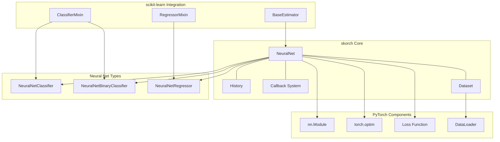
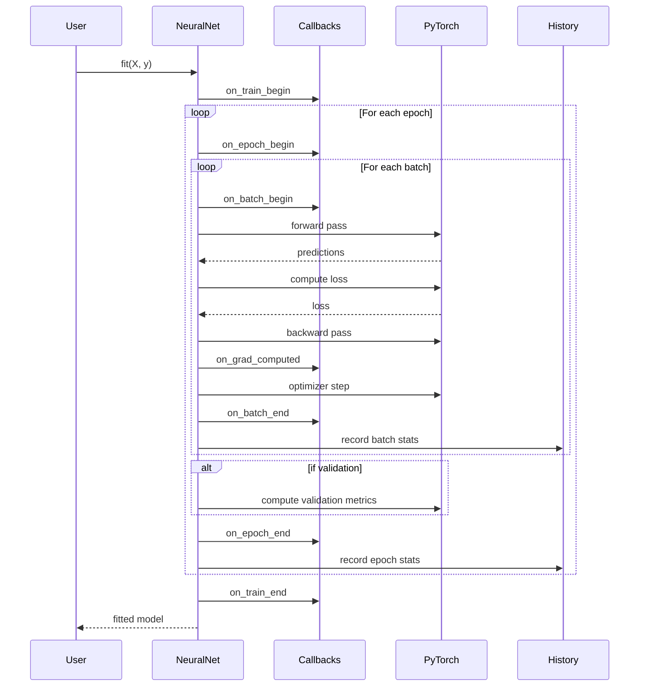
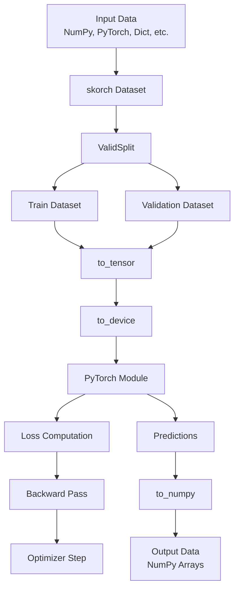
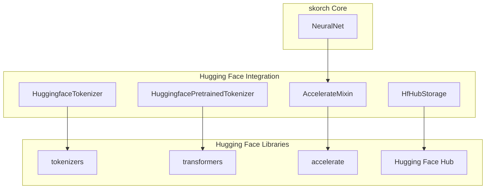

<!-- source: DeepWiki mcp.deepwiki.com · repo skorch-dev/skorch · page 1 Overview · fetched 2026-10-21 -->

# Overview

<details>
<summary>Relevant source files</summary>

The following files were used as context for generating this wiki page:

- [.github/workflows/testing.yml](.github/workflows/testing.yml)
- [CHANGES.md](CHANGES.md)
- [README.rst](README.rst)
- [docs/user/FAQ.rst](docs/user/FAQ.rst)
- [docs/user/callbacks.rst](docs/user/callbacks.rst)
- [docs/user/dataset.rst](docs/user/dataset.rst)
- [docs/user/installation.rst](docs/user/installation.rst)
- [docs/user/neuralnet.rst](docs/user/neuralnet.rst)

</details>


This page provides a comprehensive introduction to skorch, a Python library that bridges PyTorch and scikit-learn by providing a scikit-learn compatible interface for neural networks implemented in PyTorch. For detailed information about specific components, please refer to their respective pages in this wiki.

## What is skorch?

skorch is a high-level neural network library that wraps PyTorch models in a scikit-learn compatible API. It allows users to build, train, and evaluate PyTorch neural networks using familiar scikit-learn patterns and workflows, including integration with GridSearchCV, Pipelines, and other scikit-learn tools.

The library provides a seamless interface between PyTorch's flexibility in creating custom neural network architectures and scikit-learn's consistent API and wealth of utility functions for model selection, evaluation, and preprocessing.

Sources: [README.rst:8-8](), [setup.py:34-34]()

## Core Architecture

skorch is built around a central `NeuralNet` class which serves as the foundation for more specialized neural network implementations.

### Architecture Diagram



Sources: [CHANGES.md:28-28](), [README.rst:44-82]()

The diagram shows the core architecture of skorch. The central `NeuralNet` class inherits from scikit-learn's `BaseEstimator` and serves as the base for specialized classes like `NeuralNetClassifier`, `NeuralNetBinaryClassifier`, and `NeuralNetRegressor`. The `NeuralNet` class wraps PyTorch components (module, optimizer, criterion) and provides a scikit-learn compatible interface.

## Training and Callback Lifecycle

skorch implements a comprehensive training loop with well-defined lifecycle events where callbacks can be triggered.



Sources: [CHANGES.md:132-132](), [CHANGES.md:111-112]()

This diagram illustrates the training lifecycle in skorch and how callbacks integrate with it. When you call `fit()`, the process involves multiple nested loops over epochs and batches, with callback methods triggered at specific points to allow for customization of the training process.

## Key Features

### scikit-learn Compatibility

skorch is fully compatible with scikit-learn's ecosystem:

- Works seamlessly in scikit-learn pipelines
- Compatible with model selection tools like GridSearchCV
- Follows scikit-learn's fit/predict API pattern
- Inherits from scikit-learn's BaseEstimator

Sources: [README.rst:83-96](), [README.rst:98-114]()

### Rich Callback Ecosystem

```mermaid
graph TD
    subgraph "Callback Base"
        Callback["Callback"]
    end
    
    subgraph "Training Control"
        EarlyStopping["EarlyStopping"]
        Checkpoint["Checkpoint"]
        TrainEndCheckpoint["TrainEndCheckpoint"]
        LoadInitState["LoadInitState"]
        ParamMapper["ParamMapper"]
        Freezer["Freezer"]
        Unfreezer["Unfreezer"]
    end
    
    subgraph "Scoring & Metrics"
        EpochScoring["EpochScoring"]
        BatchScoring["BatchScoring"]
        PassthroughScoring["PassthroughScoring"]
    end
    
    subgraph "Learning Rate"
        LRScheduler["LRScheduler"]
        WarmRestartLR["WarmRestartLR"]
    end
    
    subgraph "Logging & Visualization"
        PrintLog["PrintLog"]
        ProgressBar["ProgressBar"]
        TensorBoard["TensorBoard"]
        NeptuneLogger["NeptuneLogger"]
        WandbLogger["WandbLogger"]
        MlflowLogger["MlflowLogger"]
        SacredLogger["SacredLogger"]
    end
    
    Callback --> EarlyStopping
    Callback --> Checkpoint
    Callback --> TrainEndCheckpoint
    Callback --> LoadInitState
    Callback --> ParamMapper
    ParamMapper --> Freezer
    ParamMapper --> Unfreezer
    
    Callback --> EpochScoring
    Callback --> BatchScoring
    Callback --> PassthroughScoring
    
    Callback --> LRScheduler
    
    Callback --> PrintLog
    Callback --> ProgressBar
    Callback --> TensorBoard
    Callback --> NeptuneLogger
    Callback --> WandbLogger
    Callback --> MlflowLogger
    Callback --> SacredLogger
```



Sources: [README.rst:119-128](), [CHANGES.md:123-124](), [CHANGES.md:119-121](), [CHANGES.md:146-147]()

skorch provides a rich ecosystem of callbacks that allow customizing various aspects of the training process:

- **Training Control**: Early stopping, checkpointing, parameter freezing/unfreezing
- **Scoring & Metrics**: Performance evaluation during training
- **Learning Rate**: Learning rate scheduling
- **Logging & Visualization**: Progress tracking and visualization

### Flexible Data Handling

skorch handles data conversion between different formats:



Sources: [CHANGES.md:177-179](), [CHANGES.md:112-112](), [CHANGES.md:657-658]()

The diagram shows how skorch handles data flow, including automatic conversion between NumPy arrays and PyTorch tensors, and support for various input data formats.

### Hugging Face Integration

skorch provides integration with the Hugging Face ecosystem for working with transformer models:



Sources: [README.rst:127-127](), [CHANGES.md:104-107]()

The diagram shows skorch's integration with Hugging Face's ecosystem, including support for tokenizers, transformers, and the accelerate library for advanced training capabilities.

## Version and Platform Support

skorch is compatible with:

- Python 3.9 or higher
- PyTorch - officially supports the last four minor versions:
  - 2.3.1
  - 2.4.1
  - 2.5.1
  - 2.6.0
- scikit-learn 0.22.0 or higher

Sources: [README.rst:133-133](), [README.rst:237-246](), [CHANGES.md:110-110]()

## Basic Usage Example

Here's a simple example demonstrating how to use skorch:

```python
import numpy as np
from sklearn.datasets import make_classification
from torch import nn
from skorch import NeuralNetClassifier

X, y = make_classification(1000, 20, n_informative=10, random_state=0)
X = X.astype(np.float32)
y = y.astype(np.int64)

class MyModule(nn.Module):
    def __init__(self, num_units=10, nonlin=nn.ReLU()):
        super().__init__()

        self.dense0 = nn.Linear(20, num_units)
        self.nonlin = nonlin
        self.dropout = nn.Dropout(0.5)
        self.dense1 = nn.Linear(num_units, num_units)
        self.output = nn.Linear(num_units, 2)
        self.softmax = nn.Softmax(dim=-1)

    def forward(self, X, **kwargs):
        X = self.nonlin(self.dense0(X))
        X = self.dropout(X)
        X = self.nonlin(self.dense1(X))
        X = self.softmax(self.output(X))
        return X

net = NeuralNetClassifier(
    MyModule,
    max_epochs=10,
    lr=0.1,
    # Shuffle training data on each epoch
    iterator_train__shuffle=True,
)

net.fit(X, y)
y_proba = net.predict_proba(X)
```

Sources: [README.rst:44-82]()

## Integration with scikit-learn Pipeline

skorch neural networks can be used in scikit-learn pipelines:

```python
from sklearn.pipeline import Pipeline
from sklearn.preprocessing import StandardScaler

pipe = Pipeline([
    ('scale', StandardScaler()),
    ('net', net),
])

pipe.fit(X, y)
y_proba = pipe.predict_proba(X)
```

Sources: [README.rst:83-96]()

## Grid Search with skorch

skorch models can be used with scikit-learn's GridSearchCV:

```python
from sklearn.model_selection import GridSearchCV

# deactivate skorch-internal train-valid split and verbose logging
net.set_params(train_split=False, verbose=0)
params = {
    'lr': [0.01, 0.02],
    'max_epochs': [10, 20],
    'module__num_units': [10, 20],
}
gs = GridSearchCV(net, params, refit=False, cv=3, scoring='accuracy', verbose=2)

gs.fit(X, y)
print("best score: {:.3f}, best params: {}".format(gs.best_score_, gs.best_params_))
```

Sources: [README.rst:98-114]()

## Further Resources

For more detailed information about specific components of skorch, please refer to their respective pages in this wiki:

- For detailed documentation on the NeuralNet class, see [NeuralNet Class](#2.1)
- For specialized neural network types, see [Neural Network Types](#2.2)
- For information about the callback system, see [Callback System](#3)
- For integration with other libraries, see [Integration & Extensions](#5)

---

