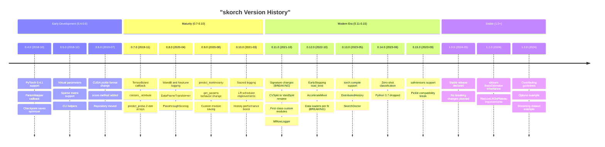

<!-- source: DeepWiki mcp.deepwiki.com · repo skorch-dev/skorch · page 10 Version History and Migration · fetched 2026-10-21 -->

# Version History and Migration

<details>
<summary>Relevant source files</summary>

The following files were used as context for generating this wiki page:

- [CHANGES.md](CHANGES.md)

</details>


This document provides a comprehensive overview of skorch's version history and migration guides for handling breaking changes between versions. It tracks major features, improvements, and API changes across releases to help users understand what changed and how to update their code when upgrading.

For information about the build system and versioning process, see [Build System and Deployment](#9.1). For contributing to future versions, see [Contributing Guidelines](#9.3).

---

## Version Timeline and Major Milestones

The following diagram illustrates the progression of skorch versions and their key milestones:



**Sources:** [CHANGES.md:1-389]()

---

## Breaking Changes Across Versions

The following diagram maps breaking changes to the versions where they were introduced:

```mermaid
graph TB
    subgraph "Version 1.x"
        v120["1.2.0<br/>No breaking changes"]
        v110["1.1.0<br/>Inherits from sklearn.base.BaseEstimator<br/>affects pickle compatibility"]
        v100["1.0.0<br/>Stable release<br/>No breaking changes"]
    end
    
    subgraph "Version 0.15.x"
        v015["0.15.0<br/>Cannot load pickles from 0.11<br/>Must re-pickle in 0.12-0.14"]
    end
    
    subgraph "Version 0.12-0.14"
        v014["0.14.0<br/>Python 3.7 dropped<br/>pkg_resources to importlib"]
        v013["0.13.0<br/>No breaking changes"]
        v012["0.12.0<br/>Data loaders per fit not per epoch<br/>sklearn >= 0.22.0 required"]
    end
    
    subgraph "Version 0.11.x"
        v011["0.11.0<br/>validation_step signature changed<br/>train_step_single signature changed<br/>CVSplit renamed to ValidSplit<br/>optimizer checking moved to initialize"]
    end
    
    subgraph "Version 0.9-0.10"
        v010["0.10.0<br/>No epoch param to LR schedulers"]
        v009["0.9.0<br/>get_params no longer returns module_<br/>CyclicLR removed from callbacks<br/>predict applies softmax for CrossEntropyLoss"]
    end
    
    subgraph "Version 0.7.x"
        v007["0.7.0<br/>predict_proba returns 2-dim array<br/>history is now a property"]
    end
    
    subgraph "Version 0.6.x"
        v006["0.6.0<br/>Pickle format changed for CUDA<br/>PyTorch >= 1.1.0 required"]
    end
    
    v120 --> v110
    v110 --> v100
    v100 --> v015
    v015 --> v014
    v014 --> v013
    v013 --> v012
    v012 --> v011
    v011 --> v010
    v010 --> v009
    v009 --> v007
    v007 --> v006
    
    style v011 stroke-width:3px
    style v009 stroke-width:3px
    style v012 stroke-width:3px
    style v015 stroke-width:3px
```



**Sources:** [CHANGES.md:1-389]()

---

## Version 1.x Series

### Version 1.2.0

**Added:**
- Contributing guidelines for the project
- Optuna hyperparameter optimization example
- Streaming dataset example
- `pyproject.toml` for improved CI/CD and tooling

**Changed:**
- Loading pickled nets now may trigger PyTorch warning about `weights_only=False`; re-pickle nets to avoid warning

**Fixed:**
- Implemented `__sklearn_is_fitted__` following sklearn custom model protocol

**Sources:** [CHANGES.md:18-32]()

---

### Version 1.1.0

**Added:**
- Learning Rate Scheduler notebook demonstrating usage
- Learning rate recording in history when using `ReduceLROnPlateau` (accessible via `net.history[:, 'event_lr']`)
- Support for stepping `ReduceLROnPlateau` per batch (not just per epoch)
- Step args support in LR scheduler `.simulate()` method

**Changed:**
- All neural net classes now inherit from `sklearn.base.BaseEstimator`, `ClassifierMixin`, or `RegressorMixin` for sklearn 1.6.0+ compatibility
- Removed deprecated `skorch.callbacks.scoring.cache_net_infer`

**Fixed:**
- Issue with using `NeuralNetBinaryClassifier` with `torch.compile`

**Migration Impact:**
The inheritance from sklearn base classes may affect pickle compatibility. See [Migration to 1.1.0+](#migration-to-110-sklearn-baseestimator) below.

**Sources:** [CHANGES.md:33-49]()

---

### Version 1.0.0 (May 27, 2024)

This release marks skorch as stable and production-ready. The core API is considered mature, and no breaking changes are planned for future releases. The focus going forward is maintaining compatibility with the latest PyTorch and scikit-learn versions and fixing bugs.

**Sources:** [CHANGES.md:50-52]()

---

## Version 0.x Series

### Version 0.15.0 (September 4, 2023)

**Added:**
- Global override for scoring callback caching via `use_caching` parameter on the net
- Support for saving/loading with [safetensors](https://github.com/huggingface/safetensors): `net.save_params(..., use_safetensors=True)` and `net.load_params(..., use_safetensors=True)`

**Changed:**
- **BREAKING:** Nets pickled with skorch 0.11 can no longer be loaded in 0.15; must re-pickle in versions 0.12-0.14 first

**Fixed:**
- Issues with `AccelerateMixin` in multi-GPU settings
- Installing with `[testing]` option now installs all dev requirements

**Sources:** [CHANGES.md:54-67]()

---

### Version 0.14.0 (June 24, 2023)

**Added:**
- Version logging to `NeptuneLogger` callback
- Support for zero-shot and few-shot classification with Large Language Models via Hugging Face transformers

**Changed:**
- **BREAKING:** Moved from `pkg_resources` to `importlib`, dropping Python 3.7 support (PyTorch also dropped 3.7)
- `NeuralNetRegressor` can now be fitted with 1-dimensional `y` (necessary for `BaggingRegressor` compatibility)

**Sources:** [CHANGES.md:68-82]()

---

### Version 0.13.0 (May 17, 2023)

**Added:**
- Support for `torch.compile` (PyTorch 2.0+) for performance optimization; enable with `compile=True` and configure with dunder notation (e.g., `compile__dynamic=True`)
- `DistributedHistory` class for multi-GPU training scenarios
- `SkorchDoctor` helper class for debugging neural net training
- Option to prevent unwrapping of modules when using `AccelerateMixin` via `unwrap_after_train=True`

**Fixed:**
- Install command compatibility with Google Colab
- Bugs related to non-default modules and criteria
- Bug in `AccelerateMixin` multi-GPU setup
- Module unwrapping issue at end of training with `AccelerateMixin`

**Sources:** [CHANGES.md:83-101]()

---

### Version 0.12.0 (October 7, 2022)

**Added:**
- `load_best` attribute to `EarlyStopping` for automatic best model loading
- `trim_for_prediction()` method to reduce net size for inference
- Experimental `AccelerateMixin` for Hugging Face Accelerate integration
- Hugging Face tokenizer integration via `skorch.hf.HuggingfaceTokenizer` and `skorch.hf.HuggingfacePretrainedTokenizer`
- `HfHubStorage` for creating checkpoints on Hugging Face Hub
- PyTorch Geometric notebook example

**Changed:**
- **BREAKING:** Minimum scikit-learn version bumped to 0.22.0
- **BREAKING:** Data loaders initialized once per fit call instead of once per epoch (see [migration guide](#migration-to-0120-data-loaders-per-fit))
- `np.asarray` can now be called with `SliceDataset`s

**Fixed:**
- Bug in `SliceDataset` preventing use with `to_numpy`
- Bug when loading net with `device=None`
- Loading nets trained with CUDA on CPU
- M1/M2 Apple MacBook compatibility

**Sources:** [CHANGES.md:112-132]()

---

### Version 0.11.0 (October 11, 2021)

**Added:**
- `load_best` attribute to `Checkpoint` callback
- `get_all_learnable_params()` method
- `MlflowLogger` callback
- `InputShapeSetter` callback
- Experimental Gaussian Processes support via GPyTorch

**Changed:**
- **BREAKING:** Signature of `validation_step`, `train_step_single`, `train_step`, `evaluation_step`, `on_batch_begin`, and `on_batch_end` changed to receive whole batch instead of `X` and `y` separately (see [migration guide](#migration-to-0110-signature-changes))
- **BREAKING:** Argument checking moved from `__init__` to `.initialize()`
- **BREAKING:** Custom modules, criteria, and optimizers are now first-class (automatically registered and managed)
- **BREAKING:** `CVSplit` renamed to `ValidSplit`

**Fixed:**
- Bugs in `net.history` implementation
- Bug in `TrainEndCheckpoint` preventing unpickling

**Sources:** [CHANGES.md:133-154]()

---

### Version 0.10.0 (March 23, 2021)

**Added:**
- `SacredLogger` callback
- CLI helper function support for non-skorch sklearn estimators
- Support for disabling all callbacks
- Correct value monitoring in `LRScheduler` for `ReduceLROnPlateau`

**Changed:**
- **BREAKING:** No longer pass `epoch` parameter to LR schedulers (deprecated in PyTorch)
- Faster `net.history` access implementation

**Sources:** [CHANGES.md:155-171]()

---

### Version 0.9.0 (August 30, 2020)

**Added:**
- `event_name` argument for `LRScheduler` to record LR changes in history (PyTorch >= 1.4)
- Automatic registration of custom modules/optimizers
- `step_every` argument for `LRScheduler`
- `loss_scoring` function in scoring module
- `predict_nonlinearity` parameter to control nonlinearity for predict/predict_proba
- Saving criterion and custom modules with checkpoints

**Changed:**
- **BREAKING:** Removed `batch_step()` method support in `LRScheduler`
- **BREAKING:** `net.get_params()` no longer returns learned attributes like `module_`; use `copy.deepcopy` for fitted net copies
- **BREAKING:** `CyclicLR` default changed from step per batch to step per epoch
- Set train/validation mode on criterion if it's a PyTorch module
- Don't pass `y=None` to `NeuralNet.train_split`
- `to_numpy` can now unpack dicts and lists/tuples
- **BREAKING:** `predict`/`predict_proba` automatically apply softmax when using `CrossEntropyLoss`

**Fixed:**
- `CyclicLR` updating during both training and validation
- LBFGS optimizer compatibility
- `ProgressBar` callback pickling
- `ReduceLROnPlateau` with `mode == max`
- Disconnected weights after `copy.deepcopy`
- Loading CUDA models configured for CPU

**Sources:** [CHANGES.md:172-200]()

---

### Version 0.8.0 (April 11, 2020)

**Added:**
- `NeptuneLogger` callback
- `DataFrameTransformer` for pandas DataFrame compatibility
- `WandbLogger` callback for Weights & Biases
- `None` option for `device` parameter
- `PassthroughScoring` callback for batch-level metrics

**Changed:**
- Optimized scoring callbacks when using caching
- Cleaned up duplicate code in fit loop

**Fixed:**
- sklearn 0.22 compatibility
- Bug with settable attribute name conflicts

**Sources:** [CHANGES.md:201-224]()

---

### Version 0.7.0 (November 29, 2019)

**Added:**
- More careful parameter name checking
- Better error messages for uninitialized models
- `TensorBoard` callback
- `NeuralNetBinaryClassifier` compatibility with `CalibratedClassifierCV`
- Automatic output squeezing in `NeuralNetBinaryClassifier`
- `classes_` attribute on `NeuralNetClassifier` after fit
- `NeuralNet.load_params` with checkpoint initialization

**Changed:**
- Improved numerical stability with `NLLLoss` in `NeuralNetClassifier`
- Refactored for easier gradient accumulation
- **BREAKING:** `NeuralNetBinaryClassifier.predict_proba` returns 2-dim array; access old behavior via `y_proba[:, 1]`
- `net.history` is now a property accessing `net.history_`
- Removed deprecated `skorch.callbacks.CyclicLR`

**Fixed:**
- Bug with `LoadInitState` and `TrainEndCheckpoint`
- Bug with batch dimension squeezing when `batch_size=1`

**Sources:** [CHANGES.md:225-254]()

---

### Version 0.6.0 (July 19, 2019)

**Added:**
- FAQ entry on initialization behavior
- CUDA pickle test with artifact
- `train_batch_count` and `valid_batch_count` in history
- Score method for classifier and regressor classes
- Wrapper class for torch Datasets for sklearn compatibility

**Changed:**
- Repository moved to https://github.com/skorch-dev/skorch/
- **BREAKING:** Improved CUDA-dependent attribute handling
- **BREAKING:** Pickle format changed for CUDA compatibility (must re-pickle old models)
- **BREAKING:** PyTorch >= 1.1.0 now required
- `net.criterion_` and parameters moved to target device automatically

**Fixed:**
- Requirements in MANIFEST.in
- `criterion_` added to `cuda_dependent_attributes_`
- `TrainEndCheckpoint` cloning

**Sources:** [CHANGES.md:256-282]()

---

### Version 0.5.0 (December 13, 2018)

**Added:**
- Google Colab support for notebooks
- Better user-facing messages for re-initialization
- Experimental virtual parameters API (`net._register_virtual_param`)
- Support for setting `lr`, `momentum` without resetting optimizer
- Scipy sparse CSR matrix support
- CLI helper functions

**Changed:**
- Reduced overhead of `BatchScoring` with loss scores
- Reduced overhead of `on_grad_computed` callback
- Default `fn_prefix` in `TrainEndCheckpoint` changed to `train_end_`
- Warning when `Checkpoint.monitor` conflicts with history

**Fixed:**
- Optimizer re-initialization with `lr` argument
- `SliceDict` copying now returns `SliceDict`
- `SliceDict` equality with numpy arrays and torch tensors

**Sources:** [CHANGES.md:284-320]()

---

### Version 0.4.0 (October 24, 2018)

**Added:**
- PyTorch 0.4.1 support
- Automatic callback naming
- Training data access in `on_grad_computed` event
- Image segmentation example
- Toy network creation via `skorch.toy.make_classifier`
- `ParamMapper` callback (including `Freezer`/`Unfreezer`)
- Refactored `EpochScoring` for easier subclassing
- Optimizer saving in `Checkpoint` callback
- `LoadInitState` callback
- Checkpoint loading support in `NeuralNetwork.load_params`
- Saving and loading documentation

**Changed:**
- `ProgressBar` automatic batches per epoch determination
- `on_grad_computed` access to current batch

**Deprecated:**
- `filtered_optimizer` in favor of `Freezer`
- `f` parameter in `load_params`/`save_params` for more specific parameters

**Fixed:**
- `uses_placeholder_y` requirement for `y` field
- LR scheduler batch index creation
- Python 3.5 compatibility with callbacks
- `to_tensor` with `PackedSequence`
- History recursion causing memory leaks
- `ReduceLROnPlateau` with `mode == max`
- Weight disconnection after `copy.deepcopy`
- Loading CUDA models configured for CPU

**Sources:** [CHANGES.md:322-371]()

---

## Migration Guides

### Migration to 1.1.0+ (sklearn BaseEstimator)

**Issue:** Starting from version 1.1.0, all skorch neural net classes inherit from sklearn's base classes (`BaseEstimator`, `ClassifierMixin`, `RegressorMixin`).

**Impact:**
- Pickle compatibility may be affected
- More native sklearn integration

**Migration Steps:**

1. **Re-pickle models if needed:** If you have pickled models from earlier versions, they should still work, but re-pickling is recommended for best compatibility.

2. **Leverage new sklearn features:** Your skorch models now have full sklearn compatibility:
   ```python
   from skorch import NeuralNetClassifier
   from sklearn.base import clone
   
   net = NeuralNetClassifier(module)
   net.fit(X, y)
   
   # Now works seamlessly
   cloned_net = clone(net)
   ```

3. **Update custom classes:** If you have custom net classes, ensure they properly call parent `__init__`:
   ```python
   class MyNet(NeuralNetClassifier):
       def __init__(self, module, **kwargs):
           super().__init__(module, **kwargs)
   ```

**Sources:** [CHANGES.md:33-49]()

---

### Migration to 0.15.0 (Pickle Compatibility)

**Issue:** Nets pickled with skorch 0.11 cannot be loaded in version 0.15.

**Migration Steps:**

1. **If you have pickled nets from 0.11:** Load them in a version between 0.12 and 0.14, then re-pickle:
   ```python
   # In environment with skorch 0.12-0.14
   import pickle
   
   with open('old_model_011.pkl', 'rb') as f:
       net = pickle.load(f)
   
   with open('model_compatible.pkl', 'wb') as f:
       pickle.dump(net, f)
   ```

2. **Consider using safetensors:** For better compatibility and security:
   ```python
   # Save with safetensors (requires safetensors library)
   net.save_params('model.safetensors', use_safetensors=True)
   
   # Load
   net.load_params('model.safetensors', use_safetensors=True)
   ```

**Sources:** [CHANGES.md:54-67]()

---

### Migration to 0.12.0 (Data Loaders Per Fit)

**Issue:** Data loaders are now initialized once per fit call instead of once per epoch.

**Impact:** If you have custom logic that depends on data loaders being recreated every epoch, it will need adjustment.

**Migration Steps:**

1. **Review custom dataset logic:** Check if your code assumes fresh data loaders each epoch:
   ```python
   # OLD behavior: DataLoader created each epoch
   # NEW behavior: DataLoader created once during fit
   ```

2. **For epoch-specific sampling:** If you need different sampling per epoch, implement this in your Dataset's `__getitem__`:
   ```python
   class MyDataset(torch.utils.data.Dataset):
       def __init__(self, X, y):
           self.X = X
           self.y = y
           self.epoch = 0
       
       def __getitem__(self, idx):
           # Custom per-epoch logic here
           return self.X[idx], self.y[idx]
   ```

3. **For dynamic data:** If data changes between epochs, ensure your Dataset reflects this:
   ```python
   class DynamicDataset(torch.utils.data.Dataset):
       def __getitem__(self, idx):
           # Fetch fresh data each time
           return self.load_fresh_data(idx)
   ```

**Reference:** See [migration guide in docs](https://skorch.readthedocs.io/en/stable/user/FAQ.html#migration-from-0-11-to-0-12)

**Sources:** [CHANGES.md:112-132]()

---

### Migration to 0.11.0 (Signature Changes)

**Issue:** Method signatures changed from receiving `X, y` to receiving `batch`.

**Methods affected:**
- `validation_step`
- `train_step_single`
- `train_step`
- `evaluation_step`
- `on_batch_begin`
- `on_batch_end`

**Migration Steps:**

1. **Update callback signatures:** If you have custom callbacks:
   ```python
   # OLD (0.10.0 and earlier)
   class MyCallback(Callback):
       def on_batch_begin(self, net, X=None, y=None, training=False, **kwargs):
           # Use X and y directly
           pass
   
   # NEW (0.11.0+)
   class MyCallback(Callback):
       def on_batch_begin(self, net, batch=None, training=False, **kwargs):
           # Unpack batch
           X, y = batch
           pass
   ```

2. **Update custom step methods:**
   ```python
   # OLD
   def validation_step(self, X, y, **fit_params):
       y_pred = self.infer(X, **fit_params)
       return self.get_loss(y_pred, y, X=X, training=False)
   
   # NEW
   def validation_step(self, batch, **fit_params):
       X, y = batch
       y_pred = self.infer(X, **fit_params)
       return self.get_loss(y_pred, y, X=X, training=False)
   ```

3. **Handle non-tuple datasets:** This change makes it easier to work with datasets that don't return `(X, y)`:
   ```python
   # Now works seamlessly
   class CustomDataset(torch.utils.data.Dataset):
       def __getitem__(self, idx):
           return {'input': X[idx], 'target': y[idx], 'meta': meta[idx]}
   
   class MyCallback(Callback):
       def on_batch_begin(self, net, batch=None, **kwargs):
           # batch is the dict directly
           input_data = batch['input']
   ```

4. **Rename CVSplit to ValidSplit:**
   ```python
   # OLD
   from skorch.helper import CVSplit
   net = NeuralNet(module, train_split=CVSplit(0.2))
   
   # NEW
   from skorch.dataset import ValidSplit
   net = NeuralNet(module, train_split=ValidSplit(0.2))
   ```

**Reference:** See [migration guide in docs](https://skorch.readthedocs.io/en/latest/user/FAQ.html#migration-from-0-10-to-0-11)

**Sources:** [CHANGES.md:133-154]()

---

### Migration to 0.9.0 (get_params Changes)

**Issue:** `net.get_params()` no longer returns learned attributes like `module_`.

**Impact:** Functions like `sklearn.base.clone` will return uninitialized nets instead of fitted nets when called with fitted nets.

**Migration Steps:**

1. **For cloning fitted nets:** Use `copy.deepcopy` instead of `sklearn.base.clone`:
   ```python
   import copy
   from sklearn.base import clone
   
   net = NeuralNetClassifier(module).fit(X, y)
   
   # OLD: This returned a fitted net (no longer works)
   # cloned_fitted = clone(net)
   
   # NEW: Use deepcopy for fitted nets
   cloned_fitted = copy.deepcopy(net)
   
   # clone() now returns uninitialized net (as intended by sklearn)
   cloned_uninitialized = clone(net)
   ```

2. **For accessing learned attributes:** Access them directly, not through `get_params()`:
   ```python
   # Correct way to access fitted attributes
   module = net.module_
   optimizer = net.optimizer_
   history = net.history_
   
   # get_params() only returns constructor parameters
   params = net.get_params()  # Returns initial params, not fitted state
   ```

3. **Update GridSearchCV usage:** This change ensures correct behavior:
   ```python
   from sklearn.model_selection import GridSearchCV
   
   # GridSearchCV will now correctly create fresh model copies
   # for each hyperparameter combination
   gs = GridSearchCV(
       NeuralNetClassifier(module),
       param_grid={'lr': [0.01, 0.001]},
   )
   gs.fit(X, y)
   ```

**Sources:** [CHANGES.md:172-200]()

---

### Migration to 0.7.0 (predict_proba Changes)

**Issue:** `NeuralNetBinaryClassifier.predict_proba` now returns 2-dimensional arrays instead of 1-dimensional.

**Migration Steps:**

1. **Update code expecting 1-D arrays:**
   ```python
   net = NeuralNetBinaryClassifier(module).fit(X, y)
   y_proba = net.predict_proba(X_test)
   
   # OLD: y_proba was 1-D array with positive class probabilities
   # positive_proba = y_proba
   
   # NEW: y_proba is 2-D array with both class probabilities
   negative_proba = y_proba[:, 0]  # Probability of class 0
   positive_proba = y_proba[:, 1]  # Probability of class 1
   ```

2. **Update threshold-based predictions:**
   ```python
   # OLD
   predictions = (y_proba > 0.5).astype(int)
   
   # NEW
   predictions = (y_proba[:, 1] > 0.5).astype(int)
   ```

3. **Benefit:** Now consistent with sklearn's binary classifier interface:
   ```python
   from sklearn.metrics import roc_auc_score
   
   # Works seamlessly with sklearn metrics
   roc_auc = roc_auc_score(y_true, y_proba[:, 1])
   ```

**Sources:** [CHANGES.md:225-254]()

---

### Migration to 0.6.0 (CUDA Pickle Changes)

**Issue:** Pickle format changed for better CUDA compatibility. Models pickled with earlier versions may not load correctly.

**Migration Steps:**

1. **Re-pickle old models:**
   ```python
   # Load old model in 0.5.0 environment
   with open('old_model.pkl', 'rb') as f:
       net = pickle.load(f)
   
   # Save in 0.6.0+ environment
   with open('new_model.pkl', 'wb') as f:
       pickle.dump(net, f)
   ```

2. **CUDA-dependent attributes:** Now automatically handled:
   ```python
   # Criterion weights are now automatically moved to device
   criterion = torch.nn.NLLLoss(weight=class_weights)
   net = NeuralNetClassifier(
       module,
       criterion=criterion,
       device='cuda',
   )
   # class_weights automatically moved to CUDA
   ```

3. **PyTorch version requirement:** Ensure PyTorch >= 1.1.0:
   ```bash
   pip install torch>=1.1.0
   ```

**Sources:** [CHANGES.md:256-282]()

---

## Version Compatibility Matrix

The following table summarizes key compatibility requirements across versions:

| Version | Python | PyTorch | scikit-learn | Key Notes |
|---------|--------|---------|--------------|-----------|
| 1.2.0+ | 3.8+ | Any | Any | Current stable |
| 1.1.0+ | 3.8+ | Any | 1.6.0+ | BaseEstimator inheritance |
| 1.0.0 | 3.8+ | Any | Any | Stable release |
| 0.15.0 | 3.8+ | Any | Any | safetensors support |
| 0.14.0 | 3.8+ | Any | Any | Python 3.7 dropped |
| 0.13.0 | 3.7-3.11 | 2.0+ | Any | torch.compile support |
| 0.12.0 | 3.7-3.11 | Any | 0.22.0+ | sklearn minimum raised |
| 0.11.0 | 3.6-3.9 | Any | Any | Signature changes |
| 0.10.0 | 3.6-3.9 | Any | Any | LR scheduler epoch removed |
| 0.9.0 | 3.6-3.9 | Any | Any | get_params changed |
| 0.6.0-0.8.0 | 3.5-3.8 | 1.1.0+ | Any | Pickle format changed |
| 0.4.0-0.5.0 | 3.5-3.8 | 0.4.1+ | Any | Early stable versions |

**Sources:** [CHANGES.md:1-389]()

---

## Component Evolution Diagram

The following diagram shows how key components evolved across major versions:

```mermaid
graph TB
    subgraph "NeuralNet Evolution"
        nn_v04["v0.4.0<br/>NeuralNet<br/>+ Checkpoint saves optimizer<br/>+ LoadInitState"]
        nn_v09["v0.9.0<br/>NeuralNet<br/>+ predict_nonlinearity<br/>+ Custom module saving<br/>BREAKING: get_params"]
        nn_v011["v0.11.0<br/>NeuralNet<br/>BREAKING: batch signatures<br/>+ First-class custom modules<br/>+ Checking in initialize"]
        nn_v012["v0.12.0<br/>NeuralNet<br/>+ trim_for_prediction<br/>BREAKING: DataLoaders per fit"]
        nn_v013["v0.13.0<br/>NeuralNet<br/>+ torch.compile support<br/>+ compile parameter"]
        nn_v110["v1.1.0<br/>NeuralNet<br/>+ sklearn BaseEstimator<br/>+ ClassifierMixin/RegressorMixin"]
    end
    
    subgraph "Callback Evolution"
        cb_v04["v0.4.0<br/>Callbacks<br/>+ ParamMapper<br/>+ Freezer/Unfreezer<br/>+ Automatic naming"]
        cb_v07["v0.7.0<br/>Callbacks<br/>+ TensorBoard"]
        cb_v08["v0.8.0<br/>Callbacks<br/>+ WandbLogger<br/>+ NeptuneLogger<br/>+ PassthroughScoring"]
        cb_v010["v0.10.0<br/>Callbacks<br/>+ SacredLogger"]
        cb_v011["v0.11.0<br/>Callbacks<br/>+ MlflowLogger<br/>+ InputShapeSetter"]
        cb_v012["v0.12.0<br/>Callbacks<br/>+ EarlyStopping.load_best<br/>+ Checkpoint.load_best"]
    end
    
    subgraph "Data Handling Evolution"
        data_v05["v0.5.0<br/>Data<br/>+ Sparse matrices"]
        data_v08["v0.8.0<br/>Data<br/>+ DataFrameTransformer"]
        data_v011["v0.11.0<br/>Data<br/>BREAKING: CVSplit to ValidSplit"]
        data_v012["v0.12.0<br/>Data<br/>+ SliceDataset with np.asarray"]
    end
    
    subgraph "Integration Evolution"
        int_v012["v0.12.0<br/>Integrations<br/>+ AccelerateMixin<br/>+ HuggingFace tokenizers<br/>+ HfHubStorage"]
        int_v013["v0.13.0<br/>Integrations<br/>+ DistributedHistory<br/>+ SkorchDoctor"]
        int_v014["v0.14.0<br/>Integrations<br/>+ LLM zero/few-shot"]
        int_v015["v0.15.0<br/>Integrations<br/>+ safetensors"]
    end
    
    nn_v04 --> nn_v09
    nn_v09 --> nn_v011
    nn_v011 --> nn_v012
    nn_v012 --> nn_v013
    nn_v013 --> nn_v110
    
    cb_v04 --> cb_v07
    cb_v07 --> cb_v08
    cb_v08 --> cb_v010
    cb_v010 --> cb_v011
    cb_v011 --> cb_v012
    
    data_v05 --> data_v08
    data_v08 --> data_v011
    data_v011 --> data_v012
    
    int_v012 --> int_v013
    int_v013 --> int_v014
    int_v014 --> int_v015
```



**Sources:** [CHANGES.md:1-389]()

---

## Summary of Key Breaking Changes

| Version | Change | Component | Migration Effort |
|---------|--------|-----------|------------------|
| 0.11.0 | Signature: `X, y` → `batch` | Methods: `validation_step`, `train_step_single`, etc. | Medium |
| 0.11.0 | `CVSplit` → `ValidSplit` | Dataset splitting | Low |
| 0.11.0 | Custom modules first-class | Module registration | Low |
| 0.9.0 | `get_params()` excludes `module_` | Parameter access | Low |
| 0.9.0 | Automatic softmax for `CrossEntropyLoss` | Prediction | Low |
| 0.7.0 | `predict_proba` returns 2-D array | Binary classification | Low |
| 0.6.0 | Pickle format changed | Serialization | Medium |
| 0.12.0 | DataLoaders once per fit | Data loading | Low |
| 0.15.0 | Cannot load 0.11 pickles | Serialization | Medium |
| 1.1.0 | Inherits sklearn base classes | Class hierarchy | Low |

**Sources:** [CHANGES.md:1-389]()

---

