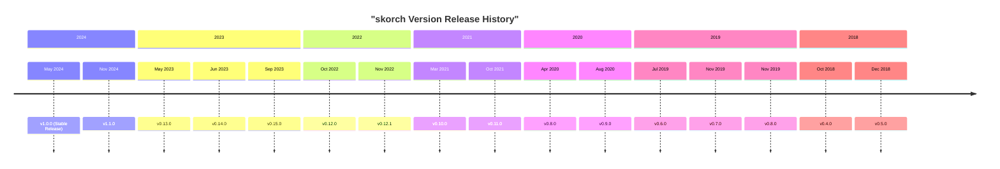
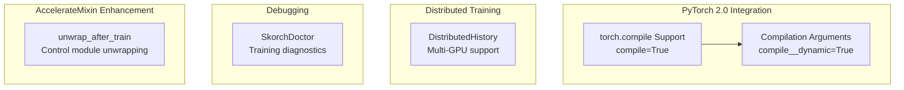
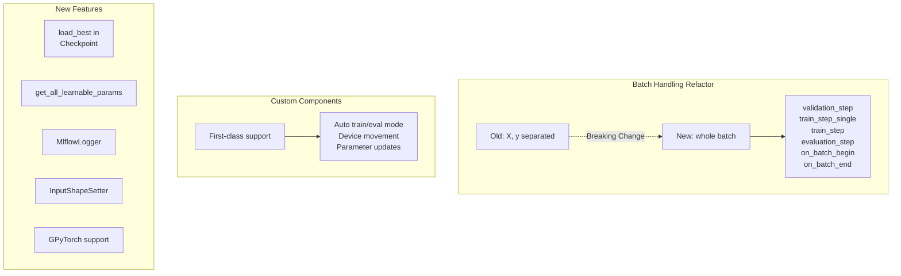
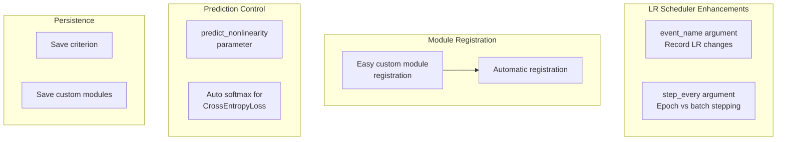
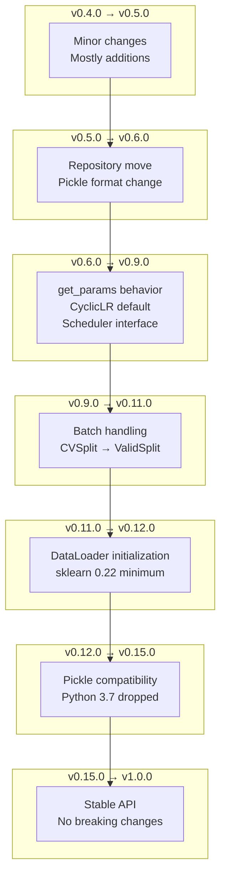

<!-- source: DeepWiki mcp.deepwiki.com · repo skorch-dev/skorch · page 10.1 Major Changes by Version · fetched 2026-10-21 -->

# Major Changes by Version

Relevant source files

The following files were used as context for generating this wiki page:

- [CHANGES.md](CHANGES.md)

## Purpose and Scope

This page documents the major changes, additions, and fixes in each version of skorch, organized chronologically from most recent to oldest. Each version section highlights key features added, important behavioral changes, bug fixes, and deprecations. This information is sourced from the project's changelog and provides a high-level overview of skorch's evolution.

For detailed guidance on migrating between major versions, including handling breaking changes, see [Migration Guides](#10.2). For information about the build system and versioning process, see [Build System and Deployment](#9.1).

## Version Release Timeline

**Sources:** [CHANGES.md:1-389]()

## Feature Evolution by Category

```mermaid
graph LR
    subgraph "Core Infrastructure"
        v04["v0.4.0<br/>PyTorch 0.4.1"]
        v06["v0.6.0<br/>PyTorch >= 1.1.0"]
        v10["v1.0.0<br/>Stable API"]
        v04 --> v06
        v06 --> v10
    end
    
    subgraph "sklearn Integration"
        v07["v0.7.0<br/>classes_ attribute"]
        v09["v0.9.0<br/>get_params refactor"]
        v11["v1.1.0<br/>BaseEstimator"]
        v07 --> v09
        v09 --> v11
    end
    
    subgraph "Callbacks & Training"
        v04b["v0.4.0<br/>ParamMapper"]
        v08["v0.8.0<br/>PassthroughScoring"]
        v012["v0.12.0<br/>load_best in<br/>EarlyStopping"]
        v04b --> v08
        v08 --> v012
    end
    
    subgraph "Persistence"
        v04c["v0.4.0<br/>Checkpoint with<br/>optimizer"]
        v015["v0.15.0<br/>safetensors<br/>support"]
        v04c --> v015
    end
    
    subgraph "Advanced Features"
        v012b["v0.12.0<br/>AccelerateMixin"]
        v013["v0.13.0<br/>torch.compile"]
        v014["v0.14.0<br/>LLM support"]
        v012b --> v013
        v013 --> v014
    end
    
    subgraph "ML Platform Integration"
        v011["v0.11.0<br/>MlflowLogger"]
        v08b["v0.8.0<br/>WandbLogger<br/>NeptuneLogger"]
        v010["v0.10.0<br/>SacredLogger"]
        v08b --> v010
        v010 --> v011
    end
```

**Sources:** [CHANGES.md:1-389]()

## Version 1.2.0 (Unreleased)

Current development version with the following changes:

### Added
- Contributing Guidelines for skorch ([CHANGES.md:22]())
- Example for hyper-parameter optimization using Optuna ([CHANGES.md:23]())
- Example for Streaming Dataset ([CHANGES.md:24]())
- `pyproject.toml` to improve CI/CD and tooling ([CHANGES.md:25]())

### Changed
- Loading skorch nets using pickle now triggers a PyTorch warning about `weights_only=False`; re-pickling the net will avoid this warning ([CHANGES.md:29]())

### Fixed
- Implemented `__sklearn_is_fitted__` for skorch models, following sklearn custom model protocol ([CHANGES.md:16]())

**Sources:** [CHANGES.md:8-17](), [CHANGES.md:18-32]()

## Version 1.1.0 (2024)

### Added
| Feature | Description | Reference |
|---------|-------------|-----------|
| Learning Rate Scheduler Notebook | Shows how to use learning rate schedulers in skorch | [CHANGES.md:37]() |

### Changed
| Change | Description | Impact | Reference |
|--------|-------------|--------|-----------|
| sklearn Inheritance | All neural net classes now inherit from `BaseEstimator`; classifiers inherit from `ClassifierMixin`, regressors from `RegressorMixin` | Required for sklearn 1.6.0+ compatibility | [CHANGES.md:41]() |
| LR Recording for ReduceLROnPlateau | Learning rate changes are now recorded in `net.history[:, 'event_lr']`; can now step per batch | Better tracking of LR changes | [CHANGES.md:42]() |
| LR Scheduler Simulation | `.simulate()` method now supports step args for policies like `ReduceLROnPlateau` | More accurate simulations | [CHANGES.md:43]() |
| Deprecated Code Removal | Removed deprecated `skorch.callbacks.scoring.cache_net_infer` | Breaking change for legacy code | [CHANGES.md:44]() |

### Fixed
- Issue with using `NeuralNetBinaryClassifier` with `torch.compile` ([CHANGES.md:48]())

**Sources:** [CHANGES.md:33-49]()

## Version 1.0.0 (2024-05-27)

Stable release marking skorch as feature-complete. The development philosophy going forward focuses on:
- Maintaining compatibility with latest PyTorch and scikit-learn versions
- Bug fixes and stability improvements
- No planned breaking changes or major API revisions

**Sources:** [CHANGES.md:50-52]()

## Version 0.15.0 (2023-09-04)

### Added
| Feature | Description | Code Reference |
|---------|-------------|----------------|
| Global Caching Override | Set `use_caching` argument on net to override individual callback settings | Scoring callbacks |
| safetensors Support | Save and load parameters using safetensors format with `use_safetensors=True` | `net.save_params()`, `net.load_params()` |

### Changed
- **Breaking:** Nets pickled with skorch 0.11 can no longer be loaded in 0.15; transition through versions 0.12-0.14 ([CHANGES.md:61]())

### Fixed
- Multiple issues with `AccelerateMixin` in multi-GPU settings ([CHANGES.md:65]())
- Installing with `[testing]` option now installs all dev requirements ([CHANGES.md:66]())

**Sources:** [CHANGES.md:54-67]()

## Version 0.14.0 (2023-06-24)

### Added
| Feature | Description | Reference |
|---------|-------------|-----------|
| Neptune Version Logging | `NeptuneLogger` now logs version information | [CHANGES.md:72]() |
| Zero-shot Classification | Support for zero-shot and few-shot classification with LLMs and Hugging Face transformers | [CHANGES.md:73]() |

### Changed
- Dropped support for Python 3.7 after moving from `pkg_resources` to `importlib` ([CHANGES.md:76-77]())
- `NeuralNetRegressor` can now accept 1-dimensional `y` (necessary for `BaggingRegressor` compatibility) ([CHANGES.md:79]())

**Sources:** [CHANGES.md:68-82]()

## Version 0.13.0 (2023-05-17)

### Major New Features

### Added
| Feature | Description | Reference |
|---------|-------------|-----------|
| `torch.compile` Support | Compile PyTorch modules for improved performance on new GPU architectures using `compile=True` | [CHANGES.md:86]() |
| `DistributedHistory` | Class for use in multi-GPU training scenarios | [CHANGES.md:87]() |
| `SkorchDoctor` | Helper class for understanding and debugging neural net training | [CHANGES.md:88]() |
| `unwrap_after_train` | Control unwrapping behavior when using `AccelerateMixin` | [CHANGES.md:89]() |

### Fixed
- Multiple bugs with `AccelerateMixin` in multi-GPU setups ([CHANGES.md:96](), [CHANGES.md:100]())
- Issues with non-default modules and criteria ([CHANGES.md:95]())
- `_get_param_names` now returns list instead of generator for better error messages ([CHANGES.md:97-99]())

**Sources:** [CHANGES.md:83-101]()

## Version 0.12.0 (2022-10-07)

Major release with extensive new features for model management and distributed training.

### Key Additions

| Category | Features | Reference |
|----------|----------|-----------|
| Training Control | `load_best` attribute in `EarlyStopping` to auto-load best weights | [CHANGES.md:115]() |
| Model Trimming | `trim_for_prediction()` method to reduce net size after training | [CHANGES.md:116]() |
| Distributed Training | Experimental `AccelerateMixin` for Hugging Face accelerate integration | [CHANGES.md:117]() |
| Tokenizers | `HuggingfaceTokenizer` and `HuggingfacePretrainedTokenizer` | [CHANGES.md:118]() |
| Persistence | `HfHubStorage` for checkpoints on Hugging Face Hub | [CHANGES.md:119]() |
| Examples | PyTorch Geometric notebook | [CHANGES.md:120]() |

### Changed
- **Breaking:** Minimum scikit-learn version bumped to 0.22.0 ([CHANGES.md:123]())
- **Breaking:** Data loaders initialized once per fit call instead of per epoch ([CHANGES.md:124]())

### Fixed
- `SliceDataset` can now be used with `np.asarray` and `to_numpy` ([CHANGES.md:128]())
- Loading nets with `device=None` ([CHANGES.md:129]())
- M1/M2 Apple MacBook compatibility ([CHANGES.md:131]())

**Sources:** [CHANGES.md:112-132]()

## Version 0.11.0 (2021-10-11)

### Major Changes

This version introduced significant changes to batch handling and first-class support for custom components.

### Added
| Feature | Description | Reference |
|---------|-------------|-----------|
| `load_best` in Checkpoint | Auto-load best checkpoint at training end | [CHANGES.md:137]() |
| `get_all_learnable_params` | Retrieve named parameters from all PyTorch modules | [CHANGES.md:138]() |
| `MlflowLogger` | Logging callback for MLflow | [CHANGES.md:139]() |
| `InputShapeSetter` | Automatically set input dimension of PyTorch module | [CHANGES.md:140]() |
| GPyTorch Support | Experimental Gaussian Processes support | [CHANGES.md:141]() |

### Changed
- **Breaking:** Batch handling methods now receive whole batch instead of separated `X` and `y` ([CHANGES.md:145]())
- Argument checking moved from `__init__` to `.initialize()` ([CHANGES.md:146]())
- Custom modules, criteria, and optimizers are now first-class citizens ([CHANGES.md:147]())
- `CVSplit` renamed to `ValidSplit` ([CHANGES.md:148]())

### Fixed
- Multiple bugs in `net.history` implementation ([CHANGES.md:152]())
- `TrainEndCheckpoint` unpickling issue ([CHANGES.md:153]())

**Sources:** [CHANGES.md:133-154]()

## Version 0.10.0 (2021-03-23)

### Added
| Feature | Description | Reference |
|---------|-------------|-----------|
| `SacredLogger` | Logging callback for Sacred | [CHANGES.md:159]() |
| CLI Helper | Support for non-skorch sklearn estimators | [CHANGES.md:160]() |
| Callback Disabling | Disable all callbacks to reduce overhead | [CHANGES.md:161-162]() |
| ReduceLROnPlateau Fix | Correctly passes monitored value to scheduler | [CHANGES.md:163]() |

### Changed
- No longer pass `epoch` parameter to LR schedulers (deprecated in PyTorch) ([CHANGES.md:167]())
- Faster `net.history` access implementation ([CHANGES.md:168]())

**Sources:** [CHANGES.md:155-171]()

## Version 0.9.0 (2020-08-30)

### Key Changes

### Added
| Feature | Description | Reference |
|---------|-------------|-----------|
| LR Event Recording | `event_name` argument to record LR changes in history | [CHANGES.md:176]() |
| Custom Module Registration | Easier addition of custom modules/optimizers | [CHANGES.md:177]() |
| `step_every` for LRScheduler | Control stepping per epoch or batch | [CHANGES.md:178]() |
| `loss_scoring` Function | Compute net's loss on input data | [CHANGES.md:179]() |
| `predict_nonlinearity` | Control nonlinearity for predict/predict_proba | [CHANGES.md:180]() |
| Criterion Persistence | Save criterion with checkpoints | [CHANGES.md:181-182]() |

### Changed
- **Breaking:** Removed support for schedulers with `batch_step()` method ([CHANGES.md:186]())
- `net.get_params()` no longer returns learned attributes like `module_` ([CHANGES.md:188]())
- `CyclicLR` default changed from batch stepping to epoch stepping ([CHANGES.md:189]())
- Criterion set to train/validation mode if it's a PyTorch module ([CHANGES.md:190]())
- Auto-apply softmax when using `CrossEntropyLoss` ([CHANGES.md:193]())

### Fixed
- `CyclicLR` updating during both training and validation ([CHANGES.md:197]())
- LBFGS optimizer compatibility ([CHANGES.md:198]())
- `ProgressBar` pickling ([CHANGES.md:199]())

**Sources:** [CHANGES.md:172-200]()

## Version 0.8.0 (2020-04-11)

### Added
| Feature | Description | Reference |
|---------|-------------|-----------|
| `NeptuneLogger` | Logging to neptune.ai | [CHANGES.md:205]() |
| `DataFrameTransformer` | sklearn transformer for pandas DataFrames | [CHANGES.md:206]() |
| `WandbLogger` | Logging to Weights & Biases | [CHANGES.md:207]() |
| `None` Device Option | Leave device(s) unmodified | [CHANGES.md:208]() |
| `PassthroughScoring` | Average batch-level metrics to epoch level | [CHANGES.md:209]() |

### Changed
- Optimized caching in scoring callbacks ([CHANGES.md:213]())
- Cleaned up duplicate code in fit_loop ([CHANGES.md:214]())

### Fixed
- sklearn 0.22 compatibility ([CHANGES.md:222]())
- Bug with new "settable" attributes starting with same name ([CHANGES.md:223]())

**Sources:** [CHANGES.md:201-224]()

## Version 0.7.0 (2019-11-29)

### Added
| Feature | Description | Reference |
|---------|-------------|-----------|
| Parameter Checking | More careful checks for wrong parameter names | [CHANGES.md:229]() |
| Better Error Messages | More helpful errors for uninitialized models | [CHANGES.md:230]() |
| `TensorBoard` Callback | Automatic logging to TensorBoard | [CHANGES.md:231]() |
| Calibration Support | `NeuralNetBinaryClassifier` works with `CalibratedClassifierCV` | [CHANGES.md:232]() |
| `classes_` Attribute | Automatically inferred from y after fit | [CHANGES.md:235]() |
| Initialization Convenience | `load_params` with checkpoint now auto-initializes | [CHANGES.md:236]() |

### Changed
- **Breaking:** `NeuralNetBinaryClassifier.predict_proba` now returns 2-dim array ([CHANGES.md:242]())
- Improved numerical stability with `NLLLoss` ([CHANGES.md:240]())
- `net.history` is now a property accessing `net.history_` ([CHANGES.md:243]())
- Removed deprecated `skorch.callbacks.CyclicLR` ([CHANGES.md:244]())

### Fixed
- `LoadInitState` not working with `TrainEndCheckpoint` ([CHANGES.md:252]())
- Batch dimension squeezing bug in `NeuralNetBinaryClassifier` ([CHANGES.md:253]())

**Sources:** [CHANGES.md:225-254]()

## Version 0.6.0 (2019-07-19)

### Major Infrastructure Changes

This version marked the repository move to github.com/skorch-dev/skorch and introduced major CUDA compatibility improvements.

### Added
| Feature | Description | Reference |
|---------|-------------|-----------|
| CUDA Pickle Test | Testing infrastructure for CUDA compatibility | [CHANGES.md:261]() |
| Batch Counts in History | `train_batch_count` and `valid_batch_count` tracking | [CHANGES.md:262]() |
| Score Method | Added to classifier and regressor classes | [CHANGES.md:263]() |
| Dataset Wrapper | Make torch Datasets work with sklearn features | [CHANGES.md:264]() |

### Changed
- **Breaking:** Repository moved to skorch-dev organization ([CHANGES.md:268]())
- **Breaking:** Pickle format changed for better CUDA compatibility ([CHANGES.md:272]())
- `criterion_` and its parameters moved to target device ([CHANGES.md:273]())
- Minimum PyTorch version: 1.1.0 ([CHANGES.md:274]())

### Fixed
- CUDA device handling for criterion weights ([CHANGES.md:279-280]())
- `TrainEndCheckpoint` cloning ([CHANGES.md:281]())

**Sources:** [CHANGES.md:256-282]()

## Version 0.5.0 (2018-12-13)

### Added
| Feature | Description | Reference |
|---------|-------------|-----------|
| Google Colab Notebooks | All basic notebooks run on Colab | [CHANGES.md:288-290]() |
| Virtual Parameters | Experimental API for virtual parameters | [CHANGES.md:292-293]() |
| Dynamic LR/Momentum | Set without resetting optimizer | [CHANGES.md:294-297]() |
| Sparse Matrix Support | scipy CSR matrices as input | [CHANGES.md:298-299]() |
| CLI Helpers | Build command line interfaces with minimal boilerplate | [CHANGES.md:300-301]() |

### Changed
- Reduced `BatchScoring` overhead when using train/valid loss scores ([CHANGES.md:310]())
- `on_grad_computed` yields iterable only when used ([CHANGES.md:311]())
- Default `fn_prefix` in `TrainEndCheckpoint` changed to `train_end_` ([CHANGES.md:312]())

### Fixed
- Optimizer re-initialization with `lr` argument ([CHANGES.md:317]())
- `SliceDict` copying behavior ([CHANGES.md:318]())

**Sources:** [CHANGES.md:284-320]()

## Version 0.4.0 (2018-10-24)

### Foundation Release

This version established many core features still in use today.

### Added
| Feature | Description | Reference |
|---------|-------------|-----------|
| PyTorch 0.4.1 Support | Updated for PyTorch 0.4.1 | [CHANGES.md:326]() |
| Automatic Callback Naming | No need to explicitly name callbacks | [CHANGES.md:327]() |
| Training Data in Events | Access training data in `on_grad_computed` | [CHANGES.md:328]() |
| Image Segmentation Example | New example notebook | [CHANGES.md:329]() |
| Toy Network Helpers | `make_classifier` for quick experiments | [CHANGES.md:330]() |
| `ParamMapper` Callback | Modify/freeze/unfreeze parameters | [CHANGES.md:331-335]() |
| Optimizer in Checkpoints | Save optimizer state | [CHANGES.md:338]() |
| `LoadInitState` Callback | Continue training from checkpoints | [CHANGES.md:339]() |
| Checkpoint Loading | Load from `Checkpoint` instances | [CHANGES.md:340]() |

### Changed
- `ProgressBar` automatically determines batches per epoch ([CHANGES.md:350]())
- `on_grad_computed` has access to training batch ([CHANGES.md:351]())

### Deprecated
- `filtered_optimizer` in favor of `Freezer` callback ([CHANGES.md:355]())
- `f` parameter in save/load methods ([CHANGES.md:356-357]())

### Fixed
- Multiple compatibility and stability fixes ([CHANGES.md:361-370]())

**Sources:** [CHANGES.md:322-371]()

## Summary of Breaking Changes Across Versions

**Sources:** [CHANGES.md:1-389]()

## Feature Category Timeline

| Category | v0.4 | v0.6 | v0.8 | v0.10 | v0.11 | v0.12 | v0.13 | v0.15 | v1.0 | v1.1 |
|----------|------|------|------|-------|-------|-------|-------|-------|------|------|
| **Core API** | Callbacks | CUDA | - | - | Batch API | DataLoader | Compile | - | Stable | sklearn |
| **Persistence** | Checkpoint | Pickle | - | - | - | trim | - | safetensors | - | - |
| **Training Control** | ParamMapper | - | - | - | load_best | EarlyStopping | - | - | - | - |
| **ML Platforms** | - | - | Neptune, WandB | Sacred | Mlflow | HF Hub | - | - | - | - |
| **Advanced** | - | - | DataFrame | - | GPyTorch | Accelerate | DistHistory | - | - | - |
| **sklearn** | - | score | - | - | - | - | - | - | - | Mixins |

**Sources:** [CHANGES.md:1-389]()

---

