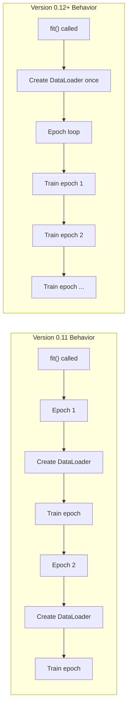
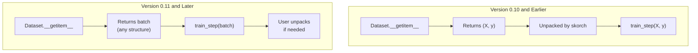
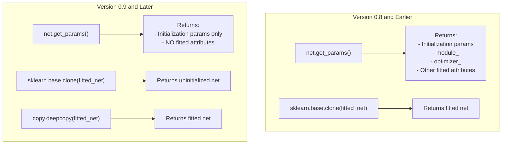
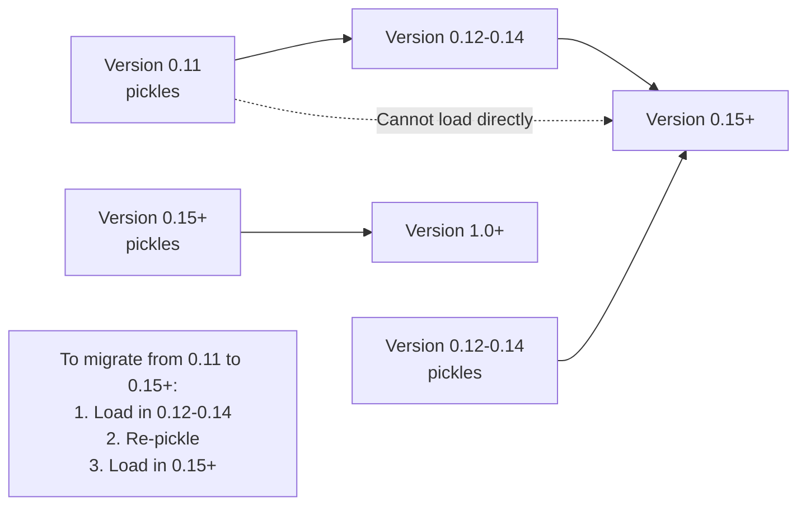
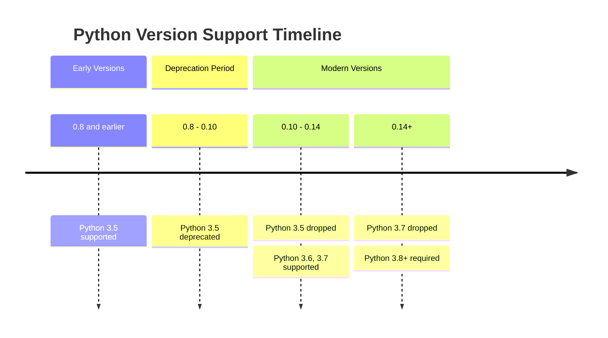

<!-- source: DeepWiki mcp.deepwiki.com · repo skorch-dev/skorch · page 10.2 Migration Guides · fetched 2026-10-21 -->

# Migration Guides

<details>
<summary>Relevant source files</summary>

The following files were used as context for generating this wiki page:

- [CHANGES.md](CHANGES.md)

</details>


This document provides guidance for migrating code between major versions of skorch that introduce breaking changes. It identifies incompatibilities, explains the rationale behind changes, and provides practical steps for updating existing code.

For a chronological list of all changes, see [Major Changes by Version](#10.1). For general troubleshooting, see [Troubleshooting and FAQ](#11).

## Overview of Breaking Changes

The following table summarizes major breaking changes that require code modifications when upgrading:

| Version Transition | Breaking Change | Impact | Migration Complexity |
|-------------------|-----------------|--------|---------------------|
| 0.11 → 0.12 | Data loader initialization changed | Medium | Low |
| 0.10 → 0.11 | Batch signature changed | High | Medium |
| 0.8 → 0.9 | `get_params()` behavior changed | High | Medium |
| 0.5 → 0.6 | Pickle format changed | Medium | Low |
| 0.5 → 0.6 | PyTorch >= 1.1.0 required | Medium | Low |
| 0.14 → 0.15 | Python 3.7 support dropped | Low | Low |
| 0.11 → current | Pickle compatibility window | High | Medium |

Sources: [CHANGES.md:1-389]()

## Migration from 0.11 to 0.12

### Data Loader Initialization Change

**Change**: In version 0.12, data loaders for training and validation datasets are initialized once per `fit()` call instead of once per epoch.

**Rationale**: This change improves performance by avoiding repeated initialization overhead and makes the behavior more predictable.

**Impact**: This affects code that relies on data loaders being recreated every epoch, particularly custom callbacks that modify data loader behavior or custom Dataset classes with epoch-dependent behavior.



**Migration Steps**:

1. **Review custom Dataset implementations**: If your Dataset class has state that changes between epochs (e.g., epoch-dependent augmentation), move this logic into the `__getitem__` method or use callbacks instead.

2. **Update callbacks that modify data loaders**: If you have callbacks that modify `net.train_dataloader_` or `net.valid_dataloader_` during training, ensure they work with persistent data loaders.

3. **Check worker processes**: If using multi-process data loading (`num_workers > 0`), verify that worker initialization happens correctly with persistent data loaders.

Sources: [CHANGES.md:123-125]()

## Migration from 0.10 to 0.11

### Batch Signature Change

**Change**: The signature of several methods changed to receive the whole batch instead of separate `X` and `y` parameters. Affected methods:
- `validation_step`
- `train_step_single`
- `train_step`
- `evaluation_step`
- `on_batch_begin`
- `on_batch_end`

**Rationale**: Many PyTorch datasets don't strictly return an `(X, y)` tuple. This change makes skorch more compatible with diverse PyTorch datasets, including those that return dictionaries, tuples with more than two elements, or other structures.



**Migration Steps**:

1. **Update method signatures**: If you override any of the affected methods, change the signature from `(X, y)` to `(batch)`:

   Before (0.10):
   ```python
   def train_step(self, X, y, **fit_params):
       # implementation
   ```

   After (0.11+):
   ```python
   def train_step(self, batch, **fit_params):
       X, y = batch  # unpack if needed
       # implementation
   ```

2. **Update custom callbacks**: If you have callbacks that override `on_batch_begin` or `on_batch_end`, update them:

   Before (0.10):
   ```python
   def on_batch_begin(self, net, X=None, y=None, training=False, **kwargs):
       # implementation
   ```

   After (0.11+):
   ```python
   def on_batch_begin(self, net, batch=None, training=False, **kwargs):
       X, y = batch  # unpack if needed
       # implementation
   ```

3. **Handle non-standard batch formats**: For datasets that return structures other than `(X, y)`, adapt your unpacking logic accordingly:

   ```python
   def train_step(self, batch, **fit_params):
       if isinstance(batch, dict):
           X = batch['input']
           y = batch['target']
       else:
           X, y = batch
       # rest of implementation
   ```

Sources: [CHANGES.md:145-146]()

### CVSplit Renamed to ValidSplit

**Change**: The `CVSplit` class was renamed to `ValidSplit` to avoid confusion with cross-validation.

**Migration Steps**:

1. Update import statements:
   ```python
   # Before
   from skorch.dataset import CVSplit
   
   # After
   from skorch.dataset import ValidSplit
   ```

2. Update instantiation:
   ```python
   # Before
   net = NeuralNet(module, train_split=CVSplit(5))
   
   # After
   net = NeuralNet(module, train_split=ValidSplit(5))
   ```

Sources: [CHANGES.md:148]()

### Custom Modules Now First-Class

**Change**: User-added modules, criteria, and optimizers are now first-class citizens. Skorch automatically handles train/eval mode switching, device placement, and parameter updates for all registered components.

**Impact**: This primarily affects advanced use cases where users add custom modules beyond the main `module_`.

**Migration Steps**:

1. **Remove manual mode switching**: If you previously manually called `.train()` or `.eval()` on custom modules in callbacks, you can remove this code.

2. **Remove manual device placement**: If you previously moved custom modules to devices manually, this is now handled automatically.

3. **Update parameter extraction**: Custom module parameters are now automatically included in training. Verify that this matches your intended behavior.

Sources: [CHANGES.md:147]()

## Migration from 0.8 to 0.9

### get_params() Behavior Change

**Change**: `net.get_params()` no longer returns "learned" attributes like `module_`, making it consistent with scikit-learn's behavior.

**Rationale**: This change aligns skorch with scikit-learn conventions, where `get_params()` returns initialization parameters, not fitted state.



**Impact**: This affects code that uses `sklearn.base.clone()` with fitted nets, or any code that relies on `get_params()` returning fitted attributes. sklearn tools like `GridSearchCV` use `clone()` internally.

**Migration Steps**:

1. **Replace clone() with deepcopy() for fitted nets**: If you need a copy of a fitted net, use `copy.deepcopy()` instead of `sklearn.base.clone()`:

   ```python
   import copy
   
   # Before (creates fitted copy)
   net_copy = sklearn.base.clone(fitted_net)
   
   # After (for fitted copy)
   net_copy = copy.deepcopy(fitted_net)
   
   # After (for uninitialized copy)
   net_copy = sklearn.base.clone(fitted_net)
   ```

2. **Update code accessing fitted attributes**: Don't rely on `get_params()` to access `module_`, `optimizer_`, or other fitted attributes. Access them directly:

   ```python
   # Before (might have worked but incorrect)
   params = net.get_params()
   module = params['module_']
   
   # After (correct)
   module = net.module_
   ```

3. **Verify GridSearchCV usage**: If using `GridSearchCV` with fitted nets, be aware that the best estimator will be refitted from scratch, not cloned from a fitted state.

Sources: [CHANGES.md:188-189]()

### CyclicLR Scheduler Change

**Change**: The default behavior of `CyclicLR` scheduler changed from taking a step every batch to taking a step every epoch.

**Migration Steps**:

1. **Explicitly set step_every**: If you relied on the old batch-stepping behavior, explicitly set `step_every='batch'`:

   ```python
   from skorch.callbacks import LRScheduler
   from torch.optim.lr_scheduler import CyclicLR
   
   # To maintain old behavior
   net = NeuralNet(
       module,
       callbacks=[
           LRScheduler(CyclicLR, step_every='batch', ...)
       ]
   )
   ```

Sources: [CHANGES.md:189]()

### Automatic Softmax with CrossEntropyLoss

**Change**: When using `CrossEntropyLoss`, softmax is now automatically applied to the output when calling `predict()` or `predict_proba()`.

**Impact**: This makes the behavior more intuitive, as users no longer need to manually apply softmax to get probabilities.

**Migration Steps**:

1. **Remove manual softmax**: If you were manually applying softmax in your code after prediction, remove it:

   ```python
   # Before (manual softmax needed)
   y_pred_raw = net.predict_proba(X)
   y_pred = torch.softmax(y_pred_raw, dim=1)
   
   # After (automatic)
   y_pred = net.predict_proba(X)  # softmax applied automatically
   ```

Sources: [CHANGES.md:193]()

## Migration from 0.5 to 0.6

### Pickle Format Change

**Change**: The skorch pickle format changed to improve CUDA compatibility.

**Migration Steps**:

1. **Re-pickle old models**: If you have models pickled with version 0.5 or earlier:
   - Load them in a version before 0.6
   - Re-pickle them
   - The new pickle files will be compatible with 0.6+

2. **Test CUDA compatibility**: If you pickle models on CPU and load on GPU (or vice versa), test the migration path thoroughly.

Sources: [CHANGES.md:272]()

### PyTorch Version Requirement

**Change**: Skorch now requires PyTorch >= 1.1.0.

**Impact**: This mainly affects learning rate schedulers, whose internal workings changed in PyTorch 1.1.0. Pickled models from earlier versions may be incompatible.

**Migration Steps**:

1. **Upgrade PyTorch**: Ensure PyTorch 1.1.0 or later is installed:
   ```bash
   pip install 'torch>=1.1.0'
   ```

2. **Update LR scheduler usage**: Review learning rate scheduler code for compatibility with PyTorch 1.1.0+ API.

3. **Re-pickle models**: Models pickled with older PyTorch versions may need to be re-pickled.

Sources: [CHANGES.md:274]()

### Repository Move

**Change**: Repository moved to https://github.com/skorch-dev/skorch/.

**Migration Steps**:

1. **Update git remotes**: If you have a local clone of the repository:
   ```bash
   git remote set-url origin https://github.com/skorch-dev/skorch.git
   ```

2. **Update documentation links**: Update any bookmarks or documentation links to the new repository URL.

Sources: [CHANGES.md:268]()

## Handling Pickle Compatibility Across Versions

The following diagram shows the pickle compatibility relationships between major versions:



**Pickle Migration Strategy**:

1. **From 0.11 to 0.15+**: Cannot load directly. Migration path:
   - Install skorch 0.12-0.14
   - Load the old pickle
   - Re-pickle with `net.save_params()` or standard pickle
   - Upgrade to skorch 0.15+
   - Load the new pickle

2. **Within compatible versions**: Pickles are generally compatible within major version ranges (0.12-0.14, 0.15+, 1.0+).

3. **PyTorch version changes**: When PyTorch makes optimizer changes, re-pickling may be necessary even within compatible skorch versions.

Sources: [CHANGES.md:61]()

## Python Version Support Changes



**Migration Steps for Python Version Changes**:

1. **Python 3.5 → 3.6+ (version 0.10)**: Upgrade Python to 3.6 or later before upgrading skorch to 0.10.

2. **Python 3.7 → 3.8+ (version 0.14)**: Skorch 0.14 moved from `pkg_resources` to `importlib`, requiring Python 3.8+. Upgrade Python before upgrading skorch.

Sources: [CHANGES.md:76-77](), [CHANGES.md:218]()

## Deprecated Features Migration

The following features were deprecated and later removed. If you're using these features in older code, follow the migration paths below:

### filtered_optimizer (Deprecated in 0.4.0)

**Migration**: Use the `Freezer` callback instead.

```python
# Old approach (deprecated)
from skorch.utils import filtered_optimizer

# New approach
from skorch.callbacks import Freezer

net = NeuralNet(
    module,
    callbacks=[
        Freezer('layer*.weight'),  # Freeze matching parameters
    ]
)
```

Sources: [CHANGES.md:355]()

### cache_net_infer (Removed in 1.1.0)

**Migration**: This internal function was removed. If you were using it directly, refactor to use the scoring callback's caching mechanism instead.

Sources: [CHANGES.md:44]()

### CyclicLR Callback (Removed in 0.7.0)

**Migration**: Use PyTorch's built-in `torch.optim.lr_scheduler.CyclicLR` with skorch's `LRScheduler` callback wrapper:

```python
# Old approach (removed)
from skorch.callbacks import CyclicLR

# New approach
from skorch.callbacks import LRScheduler
from torch.optim.lr_scheduler import CyclicLR

net = NeuralNet(
    module,
    callbacks=[
        LRScheduler(CyclicLR, base_lr=0.001, max_lr=0.01)
    ]
)
```

Sources: [CHANGES.md:244]()

## Safetensors Support (Version 0.15+)

Starting in version 0.15, skorch supports saving and loading parameters using the safetensors format, which provides improved safety and performance.

**Migration to safetensors**:

1. **Save with safetensors**:
   ```python
   net.save_params(f_params='model.safetensors', use_safetensors=True)
   ```

2. **Load with safetensors**:
   ```python
   net.load_params(f_params='model.safetensors', use_safetensors=True)
   ```

3. **Requirements**: Install the safetensors library:
   ```bash
   pip install safetensors
   ```

Sources: [CHANGES.md:58]()

## sklearn Integration Changes

### sklearn 1.6.0+ Compatibility (Version 1.1.0)

**Change**: All neural net classes now inherit from sklearn's `BaseEstimator`. Classification models additionally inherit from `ClassifierMixin` and regressors from `RegressorMixin`.

**Impact**: This ensures compatibility with sklearn 1.6.0+ but shouldn't require code changes in most cases.

**Migration Steps**:

1. **Verify sklearn compatibility**: Ensure you're using sklearn 0.22.0 or later (minimum requirement since skorch 0.12).

2. **Check custom subclasses**: If you've subclassed skorch neural nets, verify that your inheritance structure still works correctly.

Sources: [CHANGES.md:41](), [CHANGES.md:123]()

### sklearn 0.22 Compatibility (Version 0.12.0)

**Change**: Minimum scikit-learn version bumped to 0.22.0.

**Migration Steps**:

1. **Upgrade sklearn**:
   ```bash
   pip install 'scikit-learn>=0.22.0'
   ```

Sources: [CHANGES.md:222]()

## General Migration Best Practices

1. **Read the changelog**: Always review [CHANGES.md:1-389]() before upgrading to understand all changes affecting your code.

2. **Test incrementally**: When upgrading across multiple versions, test at each major version boundary rather than jumping directly to the latest.

3. **Use virtual environments**: Test migrations in isolated environments before updating production code.

4. **Re-pickle models**: When upgrading across pickle-incompatible versions, re-pickle all saved models.

5. **Update tests**: Ensure your test suite runs successfully after migration and add tests for new behavior where appropriate.

6. **Check deprecation warnings**: Run your code with Python warnings enabled to catch deprecated features:
   ```python
   import warnings
   warnings.filterwarnings('default')
   ```

Sources: [CHANGES.md:1-389]()

---

