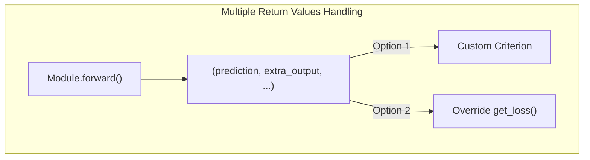
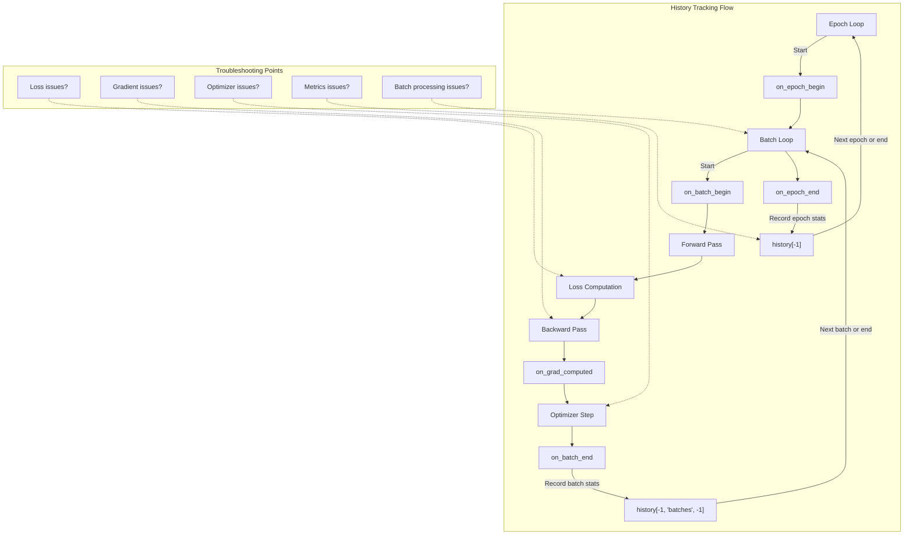

<!-- source: DeepWiki mcp.deepwiki.com · repo skorch-dev/skorch · page 11 Troubleshooting and FAQ · fetched 2026-10-21 -->

# Troubleshooting and FAQ

<details>
<summary>Relevant source files</summary>

The following files were used as context for generating this wiki page:

- [.github/workflows/testing.yml](.github/workflows/testing.yml)
- [README.rst](README.rst)
- [docs/user/FAQ.rst](docs/user/FAQ.rst)
- [docs/user/callbacks.rst](docs/user/callbacks.rst)
- [docs/user/dataset.rst](docs/user/dataset.rst)
- [docs/user/installation.rst](docs/user/installation.rst)
- [docs/user/neuralnet.rst](docs/user/neuralnet.rst)

</details>


This page provides solutions to common issues encountered when using skorch, along with answers to frequently asked questions. It covers technical problems related to model training, data handling, integration with scikit-learn, and PyTorch-specific challenges.

For information about the core architecture of skorch, see [Core Architecture](#2). For details about the callback system, refer to [Callback System](#3).

## Common Troubleshooting Areas

Below is a diagram illustrating where common issues typically arise in the skorch workflow:

```mermaid
flowchart TD
    subgraph "Common Troubleshooting Areas"
        direction TB
        A["Data Preparation Issues"] --> A1["Format Conversion Problems"]
        A --> A2["Dataset/DataLoader Issues"]
        A --> A3["Train/Validation Split Problems"]
        
        B["Model Configuration Issues"] --> B1["Module Initialization Problems"]
        B --> B2["Parameter Passing Issues"]
        B --> B3["Device Configuration Problems"]
        
        C["Training Process Issues"] --> C1["Loss Calculation Problems"]
        C --> C2["Optimizer Configuration Issues"]
        C --> C3["Learning Rate Problems"]
        C --> C4["Gradient Issues"]
        
        D["Integration Issues"] --> D1["scikit-learn Compatibility Problems"]
        D --> D2["PyTorch Interoperability Issues"]
        D --> D3["Callback Configuration Problems"]
    end
```



Sources: [docs/user/FAQ.rst:8-458](), [docs/user/quickstart.rst:1-110]()

## Frequently Asked Questions

### Training Configuration

#### How do I apply L2 regularization?

To apply L2 regularization (weight decay), use the double-underscore notation to pass the `weight_decay` parameter to the optimizer:

```python
net = NeuralNet(
    ...,
    optimizer__weight_decay=0.01,
)
```

Sources: [docs/user/FAQ.rst:8-21]()

#### How can I continue training my model?

By default, calling `fit()` multiple times starts training from scratch. To continue training from the current state:

1. Use `partial_fit()` instead of `fit()`, or
2. Set `warm_start=True` when initializing your network

```python
# Option 1
net.partial_fit(X, y)

# Option 2
net = NeuralNet(
    ...,
    warm_start=True
)
net.fit(X, y)
net.fit(X, y)  # Continues from previous state
```

Sources: [docs/user/FAQ.rst:24-34]()

#### How do I shuffle my train batches?

Use the double-underscore notation to pass parameters to PyTorch's `DataLoader`:

```python
net = NeuralNet(
    ...,
    iterator_train__shuffle=True,
)
```

Sources: [docs/user/FAQ.rst:37-55]()

#### How can I set the random seed of my model?

Set the random seeds for both numpy and PyTorch before initializing your model:

```python
import numpy as np
import torch

seed = 42
np.random.seed(seed)
torch.manual_seed(seed)  # Also sets CUDA seed if CUDA is available

net = NeuralNet(...)
```

For a fixed train/validation split, pass `random_state` to `ValidSplit`:

```python
from skorch.dataset import ValidSplit

net = NeuralNet(
    ...,
    train_split=ValidSplit(random_state=seed),
)
```

Sources: [docs/user/FAQ.rst:417-463]()

### Data Handling

#### How do I use sklearn GridSearchCV when my data is in a dictionary?

skorch supports dictionaries as input, but scikit-learn doesn't. Wrap your dictionary in a `SliceDict` to make it compatible with both:


Sources: [docs/user/FAQ.rst:58-67]()

#### How do I use sklearn GridSearchCV when my data is in a dataset?

Similar to dictionary data, wrap your dataset in a `SliceDataset` to make it compatible with scikit-learn:


Sources: [docs/user/FAQ.rst:70-82]()

#### How do I use a PyTorch Dataset with skorch?

skorch directly supports PyTorch's `Dataset` as input to `fit()`. Your dataset's `__getitem__` method should return a tuple of (X, y):

```python
class MyDataset(torch.utils.data.Dataset):
    def __init__(self):
        self.X = torch.randn(128, 10)
        self.Y = torch.randn(128, 10)
        
    def __getitem__(self, idx):
        return self.X[idx], self.Y[idx]
        
    def __len__(self):
        return 128

net = NeuralNet(MyModule, criterion=torch.nn.MSELoss)
net.fit(MyDataset())
```

Sources: [docs/user/FAQ.rst:220-266]()

#### I already split my data into training and validation sets, how can I use them?

Use `predefined_split` to wrap your validation dataset:

```python
from skorch.helper import predefined_split

# For PyTorch Datasets
net = NeuralNet(
    ...,
    train_split=predefined_split(valid_ds)
)
net.fit(train_ds)

# For NumPy arrays
from sklearn.model_selection import train_test_split
from skorch.dataset import Dataset

X_train, X_test, y_train, y_test = train_test_split(X, y)
valid_ds = Dataset(X_test, y_test)

net = NeuralNet(
    ...,
    train_split=predefined_split(valid_ds)
)
net.fit(X_train, y_train)
```

Sources: [docs/user/FAQ.rst:135-172]()

### Model Behavior

#### What happens when NeuralNet is passed an initialized PyTorch module?

When `NeuralNet` receives an initialized PyTorch module, it generally preserves that instance without re-initialization. This means in the following example, the module will train for a total of 20 epochs (10 in each net):

```python
module = MyModule()
net1 = NeuralNet(module, max_epochs=10, ...)
net1.fit(X, y)

net2 = NeuralNet(module, max_epochs=10, ...)
net2.fit(X, y)  # Continues from net1's state
```

However, when module parameters are set through keyword arguments, the module will be re-initialized:

```python
net = NeuralNet(module, module__hidden=10, ...)
net.fit(X, y)  # Module will be re-initialized
```

The recommended approach is to pass the module class rather than an instance:

```python
net = NeuralNet(MyModule, ...)  # Pass the class, not an instance
```

Sources: [docs/user/FAQ.rst:175-218]()

#### How do I implement a score method on the net that returns the loss?

Use the `loss_scoring` function from skorch:

```python
from skorch.scoring import loss_scoring

# Example 1: Using loss_scoring as a function
net = NeuralNetClassifier(module).fit(X, y)
loss = loss_scoring(net, X, y)

# Example 2: Adding a score method to your custom net
class ScoredNet(NeuralNetClassifier):
    def score(self, X, y=None):
        loss_value = loss_scoring(self, X, y)
        return -loss_value  # Negative because GridSearchCV maximizes score
```

Sources: [docs/user/FAQ.rst:369-414]()

### Advanced Usage

#### How can I deal with multiple return values from forward?

When your module's `forward` method returns multiple values (as a tuple), you need to either:
1. Use a custom criterion that can handle multiple return values, or
2. Override `get_loss` to handle the unpacking of the tuple.

To inspect the outputs, use either the `forward` method (eager) or `forward_iter` method (lazy).



Sources: [docs/user/FAQ.rst:268-287]()

#### How can I perform gradient accumulation with skorch?

Create a custom neural network class that overrides the `train_step` method:

```python
class GradAccNet(NeuralNetClassifier):
    def __init__(self, *args, acc_steps=2, **kwargs):
        super().__init__(*args, **kwargs)
        self.acc_steps = acc_steps

    def get_loss(self, *args, **kwargs):
        loss = super().get_loss(*args, **kwargs)
        return loss / self.acc_steps  # normalize loss

    def train_step(self, batch, **fit_params):
        n_train_batches = len(self.history[-1, 'batches'])
        step = self.train_step_single(batch, **fit_params)

        if n_train_batches % self.acc_steps == 0:
            self.optimizer_.step()
            self.optimizer_.zero_grad()
        return step
```

Alternatively, use the `AccelerateMixin` to leverage Hugging Face's `accelerate` library for gradient accumulation.

Sources: [docs/user/FAQ.rst:289-335]()

#### How can I dynamically set the input size of the PyTorch module based on the data?

Create a callback that sets the module's input size parameter at the beginning of training:

```python
class InputShapeSetter(skorch.callbacks.Callback):
    def on_train_begin(self, net, X, y):
        net.set_params(module__input_dim=X.shape[1])

net = NeuralNetClassifier(
    Module,
    callbacks=[InputShapeSetter()],
)
```

Sources: [docs/user/FAQ.rst:337-367]()

#### How do I use sample_weight?

To apply sample weights, include them in your input dictionary and override the `get_loss` method:

```python
# 1. Add sample_weight to your input
X = {'data': X, 'sample_weight': sample_weight}

# 2. Update your module's forward method to accept sample_weight
class MyModule(nn.Module):
    def forward(self, data, sample_weight):
        # sample_weight can typically be ignored here
        return self.net(data)

# 3. Create a custom NeuralNet class that applies the weights
class MyNet(NeuralNet):
    def __init__(self, *args, criterion__reduce=False, **kwargs):
        # Set reduce=False to get per-sample losses
        super().__init__(*args, criterion__reduce=criterion__reduce, **kwargs)

    def get_loss(self, y_pred, y_true, X, *args, **kwargs):
        loss_unreduced = super().get_loss(y_pred, y_true, X, *args, **kwargs)
        sample_weight = skorch.utils.to_tensor(X['sample_weight'], device=self.device)
        loss_reduced = (sample_weight * loss_unreduced).mean()
        return loss_reduced
```

Sources: [docs/user/FAQ.rst:84-133]()

## Migration Guides

### Migration from 0.10 to 0.11

In skorch 0.11, the tuple unpacking of values returned by the iterator was pushed down the call chain. This changes the signatures of these methods:

- `NeuralNet.train_step_single`
- `NeuralNet.validation_step`
- `Callback.on_batch_begin`
- `Callback.on_batch_end`

Instead of receiving unpacked `X` and `y`, they now receive a `batch` parameter.

To update your custom implementations:

```python
# Before
def on_batch_begin(self, net, X, y, ...):
    ...

# After
def on_batch_begin(self, net, batch, ...):
    X, y = batch
    ...
```

Sources: [docs/user/FAQ.rst:466-504]()

### Migration from 0.11 to 0.12

In skorch 0.12, the `DataLoader` is only initialized once per `fit` call instead of once per epoch. This affects the `run_single_epoch` method:

```python
# Before
def run_single_epoch(self, dataset, ...):
    ...
    for batch in self.get_iterator(dataset, training=training):
        ...

# After
def run_single_epoch(self, iterator, ...):
    ...
    for batch in iterator:
        ...
```

If you need access to the `Dataset` inside of `run_single_epoch`, use `iterator.dataset`.

Sources: [docs/user/FAQ.rst:506-543]()

## Common Problems and Solutions

### Training Issues

| Problem | Possible Causes | Solutions |
|---------|----------------|-----------|
| Loss not decreasing | Learning rate too high/low | Adjust learning rate or use LR scheduler |
|  | Initialization issues | Use different initialization methods |
|  | Model architecture | Ensure model is suitable for the task |
| Training very slow | Batch size too small | Increase batch size if memory allows |
|  | Complex model architecture | Simplify model or use faster hardware |
|  | Data preprocessing bottlenecks | Optimize data loading pipeline |
| Memory errors | Batch size too large | Reduce batch size |
|  | Model too large | Simplify model or use gradient accumulation |
|  | Memory leaks | Ensure tensors are properly freed |

Sources: [docs/user/FAQ.rst:24-34](), [docs/user/FAQ.rst:289-335]()

### Integration Issues

| Problem | Possible Causes | Solutions |
|---------|----------------|-----------|
| GridSearchCV not working | Data format incompatibility | Use SliceDict or SliceDataset |
|  | Parameter naming issues | Use double-underscore notation |
| Pipeline errors | Input/output format mismatch | Ensure modules handle expected formats |
| Error during training in scikit-learn | Incompatible scoring | Use appropriate scoring functions |

Sources: [docs/user/FAQ.rst:58-82](), [docs/user/FAQ.rst:369-414]()

### History and Monitoring

The diagram below shows how history tracking works in skorch and potential troubleshooting points:



Sources: [docs/user/history.rst:1-154](), [docs/user/FAQ.rst:289-335]()

## Debugging Tips

1. **Enable verbose output**:
   ```python
   net = NeuralNet(..., verbose=1)
   ```

2. **Examine specific history entries**:
   ```python
   # Check last epoch
   print(net.history[-1])
   
   # Check train loss progression
   print(net.history[:, 'train_loss'])
   
   # Check batch-level information
   print(net.history[-1, 'batches', -1])
   ```

3. **Use PrintLog callback** to customize logging:
   ```python
   from skorch.callbacks import PrintLog
   
   net = NeuralNet(
       ...,
       callbacks=[PrintLog(keys_ignored=None)]
   )
   ```

4. **Add a TensorBoard callback** for visualization:
   ```python
   from skorch.callbacks import TensorBoard
   
   net = NeuralNet(
       ...,
       callbacks=[TensorBoard(log_dir='./logs')]
   )
   ```

Sources: [docs/user/history.rst:1-87]()