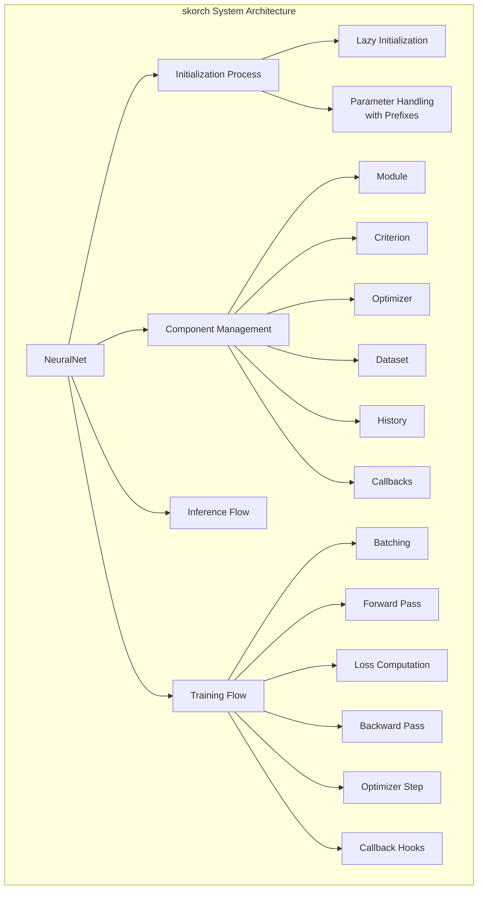
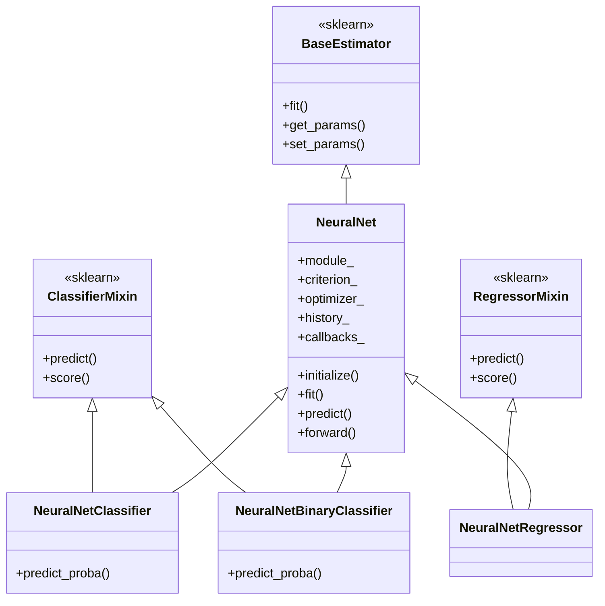
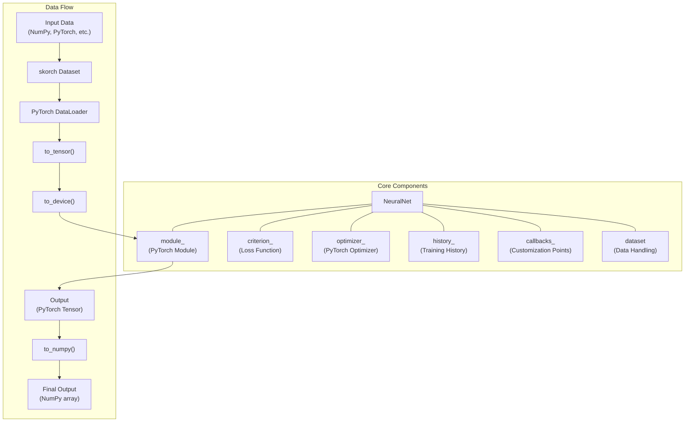
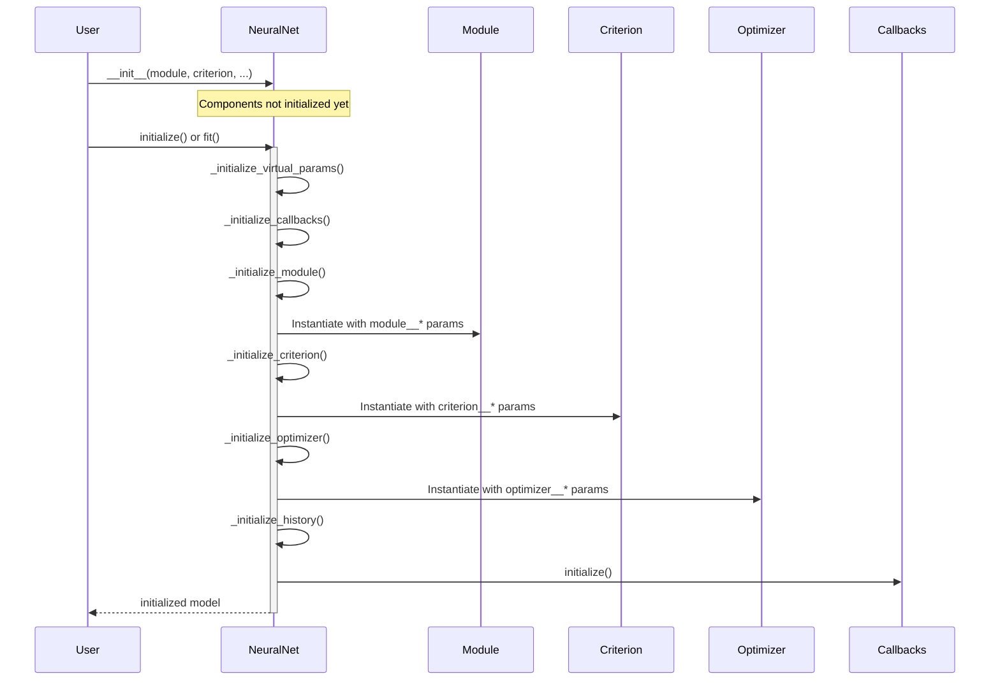
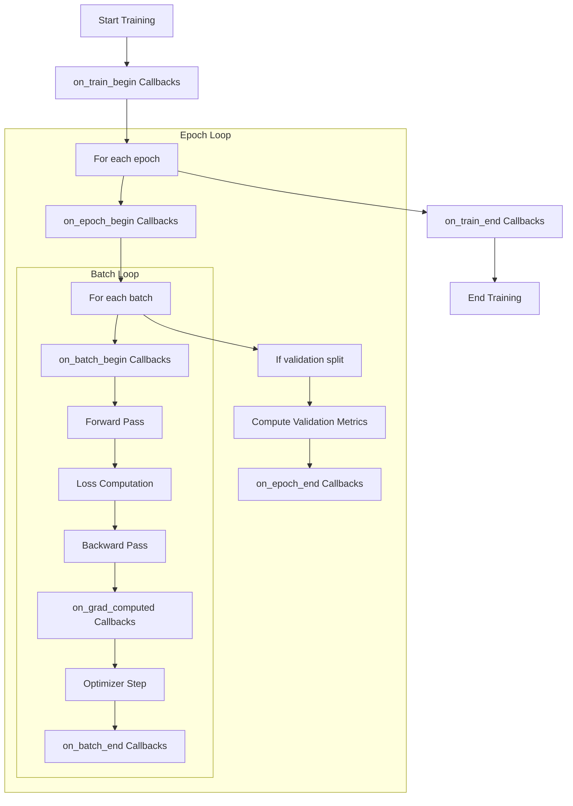
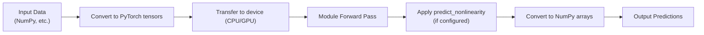
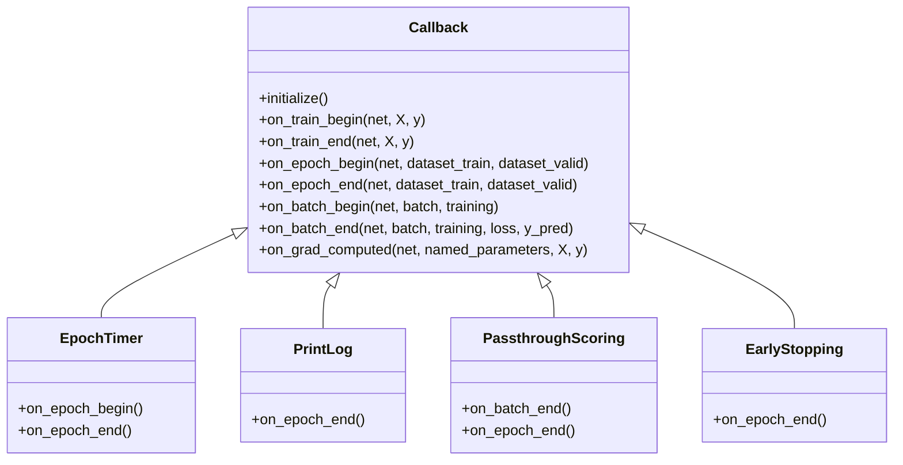
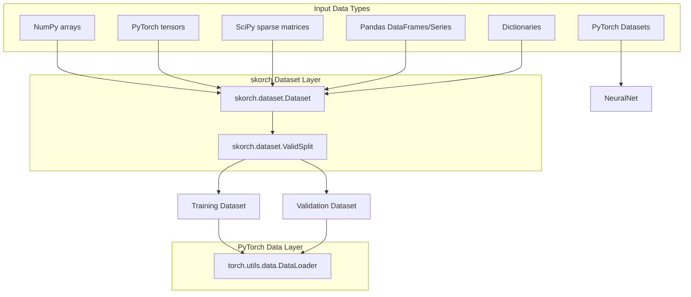

<!-- source: DeepWiki mcp.deepwiki.com · repo skorch-dev/skorch · page 2 Core Architecture · fetched 2026-10-21 -->

# Core Architecture

<details>
<summary>Relevant source files</summary>

The following files were used as context for generating this wiki page:

- [.github/workflows/testing.yml](.github/workflows/testing.yml)
- [README.rst](README.rst)
- [docs/user/installation.rst](docs/user/installation.rst)
- [skorch/net.py](skorch/net.py)
- [skorch/tests/test_net.py](skorch/tests/test_net.py)

</details>


This page explains the core architectural design and main components of the skorch library. It details how skorch bridges PyTorch and scikit-learn by providing a standardized, scikit-learn compatible interface for neural networks implemented in PyTorch.

For more specific information about the NeuralNet class, see [NeuralNet Class](#2.1). For details on dataset handling, see [Dataset Handling](#2.3).

## Overview

skorch's core architecture is designed to make PyTorch models work with scikit-learn's API while minimizing boilerplate code. It handles tasks like converting between NumPy arrays and PyTorch tensors, implementing the training loop, managing batching, and providing a callback system for customization.



Sources: [skorch/net.py:55-311](). This diagram is based on the core components described in the NeuralNet class docstring.

## Class Hierarchy and Inheritance

skorch provides a scikit-learn compatible interface through its class hierarchy. The base `NeuralNet` class inherits from scikit-learn's `BaseEstimator`, and specialized variants inherit from `NeuralNet`.



Sources: [skorch/net.py:55-56](), [docs/user/neuralnet.rst:8-16]()

## Core Components

The main components of skorch's architecture work together to provide the bridge between PyTorch and scikit-learn:



Sources: [skorch/net.py:94-239](), [docs/user/neuralnet.rst:62-101]()

### NeuralNet

The `NeuralNet` class is the central component of skorch's architecture. It acts as a wrapper around PyTorch modules and provides scikit-learn compatibility.

Key responsibilities:
- Initializes and manages PyTorch components (module, criterion, optimizer)
- Implements the training loop
- Converts data between NumPy and PyTorch formats
- Manages callback execution during training
- Tracks training metrics in the history

Sources: [skorch/net.py:55-311](), [docs/user/neuralnet.rst:8-16]()

### Initialization Process

skorch uses lazy initialization, meaning components are only initialized when needed. When a `NeuralNet` is instantiated, arguments are stored but not immediately used.

The initialization sequence is:



Sources: [skorch/net.py:929-943](), [docs/user/neuralnet.rst:42-60]()

### Parameter Handling

skorch uses a special parameter naming convention with double underscores to set parameters on subcomponents:

```
module__num_units=100      # Sets num_units=100 on module initialization
criterion__weight=weights  # Sets weight=weights on criterion initialization
optimizer__momentum=0.9    # Sets momentum=0.9 on optimizer initialization
```

This allows convenient configuration of all components from the top-level `NeuralNet` instance.

Sources: [skorch/net.py:63-87](), [docs/user/neuralnet.rst:499-526]()

### Component Management

skorch manages several key components:

1. **module_**: The instantiated PyTorch module that defines the neural network architecture.
2. **criterion_**: The loss function used during training.
3. **optimizer_**: The optimization algorithm that updates model parameters.
4. **history_**: Tracks metrics during training.
5. **callbacks_**: Custom callback objects for modifying the training process.

Components are initialized when needed, and each has a dedicated initialization method:

| Component | Initialization Method | Description |
|-----------|------------------------|-------------|
| Module | `initialize_module()` | Instantiates the PyTorch module |
| Criterion | `initialize_criterion()` | Instantiates the loss function |
| Optimizer | `initialize_optimizer()` | Instantiates the optimizer |
| History | `initialize_history()` | Creates a new History object |
| Callbacks | `initialize_callbacks()` | Sets up all callbacks |

Sources: [skorch/net.py:605-682](), [docs/user/neuralnet.rst:69-119]()

## Training and Inference Flow

The training process in skorch follows a fixed pattern, with callbacks serving as customization points at each step:



Sources: [skorch/net.py:403-446](), [docs/user/callbacks.rst:40-89]()

### Inference Flow

During inference (prediction), the data follows a similar flow but skips the training-specific components:



Sources: [skorch/net.py:334-356](), [docs/user/neuralnet.rst:359-388]()

## Callback System

The callback system is a key architectural feature that provides customization points throughout the training process:



skorch provides default callbacks and allows custom callbacks to be added. The default callbacks include:
- `EpochTimer`: Times each epoch
- `PrintLog`: Prints training metrics
- `PassthroughScoring`: Records metrics during training

Sources: [skorch/net.py:386-398](), [docs/user/callbacks.rst:1-24]()

## Dataset Handling

skorch handles various input data types through its `Dataset` class:



The dataset system handles:
- Converting various input types to a format PyTorch can use
- Splitting data into training and validation sets
- Providing a consistent interface for different data types
- Supporting dictionary inputs to match module parameter names

Sources: [docs/user/dataset.rst:1-147](), [skorch/net.py:131-147]()

## Summary

skorch's core architecture provides a clean integration between PyTorch and scikit-learn. The `NeuralNet` class wraps PyTorch modules, the callback system enables customization, and the dataset handling makes working with different data formats seamless.

The architecture is designed to be flexible and extensible while hiding the complexity of boilerplate code, allowing users to focus on model development.

---

