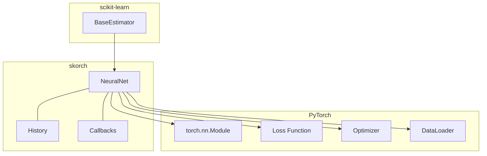
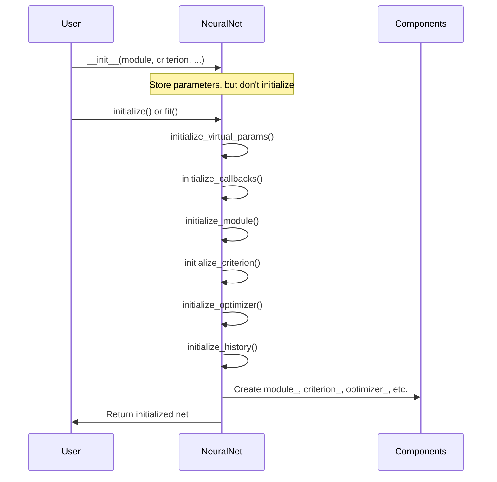
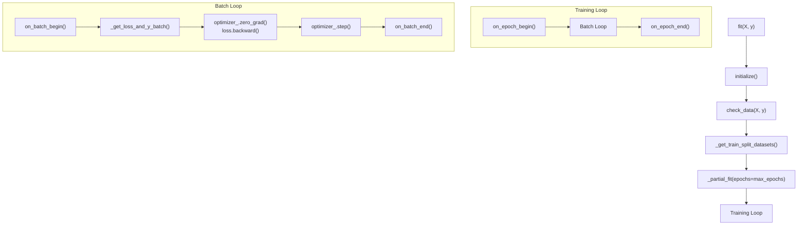
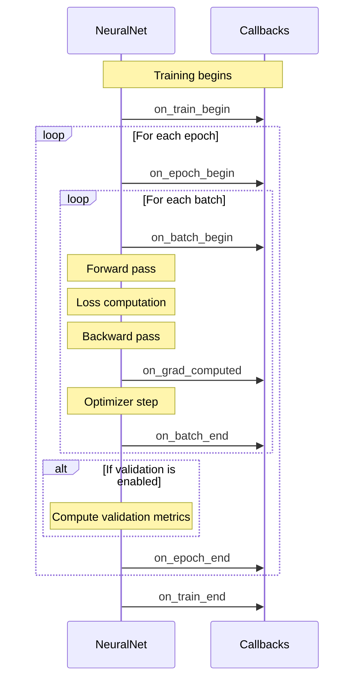
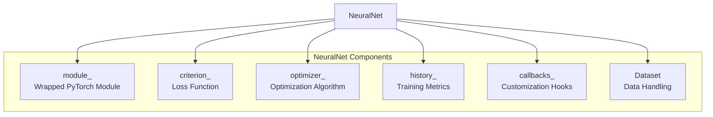
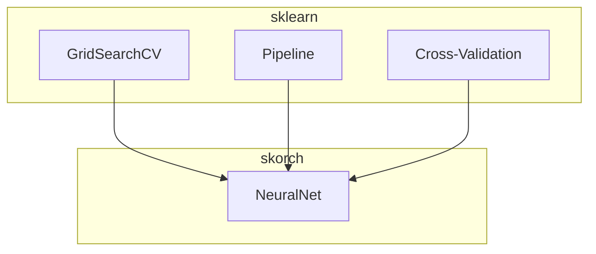

<!-- source: DeepWiki mcp.deepwiki.com · repo skorch-dev/skorch · page 2.1 NeuralNet Base Class · fetched 2026-10-21 -->

# NeuralNet Class

<details>
<summary>Relevant source files</summary>

The following files were used as context for generating this wiki page:

- [docs/user/FAQ.rst](docs/user/FAQ.rst)
- [docs/user/callbacks.rst](docs/user/callbacks.rst)
- [docs/user/dataset.rst](docs/user/dataset.rst)
- [docs/user/neuralnet.rst](docs/user/neuralnet.rst)
- [skorch/net.py](skorch/net.py)
- [skorch/tests/test_net.py](skorch/tests/test_net.py)

</details>


The `NeuralNet` class is the core component of skorch, providing a scikit-learn compatible interface for PyTorch neural networks. It serves as the base class that wraps PyTorch's `nn.Module` while handling training loops, batching, data conversion, and other boilerplate code. For specialized versions that handle classification and regression tasks, see [Neural Network Types](#2.2).

## Overview

`NeuralNet` is designed to bridge the gap between PyTorch's flexibility and scikit-learn's ease of use. It inherits from scikit-learn's `BaseEstimator` and provides methods like `fit()`, `predict()`, and `score()` that sklearn users are familiar with.



Sources: [skorch/net.py:55-312](). [docs/user/neuralnet.rst:8-37]().

## Initialization Process

The `NeuralNet` class follows a two-step initialization process:

1. **Instantiation**: When you create a `NeuralNet` object, parameters are stored but not initialized.
2. **Initialization**: When you call `fit()` or `initialize()`, components are actually initialized.

After initialization, components are available as attributes with trailing underscores (e.g., `module_`, `criterion_`, `optimizer_`).



Sources: [skorch/net.py:929-943](). [docs/user/neuralnet.rst:42-60]().

## Key Parameters

The `NeuralNet` class accepts numerous parameters to configure behavior. Here are the most important ones:

| Parameter | Description |
|-----------|-------------|
| `module` | PyTorch `nn.Module` class or instance |
| `criterion` | PyTorch loss function class |
| `optimizer` | PyTorch optimizer class (default: `torch.optim.SGD`) |
| `lr` | Learning rate (shortcut for `optimizer__lr`) |
| `max_epochs` | Number of training epochs |
| `batch_size` | Size of mini-batches for training |
| `callbacks` | List of callbacks for customizing behavior |
| `train_split` | Function for splitting data into train/validation |
| `device` | Computation device ('cpu', 'cuda', etc.) |
| `warm_start` | Whether to reuse previous initialization |

Additionally, `NeuralNet` supports parameter passing to components using double-underscore notation:

```
net = NeuralNet(
    module=MyModule,
    module__num_units=100,
    optimizer__momentum=0.9,
)
```

Sources: [skorch/net.py:93-267](). [docs/user/neuralnet.rst:62-203]().

## Mechanism of Operation

### Lifecycle and Training Flow

The diagram below illustrates the key methods and flow during training:



Sources: [skorch/net.py:1003-1157](). [skorch/net.py:421-442]().

### Callback System Integration

Callbacks are notified at specific points in the training lifecycle:



Sources: [skorch/net.py:403-446](). [docs/user/callbacks.rst:35-89]().

## Component Architecture

The `NeuralNet` class orchestrates several key components:



Sources: [skorch/net.py:55-312](). [docs/user/neuralnet.rst:8-37]().

### Module

The `module` parameter is the PyTorch neural network you want to train. It should be a class that inherits from `torch.nn.Module` or an instance of such a class. After initialization, the instantiated module is available as `module_`.

Sources: [skorch/net.py:95-102](). [docs/user/neuralnet.rst:69-101]().

### Criterion

The `criterion` parameter is the loss function used for training. It should be a PyTorch criterion class (not an instance). After initialization, the instantiated criterion is available as `criterion_`.

Sources: [skorch/net.py:100-102](). [docs/user/neuralnet.rst:102-118]().

### Optimizer

The `optimizer` parameter is the optimization algorithm used for training. It should be a PyTorch optimizer class (not an instance). The default is `torch.optim.SGD`. After initialization, the instantiated optimizer is available as `optimizer_`.

Sources: [skorch/net.py:104-107](). [docs/user/neuralnet.rst:120-156]().

### History

The `history_` attribute tracks metrics during training. It's automatically created and updated during training. You don't pass it as a parameter to `NeuralNet`.

Sources: [skorch/net.py:268-269](). [docs/user/neuralnet.rst:58-60]().

### Callbacks

The `callbacks` parameter allows customizing behavior at various points in the training process. By default, `NeuralNet` uses several callbacks including `EpochTimer`, `PassthroughScoring`, and `PrintLog`.

Sources: [skorch/net.py:148-170](). [docs/user/neuralnet.rst:217-281]().

### Dataset and Data Handling

`NeuralNet` handles various input data types including numpy arrays, PyTorch tensors, scipy sparse matrices, and pandas DataFrames. It converts these to PyTorch tensors before passing them to the model.

Sources: [skorch/net.py:131-146](). [docs/user/dataset.rst:61-146]().

## Key Methods

### initialize()

The `initialize()` method initializes all components of the net. It's automatically called by `fit()`, but you can also call it explicitly.

Sources: [skorch/net.py:929-943](). [docs/user/neuralnet.rst:304-323]().

### fit(X, y)

The `fit(X, y)` method trains the model. It initializes the model if not already initialized, then runs the training loop for `max_epochs` epochs.

Sources: [skorch/net.py:1003-1157](). [docs/user/neuralnet.rst:324-358]().

### predict(X) and predict_proba(X)

These methods perform inference on input data. `predict_proba()` returns the raw outputs from the model's forward pass, while `predict()` applies an appropriate transformation (e.g., argmax for classification).

Sources: [skorch/net.py:1219-1327](). [docs/user/neuralnet.rst:359-388]().

### save_params() and load_params()

These methods save and load model parameters to/from disk, allowing model persistence without pickling the entire object.

Sources: [skorch/net.py:1711-1855](). [docs/user/neuralnet.rst:397-420]().

## Advanced Features

### Virtual Parameters

`NeuralNet` supports "virtual parameters" that can be set using `set_params()` but don't correspond directly to attributes. For example, optimizer parameters can be updated after initialization using `net.set_params(optimizer__lr=0.01)`.

Sources: [skorch/net.py:631-648]().

### Device Management

`NeuralNet` automatically handles moving data and models between devices (CPU/GPU) based on the `device` parameter.

Sources: [skorch/net.py:213-216](). [docs/user/neuralnet.rst:294-303]().

### PyTorch Module Compilation

Recent versions support compiling PyTorch modules for better performance using `torch.compile()` via the `compile` parameter.

Sources: [skorch/net.py:217-226](). [skorch/net.py:791-841]().

## Usage Example

Here's a simple example of using `NeuralNet`:

```python
class MyModule(torch.nn.Module):
    def __init__(self, num_units=10):
        super().__init__()
        self.dense = torch.nn.Linear(20, num_units)
        self.output = torch.nn.Linear(num_units, 2)
        
    def forward(self, X):
        X = torch.relu(self.dense(X))
        X = torch.softmax(self.output(X), dim=-1)
        return X

net = NeuralNet(
    module=MyModule,
    module__num_units=100,
    criterion=torch.nn.NLLLoss,
    optimizer=torch.optim.SGD,
    optimizer__momentum=0.9,
    max_epochs=10,
    lr=0.1,
)

net.fit(X, y)
y_pred = net.predict(X_test)
```

Sources: [docs/user/neuralnet.rst:16-29]().

## Integration with sklearn

As `NeuralNet` inherits from sklearn's `BaseEstimator`, it can be used with sklearn tools like `GridSearchCV`, `Pipeline`, etc.



Sources: [docs/user/neuralnet.rst:8-11]().

---

