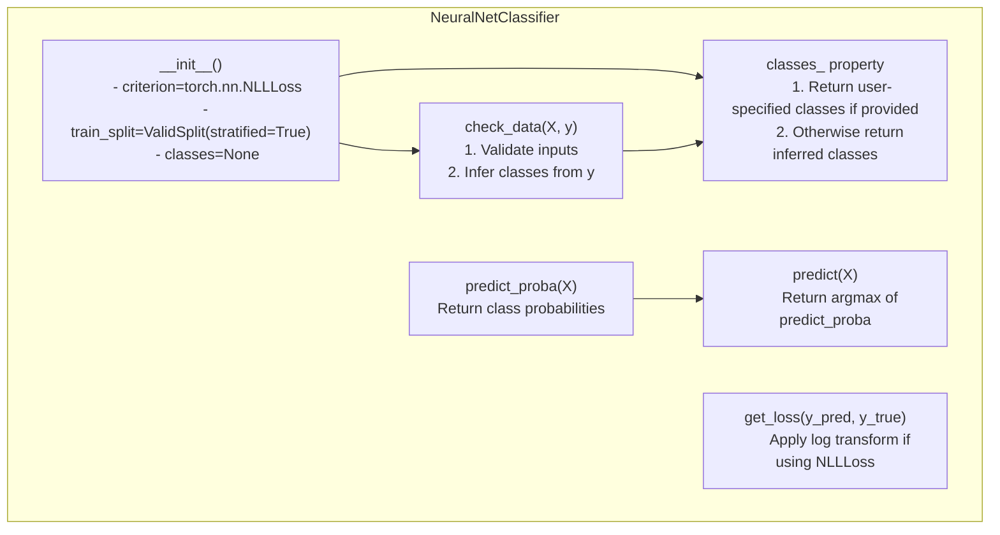
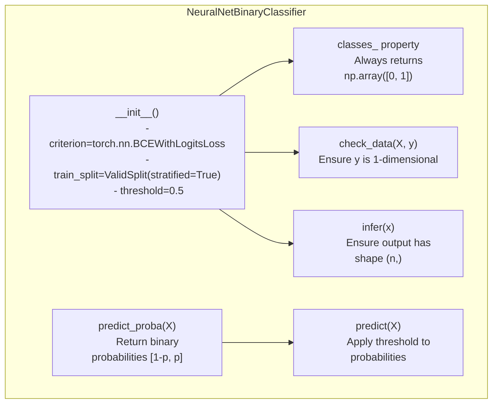
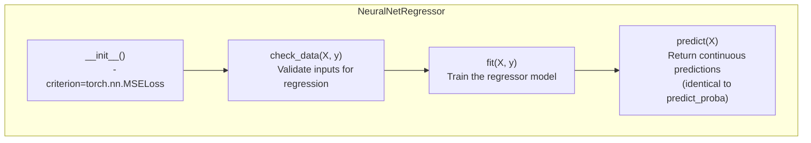
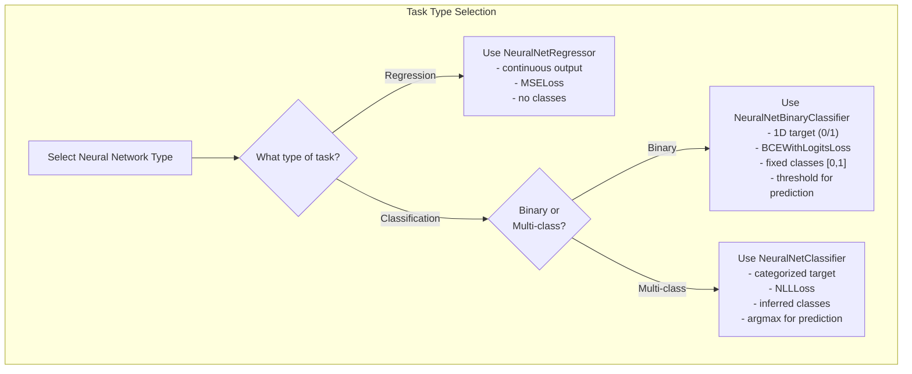

<!-- source: DeepWiki mcp.deepwiki.com · repo skorch-dev/skorch · page 2.2 Neural Network Types · fetched 2026-10-21 -->

# Neural Network Types

<details>
<summary>Relevant source files</summary>

The following files were used as context for generating this wiki page:

- [skorch/classifier.py](skorch/classifier.py)
- [skorch/net.py](skorch/net.py)
- [skorch/tests/test_classifier.py](skorch/tests/test_classifier.py)
- [skorch/tests/test_net.py](skorch/tests/test_net.py)
- [skorch/tests/test_regressor.py](skorch/tests/test_regressor.py)

</details>


This document describes the specialized neural network classes in skorch that extend the base `NeuralNet` class for specific machine learning tasks. These specialized classes provide task-specific defaults and interfaces that align with scikit-learn's API conventions. For information about the core `NeuralNet` class, see [NeuralNet Class](#2.1).

## Overview

Skorch provides three specialized neural network classes that cater to different types of machine learning tasks:

- **NeuralNetClassifier**: For multi-class classification tasks
- **NeuralNetBinaryClassifier**: Specifically for binary classification tasks
- **NeuralNetRegressor**: For regression tasks

Each of these classes inherits from the base `NeuralNet` class and incorporates scikit-learn's mixins to ensure compatibility with the scikit-learn ecosystem.

```mermaid
classDiagram
    class "sklearn.base.BaseEstimator" {
    }
    class "sklearn.base.ClassifierMixin" {
        +predict(X)
        +score(X, y)
    }
    class "sklearn.base.RegressorMixin" {
        +predict(X)
        +score(X, y)
    }
    class "NeuralNet" {
        +fit(X, y)
        +predict(X)
        +predict_proba(X)
        +score(X, y)
    }
    class "NeuralNetClassifier" {
        +criterion: torch.nn.NLLLoss
        +classes_
        +predict(X)
        +predict_proba(X)
    }
    class "NeuralNetBinaryClassifier" {
        +criterion: torch.nn.BCEWithLogitsLoss
        +threshold: float
        +classes_
        +predict(X)
        +predict_proba(X)
    }
    class "NeuralNetRegressor" {
        +criterion: torch.nn.MSELoss
        +predict(X)
    }
    
    "sklearn.base.BaseEstimator" <|-- "NeuralNet"
    "NeuralNet" <|-- "NeuralNetClassifier"
    "NeuralNet" <|-- "NeuralNetBinaryClassifier"
    "NeuralNet" <|-- "NeuralNetRegressor"
    "sklearn.base.ClassifierMixin" <|-- "NeuralNetClassifier"
    "sklearn.base.ClassifierMixin" <|-- "NeuralNetBinaryClassifier"
    "sklearn.base.RegressorMixin" <|-- "NeuralNetRegressor"
```

Sources: [skorch/classifier.py:57-68](), [skorch/classifier.py:266-286](), [skorch/regressor.py:39-54]()

## NeuralNetClassifier

`NeuralNetClassifier` is designed for multi-class classification tasks where the target variable can have multiple categories.

### Key Features and Defaults

- **Default Loss Function**: `torch.nn.NLLLoss` (Negative Log Likelihood Loss), which expects log probabilities as input
- **Default Callbacks**: Includes `EpochTimer`, `PassthroughScoring` for tracking loss, and `EpochScoring` with 'accuracy' metric
- **Classes Handling**: Automatically infers class labels from the training data
- **Validation Split**: Uses `ValidSplit` with stratified sampling by default



Sources: [skorch/classifier.py:57-168]()

### Example Usage

The `NeuralNetClassifier` is best used when you have a multi-class classification problem. It automatically applies the log transformation when using `NLLLoss` and provides class probability predictions with `predict_proba()`.

Key behaviors to note:
- The class infers the unique classes from your training data and stores them in the `classes_` attribute
- It converts the output of your PyTorch module (which should be probabilities) to log probabilities if using `NLLLoss`
- The `predict()` method returns the class with the highest probability

Sources: [skorch/classifier.py:156-235](), [skorch/tests/test_classifier.py:61-68]()

## NeuralNetBinaryClassifier

`NeuralNetBinaryClassifier` is specialized for binary classification tasks where the target variable has exactly two categories (typically 0 and 1).

### Key Features and Defaults

- **Default Loss Function**: `torch.nn.BCEWithLogitsLoss` (Binary Cross Entropy with Logits)
- **Default Callbacks**: Similar to `NeuralNetClassifier` with accuracy scoring
- **Fixed Classes**: Always has `classes_` as `[0, 1]`
- **Threshold**: Uses a configurable threshold (default 0.5) for binary predictions
- **Target Shape**: Requires 1-dimensional target values
- **Module Output**: Expects module to output logits with shape (n,) or (n, 1)



Sources: [skorch/classifier.py:266-386]()

### Example Usage

The `NeuralNetBinaryClassifier` is designed specifically for binary classification tasks. It has several optimizations and validations specific to this use case:

- It ensures that the target variable is one-dimensional
- It makes sure the module output has the correct shape (either (n,) or (n, 1))
- It uses a threshold to convert probabilities to binary predictions
- It automatically applies the sigmoid function to convert logits to probabilities when using `BCEWithLogitsLoss`

Sources: [skorch/classifier.py:341-386](), [skorch/tests/test_classifier.py:306-329]()

## NeuralNetRegressor

`NeuralNetRegressor` is designed for regression tasks where the target variable is continuous.

### Key Features and Defaults

- **Default Loss Function**: `torch.nn.MSELoss` (Mean Squared Error)
- **Target Handling**: Flexible with target dimensionality, but should align with model output dimensions



Sources: [skorch/regressor.py:39-85]()

### Example Usage

The `NeuralNetRegressor` is used for predicting continuous values. When using this class:

- The target values are typically continuous and not categorized
- `predict()` and `predict_proba()` return identical results, as probability doesn't apply in regression
- There's no need for class inference as in classification tasks
- The model is typically evaluated using R² score or other regression metrics

A key consideration when using `NeuralNetRegressor` is ensuring that your target values and model outputs have matching dimensions to avoid broadcasting issues, which can lead to incorrect results.

Sources: [skorch/regressor.py:72-85](), [skorch/tests/test_regressor.py:102-116](), [skorch/tests/test_regressor.py:124-147]()

## Comparison of Neural Network Types



This diagram helps you select the appropriate neural network type based on your task.

Sources: [skorch/classifier.py:19-43](), [skorch/classifier.py:238-253](), [skorch/regressor.py:15-26]()

## Integration with scikit-learn

A key advantage of all these neural network types is their compatibility with scikit-learn's ecosystem. They implement the necessary interfaces from `BaseEstimator` and the respective mixins (`ClassifierMixin` or `RegressorMixin`).

### Key Integration Features

- **Grid Search**: Compatible with `GridSearchCV` for hyperparameter tuning
- **Pipelines**: Can be used in scikit-learn `Pipeline` objects
- **Cross-Validation**: Works with various cross-validation schemes
- **Model Selection**: Compatible with scikit-learn's model selection tools

The specialized neural network classes ensure that methods like `predict()`, `predict_proba()`, and `score()` behave in a way that's consistent with scikit-learn's expectations for each task type.

Sources: [skorch/tests/test_classifier.py:394-403](), [skorch/tests/test_regressor.py:118-122](), [skorch/tests/test_classifier.py:174-184]()

---

